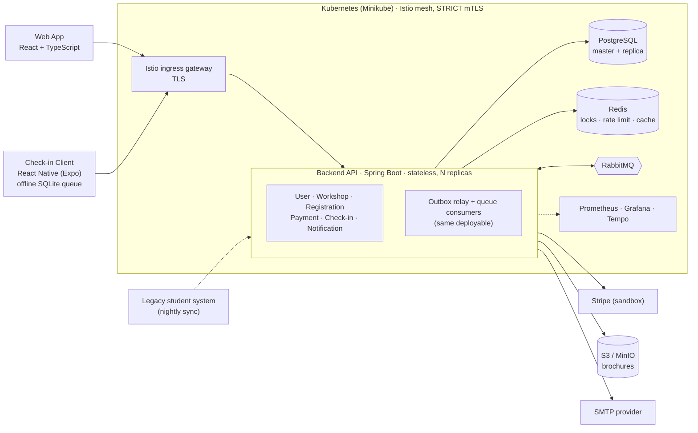

<div align="center">

# UniHub

**A university workshop platform: discovery, race-free registration, payment, and offline on-site check-in.**

_Designed and built end to end by **Nguyễn Thành Tiến**_

<br/>


</div>

---

## Overview

University workshops are usually run from spreadsheets and forms. That breaks in three places, and UniHub is built around fixing exactly those:

1. **Seats.** When hundreds of students click "register" for the last ten seats, a seat must never be sold twice, and a student whose payment fails must not hold a seat forever.
2. **Money.** Payments go through an external gateway that can time out, retry, or answer late. Every charge must end in a consistent state: confirmed, or refunded.
3. **The venue.** Check-in happens at a door with unreliable Wi-Fi. Scanning has to keep working offline and reconcile afterwards without losing or double-counting anyone.

The system combines three architectural styles: a **Modular Monolith** (one stateless deployable, six modules, each the sole writer of its own data), **Clean / Hexagonal Architecture** inside each module (the domain never touches a framework or I/O), and **Event-Driven Architecture** for cross-module effects (through a transactional outbox). It is simple to operate today and has clean seams to split into services later.

It is a solo project covering the whole path: requirements, architecture, backend, web client, mobile client, tests, CI, Kubernetes manifests, and observability.

## Features

| Role | What they can do |
| --- | --- |
| **Student** | Browse published workshops with a live seat count, sign in, register (free or paid), pay at checkout through the Stripe sandbox, get a signed **QR e-ticket**, receive a confirmation email (QR included) and in-app notifications, and see their registrations. |
| **Organizer / Admin** | Create, update, publish, cancel and reschedule workshops and upload a brochure PDF (through the API), and read per-workshop attendance reports (in the web app). Cancelling or rescheduling notifies exactly the students who hold a seat. Access is permission-based (RBAC). |
| **Check-in Staff** | Use the **Check-in Client** mobile app to scan e-tickets with no network, keep scans in a durable on-device queue, and sync automatically when a connection returns. |

Behind the scenes the system also syncs the legacy student roster nightly, expires unpaid seat holds, reconciles payments the gateway answered late, and refunds a payment that arrives after its hold has expired.

## Architecture



- **One deployable, six modules.** User, Workshop, Registration, Payment, Check-in and Notification. A module never reads another module's tables; it calls that module's `api` package. ArchUnit tests fail the build if a boundary is crossed ([`ArchitectureTest`](apps/backend/src/test/java/com/unihub/ArchitectureTest.java)).
- **Reads and writes are split.** Writes and any read that must be current go to the PostgreSQL master; catalog and report reads can use a replica.
- **Cross-module effects are events.** A business write and its "intent to publish" commit in one transaction; a relay publishes to RabbitMQ afterwards. Consumers run inside the same deployable and tolerate redelivery.
- **Full design:** [`docs/architecture.md`](docs/architecture.md) (C4 diagrams, data and messaging topology, security model). The PNGs in `docs/diagrams/` are the original design drawings and predate the Istio gateway and the Expo client, so the Mermaid diagram above is the current picture.

## Engineering Highlights

Each claim below links to the test or design document that backs it.

- **Layered anti-overbooking.** A Redis lock reduces contention but is only advisory. The accept/reject decision is PostgreSQL's optimistic-concurrency check (version column plus a check constraint). Tests run the contention with the lock in place, with the lock skipped, and with Redis down: [`RegistrationConcurrencyIT`](apps/backend/src/integrationTest/java/com/unihub/registration/web/controller/RegistrationConcurrencyIT.java), [`RegistrationConcurrencyLockSkippedIT`](apps/backend/src/integrationTest/java/com/unihub/registration/web/controller/RegistrationConcurrencyLockSkippedIT.java), [`RedisOutageIT`](apps/backend/src/integrationTest/java/com/unihub/registration/infrastructure/out/lock/RedisOutageIT.java).
- **Idempotency and a transactional outbox.** Idempotency keys live in PostgreSQL, in the same transaction as the effect they guard, so a retried registration or charge returns the original result. Events are written to an outbox in that same transaction, so none is lost and none is published for a rolled-back change. Design: [`architecture.md` §4.5](docs/architecture.md#45-idempotency-store). A broker outage is tested in [`OutboxRelayBrokerOutageIT`](apps/backend/src/integrationTest/java/com/unihub/shared/infrastructure/out/messaging/OutboxRelayBrokerOutageIT.java).
- **Consumers are safe under redelivery.** RabbitMQ is at-least-once, so every listener is tested sequentially and concurrently, and a coverage test fails if a new listener has no such test: [`ConsumerRedeliveryCoverageTest`](apps/backend/src/test/java/com/unihub/ConsumerRedeliveryCoverageTest.java).
- **Payment resilience.** A Resilience4j circuit breaker isolates the gateway ([`PaymentCircuitBreakerIT`](apps/backend/src/integrationTest/java/com/unihub/payment/infrastructure/out/client/PaymentCircuitBreakerIT.java)); signed webhooks are verified; a reconciliation sweep resolves late answers; a payment that lands after its hold expired is refunded ([`RefundEndToEndIT`](apps/backend/src/integrationTest/java/com/unihub/payment/infrastructure/in/messaging/RefundEndToEndIT.java)).
- **Offline-first check-in with self-verifying tickets.** The QR is a compact JWS signed ES256 inside the confirming transaction ([`TicketIssuanceIT`](apps/backend/src/integrationTest/java/com/unihub/registration/TicketIssuanceIT.java)). The phone holds only the public key and verifies on-device. Duplicate scans reconcile server-side, earliest timestamp wins ([`ReconciliationPolicy`](apps/backend/src/main/java/com/unihub/checkin/domain/model/ReconciliationPolicy.java), [`CheckInSyncIT`](apps/backend/src/integrationTest/java/com/unihub/checkin/CheckInSyncIT.java)).
- **Permission-based RBAC.** Every check asks "does this user have permission X", never "is the role Y". The JWT carries the resolved permission list. Design: [`auth-and-identity.md`](docs/technical-design/platform/auth-and-identity.md).
- **Safe schema evolution.** Flyway migrations only, no ORM auto-DDL. CI starts the previous release's jar on the new schema to prove a rolling update can overlap two versions: [`MigrationCompatibilityIT`](apps/backend/src/integrationTest/java/com/unihub/shared/infrastructure/migration/MigrationCompatibilityIT.java).
- **Tested against real infrastructure.** 800+ integration tests run on real PostgreSQL, Redis, RabbitMQ and MinIO through Testcontainers, because locking, isolation levels and redelivery are exactly what an in-memory fake would hide. Approach: [`integration-testing.md`](docs/testing/test-levels/integration-testing.md).
- **Platform.** Identity-keyed rate limiting that fails open with an alert ([`RateLimitIT`](apps/backend/src/integrationTest/java/com/unihub/shared/infrastructure/ratelimit/RateLimitIT.java)), Istio `STRICT` mTLS between pods ([`check-mtls.sh`](k8s/scripts/check-mtls.sh)), one OpenAPI 3.1 contract that CI diffs against the running backend ([`packages/api-contract`](packages/api-contract)), and a correlation ID that is the trace ID, followed end to end through the outbox and the consumers ([`CorrelationPropagationIT`](apps/backend/src/integrationTest/java/com/unihub/shared/infrastructure/correlation/CorrelationPropagationIT.java)).

## Tech Stack

| Layer | Choices |
| --- | --- |
| **Backend** | Java 21 · Spring Boot 3.3 · Gradle · Spring Security (OAuth2 resource server) · Flyway · Resilience4j · Redisson · Micrometer |
| **Data & messaging** | PostgreSQL 16 (master + streaming replica) · Redis 7 · RabbitMQ 3.13 · S3-compatible object storage (AWS SDK v2; MinIO locally) |
| **Web** | React 19 · TypeScript · Vite · TanStack Query · Zustand · React Hook Form + Zod · Tailwind CSS · shadcn/ui · Vitest + Testing Library |
| **Mobile (check-in)** | React Native · Expo SDK 58 · Expo Camera · Expo SQLite + Drizzle ORM · `@noble/curves` (ES256 verification) · Jest |
| **Platform** | Kubernetes 1.35 (Minikube) · Istio 1.31 (mTLS, ingress gateway) · Kustomize · Docker (multi-arch images) |
| **Observability** | Prometheus · Grafana · Tempo · OpenTelemetry (OTLP) |
| **Quality & CI** | JUnit 5 · Testcontainers · ArchUnit · WireMock · Playwright · k6 · Checkstyle · Spotless · JaCoCo · Semgrep · OWASP Dependency-Check · Gitleaks · GitHub Actions |

## Repository Layout

```
UniHub/
├── apps/
│   ├── backend/          # Java 21 · Spring Boot · Gradle (Modular Monolith)    → apps/backend/README.md
│   ├── web/              # React · TypeScript · Vite                            → apps/web/README.md
│   └── mobile/           # React Native (Expo) Check-in Client for staff        → apps/mobile/README.md
├── packages/
│   └── api-contract/     # OpenAPI 3.1: the contract-first HTTP surface
├── k8s/                  # Kustomize base + overlays, Istio config, cluster and drill scripts
├── observability/        # Prometheus, Grafana (dashboards + alert rules), Tempo configuration
├── tests/
│   ├── e2e/              # Playwright: Chromium, Firefox and WebKit against the cluster
│   └── load/k6/          # k6 adversarial scripts (last-seat contention)
├── docs/                 # SRS · proposal · C4 architecture · technical design · testing
├── Makefile              # Cluster, deploy, smoke and e2e entry points
└── .github/workflows/    # CI pipeline
```

## Getting Started

Run the system locally: the infrastructure in Docker, the backend and web app on the host. Each app's README has the full steps.

```sh
cd apps/backend && docker compose up -d     # PostgreSQL, Redis, RabbitMQ, Mailpit, MinIO, Prometheus, Grafana, Tempo
```

1. **Backend**: configure, migrate and run it: [`apps/backend/README.md`](apps/backend/README.md). Needs JDK 21 and Docker.
2. **Web**: `npm ci && npm run dev`: [`apps/web/README.md`](apps/web/README.md). Needs Node.js 22.
3. **Check-in Client** (optional, runs in Expo Go on a phone): [`apps/mobile/README.md`](apps/mobile/README.md).

## Testing

- **Backend:** `./gradlew test` (unit and architecture rules), `./gradlew integrationTest` (real PostgreSQL, Redis, RabbitMQ and MinIO through Testcontainers; needs Docker and a full git clone, not `--depth 1`).
- **Web and mobile:** `npm test` in each app.
- **End to end:** `make e2e` runs Playwright in three browsers against a deployed cluster ([`tests/e2e`](tests/e2e/README.md)). A k6 script ([`tests/load/k6`](tests/load/k6)) fires 500 virtual users at the last 10 seats.

The strategy, per-level guidelines and a requirement-to-test traceability matrix are in [`docs/testing/`](docs/testing).

## CI/CD

[GitHub Actions](.github/workflows/ci.yml) runs on every push to `main`: formatting and lint, unit and integration tests, web and mobile checks, an OpenAPI contract diff against the backend, static analysis (Semgrep), dependency and secret scans (OWASP Dependency-Check, Gitleaks), and a multi-architecture image build that pushes the backend and web images to Docker Hub tagged by commit SHA.

## Kubernetes Deployment

The target is a local proof of concept on **Minikube** (not a cloud rollout), with Istio providing mTLS and the ingress gateway. From the repository root:

```sh
make cluster-up                 # Minikube + Istio at the versions pinned in k8s/versions.env
make secrets                    # create the Secrets from the environment (nothing is committed)
make deploy-dev TAG=<sha>       # run migrations, then deploy the images CI built for that commit
make smoke                      # smoke test of the deployed cluster
```

`TAG` must be a commit SHA whose CI run has pushed its images. Reaching the app over HTTPS and running the browser tests need a one-time local CA and hosts entry, described in [`tests/e2e/README.md`](tests/e2e/README.md). The design is in [`deployment-and-cicd.md`](docs/technical-design/platform/deployment-and-cicd.md). Resilience drills (pod kills, Redis/RabbitMQ/gateway outages, the mTLS check) are scripts in [`k8s/scripts/`](k8s/scripts).

## Observability

Prometheus and Grafana (provisioned dashboards and alert rules), Tempo for OpenTelemetry traces, and a correlation ID on every response and error body. The configuration is in [`observability/`](observability); `docker compose up -d` and `make deploy-dev` both bring it up.

## Documentation

| Document | What it answers |
| --- | --- |
| [`docs/requirement.md`](docs/requirement.md) | What the system must do (SRS). |
| [`docs/proposal.md`](docs/proposal.md) | Why: business case, scope, technology choices, risks. |
| [`docs/architecture.md`](docs/architecture.md) | How: C4 diagrams, data and messaging topology, security architecture. |
| [`docs/technical-design/`](docs/technical-design) | Physical design: schema, Redis keys, messaging, auth, deployment, plus one narrated file per module. |
| [`packages/api-contract`](packages/api-contract) | The OpenAPI 3.1 contract. |
| [`docs/guidelines/`](docs/guidelines) | Coding standards for backend, web and mobile. |
| [`docs/testing/`](docs/testing) | Test strategy, per-level guidelines, the traceability matrix and release reports. |

## Author

**Nguyễn Thành Tiến** · [tiennt220805@gmail.com](mailto:tiennt220805@gmail.com) · [GitHub: tiennt220805](https://github.com/tiennt220805)
