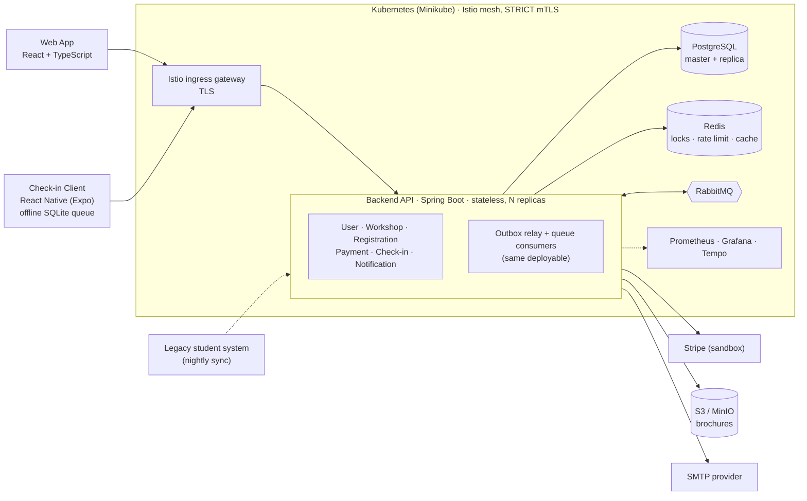

<div align="center">

# UniHub

**A university workshop platform: discovery, race-free registration, payment, and offline on-site check-in.**

_Designed and built end to end by **Nguyễn Thành Tiến**_

<br/>


</div>

---

## Table of Contents

- [Overview](#overview)
- [Features](#features)
- [Architecture](#architecture)
- [Engineering Highlights](#engineering-highlights)
- [Tech Stack](#tech-stack)
- [Repository Layout](#repository-layout)
- [Getting Started](#getting-started)
- [Testing](#testing)
- [CI/CD](#cicd)
- [Kubernetes Deployment](#kubernetes-deployment)
- [Observability](#observability)
- [Documentation](#documentation)
- [Author](#author)

## Overview

University workshops are usually run from spreadsheets and forms. That breaks in three places, and UniHub is built around fixing exactly those:

1. **Seats.** When hundreds of students click "register" for the last ten seats, a seat must never be sold twice, and a student whose payment fails must not hold a seat forever.
2. **Money.** Payments go through an external gateway that can time out, retry, or answer late. Every charge must end in a consistent state: confirmed, or refunded.
3. **The venue.** Check-in happens at a door with unreliable Wi-Fi. Scanning has to keep working offline and reconcile afterwards without losing or double-counting anyone.

The system combines three architectural styles: a **Modular Monolith** (one stateless deployable, six modules, each the sole writer of its own data), **Clean / Hexagonal Architecture** inside each module (the domain never touches a framework or I/O), and **Event-Driven Architecture** for cross-module effects (through a transactional outbox). It is simple to operate today and has clean seams to split into services later.

It is a solo project covering the whole path: requirements, architecture, backend, web client, mobile client, tests, CI, Kubernetes manifests, and observability.

## Features

| Role | What they can do |
| --- | --- |
| **Student** | Browse published workshops with a live seat count, sign in, register (free or paid), pay at checkout through the Stripe sandbox, get a signed **QR e-ticket**, receive a confirmation email (QR included) and in-app notifications, and see their registrations. |
| **Organizer / Admin** | Create, update, publish, cancel and reschedule workshops and upload a brochure PDF (through the API), and read per-workshop attendance reports (in the web app). Cancelling or rescheduling notifies exactly the students who hold a seat. Access is permission-based (RBAC). |
| **Check-in Staff** | Use the **Check-in Client** mobile app to scan e-tickets with no network, keep scans in a durable on-device queue, and sync automatically when a connection returns. |

Behind the scenes the system also syncs the legacy student roster nightly, expires unpaid seat holds, reconciles payments the gateway answered late, and refunds a payment that arrives after its hold has expired.

## Architecture



- **One deployable, six modules.** User, Workshop, Registration, Payment, Check-in and Notification. A module never reads another module's tables; it calls that module's `api` package. ArchUnit tests fail the build if a boundary is crossed ([`ArchitectureTest`](apps/backend/src/test/java/com/unihub/ArchitectureTest.java)).
- **Reads and writes are split.** Writes and any read that must be current go to the PostgreSQL master; catalog and report reads can use a replica.
- **Cross-module effects are events.** A business write and its "intent to publish" commit in one transaction; a relay publishes to RabbitMQ afterwards. Consumers run inside the same deployable and tolerate redelivery.
- **Full design:** [`docs/architecture.md`](docs/architecture.md) (C4 diagrams, data and messaging topology, security model). The PNGs in `docs/diagrams/` are the original design drawings and predate the Istio gateway and the Expo client, so the Mermaid diagram above is the current picture.

## Engineering Highlights

Each claim below links to the test or design document that backs it.

- **Layered anti-overbooking.** A Redis lock reduces contention but is only advisory. The accept/reject decision is PostgreSQL's optimistic-concurrency check (version column plus a check constraint). Tests run the contention with the lock in place, with the lock skipped, and with Redis down: [`RegistrationConcurrencyIT`](apps/backend/src/integrationTest/java/com/unihub/registration/web/controller/RegistrationConcurrencyIT.java), [`RegistrationConcurrencyLockSkippedIT`](apps/backend/src/integrationTest/java/com/unihub/registration/web/controller/RegistrationConcurrencyLockSkippedIT.java), [`RedisOutageIT`](apps/backend/src/integrationTest/java/com/unihub/registration/infrastructure/out/lock/RedisOutageIT.java).
- **Idempotency in the same transaction as the effect.** Keys live in PostgreSQL, not Redis, with a unique constraint as the backstop. A retried registration or charge returns the original result. Design: [`architecture.md` §4.5](docs/architecture.md#45-idempotency-store).
- **Transactional outbox.** No event is lost, and none is published for a rolled-back change. A broker outage and a double publish are both tested: [`OutboxRelayBrokerOutageIT`](apps/backend/src/integrationTest/java/com/unihub/shared/infrastructure/out/messaging/OutboxRelayBrokerOutageIT.java), [`OutboxRelayDoublePublishIT`](apps/backend/src/integrationTest/java/com/unihub/notification/OutboxRelayDoublePublishIT.java).
- **Consumers are idempotent under redelivery.** RabbitMQ is at-least-once, so every listener is tested sequentially and concurrently, and a coverage test fails if a new listener has no such test: [`ConsumerRedeliveryCoverageTest`](apps/backend/src/test/java/com/unihub/ConsumerRedeliveryCoverageTest.java).
- **Payment resilience.** A Resilience4j circuit breaker isolates the gateway ([`PaymentCircuitBreakerIT`](apps/backend/src/integrationTest/java/com/unihub/payment/infrastructure/out/client/PaymentCircuitBreakerIT.java)); signed webhooks are verified; a reconciliation sweep resolves late answers; a payment that lands after its hold expired is refunded ([`RefundEndToEndIT`](apps/backend/src/integrationTest/java/com/unihub/payment/infrastructure/in/messaging/RefundEndToEndIT.java)).
- **Offline-first check-in with self-verifying tickets.** The QR is a compact JWS signed ES256 inside the confirming transaction ([`TicketIssuanceIT`](apps/backend/src/integrationTest/java/com/unihub/registration/TicketIssuanceIT.java)). The phone holds only the public key and verifies on-device. Duplicate scans reconcile server-side, earliest timestamp wins ([`ReconciliationPolicy`](apps/backend/src/main/java/com/unihub/checkin/domain/model/ReconciliationPolicy.java), [`CheckInSyncIT`](apps/backend/src/integrationTest/java/com/unihub/checkin/CheckInSyncIT.java)).
- **Permission-based RBAC.** Every check asks "does this user have permission X", never "is the role Y". The JWT carries the resolved permission list. Design: [`auth-and-identity.md`](docs/technical-design/platform/auth-and-identity.md).
- **Rate limiting keyed by identity.** The user when the token is valid, the address otherwise, enforced through Redis. It fails open with a counter and an alert if Redis is down ([`RateLimitIT`](apps/backend/src/integrationTest/java/com/unihub/shared/infrastructure/ratelimit/RateLimitIT.java)).
- **Observability that is tested.** The correlation ID is the trace ID, and one ID is followed from an HTTP request through the outbox, the message header and two consumers ([`CorrelationPropagationIT`](apps/backend/src/integrationTest/java/com/unihub/shared/infrastructure/correlation/CorrelationPropagationIT.java)). An alert rule is proven to fire against a real Prometheus and Grafana ([`AuditAlertIT`](apps/backend/src/integrationTest/java/com/unihub/shared/infrastructure/alerting/AuditAlertIT.java)). Audit logging is async and fail-open, but a failing audit pipeline raises an alert.
- **Safe schema evolution.** Flyway migrations only, no ORM auto-DDL. CI starts the previous release's jar on the new schema to prove a rolling update can overlap two versions: [`MigrationCompatibilityIT`](apps/backend/src/integrationTest/java/com/unihub/shared/infrastructure/migration/MigrationCompatibilityIT.java).
- **Zero-trust networking.** Istio `STRICT` mTLS between pods, checked by [`k8s/scripts/check-mtls.sh`](k8s/scripts/check-mtls.sh), including a negative control.
- **Contract-first API.** One OpenAPI 3.1 contract ([`packages/api-contract`](packages/api-contract)) generates the types of both TypeScript clients, and CI diffs it against what the backend actually serves.
- **Tested against real infrastructure.** Integration tests (800+) run on real PostgreSQL, Redis, RabbitMQ and MinIO through Testcontainers, because locking, isolation levels and redelivery are exactly what an in-memory fake would hide. Approach: [`integration-testing.md`](docs/testing/test-levels/integration-testing.md).

## Tech Stack

| Layer | Choices |
| --- | --- |
| **Backend** | Java 21 · Spring Boot 3.3 · Gradle · Spring Security (OAuth2 resource server) · Flyway · Resilience4j · Redisson · Micrometer |
| **Data & messaging** | PostgreSQL 16 (master + streaming replica) · Redis 7 · RabbitMQ 3.13 · S3-compatible object storage (AWS SDK v2; MinIO locally) |
| **Web** | React 19 · TypeScript · Vite · TanStack Query · Zustand · React Hook Form + Zod · Tailwind CSS · shadcn/ui · Vitest + Testing Library |
| **Mobile (check-in)** | React Native · Expo SDK 58 · Expo Camera · Expo SQLite + Drizzle ORM · `@noble/curves` (ES256 verification) · Jest |
| **Platform** | Kubernetes 1.35 (Minikube) · Istio 1.31 (mTLS, ingress gateway) · Kustomize · Docker (multi-arch images) |
| **Observability** | Prometheus · Grafana · Tempo · OpenTelemetry (OTLP) |
| **Quality & CI** | JUnit 5 · Testcontainers · ArchUnit · WireMock · Playwright · k6 · Checkstyle · Spotless · JaCoCo · Semgrep · OWASP Dependency-Check · Gitleaks · GitHub Actions |

## Repository Layout

```
UniHub/
├── apps/
│   ├── backend/          # Java 21 · Spring Boot · Gradle (Modular Monolith), Dockerfile, docker-compose for local infra
│   ├── web/              # React · TypeScript · Vite (student journey + admin report), Dockerfile (nginx)
│   └── mobile/           # React Native (Expo) Check-in Client for staff
├── packages/
│   └── api-contract/     # OpenAPI 3.1: the contract-first HTTP surface
├── k8s/                  # Kustomize base + overlays, Istio config, cluster and drill scripts
├── observability/        # Prometheus, Grafana (dashboards + alert rules), Tempo configuration
├── tests/
│   ├── e2e/              # Playwright: Chromium, Firefox and WebKit against the cluster
│   └── load/k6/          # k6 adversarial scripts (last-seat contention)
├── docs/                 # SRS · proposal · C4 architecture · technical design · testing
├── checklists/           # Per-phase execution checklists
├── Makefile              # Cluster, deploy, smoke and e2e entry points
└── .github/workflows/    # CI pipeline
```

## Getting Started

Run the whole stack locally: infrastructure in Docker, backend and web on the host.

**Prerequisites:** JDK 21, Docker (with Compose), Node.js 20+ and npm.

### 1. Start the infrastructure

```sh
cd apps/backend
docker compose up -d
```

This starts PostgreSQL, Redis, RabbitMQ, Mailpit (an SMTP catcher), MinIO, Prometheus, Grafana and Tempo, all bound to `127.0.0.1`. Every default is a throwaway local value.

### 2. Configure the backend

```sh
cp env.example .env
scripts/generate-ticket-key.sh --write   # writes the QR signing key into .env (git-ignored)
```

Then edit `.env`:

- `UNIHUB_SECURITY_JWT_SECRET`: any random string of at least 32 bytes, e.g. `openssl rand -base64 48`.
- `UNIHUB_DEV_SEED_STUDENT_PASSWORD`, `UNIHUB_DEV_SEED_ORGANIZER_PASSWORD`, `UNIHUB_DEV_SEED_ADMIN_PASSWORD`, `UNIHUB_DEV_SEED_CHECKIN_STAFF_PASSWORD`: passwords for the dev accounts. Nothing is seeded for a blank one, and there is no default.
- Append the connection settings for the compose Postgres and RabbitMQ. The application takes these from the environment only and has no defaults for them:

  ```sh
  SPRING_DATASOURCE_URL=jdbc:postgresql://127.0.0.1:5432/unihub
  SPRING_DATASOURCE_USERNAME=unihub
  SPRING_DATASOURCE_PASSWORD=unihub_dev_only
  SPRING_RABBITMQ_HOST=127.0.0.1
  SPRING_RABBITMQ_USERNAME=unihub
  SPRING_RABBITMQ_PASSWORD=unihub_dev_only
  ```

The Redis address and SMTP host are required too; `env.example` already points them at the compose stack.

### 3. Migrate and run the backend

The application never migrates its own schema at boot (migrations are an explicit, versioned step that runs before rollout), so apply them first:

```sh
./gradlew flywayMigrate                     # uses the compose Postgres defaults
set -a; . ./.env; set +a
SPRING_PROFILES_ACTIVE=dev ./gradlew bootRun
```

The API listens on `http://localhost:8080`. The `dev` profile seeds `student1..3@dev.unihub.local`, `organizer1@dev.unihub.local`, `admin1@dev.unihub.local` and `staff1@dev.unihub.local`. Health and Prometheus metrics are on the management port, `http://localhost:8081/actuator/health`.

### 4. Run the web app

```sh
cd apps/web
npm ci
npm run dev
```

Open the URL Vite prints. `/api` is proxied to `localhost:8080`, and the checkout page offers Stripe **test** payment tokens in development. Confirmation emails land in Mailpit at `http://127.0.0.1:8025`.

### 5. Run the Check-in Client (optional)

See [`apps/mobile/README.md`](apps/mobile/README.md): it runs in Expo Go on a phone on the same network. Port `8081` is also Expo's default Metro port, so set `MANAGEMENT_SERVER_PORT` to another value in `.env` before running both.

### Useful local URLs

| Service | URL |
| --- | --- |
| Backend API | http://localhost:8080 |
| Mailpit (emails) | http://127.0.0.1:8025 |
| RabbitMQ management | http://127.0.0.1:15672 |
| MinIO console | http://127.0.0.1:9001 |
| Prometheus / Grafana / Tempo | http://127.0.0.1:9090 · http://127.0.0.1:3000 · http://127.0.0.1:3200 |

## Testing

| Level | Command | Notes |
| --- | --- | --- |
| Backend unit + architecture | `cd apps/backend && ./gradlew test` | No infrastructure needed; includes the ArchUnit boundary rules. |
| Backend integration | `cd apps/backend && ./gradlew integrationTest` | Needs Docker. Testcontainers starts real PostgreSQL, Redis, RabbitMQ and MinIO. Takes many minutes. |
| Web | `cd apps/web && npm test` | Vitest + Testing Library; MSW stands in for the API. |
| Mobile | `cd apps/mobile && npm test` | Jest: ticket verification, the SQLite queue, sync, screens. |
| End to end | `make e2e` | Playwright in three browsers against a deployed cluster; see [`tests/e2e/README.md`](tests/e2e/README.md). |
| Load | [`tests/load/k6`](tests/load/k6) | k6 script: 500 virtual users against the last 10 seats of a workshop. |

The strategy, per-level guidelines and a requirement-to-test traceability matrix are in [`docs/testing/`](docs/testing).

## CI/CD

[`.github/workflows/ci.yml`](.github/workflows/ci.yml) runs on every push to `main` and on pull requests.

| Job | What it does |
| --- | --- |
| `lint` | Spotless, Checkstyle, OpenAPI bundle validation, and a render of the Kubernetes overlays. |
| `unit-test` | Backend unit and architecture tests with a coverage gate. |
| `integration-test` | Backend integration suite on Testcontainers, including the previous-release migration check. |
| `web` | Type-check, lint and Vitest for the web app. |
| `mobile` | Type-check, lint and Jest for the Check-in Client. |
| `contract-diff` | Diffs the OpenAPI contract against the backend's generated spec. |
| `build-and-push` | Builds multi-architecture backend and web images and pushes them to Docker Hub, tagged by commit SHA. |
| `sast-semgrep` | Static analysis. |
| `dependency-check` | OWASP Dependency-Check over the Java dependencies. |
| `secret-scan-gitleaks` | Secret scanning (blocking). |

## Kubernetes Deployment

The target is a local proof of concept on **Minikube** (not a cloud rollout) with Istio providing mTLS and the ingress gateway. Everything runs from the repository root through the [`Makefile`](Makefile).

```sh
make cluster-up                 # Minikube + Istio at the versions pinned in k8s/versions.env
make secrets                    # create the Secrets from the environment (nothing is committed)
make deploy-dev TAG=<sha>       # run migrations, then deploy the images CI built for that commit
make smoke                      # end-to-end smoke test of the deployed cluster
```

`TAG` must be a commit SHA whose CI run has pushed its images; `latest` is never deployed. `make deploy-loadtest` adds the PostgreSQL replica and more API replicas. `make render PROFILE=dev` prints the manifests without needing a cluster. Reaching the app through `https://unihub.local` needs a one-time local CA and hosts entry, described in [`tests/e2e/README.md`](tests/e2e/README.md). The deployment design is in [`docs/technical-design/platform/deployment-and-cicd.md`](docs/technical-design/platform/deployment-and-cicd.md).

Resilience on the cluster is exercised with scripts in [`k8s/scripts/`](k8s/scripts): pod kills, dependency outages (Redis, RabbitMQ, payment gateway), rate-limit checks and the mTLS check.

## Observability

- **Metrics:** Prometheus scrapes the backend's management port and RabbitMQ. Grafana ships three provisioned dashboards and a set of provisioned alert rules (audit-pipeline failures, dependency down, circuit breaker open, queue depth, replica lag, and more) from [`observability/`](observability).
- **Tracing:** OpenTelemetry traces go to Tempo over OTLP when `MANAGEMENT_OTLP_TRACING_ENDPOINT` is set. Spans cover HTTP, JDBC (SQL text only, never bind values), AMQP and outbound calls; exception messages are scrubbed from spans.
- **Correlation:** every response carries `X-Correlation-Id`, which is the trace ID, and every error body repeats it.

Locally, `docker compose up -d` brings up Prometheus, Grafana (anonymous viewer on `127.0.0.1:3000`) and Tempo. On Minikube the same configuration is deployed into its own namespace by `make deploy-dev`.

## Documentation

| Document | What it answers |
| --- | --- |
| [`docs/requirement.md`](docs/requirement.md) | What the system must do (SRS). |
| [`docs/proposal.md`](docs/proposal.md) | Why: business case, scope, technology choices, risks. |
| [`docs/architecture.md`](docs/architecture.md) | How: C4 diagrams, data and messaging topology, security architecture. |
| [`docs/technical-design/`](docs/technical-design) | Physical design: schema, Redis keys, messaging, auth, deployment, plus one narrated file per module. |
| [`packages/api-contract`](packages/api-contract) | The OpenAPI 3.1 contract. |
| [`docs/guidelines/`](docs/guidelines) | Coding standards for backend, web and mobile. |
| [`docs/testing/`](docs/testing) | Test strategy, per-level guidelines, the traceability matrix and release reports. |

## Author

**Nguyễn Thành Tiến** · [tiennt220805@gmail.com](mailto:tiennt220805@gmail.com) · [GitHub: tiennt220805](https://github.com/tiennt220805)
