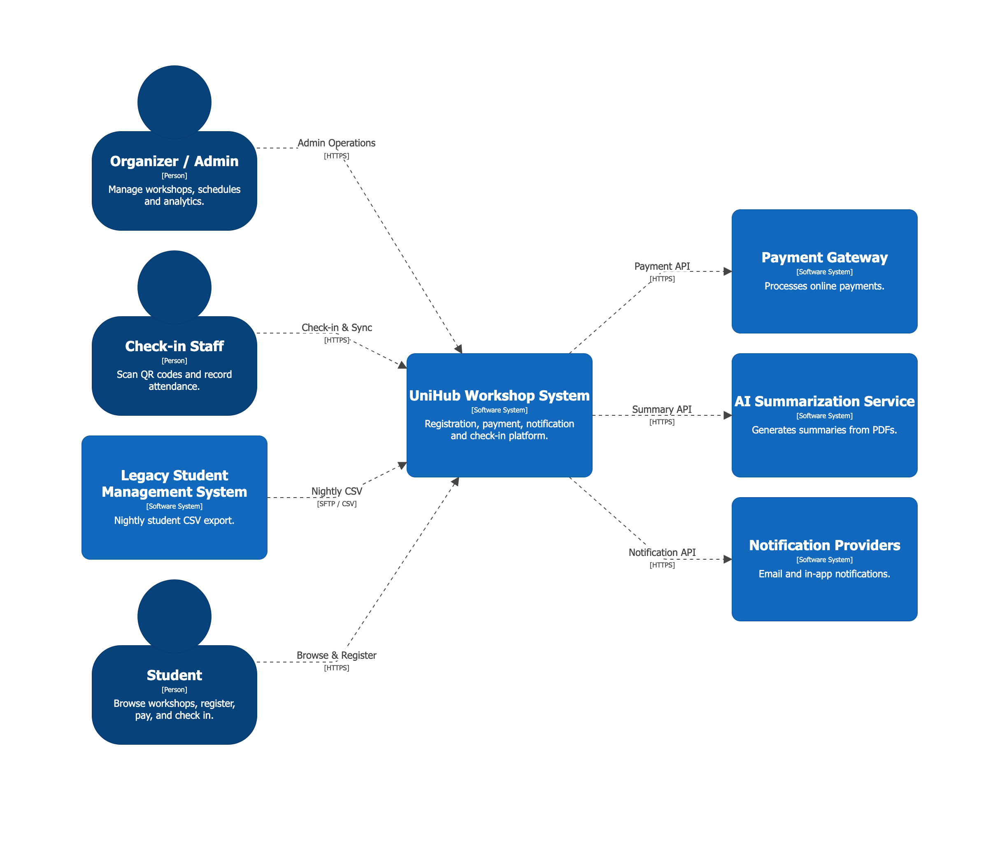
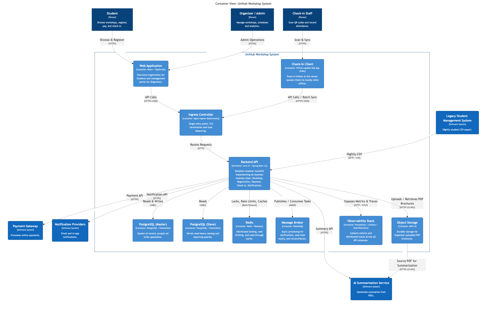
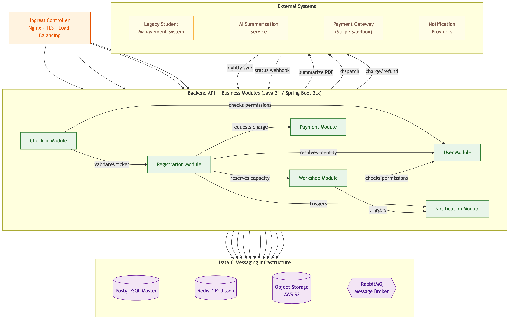
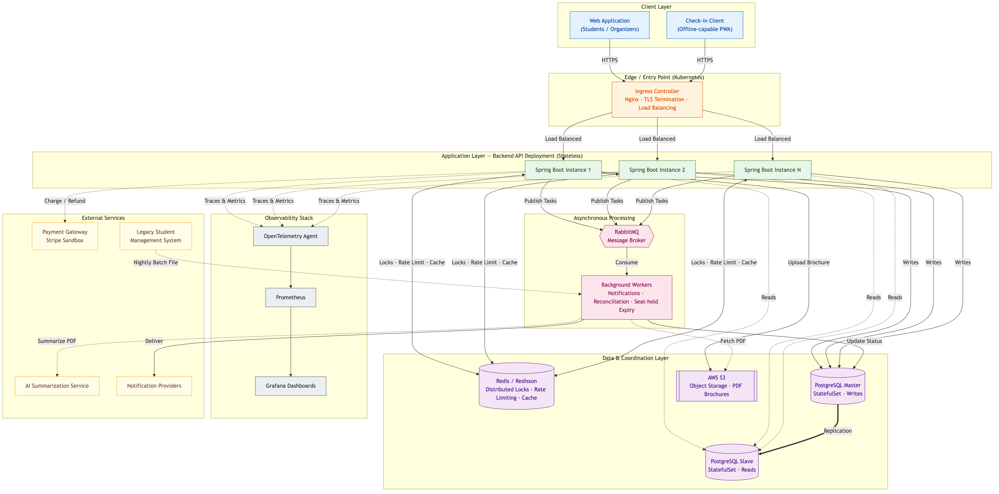
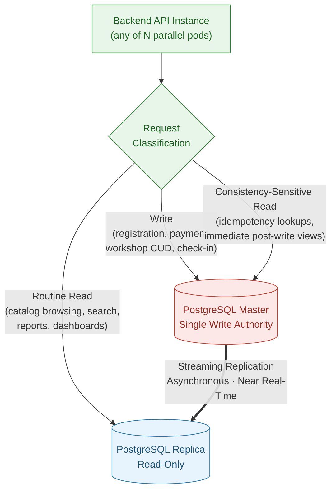
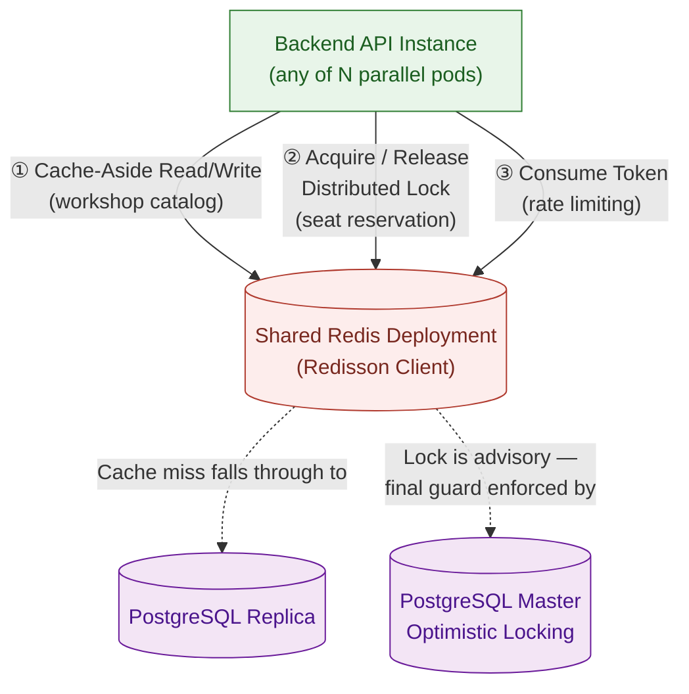
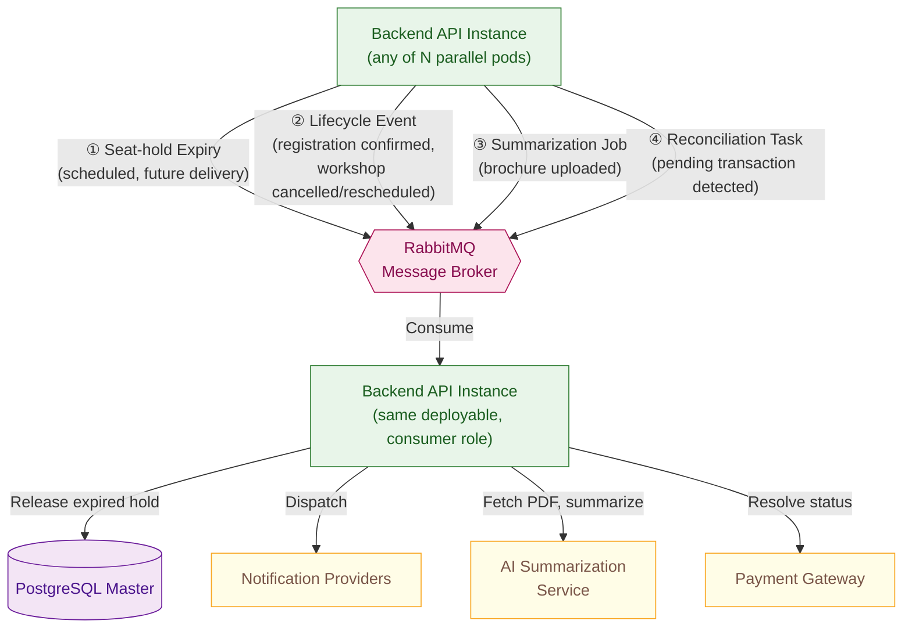
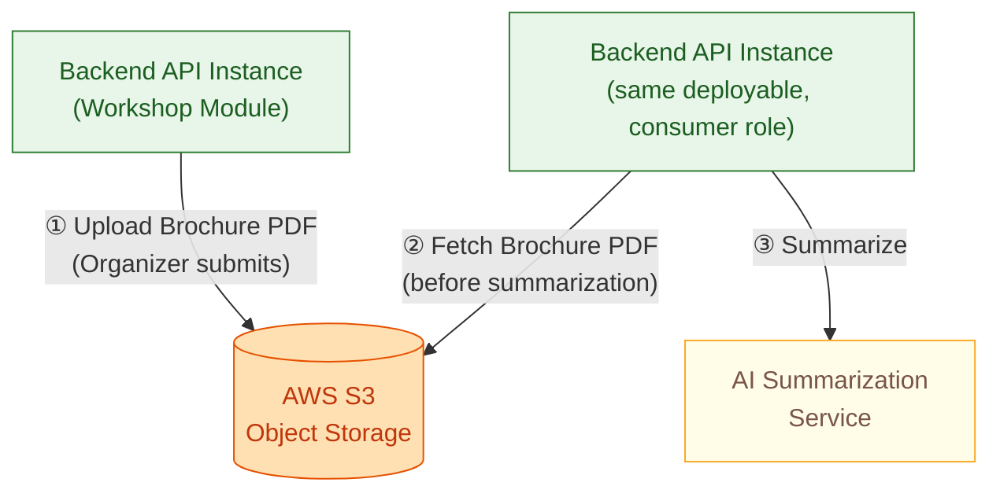
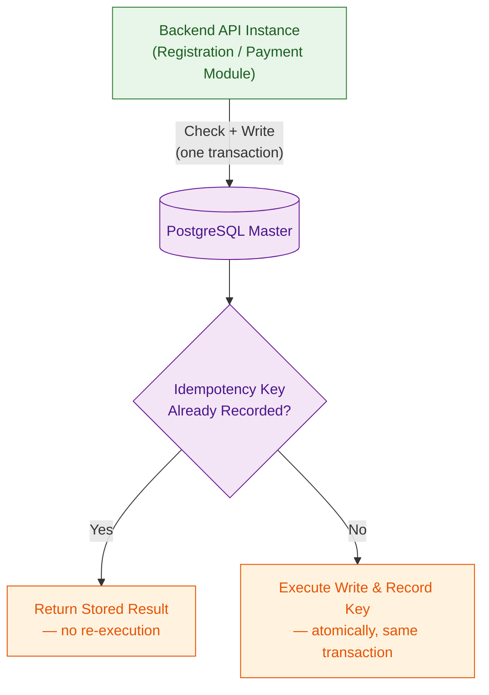
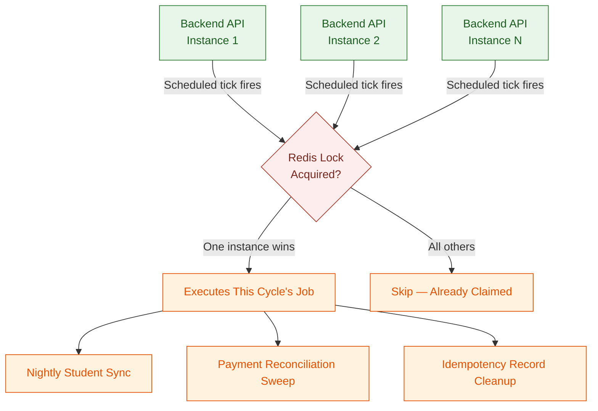

# UniHub Workshop System — System Architecture

---

## 1. Overall Architecture Overview

### 1.1 Architectural Style

**Chosen architecture:** Stateless Modular Monolith with clean, infrastructure-agnostic module boundaries.

The backend is delivered as a single deployable Spring Boot application, internally partitioned into independently reasoned-about business modules (User, Workshop, Registration, Payment, Check-in, Notification). Each module owns its business logic and keeps that logic decoupled from the specific infrastructure it depends on, so the system can evolve — or be split into standalone services — without a rewrite.

Statelessness is the defining property of the application layer: no instance retains user session state locally, and identity/authorization context travels with the request (via JWT) rather than living on a specific server. This is what allows the system to scale horizontally by adding instances rather than by growing a single instance, and it is a prerequisite for the self-healing behavior described in Section 1.4.

### 1.2 Core Components

| Component               | Purpose                                                                                         | Notes                                                                                                                       |
| :---------------------- | :---------------------------------------------------------------------------------------------- | :-------------------------------------------------------------------------------------------------------------------------- |
| **Web Application**     | Discovery and registration for Students; catalog and reporting management for Organizers/Admins | Single responsive web client; views are gated by permission-based access control                                            |
| **Check-in Client**     | E-ticket scanning at venue entrances                                                            | Offline-capable web client; queues scan events locally and syncs once connectivity returns                                  |
| **Ingress Controller**  | Single external entry point for all client traffic                                              | Kubernetes-native Ingress; performs TLS termination and load balancing across Backend API instances                         |
| **Backend API**         | Central business logic and orchestration for every module                                       | Java 21 / Spring Boot 3.x, stateless Modular Monolith, deployed as multiple parallel instances                              |
| **PostgreSQL**          | System of record for all transactional data                                                     | Master-Slave replication topology; writes are routed to the Master, reads to Slave replicas                                 |
| **Redis**               | Distributed coordination and caching                                                            | Backs distributed locking and rate limiting (via Redisson), and serves as a read-through cache for low-change workshop data |
| **Message Broker**      | Asynchronous, decoupled task processing                                                         | RabbitMQ; carries seat-hold expiry, notification delivery, and reconciliation triggers off the synchronous request path     |
| **Object Storage**      | Durable storage for Organizer-uploaded promotional PDFs                                         | AWS S3; decouples large binary storage from the transactional database and serves as the source file for AI summarization   |
| **Observability Stack** | Operational visibility across all running instances                                             | Prometheus + Grafana for metrics and dashboards; OpenTelemetry for distributed request tracing                              |

### 1.3 Communication Protocols

- **Client to Backend (Web Application & Check-in Client):** HTTPS with JSON payloads; authentication carried via a stateless JWT, verified independently by any Backend API instance.
- **Ingress to Backend API:** Internal HTTP, load-balanced across all healthy API instances behind the Ingress Controller.
- **Backend API to PostgreSQL:** JDBC, with write traffic routed to the Master and read traffic routed to Slave replicas via a dynamic routing datasource.
- **Backend API to Redis:** Redis protocol via the Redisson client, used for distributed locks, rate-limit counters, and cached read data.
- **Backend API to Message Broker:** AMQP, for publishing and consuming asynchronous tasks.
- **Backend API to Object Storage:** HTTPS via the AWS S3 API, for uploading and retrieving PDF brochures; the Background Workers use the same API to fetch a stored PDF before invoking summarization.
- **Backend API to External Services:** HTTPS for the Payment Gateway, the AI Summarization Service, and Notification Providers.
- **Legacy Student Data Ingestion:** Scheduled batch file intake (nightly export), processed out-of-band from live user traffic.
- **Backend API to Observability Stack:** Metrics scraped over HTTP (Actuator endpoints); traces exported via the OpenTelemetry protocol.

### 1.4 Resilience Strategy

- **Layered seat-protection.** Overbooking is prevented through independent safeguards at the request-handling, coordination, and storage layers, so no single point of failure can result in an oversold seat.
- **Fault isolation around external dependencies.** Calls to the Payment Gateway are wrapped in a circuit-breaker boundary, so a gateway outage degrades only payment-related functionality and does not cascade into browsing, check-in, or reporting.
- **Idempotent request handling.** Registration and payment requests are safe to retry; duplicate submissions caused by network retries or repeated clicks are resolved to a single outcome.
- **Asynchronous, retry-safe background work.** Time-bound and background processes — seat-hold expiry, notification delivery, financial reconciliation — run off the critical path via the Message Broker, so they never block a user-facing request.
- **Self-healing application instances.** Kubernetes health probes detect and restart unhealthy Backend API instances automatically, without operator intervention.
- **Offline-first check-in with deterministic reconciliation.** Check-in continues to function without network connectivity at the venue, with server-side reconciliation ensuring exactly one valid check-in is recorded per ticket after sync.

---

## 2. C4 Diagrams

### 2.1. Level 1 — System Context

  

The system context view positions the **UniHub Workshop System** as the central platform coordinating the entire workshop lifecycle for "Skills and Career Week." Three primary personas interact with the system directly. **Students** discover workshops, register, pay, and check in using an issued e-ticket. **Organizers/Admins** manage the workshop catalog end-to-end — creation, editing, cancellation, and rescheduling — and monitor registration and check-in activity in real time. **Check-in Staff** use the system at venue entrances to validate e-tickets, including under unstable network conditions.

Four external systems define the boundary of UniHub's responsibility. The **Legacy Student Management System** supplies a nightly batch export used for identity verification, flowing into UniHub without a return path. The **Payment Gateway** authorizes paid registrations and is treated as an inherently unreliable dependency, isolated behind a fault-tolerance boundary. The **AI Summarization Service** is invoked to generate concise workshop descriptions from Organizer-uploaded promotional PDFs. **Notification Providers** deliver registration confirmations and lifecycle alerts (cancellation, reschedule), and are integrated through a channel-agnostic boundary so new providers can be added without touching core business modules.

This diagram establishes the trust boundary of the system: all user interaction happens over authenticated HTTPS, while every external system is treated as a dependency that may be slow, unavailable, or delayed — never as something the core registration and payment guarantees rely on being perfectly reliable.

### 2.2. Level 2 — Container

  

The container view decomposes UniHub into its client applications, the backend service, and its supporting infrastructure. The **Web Application** serves both Students and Organizers/Admins through a single responsive client with permission-gated views. The **Check-in Client** is a separate, offline-capable web client purpose-fit for venue scanning, since its connectivity assumptions differ fundamentally from the rest of the system.

All client traffic enters through a single **Ingress Controller**, which terminates TLS and load-balances requests across the running instances of the **Backend API** — a stateless Spring Boot Modular Monolith holding every business module described in Section 1.2. The Backend API is the only component that talks directly to the data and messaging layer: it routes writes to the **PostgreSQL Master** and read-heavy queries to **PostgreSQL Replicas**, coordinates concurrent access and caches low-change reads through **Redis**, offloads time-deferred work to the **Message Broker** for asynchronous processing, and persists Organizer-uploaded promotional PDFs to **Object Storage** rather than the transactional database.

Cross-cutting the entire container landscape, the **Observability Stack** collects metrics and distributed traces from every running Backend API instance, giving operators a real-time view of system health — independent of which instance is handling any given request. External systems (Legacy Student Management System, Payment Gateway, AI Summarization Service, Notification Providers) are integrated exclusively through the Backend API, keeping the boundary of external dependency in one place.

This container structure is what allows the system to scale horizontally under registration-peak load, maintain strict write consistency for seat allocation and payment, and keep check-in operational at the venue even when the network is not.

### 2.3. Level 3 — Component (Backend API)

  

This diagram deconstructs the **Backend API** container from Section 2.2 into the six business modules introduced in Section 1.1: **User**, **Workshop**, **Registration**, **Payment**, **Check-in**, and **Notification**. Each module is a distinct component with its own responsibility boundary, and the diagram makes explicit which infrastructure and external systems each module — not the monolith as a whole — actually depends on.

The **Ingress Controller** routes incoming requests directly to the module that owns them, rather than to an undifferentiated "Backend API" black box. The **Registration Module** sits at the center of the highest-risk workflow: it calls the **Workshop Module** to check and reserve seat capacity, calls the **Payment Module** for paid tickets, and calls the **User Module** to resolve student identity — reflecting the same request-handling, coordination, and storage layering described in Section 1.4, now attributed to specific modules rather than the system as a whole.

Two modules own the system's external-facing integrations exclusively: the **Payment Module** is the only component that talks to the Payment Gateway, keeping circuit-breaker isolation contained to a single, well-defined boundary; and the **Notification Module** is the only component that talks to Notification Providers, consuming events from the Message Broker rather than being called synchronously by other modules — which is what makes the notification channel pluggable without touching the modules that trigger it. The **Workshop Module** owns both the **Object Storage** and **AI Summarization Service** dependencies, since brochure upload and summarization are part of the same workshop-content responsibility. The **User Module** is the sole target of the nightly student data sync from the **Legacy Student Management System**, consistent with it being the module of record for identity data.

This decomposition is what justifies the Modular Monolith decision in Section 1.1: each module already has a narrow, enforceable dependency footprint on shared infrastructure, so extracting any one of them into a standalone service later would not require redrawing these boundaries — only relocating them.

---

## 3. High-Level Architecture Diagram

  

This diagram grounds the Container view (Section 2.2) in a concrete runtime topology, showing how each container is horizontally scaled and wired together in production. **Client traffic** enters exclusively through the **Ingress Controller**, which terminates TLS and load-balances requests across every running **Backend API** instance — the Application Layer is drawn as multiple parallel instances specifically to make explicit that no request is bound to a specific instance.

Every Backend API instance shares the same **Data & Coordination Layer**: writes are sent to the **PostgreSQL Master**, read-heavy queries are served from the **PostgreSQL Slave** (kept current via replication), and **Redis** is used uniformly for distributed locking, rate limiting, and caching low-change reads. Because this layer is shared rather than instance-local, any Backend API instance can safely process any request without coordination gaps.

Work that does not need to block the caller — notification delivery, seat-hold expiry, and financial reconciliation — is handed off to **RabbitMQ** and picked up by **Background Workers**, which write results back to PostgreSQL and hand off to Notification Providers. The **Legacy Student Management System** feeds into this same asynchronous path via its nightly batch file, keeping bulk data processing off the synchronous request path entirely. PDF brochure processing follows the same pattern: the Backend API uploads the file directly to **Object Storage (AWS S3)** and returns to the Organizer immediately, while a Background Worker later fetches that same file from S3 to invoke the AI Summarization Service — keeping large binary I/O and third-party summarization latency off the request path.

The **Observability Stack** and **External Services** sit at the edges of the diagram to reflect their role: every Backend API instance reports traces and metrics outward to OpenTelemetry, Prometheus, and Grafana regardless of load, while calls to the Payment Gateway and AI Summarization Service are drawn as isolated, single-direction dependencies — consistent with the fault-isolation principle in Section 1.4, where failure on either side must never propagate back into the core request path.

---

## 4. Data & Messaging Architecture

> [!NOTE]
> This section stays at the Macro Overview standard: **Rationale**, **System-level Topology**, **Trade-offs**, and **Consistency Guarantees**. Physical schema (DDL, indexing), Redis key naming formats, TTL values, message payload shapes, and retry/circuit-breaker policy specifics are implementation-level detail and belong in the corresponding files under [`blueprint/technical-design/`](./technical-design/).

### 4.1 PostgreSQL Read/Write Splitting & Consistency Trade-offs

**Rationale**

Workshop discovery traffic — catalog browsing, search, seat-availability display — is, by volume, the dominant class of database activity, especially during the registration-peak window described in the SRS. Write traffic — seat reservation, payment confirmation, workshop lifecycle changes, check-in records — is comparatively low in volume but carries the system's strictest correctness requirements: it must never be delayed or degraded by unrelated read load. Serving both from a single database node forces them to compete for the same connection pool, I/O bandwidth, and lock contention, meaning a surge in read traffic can directly threaten the availability of the write path that the anti-overbooking guarantee depends on.

Splitting read and write responsibility onto separate nodes isolates this blast radius: read load can grow — and be scaled independently by adding replicas — without ever contending with the single node responsible for transactional correctness. This is a deliberate application of the same isolation principle used elsewhere in the architecture (Section 1.4): the component under the highest correctness obligation is shielded from the component under the highest traffic volume.

**Topology**

A single **PostgreSQL Master** is the sole authority for all write operations. One or more **PostgreSQL Read Replicas** are kept current via native, asynchronous streaming replication and serve all read-only traffic. Every Backend API instance classifies each incoming request as a write, a routine read, or a consistency-sensitive read, and directs it to the appropriate node accordingly — this classification happens uniformly across all parallel API instances, so no instance has a different view of "which node handles what" than any other.

**Replication Lag & Consistency Trade-offs**

Because replication is asynchronous, a Replica is not guaranteed to reflect a write the instant it commits on the Master — there is a small, variable lag window. Rather than eliminating this lag (which would mean sacrificing the isolation this design exists to provide), the architecture accepts it and classifies data by whether staleness within that window is tolerable:

- **Tolerant of staleness — routed to Replica.** Workshop catalog browsing, search results, historical reports, and check-in dashboards are high-volume and read-mostly; a few hundred milliseconds of staleness has no correctness impact and is imperceptible in normal use.
- **Not tolerant of staleness — routed to Master.** Two categories require a strongly consistent read: (1) reads that feed directly into a subsequent write decision — most notably idempotency-key lookups before a payment is charged, where a stale "not found" could allow a duplicate charge to slip through; and (2) reads that immediately follow a user's own write and must reflect it — such as an Organizer viewing a workshop right after creating or editing it, where showing stale or missing data would read as a broken save rather than a replication delay.

Critically, this classification is a UX and defense-in-depth concern, not the system's sole line of defense against overbooking: the seat-reservation decision itself is never made by trusting a prior read, staleness-tolerant or not. It is re-validated transactionally against the Master at the moment of write, under the distributed-locking and optimistic-concurrency safeguards described later in this section — so Replica staleness can affect what a user _sees_, but never what the system _commits_.

**Consistency Guarantees**

- All write operations observe the Master's transactional guarantees; no write is ever accepted based on a Replica read.
- Streaming replication is ordered: a Replica may lag behind the Master, but it never presents writes out of sequence relative to one another.
- The system does **not** provide global read-after-write consistency by default. Strong consistency is applied selectively — to idempotency checks and immediate post-write confirmation views — rather than to all reads, which is the deliberate trade-off that makes horizontal read scaling viable in the first place.

### 4.2 Redis Coordination & Caching Topology

**Rationale**

Redis does two jobs that look unrelated at first glance: **caching** low-change workshop data, and **coordination** — distributed locks and rate limits.

Why put both on the same store? Because neither needs the isolation Section 4.1 requires. That split existed because read traffic could genuinely starve the write path. That risk doesn't apply here — caching and coordination are both cheap, short-lived, and fail safely. A cache miss just falls back to the database. A lock only lives for one operation. Since neither depends on its data surviving a restart, sharing infrastructure is a simplification, not a compromise — it avoids running a second stateful component just to keep two lightweight jobs apart.

Why a distributed store at all, instead of something in-process? Because the Backend API runs as N stateless instances (Section 10, `proposal.md`). A lock or rate-limit counter has to be visible to every instance, not just the one that set it — an in-memory lock on one pod is invisible to the other N-1 pods handling the next request for the same workshop.

**Topology**

Every Backend API instance talks to the same shared Redis deployment for all three jobs:

- **Cache reads** use a cache-aside pattern — miss the cache, fall through to the PostgreSQL Replica.
- **Locking is advisory only.** Redis decides _when_ an instance may attempt a write, not whether that write is accepted. That final call still belongs to PostgreSQL's optimistic-concurrency check (Section 11.1, `proposal.md`).

**Trade-offs**

- **One outage, two very different consequences.** Cache, lock, and rate limit all share one Redis deployment — so a Redis outage hits all three at once. But the impact isn't equal. Lose the cache, and reads fall back to the Replica: slower, still correct. Lose the lock, and the system can't safely admit concurrent seat reservations at all. So the rule is simple: if coordination goes down, registration writes get **rejected**, not allowed to proceed uncoordinated — the same fail-safe boundary from Section 1.4, applied here.
- **Freshness vs. database load.** Cached data doesn't live forever — it expires, and organizer writes (cancel, reschedule) invalidate it explicitly, so a cancelled workshop can't keep showing as available. This is the mirror image of Section 4.1's trade-off: staleness here is a deliberate design choice, not a replication artifact, and squeezing it too tight just pushes load back onto the database the cache exists to protect.
- **Lock duration is a balancing act.** Too short, and a slow-but-legitimate operation can lose the lock mid-flight, letting a second instance start concurrently. Too long, and a crashed instance blocks everyone else from ever acquiring it. We manage this with a bounded lease — the exact duration is a tuning parameter documented in `technical-design/anti-overbooking.md`, not an architectural decision.

**Consistency Guarantees**

- The cache is **never the source of truth** — every cached value is a disposable copy of PostgreSQL state. Clear the whole cache at any moment, and the system stays correct.
- The distributed lock guarantees mutual exclusion **across all parallel instances** for the seat-reservation critical section — but it's one layer, not the whole guarantee. Final correctness still needs the optimistic-concurrency check at the Master (Section 11.1, `proposal.md`).
- Rate-limit state is shared cluster-wide — a client's request budget is the same no matter which instance handles the request. A per-instance limiter would leave that gap wide open.

### 4.3 RabbitMQ Asynchronous Messaging Topology

**Rationale**

Four kinds of work must not happen inline with the request that triggers them:

- **Notification delivery** and **PDF summarization** depend on slow, third-party services — their latency should never land on a student's or organizer's response time.
- **Payment reconciliation processing** benefits from a queue's retry and failure-isolation behavior.
- **Seat-hold expiry** has to fire on its own, with no caller present, once the 15-minute window ends.

We considered polling the database for "holds that are now due" and rejected it — that means scanning every workshop at short intervals, and it only gets worse as registration volume grows. A message broker that can schedule future, caller-less delivery solves the seat-hold case directly. Reusing it for the other three keeps us from running a second async mechanism for what's really the same problem: decoupling _when work happens_ from _when it was triggered_.

**Topology**

Backend API instances publish four kinds of messages. The same deployable also consumes them — there's no separate worker service. That's a direct consequence of the Modular Monolith decision (Section 1.1): instances split their time between serving HTTP requests and consuming queued messages, not two different kinds of runtime.

(Section 3's diagram draws "Background Workers" as its own box to make the async role easy to spot at a glance — it isn't a separate deployment.)

**Trade-offs**

- **At-least-once, not exactly-once.** A broker or consumer failure can redeliver a message, so every consumer has to treat processing as idempotent. Releasing an already-released seat hold, or reconciling an already-resolved transaction, must be a safe no-op — never a duplicate side effect. This is exactly why Section 4.5 (Idempotency Store) gets its own subsection instead of being folded into this one.
- **No global ordering guarantee.** Messages for different reservations or workshops can be consumed out of order. That's fine almost everywhere, because consumers re-check current state at the Master before acting — they don't trust the message payload alone. The one honest exception: two lifecycle events for the _same_ workshop (an update followed by a cancellation) could, in rare cases, be processed out of order. We accept that risk at this scope rather than eliminate it — reading current state before acting bounds the damage, it doesn't remove it.
- **Worker capacity rides on API capacity.** Same instances, both jobs — so a registration surge and a notification backlog compete for the same pool. We don't split them into separate deployments. The fix is horizontal scaling under the same stateless model as Section 1.1, not a dedicated worker fleet. Splitting workers out later is a valid move if this coupling ever becomes a real bottleneck — just not one we're making preemptively.

**Consistency Guarantees**

- Messages are **durable** — a broker restart doesn't silently drop a scheduled seat-hold release or a queued reconciliation task.
- Delivery is **at-least-once, never zero** — the system is built to tolerate duplicates, not to promise they can't happen.
- Every consumer's effect is **idempotent under redelivery** — processing the same message twice never produces a different or worse outcome than processing it once.

### 4.4 Object Storage (AWS S3) Access Pattern

**Rationale**

Same reasoning as the PostgreSQL split in Section 4.1, applied to a different kind of data: large binary files don't belong next to structured transactional rows. A multi-megabyte PDF stored as a database blob inflates every backup, slows scans near it, and forces the OLTP engine to handle an I/O pattern it wasn't built for — large sequential reads, not indexed lookups of small rows.

Object storage is purpose-built for exactly this: write once, read occasionally, serve by byte range. Splitting it out keeps PostgreSQL focused on what it does best, and gives the AI Summarization Service a durable, directly fetchable source file instead of a blob buried inside a database row.

**Topology**

Only the Workshop Module touches S3, in two steps that never happen in the same request:

- **Upload** — the Workshop Module writes the brochure to S3 while handling the Organizer's request, and confirms the upload before the summarization pipeline ever runs.
- **Fetch** — the Background Worker (the same consumer role from Section 4.3) reads that object back later, only when it's ready to call the AI Summarization Service.

Splitting upload from fetch this way means an Organizer's upload is never blocked waiting on the AI Summarization Service — the two steps fail independently.

**Trade-offs**

- **One more thing outside the cluster.** S3 is the single exception to an otherwise fully local, self-managed topology (`proposal.md`, Section 6). PostgreSQL, Redis, and RabbitMQ all run inside the cluster; S3 doesn't. That means brochure upload and summarization now depend on outbound connectivity the rest of the system doesn't need — and an S3 outage has to be treated with the same fault-isolation discipline as the Payment Gateway (Section 1.4): it can fail the brochure flow, but it must never touch Registration, Payment, or Check-in.
- **Durable, but not disposable.** Unlike Redis's cache (Section 4.2), losing an S3 object is real data loss, not a recoverable miss — there's no PostgreSQL fallback to fetch a brochure from. That's the trade-off for decoupling it from the database: reliability now rests on S3's own durability instead of PostgreSQL's backups.
- **No expiry, by design.** Brochures aren't ephemeral like the cache entries in Section 4.2 or the idempotency keys in Section 4.5 — they persist as part of the workshop's historical record for as long as the workshop does. There's no TTL to reason about here, just a durable, indefinite object.

**Consistency Guarantees**

- Reads reflect the most recent successful write — S3 gives strong read-after-write consistency for this access pattern, so there's no staleness window to design around here, unlike Sections 4.1 and 4.2.
- **PostgreSQL, not S3, is authoritative** for whether a brochure exists and what its processing status is. S3 holds the bytes; the database record is what the rest of the system trusts.
- An Object Storage outage is isolated to the Workshop Module's upload/summarization flow — it never cascades into unrelated modules, consistent with the fault-isolation principle in Section 1.4.

### 4.5 Idempotency Store

**Rationale**

A client retry — network lag, a double-click, a resent request — must never register a student twice or charge a payment twice. Every registration and payment request carries a client-generated key, and the system must execute the request it identifies **exactly once** (`proposal.md`, Section 11.2).

The part that actually decides whether this guarantee holds isn't the key itself — it's **where the record of "this key was used" lives**. If that record and the business effect it guards (the registration row, the charge) can ever end up in different stores, there's a crash window where one succeeds and the other doesn't — and that window is exactly the double-charge scenario idempotency exists to prevent.

**Decision**

Idempotency records live in **PostgreSQL**, not Redis, and are written in the **same transaction** as the business effect they guard. This isn't a new decision — Section 4.1 already named idempotency-key lookups as the flagship example of a Master-routed, consistency-sensitive read. This subsection is that decision, made explicit.

**Trade-offs**

- **Slower than a pure Redis check, on purpose.** A Redis-only idempotency check would be faster, but it opens a window where a crash between "Redis says key recorded" and "PostgreSQL commits the business write" leaves the two out of sync — the exact double-charge scenario this store exists to prevent. We accept the extra transactional overhead because the guarantee only holds if both facts — key used, effect happened — are written together, or not at all.
- **Cleanup is a background job, not automatic expiry.** Redis keys expire on their own; PostgreSQL rows don't. Idempotency records only need to survive a short retry window — a few minutes is enough (`proposal.md`, Section 11.2) — so a scheduled sweep removes expired records instead of relying on the store to forget them by itself. That sweep is another instance of the pattern in Section 4.6.
- **This is the same decision as Section 4.1, applied twice.** Idempotency-guarded writes were already routed to the Master before this subsection existed. Read/write splitting and idempotency correctness aren't two separate trade-offs — they're one trade-off, showing up in two places.

**Consistency Guarantees**

- The idempotency record and the business effect it guards are **written atomically, in one transaction** — they can never exist independently of each other, even across a crash.
- A duplicate request with a previously used key **never re-executes business logic** — it returns the original result, every time, regardless of which Backend API instance handles the retry.
- Idempotency records are retained only long enough to cover realistic retry windows (`proposal.md`, Section 11.2) — this store is not a permanent audit log.

### 4.6 Distributed Scheduled Job Coordination

**Rationale**

Three jobs run on a recurring schedule, not in reaction to a single event: the nightly student data sync, the payment reconciliation sweep for stuck Pending transactions, and the idempotency-record cleanup sweep from Section 4.5. This is a different problem from Section 4.3's messaging: a RabbitMQ message is scheduled once, for one specific piece of work, and whichever instance consumes it does so exactly once by construction. A recurring job has no such built-in exclusivity — every instance's internal clock fires independently, so without coordination, all N parallel instances (Section 1.1) would decide "it's time" at the same moment and run the same job simultaneously.

**Topology**

Before executing, each instance attempts to acquire a shared, short-lived lock — the same Redis coordination primitive from Section 4.2, reused here for a different purpose. Only the instance that wins proceeds; every other instance skips that cycle outright, because the job will fire again on its next tick.

**Trade-offs**

- **Skipped cycles, not queued retries.** An instance that loses the lock race doesn't retry the same cycle — it waits for the next tick. All three jobs here tolerate running slightly late, so there's no need for the added complexity of letting a loser pick up after a winner's failure.
- **Lock failure means a skipped cycle, not a stuck system.** If the coordination layer is unavailable when a tick fires, no instance safely claims the job that cycle, and the system's choice is to skip rather than guess. Same fail-safe boundary as Section 4.2: uncoordinated execution is worse than a delayed one.
- **One instance per cycle is also a ceiling.** Only one instance does the work, so a job's runtime is bounded by what a single instance can do alone. That's fine at current data volumes — a nightly batch, a bounded set of pending transactions — but it wouldn't scale to jobs that need to process work in parallel across instances. That's a different problem (partitioned job execution) this architecture doesn't need to solve yet.

**Consistency Guarantees**

- Exactly one instance executes a given scheduled job per cycle — never zero (barring a coordination-layer outage) and never more than one.
- A skipped cycle is always recovered by the next scheduled tick — none of these jobs depend on every single cycle succeeding.
- This pattern only governs _when and how many_ instances run a job — it says nothing about the job's own internal correctness. That belongs to the job's own file, e.g. `technical-design/student-sync.md`.
