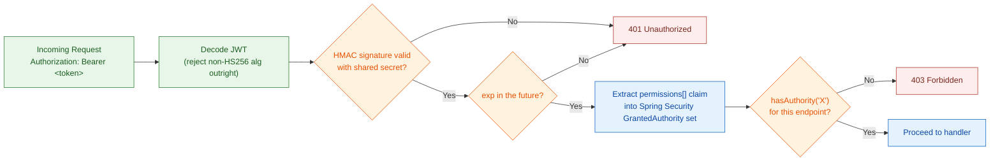
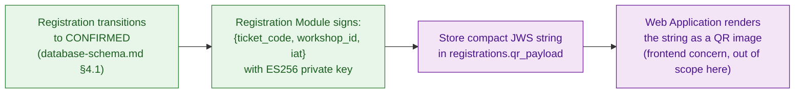

# Authentication & E-Ticket Security — Technical Design

This file is the physical-level completion of `architecture.md` §5.2 (Stateless Authentication & JWT Claims Lifecycle) and §5.3 (QR Code E-Ticket Security & Integrity). Those sections established *that* the auth token is a self-contained, stateless permission snapshot and *that* the e-ticket is an offline-verifiable signed payload, but deliberately stopped short of claim shapes, algorithms, TTL values, and key-management mechanics — both `database-schema.md` §5 (Scope) and `redis-cache-and-locking.md` (Scope) already named "JWT claim shape/expiry" as out of scope for themselves and pointed here instead. Nothing in this file overrides `architecture.md` — where the two disagree, `architecture.md` is the authority and this file has a bug.

**Scope:** the auth JWT's claim shape, signing algorithm, key storage, and TTL (§5.2); the QR e-ticket's payload format, signing algorithm, key management, and on-device verification mechanics (§5.3). Every algorithm, TTL, and key-management decision below was decided against 2–4 explored alternatives through the spec-driven-development Decision Gate, and recorded as an ADR immediately below — this document specifies the chosen options, it doesn't re-argue the ones that were rejected.

**Out of scope:** the RBAC data model itself (`database-schema.md` §2 — this file consumes that model's output, it doesn't redefine it), mTLS/transport encryption (`architecture.md` §5.4), audit event emission (`architecture.md` §5.5, `database-schema.md` §8.3), rate limiting on the login endpoint (`redis-cache-and-locking.md` §5), QR *image* rendering (turning the signed string into a scannable graphic is a frontend/web-app concern), and the operational mechanics of *how* a user gets suspended (who triggers it, from where) — that belongs to an Ops Runbook / API Contracts document; this file states only the auth-side *consequence* of a `SUSPENDED` user (§4).

Both mechanisms in this document use the JOSE (JSON Object Signing and Encryption) standard — RFC 7515 (JWS) / RFC 7519 (JWT) — per `CLAUDE.md`'s tech stack. They deliberately do **not** share a signing key or even a signing algorithm; §1 explains why they can't.

---

## Architecture Decision Records (ADRs)

Both algorithm/lifecycle decisions below were reached through the `spec-driven-development` gated workflow: 2–4 alternatives were explored with a trade-off matrix, the human made the call at the Phase 3 Decision Gate, and the reasoning was captured here verbatim rather than left to live only in `SPEC.md` (which is a working document for the next task, not a durable record). Every section from §1 onward specifies these two decisions in physical detail; this section is the permanent record of *why* they were chosen over their rejected alternatives.

### ADR Mini: JWT Signing Algorithm & Session Lifecycle

**Context:** `architecture.md` §5.2 requires stateless, zero-DB-lookup JWT verification on every request across all Backend API pods, sized for a 12,000-concurrent-user registration-opening spike (`docs/requirement.md` §1.4). §5.2's own Trade-offs section already states, as an accepted limitation, that this design "doesn't solve instant revocation, and doesn't claim to" — any option that quietly reopens that limitation needs to be a deliberate, visible choice, not a default.

**Decision:** `HS256` (HMAC-SHA256), 30-minute access-token TTL, **no refresh token**. On expiry, the client re-authenticates via the login endpoint. Revocation has exactly two levers: (1) rotating the shared HMAC secret — a blunt, cluster-wide instrument that invalidates every outstanding token once every pod has completed a rolling restart onto it, reserved for a suspected secret compromise; (2) suspending a `users` row (`database-schema.md` §2.1's `SUSPENDED` status) — blocks new logins but, consistent with §5.2, does not invalidate that user's already-issued token before it expires.

**Consequences:**
- Verification stays a pure signature+expiry check, no DB or Redis round-trip, at any scale the spike requirement demands.
- No new schema (no `refresh_tokens` table), no new endpoint (no `/refresh`), no new attack surface for refresh-token theft or reuse-detection logic.
- A legitimate session can be interrupted mid-use after 30 minutes; the user must re-login. Accepted as a deliberate UX trade-off for this project's current stage.

**Trade-offs accepted (user's own reasoning):** a refresh-token pair (Option C) was explicitly rejected because it would require a new `refresh_tokens` table, a new `/refresh` endpoint (expanded attack surface), and rotation/reuse-detection logic — and because concurrent requests racing an access-token expiry can trigger false-positive "token theft" detection on refresh-token rotation, risking accidental account lockouts. HS256 was chosen over RS256/ES256 (Option B) because issuer and verifier are the same trust domain (the Backend API verifying its own tokens) — an asymmetric keypair would add key-lifecycle management for no corresponding security gain here. A Redis-backed deny-list (Option D) was rejected because it would reintroduce a per-request lookup, directly undoing the zero-lookup property §5.2 was designed to guarantee, and would make Redis correctness-critical for auth rather than advisory — a role `architecture.md` §4.2 doesn't assign it.

### ADR Mini: QR E-Ticket Signing Algorithm & Key Distribution/Rotation

**Context:** `architecture.md` §5.3 requires the e-ticket to be verifiable fully offline, on-device, with zero network round-trip, by a Check-in Client operating under real physical conditions — unstable venue network (`docs/requirement.md` §1.3.5), variable camera hardware, and lecture-hall lighting. §5.3 also establishes, as a stated design point, that the *only* revocation mechanism for a ticket is rotating the signing key, and that rotation "kills every ticket, not just one" — any distribution/caching design must make that statement literally true, not accidentally soften it.

**Decision:** `ES256` (ECDSA P-256) for ticket signing. Public key distribution via an authenticated endpoint the Check-in Client calls while online (login, and opportunistically on every scan-batch sync); the fetched key is cached as the single active key in Expo SecureStore, **overwritten** on every successful fetch — never accumulated alongside older keys.

**Consequences:**
- ES256's ~64–72 byte signature (vs. RSA-2048's ~256 bytes) leaves more of the QR code's fixed data budget for error correction, producing a more scan-reliable code under exactly the degraded conditions §1.3.5 anticipates.
- Rotating the signing key requires no app rebuild or store release — the new public key propagates the next time each device is online, consistent with `architecture.md` §5.4's "secrets/keys injected at runtime, never baked into a build."
- Because the client keeps exactly one cached key, rotation is provably a total, all-tickets revocation, not a partial one — matching §5.3's stated guarantee exactly, without a separate mechanism that could accidentally make it partial.
- A device offline across the exact moment of a rotation event has a bounded, self-healing blind spot: it still accepts old-key tickets and rejects new-key tickets until its next successful online sync.

**Trade-offs accepted (user's own reasoning):** RSA-2048 (Option A) was rejected specifically because a denser QR code (or a lower error-correction level to compensate) works against the physical scan-reliability requirement at venue conditions the SRS already flags. Baking the public key into the app build (Option C) was rejected because a key-compromise response would then require an app rebuild and redistribution to every device — far slower than rotating a server-side key — and because it conflicts with §5.4's runtime-injection principle for key material.

---

## 1. Two Tokens, Two Trust Boundaries, Two Algorithm Choices

**Rationale:** it's tempting to treat "the auth JWT" and "the ticket QR payload" as the same kind of problem — both are signed JSON, both use JOSE, both get verified before something is allowed to happen. They aren't the same problem, because *who verifies them* is different, and that difference is what forces a different algorithm for each.

| | Auth JWT (§2–§4) | QR E-Ticket (§5–§8) |
|---|---|---|
| Issuer | Backend API, at login | Registration Module, at ticket issuance |
| Verifier | Backend API — **only ever itself**, any pod (§5.2) | Any Check-in Client device — **never** the issuer alone (§5.3) |
| Trust relationship | Issuer and verifier are the same trust domain | Issuer and verifier are different trust domains — a device that can verify must never be able to forge |
| Algorithm family | **Symmetric (HS256)** | **Asymmetric (ES256)** |

A symmetric key works exactly as long as issuer and verifier are the same party holding the same secret — that's the auth JWT's situation, and asymmetric crypto there would just be unneeded key-pair management for no added guarantee. The ticket is the opposite: the verifier (a Check-in Client device, possibly stolen or compromised) must be structurally incapable of forging what it verifies, which a shared secret can never guarantee — only a private/public split can. This is the same distinction `architecture.md` §5.3 draws when it says the Check-in Client "carries only the corresponding public key, so a device that can verify a ticket is never in possession of anything that could forge one."

**Guarantee:** compromising every Check-in Client device in the field never yields anything that could forge a ticket or a login token; compromising a Check-in Client's cache never yields the auth-JWT signing secret either, since the two live in entirely separate secrets and neither service ever ships one to a party that only needs the other.

---

## 2. Auth JWT — Claim Shape

**Rationale:** `docs/requirement.md` §2.11 requires the token to carry "the user's list of specific authorities, not merely their role name." `architecture.md` §5.2 adds that resolution (User → Role → Permission, §5.1) happens once, at issuance — the token is that resolution's frozen snapshot. Every claim below exists to make that snapshot self-sufficient; nothing is included that would send the caller back to the database, and nothing is included purely for UI convenience.

| Claim | Type | Meaning | Why it's here (or why something else isn't) |
|---|---|---|---|
| `sub` | UUID string | The authenticated user's `users.id` | Standard JWT subject claim; every audit event's `actor_user_id` (`database-schema.md` §8.3) traces back to this. |
| `permissions` | array of strings | The resolved permission codes (`permissions.code`, e.g. `WORKSHOP_CREATE`), flattened across every role assigned to this user | This is the claim §2.11 mandates. Flattened and de-duplicated at issuance — a user with two roles that both grant `REPORT_VIEW` gets it once, not twice; the array is a set, not a role-by-role breakdown. |
| `iat` | Unix timestamp | Issued-at | Standard; also the reference point `exp` is computed from. |
| `exp` | Unix timestamp | Expiry | Bounds the revocation-lag window §5.2's Trade-offs section already names; see §4 for the actual duration. |

**Deliberately absent:**
- **No `role` claim.** §5.1 and §5.2 are explicit that role plays no part at request time — including it would create a second, redundant path an API check could be tempted to branch on, reopening exactly the hardcoded-role-name problem §5.1 exists to close.
- **No UI-convenience fields (display name, email, etc.).** The token exists to answer "what may this request do," not "what should the UI show." Anything the client needs to render — the user's name, a greeting, which role labels apply — belongs in the login endpoint's **response body**, issued once at login alongside the token, not baked into the token itself. Keeping the token to exactly the four claims above means every future UI display need is a response-body change, never a token-schema change.
- **No `jti` / deny-list plumbing.** A `jti` claim only matters paired with a server-side revocation check — exactly the per-request lookup §5.2 exists to avoid, and something `architecture.md` §5.2's Trade-offs explicitly says this design "doesn't solve... and doesn't claim to." This was evaluated directly as an alternative (a Redis-backed deny-list, checked every request) and rejected: it would reintroduce the exact per-request lookup this design exists to avoid, and would make Redis correctness-critical for auth — a role `architecture.md` §4.2 never assigns it. If instant revocation becomes a real requirement later, it's a deliberate architectural revisit through a new decision gate, not a claim this file quietly slips in now.
- **No `iss` / `aud`.** Both exist to let a verifier distinguish tokens meant for it from tokens meant for someone else — necessary in a federated or multi-service setup. This system has exactly one issuer and exactly one verifier (the Backend API, of itself), so there is nothing for either claim to disambiguate.

**Guarantee:** every claim the API-layer authorization check reads (`permissions`) was fixed at issuance and is never re-derived, re-interpreted, or supplemented from any other source at request time (§5.2).

---

## 3. Auth JWT — Signing, Verification & Key Storage

**Model:**

| Decision | Value | Why |
|---|---|---|
| Algorithm | `HS256` (HMAC-SHA256) | Per §1 — issuer and verifier are the same trust domain, so a shared secret costs nothing in safety and avoids the key-pair lifecycle (generation, distribution, rotation-without-breaking-old-tokens) an asymmetric scheme would otherwise force on a claim that doesn't need it. |
| Library | `nimbus-jose-jwt` (the JOSE reference implementation for the JVM), via Spring Security's `JwtEncoder`/`JwtDecoder` | Same underlying standard (RFC 7515/7519) the ticket-signing path in §6 implements — one dependency, two use sites, rather than two separate JWT libraries for two claims that both just need "sign and verify a JOSE token." |
| Secret storage | Kubernetes `Secret`, mounted as an environment variable into every Backend API pod | Per `architecture.md` §5.4 — never in source or committed config, injected at runtime. Every pod needs the identical secret, since any pod must be able to verify a token issued by any other pod (§5.2's statelessness requirement). |
| `alg` handling | Verifier pins the expected algorithm (`HS256`) explicitly; a token asserting any other `alg` — including `none` — is rejected before signature verification runs | JOSE's `alg` header is attacker-controlled input. A verifier that trusts whatever `alg` the token claims is vulnerable to the well-known "none algorithm" and key-confusion attacks; pinning removes the choice from the token entirely. |

**Verification path (every request, any pod):**



No step in this path touches PostgreSQL or Redis — exactly the zero-lookup verification §5.2 requires. `hasAuthority('WORKSHOP_CREATE')`-style checks (`docs/requirement.md` §2.11) run directly against the `GrantedAuthority` set extracted from `permissions[]`; there is no code path that instead compares a role name.

**Trade-off — a leaked or rotated secret is an all-or-nothing lever, and not an instant one:** because the secret is injected as an environment variable, a pod only picks up a new value on its next start — updating the Kubernetes `Secret` object alone does not change what an already-running pod holds in memory. Rotation therefore only takes full effect once every pod has gone through a rolling restart with the new secret, not the instant the `Secret` object is updated. During that rollout window, some pods still verify against the old secret and some against the new — both a token signed before rotation and the operator's expectation of "already invalidated" can briefly disagree. This is a coarser, slower, different instrument than the per-user revocation §5.2 already says this design doesn't support — see §4 for the full lever description.

**Guarantee:** any Backend API pod reaches the identical allow/deny decision for the identical token, with no shared session store and no database round-trip — the property `architecture.md` §5.2 requires verbatim.

---

## 4. Auth JWT — TTL, Lifecycle & Revocation

**Rationale:** `architecture.md` §5.2 leaves the exact token lifetime as "a tuning parameter for `technical-design/`," bounded by a stated trade-off: short enough that a revoked permission doesn't stay dangerously live, long enough that the system isn't re-authenticating constantly. §5.2 also settles a related question by omission — it describes exactly three lifecycle moments (issue, use, expire → re-authenticate) and never mentions a fourth (refresh).

**Decision — no refresh token.** This is a closed decision, not an open option: a refresh-token pair was evaluated directly against the plain short-lived-token approach and rejected, because it would require a new `refresh_tokens` table, a new `/refresh` endpoint (expanded attack surface), and rotation/reuse-detection logic — and because concurrent requests racing an access-token expiry can trigger false-positive "token theft" detection on refresh-token rotation, risking accidental account lockouts for legitimate users. This document does not introduce a refresh mechanism, and a future pass reopening this choice needs a new decision gate, not a drive-by addition here.

**Model:**

| Parameter | Value | Why |
|---|---|---|
| Access token TTL (`exp - iat`) | 30 minutes | A typical single browsing-to-registration session (`docs/requirement.md` §1.3.1) comfortably fits inside one token's life, so re-authentication doesn't interrupt a normal flow. Short enough that a permission downgrade or role change (the exact gap §5.2's Trade-offs names) is live for at most half an hour, not a full working day. |
| Clock skew leeway | None applied | All Backend API pods run inside one Kubernetes cluster on cluster-synchronized NTP; there is no cross-organization clock boundary here to buffer against, unlike a federated-token scenario where skew leeway is standard practice. |
| On expiry | `401`, client re-authenticates via the login endpoint | Per §5.2's three-moment lifecycle — no silent renewal, no refresh token; a new login re-resolves permissions from §5.1's current state, which is also how a legitimately-restored permission takes effect without waiting out an old token's remaining life. |

**Revocation — exactly two levers, both partial by design:**

| Lever | What it does | What it does *not* do |
|---|---|---|
| Rotate the shared HMAC secret (§3) | Invalidates **every** outstanding token, cluster-wide, once every pod has completed a rolling restart onto the new secret | Not selective — there is no way to invalidate one user's token without invalidating all of them. Not instant either — see §3's Trade-off: a pod only picks up the new secret on restart, so full invalidation completes on the rollout's timescale, not the moment the `Secret` object is updated. Reserved for a suspected secret compromise, not routine use. |
| Suspend a user (`users.status = 'SUSPENDED'`, `database-schema.md` §2.1) | Blocks that user from obtaining a **new** token: the login handler checks `users.status = 'ACTIVE'` before signing anything, and fails the request (`401`/`403`) at login if the status is anything else | Does **not** invalidate a token that user already holds — it keeps working, exactly as issued, until its own `exp` passes (at most 30 minutes later). The operational procedure for *who* flips this status and *from where* is an Ops Runbook / API Contracts concern, out of scope for this file — this table states only the auth-side consequence and the one check the login handler must perform to enforce it. |

**Trade-off — no refresh token means a legitimate session can be interrupted mid-use:** a student thirty minutes into browsing gets logged out mid-session, not silently renewed. This is the direct, accepted cost of the decision above; if session continuity becomes a real product requirement, introducing a refresh token is a deliberate addition to revisit through a new decision gate, not something to improvise around by inflating the access-token TTL (which would only widen the exact revocation-lag window this section is trying to bound).

**Guarantee:** the window between a permission change taking effect in `database-schema.md`'s RBAC tables and it being reflected in every live token is never longer than 30 minutes; a suspended user can never obtain a new token past their next login attempt, though their already-issued one is only guaranteed dead once its `exp` passes; a secret rotation is guaranteed to invalidate every outstanding token once the rolling restart it requires has completed, not before.

---

## 5. QR E-Ticket — Payload Format

**Rationale:** `architecture.md` §5.3 requires the ticket to "prove itself, with zero round-trip" — the payload has to carry everything a fully offline device needs to answer "is this authentic," and nothing more, since anything beyond authenticity (is it still *valid*) is explicitly deferred to server-side reconciliation, not encoded in the payload at all.

**Model — JWS, compact serialization** (`header.payload.signature`, base64url-encoded, no JSON wrapping) — the standard QR-friendly JOSE form, chosen because compact serialization is the shortest standard encoding, and payload size is a hard physical constraint here (§7).

| Claim | Type | Meaning | Why it's here (or why something else isn't) |
|---|---|---|---|
| `ticket_code` | string | The registration's `registrations.ticket_code` (`database-schema.md` §4.1) | What a Check-in device resolves at reconciliation time to look up the registration server-side (`database-schema.md` §6.1's `check_in_scans.registration_id`). |
| `workshop_id` | UUID string | The workshop this ticket belongs to | Lets a Check-in Client display which workshop a scanned ticket belongs to, and lets it flag an obvious venue mismatch, without a lookup. Spelled out in full, not abbreviated, for consistency with `ticket_code` — the byte saved by shortening a claim *key* is negligible next to a 36-character UUID *value*, so there's no payload-budget reason to abbreviate it (§7's budget argument is about signature size, not claim-name length). |
| `iat` | Unix timestamp | Issued-at | Standard JOSE housekeeping; not used as a validity check (see below). |

**Deliberately absent:**
- **No `exp`.** `architecture.md` §5.3 is explicit and non-negotiable on this point: "no per-ticket revocation, ever... once issued, it stays authentic forever." An `exp` claim would silently reintroduce a per-ticket kill switch this design deliberately does not have — a workshop's tickets aren't supposed to stop being *authentic* on their own; only reconciliation decides *validity* (cancelled, already used), and that decision lives server-side in `check_in_scans`/`attendances`, never in the payload itself.
- **No student PII (name, email).** The signature already proves *which ticket*; a Check-in Staff member confirming *which person* is a visual/manual check against an ID at the door, outside this document's scope — encoding PII into a QR code that gets photographed, screenshotted, and forwarded (§5.3's own "copying, not forgery" framing) would leak it far wider than the check-in flow needs.

**Guarantee:** the payload alone is sufficient for any device to determine authenticity with zero network access and zero fields that could go stale between issuance and a scan weeks later — staleness is a validity question, and validity is explicitly not this payload's job (§5.3).

---

## 6. QR E-Ticket — Signing at Issuance

**Model:**

| Decision | Value | Why |
|---|---|---|
| Algorithm | `ES256` (ECDSA over P-256) | Chosen over RSA specifically for signature size — see §7. |
| Signer | Registration Module only, at the moment a registration transitions to `CONFIRMED` (`database-schema.md` §4.1) | Per `CLAUDE.md`'s module-ownership table — Registration is the sole writer of `registrations`, and the ticket is that row's own artifact; no other module signs a ticket. |
| Library | `nimbus-jose-jwt` — the same dependency as §3 | One JOSE library serving both signing use sites in this backend; the two never share a *key*, only the *implementation*. |
| Private key storage | Kubernetes `Secret`, readable only by the Backend API's Registration-module code path | Per `architecture.md` §5.4 — the private key never leaves the backend, and is the one piece of key material in this entire document that no client, mobile or web, ever receives in any form. |
| Persistence | The signed compact string is stored verbatim in `registrations.qr_payload` (`database-schema.md` §4.1) | Never recomputed on read — a ticket keeps rendering correctly even after a key rotation (§8) invalidates it for *verification* purposes; the row itself is an unaltered historical record either way. |

**Issuance flow:**



**Guarantee:** every `CONFIRMED` registration has exactly one signed ticket payload, generated once, by the one module authorized to generate it, and never regenerated from scratch afterward.

---

## 7. Why ECDSA, Not RSA — the QR Capacity Constraint

**Rationale:** this is a place where a purely cryptographic decision and a purely physical one point at the same answer, and it's worth making the physical reasoning explicit rather than leaving "ES256" looking like an arbitrary pick.

A QR code has a fixed data-capacity ceiling per symbol version and error-correction level — more bytes forces either a larger/denser code (more modules, harder for a phone camera to resolve at a distance or under the "unstable lecture-hall conditions" `docs/requirement.md` §1.3.5 already flags) or a lower error-correction level (less tolerant of the exact smudging/glare/motion-blur conditions a physical event produces). Signature size feeds directly into that ceiling:

| Algorithm | Typical signature size | Compact JWS length (this payload) | Effect on the QR code |
|---|---|---|---|
| RSA-2048 (`RS256`) | ~256 bytes | Materially longer | Forces a higher-version (denser) QR code for the same error-correction level, or a lower error-correction level for the same code size — either way, a harder scan target under the exact degraded-camera, degraded-lighting, unstable-network conditions §1.3.5 warns about. |
| ECDSA P-256 (`ES256`) | ~64–72 bytes | Materially shorter | Leaves headroom to keep a smaller/denser-tolerant code at a high error-correction level — an easier scan target, for the same cryptographic guarantee. |

Both algorithms satisfy `architecture.md` §5.3's authenticity requirement equally — this isn't a security trade-off, it's a scan-reliability one, and ECDSA wins it without giving up anything the section actually asks for. This is a materially different rationale from §3's HS256 choice (a trust-boundary argument) — the two algorithm decisions in this document are independent and shouldn't be read as following from the same reasoning.

**Guarantee:** the signature scheme adds the minimum payload weight the JOSE standard allows for this security level, so the QR code's data budget is spent on cryptographic integrity rather than being forced into a harder-to-scan format by an oversized signature.

---

## 8. Verification Key Distribution & Rotation

**Rationale:** the Check-in Client verifies fully offline (§5.3), which means it must already be holding the public key *before* it ever loses connectivity — it can't fetch what it needs at the exact moment it needs it. That forces a fetch-while-online, cache-for-offline-use pattern, and it means key rotation has to be reasoned about in terms of what a device that's been offline across a rotation event actually has cached.

**Model:**

| Decision | Value | Why |
|---|---|---|
| Distribution endpoint | `GET /api/v1/checkin/verification-key`, gated by `hasAuthority('CHECKIN_SCAN')` on the Check-in Staff's existing session | The Check-in Client already authenticates its own staff user to sync scan batches (`docs/requirement.md` §2.9) — reusing that same session, permission-checked, avoids standing up a second, separate auth mechanism just for key fetch. Gating on `CHECKIN_SCAN` specifically — not merely "any authenticated request" — keeps this endpoint consistent with §3's discipline: `architecture.md` §5.1 requires every check to be permission-based, never a bare authenticated/not-authenticated boolean, and this endpoint is no exception just because the key itself isn't confidential. |
| Response format | A single JWK (JSON Web Key) representing the current active ECDSA public key | Standard JOSE key representation — the same format `nimbus-jose-jwt` (server) and `jose` (client, per `CLAUDE.md`'s mobile stack) both consume natively. |
| Fetch trigger | On Check-in Client login, and opportunistically on every successful online sync (`docs/requirement.md` §2.9) | Login is the one moment the device is guaranteed online; piggybacking on every sync (also necessarily online) means the cached key self-refreshes as a side effect of a flow the device already performs, without a dedicated polling mechanism. |
| Cache location | Expo SecureStore, overwriting the previous cached key on every successful fetch | Per `CLAUDE.md` — device-hardware-backed keystore, alongside the client's own auth token; a single active key, not an accumulating list. |
| Key count cached | **Exactly one** — the current active key, always overwritten, never appended | This is the deliberate design point: see the rotation discussion below. A multi-key cache (retaining old keys so previously-issued tickets keep verifying past a rotation) was evaluated as an alternative and rejected — it would directly contradict §5.3's stated guarantee that rotation is the *only* revocation lever and that it acts on *everything*, not just newly-issued tickets. |

**On-device verification (offline, per scan):**

```typescript
import { importJWK, compactVerify } from 'jose';

async function verifyTicket(qrPayload: string, cachedPublicJwk: JWK): Promise<TicketClaims | null> {
  try {
    const publicKey = await importJWK(cachedPublicJwk, 'ES256');
    // algorithms: ['ES256'] pins the accepted alg explicitly — mirrors §3's server-side alg-pinning
    // rationale, applied here too: this key is deliberately public (§8's distribution model), which
    // is exactly the condition under which an algorithm-confusion forgery (e.g. a crafted header
    // claiming a symmetric alg) needs to be rejected outright rather than left to a library default.
    const { payload } = await compactVerify(qrPayload, publicKey, { algorithms: ['ES256'] });
    return JSON.parse(new TextDecoder().decode(payload)); // { ticket_code, workshop_id, iat }
  } catch {
    return null; // signature invalid, tampered payload, wrong/rejected alg, or malformed input — reject, offline, instantly
  }
}
```

A `null` result is recorded locally as a rejected scan (`database-schema.md` §6.1's `REJECTED_INVALID` at the point it later reconciles) — either way, this function never calls the network, exactly as §5.3 requires.

**Rotation — a deliberate blunt instrument, not a graceful handoff:** `architecture.md` §5.3's Trade-offs section is explicit that "the only way to kill \[a ticket] is rotating the signing key, and that kills every ticket, not just one." This document's single-cached-key model is what makes that statement literally true at the implementation level: because a Check-in Client never retains a previous key once a fetch overwrites it, rotating the signing key means every ticket ever issued under the old key fails verification the moment a device refreshes its cache — not just newly-scanned ones, and with no graceful multi-key transition period. Rotation is reserved for a suspected private-key compromise — a rare, break-glass operation, not a routine one — precisely because its blast radius is "every ticket this system has ever issued." Because the key is fetched over the network rather than baked into the app build, this rotation requires no app rebuild or store release — the new key propagates the next time each device is online, consistent with `architecture.md` §5.4's "secrets/keys injected at runtime, never baked into a build."

**Trade-off — a device offline across a rotation event has a temporary blind spot in both directions:** if the signing key rotates while a Check-in Client is offline, that device (a) still accepts old-key tickets as authentic until its next successful sync, and (b) rejects any ticket signed with the *new* key as an invalid signature until that same sync happens. Both resolve the moment the device is back online and re-fetches — this is a bounded, self-healing gap, not a permanent one, and it only matters in the already-rare window immediately following a break-glass rotation.

**Guarantee:** a private-key compromise has exactly one operational response — rotate — and that response provably invalidates every previously-issued ticket everywhere, with no code path that could accidentally leave an old, compromised key's tickets still verifiable somewhere.

---

## 9. Failure Modes & Fail-Safe Behavior

| Situation | Behavior | Why |
|---|---|---|
| Auth JWT signature invalid or `exp` passed | `401` — reject | §5.2: a request with no valid, current permission snapshot has nothing to authorize against; there's no partial-trust fallback. |
| Auth JWT valid, but endpoint's required permission absent from `permissions[]` | `403` — reject | Distinct from `401` on purpose: the caller is authenticated, just not authorized for this specific action — the same two-distinct-response-codes discipline `redis-cache-and-locking.md` §3 applies to its own two failure paths. |
| Ticket signature invalid (tampered/forged/garbage QR) | Reject instantly, offline, on the scanning device | §5.3: authenticity is a local, zero-round-trip decision — there is no server call in this path to fail differently. |
| Ticket signature valid, but registration since cancelled | **Accepted** at scan time; caught at server-side reconciliation, not at the device | §5.3's explicit, accepted gap — authenticity and validity are different questions, and only the second one needs the network (`database-schema.md` §6.1's `REJECTED_INVALID` outcome). |
| Check-in Client can't reach the verification-key endpoint (offline at very first login) | Cannot verify any ticket until it gets online at least once | A device's first login must happen online — no different from any other first-run provisioning step; `docs/requirement.md` §2.9 already presumes an online login/sync exists in the device's workflow. |
| Auth signing secret (§3) suspected compromised | Rotate the Kubernetes `Secret` and perform a rolling restart of every Backend API pod — invalidates every outstanding auth token cluster-wide once the restart completes (§4) | The only lever this design has for a secret-level (as opposed to single-account) compromise; a blunt, all-sessions response — but bounded by rollout time, not instantaneous (§3, §4). |
| Ticket signing private key (§6/§8) suspected compromised | Rotate the signing key pair and redistribute the new public JWK — invalidates every previously-issued ticket's signature, system-wide, as devices refresh | The deliberate, sole revocation mechanism `architecture.md` §5.3 already names; not a mechanism this file invented. |

---

## 10. Reference Table

Every claim, algorithm, and key-management decision in this document, in one place — the same purpose `database-schema.md` §11's Traceability Matrix and `redis-cache-and-locking.md` §7's key-format table serve for their own documents.

| Item | Value | Backs |
|---|---|---|
| Auth JWT algorithm | `HS256` | Stateless, same-trust-domain verification (`architecture.md` §5.2) |
| Auth JWT claims | `sub`, `permissions[]`, `iat`, `exp` — no `role`, no `jti`, no `iss`/`aud`, no UI-convenience fields | `docs/requirement.md` §2.11's "authorities, not role name" requirement |
| Auth JWT TTL | 30 minutes, no refresh token | Bounding the revocation-lag window (`architecture.md` §5.2 Trade-offs) without adding refresh-token infrastructure/attack surface |
| Auth signing secret storage | Kubernetes `Secret`, env-injected | `architecture.md` §5.4 — never in source/config |
| Auth revocation levers | Secret rotation (global, all tokens, complete once the rolling restart finishes) or user suspension (blocks new logins only, enforced by an explicit `status = 'ACTIVE'` check at login) | `architecture.md` §5.2 — no instant single-token revocation by design |
| Ticket signature algorithm | `ES256` (ECDSA P-256) | Offline authenticity (`architecture.md` §5.3) at minimum QR payload weight (§7) |
| Ticket claims | `ticket_code`, `workshop_id`, `iat` — no `exp`, no PII | `architecture.md` §5.3's "authentic forever, no per-ticket revocation" |
| Ticket private key storage | Kubernetes `Secret`, Registration Module only | `architecture.md` §5.4; single-caller exclusivity applied to the signing key |
| Verification key distribution | `GET /api/v1/checkin/verification-key`, `hasAuthority('CHECKIN_SCAN')` (reuses Check-in Staff session), JWK format | Offline-first requirement (`docs/requirement.md` §1.3.5, §2.9) — fetch-while-online, cache-for-offline; permission-gated per `architecture.md` §5.1 |
| Verification key cache | Expo SecureStore, single key, overwrite-on-fetch (never accumulated) | Hardware-backed key integrity (`architecture.md` §5.4); makes rotation a total, not partial, revocation (§8) |
