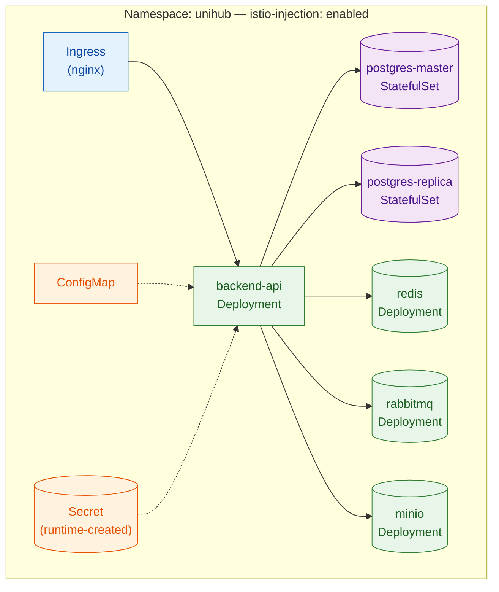
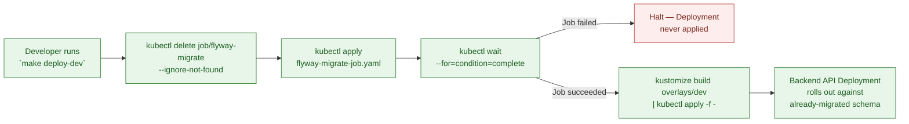

# Deployment & CI/CD — Platform

This file is the physical-level completion of `architecture.md` §1.2 (Core Components — Ingress Controller, Service Mesh, Backend API, PostgreSQL, Redis, Message Broker, Object Storage, Observability Stack) and §5.4 (Network & Data Protection Boundaries — the Zero-Trust mesh every pod runs inside), together with `proposal.md` §5.2/§14/§16 and `docs/requirement.md` §3.3. Those sections established *that* the system runs as N parallel, self-healing Backend API instances behind a single entry point, with PostgreSQL under stable identity/persistent storage, secrets injected at runtime, and CI enforcing lint/test/package before any image is deployable — but deliberately left the concrete Dockerfile, the concrete Kubernetes manifests, the concrete CI workflow, and the concrete migration/seed mechanism as physical detail for this document. Nothing here overrides `architecture.md` — where this file and that one appear to disagree, `architecture.md` is the authority and this file has a bug.

**Why this lives in `platform/`:** it packages and deploys every subsystem this corpus specifies — PostgreSQL (`database-schema.md`), Redis (`distributed-coordination.md`), RabbitMQ (`messaging.md`), MinIO/S3 (`../modules/workshop.md`), JWT/RBAC (`auth-and-identity.md`), and metrics/tracing (`observability.md`) — as one outer envelope: how the Backend API is built into an image, how that image and its dependencies are declared as Kubernetes manifests, how CI verifies a change before it can be packaged, and how a schema/seed migration is applied before any pod starts against it. It does not redesign any subsystem it deploys.

**Scope:** the multi-stage Dockerfile; the Kustomize-based Kubernetes manifest set (base + dev/loadtest overlays); the GitHub Actions CI pipeline; the Flyway-as-a-Kubernetes-Job migration and seed-data mechanism; and the Dev/CI/Minikube-PoC environment matrix. **Out of scope:** the SQL content of any migration beyond the one seed-data file this document names (`database-schema.md` owns schema DDL); Istio's own mTLS/traffic-policy internals beyond the sidecar-injection labeling needed to run under it (`architecture.md` §5.4 already specifies the model); Prometheus/Grafana/OpenTelemetry configuration beyond the ports and ConfigMap values this document wires up as a deployment target (`observability.md` already specifies the metrics/tracing design); JWT secret *contents* or claims structure (`auth-and-identity.md`, already written — this file only specifies that such a secret exists as a Kubernetes Secret, not its value or shape); any production cloud deployment target (`proposal.md` §5.2 excludes this explicitly); and the Mobile App's (Expo) build/distribution pipeline (a separate, non-store-distribution concern from this Backend-API-focused CI/CD document).

All configuration in this document targets a single Kubernetes namespace, `unihub`, on a local Minikube cluster — consistent with `proposal.md` §5.2's framing of the PoC as local/self-hosted infrastructure, AWS S3 excepted.

---

## Table of Contents

- [Architecture Decision Records (ADRs)](#architecture-decision-records-adrs)
  - [ADR Mini: CI/CD Automation Boundary](#adr-mini-cicd-automation-boundary)
  - [ADR Mini: Kubernetes Manifest Management](#adr-mini-kubernetes-manifest-management)
  - [ADR Mini: Resource Profile Strategy](#adr-mini-resource-profile-strategy)
  - [ADR Mini: Migration & Seed Data Mechanism](#adr-mini-migration-seed-data-mechanism)
  - [ADR Mini: CI Job Structuring](#adr-mini-ci-job-structuring)
  - [ADR Mini: Container Packaging Strategy](#adr-mini-container-packaging-strategy)
- [1. Container Packaging & Build Strategy](#1-container-packaging-build-strategy)
- [2. Kubernetes Topology — Kustomize Base](#2-kubernetes-topology-kustomize-base)
- [3. Resource Profile Overlays — Dev vs. Load-Test Scale](#3-resource-profile-overlays-dev-vs-load-test-scale)
- [4. Database Migration & Seed Data — Flyway as a Kubernetes Job](#4-database-migration-seed-data-flyway-as-a-kubernetes-job)
- [5. CI Pipeline — GitHub Actions](#5-ci-pipeline-github-actions)
- [6. Local Development vs. CI vs. Minikube PoC — Environment Matrix](#6-local-development-vs-ci-vs-minikube-poc-environment-matrix)
- [7. Reference Table](#7-reference-table)

---

## Architecture Decision Records (ADRs)

### ADR Mini: CI/CD Automation Boundary

**Context:** `docs/requirement.md` §3.3 lists GitHub Actions' CI steps ending at "package the application into a Docker image and push it to Docker Hub" — no deployment step is named anywhere in the corpus. `proposal.md` §14 describes the Minikube-run topology as the runtime target, not something CI is described as driving into. Minikube is inherently local to a developer's machine; a GitHub Actions hosted runner has no network path to reach it without introducing new infrastructure (a self-hosted runner, or a tunnel) that no document in the corpus calls for.

**Decision:** GitHub Actions' automation scope stops at building and pushing the Docker image to Docker Hub. Deployment to the local Minikube cluster is a separate, explicit local action — a Makefile target the developer runs by hand (`kustomize build overlays/<profile> | kubectl apply -f -`) — never a job inside the CI workflow.

**Consequences:**
- The CI workflow's job graph terminates at `build-and-push`; no `deploy` job exists in `.github/workflows/`.
- The local `Makefile` is a first-class artifact of this design (versioned in the repo, not ad hoc), since it's now the only place deployment actually happens.

**Trade-offs accepted (user's own reasoning):** a self-hosted runner registered on the developer's machine (true end-to-end CD) and a tunneled hosted runner were both rejected — the first compounds `proposal.md` §16's already-flagged "learning curve for infrastructure-heavy tooling" risk with a new long-lived process to maintain, the second exposes a local cluster to the internet for no benefit a single-developer PoC needs.

### ADR Mini: Kubernetes Manifest Management

**Context:** `architecture.md` §1.2 and `proposal.md` §14 fix Kubernetes/Minikube as the orchestration target but name no manifest-management tool. The dev-lightweight vs. load-test-scale need (see next ADR) requires some form of environment parameterization across manifest sets, and raw per-environment YAML duplication risks drift between profiles.

**Decision:** Kustomize — a `base/` directory of canonical manifests plus `overlays/dev` and `overlays/loadtest` patch directories, applied via `kubectl apply -k` — is the manifest-management mechanism. No Helm chart, no other templating engine.

**Consequences:**
- Environment differences are expressed as patches against one shared base, not duplicated files — a change to the base (e.g., a new ConfigMap key) propagates to both profiles automatically.
- No new binary is required beyond what ships inside `kubectl` (Kustomize has been built in since 1.14).

**Trade-offs accepted (user's own reasoning):** Helm was rejected — its chart packaging, release/rollback, and Go-template DSL solve problems (multi-release distribution, versioned rollback history) this single-deployable, single-environment-target PoC doesn't have, and would add a second templating language on top of an already infrastructure-heavy stack.

### ADR Mini: Resource Profile Strategy

**Context:** `proposal.md` §16 explicitly flags "high local resource consumption — running a full Kubernetes cluster, database replicas, messaging, monitoring, and a Service Mesh sidecar on every pod together on developer hardware" as a risk, with the accepted mitigation being to "constrain resource usage per component during day-to-day development; run the full topology at scale only for dedicated load-test sessions." No document specifies the mechanism for that split.

**Decision:** Two static Kustomize overlays implement the mitigation directly: `overlays/dev` (1 Backend API replica, single Postgres instance with no replica, minimal `resources.requests/limits`) and `overlays/loadtest` (2+ Backend API replicas, Postgres Master-Replica, full-size `resources.requests/limits` sized toward the 12,000-CCU spike target in `docs/requirement.md` §1.4).

**Consequences:**
- Day-to-day development runs against `overlays/dev` by default — fast iteration, low resource pressure.
- A dedicated load-test session switches to `overlays/loadtest` by name, matching exactly the "only for dedicated load-test sessions" language in `proposal.md` §16.

**Trade-offs accepted (user's own reasoning):** a HorizontalPodAutoscaler-only approach was rejected as the sole mechanism — HPA can scale the Backend API Deployment, but does nothing about Postgres replica count or the per-pod Istio sidecar overhead that `proposal.md` §16 actually names as the cost driver; HPA may still be layered inside `overlays/loadtest` for the API tier specifically, but it does not replace the overlay split.

### ADR Mini: Migration & Seed Data Mechanism

**Context:** `architecture.md` §6.2 already fixes the migration ADR at the concept level: schema changes are explicit and versioned, migration runs once, before any application instance starts, from a single place — never from inside the applications themselves. That ADR's own diagram shows a dedicated Migration Job running before the rolling deployment begins. Given the CI/CD Automation Boundary ADR above, this Job is applied as part of the local deploy step, not by GitHub Actions.

**Decision:** Flyway is packaged into its own container image and run as a one-shot Kubernetes Job (`flyway-migrate`), applied first by the local `Makefile` target; the target blocks on `kubectl wait --for=condition=complete job/flyway-migrate` before applying the Backend API Deployment. Seed data — default roles/permissions from `database-schema.md` §2.2–§2.3 — travels as a Flyway versioned migration (`V2__seed_default_roles_permissions.sql`) using idempotent `INSERT ... ON CONFLICT DO NOTHING`, through the exact same single-execution pipeline as schema DDL, not a separate ad hoc script.

**Consequences:**
- The Job is a first-class, retryable Kubernetes object — its failure is visible via `kubectl get job/flyway-migrate` and blocks the subsequent Deployment apply deterministically.
- Reference data gets the same once-only, versioned guarantee as schema changes — no second mechanism to remember or forget against a fresh cluster.

**Trade-offs accepted (user's own reasoning):** running Flyway from the developer's own machine via `kubectl port-forward` was rejected — it bypasses the in-cluster mTLS path (`architecture.md` §5.4) the in-cluster Job would otherwise use, and depends on a manually-managed, easy-to-forget port-forward process. Running Flyway on Spring Boot startup was rejected outright as a direct violation of the existing `architecture.md` §6.2 ADR (N parallel pods would race to migrate).

### ADR Mini: CI Job Structuring

**Context:** `docs/requirement.md` §3.3 lists an ordered CI sequence (lint, unit tests, integration tests, package+push) but does not specify how that ordering is enforced. This document additionally requires that test execution be structurally separated from artifact publishing, not just sequentially ordered.

**Decision:** A single GitHub Actions workflow file with sequential jobs — `lint` → `unit-test` → `integration-test` (Testcontainers: Postgres, Redis, RabbitMQ, MinIO) → `build-and-push` — connected via `needs:`. The `build-and-push` job additionally runs only on a `push` event to `main` (never on a pull request), and only if every upstream job in the graph succeeded.

**Consequences:**
- A failed lint/unit/integration job structurally blocks `build-and-push` via the job dependency graph — not merely step ordering within one job, which could be bypassed by a misplaced `continue-on-error` or a step-reordering mistake.
- One workflow file remains the single source of truth for the whole pipeline, with no cross-workflow triggering to reason about.

**Trade-offs accepted (user's own reasoning):** two separate workflow files cross-triggered via `workflow_run` were rejected — that level of pipeline decoupling is disproportionate for one developer maintaining one repository, and adds triggering complexity with no corresponding benefit here.

### ADR Mini: Container Packaging Strategy

**Context:** `CLAUDE.md` and `proposal.md` §10 fix Java 21 / Spring Boot 3.x as the backend stack and Docker Hub as the registry, but name no build mechanism. Spring Boot 3 ships two credible Dockerfile-free alternatives — Cloud Native Buildpacks via `bootBuildImage`, and Jib — alongside a hand-written multi-stage Dockerfile.

**Decision:** An explicit multi-stage Dockerfile: a builder stage (JDK + Gradle, with the dependency-resolution layer cached separately from the source-copy layer so unchanged dependencies never re-download) produces the jar; a minimal runtime stage (slim JRE base image, non-root `USER`, `-XX:MaxRAMPercentage` tuned for cgroup v2 container memory limits) runs it.

**Consequences:**
- Every layering, user-privilege, and JVM-tuning decision is visible and reviewable directly in the Dockerfile — nothing is delegated to a buildpack's implicit defaults.
- The dependency-layer/source-layer split gives the same build-cache benefit Buildpacks/Jib provide automatically, but stated explicitly as a design decision in this document.

**Trade-offs accepted (user's own reasoning):** Buildpacks and Jib were both rejected — this is a design-stage project meant to specify and demonstrate the container-build reasoning (layer caching, non-root user, cgroup-aware JVM sizing) explicitly; delegating that to a buildpack's implicit defaults would hide exactly the mechanics this document exists to make legible.

---

## 1. Container Packaging & Build Strategy

**Rationale:** `CLAUDE.md` fixes Java 21 / Spring Boot 3.x and Docker Hub as the registry (per the Container Packaging Strategy ADR above). The two things a container-packaging design must get right for this project specifically are: (a) rebuilding the image on every source change must not re-download every dependency, since CI runs this on every push (`docs/requirement.md` §3.3), and (b) the running container must respect the memory limit Kubernetes assigns it, not the host's full physical memory, since the JVM historically over-reads `/proc/meminfo` unless told the process is inside a cgroup.

**Model:**

```dockerfile
# ---- Builder stage ----
FROM eclipse-temurin:21-jdk-jammy AS builder
WORKDIR /workspace

# Dependency layer, cached separately from source: Docker only re-runs this
# RUN when build.gradle/settings.gradle/gradle-wrapper.properties change,
# never on a plain source edit.
COPY gradlew ./
COPY gradle gradle
COPY build.gradle settings.gradle ./
RUN ./gradlew dependencies --no-daemon

# Source layer: invalidates only this and the steps below it on a source edit.
COPY src src
RUN ./gradlew bootJar --no-daemon -x test

# ---- Runtime stage ----
FROM eclipse-temurin:21-jre-jammy AS runtime

# Non-root: the container never runs as root, even though nothing in this
# image currently requires elevated privileges — defense-in-depth against
# a future dependency that might.
RUN groupadd --system unihub && useradd --system --gid unihub unihub
WORKDIR /app
COPY --from=builder /workspace/build/libs/*.jar app.jar
USER unihub

# cgroup v2-aware JVM sizing: MaxRAMPercentage bounds heap to a share of the
# *container's* memory limit (via Deployment resources.limits.memory, §2/§3),
# not the node's physical RAM — required so a pod's own limit is what the JVM
# actually respects. InitialRAMPercentage avoids a cold-start heap that's too
# small to absorb the registration-opening spike (docs/requirement.md §1.4)
# before the JVM's own heuristics catch up.
ENV JAVA_TOOL_OPTIONS="-XX:+UseContainerSupport -XX:MaxRAMPercentage=75.0 -XX:InitialRAMPercentage=50.0"

EXPOSE 8080
ENTRYPOINT ["java", "-jar", "/app/app.jar"]
```

| Decision | Value | Why |
|---|---|---|
| Builder base image | `eclipse-temurin:21-jdk-jammy` | Matches `CLAUDE.md`'s Java 21 requirement exactly; Temurin is the OpenJDK distribution with the widest CI/Docker Hub support. |
| Runtime base image | `eclipse-temurin:21-jre-jammy` (not `-jdk`) | The runtime stage never compiles anything — a JRE is the smaller, correct base; shipping a JDK (with `javac`, `jshell`, etc.) into a runtime image is unused attack surface. |
| Layer order | Dependency manifest copied and resolved *before* `src/` is copied | Docker's layer cache invalidates from the first changed layer downward — putting the rarely-changing dependency manifest first means a routine source edit never re-triggers a dependency re-download. |
| Non-root `USER` | Dedicated `unihub` system user, no shell, no home directory needed | Baseline container hardening; consistent with `architecture.md` §5.4's Zero-Trust posture applied one layer lower, at the process level inside the pod. |
| JVM container awareness | `-XX:+UseContainerSupport -XX:MaxRAMPercentage=75.0` | Modern JDKs (10+) enable container support by default, but pinning it here makes the intent explicit rather than relying on a default that could change; 75% leaves headroom for the JVM's own non-heap memory (metaspace, thread stacks, direct buffers) inside the same container limit (§2/§3). |
| Health check mechanism | Kubernetes liveness/readiness probes (§2), **not** a Docker `HEALTHCHECK` instruction | Kubernetes never consults `HEALTHCHECK` — it uses its own probe configuration on the Pod spec. Adding one here would be dead configuration; the actual probe design lives in `observability.md`. |
| Image tag convention | `<dockerhub-namespace>/unihub-backend:<git-sha>`, plus a floating `:latest` on every `main` push | The immutable `git-sha` tag is what Kubernetes manifests actually reference (§2) — a floating tag alone would make "which commit is running" unanswerable from the cluster; `:latest` remains only as a convenience pointer for manual local use. |

**Trade-offs:** the two-stage build means the builder stage's full JDK + Gradle toolchain is downloaded and run on every CI build — that cost is accepted because it's paid once per CI run, inside a job whose own stated job (§5) is exactly to verify the code before it can be packaged; it is never paid at runtime, since the final image contains only the JRE and the built jar.

**Guarantees:** the shipped image never contains build tooling (Gradle, source `.java` files, a full JDK) — only the runtime and the compiled jar; the container never runs as root; the JVM's heap sizing is bound to whatever `resources.limits.memory` the Deployment spec assigns it (§2/§3), never to the node's total physical memory.

---

## 2. Kubernetes Topology — Kustomize Base

**Rationale:** `architecture.md` §1.2 names the Core Components this topology must stand up: Ingress Controller, Backend API, PostgreSQL, Redis, Message Broker, Object Storage, and — per §5.4 — a sidecar proxy on every one of those pods. This section gives that list concrete manifest form as a Kustomize `base/`, deferring only the two things that differ per environment (replica counts, resource sizing — §3) to overlays.

**Model:**

```
k8s/
├── namespace.yaml
├── base/
│   ├── kustomization.yaml
│   ├── backend-api-deployment.yaml
│   ├── backend-api-service.yaml
│   ├── ingress.yaml
│   ├── postgres-master-statefulset.yaml
│   ├── postgres-master-service.yaml
│   ├── postgres-replica-statefulset.yaml
│   ├── postgres-replica-service.yaml
│   ├── redis-deployment.yaml
│   ├── redis-service.yaml
│   ├── rabbitmq-deployment.yaml
│   ├── rabbitmq-service.yaml
│   ├── minio-deployment.yaml
│   ├── minio-service.yaml
│   ├── configmap.yaml
│   └── secret.example.yaml
├── overlays/
│   ├── dev/
│   └── loadtest/
└── jobs/
    └── flyway-migrate-job.yaml
```

`base/kustomization.yaml` is what actually ties the files above into one applied resource set — every manifest is listed explicitly, **except** `secret.example.yaml`, which is deliberately left out:

```yaml
# k8s/base/kustomization.yaml
apiVersion: kustomize.config.k8s.io/v1beta1
kind: Kustomization
resources:
  - backend-api-deployment.yaml
  - backend-api-service.yaml
  - ingress.yaml
  - postgres-master-statefulset.yaml
  - postgres-master-service.yaml
  - postgres-replica-statefulset.yaml
  - postgres-replica-service.yaml
  - redis-deployment.yaml
  - redis-service.yaml
  - rabbitmq-deployment.yaml
  - rabbitmq-service.yaml
  - minio-deployment.yaml
  - minio-service.yaml
  - configmap.yaml
# secret.example.yaml is intentionally absent from this list — it is a
# committed template only (placeholder stringData, shown below). Leaving it
# out of `resources:` is what guarantees `kubectl apply -k` (any overlay)
# never creates a Secret whose values are the literal string
# "<injected at runtime>" — the real Secret only ever comes from the
# imperative `kubectl create secret generic backend-api-secrets ...`
# command shown below, never from a file kustomize/kubectl reads.
```

`namespace.yaml` carries the mesh-injection label required by `architecture.md` §5.4 — every pod created inside this namespace picks up an Envoy sidecar automatically, with no per-Deployment annotation needed:

```yaml
apiVersion: v1
kind: Namespace
metadata:
  name: unihub
  labels:
    istio-injection: enabled
```

`base/backend-api-deployment.yaml` — the base carries a conservative default; §3's overlays patch `replicas` and `resources` per profile:

```yaml
apiVersion: apps/v1
kind: Deployment
metadata:
  name: backend-api
  namespace: unihub
spec:
  replicas: 1  # base default only — always overridden by an overlay (§3)
  selector:
    matchLabels: { app: backend-api }
  template:
    metadata:
      labels: { app: backend-api }
    spec:
      containers:
        - name: backend-api
          image: unihub/unihub-backend:latest  # tag pinned per-deploy via `kustomize edit set image` (§7)
          ports:
            - containerPort: 8080
          envFrom:
            - configMapRef: { name: backend-api-config }
            - secretRef: { name: backend-api-secrets }
          resources:
            requests: { cpu: "250m", memory: "512Mi" }  # base default only — patched per overlay (§3)
            limits:   { cpu: "500m", memory: "768Mi" }
          readinessProbe:
            httpGet: { path: /actuator/health/readiness, port: 8080 }
            initialDelaySeconds: 15
            periodSeconds: 10
          livenessProbe:
            httpGet: { path: /actuator/health/liveness, port: 8080 }
            initialDelaySeconds: 30
            periodSeconds: 15
```

Probe paths and the Liveness/Readiness split (process-alive vs. dependency-connectivity) are `observability.md`'s design, reused here only as the concrete `httpGet` wiring the Deployment spec needs.

`base/configmap.yaml` and `base/secret.example.yaml` are **shape-only** — key names, never real values, per `CLAUDE.md`'s non-negotiable invariant that secrets are never committed:

```yaml
apiVersion: v1
kind: ConfigMap
metadata:
  name: backend-api-config
  namespace: unihub
data:
  SPRING_PROFILES_ACTIVE: "kubernetes"
  DB_HOST: "postgres-master"
  DB_PORT: "5432"
  REDIS_HOST: "redis"
  RABBITMQ_HOST: "rabbitmq"
  S3_ENDPOINT: "http://minio:9000"
---
# secret.example.yaml — committed as a template, never as `secret.yaml` with real values;
# `.gitignore` excludes any locally-generated `secret.yaml`. Real values are created via
# `kubectl create secret generic backend-api-secrets --from-literal=DB_PASSWORD=... \
#   --from-literal=JWT_SIGNING_KEY=... -n unihub` and are never written to a file that
# could be committed.
apiVersion: v1
kind: Secret
metadata:
  name: backend-api-secrets
  namespace: unihub
type: Opaque
stringData:
  DB_USER: "<injected at runtime>"
  DB_PASSWORD: "<injected at runtime>"
  JWT_SIGNING_KEY: "<injected at runtime>"
  PAYMENT_GATEWAY_API_KEY: "<injected at runtime>"
```

`base/postgres-master-statefulset.yaml` gives PostgreSQL the stable identity and persistent storage `docs/requirement.md` §3.3 requires; `database-schema.md` owns everything about the schema this instance holds, not this document:

```yaml
apiVersion: apps/v1
kind: StatefulSet
metadata:
  name: postgres-master
  namespace: unihub
spec:
  serviceName: postgres-master
  replicas: 1
  selector:
    matchLabels: { app: postgres-master }
  template:
    metadata:
      labels: { app: postgres-master }
    spec:
      containers:
        - name: postgres
          image: postgres:16-alpine
          ports: [{ containerPort: 5432 }]
          envFrom:
            - secretRef: { name: backend-api-secrets }
          volumeMounts:
            - name: data
              mountPath: /var/lib/postgresql/data
          resources:
            requests: { cpu: "250m", memory: "512Mi" }  # base default only — patched per overlay (§3)
            limits:   { cpu: "500m", memory: "1Gi" }
  volumeClaimTemplates:
    - metadata: { name: data }
      spec:
        accessModes: ["ReadWriteOnce"]
        resources: { requests: { storage: "2Gi" } }  # base default only — patched per overlay (§3)
```

`postgres-master`'s `spec.serviceName` above requires a governing Service of that exact name to exist — this is what gives the StatefulSet's pod(s) the stable network identity `docs/requirement.md` §3.3 requires, and it's the same name the Flyway Job (§4) and the ConfigMap's `DB_HOST` (above) resolve against. It's headless (`clusterIP: None`) because a StatefulSet's governing Service exists to provide per-pod DNS records, not a single load-balanced ClusterIP:

```yaml
# base/postgres-master-service.yaml
apiVersion: v1
kind: Service
metadata:
  name: postgres-master
  namespace: unihub
spec:
  clusterIP: None
  selector:
    app: postgres-master
  ports:
    - port: 5432
      targetPort: 5432
```

`base/postgres-replica-statefulset.yaml` mirrors the Master's StatefulSet (same `resources` block, same volume claim shape) with streaming replication configured against `postgres-master` — present in the base for completeness of the topology, but scaled to zero replicas in `overlays/dev` and to 1+ in `overlays/loadtest` (§3), since a lone developer iterating locally has no read-traffic volume to split. `base/postgres-replica-service.yaml` mirrors the Master's headless Service identically, with `name: postgres-replica` and `selector: { app: postgres-replica }` — the Backend API's read-routing datasource (`architecture.md` §4.1) resolves reads against this name, writes against `postgres-master` above.

`base/ingress.yaml` is the single external entry point (`architecture.md` §1.2), TLS-terminating and routing to `backend-api-service`:

```yaml
apiVersion: networking.k8s.io/v1
kind: Ingress
metadata:
  name: unihub-ingress
  namespace: unihub
  annotations:
    kubernetes.io/ingress.class: nginx
spec:
  tls:
    - hosts: ["unihub.local"]
      secretName: unihub-tls
  rules:
    - host: unihub.local
      http:
        paths:
          - path: /
            pathType: Prefix
            backend:
              service:
                name: backend-api-service
                port: { number: 8080 }
```

Redis, RabbitMQ, and MinIO each get a base `Deployment` + `Service` pair, each following `distributed-coordination.md` §1's single-instance-PoC topology, `messaging.md`'s broker configuration, and `../modules/workshop.md`'s MinIO-as-S3-substitute decision respectively — this document only wires them into the same namespace and mesh, it does not redesign any of the three. Their Deployments carry the same `app: <name>` pod-template label the Backend API's Deployment does (§2, above); each Service below selects on that same label, which is what makes the ConfigMap's `REDIS_HOST`/`RABBITMQ_HOST`/`S3_ENDPOINT` values (above) resolvable at all:

```yaml
# base/redis-service.yaml
apiVersion: v1
kind: Service
metadata:
  name: redis
  namespace: unihub
spec:
  selector: { app: redis }
  ports:
    - port: 6379
      targetPort: 6379
---
# base/rabbitmq-service.yaml
apiVersion: v1
kind: Service
metadata:
  name: rabbitmq
  namespace: unihub
spec:
  selector: { app: rabbitmq }
  ports:
    - port: 5672
      targetPort: 5672
    - port: 15672
      targetPort: 15672
---
# base/minio-service.yaml
apiVersion: v1
kind: Service
metadata:
  name: minio
  namespace: unihub
spec:
  selector: { app: minio }
  ports:
    - port: 9000
      targetPort: 9000
```

<div align=center>



</div>

**Trade-offs:** the base declares every component the topology needs, including the Postgres Replica, even though `overlays/dev` scales it to zero — this means the base is never itself a directly-deployable set of manifests (it needs an overlay to be sane for any real use), a small departure from Kustomize's more common "base is deployable on its own" convention, accepted because the alternative (two divergent base-like manifest sets) is exactly the drift risk the Kubernetes Manifest Management ADR exists to avoid.

**Guarantees:** every pod in this namespace inherits the mesh's mTLS automatically via the namespace-level `istio-injection` label (`architecture.md` §5.4) — no per-Deployment sidecar configuration is needed or present. No Secret with a real value is ever committed; `secret.example.yaml`'s `stringData` placeholders are never valid credentials.

---

## 3. Resource Profile Overlays — Dev vs. Load-Test Scale

**Rationale:** implements the Resource Profile Strategy ADR directly — `proposal.md` §16's named risk (the full topology's cumulative resource cost on dev hardware) is addressed by never running the full-size topology except when a load test is the explicit goal.

**Model:**

```
k8s/overlays/dev/
├── kustomization.yaml
└── resource-patch.yaml

k8s/overlays/loadtest/
├── kustomization.yaml
└── resource-patch.yaml
```

`overlays/dev/kustomization.yaml`:

```yaml
apiVersion: kustomize.config.k8s.io/v1beta1
kind: Kustomization
resources:
  - ../../base
patches:
  - path: resource-patch.yaml
replicas:
  - name: backend-api
    count: 1
  - name: postgres-replica
    count: 0   # same replicas: mechanism overlays/loadtest uses to scale it up — no separate patch file needed
```

`overlays/dev/resource-patch.yaml`:

```yaml
apiVersion: apps/v1
kind: Deployment
metadata:
  name: backend-api
spec:
  template:
    spec:
      containers:
        - name: backend-api
          resources:
            requests: { cpu: "200m", memory: "384Mi" }
            limits:   { cpu: "400m", memory: "512Mi" }
```

`overlays/loadtest/kustomization.yaml`:

```yaml
apiVersion: kustomize.config.k8s.io/v1beta1
kind: Kustomization
resources:
  - ../../base
patches:
  - path: resource-patch.yaml
replicas:
  - name: backend-api
    count: 3
  - name: postgres-replica
    count: 1
```

`overlays/loadtest/resource-patch.yaml` — one file, three strategic-merge documents: the `backend-api` Deployment, and both Postgres StatefulSets, since the Resource Profile Strategy ADR's "full-size `resources.requests/limits`" claim covers the whole Master-Replica topology, not the API tier alone:

```yaml
apiVersion: apps/v1
kind: Deployment
metadata:
  name: backend-api
spec:
  template:
    spec:
      containers:
        - name: backend-api
          resources:
            requests: { cpu: "500m", memory: "768Mi" }
            limits:   { cpu: "1000m", memory: "1Gi" }
---
apiVersion: apps/v1
kind: StatefulSet
metadata:
  name: postgres-master
spec:
  template:
    spec:
      containers:
        - name: postgres
          resources:
            requests: { cpu: "1000m", memory: "2Gi" }
            limits:   { cpu: "2000m", memory: "4Gi" }
---
apiVersion: apps/v1
kind: StatefulSet
metadata:
  name: postgres-replica
spec:
  template:
    spec:
      containers:
        - name: postgres
          resources:
            requests: { cpu: "1000m", memory: "2Gi" }
            limits:   { cpu: "2000m", memory: "4Gi" }
```

| Component | `overlays/dev` | `overlays/loadtest` | Why |
|---|---|---|---|
| `backend-api` replicas | 1 | 3 | Dev needs one instance to iterate against; the 12,000-CCU spike target (`docs/requirement.md` §1.4) needs multiple parallel instances behind the Ingress to be meaningfully exercised at all. |
| `backend-api` CPU/memory request | 200m / 384Mi | 500m / 768Mi | Dev's single instance only needs to serve one developer's manual traffic; load-test instances need headroom under the K6/JMeter-driven surge `docs/requirement.md` §3.2 requires. |
| `postgres-master`/`postgres-replica` CPU/memory request | Unpatched — base default (250m / 512Mi, §2) | 1000m / 2Gi | A load test's whole point is to exercise the read/write split under real query volume (`architecture.md` §4.1) — running it against a resource-starved Postgres would bottleneck on the database, not on what's actually being measured. Dev's single-developer query volume never approaches the base default. |
| `postgres-replica` count | 0 | 1 | Dev has no read-traffic volume to split across a Master and a Replica; a load test is specifically what `architecture.md` §4.1's read/write split exists to be validated against. |
| Istio sidecar resources | Mesh default (unpatched) | Mesh default (unpatched) | The sidecar's own resource footprint is the same per-pod regardless of profile — the *number of pods* carrying one is what the profile split actually controls (fewer pods in dev = fewer sidecars, not smaller sidecars). |

Both values above are starting/tuning numbers, not derived from a load test that hasn't been run yet — expected to be revised once `docs/requirement.md` §3.2's K6/JMeter scenario produces real numbers.

**Trade-offs:** maintaining two overlays means any new resource ever added to the base (say, a future component) needs a conscious decision about whether it needs a per-profile patch too — a small ongoing maintenance cost, accepted in exchange for the base staying a single source of truth for every component's *shape*, with only *sizing* diverging per environment.

**Guarantees:** switching profiles is a one-line command change (`overlays/dev` vs `overlays/loadtest` in the `Makefile` target, §4), never a manual edit of shared manifests — there is no way to "accidentally" run the full-scale topology since it never activates without explicitly naming `loadtest`.

---

## 4. Database Migration & Seed Data — Flyway as a Kubernetes Job

**Rationale:** `architecture.md` §6.2 already fixes the ADR — migration runs once, from a single place, before any application instance starts. This section gives that ADR's own diagram (a Migration Job → DB → success → Rollout) concrete Kubernetes form, and extends the same single-execution guarantee to reference-data seeding, per the Migration & Seed Data Mechanism ADR above.

**Model:**

Migration SQL files live under `src/main/resources/db/migration/` in the application source tree (once it exists), following Flyway's own naming convention. `database-schema.md` §10's DDL becomes `V1__initial_schema.sql`; this document adds the seed file on top:

```sql
-- V2__seed_default_roles_permissions.sql
INSERT INTO roles (id, name) VALUES
    (gen_random_uuid(), 'Student'),
    (gen_random_uuid(), 'Organizer'),
    (gen_random_uuid(), 'Admin'),
    (gen_random_uuid(), 'Check-in Staff')
ON CONFLICT (name) DO NOTHING;

INSERT INTO permissions (id, code) VALUES
    (gen_random_uuid(), 'WORKSHOP_CREATE'),
    (gen_random_uuid(), 'WORKSHOP_EDIT'),
    (gen_random_uuid(), 'CHECKIN_SCAN'),
    (gen_random_uuid(), 'REPORT_VIEW')
ON CONFLICT (code) DO NOTHING;

-- Role-to-permission bundling: looked up by name/code, not by the UUIDs just
-- generated above, since a re-run of this file against an already-seeded
-- database never re-inserts into roles/permissions (ON CONFLICT DO NOTHING
-- above) — the ids generated on THIS run may not be the ids already stored.
INSERT INTO role_permissions (role_id, permission_id)
SELECT r.id, p.id
FROM roles r, permissions p
WHERE (r.name, p.code) IN (
    ('Organizer', 'WORKSHOP_CREATE'),
    ('Organizer', 'WORKSHOP_EDIT'),
    ('Admin', 'WORKSHOP_CREATE'),
    ('Admin', 'WORKSHOP_EDIT'),
    ('Admin', 'REPORT_VIEW'),
    ('Check-in Staff', 'CHECKIN_SCAN')
)
ON CONFLICT (role_id, permission_id) DO NOTHING;
```

`roles.name` and `permissions.code` both carry a `UNIQUE NOT NULL` constraint (`database-schema.md` §2.2/§2.3) — `ON CONFLICT DO NOTHING` is exactly what makes this file safe to run against a database that already has these rows, satisfying the idempotency this pipeline requires without a second mechanism. `role_permissions`' composite primary key (`role_id`, `permission_id` — `database-schema.md` §2.5) gives the same `ON CONFLICT` target for the bundling step, so all three inserts share the identical once-only guarantee, in the same file.

The migration SQL is bundled into a ConfigMap at deploy time (via Kustomize's `configMapGenerator`, not committed as a static manifest — its content is generated from the source tree's migration files), then mounted into the Flyway Job:

```yaml
# k8s/jobs/flyway-migrate-job.yaml
apiVersion: batch/v1
kind: Job
metadata:
  name: flyway-migrate
  namespace: unihub
spec:
  backoffLimit: 0
  template:
    spec:
      restartPolicy: Never
      containers:
        - name: flyway
          image: flyway/flyway:10-alpine
          args:
            - "-url=jdbc:postgresql://postgres-master.unihub.svc.cluster.local:5432/unihub"
            - "-user=$(DB_USER)"
            - "-password=$(DB_PASSWORD)"
            - "-locations=filesystem:/flyway/sql"
            - "migrate"
          env:
            # Declared explicitly (not envFrom) so Kubernetes' $(VAR) expansion
            # in `args` above has an unambiguous env: source to resolve against —
            # envFrom-sourced variables participating in that same expansion is
            # a less-verified path, not worth relying on for the one thing that
            # must not silently fail.
            - name: DB_USER
              valueFrom: { secretKeyRef: { name: backend-api-secrets, key: DB_USER } }
            - name: DB_PASSWORD
              valueFrom: { secretKeyRef: { name: backend-api-secrets, key: DB_PASSWORD } }
          volumeMounts:
            - name: migrations
              mountPath: /flyway/sql
      volumes:
        - name: migrations
          configMap:
            name: flyway-migrations
```

**Assumption:** the database name `unihub` in the JDBC URL above (and implicitly, wherever the Backend API's own datasource config points at `postgres-master`/`postgres-replica`) is introduced in this document for the first time — no other file in the design corpus fixes a database name. Treat it as a starting/tuning value, on the same footing as §3's resource numbers, not as a value already decided elsewhere.

The `Makefile` (introduced fully in §5) enforces the ordering the ADR requires — Job applied and awaited *before* the Deployment:

```makefile
.PHONY: deploy-dev deploy-loadtest

deploy-dev: migrate
	kustomize build k8s/overlays/dev | kubectl apply -f -

deploy-loadtest: migrate
	kustomize build k8s/overlays/loadtest | kubectl apply -f -

migrate:
	kubectl apply -f k8s/namespace.yaml
	kubectl delete job/flyway-migrate -n unihub --ignore-not-found
	kubectl apply -f k8s/jobs/flyway-migrate-job.yaml
	kubectl wait --for=condition=complete --timeout=120s job/flyway-migrate -n unihub
```

The `kubectl delete --ignore-not-found` step exists because a Kubernetes `Job`'s spec is immutable — re-applying an already-completed Job with the same name fails without first deleting the old one, which is expected on every redeploy that includes a new migration version.

<div align=center>



</div>

**Trade-offs:** because a `Job` is immutable, every redeploy that carries a new migration version requires deleting and recreating the Job object itself, not just re-running it — a small extra step versus a hypothetical mutable-Job design, accepted because Kubernetes Jobs are immutable by design and there's no simpler mechanism that stays inside the cluster.

**Guarantees:** the Backend API Deployment is never applied unless `flyway-migrate` has already exited successfully — `kubectl wait --for=condition=complete` blocks the `Makefile` target on exactly that condition, matching `architecture.md` §6.2's requirement that no application instance starts against a schema it doesn't expect. Seed data reuses the identical guarantee — it is not a separate, easier-to-forget step.

---

## 5. CI Pipeline — GitHub Actions

**Rationale:** implements the CI Job Structuring ADR and `docs/requirement.md` §3.3's ordered CI sequence, with `integration-test` using Testcontainers against real Postgres/Redis/RabbitMQ/MinIO — never in-memory fakes (`CLAUDE.md`).

**Model:**

```yaml
# .github/workflows/ci.yml
name: CI

on:
  push:
    branches: [main]
  pull_request:
    branches: [main]

jobs:
  lint:
    runs-on: ubuntu-latest
    steps:
      - uses: actions/checkout@v4
      - uses: actions/setup-java@v4
        with: { java-version: '21', distribution: 'temurin' }
      - run: ./gradlew checkstyleMain checkstyleTest spotlessCheck --no-daemon

  unit-test:
    needs: lint
    runs-on: ubuntu-latest
    steps:
      - uses: actions/checkout@v4
      - uses: actions/setup-java@v4
        with: { java-version: '21', distribution: 'temurin' }
      - run: ./gradlew test --no-daemon

  integration-test:
    needs: unit-test
    runs-on: ubuntu-latest
    steps:
      - uses: actions/checkout@v4
      - uses: actions/setup-java@v4
        with: { java-version: '21', distribution: 'temurin' }
      # Testcontainers starts Postgres, Redis, RabbitMQ, and MinIO itself
      # against the Docker daemon already present on ubuntu-latest — no
      # `services:` stanza is needed, unlike a fixed-sidecar-container setup.
      - run: ./gradlew integrationTest --no-daemon

  build-and-push:
    needs: integration-test
    # No separate branch check needed: the workflow's own `on.push.branches`
    # trigger (above) already restricts every `push` event this job can see
    # to `main` — `github.event_name == 'push'` is the whole condition.
    if: github.event_name == 'push'
    runs-on: ubuntu-latest
    steps:
      - uses: actions/checkout@v4
      - uses: docker/setup-buildx-action@v3
      - uses: docker/login-action@v3
        with:
          username: ${{ secrets.DOCKERHUB_USERNAME }}
          password: ${{ secrets.DOCKERHUB_TOKEN }}
      - uses: docker/build-push-action@v5
        with:
          context: .
          push: true
          tags: |
            unihub/unihub-backend:${{ github.sha }}
            unihub/unihub-backend:latest
```

| Job | Runs on | Gated by | Purpose |
|---|---|---|---|
| `lint` | Every push + PR | — | Checkstyle + formatting, per `docs/requirement.md` §3.3 step 1. |
| `unit-test` | Every push + PR | `lint` success | Fast, no-infrastructure tests. |
| `integration-test` | Every push + PR | `unit-test` success | Testcontainers-backed Postgres/Redis/RabbitMQ/MinIO — real infrastructure, per `CLAUDE.md`. |
| `build-and-push` | **Only** `push` to `main` | `integration-test` success | The only job that can publish an artifact — structurally unreachable from a PR or from any failed upstream job. |

`DOCKERHUB_USERNAME` and `DOCKERHUB_TOKEN` are GitHub Actions repository secrets, injected by the Actions runtime — never committed to the workflow file itself, consistent with `CLAUDE.md`'s secrets invariant extended to CI configuration.

**Trade-offs:** every push to a PR branch pays the full `lint` → `unit-test` → `integration-test` cost even though its `build-and-push` job will never run (the `if:` condition excludes anything but a `main` push) — accepted because catching a failure on a PR, before merge, is the entire point of running CI on PRs at all; skipping the expensive `integration-test` job for PRs would defeat that.

**Guarantees:** `build-and-push` cannot execute unless every job ahead of it in the `needs:` graph succeeded, and never executes at all on a pull request — there is no path by which an untested change reaches Docker Hub.

---

## 6. Local Development vs. CI vs. Minikube PoC — Environment Matrix

**Rationale:** `proposal.md` §5.2 frames this project as a local/self-hosted PoC (AWS S3 excepted), not a staged dev→cloud-staging→production pipeline — three environments cover the whole delivery path, not more.

**Model:**

| | **Local Development** | **CI Runner (GitHub Actions)** | **Minikube PoC** |
|---|---|---|---|
| Postgres / Redis / RabbitMQ / MinIO | Docker Compose (developer's own convenience, outside this document's Kustomize scope) or a local Minikube profile | Testcontainers — ephemeral, started/stopped per test run (§5) | In-cluster Deployments/StatefulSets from `base/` (§2) |
| Backend API | Run directly via `./gradlew bootRun`, pointed at Docker Compose services | Not run as a long-lived process — only exercised via `unit-test`/`integration-test` | Runs as the `backend-api` Deployment (§2/§3) |
| Migrations | Flyway Gradle plugin (`./gradlew flywayMigrate`) against the local Compose Postgres | Flyway runs as part of the Testcontainers-backed integration test lifecycle (each test's own ephemeral Postgres) | `flyway-migrate` Kubernetes Job (§4), gating the Deployment rollout |
| Config/secrets source | Local `.env` file (git-ignored, never committed) | GitHub Actions repository secrets (`DOCKERHUB_USERNAME`/`DOCKERHUB_TOKEN`) | Kubernetes ConfigMap (`backend-api-config`) + Secret created via `kubectl create secret` (§2) — never a committed file |
| Manifest/overlay used | None — Kustomize is not part of the local-dev inner loop | None — CI never applies Kubernetes manifests | `overlays/dev` for daily use, `overlays/loadtest` for a dedicated load-test session (§3) |
| Mesh (Istio) | Not present — mTLS is a cluster-only concern | Not present | Present via namespace-level `istio-injection` label (§2) |
| Triggered by | Developer, manually | `push`/`pull_request` to `main` (§5) | Developer running `make deploy-dev` / `make deploy-loadtest` (§4), manually, per the CI/CD Automation Boundary ADR |

**Guarantees:** no environment silently diverges in *mechanism* — every environment that runs a migration uses Flyway; every environment that needs Postgres/Redis/RabbitMQ/MinIO uses the same images the others do (Testcontainers and the Kustomize base both pull the same `postgres:16-alpine`, etc.); only *scale* and *automation trigger* differ, per the table above.

---

## 7. Reference Table

Every manifest file, overlay, workflow job, and script target in one place, mirroring the closing-table convention of the other `platform/*.md` and `../modules/*.md` files.

| Artifact | Path / Name | Purpose |
|---|---|---|
| Dockerfile | `Dockerfile` (repo root) | Multi-stage build: `eclipse-temurin:21-jdk-jammy` builder → `eclipse-temurin:21-jre-jammy` runtime (§1) |
| Image tag convention | `unihub/unihub-backend:<git-sha>` (+ floating `:latest`) | Immutable, traceable deploy target referenced by manifests (§1/§2) |
| Namespace manifest | `k8s/namespace.yaml` | Declares `unihub` namespace with `istio-injection: enabled` (§2) |
| Kustomize base | `k8s/base/` | Canonical manifests for every Core Component (§2) |
| Dev overlay | `k8s/overlays/dev/` | 1 API replica, 0 Postgres replicas, minimal resources (§3) |
| Load-test overlay | `k8s/overlays/loadtest/` | 3 API replicas, 1 Postgres replica, full-size resources (§3) |
| Migration Job manifest | `k8s/jobs/flyway-migrate-job.yaml` | One-shot Flyway container, gates Deployment rollout (§4) |
| Seed migration file | `src/main/resources/db/migration/V2__seed_default_roles_permissions.sql` | Idempotent default roles/permissions (§4) |
| Deploy automation | `Makefile` (`migrate`, `deploy-dev`, `deploy-loadtest` targets) | The only place deployment to Minikube happens (§4, CI/CD Automation Boundary ADR) |
| CI workflow | `.github/workflows/ci.yml` | `lint` → `unit-test` → `integration-test` → `build-and-push` job graph (§5) |
| CI secrets | `DOCKERHUB_USERNAME`, `DOCKERHUB_TOKEN` (GitHub Actions repository secrets) | Docker Hub authentication for `build-and-push`, never committed (§5) |
| Runtime Secret template | `k8s/base/secret.example.yaml` | Shape-only reference; real Secret created via `kubectl create secret generic` (§2) |
