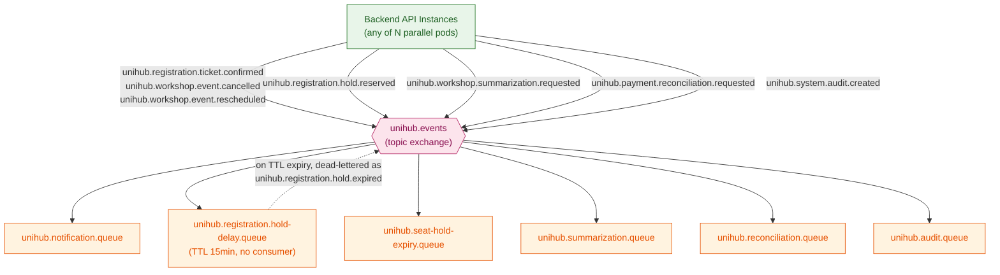
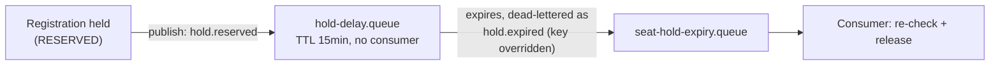
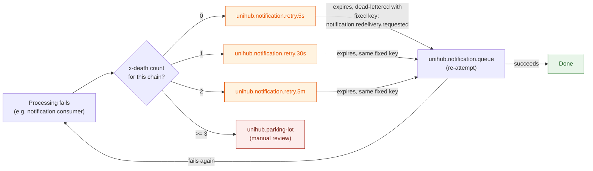

# RabbitMQ Event Topology — Technical Design

This file is the physical-level completion of `architecture.md` §4.3 (RabbitMQ Asynchronous Messaging Topology) and §5.5 (Audit Logging's reuse of the same broker). §4.3 established *that* one shared RabbitMQ deployment decouples four kinds of work from the request that triggers them; §5.5 added a fifth, explicitly without the transactional-outbox guarantee the other four get. Both sections deliberately stopped short of exchange names, queue names, routing keys, and retry mechanics — this document names every one of them. Nothing here overrides `architecture.md` — where this file and that one appear to disagree, `architecture.md` is the authority and this file has a bug.

**Scope:** all five message kinds sharing the one RabbitMQ deployment — seat-hold expiry, lifecycle events, the summarization job, the payment reconciliation task (all four from §4.3), and async audit-event publishing (§5.5). Out of scope: the transactional outbox pattern itself (`database-schema.md` §8.2 `event_publications`, already written — this file owns what happens *after* a row leaves that table, not the same-transaction guarantee that gets it there); each consumer's own business logic beyond what it calls and what state it re-checks; JWT/auth.

All configuration in this document targets RabbitMQ via Spring AMQP (per `CLAUDE.md`'s tech stack — the same deployable consumes its own queues; there is no separate worker service, per `architecture.md` §1.1/§4.3).

---

## 1. Broker Topology & Deployment

**Rationale:** `architecture.md` §4.3 already established why one broker carries all of this instead of several — every one of these five jobs is fundamentally the same problem (decouple *when work happens* from *when it was triggered*), so splitting them across multiple brokers would be complexity without a corresponding benefit.

**Model:**

| Decision | Value | Why |
|---|---|---|
| Topology | Single RabbitMQ instance (Kubernetes `StatefulSet`, one pod), management plugin enabled | Consistent with `CLAUDE.md`'s framing of this deployment as a local Minikube proof-of-concept — the same reasoning `redis-cache-and-locking.md` §1 already applied to Redis. Quorum queues / clustered HA are a deliberate future revisit, not something this design builds toward now. |
| Client | Spring AMQP (`spring-boot-starter-amqp`) | Idiomatic for the mandated Spring Boot stack; `@RabbitListener` consumers run inside the same deployable that serves HTTP (§1.1, §4.3). |
| Publisher confirms | Enabled (`publisher-confirm-type: correlated`) | The outbox relay (`database-schema.md` §8.2) needs positive confirmation that RabbitMQ actually accepted a message before marking the corresponding `event_publications` row `PUBLISHED` and eligible for cleanup — without confirms, the relay would have no way to know a publish actually landed. |
| Durability | All exchanges, queues, and messages declared durable/persistent | Per §4.3's own guarantee: "a broker restart doesn't silently drop a scheduled seat-hold release or a queued reconciliation task." |

---

## 2. Exchange & Queue Design

**Rationale:** one topic exchange, decided with the user, keeps a single binding surface — adding a new event type later is a new routing key, not a new exchange to declare and wire into every producer.

**Model:**

- **Exchange:** `unihub.events` (type `topic`, durable).
- **Routing key convention:** `unihub.<domain>.<entity>.<action>` — `domain` is the owning module's concern (`registration`, `workshop`, `payment`, `system`), `entity` is the noun the event is about, `action` is a past-tense fact ("this already happened"), except where noted otherwise below.

| Routing Key | Domain | Entity | Action | Bound Queue |
|---|---|---|---|---|
| `unihub.registration.ticket.confirmed` | registration | ticket | confirmed | `unihub.notification.queue` |
| `unihub.workshop.event.cancelled` | workshop | event | cancelled | `unihub.notification.queue` |
| `unihub.workshop.event.rescheduled` | workshop | event | rescheduled | `unihub.notification.queue` |
| `unihub.notification.redelivery.requested` | notification | redelivery | requested | `unihub.notification.queue` — a fourth, dedicated binding used only by that queue's own retry chain (§8); it exists because `unihub.notification.queue` is the one queue bound to three different "real" keys, and its retry chain needs one fixed key to dead-letter back to, not three. |
| `unihub.registration.hold.reserved` | registration | hold | reserved | `unihub.registration.hold-delay.queue` (delay-only, §3) |
| `unihub.registration.hold.expired` | registration | hold | expired | `unihub.seat-hold-expiry.queue` |
| `unihub.workshop.summarization.requested` | workshop | summarization | requested | `unihub.summarization.queue` |
| `unihub.payment.reconciliation.requested` | payment | reconciliation | requested | `unihub.reconciliation.queue` |
| `unihub.system.audit.created` | system | audit | created | `unihub.audit.queue` |

Every queue below is durable; message bodies are JSON (Jackson-serialized), matching the serialization convention already established for cached values in `redis-cache-and-locking.md` §2.

| Queue | Bound Routing Key(s) | Special Arguments | Consumer |
|---|---|---|---|
| `unihub.notification.queue` | `ticket.confirmed`, `event.cancelled`, `event.rescheduled`, `notification.redelivery.requested` | — | Notification module (§4) |
| `unihub.registration.hold-delay.queue` | `hold.reserved` | `x-message-ttl: 900000`, `x-dead-letter-exchange: unihub.events`, `x-dead-letter-routing-key: unihub.registration.hold.expired` | **None** — messages only ever leave by expiring (§3) |
| `unihub.seat-hold-expiry.queue` | `hold.expired` | — | Registration module (§3) |
| `unihub.summarization.queue` | `summarization.requested` | — | Workshop module (§5) |
| `unihub.reconciliation.queue` | `reconciliation.requested` | — | Payment module (§6) |
| `unihub.audit.queue` | `audit.created` | — | Audit/observability consumer (§7) |

Each of these five queues has its own dedicated 3-stage retry chain (§8) — not a single chain shared across all five. §8 explains why a shared chain doesn't actually work once a manual, application-level republish step is involved.

Each business queue's own dedicated retry chain (e.g. `unihub.notification.retry.5s`/`.30s`/`.5m`) and the single shared `unihub.parking-lot` are declared separately in §8.



**Guarantees:** every producer and consumer agrees on exactly one exchange and one naming convention — no message kind is ever routed by an undocumented, ad-hoc key.

---

## 3. Seat-Hold Expiry

**Rationale:** `docs/requirement.md` §1.3.1/§2.10 requires a paid-ticket seat hold to release automatically after exactly 15 minutes, with no caller present when it fires — `architecture.md` §4.3 rejected polling ("scanning every workshop at short intervals") in favor of a broker that can schedule future, caller-less delivery.

**Model:** the Dead-Letter-Exchange + per-message-TTL pattern decided with the user.

1. When a paid-ticket registration enters `RESERVED` (`database-schema.md` §4.1), the Registration module publishes to `unihub.events` with routing key `unihub.registration.hold.reserved` — bound only to `unihub.registration.hold-delay.queue`.
2. That queue has **no consumer** and a fixed `x-message-ttl` of 900000ms (15 minutes) — messages only ever leave it by expiring.
3. On expiry, RabbitMQ dead-letters the message back to `unihub.events`, but this queue's `x-dead-letter-routing-key` is **explicitly overridden** to `unihub.registration.hold.expired` — deliberately *not* the default "preserve the original routing key" behavior (§8 explains why the retry chain does the opposite). The delay queue's entire purpose is to transform the event's meaning, `reserved` → `expired`, not to redeliver the same fact.
4. `unihub.registration.hold.expired` routes to `unihub.seat-hold-expiry.queue`, where the real consumer picks it up.



**Consumer behavior — never trusts the message payload alone (`architecture.md` §4.3's ordering trade-off):**
```
1. Acquire unihub:lock:seat:{workshopId}          -- same lock as a fresh reservation
                                                       (redis-cache-and-locking.md §3) --
                                                       releasing a seat is as much a part
                                                       of the anti-overbooking critical
                                                       section as reserving one.
2. Single Postgres transaction:
     SELECT status, version FROM registrations WHERE id = ? (Master)
     if status <> 'RESERVED': COMMIT, do nothing      -- already CONFIRMED or already
                                                          CANCELLED by another path; a
                                                          safe no-op, not an error
     UPDATE registrations SET status = 'EXPIRED', version = version + 1
       WHERE id = ? AND version = :expected
     UPDATE workshops SET seats_taken = seats_taken - 1, version = version + 1
       WHERE id = ? AND version = :expected            -- same-transaction requirement,
                                                          database-schema.md §3.1/§4.1
3. Release the lock.
```

**Guarantees:** a seat held past 15 minutes is always eventually released, exactly once in effect — a redelivered expiry message for an already-resolved registration is a no-op, never a double-release or an error.

---

## 4. Lifecycle Events

**Rationale:** `docs/requirement.md` §1.3.2/§2.2 requires students to be notified of registration confirmation and organizers' cancel/reschedule actions promptly, without the notification call's latency landing on the triggering request (`architecture.md` §4.3).

**Model:** all three lifecycle facts — `unihub.registration.ticket.confirmed`, `unihub.workshop.event.cancelled`, `unihub.workshop.event.rescheduled` — route to the single `unihub.notification.queue`. The Notification module's consumer creates the corresponding `notifications` row (`database-schema.md` §7.1) and dispatches through whichever channel(s) are configured — the queue topology itself doesn't need to know about channels at all, which is exactly what makes new channels (SMS, Zalo, Telegram — `docs/requirement.md` §1.3.2) addable later without touching this document.

**Idempotency (redelivery-safety, distinct from `idempotency_keys` — see §8):** a redelivered lifecycle event must not send a duplicate email or create a duplicate in-app notification. The consumer checks for an existing `notifications` row matching `(user_id, related_entity_type, related_entity_id, type)` before creating and dispatching a new one — if found, it's a safe no-op. This is an application-level check, not a database unique constraint (`database-schema.md` §7.1 didn't add one, since a rare duplicate notification is a UX nuisance, not a correctness violation the way a duplicate charge would be — but the consumer still avoids it as ordinary good behavior, not just because it's forced to).

**Accepted trade-off — this check-then-insert has a small race under concurrent redelivery:** because there is no unique constraint behind it (`database-schema.md` §7.1), two redeliveries of the same message landing on two consumer threads/pods at nearly the same moment can both pass the "no existing row" check before either has inserted, producing two `notifications` rows for the same fact. This is accepted, not closed, for the same reason `database-schema.md` §7.1 chose not to add a unique constraint here: the failure mode is a duplicate email or duplicate in-app notification — a UX nuisance a student might shrug off, never a correctness violation the way a duplicate charge or duplicate seat would be. It is deliberately treated differently from `idempotency_keys` (`database-schema.md` §8.1), where the same race would be unacceptable and is closed with a database-enforced unique constraint instead of an application-level check alone.

**Guarantees:** every lifecycle fact reaches the Notification module at least once; redelivery produces at most one dispatched notification per `(user, entity, type)` tuple.

---

## 5. Summarization Job

**Rationale:** `docs/requirement.md` §1.3.4 requires an AI-generated summary from an uploaded brochure — a slow, third-party call that must never block the organizer's upload response (`architecture.md` §4.3).

**Model:** on brochure upload, the Workshop module publishes `unihub.workshop.summarization.requested` → `unihub.summarization.queue`. The consumer fetches the PDF from S3 (`brochure_s3_key`, `database-schema.md` §3.1), calls the AI Summarization Service, and writes the result to `workshops.ai_summary`. This write must also `DEL` the `unihub:cache:workshop:detail:{workshopId}` Redis key (`redis-cache-and-locking.md` §2) — otherwise a student could see a stale "summary pending" state for up to that key's 300s TTL after the real summary is ready.

**Idempotency:** naturally safe under redelivery — reprocessing the same brochure just overwrites `ai_summary` with a freshly generated summary. There's no accumulating side effect to guard against, unlike lifecycle events or payments.

**Guarantees:** every uploaded brochure eventually gets a summary; a redelivered or retried summarization request never produces more than one final `ai_summary` value (the last write simply wins).

---

## 6. Payment Reconciliation Task

**Rationale:** `docs/requirement.md` §2.10 requires a scheduled sweep to find payments stuck `PENDING` past 15 minutes and resolve them against the gateway. The sweep's *query* (fast, DB-only) and its *resolution* (slow, external gateway call per row) are deliberately decoupled — this is the same reasoning as §3 and §5, applied a third time.

**Model:** the reconciliation sweep — coordinated by `unihub:lock:job:payment-reconciliation` so only one pod runs it per cycle (`redis-cache-and-locking.md` §4) — queries `payments WHERE status = 'PENDING' AND initiated_at < now() - interval '15 minutes'` and publishes one `unihub.payment.reconciliation.requested` message per row found → `unihub.reconciliation.queue`. The consumer calls the Payment Gateway's status API for that payment's `gateway_transaction_id` and resolves it:
```
SELECT status, version FROM payments WHERE id = ? (Master)
if status <> 'PENDING': COMMIT, do nothing   -- already resolved, e.g. by a webhook
                                                  that raced this consumer — exactly the
                                                  race payments.version exists for
                                                  (database-schema.md §5.1)
UPDATE payments SET status = :resolved, resolved_at = now(), version = version + 1
  WHERE id = ? AND version = :expected
```

**Idempotency:** naturally safe under redelivery for the same reason as the seat-hold consumer — re-checking `status` before acting means a redelivered or duplicated reconciliation task for an already-resolved payment is a no-op.

**Note — redundant gateway calls across sweep cycles, not a correctness issue:** a payment still `PENDING` past 15 minutes matches the sweep's `WHERE` clause again on every subsequent cycle until it actually resolves, so if a sweep tick fires before a previous cycle's message for the same payment has been processed, a second (redundant) gateway status-check call gets queued for that same payment. This costs an extra external API call, not correctness — the `status <> 'PENDING'` re-check above means the second consumer to run for the same payment always finds it already resolved and no-ops.

**Guarantees:** every payment that goes stale in `PENDING` is eventually resolved; a race between this consumer and a gateway webhook always converges to one final status, never a lost or double update (`database-schema.md` §5.1's `version` column).

---

## 7. Async Audit Event Publishing

**Rationale:** `architecture.md` §5.5 requires every sensitive operation (registration, payment, check-in, workshop lifecycle change, role/permission change) to emit an audit event — asynchronously, and **deliberately without** the transactional-outbox guarantee the other four message kinds get, because audit is "an investigative concern, not a correctness-critical one."

**Model:** any module performing an audited operation publishes `unihub.system.audit.created` directly (fire-and-forget, not via the `event_publications` outbox table) → `unihub.audit.queue`. The consumer appends a row to `audit_events` (`database-schema.md` §8.3).

**This is the one message kind in this document that is genuinely allowed to be lost:** if the publish call itself fails (e.g. the broker is briefly unreachable), the audit event never enters the queue at all — and per §5.5, that's accepted, not a bug: "an audit-publish failure must never block or fail the business operation it would have recorded... but the audit-publish failure itself must surface as an operational alert." The publish call's own failure is what gets alerted on, not silently retried into the same durability the other four kinds enjoy.

**Idempotency:** deliberately *not* pursued as rigorously as elsewhere. A redelivered audit event simply produces a second `audit_events` row for the same real event — since that table has no uniqueness constraint tying a row to a single source event (`database-schema.md` §8.3), a duplicate is cosmetic noise for an investigator, not a correctness bug the way a duplicate registration or payment would be.

**Guarantees:** an audit pipeline outage never blocks or fails the business operation it would have recorded (§5.5) — the direct consequence of this message kind's publish being outside the outbox's atomicity.

---

## 8. Retry, Dead-Lettering & Idempotent Consumption

**Rationale:** `architecture.md` §4.3 states RabbitMQ here is at-least-once, never exactly-once — every consumer above already re-checks current Postgres state before acting for exactly this reason. This section adds what happens when a consumer's processing itself *fails* (a downstream call throws, a transient error occurs) — distinct from redelivery, which is about a message arriving more than once.

**Model — exponential backoff via a dedicated retry chain per business queue, not one chain shared across all five:**

A shared chain was the original design here, but it doesn't actually work: a message only reaches a retry-stage queue via an **application-level republish**, not RabbitMQ's own automatic dead-lettering. Publishing through the default exchange to reach a queue by name requires the routing key to equal that queue's name — so whatever routing key the message truly arrived with is already gone by the time the retry queue's own TTL expiry triggers the *next* dead-letter hop. RabbitMQ's "preserve the original routing key when `x-dead-letter-routing-key` is unset" behavior is real, but it only preserves the routing key of the delivery that *directly* preceded the current dead-letter event — which, after a manual republish, is the retry queue's own name, not the true original. Relying on it here would silently discard every message that fails even once, since `unihub.events` has no binding for a routing key like `unihub.retry.5s`.

The fix is to give each of the five business queues its own 3-stage chain, each explicitly (not by omission) setting `x-dead-letter-routing-key` to a key that's bound back to that same business queue — so it doesn't matter what routing key got the message into the retry queue in the first place; the dead-letter hop is hard-wired to land back in the right place regardless.

| Business Queue | Retry Chain (queue → TTL) | `x-dead-letter-routing-key` (explicit) |
|---|---|---|
| `unihub.notification.queue` | `unihub.notification.retry.5s` (5s) → `unihub.notification.retry.30s` (30s) → `unihub.notification.retry.5m` (5min) | `unihub.notification.redelivery.requested` — a dedicated key (§2) added because this queue is bound to three different "real" keys; the retry chain needs exactly one fixed target, and the message *body* still carries which of the three facts actually occurred. |
| `unihub.seat-hold-expiry.queue` | `unihub.seat-hold-expiry.retry.5s` → `.retry.30s` → `.retry.5m` | `unihub.registration.hold.expired` — reused as-is, since this queue only has the one binding. |
| `unihub.summarization.queue` | `unihub.summarization.retry.5s` → `.retry.30s` → `.retry.5m` | `unihub.workshop.summarization.requested` — reused as-is. |
| `unihub.reconciliation.queue` | `unihub.reconciliation.retry.5s` → `.retry.30s` → `.retry.5m` | `unihub.payment.reconciliation.requested` — reused as-is. |
| `unihub.audit.queue` | `unihub.audit.retry.5s` → `.retry.30s` → `.retry.5m` | `unihub.system.audit.created` — reused as-is. |

Every retry-stage queue also sets `x-dead-letter-exchange: unihub.events`. This is 15 retry queues total instead of 3 — more declarations, but each one is a small, static piece of metadata, and none of them depend on a routing-key-preservation trick that doesn't actually hold across a manual republish. A single shared `unihub.parking-lot` (below) is still fine, because nothing dead-letters *out* of it automatically — it's the terminal stage, manually drained by a human, so there's no further routing-key hop to get wrong.

| Terminal | `unihub.parking-lot` | — (no TTL, no auto-processing) | n/a — durable, manually inspected |

**Retry-count tracking:** RabbitMQ automatically attaches an `x-death` header to every dead-lettered message — an array with one entry per distinct (queue, reason) combination the message has passed through, each carrying its own `count`. Consumers derive the current attempt number by scanning that array for the entry matching the message's *own* retry-chain queue and reading its `count` — not by treating `x-death` as a single scalar. No custom `x-retry-count` header needs to be invented or maintained by application code.

**Flow — on a processing failure (using `unihub.notification.queue` as the example; identical shape for the other four):**
```
1. Consumer catches the processing exception, nacks without requeue.
2. Error handler scans the x-death array for the entry matching this message's own
   retry-chain queue (e.g. unihub.notification.retry.*) and reads its count:
     count == 0  → publish to unihub.notification.retry.5s   (default exchange,
                                                                routing key = queue name)
     count == 1  → publish to unihub.notification.retry.30s
     count == 2  → publish to unihub.notification.retry.5m
     count >= 3  → Max Retries (3) exhausted — publish directly to unihub.parking-lot,
                   tagging the original routing key + last exception message as headers
```
The routing key used to reach the retry queue in step 2 no longer matters for correctness — each retry queue's `x-dead-letter-routing-key` is hard-wired (table above), so the dead-letter hop back to the business queue is correct regardless.



Each of the other four business queues has an identical-shaped chain and diagram, differing only in queue names and the fixed dead-letter-routing-key (table above) — not repeated here.

**Critical distinction — this is a different mechanism from `idempotency_keys`:** `database-schema.md` §8.1's `idempotency_keys` table guards **client-facing HTTP request** duplication — a student's double-click or a resent network request, deduplicated by a client-generated key checked in the same Postgres transaction as the business effect. The re-check-current-state-before-acting pattern in this document (§3, §6, and every consumer above) guards **broker redelivery** — a completely different failure mode, with a completely different mechanism. Neither one substitutes for the other, and this document must never be read as saying the `idempotency_keys` table also covers message redelivery, or vice versa.

**Guarantees:** a transient consumer failure is retried up to 3 times with increasing delay before requiring human attention; the Parking Lot Queue is where the Organizing Committee's operational visibility (`architecture.md`'s Observability Stack) picks up a genuinely stuck message — never a silent drop.

---

## 9. Reference Table

Every exchange, queue, routing key, and retry/TTL value in this document, in one place — the same purpose the closing tables in `database-schema.md` §11 and `redis-cache-and-locking.md` §7 serve for their respective files.

| Name | Type / Value | Backs |
|---|---|---|
| `unihub.events` | Topic exchange | Single binding surface for all five message kinds (`architecture.md` §4.3, §5.5) |
| `unihub.registration.ticket.confirmed` | Routing key | Registration confirmation notification (`docs/requirement.md` §1.3.2) |
| `unihub.workshop.event.cancelled` / `.rescheduled` | Routing key | Workshop lifecycle notification (`docs/requirement.md` §1.3.3) |
| `unihub.registration.hold.reserved` / `.expired` | Routing key | Seat-hold expiry (`docs/requirement.md` §1.3.1, §2.10) |
| `unihub.workshop.summarization.requested` | Routing key | AI brochure summarization (`docs/requirement.md` §1.3.4) |
| `unihub.payment.reconciliation.requested` | Routing key | Stuck-payment reconciliation (`docs/requirement.md` §2.10) |
| `unihub.system.audit.created` | Routing key | Async audit trail (`architecture.md` §5.5) |
| `unihub.notification.redelivery.requested` | Routing key | Fixed dead-letter target for `unihub.notification.queue`'s own retry chain (§8) — needed because that queue has three "real" bindings, not one |
| `unihub.registration.hold-delay.queue` | TTL 900000ms (15 min), no consumer | Seat-hold 15-minute window, exact value (`docs/requirement.md` §1.3.1) |
| `unihub.notification.retry.5s` / `.30s` / `.5m` | TTL 5s / 30s / 5min, `x-dead-letter-routing-key` explicitly `unihub.notification.redelivery.requested` | Exponential-backoff retry, dedicated to `unihub.notification.queue` (§8) |
| `unihub.seat-hold-expiry.retry.5s` / `.30s` / `.5m` | Same TTLs, dead-letter-routing-key `unihub.registration.hold.expired` | Dedicated retry chain for `unihub.seat-hold-expiry.queue` (§8) |
| `unihub.summarization.retry.5s` / `.30s` / `.5m` | Same TTLs, dead-letter-routing-key `unihub.workshop.summarization.requested` | Dedicated retry chain for `unihub.summarization.queue` (§8) |
| `unihub.reconciliation.retry.5s` / `.30s` / `.5m` | Same TTLs, dead-letter-routing-key `unihub.payment.reconciliation.requested` | Dedicated retry chain for `unihub.reconciliation.queue` (§8) |
| `unihub.audit.retry.5s` / `.30s` / `.5m` | Same TTLs, dead-letter-routing-key `unihub.system.audit.created` | Dedicated retry chain for `unihub.audit.queue` (§8) |
| `unihub.parking-lot` | Durable, no TTL, manual processing | Max Retries = 3 exhausted — operator-visible failure surface, shared across all five chains since it's terminal (no further dead-letter hop to get wrong) |
| Consumer state re-check (all consumers) | Application-level pattern | "Consumers must be idempotent under redelivery" (`architecture.md` §4.3, `CLAUDE.md` Non-Negotiable Invariants) — distinct from `idempotency_keys` (`database-schema.md` §8.1) |
