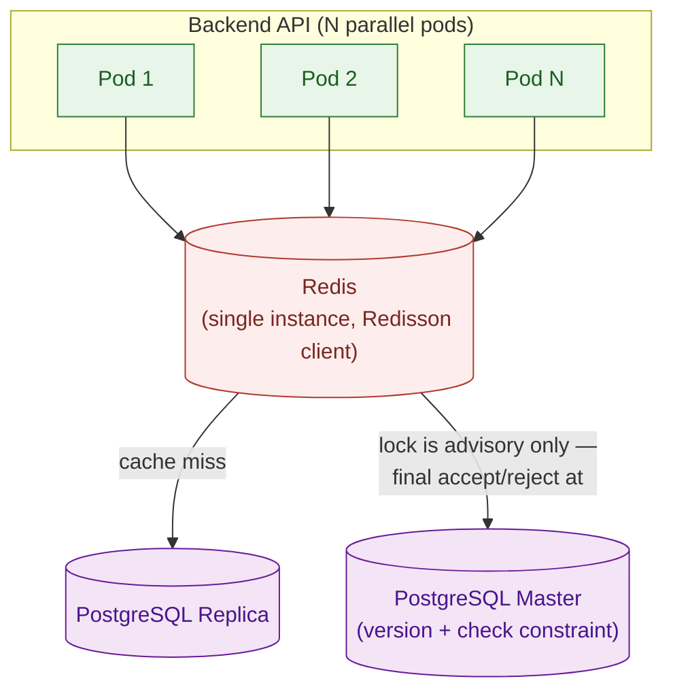
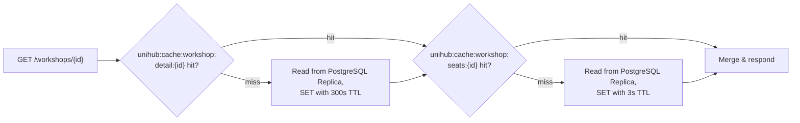

# Redis Cache & Locking — Technical Design

This file is the physical-level completion of `architecture.md` §4.2 (Redis Coordination & Caching Topology) and §4.6 (Distributed Scheduled Job Coordination). Those sections established _that_ one shared Redis deployment does three jobs — cache-aside reads, seat-reservation locking, and scheduled-job coordination — and named rate limiting (`docs/requirement.md` §2.5) in the same topology, but deliberately stopped short of key formats, TTL values, and lease durations, calling them out explicitly as tuning parameters for this document. Nothing here overrides `architecture.md` — where this file and that one appear to disagree, `architecture.md` is the authority and this file has a bug.

**Naming note:** `architecture.md` §4.2 names a future `technical-design/anti-overbooking.md` for the seat-lock lease duration specifically. This file is that document's actual home — it covers Redis's full physical topology, not just the anti-overbooking lock, and no separate `anti-overbooking.md` is planned alongside it.

**Scope:** cache-aside for the workshop catalog, the seat-reservation distributed lock, the scheduled-job coordination lock (all four jobs named in §4.6), and rate limiting — the complete physical picture of the one shared Redis deployment. Out of scope: the Postgres-side optimistic-concurrency check itself (`database-schema.md` §3.1/§4.1, already written — this file's lock is advisory only and never the final word), JWT claim shape/expiry, and each scheduled job's own internal correctness (`technical-design/student-sync.md` etc., not yet written — this file only owns the lock that decides _which instance_ runs a job, not what the job does once running).

All configuration in this document targets Redis via the Redisson client (per `CLAUDE.md`'s tech stack).

---

## 1. Redis Topology & Deployment

**Rationale:** §4.2 already established why cache, lock, and rate-limit share one deployment instead of three — all three are cheap, short-lived, and fail safely, so splitting them across separate stateful components would be complexity without a corresponding benefit. This section only adds the physical shape of that one deployment.

**Model:**

| Decision              | Value                                                     | Why                                                                                                                                                                                                                                                                                                                                                       |
| --------------------- | --------------------------------------------------------- | --------------------------------------------------------------------------------------------------------------------------------------------------------------------------------------------------------------------------------------------------------------------------------------------------------------------------------------------------------- |
| Topology              | Single Redis instance (Kubernetes `StatefulSet`, one pod) | `CLAUDE.md` frames this deployment as a local Minikube proof-of-concept, not a cloud production rollout — Sentinel/Cluster HA is a deliberate future revisit, not something this design builds toward now.                                                                                                                                                |
| Client                | Redisson, single-server mode (`SingleServerConfig`)       | Mandated client per `CLAUDE.md`'s tech stack; single-server mode matches the single-instance topology above — Sentinel/Cluster client modes aren't applicable yet.                                                                                                                                                                                        |
| Connection pool       | Redisson defaults (`connectionPoolSize` 64, `connectionMinimumIdleSize` 24)          | No load-test evidence yet justifies overriding the client's own defaults; revisit once K6/JMeter load testing (`docs/requirement.md` §3.2) produces a number.                                                                                                                                                                                             |
| Persistence (RDB/AOF) | Disabled                                                  | Nothing stored in this Redis is authoritative data (§6.3 of `database-schema.md`'s cross-referenced retention table: coordination locks and rate limits are seconds-lived; cache is disposable). A restart losing all keys is a non-event — caches refill on next read, locks simply don't exist until next acquired, rate limiters reset to full budget. |

<div align=center>



</div>

**Guarantees:** losing the Redis pod entirely degrades the system (slower reads, rejected registration writes, skipped job cycles — see §6) but never corrupts data; every value Redis holds is either a disposable copy or a coordination signal with a bounded lifetime.

---

## 2. Cache-Aside: Workshop Catalog

**Rationale:** `docs/requirement.md` §2.4 requires caching "static or infrequently changing workshop information" so catalog-browsing load doesn't hit the primary data store on every request. But §1.3.1 separately requires "real-time updated seat availability" on the same page — those two requirements pull in different directions on the _same_ entity. Caching the whole workshop row under one TTL would either make seat counts too stale (violating §1.3.1) or force the TTL so short the cache stops helping (defeating §2.4). The resolution: split the entity's cache representation in two, with different TTLs for different volatility.

**Model:**

| Key                                         | Contents                                                                                                                                                                                     | TTL  | Invalidated by                                                                                                                                                                                                      |
| ------------------------------------------- | -------------------------------------------------------------------------------------------------------------------------------------------------------------------------------------------- | ---- | ------------------------------------------------------------------------------------------------------------------------------------------------------------------------------------------------------------------- |
| `unihub:cache:workshop:detail:{workshopId}` | Slow-changing fields: `title`, `description`, `ai_summary`, `speaker_name`, `speaker_bio`, `location`, `start_time`, `end_time`, `capacity`, `is_paid`, `price`, `brochure_s3_key`, `status` | 300s | Explicit `DEL` on organizer edit/cancel/reschedule, in the same request handler that commits the Postgres update — never relies on TTL expiry alone for a write the system itself just made.                        |
| `unihub:cache:workshop:seats:{workshopId}`  | Volatile fields only: `seats_taken`, `capacity`, `status`                                                                                                                                    | 3s   | Explicit `DEL` on **(a)** any registration write that changes `seats_taken` (create/confirm/cancel/expire), **and (b)** organizer edit/cancel/reschedule — same trigger set as the detail key, since this key duplicates `status` and would otherwise disagree with the detail key's already-correct value for up to 3s after a cancellation. Natural 3s expiry as a backstop either way. |
| `unihub:cache:workshop:list:{filterHash}`   | Paginated/filtered workshop summaries (id, title, location, start_time, status) for a given search query                                                                                     | 30s  | Natural expiry only — no write-path invalidation, since a `filterHash` doesn't identify which cached lists reference a given workshop. Staleness here is accepted per §4.2's own trade-off framing, bounded to 30s. |

`filterHash` is a deterministic hash (e.g. SHA-256, truncated) of the normalized query parameters (topic, speaker, location, date range, page, page size, sort order) — same query always maps to the same key.

All values are JSON (Jackson-serialized), stored as plain Redis strings — not hashes — since every write invalidates the whole key rather than patching a field, so a hash's partial-update capability isn't needed and would only add complexity.

**Invalidation ownership:** both `detail` and `seats` keys are namespaced under `workshop`, which the Workshop module exclusively writes (`CLAUDE.md`'s module-ownership table). A Registration-module write that changes `seats_taken` must not reach across and call `DEL` on a Workshop-namespaced key directly — it invalidates through Workshop module's own interface (e.g. an in-process call or the same domain event Workshop already listens for), the same discipline `architecture.md` §1.1 applies to table writes, extended here to cache keys.

**Trade-off — seat availability is "near-real-time," not real-time, and that's accepted, not fixed:** a 3s-old seat count can still be shown to a browsing student. This doesn't reopen the anti-overbooking guarantee — per `architecture.md` §4.1, "Replica staleness can affect what a user _sees_, but never what the system _commits_"; the actual accept/reject decision happens transactionally at the Master, inside the seat-reservation lock (§3), completely independent of whatever the student's browser last displayed. The 3s TTL exists purely to shed read load during a browsing burst while keeping the _displayed_ number close enough to true that it doesn't read as broken.

**Read path:**



**Guarantees:** the cache is never the source of truth (§4.2) — clearing every key above at any moment leaves the system correct, only slower. Splitting volatility means the 5-minute TTL on slow fields doesn't force a 5-minute-stale seat count, and the 3-second TTL on seat counts doesn't force refetching the whole workshop row every 3 seconds.

---

## 3. Distributed Lock: Seat Reservation

**Rationale:** the coordination half of anti-overbooking (`architecture.md` §4.2, §6.1; `proposal.md` §11.1). This lock is **advisory only** — it decides which pod may _attempt_ the seat-reservation write next; it never decides whether that write is _accepted_. That decision belongs entirely to PostgreSQL's `version` + check-constraint pair (`database-schema.md` §3.1/§4.1). This file must never be read as making that guarantee alone.

**Model:**

| Parameter           | Value                                           | Why                                                                                                                                                                                                                                                                                                                                                                                                                                               |
| ------------------- | ----------------------------------------------- | ------------------------------------------------------------------------------------------------------------------------------------------------------------------------------------------------------------------------------------------------------------------------------------------------------------------------------------------------------------------------------------------------------------------------------------------------- |
| Key                 | `unihub:lock:seat:{workshopId}`                 | Per-workshop granularity — the critical section is "don't let two requests simultaneously modify _this_ workshop's seat count." Different workshops never contend, so a global lock would serialize unrelated registrations for no correctness benefit.                                                                                                                                                                                           |
| Lease (TTL)         | 5 seconds, fixed — **no watchdog auto-renewal** | The critical section is a single bounded Postgres transaction (re-check `seats_taken` vs `capacity`, insert/update, commit) with no external calls inside it — typically under 100ms. 5s comfortably covers that plus GC pauses or a slow connection-pool checkout, while still self-healing quickly if a pod crashes mid-hold, which matters most during the exact registration-opening spike (`docs/requirement.md` §1.4) this lock exists for. |
| `tryLock` wait-time | 2 seconds                                       | Bounds how long a request thread blocks under contention before giving up. `docs/requirement.md` §1.4 describes hundreds of requests competing for a single workshop's last few seats at once — piling up blocked threads for longer than this risks exhausting the API pod's thread/connection pool exactly when load is highest.                                                                                                                |

```java
RLock lock = redisson.getLock("unihub:lock:seat:" + workshopId);
boolean acquired;
try {
    acquired = lock.tryLock(2, 5, TimeUnit.SECONDS); // wait 2s, lease 5s fixed
} catch (RedisConnectionException e) {
    return HttpStatus.SERVICE_UNAVAILABLE; // Redis unreachable — reject, never proceed uncoordinated
}
if (!acquired) {
    return HttpStatus.SERVICE_UNAVAILABLE; // high contention — transient, Retry-After
}
try {
    // single Postgres transaction, same-transaction requirement per database-schema.md §3.1/§4.1:
    //   SELECT seats_taken, capacity, version FROM workshops WHERE id = ? (Master)
    //   if seats_taken >= capacity: rollback; return 409 (sold out)
    //   INSERT INTO registrations (...);
    //   UPDATE workshops SET seats_taken = seats_taken + 1, version = version + 1
    //     WHERE id = ? AND version = :expected
    //   commit
} finally {
    lock.unlock();
}
```

**Two distinct failure responses, not one:** losing the lock race (contention) and the workshop actually being full are different facts and must not be collapsed into the same status code:

| Situation                                                          | Response                                         | Why distinct                                                                                                             |
| ------------------------------------------------------------------ | ------------------------------------------------ | ------------------------------------------------------------------------------------------------------------------------ |
| `tryLock` times out (contention) or Redis unreachable              | `503 Service Unavailable` + `Retry-After` header | Transient — the seat may still be available; the client should retry shortly.                                            |
| Lock acquired, but `seats_taken >= capacity` on the Postgres check | `409 Conflict` ("sold out")                      | Permanent for this attempt — re-checking the same workshop won't change the outcome without someone else's cancellation. |

**Trade-off — a fixed lease can, in principle, expire under a holder before it finishes:** if a pod's Postgres transaction somehow ran past 5 seconds (a slow query, a stalled connection), a second pod could acquire the lock and run concurrently with the first still believing it holds exclusivity. This is accepted, not closed, for the same reason `architecture.md` §4.2 accepts it: the lock is advisory. Even in that scenario, PostgreSQL's `version`-based optimistic-concurrency check (`database-schema.md` §3.1) still rejects whichever of the two transactions commits second — the invariant holds at the database layer regardless of what happens at the coordination layer.

**Guarantees:** mutual exclusion for the seat-reservation critical section across all parallel pods, under normal conditions (§4.2). Combined with `database-schema.md`'s optimistic-concurrency check, no code path in this document allows two registrations to both believe they claimed the same last seat.

---

## 4. Distributed Lock: Scheduled Job Coordination

**Rationale:** reuses the same Redis coordination primitive as §3, for the different purpose `architecture.md` §4.6 describes: ensuring exactly one pod executes a given scheduled job per cycle, never zero (barring a Redis outage) and never more than one.

**Model:** one lock key per job, each with its own lease sized to comfortably exceed that job's expected runtime — a single shared lock/lease across all four jobs would either be too short for the slowest (nightly sync) or needlessly long for the fastest (the cleanup sweeps), and either way would leave a job type name resolving to logic totally unrelated to another's.

| Job                                          | Key                                         | Lease (TTL) | Why this lease                                                                                                                                                                                                             |
| -------------------------------------------- | ------------------------------------------- | ----------- | -------------------------------------------------------------------------------------------------------------------------------------------------------------------------------------------------------------------------- |
| Nightly student sync (§1.3.6)                | `unihub:lock:job:nightly-student-sync`      | 30 minutes  | Runs once daily, processing a full legacy-system export — data volume varies, and this job is never in a tight loop with others waiting, so a generous lease costs nothing. Revisit if real runtime approaches this value. |
| Payment reconciliation sweep (§2.10)         | `unihub:lock:job:payment-reconciliation`    | 5 minutes   | Scans `PENDING` payments older than 15 minutes and calls the gateway's status API per row — bounded by realistic pending-transaction volume, not by anything close to 30 minutes.                                          |
| Idempotency-key cleanup sweep (§4.5, §4.6)   | `unihub:lock:job:idempotency-cleanup`       | 1 minute    | A single bounded `DELETE ... WHERE created_at < ...` — fast by construction.                                                                                                                                               |
| Event-publication cleanup sweep (§6.1, §4.6) | `unihub:lock:job:event-publication-cleanup` | 1 minute    | Same shape as the idempotency sweep — a bounded delete of already-published rows.                                                                                                                                          |

```java
RLock lock = redisson.getLock("unihub:lock:job:" + jobName);
boolean acquired;
try {
    acquired = lock.tryLock(0, leaseSeconds, TimeUnit.SECONDS); // non-blocking: acquire now or skip
} catch (RedisConnectionException e) {
    return; // Redis unreachable — skip this cycle, next tick retries (§4.6)
}
if (!acquired) {
    return; // another instance already claimed this cycle — skip, don't queue a retry
}
try {
    // run the job
} finally {
    lock.unlock();
}
```

`tryLock` wait-time is **0** here, unlike the seat lock's 2 seconds — a scheduled tick isn't a user waiting on a response; there's no reason to block. Either this instance claims the cycle immediately, or it skips and trusts the next tick, exactly as `architecture.md` §4.6 describes.

**Trade-off — the same fixed-lease-expiry risk as §3's seat lock, without the same second layer:** if a job's actual runtime exceeds its lease (most plausible for nightly student sync, line above: "data volume varies"), the lease expires while the job is still running, and a second pod can then acquire the same lock and start a **concurrent second run** of that job — briefly violating the "exactly one instance per cycle" guarantee this section exists to provide. Unlike the seat lock, there's no PostgreSQL optimistic-concurrency check standing behind this one as a second layer, so this risk is only survivable if the job's own write path is idempotent under a concurrent duplicate run:
- **Payment reconciliation, idempotency cleanup, event-publication cleanup** are naturally safe: each operates on rows by a `WHERE` predicate (`status = 'PENDING'`, `created_at < ...`) that a second concurrent pass simply finds nothing new to act on — a duplicate run degrades to a no-op, not corruption.
- **Nightly student sync** is the one job where this isn't automatically true — a concurrent second run against the same legacy CSV import could race on the same upsert rows. This job's lease (30 minutes) is a guess at normal runtime, not a guarantee; treat sustained runtime approaching the lease as an operational alert to shorten the job or lengthen the lease, and require the sync's own upsert logic (`technical-design/student-sync.md`, not yet written) to be safe under a concurrent duplicate run regardless — this file cannot make that job idempotent on its own, it can only flag that the lock alone won't catch an overrun.

**Guarantees:** exactly one instance runs a given job per cycle under normal conditions; a skipped cycle (lost the race, or Redis unreachable) is always recovered by the next scheduled tick, never queued or retried mid-cycle (§4.6).

---

## 5. Rate Limiting

**Rationale:** `docs/requirement.md` §2.5 requires limiting requests per user/device within a time window, applied consistently across all parallel pods — an in-process limiter would leave a gap as wide as the one a local lock would leave for seat reservation (§4.2's rate-limiting rationale). Redisson's `RRateLimiter` is a token-bucket primitive native to the already-mandated client.

**Model:**

| Scope                          | Key                                      | Rate               | Why                                                                                                                                                                                                                                   |
| ------------------------------ | ---------------------------------------- | ------------------ | ------------------------------------------------------------------------------------------------------------------------------------------------------------------------------------------------------------------------------------- |
| Per-user registration attempts | `unihub:ratelimit:registration:{userId}` | 5 requests / 10s   | Generous enough for legitimate retry-on-failure UX (a student whose first attempt got a transient 503 from §3 should be able to retry within seconds), tight enough to block a scripted hammering loop aimed at one workshop's seats. |
| Per-IP general API traffic     | `unihub:ratelimit:global-ip:{ipAddress}` | 100 requests / 60s | Coarser, catches unauthenticated abuse (catalog scraping, credential-stuffing against login) that a per-user limiter can't see because it has no authenticated user yet.                                                              |

```java
// Each key is per-identity (per userId/IP), so the rate can't be pre-configured once at
// startup — it must be set the first time this pod sees a given key. trySetRate() only
// succeeds that first time (returns false harmlessly afterward), but calling it inline on
// every request still costs a second Redis round-trip per request for a value that, once
// set, never changes for that key. A pod-local cache of "keys already configured this
// pod's lifetime" skips the redundant call on every request after the first:
RRateLimiter limiter = redisson.getRateLimiter("unihub:ratelimit:registration:" + userId);
if (!configuredKeysCache.contains(limiter.getName())) { // e.g. a local Caffeine cache
    limiter.trySetRate(RateType.OVERALL, 5, 10, RateIntervalUnit.SECONDS);
    configuredKeysCache.add(limiter.getName());
}

// Hot path after the first request per key — one Redis round-trip, not two:
if (!limiter.tryAcquire()) {
    return HttpStatus.TOO_MANY_REQUESTS; // 429, with a computed Retry-After
}
```

**Trade-off — this is abuse prevention, not a correctness mechanism:** rate limiting exists to protect system capacity, not to enforce anti-overbooking — that guarantee is entirely §3's and `database-schema.md`'s. A rate-limited request is simply asked to slow down; it carries no bearing on whether a seat was, or wasn't, correctly reserved.

**Guarantees:** a client's request budget is identical regardless of which pod handles the request (§4.2) — never a per-instance-only limit that a distributed client could route around.

---

## 6. Failure Modes & Fail-Safe Behavior

One consolidated view — each of the four Redis-backed subsystems fails differently on purpose, not by a single blanket policy:

| Subsystem                  | Redis unreachable →                                       | Rationale                                                                                                                                                                                                                                                                                                                                                                                                                                                        |
| -------------------------- | --------------------------------------------------------- | ---------------------------------------------------------------------------------------------------------------------------------------------------------------------------------------------------------------------------------------------------------------------------------------------------------------------------------------------------------------------------------------------------------------------------------------------------------------- |
| Cache-aside (§2)           | Fall through to the PostgreSQL Replica directly, uncached | The cache is never authoritative (§4.2) — a miss only costs a Replica read, never a correctness problem.                                                                                                                                                                                                                                                                                                                                                         |
| Seat-reservation lock (§3) | **Reject** the registration write (`503`, `Retry-After`)  | §4.2: coordination unavailable means the write must never proceed uncoordinated. Rejecting protects the anti-overbooking invariant when the advisory layer can't do its job — Postgres's check alone, absent the lock's throughput-shaping role, isn't treated as sufficient under the exact high-contention conditions (§1.4) this lock exists for.                                                                                                             |
| Scheduled-job lock (§4)    | **Skip** this cycle; the next tick retries                | §4.6: uncoordinated execution (two instances running the same job at once) is worse than a delayed one.                                                                                                                                                                                                                                                                                                                                                          |
| Rate limiter (§5)          | **Fail open** — allow the request through unthrottled     | Not covered explicitly by §4.2. Proposed here because the one correctness-critical defense in this document (the seat lock, §3) is already fail-closed during the same outage — failing the rate limiter open too doesn't reopen the overbooking risk, it only means abuse-prevention is temporarily degraded for the duration of the outage, which is an acceptable secondary-layer trade-off rather than a second correctness gap stacked on top of the first. |

---

## 7. Key Format & Tuning-Parameter Reference Table

Every Redis key pattern and numeric value in this document, in one place, traced back to what it backs — the same purpose `database-schema.md` §11's Traceability Matrix serves for the schema.

| Key Pattern                                 | TTL / Lease / Rate   | Backs                                                                                                                                                                                              |
| ------------------------------------------- | -------------------- | -------------------------------------------------------------------------------------------------------------------------------------------------------------------------------------------------- |
| `unihub:cache:workshop:detail:{workshopId}` | 300s TTL             | Caching slow-changing workshop data (`docs/requirement.md` §2.4)                                                                                                                                   |
| `unihub:cache:workshop:seats:{workshopId}`  | 3s TTL               | Near-real-time seat availability display (§1.3.1) without re-querying the Replica on every request                                                                                                 |
| `unihub:cache:workshop:list:{filterHash}`   | 30s TTL              | Catalog search/browse caching (§2.4), accepted staleness per `architecture.md` §4.2                                                                                                                |
| `unihub:lock:seat:{workshopId}`             | 5s lease, 2s wait    | Anti-overbooking coordination layer (§6.1/§4.2 of `architecture.md`, `proposal.md` §11.1) — advisory only; `database-schema.md` §3.1/§4.1's `version`/check-constraint pair is the final authority |
| `unihub:lock:job:nightly-student-sync`      | 30min lease, 0s wait | Exactly-one-instance nightly sync (§1.3.6, §4.6)                                                                                                                                                   |
| `unihub:lock:job:payment-reconciliation`    | 5min lease, 0s wait  | Exactly-one-instance reconciliation sweep (§2.10, §4.6)                                                                                                                                            |
| `unihub:lock:job:idempotency-cleanup`       | 1min lease, 0s wait  | Exactly-one-instance idempotency sweep (§4.5, §4.6)                                                                                                                                                |
| `unihub:lock:job:event-publication-cleanup` | 1min lease, 0s wait  | Exactly-one-instance outbox cleanup sweep (§6.1, §4.6)                                                                                                                                             |
| `unihub:ratelimit:registration:{userId}`    | 5 req / 10s          | Abuse prevention on registration attempts (`docs/requirement.md` §2.5)                                                                                                                             |
| `unihub:ratelimit:global-ip:{ipAddress}`    | 100 req / 60s        | Abuse prevention for unauthenticated traffic (`docs/requirement.md` §2.5)                                                                                                                          |
