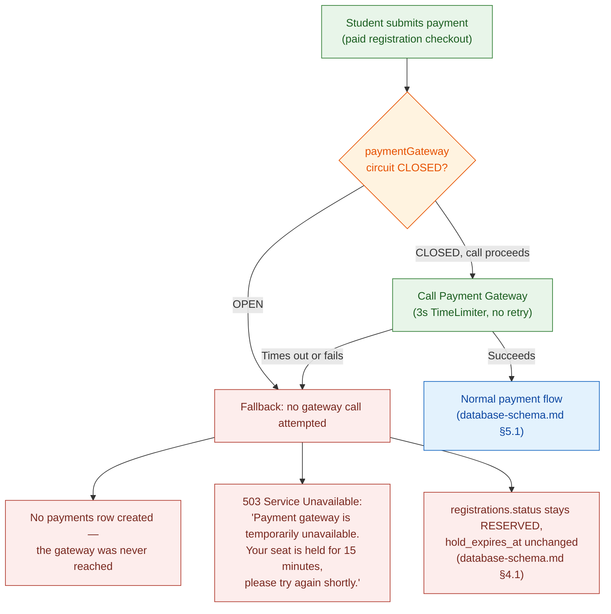
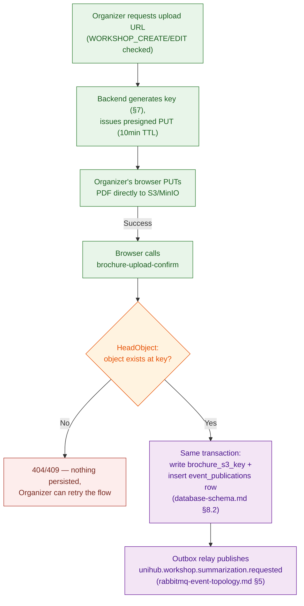
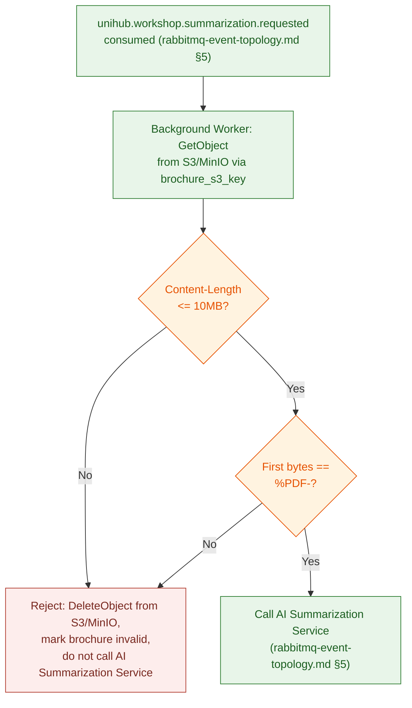

# Payment Gateway Resilience & Object Storage — Technical Design

This file is the physical-level completion of `proposal.md` §11.3 (Resilience to Payment Gateway Failures), `docs/requirement.md` §2.7 (Fault Tolerance for Third-Party Service Dependencies), `architecture.md` §1.4 (Resilience Strategy), and `architecture.md` §4.4 (Object Storage Access Pattern). Those sources establish *that* the Payment Gateway sits behind a circuit-breaker boundary and *that* brochure upload/fetch are split into two independent steps, but stop short of concrete Resilience4j parameters, fallback wiring, bucket/key structure, file constraints, and environment-specific storage backends. Nothing in this file overrides `architecture.md`/`proposal.md` — where they disagree, those documents are the authority and this file has a bug.

**Scope:** Resilience4j `CircuitBreaker`/`Retry`/`TimeLimiter` configuration around every Payment Gateway call, and its fallback behavior on both the synchronous and asynchronous call paths (§1–§5 below); the Object Storage access pattern for brochure PDFs — backend-per-environment, bucket/key structure, file constraints, presigned-upload flow, and post-upload verification (§6–§10 below).

**Out of scope:** the `payments`/`workshops` table schemas (`database-schema.md` §5.1/§3.1, already written — this file wraps calls around those rows, it doesn't redefine them), the reconciliation-sweep and summarization-job RabbitMQ queue/consumer design (`rabbitmq-event-topology.md` §5/§6, already written — this file adds a circuit-breaker guard in front of an existing, already-correct idempotent consumer; it doesn't redesign the queue), real Stripe production settlement (`proposal.md` §5.2 — sandbox mode only), the AI Summarization Service's own internals, any client-facing PDF viewing or re-download capability (confirmed out of scope — see the PDF Upload & Access Pattern ADR below), and JWT/auth mechanics (`auth-and-security.md`, already written).

---

## Architecture Decision Records (ADRs)

All three decisions below were reached through the `spec-driven-development` gated workflow: 2–4 alternatives were explored with a trade-off matrix, the human made the call at the Phase 3 Decision Gate, and the reasoning was captured here verbatim rather than left to live only in `SPEC.md` (a working document for the next task, not a durable record). Every section from §1 onward specifies these three decisions in physical detail; this section is the permanent record of *why* they were chosen over their rejected alternatives.

### ADR Mini: Circuit Breaker Scope for Payment Gateway

**Context:** `docs/requirement.md` §2.7 and `proposal.md` §11.3 require "the system" (singular) to detect Payment Gateway degradation and temporarily stop sending it requests, while unrelated functionality continues normally, with automatic periodic recovery checks. Two independent call-sites talk to the Payment Gateway: the synchronous charge-at-checkout path, and the asynchronous payment-reconciliation sweep (`rabbitmq-event-topology.md` §6) that polls the gateway's status API for payments stuck `PENDING` past 15 minutes. Without shared circuit-breaker state, one call-site could keep hammering a gateway the other has already detected as failing.

**Decision:** A single Resilience4j `CircuitBreaker` instance (registered under one name, `paymentGateway`) guards both call-sites. `TimeLimiter` and `Retry` are configured independently per call-site: the synchronous charge path uses a short `TimeLimiter` (3s) with no retry, to fail fast and free the request thread for at-checkout UX; the asynchronous reconciliation sweep uses a longer `TimeLimiter` (10s) with retry (3 attempts, exponential backoff), since it runs off the critical path and isn't user-facing.

**Consequences:**
- Both call-sites observe and contribute to the same `CLOSED`/`OPEN`/`HALF_OPEN` state — when the sync path trips the breaker, the reconciliation sweep also stops calling the gateway on its next tick, instead of continuing to poll a known-down dependency every 15 minutes.
- Two decorator configurations must stay conceptually distinct (fast-fail vs. backoff-retry) despite sharing breaker state — §2 makes this explicit so an implementer doesn't reuse one `TimeLimiter`/`Retry` config for both.
- Recovery detection (`HALF_OPEN` probe) is shared too: whichever call-site's probe call succeeds first flips the breaker back to `CLOSED` for both.

**Trade-offs accepted (user's own reasoning):** an unprotected reconciliation sweep was rejected because it would let the sweep keep polling the Gateway's status API every 15 minutes even after the synchronous path has already detected and reacted to an outage — contradicting §2.7's "temporarily stop calling that service" applied to "the system" as a whole, not just its user-facing half. Two independent `CircuitBreaker` instances per call-site were rejected because they could disagree about whether the gateway is currently healthy, letting one side hammer a gateway the other side has already given up on.

### ADR Mini: Object Storage Backend Across Environments

**Context:** `CLAUDE.md` fixes AWS S3 as the target object-storage technology, and separately establishes a testing philosophy for the rest of the stack — Testcontainers running real Postgres/Redis/RabbitMQ, "never in-memory substitutes" — but leaves the equivalent question unanswered for S3. Requiring real AWS credentials for local development and every CI run would be the only way to run "AWS S3 everywhere," but that conflicts with `proposal.md` §5.2's framing of AWS S3 as "the one managed-cloud dependency" in an otherwise self-hosted, local Kubernetes topology — extending that one exception into the day-to-day dev/test loop was judged out of proportion to the benefit.

**Decision:** MinIO (S3-compatible, self-hosted), run via Testcontainers for integration tests and available for local Minikube development, stands in for S3 in every environment except the final PoC deployment, which still targets real AWS S3. The AWS SDK's `endpointOverride` is the only thing that changes between environments — no application code branches on which backend is in use.

**Consequences:**
- Local development and CI never require real AWS credentials, removing both a credential-leak surface and a real-dollar cost for every test run.
- MinIO containers are ephemeral, matching the same Testcontainers lifecycle already used for Postgres/Redis/RabbitMQ — no new operational pattern introduced.
- A small residual risk remains that MinIO's S3-API-compatibility surface diverges from real AWS S3 at some edge case this system's narrow access pattern (presigned PUT, plain `GetObject`) doesn't exercise — accepted as low-probability given how narrow that access pattern is.

**Trade-offs accepted (user's own reasoning):** real AWS S3 in every environment was rejected because it would force every developer and CI run to hold real AWS credentials, conflicting with the project's local/self-hosted framing — this is meant to be the project's one deliberate managed-cloud exception, not a precedent to extend further. LocalStack was rejected as unnecessary breadth (emulates far more AWS surface than this system needs) and heavier on developer-machine resources, which `proposal.md` §16 already flags as a constraint.

### ADR Mini: PDF Upload & Access Pattern

**Context:** `architecture.md` §4.4 explicitly separates brochure upload (Organizer → S3, during the Workshop Module's request) from brochure fetch (Background Worker → S3, only when about to call the AI Summarization Service) as two steps that "never happen in the same request," specifically so an Organizer's upload is never blocked by anything downstream. The section's own rationale for pulling binary files out of the transactional path is that large binary I/O doesn't belong in a tier built for other work. No client-facing flow for viewing or re-downloading the original PDF exists anywhere in `docs/requirement.md` or in §4.4's own diagram (only two arrows: upload, worker-fetch) — confirmed by the user as intentionally out of scope; students only ever see `workshops.ai_summary`.

**Decision:** Organizer upload uses a presigned PUT URL (10-minute TTL) issued by the Backend API — PDF bytes travel directly from the Organizer's browser to S3/MinIO, never through a Backend API pod. The Background Worker, running inside the trusted backend with its own IAM/service credentials, fetches the object directly via `GetObject` — no presigned GET is issued to any party, since the only reader is an already-trusted internal component. No client-facing download endpoint or presigned GET is built.

**Consequences:**
- The Backend API tier never carries the PDF's bytes on the upload path, matching §4.4's own stated reason for separating object storage from the request path in the first place.
- File-type/size validation cannot happen synchronously against the file's actual bytes at the moment of upload (a presigned PUT bypasses the Backend API entirely) — a post-upload verification step (§10) is required before the file is trusted enough to enter the summarization pipeline.
- Because the Backend API is never in the upload's data path, it also never automatically learns the upload happened — a confirmation step (§9) is required to close that loop, closing it explicitly is what makes `architecture.md` §4.4's "confirms the upload before the summarization pipeline ever runs" still true under a presigned-upload design rather than the backend-proxied one that line was originally written against.
- No client-facing PDF-download capability exists; if a future requirement calls for one, it is a new decision to make later, not something silently built in now "just in case."

**Trade-offs accepted (user's own reasoning):** backend-proxied upload was rejected because routing multi-megabyte files through the Backend API for every Organizer upload reintroduces exactly the large-binary-through-a-tier-not-built-for-it problem §4.4 exists to avoid — accepted in exchange for needing a post-upload file-type check instead of an upload-time one. Building a presigned GET / client-facing download path preemptively was rejected since no such requirement exists in the SRS or in §4.4's own diagram, and building it now would be designing for a hypothetical future requirement rather than a confirmed one.

---

## 1. Resilience4j Configuration Model

**Rationale:** `docs/requirement.md` §2.7 requires detecting a degraded gateway and temporarily stopping calls to it, rather than letting failed/slow calls accumulate. Resilience4j's `CircuitBreaker` is the mechanism `CLAUDE.md` names for this; the parameters below turn that mandate into a concrete, tunable state machine rather than a vague "add a circuit breaker."

**Model — one shared instance, `paymentGateway`:**

| Parameter | Value | Why |
|---|---|---|
| Sliding window type | `COUNT_BASED` | Payment attempts don't arrive at a constant rate (they spike with paid-ticket registrations, per `docs/requirement.md` §1.4) — a count-based window judges the gateway's health from the last N actual attempts regardless of how much wall-clock time they span, rather than a time-based window that could sit nearly empty during a lull and overreact to one or two failures. |
| Sliding window size | 20 calls | Large enough that a handful of transient failures (a couple of slow paid-checkout attempts) don't alone trip the breaker, small enough that the breaker reacts within a realistic burst of registration activity rather than needing hundreds of calls to notice a real outage. |
| Failure-rate threshold | 50% | Half the window failing is a clear, unambiguous signal of a genuinely degraded gateway — high enough to avoid tripping on ordinary noise, low enough to react well before every call is failing. |
| Wait-duration-in-open-state | 30s | Matches the sync path's fail-fast posture (§2): short enough that a real recovery is detected quickly, long enough not to re-probe a gateway that just failed a moment ago. |
| Permitted-calls-in-half-open-state | 5 | A small sample before committing back to `CLOSED` — large enough to be a meaningful signal, small enough that a still-unhealthy gateway doesn't get exposed to a full burst of traffic while still probationary. |

**This instance is shared by name, not by call-site.** Both the synchronous charge path (§2) and the asynchronous reconciliation sweep (§4, wrapping the call already described in `rabbitmq-event-topology.md` §6) register against the same `paymentGateway` `CircuitBreakerRegistry` entry — this is what makes the shared-detection guarantee in the ADR above literally true, not just described in prose.

**Decorator composition order:** `CircuitBreaker` around `Retry` around `TimeLimiter` around the actual gateway call — the breaker sees the *final* outcome of a call after its own retries and timeout have already been applied, so one already-retried, already-timed-out logical attempt counts as one data point in the breaker's sliding window, not several. Retrying *inside* the breaker's view (rather than each retry independently tripping toward the threshold) keeps the failure-rate calculation meaningful: a single flaky call that succeeds on its second retry attempt is a success from the breaker's perspective, exactly as it should be.

**Trade-off — the shared window mixes two structurally different call profiles, accepted for the PoC stage:** the sync path (§2) is fast and never retries, so it can contribute up to 20 data points to the window in a matter of seconds during a registration-opening spike. The async path (§4), by contrast, can take up to ~47 seconds for a single logical call to resolve under sustained failure (4 attempts × 10s `TimeLimiter`, plus 1s+2s+4s backoff between them) before that one call contributes even a single data point — because the composition order above means the breaker only sees the outcome *after* all retries and backoff have run their course. Two consequences follow, and neither is fully eliminated by this design: (1) the async path's contribution to detection is meaningfully slower than the sync path's, so "detected within the 20th call" (the Guarantee below) can mean very different wall-clock times depending on which call-site happens to fill the window; (2) call-volume imbalance skews the window's signal — during a paid-registration spike, fast sync-path outcomes can dominate the 20-slot window and dilute a genuinely failing async path's contribution, while during a quiet period between spikes, a handful of slow async failures (the sweep only runs once per payment per 15-minute cycle) can disproportionately drive the failure rate since little else is filling the window at that time. This is accepted as-is for this project's PoC scale (`proposal.md` §5.2) rather than engineered around with a larger window, a time-based window, or per-call-site weighting — those are legitimate future refinements if real load-test data (`docs/requirement.md` §3.2) shows this asymmetry actually causing a problem, not something to pre-optimize against here.

**Guarantee:** a gateway degrading past the 50%-of-last-20-calls threshold is detected and stops receiving *any* new calls — from either call-site — within the time it takes that 20th call to complete, not after some longer, call-site-specific delay. That 20th call's own duration is bounded by whichever call-site produced it (§2's 3s ceiling or §4's ~47s worst case) — see the Trade-off above for what that asymmetry means in practice.

---

## 2. Sync Charge Path — Decorators & Fallback

**Rationale:** the synchronous charge path runs inside a student's checkout request — every second spent here is a second of held request-thread and held UI spinner. `docs/requirement.md` §2.7 requires this path to fail fast with "a clear, friendly message," not to make the student wait out a slow, doomed call.

**Model:**

| Decorator | Value | Why |
|---|---|---|
| `TimeLimiter` | 3s | Long enough for a normal Stripe sandbox charge call, short enough that a stalled call doesn't tie up the checkout request past what a student will tolerate waiting on a spinner. |
| `Retry` | 0 (none) | A charge call is not free to retry blindly — retrying a call that *did* reach the gateway but lost the response on the way back risks a second charge attempt for the same request. Idempotency (`docs/requirement.md` §2.8, already handled by the client-supplied idempotency key at the Payment Module boundary) is what makes retries safe *at all*, but this document does not add a Resilience4j-level retry on top of that; a failed sync attempt simply fails fast and lets the student decide whether to try again. |
| HTTP client `connectTimeout` / `readTimeout` | ≤3s each | `TimeLimiter` alone does not stop the underlying blocking call — it only stops the *caller* from waiting past 3s by completing a wrapping future with a `TimeoutException`; the actual outbound HTTP request to the gateway keeps running on its own thread/socket until it finishes or the HTTP client's own timeout fires. Without a client-level timeout at or below the `TimeLimiter`'s 3s, a stalled call still holds a connection-pool slot and a thread well past the point the checkout request has already received its `503` — quietly defeating the thread-freeing purpose this decorator exists for, right at the exact 12,000-concurrent-user spike (`docs/requirement.md` §1.4) this document is meant to protect. |

**Fallback when the circuit is `OPEN`, or the call times out:**

No `payments` row is created for a fallback response — a row only ever exists for an attempt that actually reached the gateway (`database-schema.md` §5.1's `gateway_transaction_id`/`status` columns describe a real attempt, not a rejected-before-dialing one). The seat-hold created by `registrations.status = 'RESERVED'` (`database-schema.md` §4.1) is left completely untouched: the student still has the remainder of their original 15-minute hold window (`docs/requirement.md` §1.3.1) to retry once the gateway recovers, exactly as if this attempt had never happened.

**Trade-off — a student can lose their hold window waiting out an outage:** if the Payment Gateway stays degraded for longer than the time remaining on a student's 15-minute hold, the hold still expires on schedule (§2.10's existing expiry sweep, unaffected by this document) and the seat releases. This document does not extend the hold window in response to a gateway outage — doing so would mean the Payment Gateway's *own* availability could indirectly control anti-overbooking timing, a coupling `architecture.md` §6.1's layered anti-overbooking design does not call for and this document does not introduce.

**Guarantee:** a student attempting to pay during a gateway outage gets an immediate, clear answer and keeps their existing hold — they are never left waiting on a call that was never going to succeed, and never silently double-charged by an automatic retry they didn't ask for. Combined with the matching HTTP client timeout above, the request-handling thread and its socket are both released within 3s of a stalled call, not just the caller's logical wait.

---

## 3. Recovery Detection (Shared `HALF_OPEN`)

**Rationale:** `docs/requirement.md` §2.7 and `proposal.md` §11.3 both require the system to "automatically attempt reconnecting... after a period of time" and "resume normal payment processing automatically" once the gateway recovers — Resilience4j's `HALF_OPEN` state is exactly this mechanism, applied here to the shared instance from §1.

**Model:** after 30 seconds in `OPEN` (§1's wait-duration), the `paymentGateway` breaker moves to `HALF_OPEN` and permits up to 5 calls through — from *either* call-site, whichever happens to call next. If enough of those probe calls succeed (per the same 50%-of-window logic), the breaker returns to `CLOSED` for both call-sites simultaneously; if they fail, it reopens for another 30-second wait.

**Guarantee:** recovery is detected and acted on identically regardless of whether the sync charge path or the async reconciliation sweep happens to make the probing call — there is no scenario where one call-site "knows" the gateway is back while the other is still refusing to call it.

---

## 4. Async Reconciliation Sweep — Decorators & Fallback

**Rationale:** the reconciliation sweep (`rabbitmq-event-topology.md` §6) already tolerates redelivery and lost cycles by design — it re-checks `payments.status` before acting and simply matches the same `PENDING` row again on the next 15-minute tick if a cycle is skipped. Wrapping its gateway call in the shared `paymentGateway` breaker adds fault isolation *on top of* that existing tolerance; it does not change the sweep's own correctness logic.

**Model:**

| Decorator | Value | Why |
|---|---|---|
| `TimeLimiter` | 10s | This call runs off the critical path (a background consumer, not a held HTTP request) — there's no user-facing latency budget to protect, so it can afford to wait longer for a gateway response than the sync path can. |
| `Retry` | 3 attempts, exponential backoff (1s, 2s, 4s) | Safe here in a way it isn't on the sync path (§2): this call is a pure status *read* (`GET` transaction status), not a charge attempt — retrying it can never create a duplicate charge, only a duplicate read, which is harmless. |

**Fallback when the shared circuit is `OPEN`:** the reconciliation consumer's call to the gateway is skipped entirely for that message — exactly the same "skip this cycle, the next tick retries" pattern already documented for scheduled-job coordination in `redis-cache-and-locking.md` §6, applied here to a single payment's reconciliation attempt rather than an entire job run. The payment stays `PENDING`; since it still matches the sweep's `WHERE status = 'PENDING' AND initiated_at < now() - interval '15 minutes'` predicate (`rabbitmq-event-topology.md` §6), it is picked up again on the sweep's next cycle, and the call is retried against the gateway's *then-current* circuit state.

**This does not weaken `rabbitmq-event-topology.md` §6's guarantees.** That document already establishes that a redelivered or repeated reconciliation attempt for an already-resolved payment is a safe no-op (`status <> 'PENDING': COMMIT, do nothing`). A circuit-breaker-induced skip is indistinguishable, from that logic's point of view, from any other reason a cycle's message might not get processed in time — the existing idempotent re-check is what makes this fallback safe, not a new mechanism this document adds.

**Guarantee:** a Payment Gateway outage never causes the reconciliation sweep to pile up failed calls against a dependency it already knows is down; every stuck `PENDING` payment is still eventually resolved once the gateway recovers, on the same eventual timeline `rabbitmq-event-topology.md` §6 already guarantees — this document only changes *how quickly the sweep stops making pointless calls*, not *whether a payment eventually resolves*.

---

## 5. Fault Isolation Boundary

**Rationale:** `architecture.md` §1.4 requires a Payment Gateway outage to "degrade only payment-related functionality" — this section states plainly what that means physically, tying together §1–§4 above.

**Guarantee:** with the `paymentGateway` circuit `OPEN`, browsing the workshop catalog, free-ticket registration, check-in, and reporting are entirely unaffected — none of those paths call the Payment Gateway or share any component with it beyond the Backend API deployable itself. Only the paid-checkout submission path (§2) and the reconciliation sweep's gateway call (§4) observe the outage; every other module continues exactly as documented elsewhere.

---

## 6. Object Storage Backend Per Environment

**Rationale:** per the Object Storage Backend ADR above, this system needs object storage in three distinct environments — integration tests, local Minikube development, and the PoC deployment — without forcing the first two to depend on real AWS credentials.

**Model:**

| Environment | Backend | Wiring |
|---|---|---|
| Integration tests (JUnit + Testcontainers) | MinIO container, started/stopped per test run — same lifecycle already used for Postgres/Redis/RabbitMQ (`CLAUDE.md`) | AWS SDK for Java `S3Client` built with `.endpointOverride(minioContainer.getS3URL())` and `.forcePathStyle(true)` (MinIO requires path-style addressing; virtual-hosted-style, AWS S3's default, does not resolve against a MinIO endpoint). |
| Local Minikube development | MinIO, run as an additional container/pod alongside the rest of the local topology | Same `endpointOverride` mechanism, pointed at the local MinIO service's cluster-internal address instead of a Testcontainers-managed one. |
| PoC deployment | Real AWS S3 | No `endpointOverride` set — the SDK's default AWS endpoint resolution is used, exactly as it would be in any real AWS-targeting deployment. |

**Zero application-code branching:** the Workshop Module's upload/presign logic and the Background Worker's fetch logic call the same `S3Client` interface in all three environments. The only thing that changes is which endpoint that client was constructed to point at — a Spring `@ConfigurationProperties`-driven value, not an `if (environment == ...)` branch anywhere in business logic.

**Trade-off — MinIO is a stand-in, not identical to AWS S3:** this is the residual risk the ADR above already accepts — MinIO's S3-API compatibility is very high for the narrow access pattern this document specifies (presigned PUT, plain `GetObject`), but it is not a guarantee that every AWS S3 behavior is reproduced exactly. This document treats that risk as accepted, not eliminated; a divergence discovered later is a reason to revisit the ADR, not a reason to quietly special-case MinIO behavior into the application code.

**Guarantee:** a developer or CI run never needs real AWS credentials to exercise brochure upload/fetch logic; the only environment that talks to real AWS S3 is the PoC deployment itself.

---

## 7. Bucket & Key Structure

**Rationale:** `database-schema.md` §3.1 already defines `workshops.brochure_s3_key VARCHAR(512)` as the pointer PostgreSQL holds to the object — this section defines what actually goes into that column.

**Model:**

| Element | Value | Why |
|---|---|---|
| Bucket | `unihub-brochures` (one bucket, all environments — a test run's MinIO container has its own isolated instance entirely, so no cross-environment collision is possible regardless of naming) | A single-purpose bucket matches `architecture.md` §4.4's framing of object storage as scoped to exactly one job — brochure PDFs — with nothing else ever sharing it. |
| Key format | `{workshop_id}/{uuid}.pdf` | Namespacing by `workshop_id` groups an object with the row that references it for operational browsing/debugging, without leaking any sequential or guessable structure; the random `uuid` component (not the original filename) avoids collisions between two Organizers uploading files with the same name, and avoids storing a client-supplied filename string as part of a trusted identifier. |
| Stored in `workshops.brochure_s3_key` | The full key, e.g. `3f9a1e2c-.../7bcf9e1a-....pdf` | The bucket name itself is not stored in this column — it's a deployment-level constant (§6), not per-row data; storing only the key keeps this column meaningful even if bucket naming ever needs to change per-environment for an unrelated reason. |

**Generated at issuance, persisted at confirmation — two different moments, not one.** The Backend generates the `{workshop_id}/{uuid}.pdf` key at the same time it issues the presigned PUT URL (§9), since the key has to be baked into the URL's signature before the Organizer's browser can use it. But `workshops.brochure_s3_key` is **not** written at that moment — the Backend has no way yet to know the upload will actually succeed. The column is only written once the confirmation step (§9) verifies the object really exists at that key. Treating "key generated" and "key persisted" as the same moment would let a row point at an object that was never actually uploaded (the Organizer abandoned the flow, the browser tab closed mid-upload, etc.) — see §11's failure-mode row for what happens when confirmation never arrives.

**Trade-off — replacing a brochure orphans the previous object, by extension of an already-accepted trade-off:** each successful upload gets a fresh random `{uuid}.pdf`, so an Organizer editing a workshop and uploading a new brochure leaves the old object in the bucket with nothing pointing to it anymore — `workshops.brochure_s3_key` now names only the new key. `architecture.md` §4.4 already accepts "no expiry, by design" for a *referenced* brochure persisting for the workshop's lifetime; this extends that same acceptance to an *unreferenced*, replaced one, rather than adding cleanup logic (a `DeleteObject` on replace) that no requirement calls for. Stated explicitly here so it reads as a deliberate extension of an existing trade-off, not an oversight.

**Guarantee:** every stored object's key is derivable from, and only from, `workshops.brochure_s3_key` — there is no separate lookup or convention needed to resolve which object belongs to which workshop. Conversely, a non-`NULL` `brochure_s3_key` is only ever written after the Backend has itself confirmed the object exists (§9) — it is never a bare guess based on what URL was issued.

---

## 8. File Constraints

**Rationale:** `docs/requirement.md` §1.3.4 requires the uploaded document to be a PDF, but states no size limit — a completely unbounded upload would let a single Organizer action consume disproportionate storage and bandwidth for a job that architecturally is supposed to be a single promotional document, not an arbitrary file drop.

**Model:**

| Constraint | Value | Enforced where |
|---|---|---|
| Maximum size | 10MB | **Client-side:** the Web Application checks `file.size` before requesting a presigned URL, giving immediate feedback without waiting on a network round-trip. **Server-side (post-upload detection, not upload-time prevention):** the Background Worker checks the fetched object's actual `Content-Length` against this limit as part of §10's post-upload verification. |
| Accepted type | PDF only | **Client-side:** an `accept=".pdf"` hint on the file picker. **Server-side (post-upload detection):** the Background Worker checks the first bytes of the fetched object for the `%PDF-` magic number (§10) — never the filename extension or a client-supplied `Content-Type` header, both of which are trivially spoofable and, again, never pass through the Backend API on this upload path to be checked at upload time in the first place. |

**Trade-off — a plain presigned PUT cannot itself refuse an oversized or wrong-type upload; this is detection-and-cleanup, not prevention:** because the presigned URL (§9) authorizes a direct `PutObject` to S3/MinIO with no size or content-type condition embedded in its signature, an oversized or wrong-type file completes its upload in full — consuming the storage and bandwidth §8's Rationale is trying to bound — *before* the Background Worker ever gets a chance to check it. The check in the table above is real and authoritative for what enters the AI Summarization Service (§10's Guarantee still holds), but it is a **detect-and-reject-after-the-fact** boundary, not a prevent-at-write-time one. This is accepted for the PoC stage rather than closed with a presigned **POST** plus a `content-length-range` policy condition (the AWS-native way to make S3 itself refuse an oversized upload) — that refinement is a reasonable future revisit if abuse of this gap is ever observed, not something this document builds preemptively for a risk that hasn't materialized.

**Guarantee:** no file that isn't an actual PDF under 10MB is ever passed to the AI Summarization Service — the check that matters is the one performed on the object's real bytes, after upload, not any check a client could have skipped or lied about before it. A file that fails this check is also removed from storage (§10), so the accepted upload-time gap above does not translate into permanent storage waste.

**Known limit — the `%PDF-` check is type-sniffing, not content validation:** it confirms an object *starts with* the PDF magic number, which is materially stronger than trusting a filename extension or a client-supplied `Content-Type` header, but it does not parse the PDF's internal structure and cannot detect a malformed or maliciously crafted PDF that happens to carry a valid header. Deeper validation — structural PDF parsing, malware/exploit scanning — is out of scope for this document; this check exists to catch mislabeled or wrong-type uploads reaching the AI Summarization Service, not to certify a file as safe.

---

## 9. Presigned PUT Issuance & Upload Confirmation

**Rationale:** per the PDF Upload & Access Pattern ADR above, the Organizer's browser needs a short-lived, narrowly-scoped credential to write directly to S3/MinIO — a presigned PUT URL is exactly that. But because that upload never touches the Backend API, issuing the URL is only half the flow: `architecture.md` §4.4 requires the Workshop Module to "confirm the upload before the summarization pipeline ever runs," and nothing does that automatically once the upload is delegated to a direct browser-to-S3 write. This section specifies both halves — who can ask for a URL, and how the Backend learns the upload actually happened.

**Model — issuance:**

| Decision | Value | Why |
|---|---|---|
| Issuing endpoint | Backend API, Workshop Module (e.g. `POST /api/v1/workshops/{id}/brochure-upload-url`) | Only the Workshop Module touches S3 (`architecture.md` §4.4's module-exclusivity) — it is also the only module allowed to mint a credential granting write access to it. Requires an existing `workshops` row: brochure upload is a step performed against a workshop already created in `DRAFT` status (`database-schema.md` §3.1), not part of the create-workshop call itself — there is no `workshop_id` to build the key (§7) or the URL path around before that row exists. |
| Authorization | `hasAuthority('WORKSHOP_CREATE')` covers uploading a brochure to a workshop the Organizer just created (still `DRAFT`, same authoring session); `hasAuthority('WORKSHOP_EDIT')` covers replacing the brochure on a workshop created earlier | Matches `docs/requirement.md` §2.11's permission-based discipline (`auth-and-security.md` §3) — issuing a write credential to an object storage bucket is exactly the kind of protected action a permission check exists for, not a bare "is this user logged in" check. Both permissions are checked against the target workshop, not globally — an Organizer needs the same standing to attach a brochure as to have created or edited that specific workshop in the first place. |
| TTL | 10 minutes | Long enough to cover a normal-connection upload of a file up to the 10MB limit (§8) with margin, short enough that a leaked or abandoned presigned URL stops being usable well within the same session it was issued for. |
| Scope | One presigned URL authorizes exactly one `PutObject` to one specific key (§7) | A presigned URL is not a general-purpose credential — it's bound to the single key the Backend API generated it for, so it can't be reused to write to, or overwrite, any other object. |

**Model — confirmation:**

| Decision | Value | Why |
|---|---|---|
| Confirmation endpoint | `POST /api/v1/workshops/{id}/brochure-upload-confirm`, called by the Organizer's browser immediately after a successful `PUT` to the presigned URL | This is the step that closes the gap a direct-to-S3 upload otherwise leaves open — nothing else tells the Backend the upload happened. |
| Server-side check | `HeadObject` against the exact key issued in §9's issuance step | Confirms the object actually exists before trusting the browser's claim of success — a client that calls this endpoint without ever having uploaded anything gets a `404`/`409`, not a fabricated `brochure_s3_key`. |
| On success | In one database transaction: write `workshops.brochure_s3_key`, and insert an `event_publications` row (`database-schema.md` §8.2) for `unihub.workshop.summarization.requested` | The transactional-outbox discipline `architecture.md` §4.3 already requires for every other event in this system applies here too — the business write (persisting the key) and the intent to publish (the outbox row the relay later delivers to RabbitMQ, per `rabbitmq-event-topology.md` §5) commit atomically, exactly as `database-schema.md` §8.2 describes for every other event kind. This document does not introduce a second way of publishing an event. |

**No presigned GET, no client-facing download endpoint.** Per the ADR above, the only reader of a brochure object is the Background Worker, which holds its own service credentials and calls `GetObject` directly — it never needs, and is never issued, a presigned URL of any kind.

**Guarantee:** the only way to write a brochure object is through a credential the Workshop Module issued, scoped to one key, for ten minutes, to a permission-checked Organizer — there is no path that lets an arbitrary authenticated user write to, or an arbitrary party read from, this bucket. The only way `workshops.brochure_s3_key` is ever set is after the Backend has independently verified, via `HeadObject`, that the object it points to actually exists — and that write is never separated from the summarization-request outbox row by more than one transaction boundary.

---

## 10. Post-Upload Verification

**Rationale:** because upload happens directly against S3/MinIO (§9), nothing server-side inspects the file's actual bytes until *after* it already exists in the bucket — this section is where that inspection happens, resolving the gap the PDF Upload & Access Pattern ADR explicitly flags as a consequence of choosing presigned upload over a backend-proxied one.

**Model:** the Background Worker's summarization job (`rabbitmq-event-topology.md` §5) already fetches the object from S3 before calling the AI Summarization Service — this document adds a check as the first step of that existing fetch, before the AI Service is ever called:

On rejection, the Background Worker issues a `DeleteObject` call against the failing key **before** anything else — an oversized or wrong-type upload never lingers in the bucket once it's been identified as such, closing the storage-waste gap §8's Trade-off accepts at upload time. `workshops.ai_summary` is left `NULL` (its documented default state, per `database-schema.md` §3.1 — "NULL until the AI Summarization Service returns") and the workshop's brochure is treated as never having produced a summary; this document does not add a new status column or notification for this case, since a missing summary is already the schema's existing representation of "not summarized yet," and distinguishing "not summarized because rejected" from "not summarized because still pending" is a product-surface decision (e.g. an Organizer-facing warning) outside this document's scope. `workshops.brochure_s3_key` is deliberately left as-is (not nulled out) — it still correctly points to where the Organizer's rejected file *was*, which is enough for an operator investigating a "why did my brochure never summarize" report; clearing it is a product-surface decision, not a correctness requirement this document needs to make.

**No S3 Event Notification.** This check runs as an ordinary step inside the Background Worker's existing consumer, not as a reaction to a new AWS-side event subscription — introducing S3 Event Notifications would add a second AWS integration beyond the single "S3 for brochures" exception `proposal.md` §5.2 scopes this project to, for a check that the Worker's own existing fetch step can perform just as well.

**Guarantee:** every object that ever reaches the AI Summarization Service has been confirmed, by inspecting its actual bytes, to be a PDF no larger than 10MB — regardless of what the uploading client claimed about the file before it was written to storage. An object that fails this check does not persist in storage past the check that rejected it.

---

## 11. Failure Modes & Fail-Safe Behavior

| Situation | Behavior | Why |
|---|---|---|
| `paymentGateway` circuit `OPEN`, student attempting to pay | `503`, no `payments` row created, seat-hold untouched (§2) | Fail fast, never silently retry a charge, never lose the student's existing hold. |
| `paymentGateway` circuit `OPEN`, reconciliation sweep tick fires | That payment's gateway call is skipped for this cycle; retried on the next 15-minute tick (§4) | Consistent with `rabbitmq-event-topology.md` §6's existing "already-resolved payments are a no-op" idempotency — a skip is just another reason a cycle doesn't get to a row. |
| `paymentGateway` recovers | `HALF_OPEN` probe (either call-site) succeeds, breaker returns to `CLOSED` for both (§3) | `docs/requirement.md` §2.7's "automatically attempt reconnecting... resume normal payment processing." |
| S3/MinIO unreachable during Organizer's presigned upload | Upload fails client-side (the browser's `PUT` to the presigned URL fails); the Backend API is never involved in this failure since it isn't in the data path (§9) | `architecture.md` §4.4: an Object Storage outage is isolated to the Workshop Module's brochure flow — it never touches Registration, Payment, or Check-in. |
| S3/MinIO unreachable when the Background Worker fetches for summarization | The summarization job fails/retries per `rabbitmq-event-topology.md` §8's existing retry/dead-lettering rules; `workshops.ai_summary` stays `NULL` | Same fault-isolation principle — a stalled summary never blocks browsing, registration, payment, or check-in, which don't read `ai_summary` as a precondition for anything. |
| Uploaded object fails the post-upload size/type check | Rejected; `DeleteObject` removes it from storage; `ai_summary` stays `NULL`; AI Summarization Service is never called (§10) | The check exists specifically to keep a wrong-type or oversized object from ever reaching a paid third-party call, and to not leave the rejected file occupying storage indefinitely. |
| Organizer's browser uploads successfully but never calls `brochure-upload-confirm` (tab closed, network drop right after the `PUT`) | The object exists in S3/MinIO, but `workshops.brochure_s3_key` is never set — the system has no record of it | `architecture.md` §4.4: PostgreSQL, not S3, is authoritative for whether a brochure exists. An unconfirmed object is invisible to the rest of the system, not a correctness problem — the Organizer simply repeats the upload flow, and the orphaned object is the same accepted class of storage waste §7 already flags for a replaced brochure. |

---

## 12. Reference Table

Every algorithm, threshold, TTL, and naming decision in this document, in one place — the same purpose the closing tables in `database-schema.md` §11, `redis-cache-and-locking.md` §7, `rabbitmq-event-topology.md` §9, and `auth-and-security.md` §10 serve for their own documents.

| Item | Value | Backs |
|---|---|---|
| CircuitBreaker instance | `paymentGateway`, shared across sync + async call-sites | Unified gateway-health detection (`docs/requirement.md` §2.7, `proposal.md` §11.3) |
| Sliding window | `COUNT_BASED`, size 20 | Judges health from actual attempts, not wall-clock time, under bursty paid-registration load |
| Failure-rate threshold | 50% | Clear signal of real degradation without overreacting to noise |
| Wait-duration-in-open-state | 30s | Bounded, fast recovery-check cadence |
| Permitted-calls-in-half-open | 5 | Small, meaningful recovery sample |
| Sync path decorators | `TimeLimiter` 3s, `Retry` 0, HTTP client `connectTimeout`/`readTimeout` ≤3s | Fail-fast UX; no blind retry of a charge attempt; client-level timeout ensures the thread/socket is actually released, not just the caller's wait |
| Async path decorators | `TimeLimiter` 10s, `Retry` 3 (backoff 1s/2s/4s) | Safe to retry (status read, not a charge); no user-facing latency budget |
| Shared-window asymmetry | Accepted trade-off — one async "call" can take ~47s worst-case before contributing a data point, vs. seconds for a sync call | §1's Trade-off — accepted for PoC scale; revisit with real load-test data if detection latency proves inadequate |
| Sync fallback | `503`, no `payments` row, seat-hold untouched | `docs/requirement.md` §2.7's "clear, friendly message"; anti-overbooking timing stays independent of gateway health |
| Async fallback | Skip this payment's call for the cycle; retried next tick | Consistent with `rabbitmq-event-topology.md` §6's existing idempotent redelivery |
| Object Storage: test/local backend | MinIO via Testcontainers / local container, `endpointOverride` + path-style access | Zero real-AWS-credential requirement for dev/CI (`proposal.md` §5.2, §16) |
| Object Storage: PoC backend | Real AWS S3, default endpoint resolution | The project's one deliberate managed-cloud dependency |
| Bucket | `unihub-brochures` | Single-purpose object storage (`architecture.md` §4.4) |
| Key format | `{workshop_id}/{uuid}.pdf` | Traceable to its workshop, collision-free, no client-filename trust |
| Max file size | 10MB, detected and rejected post-upload (not enforced at write time by a plain presigned PUT) | Bounded storage/bandwidth per upload; the upload-time gap is an accepted trade-off (§8), closed by deleting a rejected object rather than by preventing the write |
| Accepted type | PDF only, verified by `%PDF-` magic bytes (type-sniffing, not structural/malware validation) | `docs/requirement.md` §1.3.4; spoofable filename/`Content-Type` never trusted |
| Presigned PUT TTL | 10 minutes | Covers a normal upload with margin; short-lived credential exposure |
| Presigned PUT authorization | `hasAuthority('WORKSHOP_CREATE'/'WORKSHOP_EDIT')`, against an existing `DRAFT`-or-later workshop | Permission-based issuance, consistent with `auth-and-security.md` §3 |
| Upload confirmation | `POST .../brochure-upload-confirm` → `HeadObject` → same-transaction write of `brochure_s3_key` + `event_publications` outbox row | Closes the loop a direct-to-S3 upload otherwise leaves open (§9); satisfies `architecture.md` §4.4's "confirms the upload" requirement and §4.3's transactional-outbox invariant |
| Presigned GET / client download | **None** | Confirmed out of scope — no requirement exists for client-facing PDF access |
| Post-upload verification | Background Worker checks size + `%PDF-` magic bytes, first step of the existing summarization job; `DeleteObject` on rejection | Authoritative check on real bytes, no new AWS integration (no S3 Event Notification), no permanent storage waste from a rejected upload |
