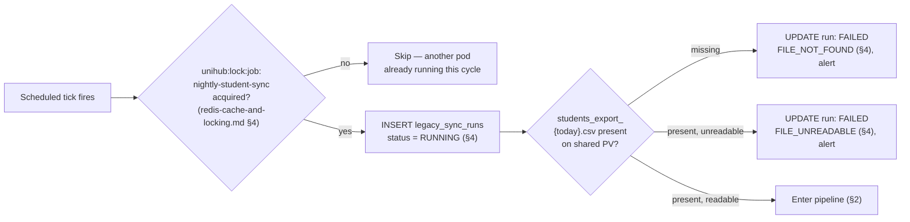
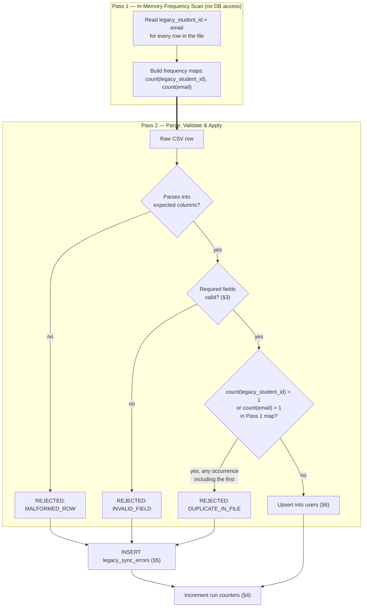

# Student Data Sync — Technical Design

This file is the physical-level completion of `architecture.md` §4.6 (Distributed Scheduled Job Coordination, as applied to the nightly student sync) and `docs/requirement.md` §1.3.6/§2.10. Those sections established *that* the sync runs nightly, on exactly one instance per cycle — already guaranteed by `redis-cache-and-locking.md` §4's `unihub:lock:job:nightly-student-sync` lock (30-minute lease) — through a sequential validation pipeline that quarantines bad records instead of halting on them. They deliberately left the pipeline's own internal mechanics, the quarantine store, and safety under a concurrent duplicate run as physical detail for this document. `database-schema.md` §2 already deferred the quarantine mechanism here, owning only the `users` table this pipeline writes into. Nothing here overrides `architecture.md` — where this file and that one appear to disagree, `architecture.md` is the authority and this file has a bug.

**Scope:** the nightly legacy-student-sync pipeline end to end — file ingestion, per-record validation/classification, the upsert into `users`, the run-bookkeeping table, and the error-quarantine table. Out of scope: the Redis job-lock itself (key, 30-minute lease, `tryLock` mechanics — already decided in `redis-cache-and-locking.md` §4); the `users` table's own column definitions (`database-schema.md` §2.1, already written); RBAC/permission assignment for the *synced student accounts themselves* (distinct from the administrative permission codes this file proposes for quarantine review, §5); any transport mechanism other than the shared volume decided below.

File ingestion in this document targets a Kubernetes-mounted shared volume, not AWS S3 — `CLAUDE.md` scopes S3 exclusively to brochure PDFs, the one deliberate managed-cloud dependency in an otherwise local/self-hosted stack. All DDL below targets PostgreSQL (the Master), following the same explicit-versioned-migration discipline as `database-schema.md` (§6.2 of `architecture.md`) — nothing here is ORM auto-generated. The two tables below are presented parent-before-child (`legacy_sync_runs` in §4, then `legacy_sync_errors` in §5) specifically so their DDL runs top-to-bottom without a forward foreign-key reference.

---

## 1. Ingestion & File Handling

**Rationale:** `docs/requirement.md` §1.3.6 requires the export to be ingested "automatically... with no manual intervention required." Since S3 is off the table (above) and this is a local, self-hosted Minikube proof-of-concept, a shared PersistentVolume mounted by the Backend API pod running the job is the natural fit — the same in-cluster posture already used for PostgreSQL, Redis, and RabbitMQ.

**Model:**

| Decision | Value | Why |
|---|---|---|
| Mount | Shared Kubernetes PersistentVolume, mounted read-only at `/var/unihub/legacy-sync/inbound` on the pod running the job | A PV is the K8s-native way to hand a file to a pod without adding a protocol client (SFTP) the application doesn't otherwise need — consistent with keeping this dependency local rather than external. |
| Filename convention | `students_export_YYYYMMDD.csv` (the export's date, not the sync run's) | Lets the job unambiguously identify "tonight's file" by name rather than trusting file-system timestamps, and makes a missing file for a given date detectable as an absence, not a guess. |
| File format | CSV, UTF-8, header row required | Confirmed assumption (project `SPEC.md`) — the simplest fit for a nightly flat-file export; no format was specified upstream in `docs/requirement.md` or `architecture.md`. |
| Missing file for tonight's date | Create one `legacy_sync_runs` row (§4) with `status = 'FAILED'`, `failure_reason = 'FILE_NOT_FOUND'`, `finished_at = now()`; log and surface an operational alert; the pod does not crash or retry mid-cycle | Same "skipped cycle, not a queued retry" posture `architecture.md` §4.6 already applies to lock contention — a missing export is recoverable by tomorrow's file. Recording the attempt in `legacy_sync_runs` (rather than only an out-of-band alert) is what makes §4's "every cycle leaves exactly one queryable record" guarantee true for *every* failure mode, not just the ones that get as far as opening the file. |
| File present but unreadable (bad encoding, unparsable header) | Whole-run failure: zero `users` writes, zero quarantine rows, one `legacy_sync_runs` row (§4) with `status = 'FAILED'`, `failure_reason = 'FILE_UNREADABLE'`, the parse error captured in `failure_detail`, alert | Distinct from a per-record validation failure (§3). A file that can't even be opened isn't "a handful of bad records" the pipeline can skip past — it's a fatal precondition, and partially processing a garbled file would be worse than processing none of it. |



**Guarantees:** a missing or corrupt export never crashes the pod and never partially applies a night's data — the outcome is always a cleanly recorded `legacy_sync_runs` row (§4), recoverable by the next scheduled export.

---

## 2. Pipeline Stages (Two-Pass)

**Rationale:** `docs/requirement.md` §2.10 requires "a sequential, step-by-step validation pipeline: verifying the format of each record before writing it into the primary system," with the explicit constraint that "a handful of faulty records must never be allowed to halt the entire synchronization process." §3's duplicate rule requires rejecting **every** occurrence of a duplicated key, including the first — which a single streaming pass cannot deliver: by the time a second occurrence is read, the first may already be committed to `users`. The pipeline is therefore **two-pass**, not one.

**Model:**

**Pass 1 — In-Memory Frequency Scan.** A single read-only pass over the file that touches only two columns, `legacy_student_id` and `email`, and never opens a database connection. It builds two in-memory frequency maps (value → occurrence count), one per column. This pass is cheap by construction — two short strings per row, not the full record — and its cost scales with file size alone, never with `users` table size or database load, so it adds no contention on the Master (§7).

**Pass 2 — Parse, Validate & Apply.** The per-row pipeline, reading Pass 1's frequency maps to classify duplicates from the very first row that carries a repeated key:

1. **Parse** — read the raw CSV row into a candidate record. A row whose column count doesn't match the header is a parse failure, classified `MALFORMED_ROW` (§3).
2. **Validate & Classify** — check required fields (§3), then look up the row's `legacy_student_id` and `email` in Pass 1's frequency maps (§3). Each row resolves to exactly one of two outcomes: **VALID** or **REJECTED** (with a reason code).
3. **Apply** — VALID rows go through the upsert (§6); REJECTED rows are written to `legacy_sync_errors` (§5) instead. A row is never written to both, and never to neither.

Because Pass 1 completes before Pass 2 applies anything, a key that appears more than once is rejected on **every** row that carries it — including the first — never just the second onward. There is no window in which an eventual duplicate's first occurrence has already been upserted before the duplication is known. Pass 2 still commits in small batches (§7), not one giant transaction and not one row per transaction, since it's the only pass that touches Postgres.



**Guarantees:** every row in the file ends up in exactly one of two places — a `users` upsert or a `legacy_sync_errors` row — never silently dropped, never counted twice. A duplicated key is rejected on every occurrence, including the first, because classification (Pass 1) is fully resolved before any row is applied (Pass 2).

---

## 3. Validation & Duplicate Classification Rules

**Rationale:** `docs/requirement.md` §2.10 requires "invalid or duplicate records" to be separated from valid ones, but doesn't define either term precisely enough to implement — that precision, and how "duplicate" is actually detected (§2's Pass 1), is this file's job.

**Model:**

| Check | Outcome if failed | Reason Code | Notes |
|---|---|---|---|
| Column count matches header | REJECTED | `MALFORMED_ROW` | Parse-level (§2), before any field-level check runs. |
| `legacy_student_id` present, non-empty | REJECTED | `INVALID_FIELD` | The natural key the upsert conflicts on (§6) — a record without one can't be upserted at all. |
| `email` present, RFC-5322-shaped | REJECTED | `INVALID_FIELD` | `users.email` is `NOT NULL UNIQUE` (`database-schema.md` §2.1); catching a malformed value here keeps the failure inside the pipeline's quarantine flow instead of surfacing as an unhandled SQL error from the upsert. |
| `full_name` present, non-empty | REJECTED | `INVALID_FIELD` | `users.full_name` is `NOT NULL` (`database-schema.md` §2.1). |
| `legacy_student_id`'s Pass-1 frequency count is exactly 1 across the whole file | else REJECTED, on every row carrying that value | `DUPLICATE_IN_FILE` | Pass 1 (§2) counts every occurrence across the entire file before Pass 2 applies anything, so a repeated key is rejected on every row that carries it — including the first — never just the second onward. An upstream data-quality issue in the legacy export, not something UniHub should silently resolve by guessing which occurrence is correct. |
| `email`'s Pass-1 frequency count is exactly 1 across the whole file | else REJECTED, on every row carrying that value | `DUPLICATE_IN_FILE` | `users.email` is also `UNIQUE` (`database-schema.md` §2.1) — two different students can't legitimately share one email, so this is a second angle on the same data-quality problem, checked independently of the `legacy_student_id` count above. Without this check, a repeated email would reach the upsert (§6) and fail on the `email` unique constraint instead of the `legacy_student_id` one it's coded to handle — an unhandled error, not a clean quarantine. |

**Explicitly not a rejection:** a `legacy_student_id` that already exists as a `users` row **from a prior night's sync** is the expected common case — an existing student's `email`/`full_name` being refreshed — and proceeds straight to the upsert (§6). Pass 1's frequency maps are scoped to *this file only*; they say nothing about what's already in the database, so "already in the system" and "duplicated within tonight's file" are never conflated.

**Guarantees:** "invalid" and "duplicate" each have a precise, non-overlapping definition, fully resolved before any row is applied; neither is ever conflated with a record simply matching an existing account, which is ordinary nightly-sync behavior for the large majority of rows.

---

## 4. Sync Run Bookkeeping (`legacy_sync_runs`)

**Rationale:** every scheduled cycle — successful, failed for any reason, or unable to even find a file — must leave exactly one queryable record, so an administrator (or the Observability Stack) never has to reconstruct what happened from ephemeral pod logs. This table is presented ahead of the quarantine table (§5) because `legacy_sync_errors` rows reference it by foreign key — a row can't be quarantined against a run that doesn't exist in the database yet.

**Model:**

```sql
CREATE TABLE legacy_sync_runs (
    id                  UUID PRIMARY KEY DEFAULT gen_random_uuid(),
    export_date         DATE NOT NULL,
    status              VARCHAR(20) NOT NULL DEFAULT 'RUNNING'
                            CHECK (status IN ('RUNNING', 'COMPLETED', 'FAILED')),
    failure_reason      VARCHAR(50)
                            CHECK (failure_reason IN ('FILE_NOT_FOUND', 'FILE_UNREADABLE', 'PIPELINE_ERROR')),
    failure_detail      TEXT,
    started_at          TIMESTAMPTZ NOT NULL DEFAULT now(),
    finished_at         TIMESTAMPTZ,
    rows_processed      INT NOT NULL DEFAULT 0,
    rows_created        INT NOT NULL DEFAULT 0,
    rows_updated        INT NOT NULL DEFAULT 0,
    rows_quarantined    INT NOT NULL DEFAULT 0
);

CREATE INDEX idx_legacy_sync_runs_export_date ON legacy_sync_runs (export_date);
CREATE INDEX idx_legacy_sync_runs_failed ON legacy_sync_runs (status) WHERE status = 'FAILED';
```

`failure_reason` follows the same `VARCHAR + CHECK`, never-a-native-`ENUM` convention as `legacy_sync_errors.reason_code` (§5) and every status column in `database-schema.md` §1 — `PIPELINE_ERROR` is reserved for a mid-run crash Pass 2 itself can't attribute to a specific file problem, distinct from the two file-level failures named in §1. `failure_detail` mirrors `legacy_sync_errors.reason_detail` (§5) for the same reason: the coded reason is what a query filters on, the free-text detail is what a human reads.

**State transitions:**

```sql
-- Start of cycle, before Pass 1 opens the file (§1) — every attempt gets a row from this point on
INSERT INTO legacy_sync_runs (export_date, status)
VALUES (:exportDate, 'RUNNING')
RETURNING id;

-- Missing file (§1)
UPDATE legacy_sync_runs
SET status = 'FAILED', failure_reason = 'FILE_NOT_FOUND', finished_at = now()
WHERE id = :runId;

-- Unreadable file (§1)
UPDATE legacy_sync_runs
SET status = 'FAILED', failure_reason = 'FILE_UNREADABLE', failure_detail = :parseErrorMessage, finished_at = now()
WHERE id = :runId;

-- Successful completion, after Pass 2 finishes (§2)
UPDATE legacy_sync_runs
SET status = 'COMPLETED',
    finished_at = now(),
    rows_processed = :rowsProcessed,
    rows_created = :rowsCreated,
    rows_updated = :rowsUpdated,
    rows_quarantined = :rowsQuarantined
WHERE id = :runId;
```

Every path through §1 and §2 ends in exactly one of these three `UPDATE`s — there is no path that leaves a row permanently `RUNNING`.

`export_date` — not `started_at`'s calendar date — is what §1's filename convention keys off. Two runs recorded against the same `export_date` is exactly the accepted lease-overrun scenario (§6); this table doesn't prevent that, it records both runs honestly, each with its own row and its own counters, rather than merging them into one.

`rows_created` vs. `rows_updated` distinguishes which branch of the upsert (§6) fired per row — purely observational, it feeds no correctness guarantee.

**Retention:** kept indefinitely, never swept or deleted — the same posture `database-schema.md` §6.3 gives `audit_events`, for the same class of reason. A `legacy_sync_runs` row is the only durable record that a given night's ingestion happened at all; that history is what a periodic administrative audit of the legacy-sync pipeline — and, over time, of the university's own data-quality trends — needs to look back over. Unlike `idempotency_keys` or `event_publications` (`database-schema.md` §6.3), this table's value is in the accumulated history, not in the latest state, so a cleanup sweep would be actively destroying the thing the table exists to provide.

**Guarantees:** every scheduled cycle — successful, failed, or unable to find a file — leaves exactly one queryable `legacy_sync_runs` row, from the moment it starts, retained for as long as the system exists.

---

## 5. Error-Quarantine Table (`legacy_sync_errors`)

**Rationale:** `docs/requirement.md` §2.10 requires quarantined records to be "set aside for manual review." Decided with the user: a new PostgreSQL table, owned by the User module — a structured table, not a log line, is what lets an administrator query and act on quarantined records rather than trawling logs.

**Model:**

```sql
CREATE TABLE legacy_sync_errors (
    id              UUID PRIMARY KEY DEFAULT gen_random_uuid(),
    sync_run_id     UUID NOT NULL REFERENCES legacy_sync_runs(id) ON DELETE RESTRICT,
    row_number      INT NOT NULL,
    raw_row         TEXT NOT NULL,
    reason_code     VARCHAR(50) NOT NULL
                        CHECK (reason_code IN ('MALFORMED_ROW', 'INVALID_FIELD', 'DUPLICATE_IN_FILE')),
    reason_detail   TEXT,
    reviewed        BOOLEAN NOT NULL DEFAULT false,
    created_at      TIMESTAMPTZ NOT NULL DEFAULT now()
);

CREATE INDEX idx_legacy_sync_errors_run ON legacy_sync_errors (sync_run_id);
CREATE INDEX idx_legacy_sync_errors_reviewed ON legacy_sync_errors (reviewed) WHERE reviewed = false;
```

`legacy_sync_runs` (§4) is declared first specifically so this `REFERENCES` clause resolves against a table that already exists when both blocks are run top-to-bottom.

- `raw_row` stores the full original CSV line verbatim — an admin reviewing a quarantined record must be able to see exactly what the legacy system sent, without re-opening a file that may already have been rotated off the shared volume.
- `reviewed` is a plain boolean, not a workflow state machine — this table's job is triage visibility, not a ticketing system. Assignment/resolution workflow, if ever needed, is a future extension this file doesn't build toward now.
- `ON DELETE RESTRICT` to `legacy_sync_runs` follows `database-schema.md` §1's history-protection convention — a run's quarantined records shouldn't be able to outlive the run record explaining when and why they were quarantined.
- No foreign key to `users`: a quarantined row, by definition, never produced a `users` write.

**Access control:** two new permission codes, following the `code` convention already established for `permissions` (`database-schema.md` §2.3, e.g. `WORKSHOP_CREATE`, `CHECKIN_SCAN`) — `STUDENT_SYNC_VIEW` (read quarantined records and run history) and `STUDENT_SYNC_RESOLVE` (toggle `reviewed`). Split into two rather than one, consistent with `architecture.md` §5.1's granularity principle (viewing and acting are separate capabilities elsewhere in the system, e.g. `REPORT_VIEW` vs. exporting a report) — an account might reasonably need visibility into sync health without needing to mark records resolved, or the reverse for a more operational role. Neither code is wired to a role in this document; role-to-permission assignment is data configuration, not something this physical design fixes (`architecture.md` §5.1).

**Trade-off — no reviewer identity or timestamp on `reviewed`:** this is a deliberate scope cut, not an oversight. Role/permission changes, registration, payment, check-in, and workshop lifecycle changes are the five categories `architecture.md` §5.5 audits; marking a quarantined sync record reviewed changes none of them, so this file doesn't force audit-log weight onto a data-quality triage action. Revisiting this is a deliberate future re-scope, not a bug being fixed here.

**Retention:** kept indefinitely, never swept — the same rationale as `legacy_sync_runs` (§4). These rows are the university's data-quality history for the legacy student-data pipeline, valuable as an accumulated record for periodic audit, not just as a short-lived operational queue. Marking `reviewed = true` does not trigger deletion: resolving a quarantined record fixes the underlying data-quality issue at the source (the next night's export correcting itself), it doesn't retroactively make the fact that a bad record was seen tonight stop mattering for audit purposes.

**Guarantees:** every quarantined record is queryable by run and by review status, permission-gated behind `STUDENT_SYNC_VIEW`/`STUDENT_SYNC_RESOLVE`, and retained indefinitely — carrying enough raw detail for a human to correct the source data without needing the original export file.

---

## 6. Upsert Idempotency & Concurrent-Run Safety

**Rationale:** this section closes the exact gap `redis-cache-and-locking.md` §4 flagged and left open: "This job's lease (30 minutes) is a guess at normal runtime, not a guarantee... require the sync's own upsert logic... to be safe under a concurrent duplicate run regardless — this file cannot make that job idempotent on its own."

**Model:**

```sql
INSERT INTO users (id, email, full_name, legacy_student_id, status, created_at, updated_at)
VALUES (gen_random_uuid(), :email, :full_name, :legacy_student_id, 'ACTIVE', now(), now())
ON CONFLICT (legacy_student_id) DO UPDATE
SET email      = EXCLUDED.email,
    full_name  = EXCLUDED.full_name,
    updated_at = now()
WHERE users.email <> EXCLUDED.email OR users.full_name <> EXCLUDED.full_name;
```

This relies on the `UNIQUE (legacy_student_id)` constraint already declared on `users` (`database-schema.md` §2.1) — the same database-enforced-backstop pattern already used for `idempotency_keys` (§8.1) and the RBAC junction tables, applied here to a different natural key.

**Why this is safe under a concurrent overlapping run (the lease-overrun scenario):** each row's upsert is a single, self-contained atomic statement scoped to one `legacy_student_id` — it never reads then writes across two separate round-trips the way an application-level "check, then insert-or-update" would. Two pods processing the same file concurrently and both reaching the same row at nearly the same instant simply serialize at the database's unique-index level: whichever statement arrives first takes the row lock and commits; the second blocks briefly and then applies its own values — identical, since both pods are reading the same source file — on top. The two runs converge to the same final `users` state either way. There is no lost update, no duplicate row, and no constraint violation ever surfaced to the application.

`password_hash` and `status` are deliberately **excluded** from `DO UPDATE SET`:
- `password_hash` — a student's own later password-set action must never be silently reverted to `NULL` by a subsequent night's sync reprocessing the same row (`database-schema.md` §2.1 already establishes this column is set once, outside this pipeline).
- `status` — an administrator's `SUSPENDED` decision is a UniHub-side action this sync must never overwrite back to `ACTIVE` just because the legacy export still lists the student as enrolled.

**What this section does not need to solve:** two overlapping runs producing two different `legacy_sync_runs` rows (§4) for the same `export_date`. That's an expected, accepted consequence of the lease-overrun scenario, not something this file prevents — each run is recorded honestly on its own, rather than merged into one.

**Trade-off:** the `WHERE` clause on `DO UPDATE` is an optimization, not a correctness requirement — without it, every row still converges correctly, just with a redundant `updated_at` bump and a wasted write on every unchanged row, every night. Skipping the write when nothing actually changed keeps the common case (most students' data identical to the night before) cheap.

**Guarantees:** the upsert converges to the same final `users` state regardless of how many times it is applied for the same input row, and regardless of how many pods apply it concurrently — the property `redis-cache-and-locking.md` §4 required this file to provide, delivered at the SQL statement level rather than by external coordination.

---

## 7. Fault Isolation from Live Traffic

**Rationale:** `docs/requirement.md` §1.3.6 requires that "processing this data must not disrupt or affect the system's operation for users currently being served." `architecture.md` §4.1 splits reads and writes specifically to shield the write path registration depends on from unrelated load — the nightly sync's own writes to `users` on the Master are exactly the kind of unrelated load that principle exists to isolate.

**Model:**

| Decision | Value | Why |
|---|---|---|
| Batch/commit size | Commit every 500 rows (Pass 2's parse + validate + upsert/quarantine as one batch) | One-row-per-transaction multiplies round-trip overhead across a full export; one-transaction-per-file holds `users`-table locks for the run's entire duration and forces a full-file rollback on one late, unrelated failure. 500 is a starting tuning value, not load-tested — same posture `redis-cache-and-locking.md` §1 already takes toward its own untested connection-pool defaults; revisit once real export sizes are known. |
| Scheduling window | **02:00 Asia/Ho_Chi_Minh (UTC+7)**, a fixed, named IANA zone — not "pod local time" | `docs/requirement.md` §1.3.6 requires "nightly," not a specific hour — running during the trough of registration traffic minimizes write-path contention before batch size even matters. A Kubernetes pod's OS clock/timezone is a node-configuration detail, not something this design should depend on implicitly; pinning to the same zone UniHub's registration traffic pattern (`docs/requirement.md` §1.4) is itself reasoned about in keeps the schedule meaningful regardless of which node the job's pod lands on. |
| Write-path topology | Same Master, same `users` table any other write path touches — no separate replica or schema carved out for sync writes | A second write path would violate `architecture.md` §6.1's single-authoritative-writer principle for no real benefit; batching (above) is what actually bounds the impact, not topology. |

**Trade-off:** this does not guarantee *zero* contention — a sync batch committing during an unexpected registration surge could still momentarily compete for the same table's write lock. This is accepted, not engineered away: `docs/requirement.md` §1.4 scopes the registration-surge scenario around workshop-registration opening specifically, and the 02:00 Asia/Ho_Chi_Minh window is chosen precisely so the two almost never overlap in practice, rather than building dedicated resource isolation for a collision this design treats as unlikely.

**Guarantees:** no single sync transaction holds a `users`-table lock for longer than one batch's worth of work; a mid-run failure loses at most one uncommitted batch, never the whole night's already-committed progress.

---

## 8. Reference Table

Every table, convention, and tuning parameter this document introduces, traced back to what it backs — the same purpose the closing tables in `database-schema.md` §11, `redis-cache-and-locking.md` §7, and `rabbitmq-event-topology.md` §9 serve for their files.

| Name | Type / Value | Backs |
|---|---|---|
| `/var/unihub/legacy-sync/inbound` | Shared PV mount path | Local, self-hosted file ingestion (`docs/requirement.md` §1.3.6) — deliberately not S3, which `CLAUDE.md` scopes to brochures only |
| `students_export_YYYYMMDD.csv` | Filename convention | Unambiguous identification of "tonight's file" (§1) |
| Pass 1 — in-memory frequency scan | Design pattern, no DB access | Ensures a duplicated key is rejected on every occurrence, including the first (§2, §3) |
| `legacy_sync_runs` | Table, declared before `legacy_sync_errors` | Per-cycle bookkeeping; parent-before-child ordering lets both `CREATE TABLE` statements run top-to-bottom without a forward FK reference (§4) |
| `legacy_sync_runs.status` / `.failure_reason` | CHECK: `RUNNING`/`COMPLETED`/`FAILED`; `FILE_NOT_FOUND`/`FILE_UNREADABLE`/`PIPELINE_ERROR` | Every cycle outcome queryable in one place, including a missing file (§1, §4) |
| `legacy_sync_runs` / `legacy_sync_errors` retention | Indefinite, no cleanup sweep | Historical data-quality reconciliation and periodic audit (§4, §5) — same posture as `audit_events` (`database-schema.md` §6.3) |
| `legacy_sync_errors` | Table | Quarantine store for invalid/duplicate records (`docs/requirement.md` §2.10) |
| `legacy_sync_errors.reason_code` | CHECK: `MALFORMED_ROW` / `INVALID_FIELD` / `DUPLICATE_IN_FILE` | Precise invalid-vs-duplicate classification (§3) |
| `STUDENT_SYNC_VIEW` / `STUDENT_SYNC_RESOLVE` | Permission codes (proposed) | Permission-based access to quarantine review, never role-name-based (`architecture.md` §5.1) |
| `ON CONFLICT (legacy_student_id) DO UPDATE` | Upsert statement | Idempotent upsert, safe under a concurrent duplicate run (§6) — the gap `redis-cache-and-locking.md` §4 left open |
| Batch commit size (500 rows) | Tuning parameter | Fault isolation from live registration traffic (§7, `docs/requirement.md` §1.3.6, `architecture.md` §4.1) |
| 02:00 Asia/Ho_Chi_Minh (UTC+7) scheduling window | Tuning parameter | Minimizes overlap with the registration-surge scenario (§7, `docs/requirement.md` §1.4); pinned to a named zone rather than pod-local time |
| `unihub:lock:job:nightly-student-sync` | Redis lock (reference only) | Exactly-one-instance-per-cycle — decided in `redis-cache-and-locking.md` §4, not redeclared here |
