# UniHub Workshop System — System Architecture

---

## Table of Contents

- [1. Overall Architecture Overview](#1-overall-architecture-overview)
  - [1.1 Architectural Style](#11-architectural-style)
  - [1.2 Core Components](#12-core-components)
  - [1.3 Communication Protocols](#13-communication-protocols)
  - [1.4 Resilience Strategy](#14-resilience-strategy)
- [2. C4 Diagrams](#2-c4-diagrams)
  - [2.1. Level 1 — System Context](#21-level-1-system-context)
  - [2.2. Level 2 — Container](#22-level-2-container)
  - [2.3. Level 3 — Component (Backend API)](#23-level-3-component-backend-api)
- [3. High-Level Architecture Diagram](#3-high-level-architecture-diagram)
- [4. Data & Messaging Architecture](#4-data-messaging-architecture)
  - [4.1 PostgreSQL Read/Write Splitting & Consistency Trade-offs](#41-postgresql-readwrite-splitting-consistency-trade-offs)
  - [4.2 Redis Coordination & Caching Topology](#42-redis-coordination-caching-topology)
  - [4.3 RabbitMQ Asynchronous Messaging Topology](#43-rabbitmq-asynchronous-messaging-topology)
  - [4.4 Object Storage (AWS S3) Access Pattern](#44-object-storage-aws-s3-access-pattern)
  - [4.5 Idempotency Store](#45-idempotency-store)
  - [4.6 Distributed Scheduled Job Coordination](#46-distributed-scheduled-job-coordination)
- [5. Security & Access Control Architecture](#5-security-access-control-architecture)
  - [5.1 Fine-Grained Role-Based Access Control (RBAC) Model](#51-fine-grained-role-based-access-control-rbac-model)
  - [5.2 Stateless Authentication & JWT Claims Lifecycle](#52-stateless-authentication-jwt-claims-lifecycle)
  - [5.3 QR Code E-Ticket Security & Integrity](#53-qr-code-e-ticket-security-integrity)
  - [5.4 Network & Data Protection Boundaries](#54-network-data-protection-boundaries)
  - [5.5 Audit Logging for Sensitive Operations](#55-audit-logging-for-sensitive-operations)
  - [5.6 Security Guarantees Summary](#56-security-guarantees-summary)
- [6. Database Architecture](#6-database-architecture)
  - [6.1 Domain Model Overview & Data Integrity](#61-domain-model-overview-data-integrity)
  - [6.2 Schema Evolution & Migration Strategy](#62-schema-evolution-migration-strategy)
  - [6.3 Data Lifecycle & Retention Summary](#63-data-lifecycle-retention-summary)

---

## 1. Overall Architecture Overview

### 1.1 Architectural Style

**Chosen architecture:** Stateless Modular Monolith with clean, infrastructure-agnostic module boundaries.

The backend is delivered as a single deployable Spring Boot application, internally partitioned into independently reasoned-about business modules (User, Workshop, Registration, Payment, Check-in, Notification). Each module owns its business logic and keeps that logic decoupled from the specific infrastructure it depends on, so the system can evolve — or be split into standalone services — without a rewrite.

Statelessness is the defining property of the application layer: no instance retains user session state locally, and identity/authorization context travels with the request (via JWT) rather than living on a specific server. This is what allows the system to scale horizontally by adding instances rather than by growing a single instance, and it is a prerequisite for the self-healing behavior described in Section 1.4.

### 1.2 Core Components

| Component               | Purpose                                                                                         | Notes                                                                                                                              |
| :---------------------- | :---------------------------------------------------------------------------------------------- | :--------------------------------------------------------------------------------------------------------------------------------- |
| **Web Application**     | Discovery, registration, payment, and e-ticket viewing for Students; catalog and reporting management for Organizers/Admins | Single responsive web client — React + TypeScript (Vite), TanStack Query + Zustand for data/state, Tailwind CSS + Shadcn UI for the component layer, React Hook Form + Zod for form validation; views are gated by permission-based access control |
| **Check-in Client**     | E-ticket scanning at venue entrances — used exclusively by Check-in Staff; Students never install or authenticate into this client | Offline-capable mobile client — React Native (Expo) + TypeScript, on the same TanStack Query + Zustand stack as the Web Application, with Expo SQLite (via Drizzle ORM) as its durable local queue, Expo Camera for scanning, and JOSE for on-device signature verification (Section 5.3); queues scan events locally and syncs once connectivity returns |
| **Ingress Controller**  | Single external entry point for all client traffic                                              | Kubernetes-native Ingress; performs TLS termination and load balancing across Backend API instances. The role is filled by the service mesh's own ingress gateway, which is itself a mesh member (decided 2026-11-05 on the owner's delegation, Phase 7 checklist D83; to be confirmed at the Phase 7 sign-off — physical detail in `deployment-and-cicd.md` §2) |
| **Service Mesh**        | Zero-Trust enforcement for all in-cluster traffic                                               | Istio with Envoy sidecar proxies; automatic mutual TLS (mTLS) between every pod, transparent to application code — see Section 5.4 |
| **Backend API**         | Central business logic and orchestration for every module                                       | Java 21 / Spring Boot 3.x, stateless Modular Monolith, deployed as multiple parallel instances                                     |
| **PostgreSQL**          | System of record for all transactional data                                                     | Master-Replica replication topology; writes are routed to the Master, reads to Replicas                                            |
| **Redis**               | Distributed coordination and caching                                                            | Backs distributed locking and rate limiting (via Redisson), and serves as a read-through cache for low-change workshop data        |
| **Message Broker**      | Asynchronous, decoupled task processing                                                         | RabbitMQ; carries seat-hold expiry, notification delivery, and reconciliation triggers off the synchronous request path            |
| **Object Storage**      | Durable storage for Organizer-uploaded promotional PDFs                                         | AWS S3; decouples large binary storage from the transactional database and serves as the source file for AI summarization          |
| **Observability Stack** | Operational visibility across all running instances                                             | Prometheus + Grafana for metrics and dashboards; OpenTelemetry for distributed request tracing                                     |

### 1.3 Communication Protocols

- **In-cluster transport security:** every hop below that stays inside the cluster is automatically wrapped in mutual TLS (mTLS) by the Service Mesh's sidecar proxies (Section 5.4) — the protocols named here are the application-layer contract, not the transport security.
- **Client to Backend (Web Application & Check-in Client):** HTTPS with JSON payloads; authentication carried via a stateless JWT, verified independently by any Backend API instance. The Check-in Client additionally verifies an e-ticket's signature locally (via JOSE, Section 5.3) before any network call is available, so this protocol only governs the later reconciliation sync, not the offline scan itself.
- **Ingress to Backend API:** mTLS via sidecar proxies, load-balanced across all healthy API instances behind the Ingress Controller.
- **Backend API to PostgreSQL:** JDBC, with write traffic routed to the Master and read traffic routed to Replicas via a dynamic routing datasource.
- **Backend API to Redis:** Redis protocol via the Redisson client, used for distributed locks, rate-limit counters, and cached read data.
- **Backend API to Message Broker:** AMQP, for publishing and consuming asynchronous tasks.
- **Backend API to Object Storage:** HTTPS via the AWS S3 API, for uploading and retrieving PDF brochures; the Background Workers use the same API to fetch a stored PDF before invoking summarization.
- **Backend API to External Services:** HTTPS for the Payment Gateway, the AI Summarization Service, and Notification Providers.
- **Legacy Student Data Ingestion:** Scheduled batch file intake (nightly export), processed out-of-band from live user traffic.
- **Backend API to Observability Stack:** Metrics scraped over HTTP (Actuator endpoints); traces exported via the OpenTelemetry protocol.

### 1.4 Resilience Strategy

- **Layered seat-protection.** Overbooking is prevented through independent safeguards at the request-handling, coordination, and storage layers, so no single point of failure can result in an oversold seat.
- **Fault isolation around external dependencies.** Calls to the Payment Gateway are wrapped in a circuit-breaker boundary, so a gateway outage degrades only payment-related functionality and does not cascade into browsing, check-in, or reporting.
- **Idempotent request handling.** Registration and payment requests are safe to retry; duplicate submissions caused by network retries or repeated clicks are resolved to a single outcome.
- **Asynchronous, retry-safe background work.** Time-bound and background processes — seat-hold expiry, notification delivery, financial reconciliation — run off the critical path via the Message Broker, so they never block a user-facing request.
- **Self-healing application instances.** Kubernetes health probes detect and restart unhealthy Backend API instances automatically, without operator intervention.
- **Offline-first check-in with deterministic reconciliation.** Check-in continues to function without network connectivity at the venue, with server-side reconciliation ensuring exactly one valid check-in is recorded per ticket after sync.

---

## 2. C4 Diagrams

### 2.1. Level 1 — System Context

  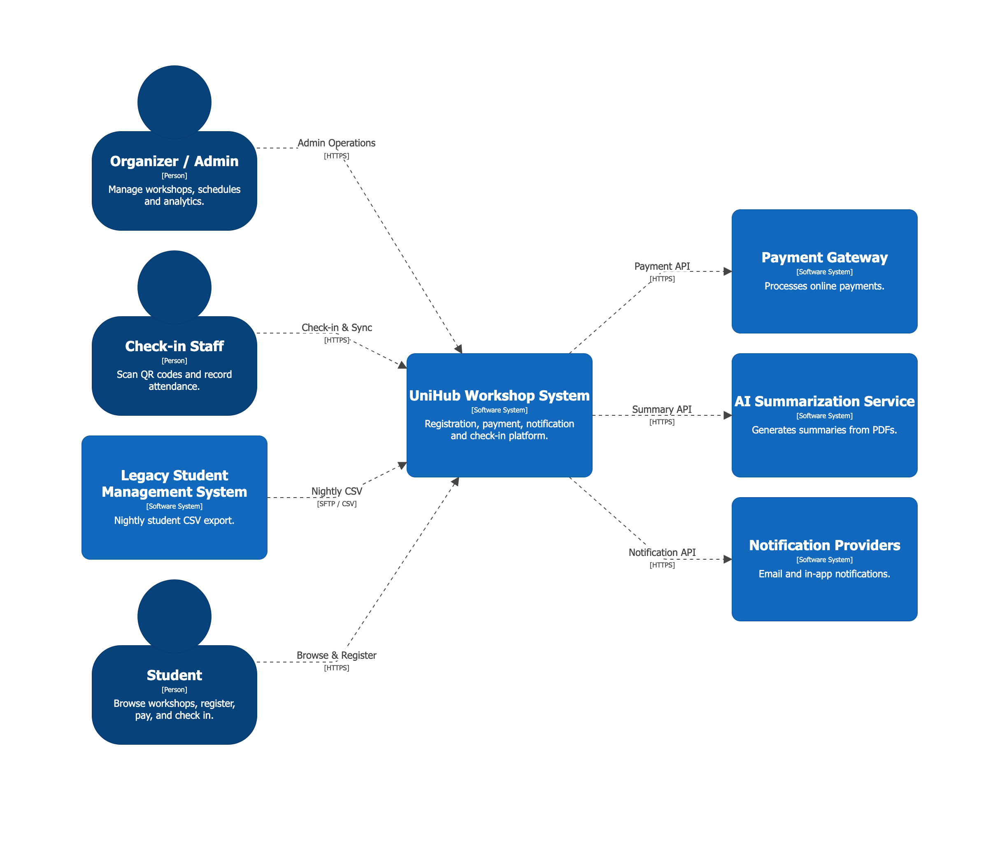

The system context view positions the **UniHub Workshop System** as the central platform coordinating the entire workshop lifecycle for "Skills and Career Week." Three primary personas interact with the system directly. **Students** discover workshops, register, pay, and check in using an issued e-ticket. **Organizers/Admins** manage the workshop catalog end-to-end — creation, editing, cancellation, and rescheduling — and monitor registration and check-in activity in real time. **Check-in Staff** use the system at venue entrances to validate e-tickets, including under unstable network conditions.

Four external systems define the boundary of UniHub's responsibility. The **Legacy Student Management System** supplies a nightly batch export used for identity verification, flowing into UniHub without a return path. The **Payment Gateway** authorizes paid registrations and is treated as an inherently unreliable dependency, isolated behind a fault-tolerance boundary. The **AI Summarization Service** is invoked to generate concise workshop descriptions from Organizer-uploaded promotional PDFs. **Notification Providers** deliver registration confirmations and lifecycle alerts (cancellation, reschedule), and are integrated through a channel-agnostic boundary so new providers can be added without touching core business modules.

This diagram establishes the trust boundary of the system: all user interaction happens over authenticated HTTPS, while every external system is treated as a dependency that may be slow, unavailable, or delayed — never as something the core registration and payment guarantees rely on being perfectly reliable.

### 2.2. Level 2 — Container

  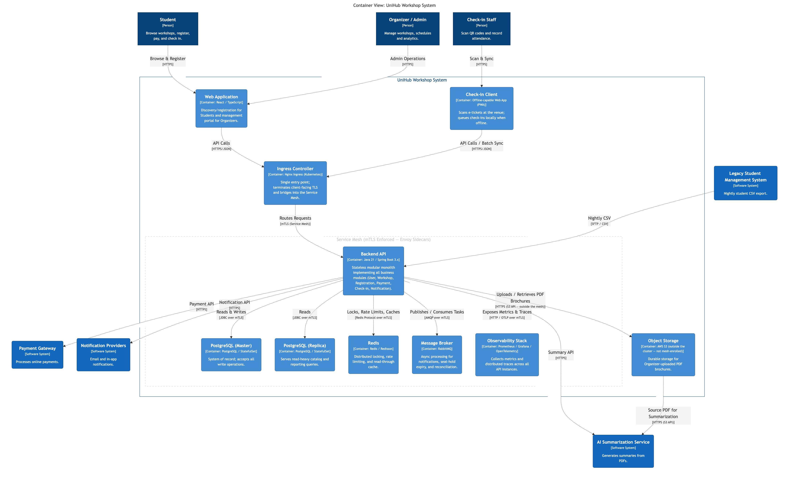

The container view decomposes UniHub into its client applications, the backend service, and its supporting infrastructure. The **Web Application** serves both Students and Organizers/Admins through a single responsive client with permission-gated views — a React + TypeScript SPA (Vite), using TanStack Query and Zustand for server-state and client-state respectively, Tailwind CSS with Shadcn UI for the component layer, and React Hook Form with Zod for form validation. This is also where a Student's issued e-ticket is viewed and downloaded — the Student's entire journey stays inside this one client. The **Check-in Client** is a separate, offline-capable mobile client purpose-fit for venue scanning, since its connectivity assumptions differ fundamentally from the rest of the system — built with React Native (Expo) and TypeScript on the same TanStack Query + Zustand data/state stack as the Web Application, with Expo SQLite (via Drizzle ORM) as its durable local queue, Expo Camera for scanning, and JOSE performing the on-device signature verification described in Section 5.3. It is used exclusively by Check-in Staff: a Student never installs, authenticates into, or otherwise interacts with this client — their side of the check-in exchange is limited to presenting the e-ticket already held in the Web Application.

All client traffic enters through a single **Ingress Controller**, which terminates TLS and load-balances requests across the running instances of the **Backend API** — a stateless Spring Boot Modular Monolith holding every business module described in Section 1.2. The Backend API is the only component that talks directly to the data and messaging layer: it routes writes to the **PostgreSQL Master** and read-heavy queries to **PostgreSQL Replicas**, coordinates concurrent access and caches low-change reads through **Redis**, offloads time-deferred work to the **Message Broker** for asynchronous processing, and persists Organizer-uploaded promotional PDFs to **Object Storage** rather than the transactional database.

Cross-cutting the entire container landscape, the **Observability Stack** collects metrics and distributed traces from every running Backend API instance, giving operators a real-time view of system health — independent of which instance is handling any given request. External systems (Legacy Student Management System, Payment Gateway, AI Summarization Service, Notification Providers) are integrated exclusively through the Backend API, keeping the boundary of external dependency in one place.

This container structure is what allows the system to scale horizontally under registration-peak load, maintain strict write consistency for seat allocation and payment, and keep check-in operational at the venue even when the network is not.

### 2.3. Level 3 — Component (Backend API)

  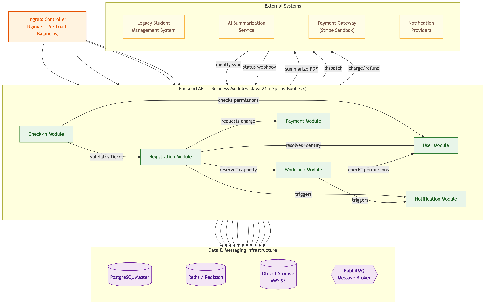

This diagram deconstructs the **Backend API** container from Section 2.2 into the six business modules introduced in Section 1.1: **User**, **Workshop**, **Registration**, **Payment**, **Check-in**, and **Notification**. Each module is a distinct component with its own responsibility boundary, and the diagram makes explicit which infrastructure and external systems each module — not the monolith as a whole — actually depends on.

The **Ingress Controller** routes incoming requests directly to the module that owns them, rather than to an undifferentiated "Backend API" black box. The **Registration Module** sits at the center of the highest-risk workflow: it calls the **Workshop Module** to check and reserve seat capacity, calls the **Payment Module** for paid tickets, and calls the **User Module** to resolve student identity — reflecting the same request-handling, coordination, and storage layering described in Section 1.4, now attributed to specific modules rather than the system as a whole.

Two modules own the system's external-facing integrations exclusively: the **Payment Module** is the only component that talks to the Payment Gateway, keeping circuit-breaker isolation contained to a single, well-defined boundary; and the **Notification Module** is the only component that talks to Notification Providers, consuming events from the Message Broker rather than being called synchronously by other modules — which is what makes the notification channel pluggable without touching the modules that trigger it. The **Workshop Module** owns both the **Object Storage** and **AI Summarization Service** dependencies, since brochure upload and summarization are part of the same workshop-content responsibility. The **User Module** is the sole target of the nightly student data sync from the **Legacy Student Management System**, consistent with it being the module of record for identity data.

This decomposition is what justifies the Modular Monolith decision in Section 1.1: each module already has a narrow, enforceable dependency footprint on shared infrastructure, so extracting any one of them into a standalone service later would not require redrawing these boundaries — only relocating them.

---

## 3. High-Level Architecture Diagram

  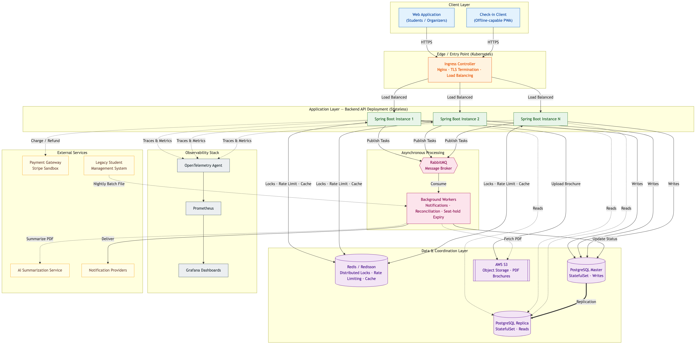

This diagram grounds the Container view (Section 2.2) in a concrete runtime topology, showing how each container is horizontally scaled and wired together in production. **Client traffic** enters exclusively through the **Ingress Controller**, which terminates TLS and load-balances requests across every running **Backend API** instance — the Application Layer is drawn as multiple parallel instances specifically to make explicit that no request is bound to a specific instance.

Every Backend API instance shares the same **Data & Coordination Layer**: writes are sent to the **PostgreSQL Master**, read-heavy queries are served from the **PostgreSQL Replica** (kept current via replication), and **Redis** is used uniformly for distributed locking, rate limiting, and caching low-change reads. Because this layer is shared rather than instance-local, any Backend API instance can safely process any request without coordination gaps.

Work that does not need to block the caller — notification delivery, seat-hold expiry, and financial reconciliation — is handed off to **RabbitMQ** and picked up by **Background Workers**, which write results back to PostgreSQL and hand off to Notification Providers. The **Legacy Student Management System** feeds into this same asynchronous path via its nightly batch file, keeping bulk data processing off the synchronous request path entirely. PDF brochure processing follows the same pattern: the Backend API uploads the file directly to **Object Storage (AWS S3)** and returns to the Organizer immediately, while a Background Worker later fetches that same file from S3 to invoke the AI Summarization Service — keeping large binary I/O and third-party summarization latency off the request path.

The **Observability Stack** and **External Services** sit at the edges of the diagram to reflect their role: every Backend API instance reports traces and metrics outward to OpenTelemetry, Prometheus, and Grafana regardless of load, while calls to the Payment Gateway and AI Summarization Service are drawn as isolated, single-direction dependencies — consistent with the fault-isolation principle in Section 1.4, where failure on either side must never propagate back into the core request path.

---

## 4. Data & Messaging Architecture

> [!NOTE]
> This section stays at the Macro Overview standard: **Rationale**, **System-level Topology**, **Trade-offs**, and **Consistency Guarantees**. Physical schema (DDL, indexing), Redis key naming formats, TTL values, message payload shapes, and retry/circuit-breaker policy specifics are implementation-level detail and belong in the corresponding files under [`docs/technical-design/`](./technical-design/).

### 4.1 PostgreSQL Read/Write Splitting & Consistency Trade-offs

**Rationale**

Workshop discovery traffic — catalog browsing, search, seat-availability display — is, by volume, the dominant class of database activity, especially during the registration-peak window described in the SRS. Write traffic — seat reservation, payment confirmation, workshop lifecycle changes, check-in records — is comparatively low in volume but carries the system's strictest correctness requirements: it must never be delayed or degraded by unrelated read load. Serving both from a single database node forces them to compete for the same connection pool, I/O bandwidth, and lock contention, meaning a surge in read traffic can directly threaten the availability of the write path that the anti-overbooking guarantee depends on.

Splitting read and write responsibility onto separate nodes isolates this blast radius: read load can grow — and be scaled independently by adding replicas — without ever contending with the single node responsible for transactional correctness. This is a deliberate application of the same isolation principle used elsewhere in the architecture (Section 1.4): the component under the highest correctness obligation is shielded from the component under the highest traffic volume.

**Topology**

A single **PostgreSQL Master** is the sole authority for all write operations. One or more **PostgreSQL Read Replicas** are kept current via native, asynchronous streaming replication and serve all read-only traffic. Every Backend API instance classifies each incoming request as a write, a routine read, or a consistency-sensitive read, and directs it to the appropriate node accordingly — this classification happens uniformly across all parallel API instances, so no instance has a different view of "which node handles what" than any other.

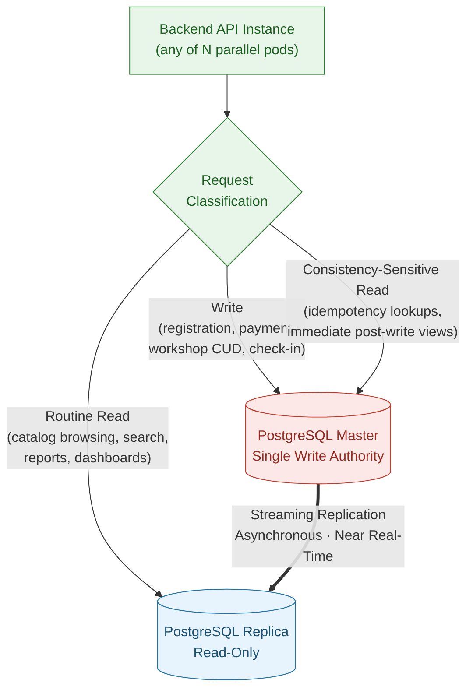

**Replication Lag & Consistency Trade-offs**

Because replication is asynchronous, a Replica is not guaranteed to reflect a write the instant it commits on the Master — there is a small, variable lag window. Rather than eliminating this lag (which would mean sacrificing the isolation this design exists to provide), the architecture accepts it and classifies data by whether staleness within that window is tolerable:

- **Tolerant of staleness — routed to Replica.** Workshop catalog browsing, search results, historical reports, and check-in dashboards are high-volume and read-mostly; a few hundred milliseconds of staleness has no correctness impact and is imperceptible in normal use.
- **Not tolerant of staleness — routed to Master.** Two categories require a strongly consistent read: (1) reads that feed directly into a subsequent write decision — most notably idempotency-key lookups before a payment is charged, where a stale "not found" could allow a duplicate charge to slip through; and (2) reads that immediately follow a user's own write and must reflect it — such as an Organizer viewing a workshop right after creating or editing it, where showing stale or missing data would read as a broken save rather than a replication delay.

Critically, this classification is a UX and defense-in-depth concern, not the system's sole line of defense against overbooking: the seat-reservation decision itself is never made by trusting a prior read, staleness-tolerant or not. It is re-validated transactionally against the Master at the moment of write, under the distributed-locking and optimistic-concurrency safeguards described later in this section — so Replica staleness can affect what a user _sees_, but never what the system _commits_.

**Consistency Guarantees**

- All write operations observe the Master's transactional guarantees; no write is ever accepted based on a Replica read.
- Streaming replication is ordered: a Replica may lag behind the Master, but it never presents writes out of sequence relative to one another.
- The system does **not** provide global read-after-write consistency by default. Strong consistency is applied selectively — to idempotency checks and immediate post-write confirmation views — rather than to all reads, which is the deliberate trade-off that makes horizontal read scaling viable in the first place.

### 4.2 Redis Coordination & Caching Topology

**Rationale**

Redis does two jobs that look unrelated at first glance: **caching** low-change workshop data, and **coordination** — distributed locks and rate limits.

Why put both on the same store? Because neither needs the isolation Section 4.1 requires. That split existed because read traffic could genuinely starve the write path. That risk doesn't apply here — caching and coordination are both cheap, short-lived, and fail safely. A cache miss just falls back to the database. A lock only lives for one operation. Since neither depends on its data surviving a restart, sharing infrastructure is a simplification, not a compromise — it avoids running a second stateful component just to keep two lightweight jobs apart.

Why a distributed store at all, instead of something in-process? Because the Backend API runs as N stateless instances (Section 10, `proposal.md`). A lock or rate-limit counter has to be visible to every instance, not just the one that set it — an in-memory lock on one pod is invisible to the other N-1 pods handling the next request for the same workshop.

**Topology**

Every Backend API instance talks to the same shared Redis deployment for all three jobs:

- **Cache reads** use a cache-aside pattern — miss the cache, fall through to the PostgreSQL Replica.
- **Locking is advisory only.** Redis decides _when_ an instance may attempt a write, not whether that write is accepted. That final call still belongs to PostgreSQL's optimistic-concurrency check (Section 11.1, `proposal.md`).

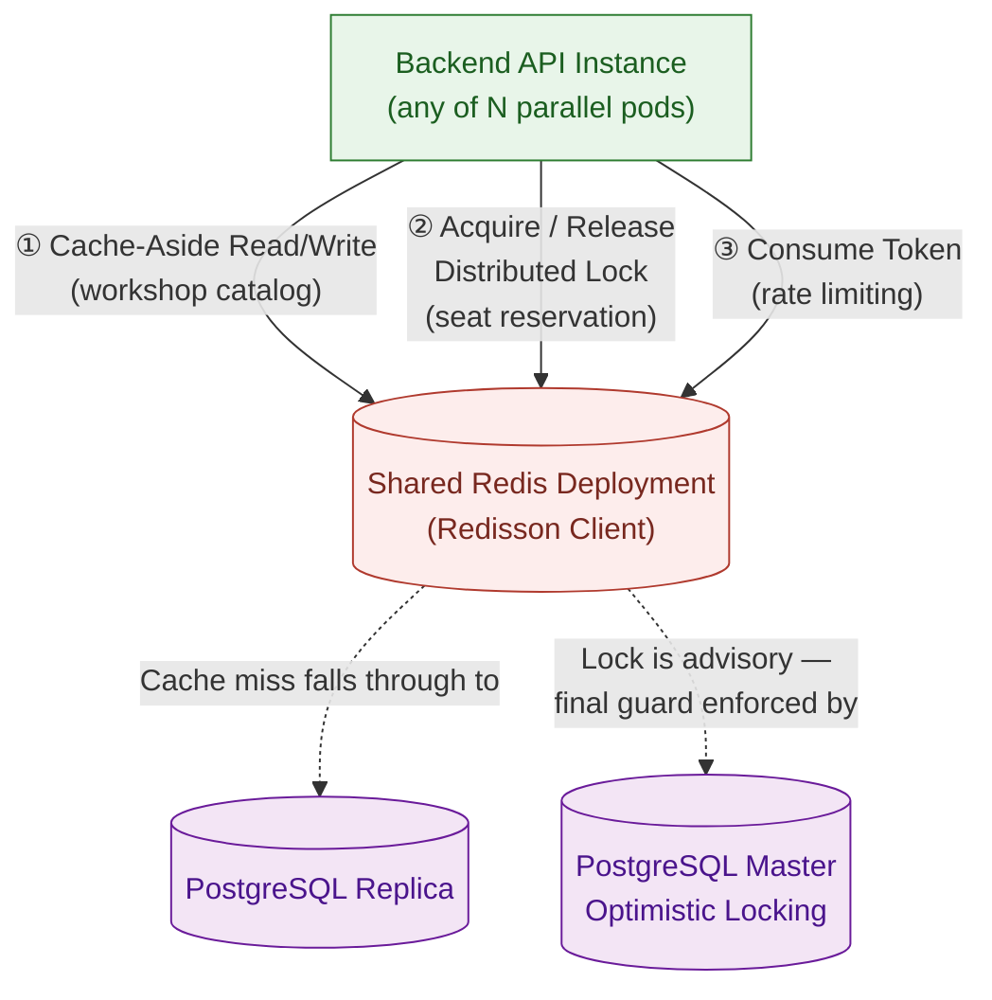

**Trade-offs**

- **One outage, two very different consequences.** Cache, lock, and rate limit all share one Redis deployment — so a Redis outage hits all three at once. But the impact isn't equal. Lose the cache, and reads fall back to the Replica: slower, still correct. Lose the lock, and the system can't safely admit concurrent seat reservations at all. So the rule is simple: if coordination goes down, registration writes get **rejected**, not allowed to proceed uncoordinated — the same fail-safe boundary from Section 1.4, applied here.
- **Freshness vs. database load.** Cached data doesn't live forever — it expires, and organizer writes (cancel, reschedule) invalidate it explicitly, so a cancelled workshop can't keep showing as available. This is the mirror image of Section 4.1's trade-off: staleness here is a deliberate design choice, not a replication artifact, and squeezing it too tight just pushes load back onto the database the cache exists to protect.
- **Lock duration is a balancing act.** Too short, and a slow-but-legitimate operation can lose the lock mid-flight, letting a second instance start concurrently. Too long, and a crashed instance blocks everyone else from ever acquiring it. We manage this with a bounded lease — the exact duration is a tuning parameter documented in `technical-design/modules/registration.md` (the seat-reservation lock), not an architectural decision.

**Consistency Guarantees**

- The cache is **never the source of truth** — every cached value is a disposable copy of PostgreSQL state. Clear the whole cache at any moment, and the system stays correct.
- The distributed lock guarantees mutual exclusion **across all parallel instances** for the seat-reservation critical section — but it's one layer, not the whole guarantee. Final correctness still needs the optimistic-concurrency check at the Master (Section 11.1, `proposal.md`).
- Rate-limit state is shared cluster-wide — a client's request budget is the same no matter which instance handles the request. A per-instance limiter would leave that gap wide open.

### 4.3 RabbitMQ Asynchronous Messaging Topology

**Rationale**

Four kinds of work must not happen inline with the request that triggers them:

- **Notification delivery** and **PDF summarization** depend on slow, third-party services — their latency should never land on a student's or organizer's response time.
- **Payment reconciliation processing** benefits from a queue's retry and failure-isolation behavior.
- **Seat-hold expiry** has to fire on its own, with no caller present, once the 15-minute window ends.

We considered polling the database for "holds that are now due" and rejected it — that means scanning every workshop at short intervals, and it only gets worse as registration volume grows. A message broker that can schedule future, caller-less delivery solves the seat-hold case directly. Reusing it for the other three keeps us from running a second async mechanism for what's really the same problem: decoupling _when work happens_ from _when it was triggered_.

**Topology**

Backend API instances publish four kinds of messages. The same deployable also consumes them — there's no separate worker service. That's a direct consequence of the Modular Monolith decision (Section 1.1): instances split their time between serving HTTP requests and consuming queued messages, not two different kinds of runtime.

(Section 3's diagram draws "Background Workers" as its own box to make the async role easy to spot at a glance — it isn't a separate deployment.)

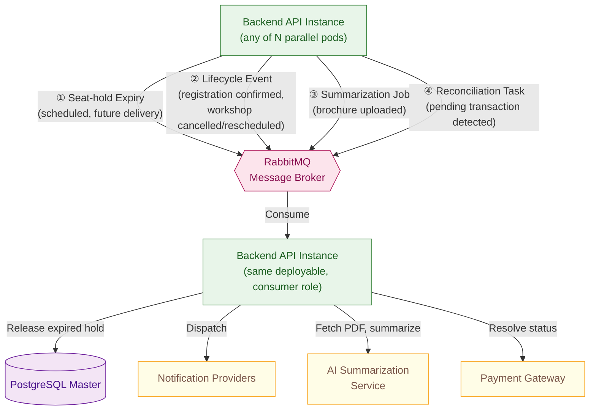

The publish step shown here is backed by the transactional outbox pattern in Section 6.1 (Event Publication) — the business write and the intent to publish commit atomically before the message ever reaches the broker.

**Trade-offs**

- **At-least-once, not exactly-once.** A broker or consumer failure can redeliver a message, so every consumer has to treat processing as idempotent. Releasing an already-released seat hold, or reconciling an already-resolved transaction, must be a safe no-op — never a duplicate side effect. This is exactly why Section 4.5 (Idempotency Store) gets its own subsection instead of being folded into this one.
- **No global ordering guarantee.** Messages for different reservations or workshops can be consumed out of order. That's fine almost everywhere, because consumers re-check current state at the Master before acting — they don't trust the message payload alone. The one honest exception: two lifecycle events for the _same_ workshop (an update followed by a cancellation) could, in rare cases, be processed out of order. We accept that risk at this scope rather than eliminate it — reading current state before acting bounds the damage, it doesn't remove it.
- **Worker capacity rides on API capacity.** Same instances, both jobs — so a registration surge and a notification backlog compete for the same pool. We don't split them into separate deployments. The fix is horizontal scaling under the same stateless model as Section 1.1, not a dedicated worker fleet. Splitting workers out later is a valid move if this coupling ever becomes a real bottleneck — just not one we're making preemptively.

**Consistency Guarantees**

- Messages are **durable** — a broker restart doesn't silently drop a scheduled seat-hold release or a queued reconciliation task.
- Delivery is **at-least-once, never zero** — the system is built to tolerate duplicates, not to promise they can't happen.
- Every consumer's effect is **idempotent under redelivery** — processing the same message twice never produces a different or worse outcome than processing it once.

### 4.4 Object Storage (AWS S3) Access Pattern

**Rationale**

Same reasoning as the PostgreSQL split in Section 4.1, applied to a different kind of data: large binary files don't belong next to structured transactional rows. A multi-megabyte PDF stored as a database blob inflates every backup, slows scans near it, and forces the OLTP engine to handle an I/O pattern it wasn't built for — large sequential reads, not indexed lookups of small rows.

Object storage is purpose-built for exactly this: write once, read occasionally, serve by byte range. Splitting it out keeps PostgreSQL focused on what it does best, and gives the AI Summarization Service a durable, directly fetchable source file instead of a blob buried inside a database row.

**Topology**

Only the Workshop Module touches S3, in two steps that never happen in the same request:

- **Upload** — the Workshop Module writes the brochure to S3 while handling the Organizer's request, and confirms the upload before the summarization pipeline ever runs.
- **Fetch** — the Background Worker (the same consumer role from Section 4.3) reads that object back later, only when it's ready to call the AI Summarization Service.

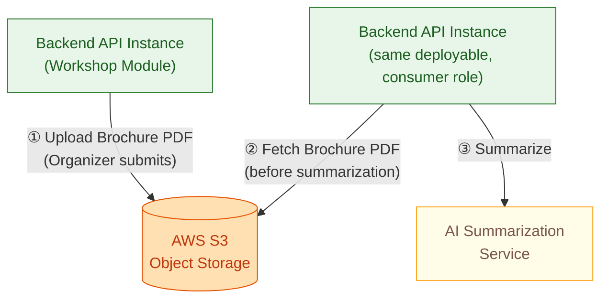

Splitting upload from fetch this way means an Organizer's upload is never blocked waiting on the AI Summarization Service — the two steps fail independently.

**Trade-offs**

- **One more thing outside the cluster.** S3 is the single exception to an otherwise fully local, self-managed topology (`proposal.md`, Section 6). PostgreSQL, Redis, and RabbitMQ all run inside the cluster; S3 doesn't. That means brochure upload and summarization now depend on outbound connectivity the rest of the system doesn't need — and an S3 outage has to be treated with the same fault-isolation discipline as the Payment Gateway (Section 1.4): it can fail the brochure flow, but it must never touch Registration, Payment, or Check-in.
- **Durable, but not disposable.** Unlike Redis's cache (Section 4.2), losing an S3 object is real data loss, not a recoverable miss — there's no PostgreSQL fallback to fetch a brochure from. That's the trade-off for decoupling it from the database: reliability now rests on S3's own durability instead of PostgreSQL's backups.
- **No expiry, by design.** Brochures aren't ephemeral like the cache entries in Section 4.2 or the idempotency keys in Section 4.5 — they persist as part of the workshop's historical record for as long as the workshop does. There's no TTL to reason about here, just a durable, indefinite object.

**Consistency Guarantees**

- Reads reflect the most recent successful write — S3 gives strong read-after-write consistency for this access pattern, so there's no staleness window to design around here, unlike Sections 4.1 and 4.2.
- **PostgreSQL, not S3, is authoritative** for whether a brochure exists and what its processing status is. S3 holds the bytes; the database record is what the rest of the system trusts.
- An Object Storage outage is isolated to the Workshop Module's upload/summarization flow — it never cascades into unrelated modules, consistent with the fault-isolation principle in Section 1.4.

### 4.5 Idempotency Store

**Rationale**

A client retry — network lag, a double-click, a resent request — must never register a student twice or charge a payment twice. Every registration and payment request carries a client-generated key, and the system must execute the request it identifies **exactly once** (`proposal.md`, Section 11.2).

The part that actually decides whether this guarantee holds isn't the key itself — it's **where the record of "this key was used" lives**. If that record and the business effect it guards (the registration row, the charge) can ever end up in different stores, there's a crash window where one succeeds and the other doesn't — and that window is exactly the double-charge scenario idempotency exists to prevent.

**Decision**

Idempotency records live in **PostgreSQL**, not Redis, and are written in the **same transaction** as the business effect they guard. This isn't a new decision — Section 4.1 already named idempotency-key lookups as the flagship example of a Master-routed, consistency-sensitive read. This subsection is that decision, made explicit.

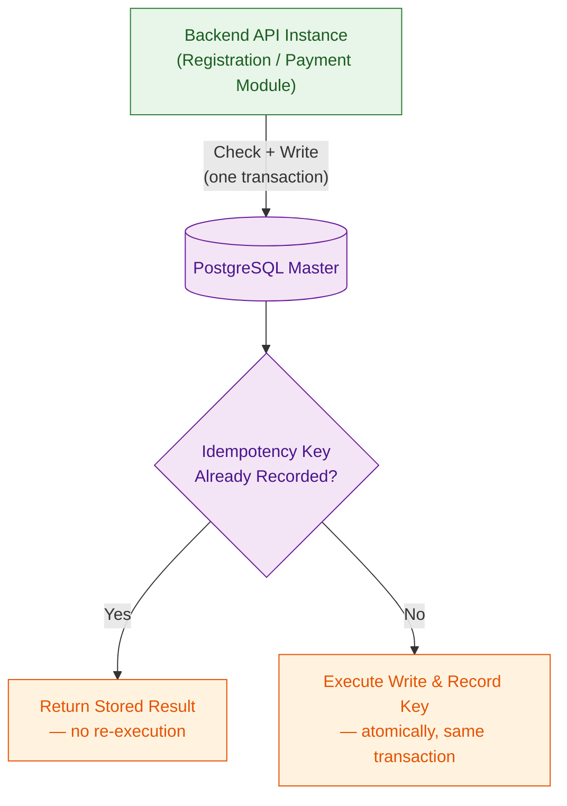

**Trade-offs**

- **Slower than a pure Redis check, on purpose.** A Redis-only idempotency check would be faster, but it opens a window where a crash between "Redis says key recorded" and "PostgreSQL commits the business write" leaves the two out of sync — the exact double-charge scenario this store exists to prevent. We accept the extra transactional overhead because the guarantee only holds if both facts — key used, effect happened — are written together, or not at all.
- **Cleanup is a background job, not automatic expiry.** Redis keys expire on their own; PostgreSQL rows don't. Idempotency records only need to survive a short retry window — a few minutes is enough (`proposal.md`, Section 11.2) — so a scheduled sweep removes expired records instead of relying on the store to forget them by itself. That sweep is another instance of the pattern in Section 4.6.
- **This is the same decision as Section 4.1, applied twice.** Idempotency-guarded writes were already routed to the Master before this subsection existed. Read/write splitting and idempotency correctness aren't two separate trade-offs — they're one trade-off, showing up in two places.

**Consistency Guarantees**

- The idempotency record and the business effect it guards are **written atomically, in one transaction** — they can never exist independently of each other, even across a crash.
- A duplicate request with a previously used key **never re-executes business logic** — it returns the original result, every time, regardless of which Backend API instance handles the retry.
- Idempotency records are retained only long enough to cover realistic retry windows (`proposal.md`, Section 11.2) — this store is not a permanent audit log.

### 4.6 Distributed Scheduled Job Coordination

**Rationale**

Five jobs run on a recurring schedule, not in reaction to a single event: the nightly student data sync, the payment reconciliation sweep for stuck Pending transactions, the idempotency-record cleanup sweep from Section 4.5, the Event Publication cleanup sweep from Section 6.1, and the Event Publication relay that moves committed outbox rows onto the Message Broker (Sections 4.3, 6.1). This is a different problem from Section 4.3's messaging: a RabbitMQ message is scheduled once, for one specific piece of work, and whichever instance consumes it does so exactly once by construction. A recurring job has no such built-in exclusivity — every instance's internal clock fires independently, so without coordination, all N parallel instances (Section 1.1) would decide "it's time" at the same moment and run the same job simultaneously.

**Topology**

Before executing, each instance attempts to acquire a shared, short-lived lock — the same Redis coordination primitive from Section 4.2, reused here for a different purpose. Only the instance that wins proceeds; every other instance skips that cycle outright, because the job will fire again on its next tick.

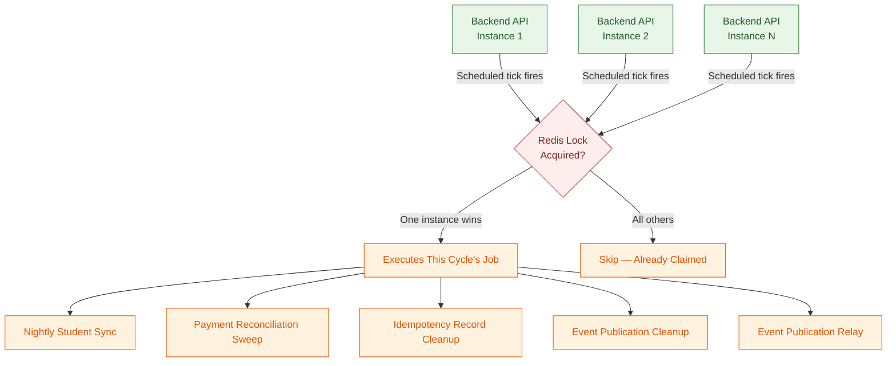

**Trade-offs**

- **Skipped cycles, not queued retries.** An instance that loses the lock race doesn't retry the same cycle — it waits for the next tick. Every job here tolerates running slightly late — for the relay, that means events reach the broker a cycle later, never that they are lost — so there's no need for the added complexity of letting a loser pick up after a winner's failure.
- **Lock failure means a skipped cycle, not a stuck system.** If the coordination layer is unavailable when a tick fires, no instance safely claims the job that cycle, and the system's choice is to skip rather than guess. Same fail-safe boundary as Section 4.2: uncoordinated execution is worse than a delayed one.
- **One instance per cycle is also a ceiling.** Only one instance does the work, so a job's runtime is bounded by what a single instance can do alone. That's fine at current data volumes — a nightly batch, a bounded set of pending transactions, an outbox that one instance drains in batches — but it wouldn't scale to jobs that need to process work in parallel across instances. That's a different problem (partitioned job execution) this architecture doesn't need to solve yet.

**Consistency Guarantees**

- Exactly one instance executes a given scheduled job per cycle — never zero (barring a coordination-layer outage) and never more than one. Concretely, what is held and tested is that **no two executions of the same job ever overlap in time**: a job on a fixed-delay schedule may legitimately run its next execution on another instance as soon as the previous one has finished, and that is the next cycle, not a duplicate.
- A skipped cycle is always recovered by the next scheduled tick — none of these jobs depend on every single cycle succeeding.
- This pattern only governs _when and how many_ instances run a job — it says nothing about the job's own internal correctness. That belongs to the job's own file, e.g. `technical-design/modules/user.md` (the nightly student sync).

---

## 5. Security & Access Control Architecture

### 5.1 Fine-Grained Role-Based Access Control (RBAC) Model

**Rationale**

A hardcoded check like "if role is Organizer, allow this" seems simple — until a new role shows up. The SRS already anticipates this: today there are three roles (Student, Organizer/Admin, Check-in Staff), but nothing rules out a Department Lead or a Volunteer Support Staff role tomorrow. If access control is wired to role _names_, every new role means hunting down every check that might need to include it.

So access control isn't built on role names at all. It's built on **permissions** — individual, atomic capabilities like "create a workshop" or "scan a check-in." A role is just a named bundle of permissions. Adding a role, or changing what an existing one can do, is a data change: assign or remove permissions from a bundle. No code touches this, and no redeploy is needed.

**Model**

Three things, three relationships:

- A **User** is assigned one or more **Roles**.
- A **Role** bundles a set of **Permissions** — it has no capability of its own beyond what it bundles.
- A **Permission** governs exactly one protected action, independent of every other permission.

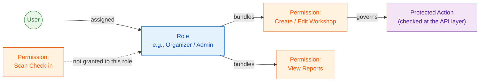

A Role is a convenience layer, not the unit of enforcement. Every check at the API layer asks "does this user have _this specific permission_," never "is this user's role X" — which is exactly the distinction between fine-grained RBAC and a hardcoded role switch.

**Trade-offs**

- **One more hop, on purpose.** Resolving "can this user do this" now means User → Role → Permission instead of a direct capability check. That indirection is the entire point — it's what makes a role reconfigurable without touching code — but it means a user's permission set is a _derived_ fact, not something read directly off the user. Section 5.2 covers where that resolution actually happens (once, not on every request).
- **Roles could be skipped — deliberately, they aren't.** Permissions alone would work for enforcement; the system doesn't strictly need Roles to know what a user can do. Roles exist because assigning capabilities to a person one permission at a time doesn't scale when the Organizing Committee is provisioning volunteer and staff accounts close to an event. Roles are an aggregation convenience layered on top of the real unit of enforcement, not a shortcut around it.
- **Permission granularity is a judgment call.** Too coarse, and we're back to hardcoded-role rigidity in disguise. Too fine — a separate permission for every button and field — and assembling a role becomes unmanageable for whoever configures it. The system settles on one permission per business capability (creating a workshop is separate from cancelling one; viewing a report is separate from exporting one), not per API field.
- **Reconfiguration has no guardrail of its own.** Because changing a role's permissions is just a data change, it's also an _invisible_ one unless something else records it. Changing what a role can do is exactly the kind of sensitive operation Section 5.5 (Audit Logging) exists to catch.

**Guarantees**

- Adding a role, or changing an existing one's permissions, never requires a code change or a redeploy.
- Permissions are never conflated — granting one never implicitly grants another. Every capability is checked on its own.
- A user's access is fully determined by their assigned role(s) at evaluation time. There's no fallback path that checks a role name directly — the permission check is the only path, by design (`docs/requirement.md`, Section 2.11).

### 5.2 Stateless Authentication & JWT Claims Lifecycle

**Rationale**

Section 5.1 left a debt: resolving "what can this user do" means walking User → Role → Permission, and that's a database-backed lookup. Doing that lookup on _every single request_ would put a consistency-sensitive read back on the hot path — exactly the cost Section 4.1 was designed to isolate. It would also fight the statelessness requirement from Section 1.1: any Backend API instance must be able to handle any request, with no per-instance session state.

The fix is to resolve permissions **once**, at login, and carry the result with the client instead of re-deriving it every time. That's what the JWT is: not just proof of identity, but a signed, self-contained snapshot of "this user, with these permissions, as of this moment."

**Model**

- The token carries the user's **resolved permission list**, not the role name (`docs/requirement.md`, Section 2.11, is explicit about this). Role is how permissions get _assigned_ — it plays no part at request time.
- Verification is **local and stateless**: any instance checks the token's signature and expiry on its own, with no shared session store and no database round-trip.
- The lifecycle has three moments: **issue** (login resolves permissions once, signs them into a token), **use** (every request, any instance, signature-only check), and **expire** (the token stops being trusted, forcing re-authentication).

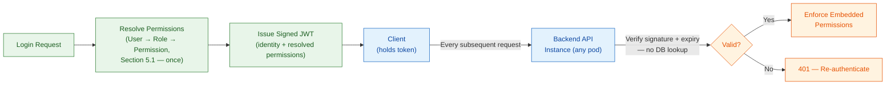

**Trade-offs**

- **Revocation lag is the real cost here.** Because permissions are baked into the token at issuance, a permission change, a role reassignment, or an account suspension doesn't take effect until that token expires. There's a window — bounded by the token's lifetime — where a user's real access and their token's embedded access can disagree. This isn't an oversight; it's the direct price of not doing a DB lookup per request. The token lifetime exists specifically to bound that window — short enough that a revoked permission doesn't stay dangerously live, long enough that the system isn't re-authenticating constantly. The exact duration is a tuning parameter for `technical-design/`, not an architectural decision.
- **This architecture doesn't solve instant revocation, and doesn't claim to.** For something like a compromised account needing to be cut off immediately, a bounded lifetime alone isn't a real answer — that needs an explicit deny-list check, which adds back the per-request lookup this design exists to avoid. The SRS doesn't call for instant revocation today, so this architecture doesn't build for it; if that requirement shows up later, it's a deliberate trade-off to revisit, not a bug in this one.
- **Carrying the full permission list costs bytes, on every request.** `docs/requirement.md` requires the token to carry specific authorities, not just a role name — so a user with many permissions sends a bigger token, every time. That's the accepted cost of zero-lookup authorization.

**Guarantees**

- Any Backend API instance authenticates and authorizes a request the same way, with no shared session store and no database round-trip.
- The permissions enforced at request time are exactly the ones resolved at issuance — never silently re-derived, never different between two instances handling the same token.
- A token's contents can't be altered without invalidating its signature — there's no way to escalate permissions by editing the payload.

### 5.3 QR Code E-Ticket Security & Integrity

**Rationale**

Every other decision in this section assumes the verifier is connected to the system. This one can't assume that: check-in has to work fully offline (`docs/requirement.md`, Sections 1.3.5 and 2.9), so a staff device can't call the server to ask "is this ticket real" — there may be no network to call on. The ticket has to prove itself, with zero round-trip.

**Model**

When a ticket is issued, the Registration Module signs it with an asymmetric scheme (RSA or ECDSA). The Registration Module is the only holder of the private signing key; the Check-in Client carries only the corresponding public key, so a device that can verify a ticket is never in possession of anything that could forge one. Verification is performed on-device by **JOSE**, a standard JWS/JWT cryptography library — the same signature format and algorithm the server signs with is what the client verifies, with zero network round-trip. That signature is what lets any device confirm the ticket came from the system and hasn't been altered — without looking anything up.

That check proves exactly one thing: the ticket is **authentic** — issued by the system, untouched. It proves nothing about whether the ticket is still **valid**. Cancel a workshop, and its tickets' signatures don't change — a device scanning offline has no way to know about that cancellation yet. Checking authenticity is instant and offline. Checking validity isn't — that only happens once the device reconnects and syncs with the server.

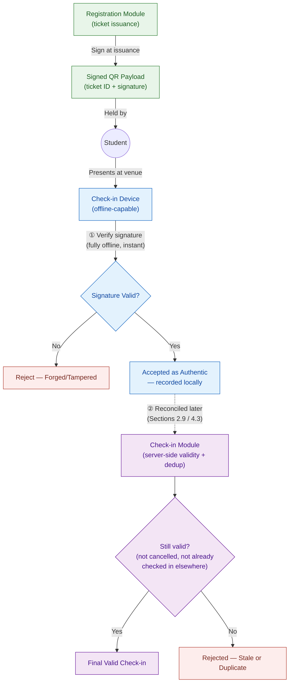

**Trade-offs**

- **Offline authenticity, delayed validity — accepted, not fixed.** A real, correctly-signed ticket for a workshop that was just cancelled still passes the offline check — the device simply doesn't know yet. Requiring a live connection for every scan would break the offline requirement outright, so we accept this gap instead of closing it upfront.
- **No per-ticket revocation, ever.** This goes further than Section 5.2's token expiry: a ticket's signature has no lifetime at all. Once issued, it stays authentic forever — the only way to kill it is rotating the signing key, and that kills every ticket, not just one. The real defense against a stale-but-real ticket is reconciliation after the scan, not blocking it before.
- **Signing stops forgery. It doesn't stop reuse.** A photographed or copied QR code is a perfectly real payload — it passes the signature check every time. That's a copying problem, not a forgery problem, and signing was never meant to catch it. One device can catch an obvious repeat scan on its own. Two different offline devices scanning the same copied ticket can't know about each other until both sync. Closing that gap is what the earliest-timestamp rule in `proposal.md` (Section 11.4) already handles — not the signature's job.
- **The verification key isn't secret, but it still needs integrity protection.** The Check-in Client's copy of the public verification key doesn't need confidentiality — anyone could read it without weakening the scheme — but it does need tamper-resistance: silently swapping it on a compromised device would let a forged ticket pass the offline check. Expo SecureStore keeps it, alongside the client's own auth token, in the platform's hardware-backed keystore rather than plain app storage, so altering either requires compromising the device's secure enclave, not just its app sandbox.

**Guarantees**

- A tampered or fabricated QR payload fails verification on every device, offline or online — no exceptions.
- Once issued, a ticket can't be revoked one at a time. Staleness is caught during reconciliation, not blocked at the scan — that's a known limit, not something we missed.
- Duplicate scans of a real ticket — one device or many — settle to exactly one valid check-in once everything reconciles. Never two. Same rule as `proposal.md` (Section 11.4).

### 5.4 Network & Data Protection Boundaries

**Rationale**

An earlier version of this section drew one trust line: encrypted from the outside, trusted network on the inside. That's a reasonable baseline, but it assumes the cluster network itself can be trusted — that nothing inside ever has to prove itself to anything else. This project adopts a stronger model instead: **Zero-Trust**. No connection is trusted by default, external or internal — every hop is encrypted and every endpoint proves its identity, every time.

Wiring that by hand — certificates and mutual authentication into every service-to-service call — would mean touching every module's code. Instead, a **Service Mesh** does it transparently: every pod gets a **sidecar proxy** (Envoy, via Istio) running alongside it, and all traffic in and out of that pod flows through the sidecar first. Two sidecars negotiate mutual TLS with each other automatically — the Backend API, PostgreSQL, Redis, and RabbitMQ never have to know encryption is happening at all.

**Model**

- Every pod in the mesh — Backend API, PostgreSQL, Redis, RabbitMQ, the Observability Stack — runs its own **sidecar proxy**. Application code talks to `localhost`; the sidecar handles everything past that.
- Two sidecars negotiate **mutual TLS (mTLS)**: each side proves its identity to the other, not just one direction. That's the "mutual" in mTLS, and it's what makes this Zero-Trust — a connection isn't just encrypted, it's authenticated on both ends before anything is exchanged.
- This is invisible to the Backend API's own code. Section 1.1's module boundaries don't change; the mesh operates entirely below the application layer.
- The target is **STRICT** mode, enforced namespace-wide: a connection that does not present a valid mesh identity would be refused, not downgraded to plaintext, making mutual TLS a requirement on every hop rather than an option two sidecars happen to negotiate. **In force since Phase 7 task 7.5 (2026-11-06):** the preconditions in `technical-design/platform/deployment-and-cicd.md` (Mesh mTLS Mode ADR) were met and `PeerAuthentication` is STRICT in `unihub` and `unihub-observability`; before that the mesh ran PERMISSIVE — mTLS between sidecars, plaintext still accepted. The proof is a run on the Minikube cluster (`k8s/scripts/check-mtls.sh`, 19 ports refuse plaintext from a pod with no sidecar), accepted as evidence only when the owner says so at the Phase 7 sign-off.
- Credentials, signing keys, and third-party API keys are a separate concern from transport security — they're never in source code or application config, injected at runtime instead. The exact mechanism lives in `technical-design/`.
- The same principle extends past the cluster boundary to the Check-in Client: its auth token and its copy of the ticket-verification public key (Section 5.3) are held in Expo SecureStore, backed by the device's hardware keystore, rather than in plain application storage — the mobile equivalent of never keeping a secret in source or config.

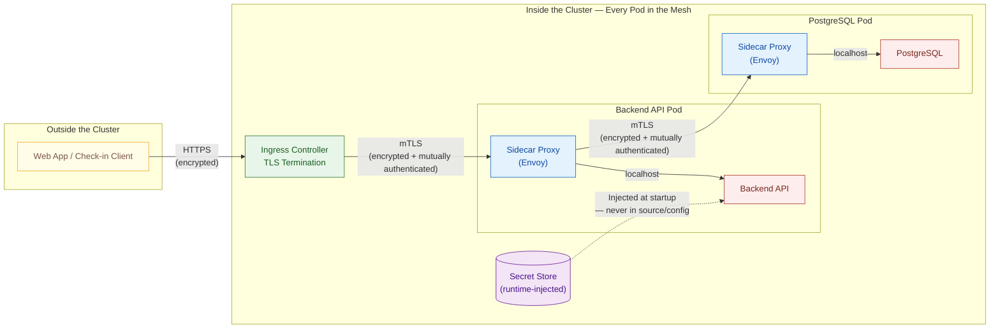

The diagram shows one pod-to-pod hop for clarity, but the same mTLS applies everywhere in the mesh — Backend API to PostgreSQL, to Redis, to RabbitMQ, to the Observability Stack, and to the Ingress. There's no exempted hop.

**Trade-offs**

- **Every pod now carries a sidecar's overhead.** A sidecar proxy uses its own CPU and memory, on every pod — Backend API, PostgreSQL, Redis, RabbitMQ, all of it. That adds directly to the resource pressure already flagged for this project's local cluster (`proposal.md`, Section 16). We accept it because this project treats defense-in-depth as worth the cost even without production traffic to justify it — a deliberate portfolio decision, not something the SRS requires (`docs/requirement.md`, Section 2.11 only requires encryption for client-facing traffic).
- **Every hop now costs a little latency.** Traffic that used to go pod-to-pod directly now passes through two sidecars, one on each end — including on the registration hot path (Section 4.1). The cost per request is small, but it's not zero, and it applies everywhere, not just at the edge.
- **Strict means every client must be in the mesh.** Once STRICT is in force, anything that connects to a mesh pod — the Ingress controller (a mesh member by construction since it is the mesh's own ingress gateway), the migration Job, the observability stack — has to carry a sidecar too, or its connections are refused. A misconfigured client fails closed rather than quietly working in plaintext, which is the point, but it is an operational precondition of the guarantee below — and the reason STRICT is gated rather than switched on.
- **The mesh is now a dependency of everything.** Before, only the Ingress had to work correctly for external traffic to be safe. Now, the mesh's control plane has to be healthy for any two pods to talk to each other at all — losing it doesn't just weaken security, it can stop internal traffic outright. That's a new, cluster-wide dependency the previous design didn't have.

**Guarantees**

- Every connection is encrypted — external or internal, there is no plaintext hop anywhere in the system, including Backend API to PostgreSQL, Redis, and RabbitMQ.
- Every connection is mutually authenticated — a pod only accepts traffic from another pod that can prove its identity, not just anything reachable on the network.
- None of this touches application code. The Backend API's modules (Section 1.1) work exactly as described elsewhere in this document; the mesh operates entirely beneath them.
- Credentials and keys stay out of source code and committed config, regardless of the transport layer securing them in flight.

### 5.5 Audit Logging for Sensitive Operations

**Rationale**

`docs/requirement.md` (Section 2.11) requires an audit trail for critical operations: registration, payment, check-in, and workshop schedule changes. There's a fifth category this section adds on top of that list: changes to what a role can do. Section 5.1 already flagged this — reconfiguring a role's permissions is just a data change, with no guardrail of its own unless something records it.

This is a different job from the Observability Stack (Section 1.2). Observability answers "is the system healthy" — metrics, traces, dashboards, aimed at operators. Audit logging answers "who did this, and when" — aimed at whoever investigates an incident after the fact. Same instinct to record what happened, different question, different audience.

**Model**

- Five categories are audited: registration, payment, check-in, workshop lifecycle changes, and role/permission changes.
- Every audit event captures the same four things: **who** (the actor's identity, from the JWT — Section 5.2), **what** (the operation), **on what** (the target), and **when**.
- This isn't owned by one module. Every module that performs a sensitive operation is responsible for emitting its own audit event as part of that operation.
- Capturing the event and completing the business operation are two separate concerns. The audit event is published asynchronously — reusing the same Message Broker as Section 4.3, but deliberately **without** the transactional-outbox guarantee from Section 6.1, since audit is an investigative concern, not a correctness-critical one (see Trade-offs below) — so writing to the audit trail never sits on the critical path of a registration, a payment, or a check-in.

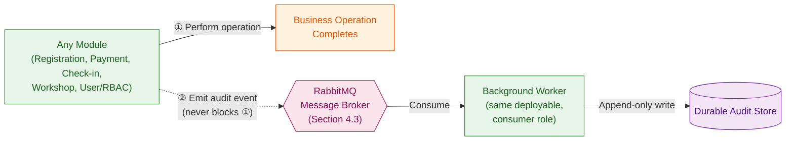

**Trade-offs**

- **Fail-open, on purpose.** If the audit pipeline is down, the registration, payment, or check-in it would have recorded still succeeds. We chose this deliberately: audit logging is an investigative concern, not a transactional one, and it shouldn't be able to take down a business operation that has nothing to do with it. The cost is a possible, bounded gap in the audit trail during an outage — accepted, not ignored: an audit-publish failure is itself something the Observability Stack surfaces, not something that fails silently.
- **Async means eventual, not instant.** An audit event is queued the moment the operation happens, not necessarily written to durable storage in the same instant. For after-the-fact investigation, that lag doesn't matter. It would matter for a real-time audit view — this design doesn't promise that.
- **A fifth category we added ourselves.** Role/permission changes weren't in the SRS's named list, but leaving them out would mean the one part of the system with the least oversight (Section 5.1's "invisible unless something records it") is also the one part with no audit trail. We extended the scope to close that gap rather than stop at the letter of the requirement.

**Guarantees**

- Every operation in the five audited categories emits an audit event — this isn't opt-in per module, it's a property of performing that operation.
- Every audit event records who, what, on what, and when — enough to reconstruct a sequence of sensitive actions after the fact.
- An audit pipeline outage never blocks or fails the business operation it would have recorded — audit failure is an operational alert, not a user-facing error.

### 5.6 Security Guarantees Summary

Five different mechanisms, five different questions. This table is the short version — what each one promises, and where that promise deliberately stops.

| Area                     | Guarantee                                                                                                                  | Known Limit                                                                                                                                     |
| :----------------------- | :------------------------------------------------------------------------------------------------------------------------- | :---------------------------------------------------------------------------------------------------------------------------------------------- |
| **RBAC** (5.1)           | Access is fully determined by permissions, never a hardcoded role name — reconfigurable without a code change or redeploy. | A role's own change history has no guardrail by itself; that gap is closed by 5.5, not by 5.1.                                                  |
| **Authentication** (5.2) | Any instance verifies a request the same way — stateless, no shared session store, no database round-trip.                 | Revocation isn't instant. A permission change or suspension only takes effect once the token expires.                                           |
| **E-Tickets** (5.3)      | A forged or tampered ticket fails verification everywhere, online or offline.                                              | A real ticket can still be stale (workshop cancelled) or duplicated (photographed) — the signature doesn't catch either; reconciliation does.   |
| **Network** (5.4)        | Every connection, external and internal, is encrypted and mutually authenticated — Zero-Trust, no exempted hop.            | The mesh's control plane is now a dependency of all internal traffic — lose it, and pods can't reach each other at all, not just less securely. |
| **Audit Logging** (5.5)  | Every sensitive operation, across five categories, leaves a traceable who/what/when record.                                | Fail-open by design — an audit pipeline outage doesn't block the operation it would have recorded, so a bounded gap is possible.                |

None of these limits are oversights — they're the same fault-isolation instinct from Section 1.4, applied to security instead of availability. A payment gateway outage shouldn't take down browsing (1.4); an audit pipeline outage shouldn't take down a registration (5.5). A stale ticket shouldn't require every check-in device to be online (5.3); a permission change shouldn't require a redeploy (5.1). Each subsection in this section chose which guarantee to hold absolutely, and which one to relax — deliberately, and in writing, rather than leaving it to be discovered later.

---

## 6. Database Architecture

### 6.1 Domain Model Overview & Data Integrity

**Rationale**

Section 2.3 split the Backend API into six modules, but never said which module owns which piece of data. Without that, nothing stops one module's code from reaching into another module's table directly — quietly breaking the boundaries Section 2.3 already drew. So: name the entities, and give each one exactly one module allowed to write it.

Not every entity means the same thing, either. Some represent the actual business — a Workshop, a Registration, a Payment. Others exist purely to make a guarantee work — an Idempotency Key means nothing to a student or an Organizer; it exists because Section 4.5 needs somewhere to record "this request already happened." Keeping these two kinds of entities separate matters: **Core Domain Entities** are what `technical-design/platform/database-schema.md` will spend most of its detail on. **Technical Pattern Entities** are supporting infrastructure for guarantees this document already made elsewhere.

**Model**

Six Core Domain Entities, one per module from Section 2.3:

- **User Module** owns User, Role, and Permission — the three-way model from Section 5.1.
- **Workshop Module** owns Workshop.
- **Registration Module** owns Registration.
- **Payment Module** owns Payment.
- **Check-in Module** owns Attendance.
- **Notification Module** owns Notification.

Three Technical Pattern Entities back guarantees already made earlier — not business data:

- **Idempotency Key** — backs the exactly-once guarantee from Section 4.5.
- **Event Publication** — records "this write also needs to publish a message," committed in the _same transaction_ as the business write it describes. This is what actually closes a gap Section 4.3 left open: a crash between committing a row and publishing to RabbitMQ can't silently lose the event, because the intent to publish is durable before the transaction ever commits.
- **Audit Event** — backs the who/what/when record from Section 5.5.

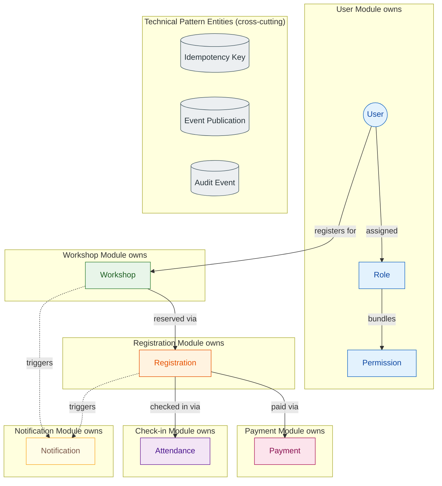

**Single Authoritative Writer, one rule.** A module writes only the entities it owns. A module that needs another module's data reads it through that module's own interface, not a direct table query — the same discipline Section 1.1 already applies in code, extended down to the schema.

**Data Integrity Principles**

- **Locking and check constraints prevent overbooking.** Every entity in the seat-reservation race — Workshop's capacity, Registration's status — carries an optimistic-concurrency version marker, backed by a check constraint so the invariant (capacity never goes negative) holds at the database level even if application logic has a bug. This is the storage-layer half of the anti-overbooking strategy from `proposal.md` (Section 11.1); the coordination half is Section 4.2's distributed lock.
- **Unique constraints are the idempotency backstop.** Section 4.5 already decided idempotency records live in PostgreSQL, in the same transaction as the effect they guard. A unique constraint on the key is what makes that decision enforceable by the database itself, not just application code — a second insert with the same key fails outright, rather than relying on the application to check first and hope nothing races it.
- **`ON DELETE RESTRICT` protects history.** A Workshop with existing Registrations can't be deleted — only cancelled. A Registration with a Payment or an Attendance can't be deleted either. This isn't just data hygiene: Section 5.5's audit trail is worthless if the record it describes can vanish out from under it.

### 6.2 Schema Evolution & Migration Strategy

**Rationale**

The system runs as N parallel, stateless instances (Section 1.1). If each instance's ORM is allowed to inspect and modify the schema on boot, every one of those instances starting at once — during a rolling deploy, after a crash-loop, anywhere N pods come up together — can attempt to change the same table at the same time. That's not hypothetical: concurrent DDL on one table is exactly the kind of table-locking, race-prone operation Sections 4 and 5 spend most of their length eliminating everywhere else. Letting the ORM do it implicitly on every boot would be the one place that discipline quietly stops applying.

**Model**

- Schema changes are explicit and versioned — never inferred from entity classes at runtime.
- Migration runs once, from a single place, **before** any application instance using the new schema starts — never from inside the applications themselves.
- The pipeline enforces the order: a dedicated migration step applies the schema first; only once it succeeds does the rolling deployment of Backend API pods begin. By the time any pod starts, the schema it expects already exists.

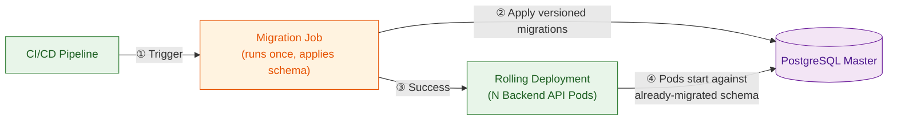

**Trade-offs**

- **Slower iteration, on purpose.** Auto-DDL is convenient early on — the schema just matches the code. Removing it means every change is a deliberate, versioned step before it reaches a running instance. That's friction we accept, not a limitation we're stuck with.
- **A failed migration blocks the whole rollout, not just one pod.** Because migration runs once, ahead of every instance, a bad migration stops the deployment before any pod starts on the new schema — instead of some pods succeeding and others crash-looping against a half-migrated database. Better to halt visibly before rollout than fail unpredictably per-instance during it.
- **Migrations have to survive a rollout in progress, not just complete before it.** A rolling deployment briefly runs old and new pod versions side by side. A migration can't assume every pod is already on the new schema the moment it's applied — it has to tolerate being read by both versions until the rollout finishes. That's a real constraint on how a migration is written, not just where it runs.

**Guarantees**

- No two instances ever race to modify the schema — exactly one migration step runs, once, before any instance starts against the new version.
- An application instance never starts against a schema it doesn't expect — migration completes, or the rollout doesn't proceed.
- Schema history is fully versioned and reviewable, independent of whatever application code happens to be running against it.

### 6.3 Data Lifecycle & Retention Summary

Retention has been decided piecemeal across this document — a TTL here, an indefinite store there, each time as part of a different guarantee. This table puts every one of those decisions side by side, so a change to one doesn't get made without seeing what else in the system assumes a similar — or deliberately different — lifetime.

| Data Domain          | Entity / Data                                                                       | Store                          | TTL / Cleanup Mechanism                                | Retention Policy                                                                         |
| :------------------- | :---------------------------------------------------------------------------------- | :----------------------------- | :----------------------------------------------------- | :--------------------------------------------------------------------------------------- |
| **System of Record** | Workshop, Registration, Payment, Attendance, User / Role / Permission, Notification | PostgreSQL (Master + Replicas) | None — never expires                                   | Indefinite. This _is_ the historical record (`ON DELETE RESTRICT`, Section 6.1).         |
| **Technical State**  | Idempotency Key                                                                     | PostgreSQL                     | Scheduled sweep (Section 4.6)                          | Minutes — just enough to cover a realistic retry window (Section 4.5).                   |
| **Technical State**  | Event Publication                                                                   | PostgreSQL                     | Scheduled sweep (Section 4.6), after confirmed publish | Short-lived — until the message is confirmed delivered, then discarded (Section 6.1).    |
| **Technical State**  | Audit Event                                                                         | Durable audit store            | None defined at this scope                             | Long-term. Retained for investigation, never opportunistically cleaned up (Section 5.5). |
| **Technical State**  | Coordination Locks & Rate Limits                                                    | Redis                          | Native key expiry (TTL)                                | Seconds — lives only as long as the operation it coordinates (Sections 4.2, 4.6).        |
| **Cache**            | Workshop catalog reads                                                              | Redis                          | TTL expiry + explicit invalidation on write            | Seconds to minutes. Disposable, never authoritative (Section 4.2).                       |
| **Blobs**            | PDF brochures                                                                       | AWS S3                         | None                                                   | Indefinite — tied to the life of the Workshop it belongs to (Section 4.4).               |
| **Edge Data**        | Pending check-in scans                                                              | Local device storage (Expo SQLite via Drizzle ORM) | Cleared after confirmed sync                           | Transient — exists only until reconciliation confirms receipt (Section 5.3).             |

The pattern across every row is the one Section 6.1 already established: data that represents the business outlives the operation that created it; data that only supports a guarantee dies the moment that guarantee no longer needs it. Nothing here is retained by default — every non-indefinite lifetime in this table is a deliberate cleanup mechanism, not an assumption that something will get overwritten eventually.
