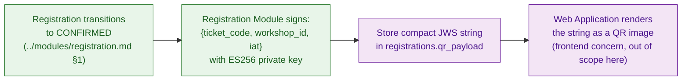
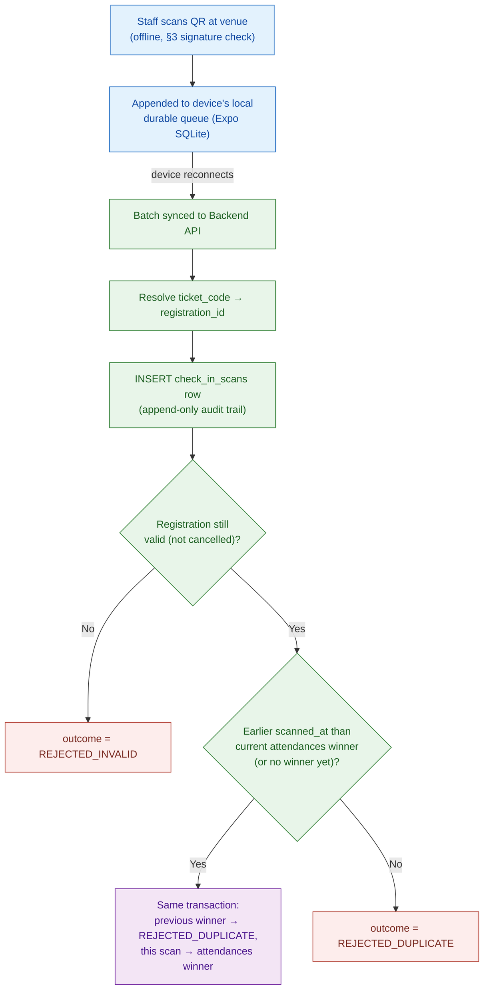

# Check-in Module — Technical Design

This file is the physical-level completion of `architecture.md` §5.3 (QR Code E-Ticket Security & Integrity), together with `docs/requirement.md` §1.3.5/§2.9 and `proposal.md` §11.4. Those sources establish *that* a ticket is signed asymmetrically so a Check-in Client can verify it fully offline, *that* scan events queue durably on-device and sync once connectivity returns, and *that* server-side reconciliation keeps exactly one valid check-in per ticket by earliest-timestamp-wins — but leave the exact payload format, signing algorithm, key distribution/rotation mechanics, and reconciliation SQL as physical detail for this document. Nothing here overrides `architecture.md` — where this file and that one appear to disagree, `architecture.md` is the authority and this file has a bug.

**Read this file top to bottom to understand the Check-in module end to end.** Where it uses a shared platform mechanism (JOSE/JWT tooling), it explains what that mechanism gives Check-in specifically and links out for the mechanism's own full design — the auth JWT that authenticates a Check-in Staff member's own session is `../platform/auth-and-identity.md`'s design, not this file's.

**Scope:** the `check_in_scans`/`attendances` tables this module owns, narrated at the rationale level (§1); the QR e-ticket's payload format, `ES256` signing at issuance, the physical reason ECDSA was chosen over RSA, and verification-key distribution/rotation (§2–§6); the offline scan → sync → reconciliation flow, including the earliest-timestamp-wins overtake logic (§7); a consolidated failure-mode table and reference table (§8–§9).

**Out of scope, and where it actually lives:** the exact `check_in_scans`/`attendances` column list (`../platform/database-schema.md` §6 — referenced throughout, not repeated here); the auth JWT a Check-in Staff member's own device session uses (`../platform/auth-and-identity.md` — this file's own two-tokens comparison in that document's §1 explains why the ticket uses a different algorithm entirely); ticket *issuance* as a registration event (`../modules/registration.md` — this module only defines the signing mechanics that module's `CONFIRMED` transition triggers); the Check-in Client's own local storage engine (Expo SQLite via Drizzle ORM, per `CLAUDE.md` — this file specifies what gets stored and synced, not the mobile app's own schema/ORM wiring).

Both this ticket signature and the auth JWT use the JOSE (JSON Object Signing and Encryption) standard — RFC 7515 (JWS) / RFC 7519 (JWT) — per `CLAUDE.md`'s tech stack. They deliberately do **not** share a signing key or even a signing algorithm — `../platform/auth-and-identity.md` §1 explains why they can't, from the auth-token side; this file explains it from the ticket side in §2 below.

---

## Table of Contents

- [Architecture Decision Record](#architecture-decision-record)
  - [ADR Mini: QR E-Ticket Signing Algorithm & Key Distribution/Rotation](#adr-mini-qr-e-ticket-signing-algorithm-key-distributionrotation)
- [1. Data Model — What This Module Owns](#1-data-model-what-this-module-owns)
- [2. Two Tokens, Two Trust Boundaries, Two Algorithm Choices](#2-two-tokens-two-trust-boundaries-two-algorithm-choices)
- [3. QR E-Ticket — Payload Format](#3-qr-e-ticket-payload-format)
- [4. QR E-Ticket — Signing at Issuance](#4-qr-e-ticket-signing-at-issuance)
- [5. Why ECDSA, Not RSA — the QR Capacity Constraint](#5-why-ecdsa-not-rsa-the-qr-capacity-constraint)
- [6. Verification Key Distribution & Rotation](#6-verification-key-distribution-rotation)
- [7. Offline Scan Sync & Reconciliation](#7-offline-scan-sync-reconciliation)
- [8. Failure Modes & Fail-Safe Behavior](#8-failure-modes-fail-safe-behavior)
- [9. Reference Table](#9-reference-table)
- [10. Reporting — Registration Counts and Check-in Rates](#10-reporting-registration-counts-and-check-in-rates)
- [API Surface](#api-surface)

---

## Architecture Decision Record

Reached through the `spec-driven-development` gated workflow: 2–4 alternatives were explored with a trade-off matrix, the human made the call at the Phase 3 Decision Gate, and the reasoning was captured here verbatim rather than left to live only in `SPEC.md` (a working document for the next task, not a durable record).

### ADR Mini: QR E-Ticket Signing Algorithm & Key Distribution/Rotation

**Context:** `architecture.md` §5.3 requires the e-ticket to be verifiable fully offline, on-device, with zero network round-trip, by a Check-in Client operating under real physical conditions — unstable venue network (`docs/requirement.md` §1.3.5), variable camera hardware, and lecture-hall lighting. §5.3 also establishes, as a stated design point, that the *only* revocation mechanism for a ticket is rotating the signing key, and that rotation "kills every ticket, not just one" — any distribution/caching design must make that statement literally true, not accidentally soften it.

**Decision:** `ES256` (ECDSA P-256) for ticket signing. Public key distribution via an authenticated endpoint the Check-in Client calls while online (login, and opportunistically on every scan-batch sync); the fetched key is cached as the single active key in Expo SecureStore, **overwritten** on every successful fetch — never accumulated alongside older keys.

**Consequences:**
- ES256's ~64–72 byte signature (vs. RSA-2048's ~256 bytes) leaves more of the QR code's fixed data budget for error correction, producing a more scan-reliable code under exactly the degraded conditions §1.3.5 anticipates.
- Rotating the signing key requires no app rebuild or store release — the new public key propagates the next time each device is online, consistent with `architecture.md` §5.4's "secrets/keys injected at runtime, never baked into a build."
- Because the client keeps exactly one cached key, rotation is provably a total, all-tickets revocation, not a partial one — matching §5.3's stated guarantee exactly, without a separate mechanism that could accidentally make it partial.
- A device offline across the exact moment of a rotation event has a bounded, self-healing blind spot: it still accepts old-key tickets and rejects new-key tickets until its next successful online sync.

**Trade-offs accepted (user's own reasoning):** RSA-2048 (Option A) was rejected specifically because a denser QR code (or a lower error-correction level to compensate) works against the physical scan-reliability requirement at venue conditions the SRS already flags. Baking the public key into the app build (Option C) was rejected because a key-compromise response would then require an app rebuild and redistribution to every device — far slower than rotating a server-side key — and because it conflicts with §5.4's runtime-injection principle for key material.

---

## 1. Data Model — What This Module Owns

**Rationale:** `architecture.md` §6.1 names `Attendance` as this module's entity — physically split into two tables (`../platform/database-schema.md` §6) because two requirements otherwise conflict on a single table: `docs/requirement.md` §2.9 requires every offline scan, including ones that later lose reconciliation, to be recorded with complete information; `proposal.md` §11.4 / `architecture.md` §5.3 require exactly one final valid check-in per ticket, ever. A single table can satisfy one of these cleanly or the other, not both.

- **`check_in_scans`** — the raw, append-only record of every scan event any device ever synced, win or lose. `outcome` (`ACCEPTED`/`REJECTED_DUPLICATE`/`REJECTED_INVALID`) is set at first reconciliation but **not immutable** — a scan initially `ACCEPTED` can flip to `REJECTED_DUPLICATE` if an earlier-`scanned_at` scan from a different device syncs later (§7). `scanned_at` is the device's own clock at scan time — the value reconciliation actually compares — never the server's receipt time (`received_at`).
- **`attendances`** — the finalized, one-row-per-registration projection. Its `UNIQUE (registration_id)` constraint **is** the "exactly one valid check-in" guarantee (`architecture.md` §5.3, `proposal.md` §11.4), enforced by the database, not application discipline alone.

---

## 2. Two Tokens, Two Trust Boundaries, Two Algorithm Choices

**Rationale:** it's tempting to treat "the auth JWT" (`../platform/auth-and-identity.md`) and "the ticket QR payload" as the same kind of problem — both are signed JSON, both use JOSE, both get verified before something is allowed to happen. They aren't the same problem, because *who verifies them* is different, and that difference is what forces a different algorithm for each.

| | Auth JWT (`../platform/auth-and-identity.md`) | QR E-Ticket (this file) |
|---|---|---|
| Issuer | Backend API, at login | Registration Module, at ticket issuance |
| Verifier | Backend API — **only ever itself**, any pod (`architecture.md` §5.2) | Any Check-in Client device — **never** the issuer alone (`architecture.md` §5.3) |
| Trust relationship | Issuer and verifier are the same trust domain | Issuer and verifier are different trust domains — a device that can verify must never be able to forge |
| Algorithm family | Symmetric (`HS256`) | **Asymmetric (`ES256`)** |

A symmetric key works exactly as long as issuer and verifier are the same party holding the same secret — that's the auth JWT's situation. The ticket is the opposite: the verifier (a Check-in Client device, possibly stolen or compromised) must be structurally incapable of forging what it verifies, which a shared secret can never guarantee — only a private/public split can. This is the same distinction `architecture.md` §5.3 draws when it says the Check-in Client "carries only the corresponding public key, so a device that can verify a ticket is never in possession of anything that could forge one."

**Guarantee:** compromising every Check-in Client device in the field never yields anything that could forge a ticket or a login token; compromising a Check-in Client's cache never yields the auth-JWT signing secret either, since the two live in entirely separate secrets and neither service ever ships one to a party that only needs the other.

---

## 3. QR E-Ticket — Payload Format

**Rationale:** `architecture.md` §5.3 requires the ticket to "prove itself, with zero round-trip" — the payload has to carry everything a fully offline device needs to answer "is this authentic," and nothing more, since anything beyond authenticity (is it still *valid*) is explicitly deferred to server-side reconciliation (§7), not encoded in the payload at all.

**Model — JWS, compact serialization** (`header.payload.signature`, base64url-encoded, no JSON wrapping) — the standard QR-friendly JOSE form, chosen because compact serialization is the shortest standard encoding, and payload size is a hard physical constraint here (§5).

| Claim | Type | Meaning | Why it's here (or why something else isn't) |
|---|---|---|---|
| `ticket_code` | string | The registration's `registrations.ticket_code` (`../platform/database-schema.md` §4.1) | What a Check-in device resolves at reconciliation time to look up the registration server-side (`../platform/database-schema.md` §6.1's `check_in_scans.registration_id`). |
| `workshop_id` | UUID string | The workshop this ticket belongs to | Lets a Check-in Client display which workshop a scanned ticket belongs to, and flag a venue mismatch against the workshop the staff member selected on the device (§7, Phase 5 checklist D51), without a lookup. Because it is signed, the server never has to cross-check it against the registration: it cannot differ. |
| `iat` | Unix timestamp | Issued-at | Standard JOSE housekeeping; not used as a validity check (see below). |

**Deliberately absent:**
- **No `exp`.** `architecture.md` §5.3 is explicit and non-negotiable on this point: "no per-ticket revocation, ever... once issued, it stays authentic forever." An `exp` claim would silently reintroduce a per-ticket kill switch this design deliberately does not have — a workshop's tickets aren't supposed to stop being *authentic* on their own; only reconciliation decides *validity* (cancelled, already used), and that decision lives server-side in `check_in_scans`/`attendances` (§7), never in the payload itself.
- **No student PII (name, email).** The signature already proves *which ticket*; a Check-in Staff member confirming *which person* is a visual/manual check against an ID at the door, outside this document's scope — encoding PII into a QR code that gets photographed, screenshotted, and forwarded (§6's own "copying, not forgery" framing) would leak it far wider than the check-in flow needs.

**Guarantee:** the payload alone is sufficient for any device to determine authenticity with zero network access and zero fields that could go stale between issuance and a scan weeks later — staleness is a validity question, and validity is explicitly not this payload's job.

---

## 4. QR E-Ticket — Signing at Issuance

**Model:**

| Decision | Value | Why |
|---|---|---|
| Algorithm | `ES256` (ECDSA over P-256) | Chosen over RSA specifically for signature size — see §5. |
| Signer | Registration Module only, at the moment a registration transitions to `CONFIRMED` (`../modules/registration.md` §1), on **both** paths: a free ticket confirmed at reservation, and a paid ticket confirmed by the payment-confirmation consumer. Signing runs **inside** the confirming transaction — a stateless computation with no network I/O (`../../guidelines/backend-coding-standards.md` §7 type 3, §19) — so `status`, `ticket_code` and `qr_payload` are written by one statement — the `INSERT` of a free registration created `CONFIRMED`, or the conditional `UPDATE` of a paid one (Phase 5 checklist D48) | Per `CLAUDE.md`'s module-ownership table — Registration is the sole writer of `registrations`, and the ticket is that row's own artifact; no other module signs a ticket. A redelivered confirmation finds the row already `CONFIRMED` and does not sign again. |
| Port and adapter | `TicketSigner` in `registration.application.port.out`; `NimbusEs256TicketSigner` in `registration.infrastructure.out.crypto`. An ArchUnit rule keeps every type that touches the private key inside `registration..` (Phase 5 checklist D47) | The module boundary is what keeps the private key with its one user. |
| `ticket_code` | 128 random bits (`SecureRandom`), Crockford base32 without padding — 26 characters (`../platform/database-schema.md` §4.1; D48) | Unguessable, readable aloud if it ever has to be typed; the `UNIQUE` constraint is the collision backstop. |
| Library | `nimbus-jose-jwt` — the same dependency `../platform/auth-and-identity.md` §3 uses for the auth JWT, declared as a **direct** dependency from Phase 5 (until then it arrived only transitively through the resource-server starter; D47), pinned in `build.gradle.kts` at the version the starter already resolved (`9.37.3`) because Spring Boot's BOM does not manage it — bumped deliberately, never by a transitive upgrade | One JOSE library serving both signing use sites in this backend; the two never share a *key*, only the *implementation*. |
| Private key storage | Kubernetes `Secret`, readable only by the Backend API's Registration-module code path. Configuration `unihub.ticket.signing-key` (env `UNIHUB_TICKET_SIGNING_KEY`): a private EC P-256 JWK. **Required at startup** — blank, not EC P-256, or missing the private member `d` stops the application with a clear message, as for Redis (Phase 3 D21) and SMTP (Phase 4 D36). Tests, `contract-diff` and local development generate a key at run time (`apps/backend/scripts/generate-ticket-key.sh`, Node only; `--write` stores it in the git-ignored `apps/backend/.env` and refuses to replace an existing key, since replacing it is a rotation); no key file is ever committed. The value is checked in a bean method, not in the properties record, and every failure message describes the problem without echoing the value, because Boot's bind-failure report would otherwise print the private key to the log (Phase 5 checklist D49) | Per `architecture.md` §5.4 — the private key never leaves the backend, and is the one piece of key material in this entire corpus that no client, mobile or web, ever receives in any form. |
| Persistence | The signed compact string is stored verbatim in `registrations.qr_payload` (`../platform/database-schema.md` §4.1) | Never recomputed on read — a ticket keeps rendering correctly even after a key rotation (§6) invalidates it for *verification* purposes; the row itself is an unaltered historical record either way. |

**Issuance flow:**



**Guarantee:** every registration confirmed from Phase 5 on has exactly one signed ticket payload, generated once, by the one module authorized to generate it, and never regenerated from scratch afterward. Rows confirmed before Phase 5 have no ticket (`NULL`); they are not backfilled (D48) and the Web Application shows "ticket not issued" for them.

**Hook into the confirmation email (Phase 4 checklist D37):** `docs/requirement.md` §1.3.2 sends the confirmation "with their e-ticket". Phase 4 ships the confirmation without the QR (`notification.md` §4); when this issuance flow is built in Phase 5, the `REGISTRATION_CONFIRMED` email template gains the e-ticket, and M-37's e-ticket half is closed then. Decided (Phase 5 checklist D55): the email carries the QR as an inline PNG image (`Content-ID`), rendered server-side by the Notification module with ZXing from `qr_payload`, read through a `registration.api` interface at the Master; the in-app notification links to the e-ticket page. A registration with no ticket gets the confirmation without the image. The `ticket.confirmed` event is written in the same transaction as the signature, so the payload is there when the consumer reads it.

**Web rendering (D56):** the e-ticket page `/me/registrations/:id` renders `qrPayload` with `qrcode.react` (SVG) at error-correction level **Q**; it fits the build's Content-Security-Policy (`img-src 'self' data:`, inline SVG needs no `img-src`).

---

## 5. Why ECDSA, Not RSA — the QR Capacity Constraint

**Rationale:** this is a place where a purely cryptographic decision and a purely physical one point at the same answer, and it's worth making the physical reasoning explicit rather than leaving "ES256" looking like an arbitrary pick.

A QR code has a fixed data-capacity ceiling per symbol version and error-correction level — more bytes forces either a larger/denser code (more modules, harder for a phone camera to resolve at a distance or under the "unstable lecture-hall conditions" `docs/requirement.md` §1.3.5 already flags) or a lower error-correction level (less tolerant of the exact smudging/glare/motion-blur conditions a physical event produces). Signature size feeds directly into that ceiling:

| Algorithm | Typical signature size | Compact JWS length (this payload) | Effect on the QR code |
|---|---|---|---|
| RSA-2048 (`RS256`) | ~256 bytes | Materially longer | Forces a higher-version (denser) QR code for the same error-correction level, or a lower error-correction level for the same code size — either way, a harder scan target under the exact degraded-camera, degraded-lighting, unstable-network conditions §1.3.5 warns about. |
| ECDSA P-256 (`ES256`) | ~64–72 bytes | Materially shorter | Leaves headroom to keep a smaller/denser-tolerant code at a high error-correction level — an easier scan target, for the same cryptographic guarantee. |

Both algorithms satisfy `architecture.md` §5.3's authenticity requirement equally — this isn't a security trade-off, it's a scan-reliability one, and ECDSA wins it without giving up anything the section actually asks for. This is a materially different rationale from the auth JWT's `HS256` choice (a trust-boundary argument, §2 above) — the two algorithm decisions in this corpus are independent and shouldn't be read as following from the same reasoning.

The actual compact JWS length and the resulting QR version at level Q are measured when the ticket is first built (Phase 5 checklist task 7.1) and recorded here; until then the table above says only "materially shorter".

**Guarantee:** the signature scheme adds the minimum payload weight the JOSE standard allows for this security level, so the QR code's data budget is spent on cryptographic integrity rather than being forced into a harder-to-scan format by an oversized signature.

---

## 6. Verification Key Distribution & Rotation

**Rationale:** the Check-in Client verifies fully offline (§3), which means it must already be holding the public key *before* it ever loses connectivity — it can't fetch what it needs at the exact moment it needs it. That forces a fetch-while-online, cache-for-offline-use pattern, and it means key rotation has to be reasoned about in terms of what a device that's been offline across a rotation event actually has cached.

**Model:**

| Decision | Value | Why |
|---|---|---|
| Distribution endpoint | `GET /api/v1/checkin/verification-key`, gated by `hasAuthority('CHECKIN_SCAN')` on the Check-in Staff's existing session | The Check-in Client already authenticates its own staff user to sync scan batches (`docs/requirement.md` §2.9) — reusing that same session, permission-checked, avoids standing up a second, separate auth mechanism just for key fetch. Gating on `CHECKIN_SCAN` specifically — not merely "any authenticated request" — keeps this endpoint consistent with `../platform/auth-and-identity.md` §3's discipline: `architecture.md` §5.1 requires every check to be permission-based, never a bare authenticated/not-authenticated boolean, and this endpoint is no exception just because the key itself isn't confidential. |
| Response format | A single JWK (JSON Web Key) representing the current active ECDSA public key — members `kty`, `crv`, `x`, `y` only, never `d` | Standard JOSE key representation — the same format `nimbus-jose-jwt` (server) and `jose` (client, per `CLAUDE.md`'s mobile stack) both consume natively. |
| Source inside the backend | Check-in serves the endpoint but does not hold the key: it reads the public JWK through `registration.api.TicketVerificationKey`, which returns public material only (Phase 5 checklist D47) | Registration keeps the private key (§4); the module boundary (`architecture.md` §1.1) allows Check-in to import only `registration.api`. No cycle: Registration does not depend on Check-in. |
| Fetch trigger | On Check-in Client login, and opportunistically on every successful online sync (`docs/requirement.md` §2.9) | Login is the one moment the device is guaranteed online; piggybacking on every sync (also necessarily online) means the cached key self-refreshes as a side effect of a flow the device already performs, without a dedicated polling mechanism. |
| Cache location | Expo SecureStore, overwriting the previous cached key on every successful fetch | Per `CLAUDE.md` — device-hardware-backed keystore, alongside the client's own auth token; a single active key, not an accumulating list. |
| Key count cached | **Exactly one** — the current active key, always overwritten, never appended | This is the deliberate design point: see the rotation discussion below. A multi-key cache (retaining old keys so previously-issued tickets keep verifying past a rotation) was evaluated as an alternative and rejected — it would directly contradict §5.3's stated guarantee that rotation is the *only* revocation lever and that it acts on *everything*, not just newly-issued tickets. |

**On-device verification (offline, per scan):**

```typescript
import { importJWK, compactVerify } from 'jose';

async function verifyTicket(qrPayload: string, cachedPublicJwk: JWK): Promise<TicketClaims | null> {
  try {
    const publicKey = await importJWK(cachedPublicJwk, 'ES256');
    // algorithms: ['ES256'] pins the accepted alg explicitly — mirrors the auth-JWT
    // verifier's own alg-pinning (../platform/auth-and-identity.md §3), applied here too:
    // this key is deliberately public (§6's distribution model), which is exactly the
    // condition under which an algorithm-confusion forgery (e.g. a crafted header claiming
    // a symmetric alg) needs to be rejected outright rather than left to a library default.
    const { payload } = await compactVerify(qrPayload, publicKey, { algorithms: ['ES256'] });
    return JSON.parse(new TextDecoder().decode(payload)); // { ticket_code, workshop_id, iat }
  } catch {
    return null; // signature invalid, tampered payload, wrong/rejected alg, or malformed input — reject, offline, instantly
  }
}
```

**On-device verification is subject to a spike (Phase 5 checklist D58).** `jose` relies on WebCrypto (`crypto.subtle`), which Hermes/React Native may not provide on the pinned Expo SDK. Before any screen is built, the spike runs `compactVerify` on a real device; if it fails, signature verification moves to `@noble/curves` (pure-JS P-256) with the `alg` still pinned to `ES256`, and this section records the result. The test of M-43 runs the same `verifyTicket` function the device runs.

A `null` result is recorded locally as a rejected scan (`../platform/database-schema.md` §6.1's `REJECTED_INVALID` at the point it later reconciles) — either way, this function never calls the network, exactly as §3/architecture.md §5.3 require.

**Rotation — a deliberate blunt instrument, not a graceful handoff:** `architecture.md` §5.3's Trade-offs section is explicit that "the only way to kill \[a ticket] is rotating the signing key, and that kills every ticket, not just one." This document's single-cached-key model is what makes that statement literally true at the implementation level: because a Check-in Client never retains a previous key once a fetch overwrites it, rotating the signing key means every ticket ever issued under the old key fails verification the moment a device refreshes its cache — not just newly-scanned ones, and with no graceful multi-key transition period. Rotation is reserved for a suspected private-key compromise — a rare, break-glass operation, not a routine one — precisely because its blast radius is "every ticket this system has ever issued." Because the key is fetched over the network rather than baked into the app build, this rotation requires no app rebuild or store release — the new key propagates the next time each device is online, consistent with `architecture.md` §5.4's "secrets/keys injected at runtime, never baked into a build."

**Trade-off — rotation leaves every student with a dead QR (Phase 5 checklist D62, accepted by the owner 2026-10-30):** because a ticket is never regenerated (§4), nothing re-issues tickets after a rotation; every issued QR stops verifying and those students cannot check in until a remedy is decided at the time. Accepted as part of the break-glass procedure, since rotation is reserved for a suspected key compromise. The procedure itself is manual: replace the secret, restart, devices pick up the new key at their next login or sync.

**Trade-off — a device offline across a rotation event has a temporary blind spot in both directions:** if the signing key rotates while a Check-in Client is offline, that device (a) still accepts old-key tickets as authentic until its next successful sync, and (b) rejects any ticket signed with the *new* key as an invalid signature until that same sync happens. Both resolve the moment the device is back online and re-fetches — this is a bounded, self-healing gap, not a permanent one, and it only matters in the already-rare window immediately following a break-glass rotation.

**Guarantee:** a private-key compromise has exactly one operational response — rotate — and that response provably invalidates every previously-issued ticket everywhere, with no code path that could accidentally leave an old, compromised key's tickets still verifiable somewhere.

---

## 7. Offline Scan Sync & Reconciliation

**Rationale:** `docs/requirement.md` §1.3.5/§2.9 require check-in to keep working fully offline, with every scan recorded locally and synced once connectivity returns; `proposal.md` §11.4 requires exactly one valid check-in per ticket, resolved by whichever scan has the earliest device timestamp, regardless of sync order or which device scanned it. §3's signature check only ever answers "is this ticket authentic" — this section is where "is this scan the one that counts" gets decided, and it is the only part of the check-in flow that needs the network at all.

**Model — what happens on-device, before any network call:** every scan — accepted or rejected by §6's offline signature check — is appended to the device's local durable queue (Expo SQLite via Drizzle ORM, per `CLAUDE.md`) with its `ticket_code`, `workshop_id`, the scanning staff member's identity, the device's own `device_id`, and the device clock's `scanned_at`. This queue is what survives an app restart or a connectivity gap — nothing about it is server-visible yet.

Device rules (Phase 5 checklist D53, D59):
- **Venue workshop.** Before scanning, the staff member selects the workshop being checked in (the list is fetched while online and kept locally). The scan records that **venue** workshop as `workshopId`; a ticket of another workshop raises a warning on the device and is still recorded.
- **Verified codes only.** Every scan carries `deviceVerdict`: `VERIFIED` (the signature verified; `ticketCode` is the verified claim) or `REJECTED_SIGNATURE` (it did not). The device sends `ticketCode` only for a `VERIFIED` scan. A scan it rejected is sent with `ticketCode = null` and `deviceVerdict = REJECTED_SIGNATURE`; the raw value stays on the device only (truncated for display). This keeps a crafted QR from ever reaching the server as data (see the poison-batch rule below). In the contract `ticketCode` is a required string of 1–64 characters only when the verdict is `VERIFIED` (`if`/`then`/`else`); for `REJECTED_SIGNATURE` it is unconstrained and the server ignores it, so the rule holds even against a client that does not follow this one.
- **Staff attribution.** Each queued scan records the `sub` of the token in use when it was scanned (`staffUserId`). A sync sends only the scans of the staff member currently logged in; others wait for their own staff member. The server never trusts a client-supplied scanner: `scanned_by` is the caller of the sync. Logout is blocked (or warned) while the user's own scans are unsynced.
- **`device_id`:** a UUID v4 generated at first launch, kept in SecureStore, unchanged by logout.
- **No cached key → no scanning** (§8). The key is fetched at login and after every successful sync, overwriting the previous one; a failed fetch keeps the old key.
- **Re-scan on the same device:** a warning ("already scanned at hh:mm"), and the scan is still recorded.
- **Automatic sync:** when connectivity returns, when the app comes to the foreground, and periodically while scans are pending; batches of at most 500; a scan leaves the queue only once the server returned a result for its `id`. An expired token keeps the scans and asks for a new login.

**Model — sync:** on reconnect, the Check-in Client uploads its queued scans in a batch to the Backend API (`POST /api/v1/checkin/sync`, `CHECKIN_SCAN`). The server resolves each scan's `ticket_code` back to a `registrations.id` and inserts one `check_in_scans` row per scan (`../platform/database-schema.md` §6.1) — this is the append-only audit trail `docs/requirement.md` §2.9 requires, and it happens regardless of whether a given scan will go on to win or lose reconciliation. A scan the device rejected, or whose code resolves to nothing, is still recorded, with `registration_id` `NULL` and `REJECTED_INVALID` (migration `V6`, D50).

Sync semantics (D54):
- A batch holds 1 … 500 scans; an empty or oversized batch, or a malformed scan, is `400` for the batch — **except** that a scan carrying `deviceVerdict = REJECTED_SIGNATURE` never fails the batch; it becomes `REJECTED_INVALID` on its own (the poison-batch rule: one crafted QR must never block every later sync of a device, REQ-1.3.5 "no data loss").
- A scan resubmitted with the same `id` creates no row and returns its **current** stored outcome (which may have moved from `ACCEPTED` to `REJECTED_DUPLICATE` since).
- The same `id` with different content keeps the stored row, returns its outcome, and logs a WARN with a counter.
- A device clock far off is **not** rejected — rejecting would lose data. `received_at` is kept, and scans with `scanned_at` more than 5 minutes after `received_at` are counted (see §8).
- Reads that decide validity (registration status, workshop status) go to the Master through `registration.api` and `workshop.api`: one `TicketLookup` call for all the verified codes of the batch, then one `WorkshopSummaries` read per **distinct** workshop in it (a batch holds the tickets of a few workshops). A workshop that cannot be read counts as cancelled: not knowing the room is open must never turn a scan into an attendance.
- The same `id` twice **inside one batch** is one scan: the first copy is processed, the later one is a resubmission, and the response has one result per distinct id (Phase 5 checklist 3.4).

**Model — reconciliation (earliest-timestamp-wins):** for each `registration_id`, the winner is the valid `check_in_scans` row that is smallest by **`(scanned_at, id)`** — not the earliest to arrive at the server. The `id` breaks a tie on `scanned_at`, so the order is total and the winner never depends on arrival order. A later-arriving sync batch can carry a scan that *overtakes* an already-recorded winner, if its device timestamp is earlier. Each registration in a batch is reconciled in **its own transaction**, serialized per registration by a Postgres advisory lock (`../platform/database-schema.md` §6.2; Phase 5 checklist D52):

```sql
SELECT pg_advisory_xact_lock(hashtextextended(:registration_id::text, 0));
-- insert this batch's scans of the registration
INSERT INTO check_in_scans (...) VALUES (...) ON CONFLICT (id) DO NOTHING;
-- winner = min (scanned_at, id) over the registration's valid scans
INSERT INTO attendances (id, registration_id, winning_scan_id, checked_in_at, created_at, updated_at)
VALUES (gen_random_uuid(), :registration_id, :winner_id, :winner_scanned_at, now(), now())
ON CONFLICT (registration_id) DO UPDATE
  SET winning_scan_id = excluded.winning_scan_id,
      checked_in_at   = excluded.checked_in_at,
      updated_at      = now();
-- the winner ACCEPTED, every other valid scan of the registration REJECTED_DUPLICATE
UPDATE check_in_scans SET outcome = CASE WHEN id = :winner_id THEN 'ACCEPTED' ELSE 'REJECTED_DUPLICATE' END,
       updated_at = now()
  WHERE registration_id = :registration_id AND outcome <> 'REJECTED_INVALID';
```

The first form written here (`… WHERE excluded.checked_in_at < attendances.checked_in_at`, with no lock) had two defects found in the Phase 5 review: a tie went to the first arrival, and two concurrent batches for one registration could both record `ACCEPTED` (Phase 5 checklist C25, C26). Doing only part of the transaction would leave `check_in_scans.outcome` and `attendances.winning_scan_id` disagreeing about which scan actually won — the same same-transaction discipline required everywhere else in this corpus (seat reservation in `../modules/registration.md` §2, idempotency in `../modules/payment.md` §8) applies here too.

- **Why Postgres and not Redis:** check-in sync must keep working with Redis down (`../../testing/non-functional/resilience-testing.md` §2.3), and a Redis lock is advisory only. Check-in may not lock `registrations` either — that table belongs to Registration.
- **Transaction unit:** one per registration, taken in ascending `registration_id` order so two batches cannot deadlock. Not one per batch (a failing scan must not lose 499 others) and not one per scan (two scans of one registration in one batch must reach the same result). `READ COMMITTED` is sufficient under the lock.

**As built (Phase 5 checklist 3.1–3.10, 2026-11-01).** The rules are plain code in `checkin.domain.model.ReconciliationPolicy` (`isValid`, `resolve`) and `ScanKey.ORDER`, which is the only place the order `(scanned_at, id)` is computed: `scanned_at` at **microseconds** (all `TIMESTAMPTZ` keeps; the JSON carries nanoseconds) and the id as **unsigned bytes** (`java.util.UUID.compareTo` is signed and disagrees with Postgres whenever the first hex digit is 8 or above). Persistence is JDBC (`JdbcCheckInScans`, `JdbcAttendances`), not JPA: the guarantees are statements (`pg_advisory_xact_lock`, `ON CONFLICT`), not an aggregate's version, and `check_in_scans` has no `version` column (`../../guidelines/backend-coding-standards.md` §9.1 notes the exception). `SyncScanBatch` holds no transaction: scans judged invalid are stored in one short transaction, the valid ones are grouped by registration and each group is reconciled in `ReconcileScansTransaction.reconcile` (lock, insert, read the registration's valid scans, upsert the attendance, write the outcomes that changed), in ascending registration id. A scan is stored first as `REJECTED_DUPLICATE` and moved to `ACCEPTED` in the same transaction if it wins. If one registration fails the others still commit; the request then answers `500` and the device sends the batch again, which is safe because a scan is identified by its own id (`CheckInNoDataLossIT`). One audit entry (`CHECKIN_SCANS_SYNCED`, target `CHECK_IN_BATCH` with a fresh id) is written per successful batch.

**A scan is rejected, not overtaken, if the ticket itself was never valid:** a signature-authentic ticket (§3 passed on-device) whose registration was since cancelled server-side is recorded as `REJECTED_INVALID`, not `ACCEPTED` then later revised — this is §3's accepted "authentic but not valid" gap resolving at exactly the point it was always deferred to: reconciliation, not the scan itself.

**Validity rule (Phase 5 checklist D51).** A scan is valid when **all** hold: its registration is `CONFIRMED`; the registration's workshop is not `CANCELLED`; and the scan's venue `workshopId` (the workshop the staff member selected) equals the ticket's workshop. The workshop check is needed because cancelling a workshop does not yet cancel its registrations (`../../guidelines/backend-coding-standards.md` §27 #8, still open), so a registration of a cancelled workshop stays `CONFIRMED`. The venue check stops a valid ticket scanned at the wrong room from counting as attendance for its own workshop, which would corrupt the check-in rates of the report. Scanning outside the workshop's time window is **not** checked: no requirement asks for it.

**Validity is judged per scan, at that scan's own reconciliation,** and an existing `attendances` row is never removed or overturned by a later change of the registration or workshop. Example: S1 is `ACCEPTED` with an attendance, the workshop is then cancelled, then an earlier scan S0 syncs → S0 is `REJECTED_INVALID`; S1 and the attendance stay. A check-in that really happened is not undone by a later cancellation; the outcome recomputation above runs only over scans already judged valid.



**Guarantees:** every offline scan is recorded with complete information (which ticket, which staff, which device, exact device-clock timestamp) regardless of whether it ultimately wins — `docs/requirement.md` §2.9. Exactly one valid check-in is retained per ticket at any point in time, determined by earliest device-clock `scanned_at` — never by sync arrival order, never by which device happened to sync first — `proposal.md` §11.4, enforced by `attendances.registration_id`'s `UNIQUE` constraint plus the atomic overtake transaction above.

---

## 8. Failure Modes & Fail-Safe Behavior

| Situation | Behavior | Why |
|---|---|---|
| A device scans a crafted QR (any length, any bytes) | Rejected on-device; synced as `ticketCode = null`, `REJECTED_SIGNATURE`; the server records `REJECTED_INVALID` for that scan only, never `400` for the batch | The poison-batch rule (§7): one crafted QR must not block every later sync of a device (REQ-1.3.5) |
| A valid ticket scanned at the wrong room | Warning on the device; `REJECTED_INVALID` at reconciliation, no attendance | Venue check (§7, D51) |
| A device clock far from real time | Accepted; counted when `scanned_at` is more than 5 minutes after `received_at` | **Known limit of earliest-timestamp-wins (D54):** a clock set far in the past can win every reconciliation. Rejecting such scans would lose data; the counter makes it visible |
| Staff A never logs in again on a device holding A's unsynced scans | Those scans stay on the device; the history screen shows them, logout is blocked while they are pending | **Residual risk of staff attribution (D53),** recorded in the Phase 5 sign-off so "no data loss" is not overclaimed |
| Redis or the Payment Gateway down | Check-in sync and reporting keep working | Reconciliation uses a Postgres lock only (§7); INV-05's Check-in half (M-80) |
| Ticket signature invalid (tampered/forged/garbage QR) | Reject instantly, offline, on the scanning device | §3 — authenticity is a local, zero-round-trip decision; there is no server call in this path to fail differently. |
| Ticket signature valid, but registration since cancelled | **Accepted** at scan time; caught at server-side reconciliation (§7), recorded `REJECTED_INVALID` | §3's explicit, accepted gap — authenticity and validity are different questions, and only the second one needs the network. |
| Two different devices scan the same real ticket | Both scans recorded in `check_in_scans`; exactly one wins `attendances` by earliest `scanned_at` once both have synced (§7) | `proposal.md` §11.4 — a photographed/copied QR code is a copying problem, not a forgery problem; signing was never meant to catch it, reconciliation is. |
| A later-syncing scan has an earlier `scanned_at` than the current `attendances` winner | Overtake transaction (§7): previous winner flips to `REJECTED_DUPLICATE`, the earlier scan becomes the new winner | Winner is determined by device-clock time, not sync arrival order — arrival order is exactly what a real offline-first, multi-device deployment can't control. |
| Check-in Client can't reach the verification-key endpoint (offline at very first login) | Cannot verify any ticket until it gets online at least once | A device's first login must happen online — no different from any other first-run provisioning step; `docs/requirement.md` §2.9 already presumes an online login/sync exists in the device's workflow. |
| Ticket signing private key (§4/§6) suspected compromised | Rotate the signing key pair and redistribute the new public JWK — invalidates every previously-issued ticket's signature, system-wide, as devices refresh | The deliberate, sole revocation mechanism `architecture.md` §5.3 already names; not a mechanism this file invented. |

---

## 9. Reference Table

Every claim, algorithm, and key-management decision for the QR e-ticket, in one place — the same purpose `../platform/auth-and-identity.md` §6 serves for the auth JWT.

| Item | Value | Backs |
|---|---|---|
| Ticket signature algorithm | `ES256` (ECDSA P-256) | Offline authenticity (`architecture.md` §5.3) at minimum QR payload weight (§5) |
| Ticket claims | `ticket_code`, `workshop_id`, `iat` — no `exp`, no PII | `architecture.md` §5.3's "authentic forever, no per-ticket revocation" |
| Ticket private key storage | Kubernetes `Secret`, Registration Module only | `architecture.md` §5.4; single-caller exclusivity applied to the signing key |
| Verification key distribution | `GET /api/v1/checkin/verification-key`, `hasAuthority('CHECKIN_SCAN')` (reuses Check-in Staff session), JWK format | Offline-first requirement (`docs/requirement.md` §1.3.5, §2.9) — fetch-while-online, cache-for-offline |
| Verification key cache | Expo SecureStore, single key, overwrite-on-fetch (never accumulated) | Hardware-backed key integrity (`architecture.md` §5.4); makes rotation a total, not partial, revocation (§6) |
| Local scan queue | Expo SQLite via Drizzle ORM (per `CLAUDE.md`) | Durable offline queue surviving app restart/connectivity gap (§7) |
| Reconciliation rule | Smallest `(scanned_at, id)` among valid scans wins; one transaction per registration under `pg_advisory_xact_lock` | `proposal.md` §11.4; Phase 5 checklist D52 |
| Validity | Registration `CONFIRMED` ∧ workshop not `CANCELLED` ∧ venue workshop = ticket workshop; judged per scan at its own reconciliation | Phase 5 checklist D51 |
| Sync batch | 1 … 500 scans; resubmitted `id` returns the current outcome; device-rejected scans never fail a batch | Phase 5 checklist D50, D54 |
| Signing key configuration | `unihub.ticket.signing-key`, private EC P-256 JWK, required at startup | Phase 5 checklist D49 |
| Reporting | `GET /api/v1/workshops/{workshopId}/report` (summary) + `listWorkshopAttendances`, `REPORT_VIEW` (Organizer and Admin) | Phase 5 checklist D46 |
| `check_in_scans.outcome` values | `ACCEPTED` / `REJECTED_DUPLICATE` / `REJECTED_INVALID` | Distinguishes "lost reconciliation" from "ticket was never valid" (§7) |

---

## 10. Reporting — Registration Counts and Check-in Rates

**Rationale:** `docs/requirement.md` §1.3.3 asks for "registration counts and real-time check-in rates for each workshop", and §1.2 gives reports to the "Organizers/Admin" group. Counting on the client from list endpoints would mean fetching every page of a workshop of hundreds of seats (Phase 5 checklist C30).

**Model (Phase 5 checklist D46):**
- **Summary endpoint** `GET /api/v1/workshops/{workshopId}/report`, owned by Check-in (its `attendances` table is the check-in side): `capacity`, `seatsTaken`, the number of `CONFIRMED` and `RESERVED` registrations, the number of check-ins, and the rate (check-ins / `CONFIRMED`). The registration counts come through a new read interface in `registration.api` (interaction type 1, `../../guidelines/backend-coding-standards.md` §7). Unknown workshop → `404`.
- **The rate:** `checkInRate` is check-ins divided by `CONFIRMED` registrations, as a ratio (not a percentage), and is `null` when there are no `CONFIRMED` registrations. It can exceed 1: an attendance already recorded is never undone by a later cancellation of its registration (§7), so the check-ins can outnumber the `CONFIRMED` registrations. The server does not clamp it; a page that draws a bar clamps for display.
- **List endpoint** `listWorkshopAttendances` stays for the per-registration view.
- **Reads go to the Replica.** "Real-time" here means a few seconds of replica lag plus the page's periodic refetch — accepted and stated (D62).
- **Permission:** `REPORT_VIEW`, granted to `Organizer` by migration `V6` (`../platform/database-schema.md` §10.3); it was Admin-only in `V2`.
- **Web:** a read-only page `/admin/workshops/:id/report` (figures + a rate bar, refetch while the tab is visible), reached from the workshop detail page when the session has `REPORT_VIEW`.

**Guarantee:** the counts the page shows are counts the database computed, never totals assembled by a client from paged lists.

---

## API Surface

The concrete HTTP contract for every endpoint this module exposes is specified in `../../../packages/api-contract/paths/checkin.yaml` (schemas in `../../../packages/api-contract/schemas/checkin.yaml`), not repeated here — including the verification-key JWK response shape (§6) and the offline scan/reconciliation model (§7) verbatim. Where the two disagree, this file is the authority and the OpenAPI contract has a bug. `syncScanBatch` (the scan-batch upload endpoint) and `listWorkshopAttendances` (the Organizer reporting view) were flagged there as inferred endpoints. Phase 5 fixed them (`POST /api/v1/checkin/sync`, §7; reporting, §10) and added the summary endpoint `getWorkshopReport`; the contract was updated and the "Inferred" flags removed on 2026-10-30 (Phase 5 checklist task 1.2). Each controller built in Mục 3–5 must match it: `contract-diff` compares every operation a controller exposes. See `../../../packages/api-contract/README.md` for the toolchain.
