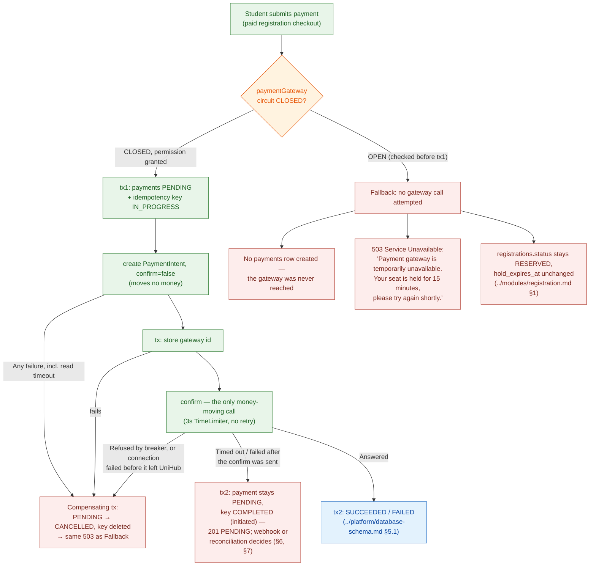
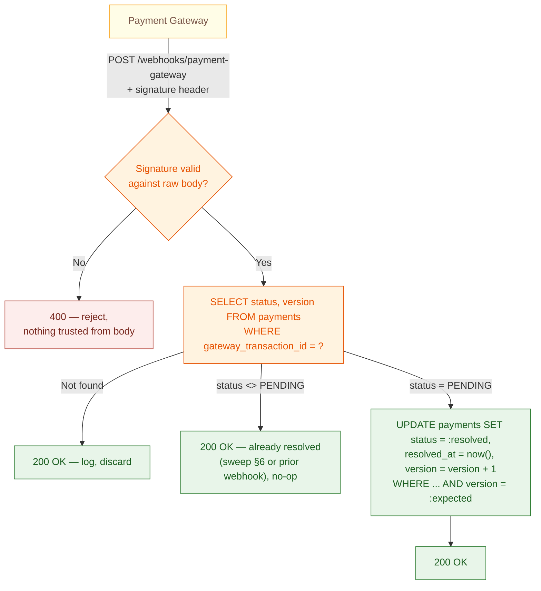

# Payment Module — Technical Design

This file is the physical-level completion of `proposal.md` §11.3 (Resilience to Payment Gateway Failures), `docs/requirement.md` §1.3.1/§2.7/§2.8/§2.10, and `architecture.md` §1.4 (Resilience Strategy). Those sources establish *that* the Payment Gateway sits behind a circuit-breaker boundary, *that* a scheduled sweep resolves stuck-`PENDING` transactions, and *that* every payment request is idempotent under client retry — but stop short of concrete Resilience4j parameters, fallback wiring, the reconciliation sweep's own consumer logic, and — nowhere in the prior corpus — a design for the gateway's webhook callback itself. Nothing here overrides `architecture.md`/`proposal.md` — where they disagree, those documents are the authority and this file has a bug.

**Read this file top to bottom to understand the Payment module end to end — payment is this system's second-highest-risk correctness path after seat reservation.** Where it uses a shared platform mechanism (RabbitMQ, the idempotency-key table), it explains what that mechanism gives Payment specifically and links out for the mechanism's own full design.

**Scope:** the `payments` table this module owns, narrated at the rationale level (§1); Resilience4j `CircuitBreaker`/`Retry`/`TimeLimiter` configuration around every Payment Gateway call, and its fallback behavior on both the synchronous charge path and the asynchronous reconciliation-sweep path (§2–§6); the payment webhook endpoint — signature verification, payload handling, and its race with the reconciliation sweep (§7, previously unspecified anywhere in this corpus); idempotent payment-charge under client retry (§8); the hand-off to Registration once a payment succeeds and the refund compensation when the registration can no longer be confirmed (§9); a consolidated failure-mode table and reference table (§10–§11).

**Out of scope, and where it actually lives:** the exact `payments` column list (`../platform/database-schema.md` §5 — referenced throughout, not repeated here); the RabbitMQ broker/exchange/retry mechanism, reused here only for the reconciliation task (`../platform/messaging.md`); the `idempotency_keys` table's own schema and generic same-transaction pattern (`../platform/database-schema.md` §8.1, `architecture.md` §4.5 — this file applies that pattern to payment-charge, it doesn't redefine it); the seat-hold lifecycle that a payment is racing against (`../modules/registration.md` — this module never extends or shortens that window); real Stripe production settlement (`proposal.md` §5.2 — sandbox mode only); JWT/auth mechanics (`../platform/auth-and-identity.md`, already written).

---

## Table of Contents

- [Architecture Decision Records (ADRs)](#architecture-decision-records-adrs)
  - [ADR Mini: Circuit Breaker Scope for Payment Gateway](#adr-mini-circuit-breaker-scope-for-payment-gateway)
  - [ADR Mini: Payment Webhook Endpoint Design](#adr-mini-payment-webhook-endpoint-design)
- [1. Data Model — What This Module Owns](#1-data-model-what-this-module-owns)
- [2. Resilience4j Configuration Model](#2-resilience4j-configuration-model)
- [3. Sync Charge Path — Decorators & Fallback](#3-sync-charge-path-decorators-fallback)
- [4. Recovery Detection (Shared `HALF_OPEN`)](#4-recovery-detection-shared-half_open)
- [5. Async Reconciliation Sweep — Decorators & Fallback](#5-async-reconciliation-sweep-decorators-fallback)
- [6. Payment Reconciliation Task](#6-payment-reconciliation-task)
- [7. Payment Webhook Endpoint](#7-payment-webhook-endpoint)
- [8. Idempotent Payment-Charge](#8-idempotent-payment-charge)
- [9. Confirmation Hand-off & Refund Compensation](#9-confirmation-hand-off-refund-compensation)
- [10. Fault Isolation Boundary & Failure Modes](#10-fault-isolation-boundary-failure-modes)
- [11. Reference Table](#11-reference-table)
- [API Surface](#api-surface)

---

## Architecture Decision Records (ADRs)

Reached through the `spec-driven-development` gated workflow: 2–4 alternatives were explored with a trade-off matrix, the human made the call at the Phase 3 Decision Gate, and the reasoning was captured here verbatim rather than left to live only in `SPEC.md` (a working document for the next task, not a durable record).

### ADR Mini: Circuit Breaker Scope for Payment Gateway

**Context:** `docs/requirement.md` §2.7 and `proposal.md` §11.3 require "the system" (singular) to detect Payment Gateway degradation and temporarily stop sending it requests, while unrelated functionality continues normally, with automatic periodic recovery checks. Three independent call-sites talk to the Payment Gateway: the synchronous charge-at-checkout path, the asynchronous payment-reconciliation sweep (§6) that polls the gateway's status API for payments stuck `PENDING` past 15 minutes, and — as of this document — the webhook endpoint's own signature-verification dependency on the gateway's published keys (§7, a lighter-weight dependency than the other two, but still worth naming explicitly). Without shared circuit-breaker state across the two *call-initiating* sites, one call-site could keep hammering a gateway the other has already detected as failing.

**Decision:** A single Resilience4j `CircuitBreaker` instance (registered under one name, `paymentGateway`) guards both the sync charge path and the async reconciliation sweep. `TimeLimiter` and `Retry` are configured independently per call-site: the synchronous charge path uses a short `TimeLimiter` (3s) with no retry, to fail fast and free the request thread for at-checkout UX; the asynchronous reconciliation sweep uses a longer `TimeLimiter` (10s) with retry (the first call and 3 retries, exponential backoff), since it runs off the critical path and isn't user-facing. The webhook endpoint (§7) does not participate in this breaker — it never initiates a call to the gateway, only receives one; there is nothing for a circuit breaker to guard there.

**Consequences:**
- Both outbound call-sites observe and contribute to the same `CLOSED`/`OPEN`/`HALF_OPEN` state — when the sync path trips the breaker, the reconciliation sweep also stops calling the gateway on its next tick, instead of continuing to poll a known-down dependency every 15 minutes.
- Two decorator configurations must stay conceptually distinct (fast-fail vs. backoff-retry) despite sharing breaker state — §3 makes this explicit so an implementer doesn't reuse one `TimeLimiter`/`Retry` config for both.
- Recovery detection (`HALF_OPEN` probe) is shared too: whichever call-site's probe call succeeds first flips the breaker back to `CLOSED` for both.
- **Pending revision (Phase 3):** the gateway refund (§9) becomes a third call-initiating site. This ADR is revised when that call is built (Phase 2 checklist D2/C10), not before.

**Trade-offs accepted (user's own reasoning):** an unprotected reconciliation sweep was rejected because it would let the sweep keep polling the Gateway's status API every 15 minutes even after the synchronous path has already detected and reacted to an outage — contradicting §2.7's "temporarily stop calling that service" applied to "the system" as a whole, not just its user-facing half. Two independent `CircuitBreaker` instances per call-site were rejected because they could disagree about whether the gateway is currently healthy, letting one side hammer a gateway the other side has already given up on.

### ADR Mini: Payment Webhook Endpoint Design

**Context:** every other document in this corpus that mentions a "webhook" does so only in passing — `../platform/database-schema.md` §5.1 notes that `payments.resolved_at` is "set by whichever of {webhook, reconciliation sweep} gets there first," and `proposal.md` §16's risk table treats the reconciliation sweep, not the webhook, as "the authoritative source of truth for payment status" specifically *because* "payment gateway sandbox behavior may not fully mirror production timing." Nowhere does any document specify the webhook endpoint itself — its route, its signature verification, its payload handling, or how it's kept safe under the gateway's own at-least-once redelivery behavior (a real Stripe behavior, not a UniHub design choice). Without this, an implementer has no design to build the *faster* of this module's two resolution paths against — only the slower, 15-minute-late fallback.

**Decision:** a dedicated endpoint, `POST /api/v1/webhooks/payment-gateway`, publicly reachable (behind the Ingress, no JWT auth — the gateway is not a UniHub user and cannot hold a UniHub session), authenticated instead by verifying the gateway's own webhook signature header against a shared webhook-signing secret. The handler re-checks `payments.status` before acting — structurally identical to the reconciliation sweep's own re-check (§6) — so it is safe under both the gateway's own redelivery and a race against the sweep resolving the same row first.

**Consequences:**
- The webhook is a genuine fast path: a payment can resolve in seconds via webhook instead of waiting up to 15 minutes for the reconciliation sweep to notice, in the common case where the gateway's callback arrives promptly.
- The reconciliation sweep (§6) remains the system's guarantee of last resort — `proposal.md` §16's stated reasoning (sandbox timing may not mirror production) is exactly why this design does not treat the webhook as sufficient on its own, only as an accelerant.
- The endpoint's authentication model is deliberately different from every other endpoint in this system (no JWT, §7 explains why) — this is called out explicitly so it isn't mistaken for an oversight.

**Trade-offs accepted:** treating the webhook as the *sole* resolution mechanism (removing the reconciliation sweep) was rejected outright — this directly contradicts `proposal.md` §16's already-recorded risk mitigation, which exists specifically because sandbox webhook delivery cannot be trusted to mirror production timing; the sweep stays as the non-negotiable backstop regardless of how reliable the webhook proves in practice. A JWT-authenticated webhook (requiring the gateway to somehow hold a UniHub-issued token) was rejected as architecturally backwards — the gateway is an external system UniHub has no session relationship with; signature verification against a shared secret is the standard, correct pattern for this direction of trust (`architecture.md` §5.4's "credentials never in source" principle, applied to a shared secret instead of a bearer token).

---

## 1. Data Model — What This Module Owns

**Rationale:** `architecture.md` §6.1 names `Payment` as this module's sole entity, and the only module allowed to call the Payment Gateway. Exact columns are in `../platform/database-schema.md` §5.1; this section narrates why the ones central to this file's later sections look the way they do.

- **`status`** (`PENDING`/`SUCCEEDED`/`FAILED`/`CANCELLED`/`REFUND_REQUIRED`/`REFUNDED`) — a row is created `PENDING` at charge-initiation (§8) and resolved by whichever of {webhook (§7), reconciliation sweep (§6)} reaches it first; `CANCELLED` also when nothing could have been charged after the row was written — any failure before the confirm, or a confirm refused by the breaker or failed before it left UniHub (§3) — and, by reconciliation, for a charge that provably was never confirmed or whose PaymentIntent was cancelled (§6). `REFUND_REQUIRED` → `REFUNDED` is the compensation path for a payment that succeeded after its registration stopped being `RESERVED` (§9).
- **`registration_id`** — not unique on its own: a registration has **at most one live payment** (`PENDING`, `SUCCEEDED`) and any number of `FAILED`, `CANCELLED`, `REFUND_REQUIRED`, `REFUNDED` ones, enforced by a partial unique index (`../platform/database-schema.md` §5.1). A declined card never locks the student out of retrying within the hold; two charges in flight for one registration remain impossible, even with two different idempotency keys.
- **`version`** — not named explicitly in `architecture.md` §6.1's anti-overbooking list, but the same optimistic-concurrency pattern is applied here for a distinct reason: the reconciliation sweep and a late-arriving gateway webhook can race to resolve the same `PENDING` row concurrently. This is a direct, consistent extension of an already-established pattern to a second, structurally identical race — not a new invariant.
- **`gateway_transaction_id`** — `UNIQUE`, set once the gateway responds; this is what both the webhook (§7) and the sweep (§6) use to correlate an external event back to a `payments` row.
- **`initiated_at`/`resolved_at`** — `initiated_at` is what the sweep's ">15 minutes in Pending" check (§6) measures from; `resolved_at` is set when `status` leaves `PENDING`, by whichever path gets there first.

---

## 2. Resilience4j Configuration Model

**Rationale:** `docs/requirement.md` §2.7 requires detecting a degraded gateway and temporarily stopping calls to it, rather than letting failed/slow calls accumulate. Resilience4j's `CircuitBreaker` is the mechanism `CLAUDE.md` names for this; the parameters below turn that mandate into a concrete, tunable state machine rather than a vague "add a circuit breaker."

**Model — one shared instance, `paymentGateway`:**

| Parameter | Value | Why |
|---|---|---|
| Sliding window type | `COUNT_BASED` | Payment attempts don't arrive at a constant rate (they spike with paid-ticket registrations, per `docs/requirement.md` §1.4) — a count-based window judges the gateway's health from the last N actual attempts regardless of how much wall-clock time they span, rather than a time-based window that could sit nearly empty during a lull and overreact to one or two failures. |
| Sliding window size | 20 calls | Large enough that a handful of transient failures (a couple of slow paid-checkout attempts) don't alone trip the breaker, small enough that the breaker reacts within a realistic burst of registration activity rather than needing hundreds of calls to notice a real outage. |
| Failure-rate threshold | 50% | Half the window failing is a clear, unambiguous signal of a genuinely degraded gateway — high enough to avoid tripping on ordinary noise, low enough to react well before every call is failing. |
| Wait-duration-in-open-state | 30s | Matches the sync path's fail-fast posture (§3): short enough that a real recovery is detected quickly, long enough not to re-probe a gateway that just failed a moment ago. |
| Permitted-calls-in-half-open-state | 5 | A small sample before committing back to `CLOSED` — large enough to be a meaningful signal, small enough that a still-unhealthy gateway doesn't get exposed to a full burst of traffic while still probationary. |
| Minimum-number-of-calls | 10 (configurable; tests override it to prove the breaker opens quickly) | The failure rate is not evaluated until 10 calls are recorded, so the first one or two failures after a start-up cannot open the breaker on their own. Half the 20-call window. **Recalibrate in Phase 8** against the load-test data (Phase 2 checklist D12, Q8). |

**This instance is shared by name, not by call-site.** Both the synchronous charge path (§3) and the asynchronous reconciliation sweep (§5, wrapping the call already described in §6) register against the same `paymentGateway` `CircuitBreakerRegistry` entry — this is what makes the shared-detection guarantee in the ADR above literally true, not just described in prose.

**Decorator composition order:** `CircuitBreaker` around `Retry` around `TimeLimiter` around the actual gateway call — the breaker sees the *final* outcome of a call after its own retries and timeout have already been applied, so one already-retried, already-timed-out logical attempt counts as one data point in the breaker's sliding window, not several. Retrying *inside* the breaker's view (rather than each retry independently tripping toward the threshold) keeps the failure-rate calculation meaningful: a single flaky call that succeeds on its second retry attempt is a success from the breaker's perspective, exactly as it should be.

**Trade-off — the shared window mixes two structurally different call profiles, accepted for the PoC stage:** the sync path (§3) is fast and never retries, so it can contribute up to 20 data points to the window in a matter of seconds during a registration-opening spike. The async path (§5), by contrast, can take up to ~47 seconds for a single logical call to resolve under sustained failure (4 attempts × 10s `TimeLimiter`, plus 1s+2s+4s backoff between them) before that one call contributes even a single data point — because the composition order above means the breaker only sees the outcome *after* all retries and backoff have run their course. Two consequences follow, and neither is fully eliminated by this design: (1) the async path's contribution to detection is meaningfully slower than the sync path's, so "detected within the 20th call" (the Guarantee below) can mean very different wall-clock times depending on which call-site happens to fill the window; (2) call-volume imbalance skews the window's signal — during a paid-registration spike, fast sync-path outcomes can dominate the 20-slot window and dilute a genuinely failing async path's contribution, while during a quiet period between spikes, a handful of slow async failures (the sweep only runs once per payment per 15-minute cycle) can disproportionately drive the failure rate since little else is filling the window at that time. This is accepted as-is for this project's PoC scale (`proposal.md` §5.2) rather than engineered around with a larger window, a time-based window, or per-call-site weighting — those are legitimate future refinements if real load-test data (`docs/requirement.md` §3.2) shows this asymmetry actually causing a problem, not something to pre-optimize against here.

**Guarantee:** a gateway degrading past the 50%-of-last-20-calls threshold is detected and stops receiving *any* new calls — from either call-site — within the time it takes that 20th call to complete, not after some longer, call-site-specific delay. That 20th call's own duration is bounded by whichever call-site produced it (§3's 3s ceiling or §5's ~47s worst case) — see the Trade-off above for what that asymmetry means in practice.

---

## 3. Sync Charge Path — Decorators & Fallback

**Rationale:** the synchronous charge path runs inside a student's checkout request — every second spent here is a second of held request-thread and held UI spinner. `docs/requirement.md` §2.7 requires this path to fail fast with "a clear, friendly message," not to make the student wait out a slow, doomed call.

**Model:**

| Decorator | Value | Why |
|---|---|---|
| `TimeLimiter` | 3s | Long enough for a normal Stripe sandbox charge call, short enough that a stalled call doesn't tie up the checkout request past what a student will tolerate waiting on a spinner. |

**Time budget of two calls (Phase 2 checklist C37, decided 2026-10-14):** since the charge became create → store id → confirm (§8), this path makes **two** gateway calls plus one short transaction. The values above apply **per call**: each call has its own 3s `TimeLimiter` and ≤3s HTTP timeouts, so a stalled call still frees its thread and socket within 3s, and the worst case for the whole request is ≈ 6.5s (two stalled calls plus the transaction) — acceptable for a checkout behind a spinner, and still a fast, clear failure. The client must not abort `chargePayment` sooner than 10s (`../../guidelines/web-coding-standards.md` §10); if it does, a same-key retry replays the outcome. The shared breaker keeps counting **calls**, not charges — a failing create is as much a sign of a degraded gateway as a failing confirm — so a 20-call window covers ≈ 10 charges and `minimumNumberOfCalls` 10 ≈ 5. Both are recalibrated in Phase 8 against load-test data.
| `Retry` | 0 (none) | A charge call is not free to retry blindly — retrying a call that *did* reach the gateway but lost the response on the way back risks a second charge attempt for the same request. Idempotency (`docs/requirement.md` §2.8, §8 below) is what makes retries safe *at all*, but this document does not add a Resilience4j-level retry on top of that; a failed sync attempt simply fails fast and lets the student decide whether to try again. |
| HTTP client `connectTimeout` / `readTimeout` | ≤3s each | `TimeLimiter` alone does not stop the underlying blocking call — it only stops the *caller* from waiting past 3s by completing a wrapping future with a `TimeoutException`; the actual outbound HTTP request to the gateway keeps running on its own thread/socket until it finishes or the HTTP client's own timeout fires. Without a client-level timeout at or below the `TimeLimiter`'s 3s, a stalled call still holds a connection-pool slot and a thread well past the point the checkout request has already received its `503` — quietly defeating the thread-freeing purpose this decorator exists for, right at the exact 12,000-concurrent-user spike (`docs/requirement.md` §1.4) this document is meant to protect. |

**Fallback when the circuit is `OPEN`** — and why a timeout is different (Phase 2 checklist D1/G1, 2026-10-14). The charge is orchestrated in two transactions around the gateway call (`../../guidelines/backend-coding-standards.md` §19.4): the first commits the `PENDING` row together with its idempotency key, the second records the outcome. The breaker is asked for permission **before** the first transaction:



No `payments` row is created when the breaker refuses **before** the first transaction, and no idempotency key either — a `503` is a transient failure and is never recorded (`../../guidelines/backend-coding-standards.md` §21 rule 7), so the client's retry with the same key executes for real. The charge then makes **two** gateway calls, and only the second can move money (Phase 2 checklist D16): it creates the PaymentIntent **unconfirmed** (`confirm=false`; Stripe: `confirm` *"defaults to `false`"*), stores its id, and only then confirms it. Therefore **any failure before the confirm** — in the create call, *including a read timeout*, or while storing the id — means no money can have moved: a compensating transaction moves the row `PENDING → CANCELLED` (never left `PENDING`, never counted as live) and deletes the key, and the response is the same `503`. An orphan unconfirmed PaymentIntent is harmless. For the **confirm** call, the network-level rule decides: refused by the breaker or failed before it left UniHub (connect timeout, refused connection, DNS) → the same compensation; **timed out or failed after the confirm was sent** → the gateway may have charged, so it is a business outcome, "initiated" (checklist D10, C30): the second transaction keeps the payment `PENDING`, completes the key with that Result and the response is `201` with `PENDING`. A same-key retry replays that `201` and the confirm is never sent again; the webhook (§7) or reconciliation (§6) decides the outcome. The seat-hold created by `registrations.status = 'RESERVED'` (`../modules/registration.md` §1) is left completely untouched: the student still has the remainder of their original 15-minute hold window (`docs/requirement.md` §1.3.1) to retry once the gateway recovers, exactly as if this attempt had never happened.

**Trade-off — a student can lose their hold window waiting out an outage:** if the Payment Gateway stays degraded for longer than the time remaining on a student's 15-minute hold, the hold still expires on schedule (`../modules/registration.md` §3's existing expiry sweep, unaffected by this document) and the seat releases. This document does not extend the hold window in response to a gateway outage — doing so would mean the Payment Gateway's *own* availability could indirectly control anti-overbooking timing, a coupling `architecture.md` §6.1's layered anti-overbooking design does not call for and this document does not introduce.

**Guarantee:** a student attempting to pay during a gateway outage gets an immediate, clear answer, keeps their existing hold, and can retry with the same key once the gateway recovers — they are never left waiting on a call that was never going to succeed, and never silently double-charged by an automatic retry they didn't ask for. Combined with the matching HTTP client timeout above, the request-handling thread and its socket are both released within 3s of a stalled call, not just the caller's logical wait.

---

## 4. Recovery Detection (Shared `HALF_OPEN`)

**Rationale:** `docs/requirement.md` §2.7 and `proposal.md` §11.3 both require the system to "automatically attempt reconnecting... after a period of time" and "resume normal payment processing automatically" once the gateway recovers — Resilience4j's `HALF_OPEN` state is exactly this mechanism, applied here to the shared instance from §2.

**Model:** after 30 seconds in `OPEN` (§2's wait-duration), the `paymentGateway` breaker moves to `HALF_OPEN` and permits up to 5 calls through — from *either* call-site, whichever happens to call next. If enough of those probe calls succeed (per the same 50%-of-window logic), the breaker returns to `CLOSED` for both call-sites simultaneously; if they fail, it reopens for another 30-second wait.

**Guarantee:** recovery is detected and acted on identically regardless of whether the sync charge path or the async reconciliation sweep happens to make the probing call — there is no scenario where one call-site "knows" the gateway is back while the other is still refusing to call it.

---

## 5. Async Reconciliation Sweep — Decorators & Fallback

**Rationale:** the reconciliation sweep (§6) already tolerates redelivery and lost cycles by design — it re-checks `payments.status` before acting and simply matches the same `PENDING` row again on the next 15-minute tick if a cycle is skipped. Wrapping its gateway call in the shared `paymentGateway` breaker adds fault isolation *on top of* that existing tolerance; it does not change the sweep's own correctness logic.

**Model:**

| Decorator | Value | Why |
|---|---|---|
| `TimeLimiter` | 10s | This call runs off the critical path (a background consumer, not a held HTTP request) — there's no user-facing latency budget to protect, so it can afford to wait longer for a gateway response than the sync path can. |
| `Retry` (status read only) | 4 attempts — the first call and 3 retries — with exponential backoff (1s, 2s, 4s) between them; this is what makes the ~47s worst case below (4 × 10s + 7s) | Safe here in a way it isn't on the sync path (§3): this call is a pure status *read* (`GET` transaction status), not a charge attempt — retrying it can never create a duplicate charge, only a duplicate read, which is harmless. |

**The cancel is not retried by Resilience4j (Phase 2 checklist 3.7, 2026-10-23).** Retry above is justified only because the call is a pure read. A cancel moves the PaymentIntent's state, and its gateway key is fixed per payment (`pi-cancel:{paymentId}`, §6): a 5xx the gateway saved for that key would only be replayed to every retry. A lost connection is not saved by the gateway, and the broker's own retry chain (`../platform/messaging.md` §4) already covers it. A cancel therefore gets the shared breaker and the 10s `TimeLimiter`, nothing more.

**How the decorators sit in code.** One class wraps the gateway port and is the only one that knows Resilience4j; the use cases see only port exceptions. What a refusal or a timeout means depends on the call: for `create` both are "nothing was confirmed" (a failed call); for `confirm` a refusal is "never left UniHub" (the compensating transaction) but a timeout is *outcome unknown* — the request may have been sent, so the payment stays `PENDING`; for the status read and the cancel a refusal is a distinct "circuit open" outcome, which §5's fallback below turns into "skip this payment for this cycle". The pre-flight check before the first transaction (§3) only *looks* at the circuit; it takes no permission, because each call asks for its own and a permission taken twice would leak a half-open probe.

**Fallback when the shared circuit is `OPEN`:** the reconciliation consumer's call to the gateway is skipped entirely for that message — the same "skip this cycle, the next tick retries" pattern `../platform/distributed-coordination.md` §2 already documents for scheduled-job coordination, applied here to a single payment's reconciliation attempt rather than an entire job run. The payment stays `PENDING`; since it still matches the sweep's `WHERE status = 'PENDING' AND initiated_at < now() - interval '15 minutes'` predicate (§6), it is picked up again on the sweep's next cycle, and the call is retried against the gateway's *then-current* circuit state.

**This does not weaken §6's guarantees.** That section already establishes that a redelivered or repeated reconciliation attempt for an already-resolved payment is a safe no-op (`status <> 'PENDING': COMMIT, do nothing`). A circuit-breaker-induced skip is indistinguishable, from that logic's point of view, from any other reason a cycle's message might not get processed in time — the existing idempotent re-check is what makes this fallback safe, not a new mechanism this document adds.

**Guarantee:** a Payment Gateway outage never causes the reconciliation sweep to pile up failed calls against a dependency it already knows is down; every stuck `PENDING` payment is still eventually resolved once the gateway recovers, on the same eventual timeline §6 already guarantees — this section only changes *how quickly the sweep stops making pointless calls*, not *whether a payment eventually resolves*.

---

## 6. Payment Reconciliation Task

**Rationale:** `docs/requirement.md` §2.10 requires a scheduled sweep to find payments stuck `PENDING` past 15 minutes and resolve them against the gateway. The sweep's *query* (fast, DB-only) and its *resolution* (slow, external gateway call per row) are deliberately decoupled — the same reasoning `../modules/workshop.md`'s summarization job and upload-confirmation flow already apply. This uses the shared RabbitMQ deployment described in `../platform/messaging.md` §1–§2; this section is the Payment-specific message flow and consumer.

**Model:** the reconciliation sweep — coordinated by `unihub:lock:job:payment-reconciliation` so only one pod runs it per cycle (`../platform/distributed-coordination.md` §2) — queries `payments WHERE status = 'PENDING' AND initiated_at < now() - interval '15 minutes'` and publishes one `unihub.payment.reconciliation.requested` message per row found → `unihub.reconciliation.queue` (`../platform/messaging.md` §2). The consumer resolves the payment from the gateway's own record, retrieved **by id** (a plain read, not subject to search delays), with one rule for the idempotency key shared with the synchronous path (Phase 2 checklist D16): **provably no money moved → `CANCELLED` and the key deleted** (so the client's same-key retry executes for real); **outcome known → the key completed** with the Result.

| What the consumer finds | Resolution | Key |
|---|---|---|
| `gateway_transaction_id` is `NULL` — the id was never stored | `CANCELLED`, **no gateway call**: the confirm is only ever sent after the id is stored, so this payment was provably never confirmed | deleted |
| PaymentIntent `succeeded` | `SUCCEEDED` (+ outbox `charge.succeeded`, §9) | completed |
| `requires_payment_method` and `latest_charge` set | `FAILED` — an attempt was made and declined (`latest_charge` "is `null` until PaymentIntent confirmation is attempted"; `last_payment_error` is not used because it "will be cleared if the PaymentIntent is later updated") | completed |
| `requires_payment_method` with `latest_charge` null, or `requires_confirmation` | never confirmed → **cancel** the PaymentIntent, then `CANCELLED` | deleted |
| `processing` | stays `PENDING`, **not** cancelled (Stripe allows cancelling `processing` only "in rare cases"); looked at again next cycle. If it is still `processing` 24 h after `initiated_at` — Stripe's idempotency-key window — the consumer stops acting on it, logs `WARN` and increments `unihub_payment_reconciliation_stuck_total` for an operator; the row stays `PENDING` (no automatic guess) | unchanged |
| `requires_action` | cannot occur on UniHub's path — the confirm is sent with `error_on_requires_action=true`, which makes Stripe "fail the payment attempt if the PaymentIntent transitions into `requires_action`"; if met anyway → cancel (allowed in `requires_action`), then `CANCELLED` | deleted |
| `requires_capture` | cannot occur (automatic capture); if met → cancel ("the remaining `amount_capturable` is automatically refunded"), then `CANCELLED` | deleted |
| `canceled` | `CANCELLED` | deleted |
| The cancel is refused because the PaymentIntent already succeeded | retrieve again and resolve from the real status (`SUCCEEDED`) | completed |

**"Deleted" in the Key column means: an `IN_PROGRESS` key is deleted.** A key already completed as "initiated" (the confirm was sent and came back unknown, §3, §8) keeps its snapshot, exactly as D10 constraint 4 says a replay returns the snapshot and `getPayment` is the truth. Deleting it would gain the student nothing: reconciliation only acts once `stale-after` (15 min) has passed, which is not before the seat hold (15 min, `../modules/registration.md` §2) has ended, and `chargePayment` refuses an ended hold with `409 registration-not-reserved` under any key. It would also run a second effect under a key the client already holds a `201` for, and break the rule that the key store never touches a `COMPLETED` key. **This holds only while `stale-after` ≥ `seat-hold`;** whoever shortens the threshold below the hold must revisit it (Phase 2 checklist D16 constraint 2, clarification 2026-10-23).

Every cancel uses the gateway key `pi-cancel:{paymentId}`; every retry of a step reuses that step's key (`../../guidelines/backend-coding-standards.md` §19.4). `metadata.payment_id` is on every PaymentIntent for operator investigation only — it is never read to resolve a payment. In one transaction at the Master:
```
SELECT status, version FROM payments WHERE id = ? (Master)
if status <> 'PENDING': COMMIT, do nothing   -- already resolved, e.g. by the webhook (§7)
                                                  racing this consumer — exactly the race
                                                  payments.version exists for (§1 above)
UPDATE payments SET status = :resolved, resolved_at = now(), version = version + 1
  WHERE id = ? AND version = :expected
UPDATE idempotency_keys SET status = 'COMPLETED', result_type = :type, result_body = :result,
       completed_at = now()                     -- outcome known (table above); for CANCELLED:
  WHERE scope = 'PAYMENT_CHARGE' AND resource_id = :paymentId AND status = 'IN_PROGRESS'
                                                -- DELETE FROM idempotency_keys … instead
                                                -- G2: a charge that crashed between its two
                                                   transactions left its key open; it is completed
                                                   here, in the SAME transaction, so the client's
                                                   same-key retry replays instead of getting 409
                                                   forever
if :resolved = 'SUCCEEDED': write outbox unihub.payment.charge.succeeded   -- §9
```

**One mapping for "the gateway says it succeeded", on every path.** The webhook (§7), this consumer and the charge's own second transaction (§8) apply the same rule to the row they find: `PENDING` → `SUCCEEDED` (with the `charge.succeeded` outbox row, §9); already `SUCCEEDED`, `REFUND_REQUIRED` or `REFUNDED` → no-op; **`CANCELLED` or `FAILED` → `REFUND_REQUIRED` directly** — never through `SUCCEEDED`, and **without** a `charge.succeeded` event, so it can never confirm a registration (checklist D5, C33). With create/confirm split this late success is practically impossible — a payment is only `CANCELLED` after its PaymentIntent was never confirmed or was cancelled — so this is defence in depth; the live-payment index covers only `PENDING`/`SUCCEEDED`, so the transition never collides with another live payment.

**Why this is safe without searching the gateway (Phase 2 checklist C31 → D16):** Stripe offers no lookup by idempotency key — a result is stored "only after the execution of an endpoint begins" and a reused key "generate[s] a new request" once pruned (≥ 24 h) — so re-sending a create to "find" a transaction could charge late; and its Search API is not read-after-write ("Don't use search for read-after-write flows"). Splitting create from confirm removes the need for either: a `NULL` id is itself the evidence that nothing was confirmed.

**Idempotency:** naturally safe under redelivery for the same reason as the seat-hold consumer (`../modules/registration.md` §3) — re-checking `status` before acting means a redelivered or duplicated reconciliation task for an already-resolved payment is a no-op.

**Note — redundant gateway calls across sweep cycles, not a correctness issue:** a payment still `PENDING` past 15 minutes matches the sweep's `WHERE` clause again on every subsequent cycle until it actually resolves, so if a sweep tick fires before a previous cycle's message for the same payment has been processed, a second (redundant) gateway status-check call gets queued for that same payment. This costs an extra external API call, not correctness — the `status <> 'PENDING'` re-check above means the second consumer to run for the same payment always finds it already resolved and no-ops.

**Guarantees:** every payment that goes stale in `PENDING` is eventually resolved; a race between this consumer and the gateway webhook (§7) always converges to one final status, never a lost or double update (§1's `version` column). Retry/dead-lettering on consumer failure follows the generic mechanism in `../platform/messaging.md` §4, applied to `unihub.reconciliation.queue`.

---

## 7. Payment Webhook Endpoint

**Rationale:** per the Payment Webhook Endpoint Design ADR above, this section is the design that was missing everywhere else in the corpus — the *faster* of this module's two resolution paths, complementing (never replacing) §6's 15-minute-late sweep.

**Model — endpoint & authentication:**

| Decision | Value | Why |
|---|---|---|
| Route | `POST /api/v1/webhooks/payment-gateway` | A dedicated route, not folded into any authenticated payment resource path — this endpoint is called by the gateway, never by a UniHub client, so it has no business sharing a URL space with client-facing payment endpoints. |
| Authentication | Gateway webhook signature verification (e.g. Stripe's `Stripe-Signature` header, HMAC over the raw request body against a shared webhook-signing secret) — **no JWT, no `hasAuthority` check** | The gateway is not a UniHub user and holds no UniHub session; `../platform/auth-and-identity.md`'s entire model (resolved permissions, `hasAuthority`) assumes an authenticated *user*, which does not apply here. Signature verification is the standard mechanism for this direction of trust — it proves the request genuinely originated from the gateway, using a secret held only by the gateway and UniHub, injected at runtime per `architecture.md` §5.4 like every other credential in this system. |
| Body handling | The **raw, unparsed** request body is what the signature is verified against, before any JSON deserialization | Signature schemes (Stripe's included) sign the exact bytes sent — verifying against a re-serialized version of a parsed object risks a whitespace/key-ordering mismatch that fails verification for a legitimate request. The raw body must be captured before any framework-level body-parsing middleware transforms it. |
| Rate limiting | **Exempt from `../platform/distributed-coordination.md` §3's per-user/per-IP limiters** | Those limiters key on `userId`/`ipAddress` for abuse prevention against UniHub's own clients; the gateway is a known, trusted, high-volume caller by design, not a traffic-abuse risk this system needs to throttle. |

**Model — payload handling & idempotency:**

```
1. Verify signature against raw body (above). Invalid signature → 400, no further processing,
   nothing read from the body as trusted data.
2. Parse payload; extract gateway_transaction_id and the gateway's reported outcome.
3. SELECT status, version FROM payments WHERE gateway_transaction_id = ? (Master)
   if no row found: 200 OK, log and discard — a webhook for a transaction ID this system
                     never initiated is not an error UniHub needs to act on (could be a
                     gateway test ping, or a delivery misrouted by the gateway itself).
   if status in (SUCCEEDED, REFUND_REQUIRED, REFUNDED), or the reported outcome matches
                     the stored one: 200 OK, COMMIT, do nothing  -- already resolved, e.g. by
                     the reconciliation sweep (§6) racing this webhook, or the gateway's own
                     at-least-once redelivery of a webhook this system already processed.
   if status in (CANCELLED, FAILED) and the gateway reports success:
     UPDATE payments SET status = 'REFUND_REQUIRED', version = version + 1
       WHERE id = ? AND version = :expected      -- late success: never a no-op (§6, §9)
   if status = 'PENDING':
     UPDATE payments SET status = :resolved, resolved_at = now(), version = version + 1
       WHERE gateway_transaction_id = ? AND version = :expected
     if :resolved = 'SUCCEEDED': write outbox unihub.payment.charge.succeeded   -- §9, same transaction
4. Always respond 200 OK once the payload has been durably handled (steps 2–3 completed
   without an exception) — a non-2xx response tells the gateway to retry delivery, which
   this system does not need once the row is resolved or determined not to apply.
```

**Why this re-check is structurally identical to §6's:** both apply the single "gateway says it succeeded" mapping of §6, and both resolve a `PENDING` row by the same pattern — read current `status`, no-op if already resolved, `UPDATE ... WHERE version = :expected` if not. Neither path trusts that it's the only one that could be acting on a given row at that moment; §1's `version` column is what makes whichever one commits second lose cleanly, rather than corrupt the row or double-notify.

**Guarantee under gateway redelivery:** payment gateways are commonly at-least-once on webhook delivery (a real external-system behavior, not a UniHub design choice) — a webhook for an already-resolved `gateway_transaction_id` is a safe no-op here (the one exception, a success for a row closed as `CANCELLED`/`FAILED`, is not a redelivery but a late success, and is refunded), the same guarantee `architecture.md` §4.3 requires of every RabbitMQ consumer in this system, applied to an inbound HTTP callback instead of a queue message.



**Guarantees:** a resolvable payment settles as fast as the gateway's own webhook delivery, typically well inside the 15-minute reconciliation window — without weakening §6's guarantee that every `PENDING` payment resolves eventually regardless of whether any webhook ever arrives at all. A race between the webhook and the sweep always converges to exactly one final status, never a lost or double update.

---

## 8. Idempotent Payment-Charge

**Rationale:** `docs/requirement.md` §2.8/§1.5 require that a client-generated key makes a payment-charge request safe to retry — a student must never be charged twice, nor have two `payments` rows created, even from a repeated click caused by network lag. The generic mechanism is `../platform/database-schema.md` §8.1's design; this section is Payment's application of it, and it works alongside `../platform/database-schema.md` §5.1's partial unique index on `registration_id` (at most one live payment per registration), which catches what a per-key check cannot — two different keys for the same registration — at the schema level.

**Model:** every `POST /api/v1/payments/charge` request carries a client-generated `Idempotency-Key` header, scoped to the operation **and the authenticated caller** — `(scope, actor_user_id, idempotency_key)`, actor from the verified JWT, never from the request (`../platform/database-schema.md` §8.1). The request body's fingerprint is stored with the key. Because the gateway call cannot sit inside a transaction (`../../guidelines/backend-coding-standards.md` §19.1), the charge is orchestrated in two transactions (§19.4):

```
0. Ask the paymentGateway breaker for permission. Refused → 503, nothing written (§3).
1. tx1 (Master):
   SELECT status, request_fingerprint, result_type, result_body FROM idempotency_keys
     WHERE scope = 'PAYMENT_CHARGE' AND actor_user_id = :actor AND idempotency_key = :key
   found, fingerprint differs → 422, nothing runs
   found, COMPLETED           → return the stored Result verbatim — the gateway is never
                                called again, "not even to double-check"
   found, IN_PROGRESS         → 409 "still being processed"
   not found:
     registration must be RESERVED and owned by the caller (otherwise a recorded 409/403/404)
     INSERT payments (status PENDING)            -- the partial unique index admits at most one
                                                    live payment per registration; a duplicate
                                                    becomes the recorded Result "a payment for
                                                    this registration is already in progress" (409)
     INSERT idempotency_keys (IN_PROGRESS, resource_id = payments.id)
   COMMIT                                        -- key and PENDING row commit together
2. create the PaymentIntent (no transaction): confirm=false, metadata.payment_id, gateway key
   pi-create:{paymentId}. Moves no money. ANY failure here (incl. read timeout) → step 4b.
3. attach (short tx): store gateway_transaction_id. Failure → step 4b (id never stored).
   Then confirm (no transaction): gateway key pi-confirm:{paymentId},
   error_on_requires_action=true — the ONLY call that can move money.
4. tx2 — what happened to the confirm decides the step (checklist D10, D16):
   definitive answer        → payment SUCCEEDED or FAILED (version check); if SUCCEEDED, write
                              outbox unihub.payment.charge.succeeded in THIS transaction (§9);
                              key COMPLETED with that snapshot → 201 with SUCCEEDED / FAILED
   sent, outcome unknown     → payment stays PENDING; key COMPLETED with "initiated" → 201 PENDING
   (read timeout, reset after sending, gateway 5xx)
   processing                → as "sent, outcome unknown"
4b. never left UniHub / not charged → compensating tx instead: PENDING → CANCELLED, key deleted
   (breaker refusal or connection failure on confirm; any failure in step 2 or 3)  → 503
   Retries of a step (SDK or Resilience4j) reuse that step's key; SDK retries are configured
   explicitly; if any attempt of the confirm may have been sent, it counts as sent.
   If the row was already resolved by the webhook (§7) before tx2 ran, tx2 loses the version
   check, re-reads, and completes the key with the row's current status.
   A crash before tx2 leaves the key IN_PROGRESS; reconciliation completes it (§6, G2).
```

**What the response carries:** `201` with the payment's **real** status when tx2 committed — `SUCCEEDED`, `FAILED`, or `PENDING` when the outcome is not yet known (checklist D10, C28). The body is a snapshot; `getPayment` is the source of truth, and a replay returns the same snapshot.

**What is recorded:** business outcomes only — the charge (succeeded, declined, or initiated) and business rejections (registration not `RESERVED`, another live payment). A `503` is never recorded, whichever way it arises (§3; `../../guidelines/backend-coding-standards.md` §21 rule 7).

**Authorization and audit:** the endpoint requires `REGISTRATION_CREATE` (the same permission as `createRegistration`, checklist D7) and the caller must own the registration. The charge and every payment transition are recorded through `AuditTrail` — the user for the charge, `Actor.system(...)` for webhook/reconciliation/compensation (checklist D6).

**Audit entries (Phase 2, checklist D6; built 2026-10-26).** Target type `PAYMENT`, target id the payment id, metadata `registrationId`, `amount`, `currency`. Each is recorded inside the transaction that makes the change and takes effect after it commits, so a rolled-back change leaves nothing; the trail never throws, so a broken audit pipeline cannot fail or roll back the payment (INV-14).

| Action | When | Actor |
|---|---|---|
| `PAYMENT_INITIATED` | tx1 of the charge creates the `PENDING` row | the student |
| `PAYMENT_SUCCEEDED` / `PAYMENT_FAILED` | tx2 of the charge, when the gateway answered | the student |
| `PAYMENT_CANCELLED` | the charge is undone because nothing could have been charged (breaker refused, create failed, confirm never left) | `payment-charge-compensation` |
| `PAYMENT_SUCCEEDED` / `PAYMENT_FAILED` / `PAYMENT_CANCELLED` | the webhook settles a `PENDING` payment | `payment-webhook` |
| same | reconciliation settles a `PENDING` payment | `payment-reconciliation` |
| `PAYMENT_REFUND_REQUIRED` | a success arrives for a closed payment (webhook), or the registration rejected the confirmation (refund consumer) | `payment-webhook` / `payment-refund` |

A payment that stays `PENDING` (outcome unknown) has not moved, so nothing is recorded; a redelivery to a payment that already moved is a no-op and records nothing. The registration's own confirmation by the consumer is recorded as `REGISTRATION_CONFIRMED` under `payment-confirmation`. The refund call and `REFUNDED` are Phase 3 (M-76).

**Payment method in Phase 2:** the web client offers only Stripe **test** tokens (a success and a decline token) and only when built with a test key; `paymentMethodToken` stays a generic gateway token so Stripe.js can replace the dropdown without an API change (checklist D11).

**Retrying after a failed charge:** a payment that ends `FAILED` (declined) or `CANCELLED` is the final outcome of **its** key: a same-key retry replays it and never dials the gateway. Trying again is a new attempt with a **new** key, and the partial unique index lets it through because a `FAILED`/`CANCELLED` payment is not live. A decline returned **synchronously** by the gateway is visible at once: the response is `201` with `FAILED`.

**This is the reason §3's `Retry: 0` decision is safe, not just cautious:** Resilience4j-level retry is deliberately absent from the sync charge path specifically because *this* mechanism — not a lower-level HTTP retry — is what makes a client's own retry safe. A student's second click, carrying the identical `Idempotency-Key` their client already generated for the first attempt, replays the first attempt's recorded outcome instead of dialing the gateway a second time.

**Guarantees:** a given `Idempotency-Key` within the `PAYMENT_CHARGE` scope reaches the Payment Gateway at most once — every subsequent request bearing it returns the original result, regardless of which Backend API pod handles the retry (`../platform/database-schema.md` §8.1's UNIQUE constraint on `(scope, actor_user_id, idempotency_key)` is the enforced backstop), and a registration never has two charges in flight (the partial unique index of `../platform/database-schema.md` §5.1). Idempotency records are retained only long enough to cover a realistic retry window, swept by the scheduled job in `../platform/distributed-coordination.md` §2.

---

## 9. Confirmation Hand-off & Refund Compensation

**Rationale:** Registration is the sole writer of `registrations` (`architecture.md` §1.1), so a successful payment cannot confirm its registration directly; and Payment is the only module allowed to call the gateway, so a refund can only happen here. Decisions: Phase 2 checklist D2 (Q2), C10, C11 (2026-10-13/14). The Registration side is `../modules/registration.md` §5.

**Model — hand-off:** whichever path moves a payment to `SUCCEEDED` (the charge's own second transaction §8, webhook §7, reconciliation §6) writes the outbox row `unihub.payment.charge.succeeded` in the same transaction (`../platform/messaging.md` §2). Registration confirms the registration if it is still `RESERVED`.

**Late success for a closed payment:** a success reported for a payment already `CANCELLED`/`FAILED` goes straight to `REFUND_REQUIRED` in this module (§6) — there is no live charge for Registration to confirm.

**Model — compensation:** if the registration is no longer `RESERVED` (hold expired, registration cancelled), Registration emits `unihub.registration.confirmation.rejected` → `unihub.payment-refund.queue`. This module's consumer:

```
UPDATE payments SET status = 'REFUND_REQUIRED', version = version + 1
  WHERE id = :paymentId AND status = 'SUCCEEDED'
affected rows = 1 → COMMIT; then (Phase 3) refund, below
affected rows = 0 → re-read:
  REFUND_REQUIRED → Phase 2: no-op. Phase 3: refund again (see rule below)
  REFUNDED        → no-op
```

**Deduplication is per payment, never per event:** in the compensation branch the registration does not change, so every redelivery of `charge.succeeded` makes Registration emit a **new** `confirmation.rejected` event with a new event id. Deduplicating by event id would refund once per redelivery; the conditional transition above, keyed by the payment, is what makes it happen once. No inbox table is added (`architecture.md` §6.1 names exactly three Technical Pattern Entities; `../../guidelines/backend-coding-standards.md` §8.5).

**Phase 3 — the refund itself (designed here, built with the seat-hold expiry consumer, which is what actually triggers this branch):**
- The refund is called **outside** any transaction with a gateway-side idempotency key that is deterministic per payment, `refund:{paymentId}`, so a repeated call can never refund twice. On success: `REFUND_REQUIRED → REFUNDED` by conditional update.
- Re-processing a payment still in `REFUND_REQUIRED` **must call the refund again** — a crash may have happened after the transition committed and before the gateway was called. Only `REFUNDED` is a no-op.
- The refund is a third call-initiating site for the gateway; the breaker ADR above is revised then. Transient failures follow the queue's retry chain; exhausted retries land in `unihub.parking-lot` and the payment stays `REFUND_REQUIRED` for an operator. A signal for refunds stuck in `REFUND_REQUIRED` is defined then (`../platform/observability.md`).
- A refund moves money, so it is an audited operation once `AuditTrail` exists (open item Q10 of the Phase 2 checklist).

**Phase 2 scope:** the hand-off, and the compensation up to `REFUND_REQUIRED` (status change only, no gateway call). Nothing on the Phase 2 live path can reach the compensation — there is no seat-hold expiry consumer and no cancellation endpoint yet — so it is exercised by tests. `REFUND_REQUIRED`/`REFUNDED` are in the schema and the contract enum from Phase 2, because adding an enum value to a response after clients exist is a breaking change.

**Derived requirements** (stated here, not in `docs/requirement.md`; traced in `../../testing/reports/test-matrix.md` §2.2 under the `DR-` prefix):
- **DR-PAY-1** — A payment that succeeds for a registration no longer `RESERVED` is moved to `REFUND_REQUIRED` exactly once, however often the triggering messages are redelivered, and its registration is never re-confirmed (Phase 2).
- **DR-PAY-2** — A payment in `REFUND_REQUIRED` is refunded through the gateway at most once (key `refund:{paymentId}`) and reaches `REFUNDED`; re-processing while still `REFUND_REQUIRED` retries the refund (Phase 3).
- **DR-PAY-3** — A registration has at most one live payment at any time, across all idempotency keys; a `FAILED` or `CANCELLED` attempt never blocks a new attempt with a new key (§1, §8; Phase 2).

**Guarantees:** money taken for a registration that could not be confirmed is always routed to exactly one refund; the system never re-grants a seat it released.

---

## 10. Fault Isolation Boundary & Failure Modes

**Fault isolation (`architecture.md` §1.4):** with the `paymentGateway` circuit `OPEN`, browsing the workshop catalog, free-ticket registration, check-in, and reporting are entirely unaffected — none of those paths call the Payment Gateway or share any component with it beyond the Backend API deployable itself. Only the paid-checkout submission path (§3) and the reconciliation sweep's gateway call (§5) observe the outage; every other module continues exactly as documented elsewhere. The webhook endpoint (§7) is likewise unaffected by the breaker being `OPEN` — it never initiates a gateway call, so there is nothing for the breaker to block on that path.

| Situation | Behavior | Why |
|---|---|---|
| `paymentGateway` circuit `OPEN`, student attempting to pay | `503`, no `payments` row and no idempotency key (breaker checked before the first transaction), seat-hold untouched (§3) | Fail fast, never silently retry a charge, never lose the student's existing hold; the same-key retry executes for real. |
| Breaker flips `OPEN` between the first transaction and the call | Compensating transaction: payment `PENDING → CANCELLED`, key deleted; `503` | §3 — the row is never left `PENDING`, and `CANCELLED` is not a live payment, so the retry is not blocked. |
| Create fails in any way (incl. read timeout), or the id cannot be stored | Compensating transaction: `PENDING → CANCELLED`, key deleted; `503` | Nothing was confirmed, so nothing was charged; the retry executes for real (§3, §8). |
| Confirm refused by the breaker or fails before it left UniHub (connect timeout, refused, DNS) | Same compensation; `503` | §3, §8. |
| Confirm times out or fails after it was sent | `201` with `PENDING`; key `COMPLETED` ("initiated"); same-key retry replays it; webhook/reconciliation decide the outcome | The gateway may have charged; a second call is never made (§3, §8). |
| Gateway answers synchronously | `201` with `SUCCEEDED` (+ `charge.succeeded` outbox in the same transaction) or `FAILED` | §8. |
| Crash between the charge's two transactions | Payment `PENDING`, key `IN_PROGRESS`; same-key retry → `409`; reconciliation resolves both together (§6) | G2. |
| Gateway reports success for a payment closed as `CANCELLED`/`FAILED` | Directly `REFUND_REQUIRED` (never via `SUCCEEDED`), no `charge.succeeded` event | Late success (§6, §7) — practically impossible with create/confirm split; never collides with the live-payment index (`PENDING`/`SUCCEEDED` only). |
| Second charge for a registration that already has a live payment (another tab, another key) | Recorded business rejection, `409` | Partial unique index (§1, §8). |
| Charge retried after `FAILED`/`CANCELLED` | Same key → replay; new key → new attempt accepted | §8. |
| Payment succeeds after its registration stopped being `RESERVED` | `SUCCEEDED → REFUND_REQUIRED`; refund from Phase 3 (§9) | The seat is never re-granted. |
| `paymentGateway` circuit `OPEN`, reconciliation sweep tick fires | That payment's gateway call is skipped for this cycle; retried on the next 15-minute tick (§5) | Consistent with §6's existing "already-resolved payments are a no-op" idempotency — a skip is just another reason a cycle doesn't get to a row. |
| `paymentGateway` recovers | `HALF_OPEN` probe (either call-site) succeeds, breaker returns to `CLOSED` for both (§4) | `docs/requirement.md` §2.7's "automatically attempt reconnecting... resume normal payment processing." |
| Webhook arrives for a `gateway_transaction_id` UniHub never initiated | `200 OK`, logged and discarded, no `payments` row touched (§7) | Not every webhook delivery necessarily maps to a UniHub-initiated charge (gateway test pings, misrouted delivery) — this is not an error condition. |
| Webhook and reconciliation sweep race to resolve the same `PENDING` row | Whichever commits first wins; the second sees `status <> 'PENDING'` and no-ops (§1, §6, §7) | `payments.version` is the same optimistic-concurrency pattern used everywhere else in this system for exactly this class of race. |
| Retried `POST /payments/charge` with a previously-used `Idempotency-Key` | Original result returned verbatim, gateway never called a second time (§8) | — |

---

## 11. Reference Table

Every algorithm, threshold, and endpoint decision in this document, in one place — the same purpose the closing tables in `../platform/database-schema.md` §11, `../platform/distributed-coordination.md` §5, and `../platform/messaging.md` §6 serve for their own documents.

| Item | Value | Backs |
|---|---|---|
| CircuitBreaker instance | `paymentGateway`, shared across sync + async call-sites | Unified gateway-health detection (`docs/requirement.md` §2.7, `proposal.md` §11.3) |
| Sliding window | `COUNT_BASED`, size 20 | Judges health from actual attempts, not wall-clock time, under bursty paid-registration load |
| Failure-rate threshold | 50% | Clear signal of real degradation without overreacting to noise |
| Wait-duration-in-open-state | 30s | Bounded, fast recovery-check cadence |
| Permitted-calls-in-half-open | 5 | Small, meaningful recovery sample |
| Sync path decorators | Per call (create, confirm): `TimeLimiter` 3s, `Retry` 0, HTTP client `connectTimeout`/`readTimeout` ≤3s; whole request ≈ 6.5s worst case | Fail-fast UX per call; no blind retry of a money-moving call; the client waits ≥ 10s (§2, checklist C37) |
| Async path decorators | Per call (retrieve, cancel): `TimeLimiter` 10s, `Retry` 3 (backoff 1s/2s/4s); a cancel retry reuses `pi-cancel:{paymentId}` | Safe to retry: retrieve is a read, cancel is idempotent under its key; no user-facing latency budget |
| Sync fallback | `503`, seat-hold untouched; no `payments` row when refused before the first transaction, `CANCELLED` row + key deleted when the request never left UniHub after it; never recorded under the key | `docs/requirement.md` §2.7's "clear, friendly message"; anti-overbooking timing stays independent of gateway health |
| Timeout after the confirm was sent | `201` `PENDING`, key `COMPLETED` ("initiated"); webhook/reconciliation decide | The gateway may have charged (§3, §8) |
| Charge call sequence | create (`confirm=false`, moves no money) → store id → confirm (`error_on_requires_action=true`) | Only confirm can move money; a `NULL` id proves nothing was confirmed (§6, §8; checklist D16) |
| Reconciliation mapping | Full PaymentIntent status table, `latest_charge` separates never-confirmed from declined | §6 |
| Charge response | `201` with the real status after the second transaction (`SUCCEEDED`/`FAILED`/`PENDING`), a snapshot | §8 |
| Minimum number of calls | 10, overridable in tests; recalibrate in Phase 8 | §2 |
| Async fallback | Skip this payment's call for the cycle; retried next tick | Consistent with §6's existing idempotent redelivery |
| Reconciliation sweep coordination | `unihub:lock:job:payment-reconciliation`, 5min lease | Exactly-one-instance-per-cycle (`../platform/distributed-coordination.md` §2) |
| Reconciliation trigger | `payments WHERE status = 'PENDING' AND initiated_at < now() - interval '15 minutes'` | `docs/requirement.md` §2.10 |
| Webhook route | `POST /api/v1/webhooks/payment-gateway` | Fast-path payment resolution (§7) |
| Webhook auth | Gateway signature verification against raw body + shared secret — no JWT | Correct trust direction for an external-system caller, not a UniHub user |
| Webhook idempotency | Re-check `status <> 'PENDING'` before acting, same pattern as §6 | Safe under gateway at-least-once redelivery and race against the sweep |
| Idempotency scope: registration | `REGISTRATION_CREATE` | Owned by `../modules/registration.md` §4 — listed here only for contrast |
| Idempotency scope: payment | `PAYMENT_CHARGE` | Composite uniqueness `(scope, actor_user_id, idempotency_key)` (`../platform/database-schema.md` §8.1), scoped to this module's charge endpoint and the authenticated caller (§8) |
| Live payments per registration | At most one (`PENDING`, `SUCCEEDED`), partial unique index | No two charges in flight; retry allowed after `FAILED`/`CANCELLED` (§1, §8) |
| Gateway idempotency keys | Per payment and per step: `pi-create:`, `pi-confirm:`, `pi-cancel:`, `refund:` (Phase 3) + payment id; reused by every retry of that step; never used to look anything up | §6, §8, §9 |
| Hand-off routing key | `unihub.payment.charge.succeeded` → `unihub.payment-confirmation.queue` | Registration confirms the paid registration (§9) |
| Compensation queue | `unihub.payment-refund.queue` ← `unihub.registration.confirmation.rejected` | `SUCCEEDED → REFUND_REQUIRED` (§9) |

---

## API Surface

The concrete HTTP contract for every endpoint this module exposes is specified in `../../../packages/api-contract/paths/payment.yaml` (schemas in `../../../packages/api-contract/schemas/payment.yaml`), not repeated here — including the webhook's signature-based authentication (§7), the shared-breaker fallback behavior (§2–§5), and the `Idempotency-Key` replay semantics (§8) verbatim. Where the two disagree, this file is the authority and the OpenAPI contract has a bug. `getPayment` in that contract is flagged there as an inferred endpoint — a direct corollary of `chargePayment` always returning `PENDING` (§1), never narrated as its own endpoint here. `chargePayment`'s request body shape (`paymentMethodToken`) is also flagged as inferred, since this file only specifies the `Idempotency-Key` header, never the body. See `../../../packages/api-contract/README.md` for the toolchain.
