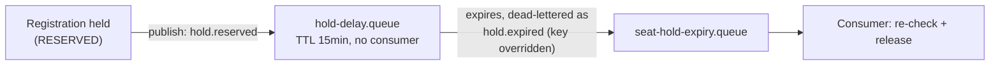

# Registration Module — Technical Design

This file is the physical-level completion of `architecture.md` §4.2 (the seat-reservation half of Redis Coordination & Caching Topology) and §4.3 (the seat-hold-expiry half of RabbitMQ Asynchronous Messaging Topology), together with `proposal.md` §11.1–§11.2 and `docs/requirement.md` §1.3.1/§1.5/§2.6/§2.8. Those sources establish *that* seat reservation is protected by an advisory distributed lock backed by a final Postgres optimistic-concurrency check, *that* a paid-ticket hold releases automatically after 15 minutes via a delayed message, and *that* every registration request is idempotent under client retry — but leave the exact lock parameters, the exact expiry message topology, and the exact end-to-end transaction shape as physical detail for this document. Nothing here overrides `architecture.md` — where this file and that one appear to disagree, `architecture.md` is the authority and this file has a bug.

**Read this file top to bottom to understand the Registration module end to end — this is the system's single highest-risk correctness path.** Where it uses a shared platform mechanism (Redis locking, RabbitMQ delay queues, the idempotency-key table), it explains what that mechanism gives Registration specifically and links out for the mechanism's own full design.

**Scope:** the `registrations` table this module owns, narrated at the rationale level (§1); the seat-reservation distributed lock and the full write transaction it wraps — this is the centerpiece of this module and of the system's anti-overbooking guarantee (§2); the seat-hold expiry message flow (§3); idempotent registration-create under client retry (§4); a consolidated failure-mode table and reference table (§5–§6).

**Out of scope, and where it actually lives:** the exact `registrations` column list (`../platform/database-schema.md` §4 — referenced throughout, not repeated here); the Redis deployment and scheduled-job-lock mechanism, reused here only for the seat lock (`../platform/distributed-coordination.md`); the RabbitMQ broker/exchange/retry mechanism, reused here only for hold expiry (`../platform/messaging.md`); the `idempotency_keys` table's own schema and generic same-transaction pattern (`../platform/database-schema.md` §8.1, `architecture.md` §4.5 — this file applies that pattern to registration-create, it doesn't redefine it); payment initiation for paid tickets, which Registration calls into but does not itself implement (`../modules/payment.md`); ticket issuance/signing, which happens at the moment this module's write confirms a registration but is `../modules/checkin.md`'s design (`architecture.md` §5.3); workshop capacity's own column definitions, owned by `../modules/workshop.md`.

---

## Table of Contents

- [1. Data Model — What This Module Owns](#1-data-model-what-this-module-owns)
- [2. Distributed Lock & Transaction: Seat Reservation](#2-distributed-lock-transaction-seat-reservation)
- [3. Seat-Hold Expiry](#3-seat-hold-expiry)
- [4. Idempotent Registration-Create](#4-idempotent-registration-create)
- [5. Failure Modes & Fail-Safe Behavior](#5-failure-modes-fail-safe-behavior)
- [6. Reference Table](#6-reference-table)
- [API Surface](#api-surface)

---

## 1. Data Model — What This Module Owns

**Rationale:** `architecture.md` §6.1 names `Registration` as this module's sole entity — it calls Workshop for capacity, Payment for paid tickets, User for identity, but never writes those modules' tables directly (`architecture.md` §1.1's module-boundary discipline, extended to schema). Exact columns are in `../platform/database-schema.md` §4.1; this section narrates why the ones central to this file's later sections look the way they do.

- **`status`** (`RESERVED`/`CONFIRMED`/`CANCELLED`/`EXPIRED`) — `RESERVED` means a seat held pending payment; `CONFIRMED` means a free ticket confirmed immediately, or a paid ticket confirmed after payment success; `EXPIRED` is what §3's delayed-message mechanism transitions a row into once the 15-minute hold lapses (`docs/requirement.md` §1.3.1).
- **`hold_expires_at`** — set if and only if `status = 'RESERVED'` (enforced by a CHECK constraint, `../platform/database-schema.md` §4.1) — the column the expiry sweep/listener in §3 watches.
- **`version`** — the optimistic-concurrency marker for status transitions racing against expiry, payment confirmation, or organizer cancellation — the same pattern `workshops.version` carries, applied to this table's own race conditions.
- **`ticket_code`/`qr_payload`** — written once, at the moment a row transitions to `CONFIRMED`; the actual signing mechanism (algorithm, key management) is `../modules/checkin.md`'s design — this module only triggers it and persists the result.

**The non-negotiable invariant this table's writes must uphold (`../platform/database-schema.md` §4.1):** every write to this table's `status` that also changes seat occupancy — `RESERVED` (hold taken), `CONFIRMED` (hold converted or free ticket confirmed), `CANCELLED`/`EXPIRED` (hold released) — **must** commit in the **same database transaction** as the corresponding `UPDATE workshops SET seats_taken = ..., version = version + 1 WHERE id = ... AND version = :expected`. §2 and §3 below are both concrete instances of this invariant; neither ever issues these as two separate transactions.

---

## 2. Distributed Lock & Transaction: Seat Reservation

**Rationale:** the coordination half of anti-overbooking (`architecture.md` §4.2, §6.1; `proposal.md` §11.1). This lock is **advisory only** — it decides which pod may *attempt* the seat-reservation write next; it never decides whether that write is *accepted*. That decision belongs entirely to PostgreSQL's `version` + check-constraint pair (`../platform/database-schema.md` §3.1/§4.1). This file must never be read as making that guarantee alone. This uses the shared Redis deployment described in `../platform/distributed-coordination.md` §1 — this section is the Registration-specific application of its locking primitive.

**Model:**

| Parameter | Value | Why |
|---|---|---|
| Key | `unihub:lock:seat:{workshopId}` | Per-workshop granularity — the critical section is "don't let two requests simultaneously modify *this* workshop's seat count." Different workshops never contend, so a global lock would serialize unrelated registrations for no correctness benefit. |
| Lease (TTL) | 5 seconds, fixed — **no watchdog auto-renewal** | The critical section is a single bounded Postgres transaction (re-check `seats_taken` vs `capacity`, insert/update, commit) with no external calls inside it — typically under 100ms. 5s comfortably covers that plus GC pauses or a slow connection-pool checkout, while still self-healing quickly if a pod crashes mid-hold, which matters most during the exact registration-opening spike (`docs/requirement.md` §1.4) this lock exists for. |
| `tryLock` wait-time | 2 seconds | Bounds how long a request thread blocks under contention before giving up. `docs/requirement.md` §1.4 describes hundreds of requests competing for a single workshop's last few seats at once — piling up blocked threads for longer than this risks exhausting the API pod's thread/connection pool exactly when load is highest. |

```java
RLock lock = redisson.getLock("unihub:lock:seat:" + workshopId);
boolean acquired;
try {
    acquired = lock.tryLock(2, 5, TimeUnit.SECONDS); // wait 2s, lease 5s fixed
} catch (RedisConnectionException e) {
    return HttpStatus.SERVICE_UNAVAILABLE; // Redis unreachable — reject, never proceed uncoordinated
}
if (!acquired) {
    return HttpStatus.SERVICE_UNAVAILABLE; // high contention — transient, Retry-After
}
try {
    // single Postgres transaction — same-transaction requirement per §1 above:
    //   SELECT seats_taken, capacity, version FROM workshops WHERE id = ? (Master)
    //   if seats_taken >= capacity: rollback; return 409 (sold out)
    //   INSERT INTO registrations (...);
    //   UPDATE workshops SET seats_taken = seats_taken + 1, version = version + 1
    //     WHERE id = ? AND version = :expected
    //   commit
} finally {
    lock.unlock();
}
```

**Two distinct failure responses, not one:** losing the lock race (contention) and the workshop actually being full are different facts and must not be collapsed into the same status code:

| Situation | Response | Why distinct |
|---|---|---|
| `tryLock` times out (contention) or Redis unreachable | `503 Service Unavailable` + `Retry-After` header | Transient — the seat may still be available; the client should retry shortly. |
| Lock acquired, but `seats_taken >= capacity` on the Postgres check | `409 Conflict` ("sold out") | Permanent for this attempt — re-checking the same workshop won't change the outcome without someone else's cancellation. |

**Trade-off — a fixed lease can, in principle, expire under a holder before it finishes:** if a pod's Postgres transaction somehow ran past 5 seconds (a slow query, a stalled connection), a second pod could acquire the lock and run concurrently with the first still believing it holds exclusivity. This is accepted, not closed, for the same reason `architecture.md` §4.2 accepts it: the lock is advisory. Even in that scenario, PostgreSQL's `version`-based optimistic-concurrency check (`../platform/database-schema.md` §3.1) still rejects whichever of the two transactions commits second — the invariant holds at the database layer regardless of what happens at the coordination layer.

**Guarantees:** mutual exclusion for the seat-reservation critical section across all parallel pods, under normal conditions (`architecture.md` §4.2). Combined with `../platform/database-schema.md`'s optimistic-concurrency check, no code path in this document allows two registrations to both believe they claimed the same last seat.

---

## 3. Seat-Hold Expiry

**Rationale:** `docs/requirement.md` §1.3.1/§2.10 requires a paid-ticket seat hold to release automatically after exactly 15 minutes, with no caller present when it fires — `architecture.md` §4.3 rejected polling ("scanning every workshop at short intervals") in favor of a broker that can schedule future, caller-less delivery. This uses the shared RabbitMQ deployment described in `../platform/messaging.md` §1–§2; this section is the Registration-specific message flow and consumer.

**Model:** the Dead-Letter-Exchange + per-message-TTL pattern.

1. When a paid-ticket registration enters `RESERVED` (§1), the Registration module publishes to `unihub.events` with routing key `unihub.registration.hold.reserved` — bound only to `unihub.registration.hold-delay.queue` (`../platform/messaging.md` §2).
2. That queue has **no consumer** and a fixed `x-message-ttl` of 900000ms (15 minutes) — messages only ever leave it by expiring.
3. On expiry, RabbitMQ dead-letters the message back to `unihub.events`, but this queue's `x-dead-letter-routing-key` is **explicitly overridden** to `unihub.registration.hold.expired` — deliberately *not* the default "preserve the original routing key" behavior (`../platform/messaging.md` §4 explains why the retry chain does the opposite). The delay queue's entire purpose is to transform the event's meaning, `reserved` → `expired`, not to redeliver the same fact.
4. `unihub.registration.hold.expired` routes to `unihub.seat-hold-expiry.queue`, where the real consumer picks it up.



**Consumer behavior — never trusts the message payload alone (`architecture.md` §4.3's ordering trade-off):**
```
1. Acquire unihub:lock:seat:{workshopId}          -- same lock as a fresh reservation
                                                       (§2 above) — releasing a seat is
                                                       as much a part of the anti-
                                                       overbooking critical section as
                                                       reserving one.
2. Single Postgres transaction:
     SELECT status, version FROM registrations WHERE id = ? (Master)
     if status <> 'RESERVED': COMMIT, do nothing      -- already CONFIRMED or already
                                                          CANCELLED by another path; a
                                                          safe no-op, not an error
     UPDATE registrations SET status = 'EXPIRED', version = version + 1
       WHERE id = ? AND version = :expected
     UPDATE workshops SET seats_taken = seats_taken - 1, version = version + 1
       WHERE id = ? AND version = :expected            -- same-transaction requirement,
                                                          §1 above
3. Release the lock.
```

**Guarantees:** a seat held past 15 minutes is always eventually released, exactly once in effect — a redelivered expiry message for an already-resolved registration is a no-op, never a double-release or an error. Retry/dead-lettering on consumer failure follows the generic mechanism in `../platform/messaging.md` §4, applied to `unihub.seat-hold-expiry.queue`.

---

## 4. Idempotent Registration-Create

**Rationale:** `docs/requirement.md` §2.8 and `architecture.md` §4.5 require that a client-generated key makes a registration request safe to retry — a student's double-click or a resent network request must never create two `registrations` rows for the same intent. The generic mechanism (same-transaction write, database-enforced unique constraint) is `../platform/database-schema.md` §8.1's design; this section is Registration's application of it.

**Model:** every `POST /api/v1/registrations` request carries a client-generated `Idempotency-Key` header. Inside the same transaction as §2's seat-reservation write:

```
1. SELECT response_status, response_body FROM idempotency_keys
     WHERE scope = 'REGISTRATION_CREATE' AND idempotency_key = :key (Master)
   if found: return the stored response verbatim — do not re-run the seat-reservation
             transaction at all, not even as a no-op re-check.
2. if not found: proceed with §2's seat-reservation transaction. On success (or on a
   definitive 409 sold-out outcome), INSERT INTO idempotency_keys (scope, idempotency_key,
   response_status, response_body) VALUES ('REGISTRATION_CREATE', :key, :status, :body)
   — in the SAME transaction as the registrations/workshops write above.
```

**Why a 409 also gets recorded:** a "sold out" rejection is as much "the original result" as a success is — a retried request with the same key must see the identical `409`, not attempt the seat-reservation transaction a second time and potentially observe a *different* outcome (e.g. a seat that freed up between the two attempts). Idempotency guarantees the same request produces the same recorded result, not that the system re-evaluates current state on every retry.

**Guarantees:** a given `Idempotency-Key` within the `REGISTRATION_CREATE` scope is acted on exactly once — every subsequent request bearing it returns the original result, regardless of which Backend API pod handles the retry (`../platform/database-schema.md` §8.1's UNIQUE constraint on `(scope, idempotency_key)` is the enforced backstop, not just an application-level check). Idempotency records are retained only long enough to cover a realistic retry window, swept by the scheduled job in `../platform/distributed-coordination.md` §2.

---

## 5. Failure Modes & Fail-Safe Behavior

| Situation | Behavior | Why |
|---|---|---|
| `tryLock` times out or Redis unreachable | `503 Service Unavailable`, `Retry-After` header | §2 — coordination unavailable means the write must never proceed uncoordinated (`architecture.md` §4.2). |
| Lock acquired, workshop full | `409 Conflict` | §2 — permanent for this attempt, distinct from the transient `503` above. |
| Redelivered `hold.expired` message for an already-resolved registration | No-op, safe re-check before acting | §3 — `architecture.md` §4.3's at-least-once delivery is tolerated by design. |
| Retried `POST /registrations` with a previously-used `Idempotency-Key` | Original result returned verbatim, seat-reservation transaction never re-attempted | §4. |
| Paid-ticket registration whose payment never completes within the 15-minute window | Hold expires via §3, seat releases automatically, regardless of what state the Payment module's own row is in | `docs/requirement.md` §1.3.1 — the hold's own 15-minute clock is authoritative for seat release, independent of payment gateway timing (`../modules/payment.md`'s own resilience posture doesn't extend this window). |

---

## 6. Reference Table

Every key format, tuning parameter, and idempotency scope in this document, in one place — the same purpose the closing tables in `../platform/database-schema.md` §11, `../platform/distributed-coordination.md` §5, and `../platform/messaging.md` §6 serve for their own documents.

| Item | Value | Backs |
|---|---|---|
| Seat lock key | `unihub:lock:seat:{workshopId}`, 5s lease, 2s wait | Anti-overbooking coordination layer (`architecture.md` §6.1/§4.2, `proposal.md` §11.1) |
| Seat lock failure response | `503` (contention/Redis down) vs. `409` (sold out) | Distinguishes transient from permanent rejection (§2) |
| Hold-delay queue | `unihub.registration.hold-delay.queue`, TTL 900000ms (15 min), no consumer | Exact 15-minute hold window (`docs/requirement.md` §1.3.1) |
| Seat-hold-expiry queue | `unihub.seat-hold-expiry.queue` | Consumer that releases an expired hold (§3) |
| Idempotency scope | `REGISTRATION_CREATE` | Composite uniqueness with client key (`../platform/database-schema.md` §8.1), scoped to this module's create endpoint (§4) |

---

## API Surface

The concrete HTTP contract for every endpoint this module exposes — request/response bodies, status codes, headers — is specified in `../../../packages/api-contract/paths/registration.yaml` (schemas in `../../../packages/api-contract/schemas/registration.yaml`), not repeated here. That OpenAPI contract is generated from this file's own decisions (§2, §4), including the `503`-vs-`409` distinction and the `Idempotency-Key` replay semantics verbatim; where the two disagree, this file is the authority and the OpenAPI contract has a bug. `registrationCancel` in that contract is flagged there as an inferred endpoint — this file never narrates a cancellation flow, only creation (§4) and expiry (§3). See `../../../packages/api-contract/README.md` for the toolchain.
