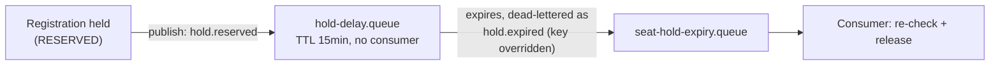

# Registration Module — Technical Design

This file is the physical-level completion of `architecture.md` §4.2 (the seat-reservation half of Redis Coordination & Caching Topology) and §4.3 (the seat-hold-expiry half of RabbitMQ Asynchronous Messaging Topology), together with `proposal.md` §11.1–§11.2 and `docs/requirement.md` §1.3.1/§1.5/§2.6/§2.8. Those sources establish *that* seat reservation is protected by an advisory distributed lock backed by a final Postgres optimistic-concurrency check, *that* a paid-ticket hold releases automatically after 15 minutes via a delayed message, and *that* every registration request is idempotent under client retry — but leave the exact lock parameters, the exact expiry message topology, and the exact end-to-end transaction shape as physical detail for this document. Nothing here overrides `architecture.md` — where this file and that one appear to disagree, `architecture.md` is the authority and this file has a bug.

**Read this file top to bottom to understand the Registration module end to end — this is the system's single highest-risk correctness path.** Where it uses a shared platform mechanism (Redis locking, RabbitMQ delay queues, the idempotency-key table), it explains what that mechanism gives Registration specifically and links out for the mechanism's own full design.

**Scope:** the `registrations` table this module owns, narrated at the rationale level (§1); the seat-reservation distributed lock and the full write transaction it wraps — this is the centerpiece of this module and of the system's anti-overbooking guarantee (§2); the seat-hold expiry message flow (§3); idempotent registration-create under client retry (§4); confirming a paid registration once its payment succeeds, and the compensation branch when it no longer can be (§5); a consolidated failure-mode table and reference table (§6–§7).

**Out of scope, and where it actually lives:** the exact `registrations` column list (`../platform/database-schema.md` §4 — referenced throughout, not repeated here); the Redis deployment and scheduled-job-lock mechanism, reused here only for the seat lock (`../platform/distributed-coordination.md`); the RabbitMQ broker/exchange/retry mechanism, reused here only for hold expiry (`../platform/messaging.md`); the `idempotency_keys` table's own schema and generic same-transaction pattern (`../platform/database-schema.md` §8.1, `architecture.md` §4.5 — this file applies that pattern to registration-create, it doesn't redefine it); payment initiation for paid tickets, which Registration calls into but does not itself implement (`../modules/payment.md`); ticket issuance/signing, which happens at the moment this module's write confirms a registration but is `../modules/checkin.md`'s design (`architecture.md` §5.3); workshop capacity's own column definitions, owned by `../modules/workshop.md`.

---

## Table of Contents

- [1. Data Model — What This Module Owns](#1-data-model-what-this-module-owns)
- [2. Distributed Lock & Transaction: Seat Reservation](#2-distributed-lock-transaction-seat-reservation)
- [3. Seat-Hold Expiry](#3-seat-hold-expiry)
- [4. Idempotent Registration-Create](#4-idempotent-registration-create)
- [5. Payment Confirmation & Compensation](#5-payment-confirmation-compensation)
- [6. Failure Modes & Fail-Safe Behavior](#6-failure-modes-fail-safe-behavior)
- [7. Reference Table](#7-reference-table)
- [API Surface](#api-surface)

---

## 1. Data Model — What This Module Owns

**Rationale:** `architecture.md` §6.1 names `Registration` as this module's sole entity — it calls Workshop for capacity, Payment for paid tickets, User for identity, but never writes those modules' tables directly (`architecture.md` §1.1's module-boundary discipline, extended to schema). Exact columns are in `../platform/database-schema.md` §4.1; this section narrates why the ones central to this file's later sections look the way they do.

- **`status`** (`RESERVED`/`CONFIRMED`/`CANCELLED`/`EXPIRED`) — `RESERVED` means a seat held pending payment; `CONFIRMED` means a free ticket confirmed immediately, or a paid ticket confirmed after payment success; `EXPIRED` is what §3's delayed-message mechanism transitions a row into once the 15-minute hold lapses (`docs/requirement.md` §1.3.1).
- **`hold_expires_at`** — set if and only if `status = 'RESERVED'` (enforced by a CHECK constraint, `../platform/database-schema.md` §4.1) — the column the expiry sweep/listener in §3 watches.
- **`version`** — the optimistic-concurrency marker for status transitions racing against expiry, payment confirmation, or organizer cancellation — the same pattern `workshops.version` carries, applied to this table's own race conditions.
- **`ticket_code`/`qr_payload`** — written once, at the moment a row transitions to `CONFIRMED`; the actual signing mechanism (algorithm, key management) is `../modules/checkin.md`'s design — this module only triggers it and persists the result. From Phase 5 (Phase 5 checklist D47, D48): the module signs through its `TicketSigner` port (adapter `NimbusEs256TicketSigner`), inside the confirming transaction, on both paths — `confirmFree` at reservation and the payment-confirmation consumer — with one statement writing `status`, `ticket_code` and `qr_payload` (the `INSERT` of a free registration, which is created already `CONFIRMED`; the conditional `UPDATE` of a paid one). A redelivered confirmation finds `CONFIRMED` and does not sign again. Rows confirmed before Phase 5 keep `NULL` (no backfill).

**The non-negotiable invariant this table's writes must uphold (`../platform/database-schema.md` §4.1):** every write to this table's `status` that also changes seat occupancy — `RESERVED` (hold taken), `CONFIRMED` (hold converted or free ticket confirmed), `CANCELLED`/`EXPIRED` (hold released) — **must** commit in the **same database transaction** as the corresponding `UPDATE workshops SET seats_taken = ..., version = version + 1 WHERE id = ... AND version = :expected`. §2 and §3 below are both concrete instances of this invariant; neither ever issues these as two separate transactions.

---

## 2. Distributed Lock & Transaction: Seat Reservation

**Rationale:** the coordination half of anti-overbooking (`architecture.md` §4.2, §6.1; `proposal.md` §11.1). This lock is **advisory only** — it decides which pod may *attempt* the seat-reservation write next; it never decides whether that write is *accepted*. That decision belongs entirely to PostgreSQL's `version` + check-constraint pair (`../platform/database-schema.md` §3.1/§4.1). This file must never be read as making that guarantee alone. This uses the shared Redis deployment described in `../platform/distributed-coordination.md` §1 — this section is the Registration-specific application of its locking primitive.

**Model:**

| Parameter | Value | Why |
|---|---|---|
| Key | `unihub:lock:seat:{workshopId}` | Per-workshop granularity — the critical section is "don't let two requests simultaneously modify *this* workshop's seat count." Different workshops never contend, so a global lock would serialize unrelated registrations for no correctness benefit. |
| Lease (TTL) | 5 seconds, fixed — **no watchdog auto-renewal** | The critical section is a single bounded Postgres transaction (re-check `seats_taken` vs `capacity`, insert/update, commit) with no external calls inside it — typically under 100ms. 5s comfortably covers that plus GC pauses or a slow connection-pool checkout, while still self-healing quickly if a pod crashes mid-hold, which matters most during the exact registration-opening spike (`docs/requirement.md` §1.4) this lock exists for. |
| `tryLock` wait-time | 2 seconds | Bounds how long a request thread blocks under contention before giving up. `docs/requirement.md` §1.4 describes hundreds of requests competing for a single workshop's last few seats at once — piling up blocked threads for longer than this risks exhausting the API pod's thread/connection pool exactly when load is highest. |

```
handle = seatLock.tryAcquire(workshopId, wait = 2s, lease = 5s)
           -- timeout, or (Phase 3) Redis unreachable → 503 + Retry-After, never proceed uncoordinated
try:
  repeat up to 3 attempts:            -- each attempt is a NEW transaction, still inside the lock
    single Postgres transaction (same-transaction requirement, §1):
      INSERT INTO registrations (...)
      UPDATE workshops SET seats_taken = seats_taken + 1, version = version + 1
        WHERE id = ? AND version = :expected AND seats_taken < capacity
      if 0 rows: re-read workshops (Master)
        seats_taken >= capacity → ROLLBACK, return 409 sold out (recorded, §4)
        version changed         → ROLLBACK, next attempt   (e.g. an organizer edit won)
      COMMIT
  all attempts lost the version race → 503 + Retry-After (not recorded, §4)
finally:
  handle.close()                      -- AFTER commit or rollback, never before
```

**Version shared with organizer edits (Phase 2 checklist D3, Q3):** `workshops.version` is bumped by seat claims and by organizer edits alike, so a claim can lose a race to an edit. The claim retries internally (3 attempts) instead of answering `409` to a student who did nothing wrong; an organizer edit never writes `seats_taken` (`../platform/database-schema.md` §3.1). Revisit thresholds for Phase 8 are in that section.

**Lock adapter per phase (Phase 2 checklist D4, Q11):** the port is `SeatLock.tryAcquire(workshopId, waitTimeout, leaseTime)` returning a handle that is closed after commit (`../../guidelines/backend-coding-standards.md` §19.2, §25). **Phase 2** uses an in-process adapter — one lock per workshop, `tryLock` with the 2 s wait, entries cleaned up when unused; it ignores the lease and does **not** coordinate across instances, so in Phase 2 the database check is the only cross-instance guard (recorded in `../../testing/reports/test-matrix.md` §4.5 with the adapter). **Phase 3** replaces it with the Redisson lock whose parameters are tabled above, including the fail-closed `503` when Redis is unreachable (INV-08, M-34). Phase 3 decisions (checklist D20, D21, 2026-10-26):

- **Any Redis failure means no lock.** The adapter maps every `org.redisson.client.RedisException` — connection refused, and the `RedisTimeoutException` a hung connection produces after the shared client's 0.5 s command timeout — to `SeatLockUnavailableException` (`503` + `Retry-After`). It uses the one shared `RedissonClient` (`../platform/distributed-coordination.md` §1).
- **Redis is required configuration.** Without `unihub.redis.address` the application does not start; there is no fallback to an in-process lock, which would run uncoordinated on more than one pod without anyone noticing. An address that is set but unreachable is different: the application starts (lazy initialization) and refuses registrations with `503`, and Readiness stays `UP` (`../platform/observability.md` §5). The in-process adapters live only in test code from Phase 3.
- **The lock is released only by its holder.** With a fixed 5 s lease the lock may already have expired and been taken by another pod; the adapter releases only a lock its own client and thread still hold (Trade-off below).

**Two distinct failure responses, not one:** losing the lock race (contention) and the workshop actually being full are different facts and must not be collapsed into the same status code:

| Situation | Response | Why distinct |
|---|---|---|
| `tryLock` times out (contention) or Redis unreachable | `503 Service Unavailable` + `Retry-After` header | Transient — the seat may still be available; the client should retry shortly. |
| Lock acquired, but `seats_taken >= capacity` on the Postgres check | `409 Conflict` ("sold out", problem `type` `urn:unihub:problem:sold-out`) | Permanent for this attempt — re-checking the same workshop won't change the outcome without someone else's cancellation. |
| Lock acquired, every attempt lost the version race | `503 Service Unavailable` + `Retry-After` | Transient — another writer (usually an organizer edit) kept bumping `version`; the seat may still be free. |

**Trade-off — a fixed lease can, in principle, expire under a holder before it finishes:** if a pod's Postgres transaction somehow ran past 5 seconds (a slow query, a stalled connection), a second pod could acquire the lock and run concurrently with the first still believing it holds exclusivity. This is accepted, not closed, for the same reason `architecture.md` §4.2 accepts it: the lock is advisory. Even in that scenario, PostgreSQL's `version`-based optimistic-concurrency check (`../platform/database-schema.md` §3.1) still rejects whichever of the two transactions commits second — the invariant holds at the database layer regardless of what happens at the coordination layer.

**Guarantees:** mutual exclusion for the seat-reservation critical section across all parallel pods, under normal conditions (`architecture.md` §4.2). Combined with `../platform/database-schema.md`'s optimistic-concurrency check, no code path in this document allows two registrations to both believe they claimed the same last seat.

---

## 3. Seat-Hold Expiry

**Rationale:** `docs/requirement.md` §1.3.1/§2.10 requires a paid-ticket seat hold to release automatically after exactly 15 minutes, with no caller present when it fires — `architecture.md` §4.3 rejected polling ("scanning every workshop at short intervals") in favor of a broker that can schedule future, caller-less delivery. This uses the shared RabbitMQ deployment described in `../platform/messaging.md` §1–§2; this section is the Registration-specific message flow and consumer.

**Model:** the Dead-Letter-Exchange + per-message-TTL pattern.

1. When a paid-ticket registration enters `RESERVED` (§1), the Registration module publishes to `unihub.events` with routing key `unihub.registration.hold.reserved` — bound only to `unihub.registration.hold-delay.queue` (`../platform/messaging.md` §2).
2. That queue has **no consumer** and a fixed `x-message-ttl` of 900000ms (15 minutes) — messages only ever leave it by expiring.
3. On expiry, RabbitMQ dead-letters the message back to `unihub.events`, but this queue's `x-dead-letter-routing-key` is **explicitly overridden** to `unihub.registration.hold.expired` — deliberately *not* the default "preserve the original routing key" behavior (`../platform/messaging.md` §4 explains why the retry chain does the opposite). The delay queue's entire purpose is to transform the event's meaning, `reserved` → `expired`, not to redeliver the same fact.
4. `unihub.registration.hold.expired` routes to `unihub.seat-hold-expiry.queue`, where the real consumer picks it up.



**Consumer behavior — never trusts the message payload alone (`architecture.md` §4.3's ordering trade-off):**
```
1. Acquire unihub:lock:seat:{workshopId}          -- same lock as a fresh reservation
                                                       (§2 above) — releasing a seat is
                                                       as much a part of the anti-
                                                       overbooking critical section as
                                                       reserving one.
                                                       Not acquired (contention, Redis
                                                       down or hung) → transient failure,
                                                       kept in the retry chain, never
                                                       parked (see below)
2. repeat up to 3 attempts:            -- each attempt is a NEW transaction, still inside the lock
   single Postgres transaction:
     SELECT status, hold_expires_at, version FROM registrations WHERE id = ? (Master)
     if status <> 'RESERVED': COMMIT, do nothing      -- already CONFIRMED, EXPIRED or
                                                          CANCELLED by another path; a
                                                          safe no-op, not an error
     if hold_expires_at > now (app Clock):            -- arrived early (clock skew between
       ROLLBACK, transient failure                       broker and pods): retried by the
                                                          chain's 5 s stage, never acted on
     UPDATE registrations SET status = 'EXPIRED', version = version + 1
       WHERE id = ? AND version = :expected AND status = 'RESERVED'
     if affected rows = 0: ROLLBACK, re-read, no-op  -- the payment-confirmation consumer
                                                          (§5) won the race; exactly one of
                                                          the two ever transitions the row
     UPDATE workshops SET seats_taken = seats_taken - 1, version = version + 1
       WHERE id = ? AND version = :expected            -- same-transaction requirement,
                                                          §1 above
     if 0 rows: ROLLBACK, next attempt                 -- an organizer edit bumped version
     COMMIT; audit (Actor.system("seat-hold-expiry"))
   all attempts lost the version race → transient failure, normal retry chain
3. Release the lock (after commit or rollback).
```

**Phase 3 decisions (checklist D19, D27, C2, C5, 2026-10-26; built 2026-10-27 as `ExpireSeatHold` → `ExpireSeatHoldTransaction`, listener `SeatHoldExpiryListener`):**

- **A seat is never released without its registration moving to `EXPIRED` in the same transaction** — the `registrations` and `workshops` updates commit or roll back together. A lost version race on `workshops` (organizer edits are outside the seat lock) or on `registrations` (the payment confirmation won) is retried as a new transaction, three attempts in all, exactly like a seat claim (§2); the re-read of the second case finds `CONFIRMED` and does nothing. The message's `workshopId` only chooses the lock: it must equal the registration's own workshop, otherwise the message is permanent (parked) and nothing is released.
- **The hold's own clock decides.** The consumer acts only when `hold_expires_at <= now`. The delay queue's TTL starts when the outbox relay publishes the job, not when the hold is created, so the effective hold is 15 minutes plus the relay's delay (normally about a second, `../platform/messaging.md` §5). That gap is accepted rather than closed by polling (`architecture.md` §4.3); during it `chargePayment` already refuses the hold.
- **One source for the 15 minutes.** The delay queue's `x-message-ttl` and `hold_expires_at` both come from `unihub.registration.seat-hold`. Because queue arguments cannot change once declared, changing that value where a broker already holds the queue means declaring a new queue.
- **A Redis outage never parks an expiry.** The fail-closed seat lock (INV-08) and the guaranteed release (INV-07) meet here: if the lock cannot be taken, the message stays in the retry chain at its 5-minute stage for as long as it takes, instead of moving to `unihub.parking-lot` after three attempts (`../platform/messaging.md` §4, exception table). The seat is released at most about 5 minutes after Redis recovers, with no manual step; `unihub_seat_hold_expiry_lock_unavailable_total` counts the waits.

**Guarantees:** a seat held past 15 minutes is always eventually released, exactly once in effect — a redelivered expiry message for an already-resolved registration is a no-op, never a double-release or an error. Retry/dead-lettering on consumer failure follows the generic mechanism in `../platform/messaging.md` §4, applied to `unihub.seat-hold-expiry.queue`.

---

## 4. Idempotent Registration-Create

**Rationale:** `docs/requirement.md` §2.8 and `architecture.md` §4.5 require that a client-generated key makes a registration request safe to retry — a student's double-click or a resent network request must never create two `registrations` rows for the same intent. The generic mechanism (same-transaction write, database-enforced unique constraint) is `../platform/database-schema.md` §8.1's design; this section is Registration's application of it.

**Model:** every `POST /api/v1/registrations` request carries a client-generated `Idempotency-Key` header. The key is scoped to the operation **and the authenticated caller** — `(scope, actor_user_id, idempotency_key)`, with the actor taken from the verified JWT, never from the request (`../platform/database-schema.md` §8.1). The request body's fingerprint (SHA-256 of its canonical JSON) is stored with the key. Inside the same transaction as §2's seat-reservation write:

```
1. SELECT status, request_fingerprint, result_type, result_body FROM idempotency_keys
     WHERE scope = 'REGISTRATION_CREATE' AND actor_user_id = :actor AND idempotency_key = :key  (Master)
   if found and fingerprint differs: 422 — the key was issued for a different request; nothing runs.
   if found and COMPLETED:           return the stored Result verbatim — do not re-run the
                                     seat-reservation transaction at all, not even as a no-op re-check.
2. if not found: INSERT the key row as IN_PROGRESS — the FIRST statement of the transaction.
   A concurrent request with the same key blocks on the unique index here; when this
   transaction commits it fails with a duplicate and gets 409 ("still being processed" —
   its retry replays this result); if this transaction rolls back it proceeds normally.
3. Proceed with §2's seat-reservation transaction. On success (or on a definitive 409
   sold-out / already-registered outcome), UPDATE the key row to COMPLETED with the
   Result (result_type, result_body) — in the SAME transaction as the
   registrations/workshops write. The IN_PROGRESS row is never committed on its own.
```

The same lookup also runs once before the seat lock (fast replay path, `../../guidelines/backend-coding-standards.md` §25.1), so a retried request never needs the lock.

**Authorization and audit:** the endpoint requires the permission `REGISTRATION_CREATE` (seeded for Students, Phase 2 checklist D7); the registration is always created for the authenticated caller. Creating and confirming a registration are recorded through `AuditTrail` (checklist D6). Each `409` carries its own problem `type` (`sold-out`, `already-registered`, `registration-not-open`, `idempotency-key-in-use`; `422` → `idempotency-key-reused` — checklist D8).

**Why a 409 also gets recorded:** a "sold out" rejection is as much "the original result" as a success is — a retried request with the same key must see the identical `409`, not attempt the seat-reservation transaction a second time and potentially observe a *different* outcome (e.g. a seat that freed up between the two attempts). Idempotency guarantees the same request produces the same recorded result, not that the system re-evaluates current state on every retry.

**What is never recorded:** a `503` (seat-lock contention, Redis unreachable) or a lost version race. Those roll back with the key row, and a retry with the same key executes for real (`../../guidelines/backend-coding-standards.md` §21 rule 7).

**Guarantees:** a given `Idempotency-Key` within the `REGISTRATION_CREATE` scope is acted on exactly once — every subsequent request bearing it returns the original result, regardless of which Backend API pod handles the retry (`../platform/database-schema.md` §8.1's UNIQUE constraint on `(scope, actor_user_id, idempotency_key)` is the enforced backstop, not just an application-level check). Idempotency records are retained only long enough to cover a realistic retry window, swept by the scheduled job in `../platform/distributed-coordination.md` §2.

---

## 5. Payment Confirmation & Compensation

**Rationale:** a paid registration is `RESERVED` until its payment succeeds (`docs/requirement.md` §1.3.1). The Payment module resolves the payment (webhook or reconciliation, `../modules/payment.md` §6–§7) but never writes `registrations` — this module is its sole writer (`architecture.md` §1.1). The hand-off is therefore asynchronous, through the outbox (`../../guidelines/backend-coding-standards.md` §7 type 4). Decisions: Phase 2 checklist D2 (Q2), C10, C11 (2026-10-13/14).

**Model — confirmation:**

1. In the same transaction that moves a payment to `SUCCEEDED`, the Payment module writes an outbox row `unihub.payment.charge.succeeded` (payload: `paymentId`, `registrationId`) → `unihub.payment-confirmation.queue` (`../platform/messaging.md` §2).
2. This module's consumer, in one transaction at the Master:
   ```
   UPDATE registrations SET status = 'CONFIRMED', hold_expires_at = NULL,
          ticket_code = :code, qr_payload = :payload, version = version + 1
     WHERE id = :registrationId AND status = 'RESERVED'
   if affected rows = 1: write outbox unihub.registration.ticket.confirmed; COMMIT
   if affected rows = 0: re-read status
     CONFIRMED            → COMMIT, no-op  (a redelivery of a message already applied)
     EXPIRED | CANCELLED  → compensation, below
   ```
   `seats_taken` does not change: the seat was claimed when the registration entered `RESERVED` (§1). Ticket signing at `CONFIRMED` is `../modules/checkin.md` §4's design: the signature is computed inside this transaction (no network I/O), so `:code` and `:payload` are the new ticket (Phase 5 checklist D48). A redelivery reaches the `CONFIRMED` branch and never signs, so the ticket a student holds is the first one issued; a lost race between two concurrent deliveries signs twice but only one conditional `UPDATE` matches, so the row holds exactly one ticket. The `201` of `createRegistration` for a free workshop carries `ticketCode` and `qrPayload` (the same body `getRegistration` returns), and an `Idempotency-Key` replay returns the stored copy, never a re-signed one; a key recorded before Phase 5 replays with both `null`.

**Model — compensation (payment succeeded, registration no longer `RESERVED`):** the money was taken but the seat cannot be held — it was released by expiry (§3) or cancellation and may already belong to someone else. The seat is **never** re-granted (`EXPIRED → CONFIRMED` is a forbidden transition, `../../testing/guidelines/test-design-techniques.md` §2). Instead:

1. The consumer leaves the registration unchanged and writes an outbox row `unihub.registration.confirmation.rejected` (payload: `paymentId`, `registrationId`, reason `HOLD_EXPIRED` | `REGISTRATION_CANCELLED`) → `unihub.payment-refund.queue`.
2. The Payment module — the only module allowed to call the gateway — moves the payment `SUCCEEDED → REFUND_REQUIRED` by a conditional update, writing `unihub.payment.refund.requested` in the same transaction; from Phase 3 that job's consumer refunds it (`../modules/payment.md` §9, Phase 3 checklist D26).

**Deduplication without an inbox table:** every transition here is a conditional `UPDATE … WHERE status = <expected>` with an affected-rows check, so a redelivered message re-applies nothing. In the compensation branch the registration does not change, so every redelivery of `charge.succeeded` emits **another** `confirmation.rejected` event — deliberately: the Payment side deduplicates by its own conditional transition, keyed by the payment, never by event id (`../../guidelines/backend-coding-standards.md` §8.5). No inbox table is added — `architecture.md` §6.1 names exactly three Technical Pattern Entities.

**What the client sees:** between the payment's `SUCCEEDED` and this consumer's commit, `getPayment` shows `SUCCEEDED` while `getRegistration` still shows `RESERVED` — "confirming"; the client keeps polling `getRegistration` (`../../../packages/api-contract/paths/registration.yaml`). In the compensation branch the client sees the registration `EXPIRED`/`CANCELLED` and the payment `REFUND_REQUIRED`, then `REFUNDED` (Phase 3).

**Phase split:** Phase 2 implements confirmation and the compensation up to `REFUND_REQUIRED`. In Phase 2 nothing on the live path can trigger the compensation — there is no expiry consumer (§3, Phase 3) and no cancellation endpoint yet — so it is exercised by tests that put the registration in `EXPIRED`/`CANCELLED` directly. The gateway refund lands in Phase 3 with the expiry consumer, the thing that actually triggers this branch.

**Trade-off — a late payment in Phase 2 still confirms:** until §3's consumer exists, a paid registration never leaves `RESERVED`, so a payment that succeeds after `hold_expires_at` is confirmed. Accepted for Phase 2 only (recorded in the Phase 2 checklist and its sign-off); from Phase 3 the hold's own clock is authoritative again, exactly as §6's last row states.

**Guarantees:** a paid registration is confirmed at most once and only while it is still `RESERVED`; when it no longer is, the payment is always routed to a refund — the system never keeps money for a seat it did not hold, and never holds a seat it did not get paid for.

---

## 6. Failure Modes & Fail-Safe Behavior

| Situation | Behavior | Why |
|---|---|---|
| `tryLock` times out or Redis unreachable (refused or hung) | `503 Service Unavailable`, `Retry-After` header | §2 — coordination unavailable means the write must never proceed uncoordinated (`architecture.md` §4.2). Redis applies from Phase 3; Phase 2's in-process lock only times out. |
| `unihub.redis.address` not configured | The application does not start | §2 — no silent fallback to an uncoordinated lock (Phase 3 checklist D21). |
| Seat lock unavailable while a hold expires | The expiry message waits in its retry chain (5-minute stage) until the lock is taken; never parked | §3 — INV-07 and INV-08 both hold (Phase 3 checklist D19). |
| `hold.expired` arrives before `hold_expires_at` | Not acted on; retried by the chain | §3 — the hold's own clock decides (Phase 3 checklist D27). |
| Seat claim loses the version race 3 times (organizer edits) | `503`, `Retry-After`, not recorded | §2 — transient, never surfaced as `409`. |
| Lock acquired, workshop full | `409 Conflict` | §2 — permanent for this attempt, distinct from the transient `503` above. |
| Redelivered `hold.expired` message for an already-resolved registration | No-op, safe re-check before acting | §3 — `architecture.md` §4.3's at-least-once delivery is tolerated by design. |
| Retried `POST /registrations` with a previously-used `Idempotency-Key` | Original result returned verbatim, seat-reservation transaction never re-attempted | §4. |
| Same `Idempotency-Key` with a different request body | `422`, nothing executed | §4 — the key was issued for another request. |
| Same `Idempotency-Key` while the first request is still in its transaction | `409` ("still being processed"); the client's retry replays the first request's result | §4. |
| `charge.succeeded` redelivered after the registration was confirmed | No-op (conditional update matches zero rows, status already `CONFIRMED`) | §5. |
| Payment succeeds after the registration expired or was cancelled | Registration unchanged; `confirmation.rejected` emitted; payment → `REFUND_REQUIRED` (refund from Phase 3) | §5 — the seat is never re-granted. |
| Paid-ticket registration whose payment never completes within the 15-minute window | Hold expires via §3, seat releases automatically, regardless of what state the Payment module's own row is in | `docs/requirement.md` §1.3.1 — the hold's own 15-minute clock is authoritative for seat release, independent of payment gateway timing (`../modules/payment.md`'s own resilience posture doesn't extend this window). |

---

## 7. Reference Table

Every key format, tuning parameter, and idempotency scope in this document, in one place — the same purpose the closing tables in `../platform/database-schema.md` §11, `../platform/distributed-coordination.md` §5, and `../platform/messaging.md` §6 serve for their own documents.

| Item | Value | Backs |
|---|---|---|
| Seat claim retry | 3 attempts on a lost version race, then `503` | Shared `workshops.version` (§2, `../platform/database-schema.md` §3.1) |
| Seat lock adapter | Phase 2 in-process (per-workshop, no cross-instance guarantee); Phase 3 Redisson, required (no fallback), any `RedisException` → `503` | §2 |
| Seat lock key | `unihub:lock:seat:{workshopId}`, 5s lease, 2s wait | Anti-overbooking coordination layer (`architecture.md` §6.1/§4.2, `proposal.md` §11.1) |
| Seat lock failure response | `503` (contention/Redis down) vs. `409` (sold out) | Distinguishes transient from permanent rejection (§2) |
| Hold-delay queue | `unihub.registration.hold-delay.queue`, TTL 900000ms (15 min) from `unihub.registration.seat-hold`, no consumer | Exact 15-minute hold window (`docs/requirement.md` §1.3.1) |
| Seat-hold-expiry queue | `unihub.seat-hold-expiry.queue`; lock unavailable → stays in the chain, never parked | Consumer that releases an expired hold (§3) |
| Seat release retry | 3 attempts on a lost version race, then the normal retry chain | §3, same rule as the seat claim (§2) |
| Idempotency scope | `REGISTRATION_CREATE` | Composite uniqueness `(scope, actor_user_id, idempotency_key)` (`../platform/database-schema.md` §8.1), scoped to this module's create endpoint and the authenticated caller (§4) |
| Payment-confirmation queue | `unihub.payment-confirmation.queue` ← `unihub.payment.charge.succeeded` | Paid registration `RESERVED → CONFIRMED` (§5) |
| Compensation event | `unihub.registration.confirmation.rejected` → `unihub.payment-refund.queue`, then `unihub.payment.refund.requested` → `unihub.payment-refund-execution.queue` | Payment succeeded for a registration no longer `RESERVED` (§5) |


**Internal read for Notification (Phase 4 checklist D35):** `registration.api` exposes a read interface returning the `(userId, registrationId)` pairs of a workshop's registrations in `CONFIRMED` or `RESERVED` (`EXPIRED`/`CANCELLED` excluded). Notification calls it through its own `WorkshopRecipients` port (`notification.md` §3), at the Master, when it consumes a cancellation or reschedule. When "workshop cancelled → cancel its registrations" is built (`backend-coding-standards.md` §27 #8), registrations cancelled for that reason must still be returned for the cancellation notice.

**Internal reads for Check-in and Notification (Phase 5 checklist D47, D51, D46, D55):** `registration.api` gains four read interfaces, each returning only what its caller needs and never an entity:
- `TicketVerificationKey` — the current **public** JWK of the ticket key (`kty`, `crv`, `x`, `y`), for Check-in's `GET /api/v1/checkin/verification-key`. The private key never crosses the module boundary.
- `TicketLookup` — bulk resolution `ticket_code` → `registrationId`, `status`, `workshopId`, at the Master, for sync reconciliation (`checkin.md` §7).
- A per-workshop count of `CONFIRMED` and `RESERVED` registrations, at the Replica, for the report (`checkin.md` §10).
- The ticket (`ticket_code`, `qr_payload`) of a registration, at the Master, for the confirmation email's QR (`notification.md` §4).

**As built (Phase 4 checklist 1.3, 2026-10-29):** `registration.api.WorkshopAttendees` with two reads, both returning `Attendee(registrationId, userId, workshopId)`: `holdingSeatsFor(WorkshopId)` — the `RESERVED`/`CONFIRMED` list above, oldest first so a retried fan-out walks the same order — and `find(RegistrationId)` — one registration in **any** status, which is how a `REGISTRATION_CONFIRMED` message naming a registration that does not exist is recognised (AC35.3). Both are `@Transactional(readOnly = true) @ReadFromPrimary` reads, not `MANDATORY` (the consumer holds no transaction while it sends).

---

## API Surface

The concrete HTTP contract for every endpoint this module exposes — request/response bodies, status codes, headers — is specified in `../../../packages/api-contract/paths/registration.yaml` (schemas in `../../../packages/api-contract/schemas/registration.yaml`), not repeated here. That OpenAPI contract is generated from this file's own decisions (§2, §4), including the `503`-vs-`409` distinction and the `Idempotency-Key` replay semantics verbatim; where the two disagree, this file is the authority and the OpenAPI contract has a bug. `registrationCancel` in that contract is flagged there as an inferred endpoint — this file never narrates a cancellation flow, only creation (§4) and expiry (§3). See `../../../packages/api-contract/README.md` for the toolchain.
