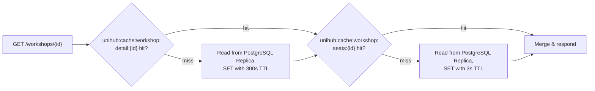
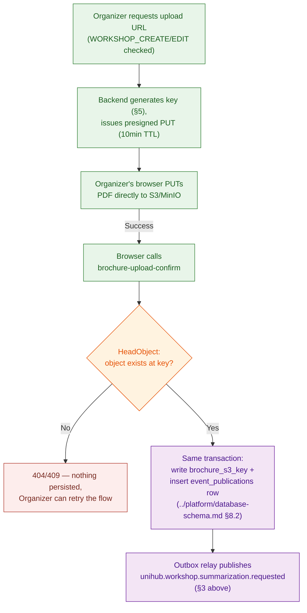
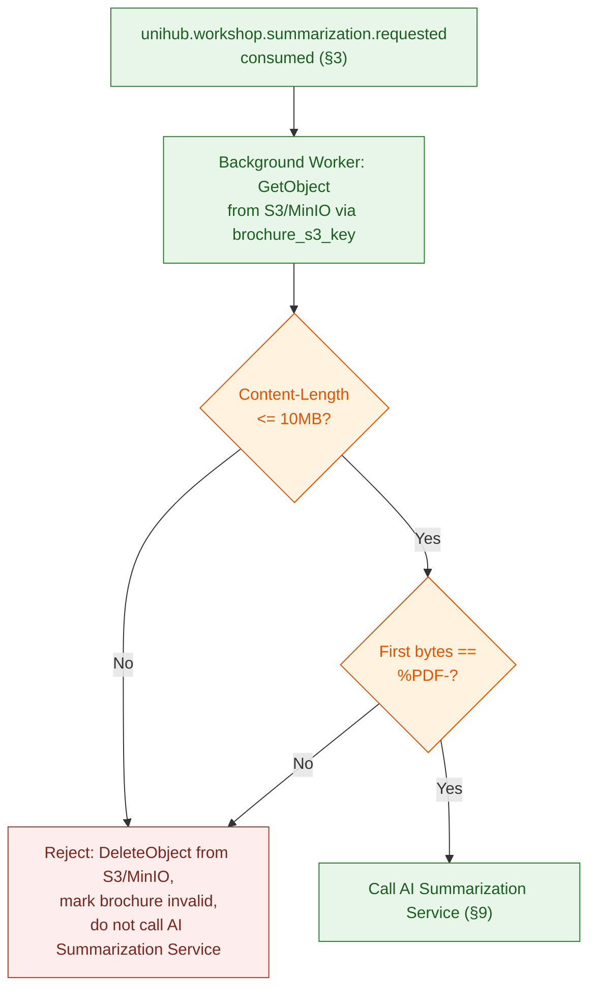

# Workshop Module — Technical Design

This file is the physical-level completion of `architecture.md` §4.2 (the workshop-catalog half of Redis Coordination & Caching Topology), §4.4 (Object Storage Access Pattern), and `proposal.md` §11 / `docs/requirement.md` §1.3.4 (AI-Powered Content Summarization), together with the Object Storage half of `architecture.md` §1.4's fault-isolation strategy. Those sources establish *that* workshop catalog data is cached with different volatility per field, *that* brochure upload and fetch are split into two steps that never happen in the same request, and *that* an uploaded PDF is summarized asynchronously — but leave cache key/TTL values, the concrete S3 access pattern, file constraints, and the AI Summarization Service's own API contract as physical detail for this document. Nothing here overrides `architecture.md` — where this file and that one appear to disagree, `architecture.md` is the authority and this file has a bug.

**Read this file top to bottom to understand the Workshop module end to end.** Where it uses a shared platform mechanism (Redis, RabbitMQ), it explains what that mechanism gives the Workshop module specifically and links out for the mechanism's own full design — it does not re-derive cache-aside semantics or retry/DLQ behavior from scratch.

**Scope:** the `workshops` table this module owns, narrated at the rationale level (§1); cache-aside for the workshop catalog (§2); the brochure-summarization async job (§3); Object Storage backend-per-environment, bucket/key structure, file constraints, the presigned-upload flow, and post-upload verification (§4–§8); the AI Summarization Service's own API contract — request/response shape, auth, timeout, and error handling (§9, previously unspecified anywhere in this corpus); a consolidated failure-mode table and reference table (§10–§11).

**Out of scope, and where it actually lives:** the exact `workshops` column list (`../platform/database-schema.md` §3 — referenced throughout, not repeated here); the Redis deployment/locking mechanism itself, reused here only for cache-aside (`../platform/distributed-coordination.md`); the RabbitMQ retry/dead-lettering mechanism, reused here only for the summarization job (`../platform/messaging.md` §4); registration's own seat-reservation flow, which reads `workshops.seats_taken` but is not this module's concern (`../modules/registration.md`).

All object-storage configuration in this document targets AWS S3 (PoC) / MinIO (test, local dev) via the AWS SDK for Java; all messaging configuration targets RabbitMQ via Spring AMQP — both per `CLAUDE.md`'s tech stack.

---

## Table of Contents

- [Architecture Decision Records (ADRs)](#architecture-decision-records-adrs)
  - [ADR Mini: Object Storage Backend Across Environments](#adr-mini-object-storage-backend-across-environments)
  - [ADR Mini: PDF Upload & Access Pattern](#adr-mini-pdf-upload-access-pattern)
  - [ADR Mini: AI Summarization Service Integration Contract](#adr-mini-ai-summarization-service-integration-contract)
- [1. Data Model — What This Module Owns](#1-data-model-what-this-module-owns)
- [2. Cache-Aside: Workshop Catalog](#2-cache-aside-workshop-catalog)
- [3. Summarization Job — Message Flow](#3-summarization-job-message-flow)
- [4. Object Storage Backend Per Environment](#4-object-storage-backend-per-environment)
- [5. Bucket & Key Structure](#5-bucket-key-structure)
- [6. File Constraints](#6-file-constraints)
- [7. Presigned PUT Issuance & Upload Confirmation](#7-presigned-put-issuance-upload-confirmation)
- [8. Post-Upload Verification](#8-post-upload-verification)
- [9. AI Summarization Service — Integration Contract](#9-ai-summarization-service-integration-contract)
- [10. Failure Modes & Fail-Safe Behavior](#10-failure-modes-fail-safe-behavior)
- [11. Reference Table](#11-reference-table)
- [API Surface](#api-surface)

---

## Architecture Decision Records (ADRs)

All three decisions below were reached through the `spec-driven-development` gated workflow: 2–4 alternatives were explored with a trade-off matrix, the human made the call at the Phase 3 Decision Gate, and the reasoning was captured here verbatim rather than left to live only in `SPEC.md` (a working document for the next task, not a durable record).

### ADR Mini: Object Storage Backend Across Environments

**Context:** `CLAUDE.md` fixes AWS S3 as the target object-storage technology, and separately establishes a testing philosophy for the rest of the stack — Testcontainers running real Postgres/Redis/RabbitMQ, "never in-memory substitutes" — but leaves the equivalent question unanswered for S3. Requiring real AWS credentials for local development and every CI run would be the only way to run "AWS S3 everywhere," but that conflicts with `proposal.md` §5.2's framing of AWS S3 as "the one managed-cloud dependency" in an otherwise self-hosted, local Kubernetes topology — extending that one exception into the day-to-day dev/test loop was judged out of proportion to the benefit.

**Decision:** MinIO (S3-compatible, self-hosted), run via Testcontainers for integration tests and available for local Minikube development, stands in for S3 in every environment except the final PoC deployment, which still targets real AWS S3. The AWS SDK's `endpointOverride` is the only thing that changes between environments — no application code branches on which backend is in use.

**Consequences:**
- Local development and CI never require real AWS credentials, removing both a credential-leak surface and a real-dollar cost for every test run.
- MinIO containers are ephemeral, matching the same Testcontainers lifecycle already used for Postgres/Redis/RabbitMQ — no new operational pattern introduced.
- A small residual risk remains that MinIO's S3-API-compatibility surface diverges from real AWS S3 at some edge case this system's narrow access pattern (presigned PUT, plain `GetObject`) doesn't exercise — accepted as low-probability given how narrow that access pattern is.

**Trade-offs accepted (user's own reasoning):** real AWS S3 in every environment was rejected because it would force every developer and CI run to hold real AWS credentials, conflicting with the project's local/self-hosted framing — this is meant to be the project's one deliberate managed-cloud exception, not a precedent to extend further. LocalStack was rejected as unnecessary breadth (emulates far more AWS surface than this system needs) and heavier on developer-machine resources, which `proposal.md` §16 already flags as a constraint.

### ADR Mini: PDF Upload & Access Pattern

**Context:** `architecture.md` §4.4 explicitly separates brochure upload (Organizer → S3, during the Workshop Module's request) from brochure fetch (Background Worker → S3, only when about to call the AI Summarization Service) as two steps that "never happen in the same request," specifically so an Organizer's upload is never blocked by anything downstream. The section's own rationale for pulling binary files out of the transactional path is that large binary I/O doesn't belong in a tier built for other work. No client-facing flow for viewing or re-downloading the original PDF exists anywhere in `docs/requirement.md` or in §4.4's own diagram (only two arrows: upload, worker-fetch) — confirmed as intentionally out of scope; students only ever see `workshops.ai_summary`.

**Decision:** Organizer upload uses a presigned PUT URL (10-minute TTL) issued by the Backend API — PDF bytes travel directly from the Organizer's browser to S3/MinIO, never through a Backend API pod. The Background Worker, running inside the trusted backend with its own IAM/service credentials, fetches the object directly via `GetObject` — no presigned GET is issued to any party, since the only reader is an already-trusted internal component. No client-facing download endpoint or presigned GET is built.

**Consequences:**
- The Backend API tier never carries the PDF's bytes on the upload path, matching §4.4's own stated reason for separating object storage from the request path in the first place.
- File-type/size validation cannot happen synchronously against the file's actual bytes at the moment of upload (a presigned PUT bypasses the Backend API entirely) — a post-upload verification step (§8) is required before the file is trusted enough to enter the summarization pipeline.
- Because the Backend API is never in the upload's data path, it also never automatically learns the upload happened — a confirmation step (§7) is required to close that loop, closing it explicitly is what makes `architecture.md` §4.4's "confirms the upload before the summarization pipeline ever runs" still true under a presigned-upload design rather than the backend-proxied one that line was originally written against.
- No client-facing PDF-download capability exists; if a future requirement calls for one, it is a new decision to make later, not something silently built in now "just in case."

**Trade-offs accepted (user's own reasoning):** backend-proxied upload was rejected because routing multi-megabyte files through the Backend API for every Organizer upload reintroduces exactly the large-binary-through-a-tier-not-built-for-it problem §4.4 exists to avoid — accepted in exchange for needing a post-upload file-type check instead of an upload-time one. Building a presigned GET / client-facing download path preemptively was rejected since no such requirement exists in the SRS or in §4.4's own diagram, and building it now would be designing for a hypothetical future requirement rather than a confirmed one.

### ADR Mini: AI Summarization Service Integration Contract

**Context:** `docs/requirement.md` §1.3.4 requires the system to "automatically read the document's content and generate a short, engaging summary." Every other file in this corpus that names the AI Summarization Service treats it as an opaque external dependency — `resilience-and-storage.md`'s scope note (now split into this file and `../platform/observability.md`) explicitly named "the AI Summarization Service's own internals" as out of scope, and no document anywhere fixed a request/response shape, an authentication mechanism, or an error-handling contract for actually calling it. That gap means an implementer has nothing to build either side of this integration against.

**Decision:** the AI Summarization Service is called as a synchronous HTTPS API from inside the Background Worker's existing summarization consumer (`../platform/messaging.md` §2, queue `unihub.summarization.queue`) — one request, one response, no webhook/callback pattern. Request carries the brochure's raw PDF bytes (already fetched from S3/MinIO, §8) as a `multipart/form-data` body; response carries a plain-text summary. Authentication is a static bearer API key, held in the same Kubernetes `Secret` pattern as every other third-party credential (`architecture.md` §5.4).

**Consequences:**
- The call fits inside the existing summarization consumer's per-message processing — no new message kind, no new queue, no new state machine to track "summarization requested but not yet returned."
- A synchronous call means the consumer's own processing time now includes the AI service's latency — acceptable because this consumer is already off the critical path (`architecture.md` §4.3) and RabbitMQ's own redelivery/retry behavior (`../platform/messaging.md` §4) already tolerates a slow or failed attempt without any special-casing.
- No webhook endpoint needs to be exposed publicly for the AI Summarization Service to call back into — reducing this integration's attack surface to outbound-only, consistent with this module being the sole owner of this external dependency (`architecture.md` §2.3).

**Trade-offs accepted:** an asynchronous webhook-callback pattern (AI service calls back a UniHub endpoint when done) was rejected — it would require exposing a new public endpoint, a webhook-signature-verification scheme (duplicating work `../modules/payment.md` already has to do for the Payment Gateway), and a way to correlate an unprompted callback back to the right `workshop_id` days later if the service is slow. A synchronous call inside an already-async, already-retry-safe consumer gets the same "doesn't block the Organizer's request" property with none of that added surface.

---

## 1. Data Model — What This Module Owns

**Rationale:** `architecture.md` §6.1 names `Workshop` as this module's sole entity. Exact columns are in `../platform/database-schema.md` §3.1; this section narrates why the ones relevant to this file's later sections look the way they do.

- **`ai_summary`** — `NULL` until the AI Summarization Service returns (§9); this file's §3/§8/§9 are collectively what fills it in.
- **`brochure_s3_key`** — the pointer to the uploaded PDF in Object Storage (§5); never written until the confirmation step (§7) has independently verified the object exists.
- **`seats_taken`/`capacity`/`version`** — the anti-overbooking columns this module's rows carry, but does not itself write in the seat-reservation path; `../modules/registration.md` is the module that updates them, inside the same transaction as its own `registrations` write (`../platform/database-schema.md` §3.1's same-transaction invariant). This module only reads them for catalog display (§2).

**Guarantee:** PostgreSQL — not S3, and not the cache — is authoritative for whether a brochure exists and what a workshop's current summarization status is (`architecture.md` §4.4).

---

## 2. Cache-Aside: Workshop Catalog

**Rationale:** `docs/requirement.md` §2.4 requires caching "static or infrequently changing workshop information" so catalog-browsing load doesn't hit the primary data store on every request. But §1.3.1 separately requires "real-time updated seat availability" on the same page — those two requirements pull in different directions on the *same* entity. Caching the whole workshop row under one TTL would either make seat counts too stale (violating §1.3.1) or force the TTL so short the cache stops helping (defeating §2.4). The resolution: split the entity's cache representation in two, with different TTLs for different volatility. This uses the shared Redis deployment described in `../platform/distributed-coordination.md` §1 — this section is the Workshop-specific application of it.

**Model:**

| Key | Contents | TTL | Invalidated by |
|---|---|---|---|
| `unihub:cache:workshop:detail:{workshopId}` | Slow-changing fields: `title`, `description`, `ai_summary`, `speaker_name`, `speaker_bio`, `location`, `start_time`, `end_time`, `capacity`, `is_paid`, `price`, `has_brochure` (a flag — the storage key itself is never cached), `status`, `created_at` | 300s | Explicit `DEL` on organizer edit/cancel/reschedule, in the same request handler that commits the Postgres update — never relies on TTL expiry alone for a write the system itself just made. |
| `unihub:cache:workshop:seats:{workshopId}` | Volatile fields only: `seats_taken`, `capacity`, `status`, and `version` + `updated_at` (a seat claim bumps both, so they cannot live in the 300s entry; added 2026-10-19) | 3s | Explicit `DEL` on **(a)** any registration write that changes `seats_taken` (create/confirm/cancel/expire — `../modules/registration.md`), and **(b)** organizer edit/cancel/reschedule — same trigger set as the detail key, since this key duplicates `status` and would otherwise disagree with the detail key's already-correct value for up to 3s after a cancellation. Natural 3s expiry as a backstop either way. |
| `unihub:cache:workshop:list:{filterHash}` | Paginated/filtered workshop summaries (id, title, location, start_time, status) for a given search query | 30s | Natural expiry only — no write-path invalidation, since a `filterHash` doesn't identify which cached lists reference a given workshop. Staleness here is accepted per `architecture.md` §4.2's own trade-off framing, bounded to 30s. |

`filterHash` is a deterministic hash (e.g. SHA-256, truncated) of the normalized query parameters (topic, speaker, location, date range, page, page size, sort order) — same query always maps to the same key.

All values are JSON (Jackson-serialized), stored as plain Redis strings — not hashes — since every write invalidates the whole key rather than patching a field, so a hash's partial-update capability isn't needed and would only add complexity.

**As built (Phase 2 checklist 1.5, 2026-10-19):** the cache is the Workshop-owned port `WorkshopCache`, used by `GetWorkshop`, `SearchWorkshops`, `UpdateWorkshop` and `CancelWorkshop`; `RedissonWorkshopCache` is its adapter and `WorkshopCacheKeys` the only place that spells a `unihub:cache:workshop:*` key. Points where the build is more specific than the text above:

- **Merge.** Where both entries carry a field (`capacity`, `status`), the 3s seats entry wins. A draft is cached like any workshop; the "a DRAFT is `404` to a caller without a workshop-management permission" rule is applied *after* the cache, since the entry is shared by every caller and the rule is not.
- **A workshop that does not exist is never cached**, so a `404` always asks the database.
- **Invalidation runs after the commit** (a `TransactionSynchronization.afterCommit`, or at once when there is no transaction), never before: dropping a key earlier lets a concurrent reader re-cache the old row before the new one is visible. A rolled-back write invalidates nothing.
- **Fail-open with back-off.** Nothing in the adapter throws. After a Redis failure it leaves the cache alone for 5s, so a dead Redis costs one failed attempt per 5s, not one per request. A `DEL` is *never* skipped during back-off, because a stale entry surviving a lost `DEL` would make the cache wrong rather than slow.
- **Redis is required configuration** (Phase 3 checklist D21): without `unihub.redis.address` the application does not start, so there is no no-op cache any more. An address that is set but unreachable is the fail-open case above.
- **Other writers must invalidate too.** Whatever later changes a cached field outside organizer edit/cancel/reschedule — the summarization consumer writing `ai_summary`, the brochure upload confirmation writing `brochure_s3_key` — must call `WorkshopCache.invalidate`, or the detail entry shows the old value for up to 300s. Seat changes go through `workshop.api.WorkshopCacheInvalidation.seatsChanged`.
- **A workshop manager never reads the cache (Phase 2 checklist 3.8, INV-03).** `GetWorkshop` is the non-transactional entry point and dispatches on the caller: a caller holding `WORKSHOP_CREATE` or `WORKSHOP_EDIT` is served by `GetWorkshopFromPrimary` (`readOnly` + `@ReadFromPrimary`, the Master, no cache read and no cache write); everyone else by `GetWorkshopFromCache` (the cache-aside flow below, a miss reads the Replica). This is `architecture.md` §4.1's "an Organizer viewing a workshop right after creating or editing it": after create the cache holds nothing for the id, and after an edit the entry is dropped and a student's miss can refill it from a lagging Replica, so neither the cache nor the Replica can answer an organizer truthfully. The manager read does not fill the cache either — that would hand every other caller a row read on a different consistency contract. Tests: `MasterRoutingIT`, `WorkshopCacheIT#managerRead_bypassesTheCache`.
- **Known limit — replica lag (student path only).** A miss refills from the Replica. A reader that misses right after an invalidation can still read the pre-commit row from a lagging Replica and cache it for the rest of the 300s. The window is the replication lag; it is accepted here for browsing and closes if the refill ever reads the Master. It does not apply to a workshop manager's own read (previous bullet).

**Invalidation ownership:** both `detail` and `seats` keys are namespaced under `workshop`, which the Workshop module exclusively writes (`CLAUDE.md`'s module-ownership table). A Registration-module write that changes `seats_taken` must not reach across and call `DEL` on a Workshop-namespaced key directly — it invalidates through the Workshop module's own interface (e.g. an in-process call or the same domain event Workshop already listens for), the same discipline `architecture.md` §1.1 applies to table writes, extended here to cache keys.

**Trade-off — seat availability is "near-real-time," not real-time, and that's accepted, not fixed:** a 3s-old seat count can still be shown to a browsing student. This doesn't reopen the anti-overbooking guarantee — per `architecture.md` §4.1, "Replica staleness can affect what a user *sees*, but never what the system *commits*"; the actual accept/reject decision happens transactionally at the Master, inside the seat-reservation lock (`../modules/registration.md`), completely independent of whatever the student's browser last displayed. The 3s TTL exists purely to shed read load during a browsing burst while keeping the *displayed* number close enough to true that it doesn't read as broken.

**Read path (browsing callers; a caller who manages workshops bypasses it and reads the Master):**

**Guarantees:** the cache is never the source of truth (`architecture.md` §4.2) — clearing every key above at any moment leaves the system correct, only slower. Splitting volatility means the 5-minute TTL on slow fields doesn't force a 5-minute-stale seat count, and the 3-second TTL on seat counts doesn't force refetching the whole workshop row every 3 seconds.

---

## 3. Summarization Job — Message Flow

**Rationale:** `docs/requirement.md` §1.3.4 requires an AI-generated summary from an uploaded brochure — a slow, third-party call that must never block the organizer's upload response (`architecture.md` §4.3). This uses the shared RabbitMQ deployment described in `../platform/messaging.md` §1–§2; this section is the Workshop-specific consumer behavior.

**Model:** on brochure upload confirmation (§7), the Workshop module publishes `unihub.workshop.summarization.requested` → `unihub.summarization.queue` (`../platform/messaging.md` §2). The consumer fetches the PDF from S3 (`brochure_s3_key`, §1), runs the post-upload verification check (§8), and — if it passes — calls the AI Summarization Service (§9) and writes the result to `workshops.ai_summary`. This write must also `DEL` the `unihub:cache:workshop:detail:{workshopId}` Redis key (§2) — otherwise a student could see a stale "summary pending" state for up to that key's 300s TTL after the real summary is ready.

**Idempotency:** naturally safe under redelivery — reprocessing the same brochure just overwrites `ai_summary` with a freshly generated summary. There's no accumulating side effect to guard against, unlike lifecycle events (`../modules/notification.md`) or payments (`../modules/payment.md`).

**Guarantees:** every uploaded brochure that passes verification eventually gets a summary; a redelivered or retried summarization request never produces more than one final `ai_summary` value (the last write simply wins). Retry/dead-lettering on failure follows the generic mechanism in `../platform/messaging.md` §4, applied to `unihub.summarization.queue`.

---

## 4. Object Storage Backend Per Environment

**Rationale:** per the Object Storage Backend ADR above, this system needs object storage in three distinct environments — integration tests, local Minikube development, and the PoC deployment — without forcing the first two to depend on real AWS credentials.

**Model:**

| Environment | Backend | Wiring |
|---|---|---|
| Integration tests (JUnit + Testcontainers) | MinIO container, started/stopped per test run — same lifecycle already used for Postgres/Redis/RabbitMQ (`CLAUDE.md`) | AWS SDK for Java `S3Client` built with `.endpointOverride(minioContainer.getS3URL())` and `.forcePathStyle(true)` (MinIO requires path-style addressing; virtual-hosted-style, AWS S3's default, does not resolve against a MinIO endpoint). |
| Local Minikube development | MinIO, run as an additional container/pod alongside the rest of the local topology | Same `endpointOverride` mechanism, pointed at the local MinIO service's cluster-internal address instead of a Testcontainers-managed one. |
| PoC deployment | Real AWS S3 | No `endpointOverride` set — the SDK's default AWS endpoint resolution is used, exactly as it would be in any real AWS-targeting deployment. |

**Zero application-code branching:** the Workshop Module's upload/presign logic and the Background Worker's fetch logic call the same `S3Client` interface in all three environments. The only thing that changes is which endpoint that client was constructed to point at — a Spring `@ConfigurationProperties`-driven value, not an `if (environment == ...)` branch anywhere in business logic.

**Trade-off — MinIO is a stand-in, not identical to AWS S3:** this is the residual risk the ADR above already accepts — MinIO's S3-API compatibility is very high for the narrow access pattern this document specifies (presigned PUT, plain `GetObject`), but it is not a guarantee that every AWS S3 behavior is reproduced exactly. This document treats that risk as accepted, not eliminated; a divergence discovered later is a reason to revisit the ADR, not a reason to quietly special-case MinIO behavior into the application code.

**Guarantee:** a developer or CI run never needs real AWS credentials to exercise brochure upload/fetch logic; the only environment that talks to real AWS S3 is the PoC deployment itself.

---

## 5. Bucket & Key Structure

**Rationale:** `../platform/database-schema.md` §3.1 already defines `workshops.brochure_s3_key VARCHAR(512)` as the pointer PostgreSQL holds to the object — this section defines what actually goes into that column.

**Model:**

| Element | Value | Why |
|---|---|---|
| Bucket | `unihub-brochures` (one bucket, all environments — a test run's MinIO container has its own isolated instance entirely, so no cross-environment collision is possible regardless of naming) | A single-purpose bucket matches `architecture.md` §4.4's framing of object storage as scoped to exactly one job — brochure PDFs — with nothing else ever sharing it. |
| Key format | `{workshop_id}/{uuid}.pdf` | Namespacing by `workshop_id` groups an object with the row that references it for operational browsing/debugging, without leaking any sequential or guessable structure; the random `uuid` component (not the original filename) avoids collisions between two Organizers uploading files with the same name, and avoids storing a client-supplied filename string as part of a trusted identifier. |
| Stored in `workshops.brochure_s3_key` | The full key, e.g. `3f9a1e2c-.../7bcf9e1a-....pdf` | The bucket name itself is not stored in this column — it's a deployment-level constant (§4), not per-row data; storing only the key keeps this column meaningful even if bucket naming ever needs to change per-environment for an unrelated reason. |

**Generated at issuance, persisted at confirmation — two different moments, not one.** The Backend generates the `{workshop_id}/{uuid}.pdf` key at the same time it issues the presigned PUT URL (§7), since the key has to be baked into the URL's signature before the Organizer's browser can use it. But `workshops.brochure_s3_key` is **not** written at that moment — the Backend has no way yet to know the upload will actually succeed. The column is only written once the confirmation step (§7) verifies the object really exists at that key. Treating "key generated" and "key persisted" as the same moment would let a row point at an object that was never actually uploaded (the Organizer abandoned the flow, the browser tab closed mid-upload, etc.) — see §10's failure-mode row for what happens when confirmation never arrives.

**Trade-off — replacing a brochure orphans the previous object, by extension of an already-accepted trade-off:** each successful upload gets a fresh random `{uuid}.pdf`, so an Organizer editing a workshop and uploading a new brochure leaves the old object in the bucket with nothing pointing to it anymore — `workshops.brochure_s3_key` now names only the new key. `architecture.md` §4.4 already accepts "no expiry, by design" for a *referenced* brochure persisting for the workshop's lifetime; this extends that same acceptance to an *unreferenced*, replaced one, rather than adding cleanup logic (a `DeleteObject` on replace) that no requirement calls for. Stated explicitly here so it reads as a deliberate extension of an existing trade-off, not an oversight.

**Guarantee:** every stored object's key is derivable from, and only from, `workshops.brochure_s3_key` — there is no separate lookup or convention needed to resolve which object belongs to which workshop. Conversely, a non-`NULL` `brochure_s3_key` is only ever written after the Backend has itself confirmed the object exists (§7) — it is never a bare guess based on what URL was issued.

---

## 6. File Constraints

**Rationale:** `docs/requirement.md` §1.3.4 requires the uploaded document to be a PDF, but states no size limit — a completely unbounded upload would let a single Organizer action consume disproportionate storage and bandwidth for a job that architecturally is supposed to be a single promotional document, not an arbitrary file drop.

**Model:**

| Constraint | Value | Enforced where |
|---|---|---|
| Maximum size | 10MB | **Client-side:** the Web Application checks `file.size` before requesting a presigned URL, giving immediate feedback without waiting on a network round-trip. **Server-side (post-upload detection, not upload-time prevention):** the Background Worker checks the fetched object's actual `Content-Length` against this limit as part of §8's post-upload verification. |
| Accepted type | PDF only | **Client-side:** an `accept=".pdf"` hint on the file picker. **Server-side (post-upload detection):** the Background Worker checks the first bytes of the fetched object for the `%PDF-` magic number (§8) — never the filename extension or a client-supplied `Content-Type` header, both of which are trivially spoofable and, again, never pass through the Backend API on this upload path to be checked at upload time in the first place. |

**Trade-off — a plain presigned PUT cannot itself refuse an oversized or wrong-type upload; this is detection-and-cleanup, not prevention:** because the presigned URL (§7) authorizes a direct `PutObject` to S3/MinIO with no size or content-type condition embedded in its signature, an oversized or wrong-type file completes its upload in full — consuming the storage and bandwidth this section's Rationale is trying to bound — *before* the Background Worker ever gets a chance to check it. The check in the table above is real and authoritative for what enters the AI Summarization Service (§8's Guarantee still holds), but it is a **detect-and-reject-after-the-fact** boundary, not a prevent-at-write-time one. This is accepted for the PoC stage rather than closed with a presigned **POST** plus a `content-length-range` policy condition (the AWS-native way to make S3 itself refuse an oversized upload) — that refinement is a reasonable future revisit if abuse of this gap is ever observed, not something this document builds preemptively for a risk that hasn't materialized.

**Guarantee:** no file that isn't an actual PDF under 10MB is ever passed to the AI Summarization Service — the check that matters is the one performed on the object's real bytes, after upload, not any check a client could have skipped or lied about before it. A file that fails this check is also removed from storage (§8), so the accepted upload-time gap above does not translate into permanent storage waste.

**Known limit — the `%PDF-` check is type-sniffing, not content validation:** it confirms an object *starts with* the PDF magic number, which is materially stronger than trusting a filename extension or a client-supplied `Content-Type` header, but it does not parse the PDF's internal structure and cannot detect a malformed or maliciously crafted PDF that happens to carry a valid header. Deeper validation — structural PDF parsing, malware/exploit scanning — is out of scope for this document; this check exists to catch mislabeled or wrong-type uploads reaching the AI Summarization Service, not to certify a file as safe.

---

## 7. Presigned PUT Issuance & Upload Confirmation

**Rationale:** per the PDF Upload & Access Pattern ADR above, the Organizer's browser needs a short-lived, narrowly-scoped credential to write directly to S3/MinIO — a presigned PUT URL is exactly that. But because that upload never touches the Backend API, issuing the URL is only half the flow: `architecture.md` §4.4 requires the Workshop Module to "confirm the upload before the summarization pipeline ever runs," and nothing does that automatically once the upload is delegated to a direct browser-to-S3 write. This section specifies both halves — who can ask for a URL, and how the Backend learns the upload actually happened.

**Model — issuance:**

| Decision | Value | Why |
|---|---|---|
| Issuing endpoint | Backend API, Workshop Module (e.g. `POST /api/v1/workshops/{id}/brochure-upload-url`) | Only the Workshop Module touches S3 (`architecture.md` §4.4's module-exclusivity) — it is also the only module allowed to mint a credential granting write access to it. Requires an existing `workshops` row: brochure upload is a step performed against a workshop already created in `DRAFT` status (`../platform/database-schema.md` §3.1), not part of the create-workshop call itself — there is no `workshop_id` to build the key (§5) or the URL path around before that row exists. |
| Authorization | `hasAuthority('WORKSHOP_CREATE')` covers uploading a brochure to a workshop the Organizer just created (still `DRAFT`, same authoring session); `hasAuthority('WORKSHOP_EDIT')` covers replacing the brochure on a workshop created earlier | Matches `docs/requirement.md` §2.11's permission-based discipline (`../platform/auth-and-identity.md` §3) — issuing a write credential to an object storage bucket is exactly the kind of protected action a permission check exists for, not a bare "is this user logged in" check. Both permissions are checked against the target workshop, not globally — an Organizer needs the same standing to attach a brochure as to have created or edited that specific workshop in the first place. |
| TTL | 10 minutes | Long enough to cover a normal-connection upload of a file up to the 10MB limit (§6) with margin, short enough that a leaked or abandoned presigned URL stops being usable well within the same session it was issued for. |
| Scope | One presigned URL authorizes exactly one `PutObject` to one specific key (§5) | A presigned URL is not a general-purpose credential — it's bound to the single key the Backend API generated it for, so it can't be reused to write to, or overwrite, any other object. |

**Where the issued key is remembered (Phase 5 checklist 9.2, decided 2026-11-01; `../platform/database-schema.md` §10.4, migration `V7`).** Issuance writes the key it generated into `workshops.pending_brochure_key` (a plain `UPDATE` that leaves `version` alone; issuing again replaces it) and makes no call to the bucket, so a URL can be issued while the bucket is down. Confirmation reads that column; `brochure_s3_key` is still only ever written after `HeadObject` found the object. Options considered: this column (chosen: PostgreSQL stays the authority for brochure state, nothing changes in the contract, the nullable column is safe for old pods), a Redis key with a TTL (rejected: Redis is not the authority and the flow would depend on it), the key in the confirm request body (rejected: breaks the published contract and the `409`). The confirmation's order is fixed so each guard has its own answer: no pending key → `409`; bucket unreachable → `503` problem `storage-unavailable` with the pending key **kept**, so the same call succeeds once storage is back; object absent → `404`, pending key kept; otherwise one transaction runs `UPDATE … SET brochure_s3_key = :pending, pending_brochure_key = NULL WHERE id = :id AND pending_brochure_key = :pending` and writes the outbox row **only if that statement changed a row** — two confirms racing give one row changed, one summarization request, one paid AI call, and a `409` for the loser. The cache entry of the workshop is dropped after the commit (`has_brochure` flips).

**Model — confirmation:**

| Decision | Value | Why |
|---|---|---|
| Confirmation endpoint | `POST /api/v1/workshops/{id}/brochure-upload-confirm`, called by the Organizer's browser immediately after a successful `PUT` to the presigned URL | This is the step that closes the gap a direct-to-S3 upload otherwise leaves open — nothing else tells the Backend the upload happened. |
| Server-side check | `HeadObject` against the exact key issued in §7's issuance step. S3/MinIO unreachable → `503` problem `storage-unavailable`, nothing persisted (Phase 5 checklist D60; closes `IMPLEMENTATION-READINESS.md` B4) | Confirms the object actually exists before trusting the browser's claim of success — a client that calls this endpoint without ever having uploaded anything gets a `404`/`409`, not a fabricated `brochure_s3_key`. |
| On success | In one database transaction: write `workshops.brochure_s3_key`, and insert an `event_publications` row (`../platform/database-schema.md` §8.2) for `unihub.workshop.summarization.requested` | The transactional-outbox discipline `architecture.md` §4.3 already requires for every other event in this system applies here too — the business write (persisting the key) and the intent to publish (the outbox row the relay later delivers to RabbitMQ, per §3 above) commit atomically. This document does not introduce a second way of publishing an event. |

**No presigned GET, no client-facing download endpoint.** Per the ADR above, the only reader of a brochure object is the Background Worker, which holds its own service credentials and calls `GetObject` directly — it never needs, and is never issued, a presigned URL of any kind.

**Guarantee:** the only way to write a brochure object is through a credential the Workshop Module issued, scoped to one key, for ten minutes, to a permission-checked Organizer — there is no path that lets an arbitrary authenticated user write to, or an arbitrary party read from, this bucket. The only way `workshops.brochure_s3_key` is ever set is after the Backend has independently verified, via `HeadObject`, that the object it points to actually exists — and that write is never separated from the summarization-request outbox row by more than one transaction boundary.

---

## 8. Post-Upload Verification

**Rationale:** because upload happens directly against S3/MinIO (§7), nothing server-side inspects the file's actual bytes until *after* it already exists in the bucket — this section is where that inspection happens, resolving the gap the PDF Upload & Access Pattern ADR explicitly flags as a consequence of choosing presigned upload over a backend-proxied one.

**Model:** the Background Worker's summarization job (§3) already fetches the object from S3 before calling the AI Summarization Service — this document adds a check as the first step of that existing fetch, before the AI Service is ever called:

On rejection, the Background Worker issues a `DeleteObject` call against the failing key **before** anything else — an oversized or wrong-type upload never lingers in the bucket once it's been identified as such, closing the storage-waste gap §6's Trade-off accepts at upload time. `workshops.ai_summary` is left `NULL` (its documented default state — "NULL until the AI Summarization Service returns") and the workshop's brochure is treated as never having produced a summary; this document does not add a new status column or notification for this case, since a missing summary is already the schema's existing representation of "not summarized yet," and distinguishing "not summarized because rejected" from "not summarized because still pending" is a product-surface decision (e.g. an Organizer-facing warning) outside this document's scope. `workshops.brochure_s3_key` is deliberately left as-is (not nulled out) — it still correctly points to where the Organizer's rejected file *was*, which is enough for an operator investigating a "why did my brochure never summarize" report; clearing it is a product-surface decision, not a correctness requirement this document needs to make.

**No S3 Event Notification.** This check runs as an ordinary step inside the Background Worker's existing consumer, not as a reaction to a new AWS-side event subscription — introducing S3 Event Notifications would add a second AWS integration beyond the single "S3 for brochures" exception `proposal.md` §5.2 scopes this project to, for a check that the Worker's own existing fetch step can perform just as well.

**Guarantee:** every object that ever reaches the AI Summarization Service has been confirmed, by inspecting its actual bytes, to be a PDF no larger than 10MB — regardless of what the uploading client claimed about the file before it was written to storage. An object that fails this check does not persist in storage past the check that rejected it.

---

## 9. AI Summarization Service — Integration Contract

**Rationale:** per the AI Summarization Service Integration Contract ADR above, this section is what was missing everywhere else in the corpus — a concrete shape for the one call this module makes to the one external service it's the sole owner of (`architecture.md` §2.3).

**Model — request:**

| Element | Value | Why |
|---|---|---|
| Protocol | HTTPS, synchronous request/response | Simplest contract that fits inside the existing summarization consumer's per-message processing (§3) — no polling, no callback. |
| Endpoint | `POST {AI_SUMMARIZATION_BASE_URL}/v1/summarize` — base URL is an environment-specific config value, not hardcoded | Keeps the actual service endpoint out of application code, consistent with `architecture.md` §5.4's runtime-configuration posture for external dependencies. |
| Body | `multipart/form-data`, one part: `file` (the PDF bytes, streamed directly from the `GetObject` response already fetched in §8 — never buffered a second time from S3 into a separate byte array before forwarding) | The service needs the actual document content, not a pointer it would have to fetch itself — this module already holds the trusted, verified bytes (§8) at the point it makes this call, so streaming them onward is strictly cheaper than making the AI service fetch from S3 on its own (which would also require sharing S3 credentials with a third party — a boundary this module does not cross). |
| Auth | `Authorization: Bearer {AI_SUMMARIZATION_API_KEY}` — static API key, Kubernetes `Secret`-injected | Same runtime-injection posture as every other third-party credential in this system (`architecture.md` §5.4) — never in source or committed config. |
| Timeout | 15s connect+read, no retry inside this call | The summarization consumer already runs off the critical path (`architecture.md` §4.3) and is covered by `../platform/messaging.md` §4's own consumer-level retry/dead-lettering on failure — adding a second, nested retry loop inside the HTTP call itself would double-count failures against that outer retry budget for no benefit. |

**Model — response:**

| Status | Body | Consumer behavior |
|---|---|---|
| `200 OK` | `{ "summary": "<plain text, ≤ 500 chars>" }` | Write `summary` verbatim into `workshops.ai_summary`, `DEL` the detail cache key (§2/§3). |
| `422 Unprocessable Entity` | `{ "reason": "UNSUPPORTED_CONTENT" }` (e.g. a scanned image-only PDF with no extractable text) | Treated as a terminal, non-retryable outcome for *this* brochure — `ai_summary` stays `NULL`, and the message is acknowledged (not requeued): a malformed-for-summarization-purposes PDF will fail identically on every retry, so retrying it is pure waste, distinct from a transient failure below. |
| `4xx` (other), `5xx`, timeout, connection failure | — | Treated as a transient failure — the consumer throws, triggering the standard retry/dead-letter chain (`../platform/messaging.md` §4). After 3 retries, the message lands in `unihub.parking-lot` for manual review, same as any other consumer failure in this system. |

**Provider status (Phase 5 checklist D60, decided by the owner 2026-10-30):** no real AI provider is chosen. Phase 5 runs against a stub only — WireMock in integration tests, a fixed-summary stub (or nothing) locally — per `../../testing/guidelines/mocking-guidelines.md` §1. The client depends only on configuration (`unihub.ai-summarization.base-url`, `unihub.ai-summarization.api-key`, timeout) and hardcodes nothing of the stub, so a cloud API can be attached later by injecting its key at run time. Unlike Redis and SMTP, `base-url` is **not** required at startup: this flow is off the critical path. If the provider chosen later accepts text rather than a PDF (most chat-style APIs do), this ADR is revised then (text extraction with PDFBox in the backend); it is not revised in Phase 5.

**Redelivery is not free (Phase 5 checklist C32):** reprocessing overwrites `ai_summary` safely, but every redelivery is another call to a paid service. The summarization consumer is therefore held to the same evidence as every other consumer (Phase 4 D41): a sequential and a concurrent redelivery test counting calls to the stub and the final `ai_summary`, and an entry in `ConsumerRedeliveryCoverageTest`.

**Response length is bounded (≤ 500 chars), not `workshops.ai_summary`'s column type:** `ai_summary` is `TEXT` (`../platform/database-schema.md` §3.1, unbounded), but this contract caps what the Workshop module *accepts* from the AI service at the API boundary — a service returning an unexpectedly large payload (misbehaving or compromised) is truncated to 500 characters before being persisted, rather than trusted to self-limit. This is a defensive input-validation boundary on an external response, the same instinct as every other place this corpus treats a third party as untrusted input (e.g. `%PDF-` type-sniffing, §6).

**Guarantees:** every call to the AI Summarization Service either produces exactly one `ai_summary` value, produces a terminal non-retryable "can't summarize this" outcome that never gets stuck retrying forever, or falls into the same transient-failure retry/parking-lot path every other consumer in this system already has — there is no fourth outcome this module has to invent special handling for.

---

## 10. Failure Modes & Fail-Safe Behavior

| Situation | Behavior | Why |
|---|---|---|
| S3/MinIO unreachable during Organizer's presigned upload | Upload fails client-side (the browser's `PUT` to the presigned URL fails); the Backend API is never involved in this failure since it isn't in the data path (§7) | `architecture.md` §4.4: an Object Storage outage is isolated to the Workshop Module's brochure flow — it never touches Registration, Payment, or Check-in. |
| S3/MinIO unreachable when the Background Worker fetches for summarization | The summarization job fails/retries per `../platform/messaging.md` §4's existing retry/dead-lettering rules; `workshops.ai_summary` stays `NULL` | Same fault-isolation principle — a stalled summary never blocks browsing, registration, payment, or check-in, which don't read `ai_summary` as a precondition for anything. |
| Uploaded object fails the post-upload size/type check | Rejected; `DeleteObject` removes it from storage; `ai_summary` stays `NULL`; AI Summarization Service is never called (§8) | The check exists specifically to keep a wrong-type or oversized object from ever reaching a paid third-party call, and to not leave the rejected file occupying storage indefinitely. |
| Organizer's browser uploads successfully but never calls `brochure-upload-confirm` (tab closed, network drop right after the `PUT`) | The object exists in S3/MinIO, but `workshops.brochure_s3_key` is never set — the system has no record of it | `architecture.md` §4.4: PostgreSQL, not S3, is authoritative for whether a brochure exists. An unconfirmed object is invisible to the rest of the system, not a correctness problem — the Organizer simply repeats the upload flow, and the orphaned object is the same accepted class of storage waste §5 already flags for a replaced brochure. |
| AI Summarization Service returns `422 UNSUPPORTED_CONTENT` | Terminal, non-retryable — message acknowledged, `ai_summary` stays `NULL` (§9) | Retrying a PDF the service has already determined it can't process wastes retry budget on a deterministic outcome. |
| AI Summarization Service times out / returns 5xx | Standard consumer retry/dead-letter chain (`../platform/messaging.md` §4) | No special-casing — this is an ordinary transient third-party failure, handled by the mechanism every other consumer already uses. |

---

## 11. Reference Table

Every algorithm, threshold, TTL, and naming decision in this document, in one place — the same purpose the closing tables in `../platform/database-schema.md` §11, `../platform/distributed-coordination.md` §5, and `../platform/messaging.md` §6 serve for their own documents.

| Item | Value | Backs |
|---|---|---|
| Cache key: workshop detail | `unihub:cache:workshop:detail:{workshopId}`, 300s TTL | Caching slow-changing workshop data (`docs/requirement.md` §2.4) |
| Cache key: workshop seats | `unihub:cache:workshop:seats:{workshopId}`, 3s TTL | Near-real-time seat availability display (§1.3.1) |
| Cache key: workshop list | `unihub:cache:workshop:list:{filterHash}`, 30s TTL | Catalog search/browse caching, accepted staleness |
| Object Storage: test/local backend | MinIO via Testcontainers / local container, `endpointOverride` + path-style access | Zero real-AWS-credential requirement for dev/CI (`proposal.md` §5.2, §16) |
| Object Storage: PoC backend | Real AWS S3, default endpoint resolution | The project's one deliberate managed-cloud dependency |
| Bucket | `unihub-brochures` | Single-purpose object storage (`architecture.md` §4.4) |
| Key format | `{workshop_id}/{uuid}.pdf` | Traceable to its workshop, collision-free, no client-filename trust |
| Max file size | 10MB, detected and rejected post-upload | Bounded storage/bandwidth per upload |
| Accepted type | PDF only, verified by `%PDF-` magic bytes | `docs/requirement.md` §1.3.4; spoofable filename/`Content-Type` never trusted |
| Presigned PUT TTL | 10 minutes | Covers a normal upload with margin; short-lived credential exposure |
| Presigned PUT authorization | `hasAuthority('WORKSHOP_CREATE'/'WORKSHOP_EDIT')`, against an existing `DRAFT`-or-later workshop | Permission-based issuance |
| Upload confirmation | `POST .../brochure-upload-confirm` → `HeadObject` → same-transaction write of `brochure_s3_key` + `event_publications` outbox row | Closes the loop a direct-to-S3 upload otherwise leaves open |
| Presigned GET / client download | **None** | Confirmed out of scope |
| Post-upload verification | Background Worker checks size + `%PDF-` magic bytes, first step of the existing summarization job; `DeleteObject` on rejection | Authoritative check on real bytes, no new AWS integration |
| AI Summarization endpoint | `POST {AI_SUMMARIZATION_BASE_URL}/v1/summarize`, `multipart/form-data`, bearer API key | AI Summarization Service Integration Contract ADR |
| AI Summarization timeout | 15s connect+read, no inner retry | Relies on outer consumer-level retry (`../platform/messaging.md` §4) |
| AI Summarization outcomes | `200` → persist; `422 UNSUPPORTED_CONTENT` → terminal, ack; other 4xx/5xx/timeout → retry/dead-letter | Distinguishes deterministic-failure from transient-failure without inventing a new mechanism |

**Internal read for the report (Phase 5 checklist 5.1, 2026-11-01):** `workshop.api.WorkshopSeatFigures.find(WorkshopId)` → `SeatFigures(capacity, seatsTaken)` (empty when the workshop does not exist; any status counts as existing), for Check-in's `getWorkshopReport` and `listWorkshopAttendances`. A `@Transactional(readOnly = true)` read **at the Replica**, straight from the `workshops` row through its own query port (`WorkshopSeatQueries`) and **never through the Redis catalog cache**: a report must not depend on Redis, or the Redis-outage probe (`resilience-testing.md` §2.3) would make every report wait out the client's command timeout.

**Internal read for Notification (Phase 4 checklist D35):** `workshop.api` exposes a read interface returning a workshop's title, start/end time, location and status by `workshopId`. Notification calls it through its own `WorkshopDetails` port (`notification.md` §3), at the Master; the status and times are what let Notification skip a stale reschedule.

**As built — the brochure flow (Phase 5 checklist 9.1–9.6, 2026-11-01).**

- **Ports and adapters.** `BrochureStorage` (`newKey`, `presignUpload` — local, `head`, `open`, `delete`) with `S3BrochureStorage` over the AWS SDK v2 `S3Client` and `S3Presigner` (BOM `2.56.0`, `apache-client` only for its timeouts); `SummarizationClient` with `HttpSummarizationClient` over `java.net.http`; `WorkshopBrochures` with plain JDBC statements for `pending_brochure_key`, `brochure_s3_key` and `ai_summary`. The AWS SDK appears nowhere outside `workshop.infrastructure` (`ArchitectureTest`).
- **Tracing (Phase 6 checklist D73, `../platform/observability.md` §2).** Neither `S3BrochureStorage` (AWS SDK Apache client) nor `HttpSummarizationClient` (`java.net.http`) is instrumented by Spring Boot; each call gets a hand-written `Observation` with outcome and duration only — no object key contents, no PDF bytes, no AI request or response body.
- **The three columns are written without touching `version`, and the JPA entity maps `brochure_s3_key` and `ai_summary` read-only.** A version bump would make a student claiming the last seat at that moment lose the race for nothing (`registration.md` §2), and a read-only mapping means an organizer's edit saved from a copy read earlier cannot erase them. Both are tested.
- **Configuration** (`unihub.object-storage.*`, `unihub.ai-summarization.*`; credentials and the API key are run-time secrets, never printed by `toString`): nothing is required at start-up. A blank `endpoint` is AWS; a set one is MinIO, with path-style addressing. The S3 client makes one attempt per call with a 2 s connect and a 5 s read timeout, so a bucket that hangs costs seconds, not the SDK's default minutes of retries (this is what `ObjectStorageOutageIT`'s `pause` fault tests). `unihub.object-storage.create-bucket` makes the bucket on start for local runs and tests only.
- **The URL is signed for `Content-Type: application/pdf`:** the browser must send that header, and a different one is refused by the bucket. Verified against MinIO, as are the expiry and the one-key scope.
- **Consumer order** (`SummarizeBrochure`): the message's key must still be the workshop's `brochure_s3_key` (otherwise the request is for a replaced brochure and is finished without any call) → `GetObject` (an absent object, which a rejection already removed, finishes the message) → `Content-Length` against 10 MB **before** the body is read → the first five bytes against `%PDF-` → on either failure the stream is closed and `DeleteObject` runs first, with no AI call → the AI call with the stream → `422` or an empty summary stores nothing → a summary is cut to 500 characters, stored only if the key is still current, and the detail cache entry dropped. A bucket or AI failure throws and walks the retry chain; no exception is caught in the listener.
- **Redelivery (C32), accepted by the owner's delegation on 2026-11-01:** a redelivered request for the current brochure is one more call to the AI service per delivery and the last write wins; only a request for a replaced brochure is skipped. `BrochureRedeliveryIT` pins the count (three deliveries, three calls, one stored value; two threads at once, two calls, one value).
- **`confirmBrochureUpload` order, `503`, `Retry-After` of 10 s and the `409` rules:** see "Where the issued key is remembered" in §7. Both endpoints write an audit entry (`BROCHURE_UPLOAD_ISSUED`, `BROCHURE_UPLOAD_CONFIRMED`).
- **Not built, by decision:** the Web upload button (no workshop-management page exists on the Web; the owner left that out of Phase 5, Q18 (3)), a real AI provider (D60), and cleanup of orphaned objects (§5).

**As built (Phase 4 checklist 1.3, 2026-10-29):** `workshop.api.WorkshopSummaries.find(WorkshopId)` → `WorkshopSummary(id, title, startTime, endTime, location, cancelled)`; any status is returned (the lookup decides no visibility), `cancelled` is the only status fact Notification needs. A `@Transactional(readOnly = true) @ReadFromPrimary` read, not `MANDATORY` (the consumer holds no transaction while it sends).

---

## API Surface

The concrete HTTP contract for every endpoint this module exposes — request/response bodies, status codes, headers — is specified in `../../../packages/api-contract/paths/workshop.yaml` (schemas in `../../../packages/api-contract/schemas/workshop.yaml`), not repeated here. That OpenAPI contract is generated from this file's own decisions (§2, §7, §9); where the two disagree, this file is the authority and the OpenAPI contract has a bug. See `../../../packages/api-contract/README.md` for the toolchain and for which endpoints are directly narrated here versus flagged there as inferred.
