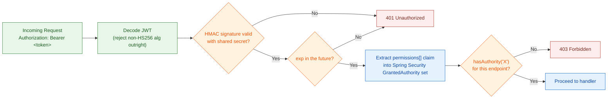

# Authentication & Identity (JWT/RBAC) — Platform

This file is the physical-level completion of `architecture.md` §5.2 (Stateless Authentication & JWT Claims Lifecycle). §5.2 established *that* the auth token is a self-contained, stateless permission snapshot, but deliberately stopped short of claim shapes, algorithms, TTL values, and key-management mechanics. Nothing in this file overrides `architecture.md` — where the two disagree, `architecture.md` is the authority and this file has a bug.

**Why this lives in `platform/`, not in one module:** every module's every endpoint authenticates and authorizes the same way — this is the one mechanism every business module depends on without owning any part of it. The RBAC data model itself (`users`/`roles`/`permissions`) is narrated in `../modules/user.md` and specified exactly in `database-schema.md` §2, since the User module is its sole writer; this file only covers what happens to that data once it's resolved into a token, which is a request-time concern spanning every module, not a User-module concern.

**A second, related mechanism lives elsewhere on purpose:** the QR e-ticket is also a JOSE-signed token, and it's tempting to treat "the auth JWT" and "the ticket QR payload" as the same document's job. They aren't the same problem, because *who verifies them* is different (§1 explains why), and because the ticket's entire reason for existing is Check-in-specific: it's what the Check-in Client verifies fully offline. That mechanism — payload format, `ES256` signing, key distribution/rotation — is specified in full in `../modules/checkin.md`, not here.

**Scope:** the auth JWT's claim shape, signing algorithm, key storage, and TTL (§2–§4); a comparison of the auth JWT's trust model against the ticket's, to make explicit why they use different algorithms (§1); a failure-mode table and reference table for the auth JWT specifically (§5–§6).

**Out of scope:** the RBAC data model itself (`database-schema.md` §2, `../modules/user.md` — this file consumes that model's output, it doesn't redefine it); mTLS/transport encryption (`architecture.md` §5.4); audit event emission (`architecture.md` §5.5, `database-schema.md` §8.3); rate limiting on the login endpoint (`distributed-coordination.md` §3); the QR e-ticket's payload format, signing, and key distribution (`../modules/checkin.md`); the operational mechanics of *how* a user gets suspended (who triggers it, from where) — that belongs to an Ops Runbook / API Contracts document; this file states only the auth-side *consequence* of a `SUSPENDED` user (§4).

Both this token and the QR e-ticket use the JOSE (JSON Object Signing and Encryption) standard — RFC 7515 (JWS) / RFC 7519 (JWT) — per `CLAUDE.md`'s tech stack. They deliberately do **not** share a signing key or even a signing algorithm; §1 explains why they can't.

---

## Table of Contents

- [Architecture Decision Record](#architecture-decision-record)
  - [ADR Mini: JWT Signing Algorithm & Session Lifecycle](#adr-mini-jwt-signing-algorithm-session-lifecycle)
- [1. Two Tokens, Two Trust Boundaries, Two Algorithm Choices](#1-two-tokens-two-trust-boundaries-two-algorithm-choices)
- [2. Auth JWT — Claim Shape](#2-auth-jwt-claim-shape)
- [3. Auth JWT — Signing, Verification & Key Storage](#3-auth-jwt-signing-verification-key-storage)
- [4. Auth JWT — TTL, Lifecycle & Revocation](#4-auth-jwt-ttl-lifecycle-revocation)
- [5. Failure Modes & Fail-Safe Behavior](#5-failure-modes-fail-safe-behavior)
- [6. Reference Table](#6-reference-table)

---

## Architecture Decision Record

Reached through the `spec-driven-development` gated workflow: 2–4 alternatives were explored with a trade-off matrix, the human made the call at the Phase 3 Decision Gate, and the reasoning was captured here verbatim rather than left to live only in `SPEC.md` (which is a working document for the next task, not a durable record). Every section from §2 onward specifies this decision in physical detail; this section is the permanent record of *why* it was chosen over its rejected alternatives.

### ADR Mini: JWT Signing Algorithm & Session Lifecycle

**Context:** `architecture.md` §5.2 requires stateless, zero-DB-lookup JWT verification on every request across all Backend API pods, sized for a 12,000-concurrent-user registration-opening spike (`docs/requirement.md` §1.4). §5.2's own Trade-offs section already states, as an accepted limitation, that this design "doesn't solve instant revocation, and doesn't claim to" — any option that quietly reopens that limitation needs to be a deliberate, visible choice, not a default.

**Decision:** `HS256` (HMAC-SHA256), 30-minute access-token TTL, **no refresh token**. On expiry, the client re-authenticates via the login endpoint. Revocation has exactly two levers: (1) rotating the shared HMAC secret — a blunt, cluster-wide instrument that invalidates every outstanding token once every pod has completed a rolling restart onto it, reserved for a suspected secret compromise; (2) suspending a `users` row (`database-schema.md` §2.1's `SUSPENDED` status) — blocks new logins but, consistent with §5.2, does not invalidate that user's already-issued token before it expires.

**Consequences:**
- Verification stays a pure signature+expiry check, no DB or Redis round-trip, at any scale the spike requirement demands.
- No new schema (no `refresh_tokens` table), no new endpoint (no `/refresh`), no new attack surface for refresh-token theft or reuse-detection logic.
- A legitimate session can be interrupted mid-use after 30 minutes; the user must re-login. Accepted as a deliberate UX trade-off for this project's current stage.

**Trade-offs accepted (user's own reasoning):** a refresh-token pair (Option C) was explicitly rejected because it would require a new `refresh_tokens` table, a new `/refresh` endpoint (expanded attack surface), and rotation/reuse-detection logic — and because concurrent requests racing an access-token expiry can trigger false-positive "token theft" detection on refresh-token rotation, risking accidental account lockouts. HS256 was chosen over RS256/ES256 (Option B) because issuer and verifier are the same trust domain (the Backend API verifying its own tokens) — an asymmetric keypair would add key-lifecycle management for no corresponding security gain here. A Redis-backed deny-list (Option D) was rejected because it would reintroduce a per-request lookup, directly undoing the zero-lookup property §5.2 was designed to guarantee, and would make Redis correctness-critical for auth rather than advisory — a role `architecture.md` §4.2 doesn't assign it.

---

## 1. Two Tokens, Two Trust Boundaries, Two Algorithm Choices

**Rationale:** it's tempting to treat "the auth JWT" and "the ticket QR payload" (`../modules/checkin.md`) as the same kind of problem — both are signed JSON, both use JOSE, both get verified before something is allowed to happen. They aren't the same problem, because *who verifies them* is different, and that difference is what forces a different algorithm for each.

| | Auth JWT (§2–§4, this file) | QR E-Ticket (`../modules/checkin.md`) |
|---|---|---|
| Issuer | Backend API, at login | Registration Module, at ticket issuance |
| Verifier | Backend API — **only ever itself**, any pod (`architecture.md` §5.2) | Any Check-in Client device — **never** the issuer alone (`architecture.md` §5.3) |
| Trust relationship | Issuer and verifier are the same trust domain | Issuer and verifier are different trust domains — a device that can verify must never be able to forge |
| Algorithm family | **Symmetric (HS256)** | **Asymmetric (ES256)** |

A symmetric key works exactly as long as issuer and verifier are the same party holding the same secret — that's the auth JWT's situation, and asymmetric crypto there would just be unneeded key-pair management for no added guarantee. The ticket is the opposite: the verifier (a Check-in Client device, possibly stolen or compromised) must be structurally incapable of forging what it verifies, which a shared secret can never guarantee — only a private/public split can. This is the same distinction `architecture.md` §5.3 draws when it says the Check-in Client "carries only the corresponding public key, so a device that can verify a ticket is never in possession of anything that could forge one."

**Guarantee:** compromising every Check-in Client device in the field never yields anything that could forge a ticket or a login token; compromising a Check-in Client's cache never yields the auth-JWT signing secret either, since the two live in entirely separate secrets and neither service ever ships one to a party that only needs the other.

---

## 2. Auth JWT — Claim Shape

**Rationale:** `docs/requirement.md` §2.11 requires the token to carry "the user's list of specific authorities, not merely their role name." `architecture.md` §5.2 adds that resolution (User → Role → Permission, `architecture.md` §5.1) happens once, at issuance — the token is that resolution's frozen snapshot. Every claim below exists to make that snapshot self-sufficient; nothing is included that would send the caller back to the database, and nothing is included purely for UI convenience.

| Claim | Type | Meaning | Why it's here (or why something else isn't) |
|---|---|---|---|
| `sub` | UUID string | The authenticated user's `users.id` | Standard JWT subject claim; every `USER`-actor audit event's `actor_user_id` (`database-schema.md` §8.3) traces back to this (system-initiated events carry `actor_type = 'SYSTEM'` and no user id). |
| `permissions` | array of strings | The resolved permission codes (`permissions.code`, e.g. `WORKSHOP_CREATE`), flattened across every role assigned to this user | This is the claim §2.11 mandates. Flattened and de-duplicated at issuance — a user with two roles that both grant `REPORT_VIEW` gets it once, not twice; the array is a set, not a role-by-role breakdown. |
| `iat` | Unix timestamp | Issued-at | Standard; also the reference point `exp` is computed from. |
| `exp` | Unix timestamp | Expiry | Bounds the revocation-lag window §5.2's Trade-offs section already names; see §4 for the actual duration. |

**Deliberately absent:**
- **No `role` claim.** `architecture.md` §5.1 and §5.2 are explicit that role plays no part at request time — including it would create a second, redundant path an API check could be tempted to branch on, reopening exactly the hardcoded-role-name problem §5.1 exists to close.
- **No UI-convenience fields (display name, email, etc.).** The token exists to answer "what may this request do," not "what should the UI show." Anything the client needs to render — the user's name, a greeting, which role labels apply — belongs in the login endpoint's **response body**, issued once at login alongside the token, not baked into the token itself. Keeping the token to exactly the four claims above means every future UI display need is a response-body change, never a token-schema change.
- **No `jti` / deny-list plumbing.** A `jti` claim only matters paired with a server-side revocation check — exactly the per-request lookup §5.2 exists to avoid, and something `architecture.md` §5.2's Trade-offs explicitly says this design "doesn't solve... and doesn't claim to." This was evaluated directly as an alternative (a Redis-backed deny-list, checked every request) and rejected: it would reintroduce the exact per-request lookup this design exists to avoid, and would make Redis correctness-critical for auth — a role `architecture.md` §4.2 never assigns it. If instant revocation becomes a real requirement later, it's a deliberate architectural revisit through a new decision gate, not a claim this file quietly slips in now.
- **No `iss` / `aud`.** Both exist to let a verifier distinguish tokens meant for it from tokens meant for someone else — necessary in a federated or multi-service setup. This system has exactly one issuer and exactly one verifier (the Backend API, of itself), so there is nothing for either claim to disambiguate.

**Guarantee:** every claim the API-layer authorization check reads (`permissions`) was fixed at issuance and is never re-derived, re-interpreted, or supplemented from any other source at request time (§5.2).

---

## 3. Auth JWT — Signing, Verification & Key Storage

**Model:**

| Decision | Value | Why |
|---|---|---|
| Algorithm | `HS256` (HMAC-SHA256) | Per §1 — issuer and verifier are the same trust domain, so a shared secret costs nothing in safety and avoids the key-pair lifecycle (generation, distribution, rotation-without-breaking-old-tokens) an asymmetric scheme would otherwise force on a claim that doesn't need it. |
| Library | `nimbus-jose-jwt` (the JOSE reference implementation for the JVM), via Spring Security's `JwtEncoder`/`JwtDecoder` | Same underlying standard (RFC 7515/7519) the ticket-signing path in `../modules/checkin.md` implements — one dependency, two use sites, rather than two separate JWT libraries for two claims that both just need "sign and verify a JOSE token." |
| Secret storage | Kubernetes `Secret`, mounted as the environment variable `UNIHUB_SECURITY_JWT_SECRET` (bound to `unihub.security.jwt.secret`, at least 32 bytes — HS256 needs a 256-bit key) into every Backend API pod; a pod without it refuses to start | Per `architecture.md` §5.4 — never in source or committed config, injected at runtime. Every pod needs the identical secret, since any pod must be able to verify a token issued by any other pod (§5.2's statelessness requirement). |
| `alg` handling | Verifier pins the expected algorithm (`HS256`) explicitly; a token asserting any other `alg` — including `none` — is rejected before signature verification runs | JOSE's `alg` header is attacker-controlled input. A verifier that trusts whatever `alg` the token claims is vulnerable to the well-known "none algorithm" and key-confusion attacks; pinning removes the choice from the token entirely. |

**Verification path (every request, any pod):**

No step in this path touches PostgreSQL or Redis — exactly the zero-lookup verification §5.2 requires. `hasAuthority('WORKSHOP_CREATE')`-style checks (`docs/requirement.md` §2.11) run directly against the `GrantedAuthority` set extracted from `permissions[]`; there is no code path that instead compares a role name.

**Trade-off — a leaked or rotated secret is an all-or-nothing lever, and not an instant one:** because the secret is injected as an environment variable, a pod only picks up a new value on its next start — updating the Kubernetes `Secret` object alone does not change what an already-running pod holds in memory. Rotation therefore only takes full effect once every pod has gone through a rolling restart with the new secret, not the instant the `Secret` object is updated. During that rollout window, some pods still verify against the old secret and some against the new — both a token signed before rotation and the operator's expectation of "already invalidated" can briefly disagree. This is a coarser, slower, different instrument than the per-user revocation §5.2 already says this design doesn't support — see §4 for the full lever description.

**Guarantee:** any Backend API pod reaches the identical allow/deny decision for the identical token, with no shared session store and no database round-trip — the property `architecture.md` §5.2 requires verbatim.

---

## 4. Auth JWT — TTL, Lifecycle & Revocation

**Rationale:** `architecture.md` §5.2 leaves the exact token lifetime as "a tuning parameter for `technical-design/`," bounded by a stated trade-off: short enough that a revoked permission doesn't stay dangerously live, long enough that the system isn't re-authenticating constantly. §5.2 also settles a related question by omission — it describes exactly three lifecycle moments (issue, use, expire → re-authenticate) and never mentions a fourth (refresh).

**Decision — no refresh token.** This is a closed decision, not an open option: a refresh-token pair was evaluated directly against the plain short-lived-token approach and rejected, because it would require a new `refresh_tokens` table, a new `/refresh` endpoint (expanded attack surface), and rotation/reuse-detection logic — and because concurrent requests racing an access-token expiry can trigger false-positive "token theft" detection on refresh-token rotation, risking accidental account lockouts for legitimate users. This document does not introduce a refresh mechanism, and a future pass reopening this choice needs a new decision gate, not a drive-by addition here.

**Model:**

| Parameter | Value | Why |
|---|---|---|
| Access token TTL (`exp - iat`) | 30 minutes | A typical single browsing-to-registration session (`docs/requirement.md` §1.3.1) comfortably fits inside one token's life, so re-authentication doesn't interrupt a normal flow. Short enough that a permission downgrade or role change (the exact gap §5.2's Trade-offs names) is live for at most half an hour, not a full working day. |
| Clock skew leeway | None applied | All Backend API pods run inside one Kubernetes cluster on cluster-synchronized NTP; there is no cross-organization clock boundary here to buffer against, unlike a federated-token scenario where skew leeway is standard practice. |
| On expiry | `401`, client re-authenticates via the login endpoint | Per §5.2's three-moment lifecycle — no silent renewal, no refresh token; a new login re-resolves permissions from `architecture.md` §5.1's current state, which is also how a legitimately-restored permission takes effect without waiting out an old token's remaining life. |

**Revocation — exactly two levers, both partial by design:**

| Lever | What it does | What it does *not* do |
|---|---|---|
| Rotate the shared HMAC secret (§3) | Invalidates **every** outstanding token, cluster-wide, once every pod has completed a rolling restart onto the new secret | Not selective — there is no way to invalidate one user's token without invalidating all of them. Not instant either — see §3's Trade-off: a pod only picks up the new secret on restart, so full invalidation completes on the rollout's timescale, not the moment the `Secret` object is updated. Reserved for a suspected secret compromise, not routine use. |
| Suspend a user (`users.status = 'SUSPENDED'`, `database-schema.md` §2.1) | Blocks that user from obtaining a **new** token: the login handler checks `users.status = 'ACTIVE'` before signing anything, and fails the request (`401`/`403`) at login if the status is anything else | Does **not** invalidate a token that user already holds — it keeps working, exactly as issued, until its own `exp` passes (at most 30 minutes later). The operational procedure for *who* flips this status and *from where* is an Ops Runbook / API Contracts concern, out of scope for this file — this table states only the auth-side consequence and the one check the login handler must perform to enforce it. |

**Trade-off — no refresh token means a legitimate session can be interrupted mid-use:** a student thirty minutes into browsing gets logged out mid-session, not silently renewed. This is the direct, accepted cost of the decision above; if session continuity becomes a real product requirement, introducing a refresh token is a deliberate addition to revisit through a new decision gate, not something to improvise around by inflating the access-token TTL (which would only widen the exact revocation-lag window this section is trying to bound).

**Guarantee:** the window between a permission change taking effect in `database-schema.md`'s RBAC tables and it being reflected in every live token is never longer than 30 minutes; a suspended user can never obtain a new token past their next login attempt, though their already-issued one is only guaranteed dead once its `exp` passes; a secret rotation is guaranteed to invalidate every outstanding token once the rolling restart it requires has completed, not before.

---

## 5. Failure Modes & Fail-Safe Behavior

| Situation | Behavior | Why |
|---|---|---|
| Auth JWT signature invalid or `exp` passed | `401` — reject | §5.2: a request with no valid, current permission snapshot has nothing to authorize against; there's no partial-trust fallback. |
| Auth JWT valid, but endpoint's required permission absent from `permissions[]` | `403` — reject | Distinct from `401` on purpose: the caller is authenticated, just not authorized for this specific action — the same two-distinct-response-codes discipline `../modules/registration.md`'s seat lock applies to its own two failure paths. |
| Auth signing secret (§3) suspected compromised | Rotate the Kubernetes `Secret` and perform a rolling restart of every Backend API pod — invalidates every outstanding auth token cluster-wide once the restart completes (§4) | The only lever this design has for a secret-level (as opposed to single-account) compromise; a blunt, all-sessions response — but bounded by rollout time, not instantaneous (§3, §4). |

Ticket-signature failure modes (tampered QR, valid-but-stale ticket, private-key compromise) are in `../modules/checkin.md` — a structurally different trust boundary (§1), with its own failure table.

---

## 6. Reference Table

Every claim, algorithm, and key-management decision for the auth JWT, in one place — the same purpose the closing tables in `database-schema.md` §11 and `distributed-coordination.md` §5 serve for their own documents. The ticket's own reference table is in `../modules/checkin.md`.

| Item | Value | Backs |
|---|---|---|
| Auth JWT algorithm | `HS256` | Stateless, same-trust-domain verification (`architecture.md` §5.2) |
| Auth JWT claims | `sub`, `permissions[]`, `iat`, `exp` — no `role`, no `jti`, no `iss`/`aud`, no UI-convenience fields | `docs/requirement.md` §2.11's "authorities, not role name" requirement |
| Auth JWT TTL | 30 minutes, no refresh token | Bounding the revocation-lag window (`architecture.md` §5.2 Trade-offs) without adding refresh-token infrastructure/attack surface |
| Auth signing secret storage | Kubernetes `Secret`, env-injected | `architecture.md` §5.4 — never in source/config |
| Auth revocation levers | Secret rotation (global, all tokens, complete once the rolling restart finishes) or user suspension (blocks new logins only, enforced by an explicit `status = 'ACTIVE'` check at login) | `architecture.md` §5.2 — no instant single-token revocation by design |
