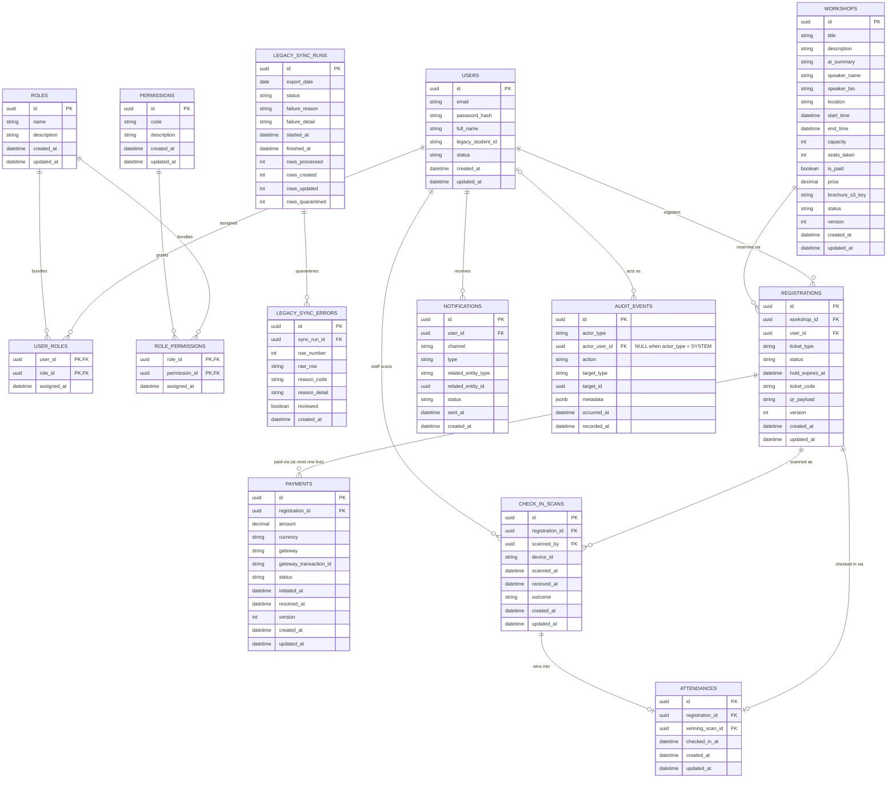

# Database Schema — Platform

This file is the physical-level completion of `architecture.md` §6 (Database Architecture). §6.1 named nine entities and the invariants each one must uphold; this document turns every one of those invariants into an actual column, type, constraint, or index. Nothing here overrides `architecture.md` — where this file and that one appear to disagree, `architecture.md` is the authority and this file has a bug.

**Why this lives in `platform/`, not split per module:** the schema is one physical artifact — a single migration history, a single ER diagram, a single set of cross-table foreign keys — and splitting its DDL across six module files would fragment the one place that has to stay internally consistent (a FK in `payments` pointing at `registrations` has to be checked against both tables at once, not against two files edited independently). Each `../modules/*.md` file narrates the *rationale and invariants* of the tables it owns and links back here for the exact column list; this file is the single source of truth for the literal schema.

**Scope:** every table owned by the six business modules, plus the three cross-cutting Technical Pattern Entities. Redis key formats/TTLs (`distributed-coordination.md`), JWT claim shape (`auth-and-identity.md`), messaging topology (`messaging.md`), and each module's own business-flow narrative (`../modules/*.md`) are out of scope here.

All SQL in this document targets PostgreSQL (the Master; DDL runs once, ahead of rollout, per §6.2).

---

## Table of Contents

- [1. Conventions](#1-conventions)
- [2. User Module](#2-user-module)
  - [2.1 `users`](#21-users)
  - [2.2 `roles`](#22-roles)
  - [2.3 `permissions`](#23-permissions)
  - [2.4 `user_roles`](#24-user_roles)
  - [2.5 `role_permissions`](#25-role_permissions)
  - [2.6 `legacy_sync_runs`](#26-legacy_sync_runs)
  - [2.7 `legacy_sync_errors`](#27-legacy_sync_errors)
- [3. Workshop Module](#3-workshop-module)
  - [3.1 `workshops`](#31-workshops)
- [4. Registration Module](#4-registration-module)
  - [4.1 `registrations`](#41-registrations)
- [5. Payment Module](#5-payment-module)
  - [5.1 `payments`](#51-payments)
- [6. Check-in Module](#6-check-in-module)
  - [6.1 `check_in_scans`](#61-check_in_scans)
  - [6.2 `attendances`](#62-attendances)
- [7. Notification Module](#7-notification-module)
  - [7.1 `notifications`](#71-notifications)
- [8. Technical Pattern Entities](#8-technical-pattern-entities)
  - [8.1 `idempotency_keys`](#81-idempotency_keys)
  - [8.2 `event_publications`](#82-event_publications)
  - [8.3 `audit_events`](#83-audit_events)
- [9. Consolidated Entity-Relationship Diagram](#9-consolidated-entity-relationship-diagram)
- [10. DDL Appendix](#10-ddl-appendix)
  - [10.1 Pending migration `V3` — specification](#101-pending-migration-v3--specification-phase-2-not-yet-a-file)
  - [10.2 Migration `V5` — specification](#102-migration-v5--specification-phase-4-not-yet-a-file)
- [11. Traceability Matrix](#11-traceability-matrix)

---

## 1. Conventions

These apply to every table below; they're stated once here rather than repeated per entity.

| Convention | Decision | Why |
|---|---|---|
| Primary key | `UUID`, `id UUID PRIMARY KEY DEFAULT gen_random_uuid()` | Fits N stateless backend pods (no centralized ID coordination) and the offline-first Check-in Client, which must generate an ID for a scan record before it has ever talked to the server. |
| Table names | snake_case, plural (`workshops`, `registrations`) | Standard PostgreSQL/JPA convention; nothing in `architecture.md` overrides it. |
| Status/state columns | `VARCHAR(n) NOT NULL CHECK (col IN (...))` | Never a native `ENUM` type — adding a new allowed value later is a tolerant migration, which §6.2 requires (old and new pod versions must both read the schema safely mid-rollout). |
| Optimistic concurrency | `version INT NOT NULL DEFAULT 0` | Applied to every entity in, or adjacent to, the seat-reservation/payment race (`workshops`, `registrations`, `payments`) — the storage-layer half of anti-overbooking (§6.1, `distributed-coordination.md` §2, `proposal.md` §11.1). Application code must increment `version` and include `WHERE version = :expected` on every update to these tables; a 0-row update means "lost the race, reload and retry or reject." |
| Audit timestamps | `created_at TIMESTAMPTZ NOT NULL DEFAULT now()`, `updated_at TIMESTAMPTZ NOT NULL DEFAULT now()` | On every table except the append-only technical/log tables, which only need `created_at`. |
| History protection | `ON DELETE RESTRICT` on every FK into a system-of-record table | Per §6.1: a row with dependent history can't be deleted, only transitioned to a terminal status (`CANCELLED`, `SUSPENDED`, etc.). Applies even to RBAC tables here, for the same reason — a `Role` still assigned to a `User` can't be silently removed out from under them. |

---

## 2. User Module

Owns `users`, `roles`, `permissions` — the three-way RBAC model from `architecture.md` §5.1 — plus the two junction tables that realize its M:N relationships (named there but not previously tabled), plus the two tables backing the nightly legacy-student-sync pipeline's own bookkeeping (`legacy_sync_runs`, `legacy_sync_errors`). Rationale for each column, and the sync pipeline's own mechanics, is narrated in `../modules/user.md`; this section is the exact schema only.

### 2.1 `users`

| Column | Type | Constraints | Notes |
|---|---|---|---|
| `id` | UUID | PK | |
| `email` | VARCHAR(255) | UNIQUE, NOT NULL | Login identifier for every account type. |
| `password_hash` | VARCHAR(255) | NULL | `NULL` means the account has no local password yet — the row was created by the nightly legacy-sync batch (`../modules/user.md` §1), and the student hasn't completed first-login setup. The application must force a "set your password" step on first login while this is `NULL`. Non-NULL from creation for Organizer/Admin/Check-in Staff accounts, which are provisioned directly, not synced. Hashing scheme/SSO details beyond this are out of scope for this file. |
| `full_name` | VARCHAR(255) | NOT NULL | |
| `legacy_student_id` | VARCHAR(50) | UNIQUE, NULL | Set by nightly sync; NULL for non-student accounts. |
| `status` | VARCHAR(20) | NOT NULL, DEFAULT `'ACTIVE'`, CHECK IN (`ACTIVE`, `SUSPENDED`) | Deactivation is a status transition, never a delete — users are indefinite system-of-record (§6.3). |
| `created_at` / `updated_at` | TIMESTAMPTZ | NOT NULL | |

**Indexes:** `UNIQUE (email)`, `UNIQUE (legacy_student_id)` (partial: `WHERE legacy_student_id IS NOT NULL`).

### 2.2 `roles`

| Column | Type | Constraints | Notes |
|---|---|---|---|
| `id` | UUID | PK | |
| `name` | VARCHAR(100) | UNIQUE, NOT NULL | e.g. `Organizer`, `Check-in Staff` — display/config label only, **never checked at the API layer** (`architecture.md` §5.1). |
| `description` | TEXT | NULL | |
| `created_at` / `updated_at` | TIMESTAMPTZ | NOT NULL | |

### 2.3 `permissions`

**Rationale:** one row per atomic capability (`architecture.md` §5.1) — "creating a workshop is separate from cancelling one."

| Column | Type | Constraints | Notes |
|---|---|---|---|
| `id` | UUID | PK | |
| `code` | VARCHAR(100) | UNIQUE, NOT NULL | e.g. `WORKSHOP_CREATE`, `CHECKIN_SCAN`, `REPORT_VIEW` — this is the literal string an API-layer `hasAuthority(...)` check tests against (`docs/requirement.md` §2.11). |
| `description` | TEXT | NULL | |
| `created_at` / `updated_at` | TIMESTAMPTZ | NOT NULL | |

### 2.4 `user_roles`

M:N junction realizing "a User is assigned one or more Roles."

| Column | Type | Constraints | Notes |
|---|---|---|---|
| `user_id` | UUID | FK → `users.id` ON DELETE RESTRICT, PK (part 1) | |
| `role_id` | UUID | FK → `roles.id` ON DELETE RESTRICT, PK (part 2) | |
| `assigned_at` | TIMESTAMPTZ | NOT NULL, DEFAULT `now()` | |

**Note:** removing a role from a user is `DELETE FROM user_roles WHERE ...`, not a cascade from deleting `users`/`roles` — those rows are never deleted. Role reassignment is one of the five audited categories (`architecture.md` §5.5); the corresponding `audit_events` row is what makes that change reviewable, not this table.

### 2.5 `role_permissions`

M:N junction realizing "a Role bundles a set of Permissions."

| Column | Type | Constraints | Notes |
|---|---|---|---|
| `role_id` | UUID | FK → `roles.id` ON DELETE RESTRICT, PK (part 1) | |
| `permission_id` | UUID | FK → `permissions.id` ON DELETE RESTRICT, PK (part 2) | |
| `assigned_at` | TIMESTAMPTZ | NOT NULL, DEFAULT `now()` | |

### 2.6 `legacy_sync_runs`

**Rationale:** per-cycle bookkeeping for the nightly legacy-student-sync pipeline (`../modules/user.md` §5) — every scheduled cycle, successful or failed, leaves exactly one row here. Declared before `legacy_sync_errors` (§2.7) specifically so that table's `REFERENCES` clause resolves against a table that already exists when both `CREATE TABLE` statements run top-to-bottom.

| Column | Type | Constraints | Notes |
|---|---|---|---|
| `id` | UUID | PK | |
| `export_date` | DATE | NOT NULL | The export's own date (`../modules/user.md` §2's filename convention), not `started_at`'s calendar date. |
| `status` | VARCHAR(20) | NOT NULL, DEFAULT `'RUNNING'`, CHECK IN (`RUNNING`, `COMPLETED`, `FAILED`) | |
| `failure_reason` | VARCHAR(50) | NULL, CHECK IN (`FILE_NOT_FOUND`, `FILE_UNREADABLE`, `PIPELINE_ERROR`) | Non-null only when `status = 'FAILED'` (`../modules/user.md` §5's three `UPDATE` statements). |
| `failure_detail` | TEXT | NULL | Free-text detail (e.g. the parse error message) alongside the coded `failure_reason`. |
| `started_at` | TIMESTAMPTZ | NOT NULL, DEFAULT `now()` | |
| `finished_at` | TIMESTAMPTZ | NULL | Non-null iff `status` is not `RUNNING` — set by every terminal `UPDATE` (`../modules/user.md` §5), never by the initial `INSERT`. |
| `rows_processed` / `rows_created` / `rows_updated` / `rows_quarantined` | INT | NOT NULL, DEFAULT 0 | Purely observational counters (`../modules/user.md` §5) — feed no correctness guarantee. |

**Indexes:** `(export_date)`, `(status) WHERE status = 'FAILED'`.

**Retention:** indefinite, never swept — same posture as `audit_events` (§8.3); a `legacy_sync_runs` row is the only durable record that a given night's ingestion happened at all (`../modules/user.md` §5).

### 2.7 `legacy_sync_errors`

**Rationale:** the quarantine store for rows the nightly-sync pipeline rejects — set aside for manual review (`docs/requirement.md` §2.10, `../modules/user.md` §6), never written to `users`.

| Column | Type | Constraints | Notes |
|---|---|---|---|
| `id` | UUID | PK | |
| `sync_run_id` | UUID | NOT NULL, FK → `legacy_sync_runs.id` ON DELETE RESTRICT | A run's quarantined records can't outlive the run record explaining when and why they were quarantined (§1's history-protection convention). |
| `row_number` | INT | NOT NULL | |
| `raw_row` | TEXT | NOT NULL | The full original CSV line, verbatim (`../modules/user.md` §6) — lets an admin see exactly what the legacy system sent without re-opening the source file. |
| `reason_code` | VARCHAR(50) | NOT NULL, CHECK IN (`MALFORMED_ROW`, `INVALID_FIELD`, `DUPLICATE_IN_FILE`) | |
| `reason_detail` | TEXT | NULL | |
| `reviewed` | BOOLEAN | NOT NULL, DEFAULT `false` | Plain triage flag, not a workflow state machine (`../modules/user.md` §6) — no reviewer identity or timestamp captured, a deliberate scope cut. |
| `created_at` | TIMESTAMPTZ | NOT NULL, DEFAULT `now()` | |

**Indexes:** `(sync_run_id)`, `(reviewed) WHERE reviewed = false`.

**No FK to `users`:** a quarantined row, by definition, never produced a `users` write (`../modules/user.md` §6).

**Retention:** indefinite, never swept — same rationale as `legacy_sync_runs` (§2.6); these rows are the university's data-quality history for the legacy pipeline, valuable as an accumulated audit record, not a short-lived operational queue.

---

## 3. Workshop Module

Rationale for each column is narrated in `../modules/workshop.md`; this section is the exact schema.

### 3.1 `workshops`

**Invariant — same-transaction requirement:** every write that moves a `registrations` row into or out of `RESERVED`/`CONFIRMED` **must** update this table's `seats_taken` and `version` in the **same database transaction** as the `registrations` write itself. This is the same non-negotiable pairing §8.1/§8.2 already require for `idempotency_keys`/`event_publications`, applied here — if the two writes ever land in separate transactions, a crash between them reopens exactly the overbooking race this table's check constraint and optimistic-concurrency version exist to close. Splitting them is not a valid optimization. See `../modules/registration.md` for the full transaction this applies to.

| Column | Type | Constraints | Notes |
|---|---|---|---|
| `id` | UUID | PK | |
| `title` | VARCHAR(255) | NOT NULL, CHECK `chk_workshop_title_not_blank` (`title ~ '\S'`) | Non-blank, matching the `Workshop` aggregate. `NOT NULL` alone admits `''`. Added by `V1_2__workshop_text_not_blank.sql`. |
| `description` | TEXT | NULL | Organizer-authored description. |
| `ai_summary` | TEXT | NULL | Generated from the uploaded brochure (`../modules/workshop.md`); NULL until the AI Summarization Service returns. |
| `speaker_name` | VARCHAR(255) | NOT NULL, CHECK `chk_workshop_speaker_name_not_blank` (`speaker_name ~ '\S'`) | Same reason as `title`. |
| `speaker_bio` | TEXT | NULL | |
| `location` | VARCHAR(255) | NOT NULL, CHECK `chk_workshop_location_not_blank` (`location ~ '\S'`) | Non-blank, as `title`. Venue/room string — no separate `Location` entity; §6.1 names only `Workshop` as this module's entity. |
| `start_time` | TIMESTAMPTZ | NOT NULL | |
| `end_time` | TIMESTAMPTZ | NOT NULL, CHECK (`end_time > start_time`) | |
| `capacity` | INT | NOT NULL, CHECK (`capacity >= 0`) | Fixed at creation/edit; not decremented directly. |
| `seats_taken` | INT | NOT NULL, DEFAULT 0, CHECK (`seats_taken >= 0 AND seats_taken <= capacity`) | Counts `RESERVED` + `CONFIRMED` registrations — a hold occupies the seat for its 15-minute window exactly as much as a confirmed one does. This is the counter the check constraint protects from going negative or over capacity even under a bug in application logic. |
| `is_paid` | BOOLEAN | NOT NULL, DEFAULT `false` | |
| `price` | NUMERIC(12,2) | NULL, CHECK `chk_workshop_price` (`(is_paid = false AND price IS NULL) OR (is_paid = true AND price IS NOT NULL AND price > 0)`) | `price IS NOT NULL` is explicit: `NULL > 0` is unknown, which a CHECK treats as passing, so without it a paid workshop with no price would be accepted. Added by `V1_1__workshop_paid_price_not_null.sql`. |
| `brochure_s3_key` | VARCHAR(512) | NULL | Object storage pointer (`../modules/workshop.md`) — the PDF itself lives in S3, never in Postgres. |
| `status` | VARCHAR(20) | NOT NULL, DEFAULT `'DRAFT'`, CHECK IN (`DRAFT`, `PUBLISHED`, `CANCELLED`, `COMPLETED`) | Reschedule is an update to `start_time`/`end_time` on a `PUBLISHED` row, not a status value — it's an event (notified via `event_publications`/`audit_events`), not a persistent state. |
| `version` | INT | NOT NULL, DEFAULT 0 | Optimistic-concurrency marker (§6.1, `distributed-coordination.md` §2). Shared by seat claims **and** organizer edits (decision below). A seat claim is `UPDATE workshops SET seats_taken = seats_taken + 1, version = version + 1 WHERE id = ? AND version = :expected AND seats_taken < capacity`; zero rows → re-read to tell a lost version race (retry) from a full workshop (sold out) (`../modules/registration.md` §2). |
| `created_at` / `updated_at` | TIMESTAMPTZ | NOT NULL | |

**Decision — one `version` for seat claims and organizer edits (Phase 2 checklist D3, Q3, 2026-10-13):** both kinds of write bump the same `version`, so the seat path keeps the literal "version column + check constraint" pair the anti-overbooking invariant names (`architecture.md` §4.2, §6.1). Consequences an implementer must honour:
- An organizer edit updates **only the columns it changes and never writes `seats_taken`** — the JPA mapping marks `seats_taken` not updatable, and seat changes go only through the Workshop module's seat-claim/release SQL.
- A seat claim that loses a version race to an organizer edit retries internally (up to 3 attempts, each a new transaction inside the seat lock) instead of returning `409` to the student; exhausted retries → `503` + `Retry-After`, never recorded under the idempotency key (`../modules/registration.md` §2).
- Lowering `capacity` below `seats_taken` is refused by both the CHECK above and the domain model.
- **Revisit in Phase 8** using `unihub_seat_claim_version_conflicts_total`, `unihub_seat_claim_retries_exhausted_total` and `unihub_workshop_edit_conflicts_total` (`observability.md` §4): reconsider if, in the 12,000-concurrent-user run, exhausted retries exceed 0.1% of seat claims or organizer-edit conflicts exceed 5% of edits.
- **Releasing a seat follows the same rule** (Phase 3 checklist C5): the seat-hold expiry's `seats_taken - 1` carries the same `version` condition, is retried up to 3 attempts on a lost race, and always commits together with the registration's move to `EXPIRED` — never one without the other (`../modules/registration.md` §3). `CHECK (seats_taken >= 0)` is the storage-level floor; it cannot catch a double release while seats remain, which is why the release is a conditional transition of the registration first.

**Decision — isolation level of the seat transactions: `READ COMMITTED` (Phase 3 checklist D24, 2026-10-26; REQ-2.6.3).** The seat claim and the seat release run at PostgreSQL's default `READ COMMITTED`, and that is sufficient on purpose: the accept/reject decision is **one** atomic conditional `UPDATE` (`… WHERE id = ? AND version = :expected AND seats_taken < capacity`), which PostgreSQL evaluates against the latest committed row, re-checking its `WHERE` after waiting on a concurrent writer. The read that follows a zero-row result only classifies the outcome (sold out or lost race); it never decides a write. No read-then-write in application code is trusted, so a non-repeatable read cannot produce a wrong outcome, and a stricter level would add serialization failures to retry without protecting anything more. The integration test asserts the isolation level actually in force inside the transaction (`current_setting('transaction_isolation')`), together with the concurrent outcome.

**Indexes:** `(status, start_time)` for catalog browsing/filtering; a full-text/trigram index on `title`/`speaker_name` for search is a plausible future addition but not specified here — the SRS names search by "topic, speaker, or location" (§1.3.1) without a performance target that forces the choice now.

---

## 4. Registration Module

Rationale for each column, and the anti-overbooking flow this table is central to, are narrated in `../modules/registration.md`; this section is the exact schema.

### 4.1 `registrations`

**Invariant — same-transaction requirement:** a write to this table's `status` that also changes seat occupancy — `RESERVED` (hold taken), `CONFIRMED` (hold converted, or a free ticket confirmed outright), `CANCELLED`/`EXPIRED` (hold released) — **must** commit in the **same database transaction** as the corresponding `UPDATE workshops SET seats_taken = ..., version = version + 1 WHERE id = ... AND version = :expected` (§3.1). Never issue these as two separate transactions: a crash or partial failure between them would leave `workshops.seats_taken` out of sync with the actual set of active registrations, silently reintroducing the overbooking race both the check constraint and the Redis lock (`distributed-coordination.md` §2, applied to seat reservation in `../modules/registration.md`) exist to prevent.

| Column | Type | Constraints | Notes |
|---|---|---|---|
| `id` | UUID | PK | |
| `workshop_id` | UUID | FK → `workshops.id` ON DELETE RESTRICT, NOT NULL | A workshop with registrations can't be deleted, only cancelled (§6.1). |
| `user_id` | UUID | FK → `users.id` ON DELETE RESTRICT, NOT NULL | |
| `ticket_type` | VARCHAR(10) | NOT NULL, CHECK IN (`FREE`, `PAID`) | |
| `status` | VARCHAR(20) | NOT NULL, CHECK IN (`RESERVED`, `CONFIRMED`, `CANCELLED`, `EXPIRED`) | `RESERVED`: seat held pending payment. `CONFIRMED`: free ticket confirmed immediately, or paid ticket confirmed after payment success. `EXPIRED`: the 15-minute hold lapsed (§1.3.1) — the delayed-message/key-expiration mechanism that *triggers* this transition is `../modules/registration.md`'s concern, not this file's. |
| `hold_expires_at` | TIMESTAMPTZ | NULL, CHECK (`(status = 'RESERVED') = (hold_expires_at IS NOT NULL)`) | Set iff the row is currently `RESERVED`; this is the column the TTL-release mechanism watches. |
| `ticket_code` | VARCHAR(64) | UNIQUE, NULL | Set once, at the moment `status` becomes `CONFIRMED` (`../modules/registration.md` §1) — `NULL` for a `RESERVED` hold that hasn't converted yet. Retained as-is if the row later moves to `CANCELLED`/`EXPIRED` after having been `CONFIRMED`, never cleared once set. The identifier embedded in the QR payload — what a Check-in device resolves to look up the registration. |
| `qr_payload` | TEXT | NULL | Same lifecycle as `ticket_code` — set once at `CONFIRMED`, retained afterward. The full signed JWS token captured at issuance (`../modules/checkin.md`) — stored, not recomputed on read, so a ticket keeps displaying correctly even after signing-key rotation. |
| `version` | INT | NOT NULL, DEFAULT 0 | Optimistic-concurrency marker for status transitions racing against expiry/payment/cancellation. |
| `created_at` / `updated_at` | TIMESTAMPTZ | NOT NULL | |

**Indexes:**
- `UNIQUE (workshop_id, user_id) WHERE status IN ('RESERVED', 'CONFIRMED')` — a partial unique index preventing a student from holding two simultaneously-active registrations for the same workshop. (Inferred from "no seat sold to more than one person"/business common sense — not an explicit SRS line; flagged here as an assumption, not an architecture-mandated constraint.)
- `(status) WHERE status = 'RESERVED'` and `(hold_expires_at) WHERE status = 'RESERVED'` — support the expiry sweep/listener.
- `(workshop_id)`, `(user_id)` — reporting and "my registrations" lookups.

---

## 5. Payment Module

Rationale for each column, and the resilience/reconciliation flow around this table, are narrated in `../modules/payment.md`; this section is the exact schema.

### 5.1 `payments`

**Rationale for `version`:** not named explicitly in §6.1's anti-overbooking list, but the same optimistic-concurrency pattern is applied here for a distinct reason: the reconciliation sweep and a late-arriving gateway webhook (`../modules/payment.md`) can race to resolve the same `PENDING` row concurrently. This is a direct, consistent extension of an already-established pattern to a second, structurally identical race — not a new invariant.

**Rationale for "at most one *live* payment per registration" (Phase 2 decision D5, 2026-10-14):** a registration may accumulate several `payments` rows over its 15-minute hold — a declined card (`FAILED`) or a charge cancelled before anything could be charged (`CANCELLED`, `../modules/payment.md` §3) must not lock the student out of trying again. What must never happen is two charges in flight, or two successful charges, for the same registration — even when two browser tabs send two different `Idempotency-Key`s, which `idempotency_keys` (§8.1) cannot catch. A **partial** unique index over the live statuses — `PENDING` and `SUCCEEDED` — enforces exactly that. `REFUND_REQUIRED`/`REFUNDED` are **not** live (Phase 2 checklist C33, 2026-10-14): they are money being returned. Keeping them in the index would block a late success from reaching `REFUND_REQUIRED` when the registration already has another live payment. A partial index cannot be the target of `ON CONFLICT ON CONSTRAINT`; the adapter catches the duplicate-key error on it and translates it into a business outcome ("a payment for this registration is already in progress", `409`), never a `500` (`../../guidelines/backend-coding-standards.md` §21).

**Rationale for `REFUND_REQUIRED`/`REFUNDED` (Phase 2 decision D2/C10):** a payment can succeed after its registration stopped being `RESERVED` (the hold expired or the registration was cancelled while the charge was in flight). The seat is not re-granted; the money goes back (`../modules/payment.md` §9). `REFUND_REQUIRED` is entered by a conditional `UPDATE … WHERE status = 'SUCCEEDED'`, which is also what makes the transition idempotent under redelivery; `REFUNDED` once the gateway confirms the refund. A **late success** — the gateway reports success for a payment already `CANCELLED`/`FAILED` — moves it **directly** to `REFUND_REQUIRED`, never through `SUCCEEDED`, and emits no `charge.succeeded` event, so it can never confirm a registration (`../modules/payment.md` §6). In Phase 2 only the first transition is implemented; the gateway refund lands in Phase 3.

| Column | Type | Constraints | Notes |
|---|---|---|---|
| `id` | UUID | PK | |
| `registration_id` | UUID | NOT NULL, FK → `registrations.id` ON DELETE RESTRICT — **no table-wide UNIQUE** (see Indexes) | A registration has at most one *live* payment (`PENDING`, `SUCCEEDED`) and any number of `FAILED`, `CANCELLED`, `REFUND_REQUIRED`, `REFUNDED` ones. *Was `UNIQUE` in `V1`; replaced by `V3` (§10.1).* |
| `amount` | NUMERIC(12,2) | NOT NULL, CHECK (`amount > 0`) | |
| `currency` | VARCHAR(3) | NOT NULL, DEFAULT `'VND'` | |
| `gateway` | VARCHAR(20) | NOT NULL, DEFAULT `'STRIPE'` | Sandbox mode only (`proposal.md` §5.2). |
| `gateway_transaction_id` | VARCHAR(255) | UNIQUE, NULL | Set once the gateway responds; the UNIQUE constraint stops two `payments` rows from ever claiming the same external transaction. |
| `status` | VARCHAR(20) | NOT NULL, DEFAULT `'PENDING'`, CHECK IN (`PENDING`, `SUCCEEDED`, `FAILED`, `CANCELLED`, `REFUND_REQUIRED`, `REFUNDED`) | `CANCELLED` also covers a charge the breaker refused after its row was written (`../modules/payment.md` §3). `REFUND_REQUIRED`/`REFUNDED`: see Rationale above. *The two refund values arrive with `V3` (§10.1).* |
| `initiated_at` | TIMESTAMPTZ | NOT NULL, DEFAULT `now()` | What the reconciliation sweep's ">15 minutes in Pending" check measures from. |
| `resolved_at` | TIMESTAMPTZ | NULL | Set when `status` leaves `PENDING`, by whichever of {webhook, reconciliation sweep, breaker compensation} gets there first (`../modules/payment.md`). Not changed by the refund transitions. |
| `version` | INT | NOT NULL, DEFAULT 0 | See Rationale above. |
| `created_at` / `updated_at` | TIMESTAMPTZ | NOT NULL | |

**Indexes:** `(initiated_at) WHERE status = 'PENDING'` — the reconciliation sweep's primary scan target; `UNIQUE (registration_id) WHERE status IN ('PENDING', 'SUCCEEDED')` (`uq_payments_live_per_registration`, `V3`) — at most one live payment per registration.

---

## 6. Check-in Module

Owns `Attendance` (§6.1) — physically split here into two tables: a raw scan log (rows are always appended, never deleted, though `outcome` can be revised in place — see §6.1), and a finalized one-row-per-registration projection. This isn't a second business entity; it's a physical decomposition of the one entity §6.1 names, justified by two requirements that otherwise conflict on a single table:

- `docs/requirement.md` §2.9 requires every offline scan — including ones that later lose the earliest-timestamp-wins reconciliation — to be "recorded with complete information: which ticket, which staff member, the scan status, and the exact scan timestamp."
- `proposal.md` §11.4 / `architecture.md` §5.3 require exactly one final valid check-in per ticket, ever.

A single table can satisfy one of these cleanly or the other, not both without the split. The reconciliation algorithm that uses this split is narrated in `../modules/checkin.md`.

### 6.1 `check_in_scans`

**Rationale:** the raw record of every scan event any device ever synced, win or lose — this is the audit trail §2.9 requires. Rows are never deleted, but **`outcome` is not immutable**: earliest-timestamp-wins reconciliation (`proposal.md` §11.4) can revisit a decision already made. A scan initially recorded `ACCEPTED` must flip to `REJECTED_DUPLICATE` if a scan with an *earlier* `scanned_at` from a different device syncs later — the winner is determined by device-clock time, not by sync arrival order, and arrival order is exactly what a real offline-first, multi-device deployment can't control.

| Column | Type | Constraints | Notes |
|---|---|---|---|
| `id` | UUID | PK | Client-generated on-device (offline-first — `../modules/checkin.md`), not server-assigned. |
| `registration_id` | UUID | NOT NULL, FK → `registrations.id` ON DELETE RESTRICT | Resolved server-side from the scanned `ticket_code` at sync time. |
| `scanned_by` | UUID | NOT NULL, FK → `users.id` ON DELETE RESTRICT | The Check-in Staff member who performed the scan. |
| `device_id` | VARCHAR(100) | NOT NULL | Identifies which physical Check-in Client device recorded this scan — needed because §2.9's reconciliation must compare scans **across** devices. |
| `scanned_at` | TIMESTAMPTZ | NOT NULL | The device's own clock at scan time — the value earliest-timestamp-wins reconciliation actually compares. Never the server's receipt time. |
| `received_at` | TIMESTAMPTZ | NOT NULL, DEFAULT `now()` | When this row reached the server — for operational visibility into sync lag, not reconciliation logic. |
| `outcome` | VARCHAR(20) | NOT NULL, CHECK IN (`ACCEPTED`, `REJECTED_DUPLICATE`, `REJECTED_INVALID`) | Set at first reconciliation, and **revised** later if an earlier-`scanned_at` scan from another device syncs afterward — see Rationale. `REJECTED_INVALID` covers a signature-authentic ticket whose registration was since cancelled (authentic-but-not-valid gap, `../modules/checkin.md`). |
| `created_at` / `updated_at` | TIMESTAMPTZ | NOT NULL | `updated_at` moves only when a later reconciliation pass revises `outcome` — this table is otherwise append-only. |

**Indexes:** `(registration_id)`, `(device_id)`.

### 6.2 `attendances`

**Rationale:** the finalized projection — exactly one row per registration that ever had a winning scan, enforced by the UNIQUE constraint below, not by application discipline alone.

| Column | Type | Constraints | Notes |
|---|---|---|---|
| `id` | UUID | PK | |
| `registration_id` | UUID | UNIQUE, NOT NULL, FK → `registrations.id` ON DELETE RESTRICT | The uniqueness constraint **is** the "exactly one valid check-in" guarantee (`architecture.md` §5.3, `proposal.md` §11.4) — enforced by the database, not just application logic. |
| `winning_scan_id` | UUID | UNIQUE, NOT NULL, FK → `check_in_scans.id` ON DELETE RESTRICT | Which raw scan won. |
| `checked_in_at` | TIMESTAMPTZ | NOT NULL | Denormalized copy of the winning scan's `scanned_at`, so check-in-rate reports (§1.3.3) don't need to join `check_in_scans` for the common case. |
| `created_at` / `updated_at` | TIMESTAMPTZ | NOT NULL | `updated_at` changes when a later-arriving-but-earlier-timestamped scan overtakes the current winner. |

**Overtake logic — one transaction, two tables:** when a new `check_in_scans` row's `scanned_at` is earlier than the current winner's, reconciliation must, together, in a single transaction:
1. `UPDATE check_in_scans SET outcome = 'REJECTED_DUPLICATE', updated_at = now() WHERE id = :previous_winning_scan_id;`
2. `INSERT INTO attendances (...) VALUES (...) ON CONFLICT (registration_id) DO UPDATE SET winning_scan_id = excluded.winning_scan_id, checked_in_at = excluded.checked_in_at, updated_at = now() WHERE excluded.checked_in_at < attendances.checked_in_at;`

Doing only one of these two would leave `check_in_scans.outcome` and `attendances.winning_scan_id` disagreeing about which scan actually won — the same same-transaction discipline required elsewhere in this document (§3.1, §4.1, §8.1) applies here too. Full walkthrough in `../modules/checkin.md`.

---

## 7. Notification Module

Rationale for each column, and the channel-abstraction design that reads `channel`, are narrated in `../modules/notification.md`; this section is the exact schema.

### 7.1 `notifications`

**Rationale:** the sole entity this module owns (§6.1). `related_entity_id` is a deliberately un-enforced polymorphic reference — see Trade-off below.

| Column | Type | Constraints | Notes |
|---|---|---|---|
| `id` | UUID | PK | |
| `user_id` | UUID | NOT NULL, FK → `users.id` ON DELETE RESTRICT | Recipient. |
| `channel` | VARCHAR(20) | NOT NULL, CHECK IN (`EMAIL`, `IN_APP`) | Adding SMS/Zalo/Telegram later (§1.3.2) is a new allowed value in this CHECK constraint — a tolerant migration, per §6.2, and exactly the "pluggable" property the SRS asks for at the schema level; the dispatch-side mechanism that makes a new value actually deliverable is `../modules/notification.md`. |
| `type` | VARCHAR(30) | NOT NULL, CHECK IN (`REGISTRATION_CONFIRMED`, `WORKSHOP_CANCELLED`, `WORKSHOP_RESCHEDULED`) | Drives templated content; not exhaustive — extend the CHECK list as new notification-triggering events are added. |
| `related_entity_type` | VARCHAR(20) | NOT NULL, CHECK IN (`WORKSHOP`, `REGISTRATION`) | |
| `related_entity_id` | UUID | NOT NULL | **No FK.** A polymorphic reference can't target two tables with one constraint in PostgreSQL without a trigger or a shared supertype table — neither of which this module's single-entity ownership (§6.1) justifies adding. Referential correctness here is an application invariant (the Notification Module only ever writes a row in reaction to an event it received, never from unvalidated user input), not a database-enforced one. |
| `status` | VARCHAR(20) | NOT NULL, DEFAULT `'PENDING'`, CHECK IN (`PENDING`, `SENT`, `FAILED`) | |
| `sent_at` | TIMESTAMPTZ | NULL | |
| `created_at` | TIMESTAMPTZ | NOT NULL, DEFAULT `now()` | |
| `source_event_id` | UUID | NOT NULL; part of `UNIQUE (source_event_id, user_id, channel)` | *Migration `V5` (§10.2).* AMQP `message-id` of the event that produced the row = `event_publications.id`. The unique key is the redelivery dedup (INV-11): the consumer inserts with `ON CONFLICT DO NOTHING` (`../modules/notification.md` §3; Phase 4 checklist D31). `user_id` is in the key because one event fans out to many recipients. |
| `claimed_at` | TIMESTAMPTZ | NULL | *Migration `V5` (§10.2).* Send lease: set by a conditional `UPDATE … WHERE status = 'PENDING' AND (claimed_at IS NULL OR claimed_at < now() - <lease>)` before the provider is called, so two concurrent deliveries never both send a row (`../modules/notification.md` §3; D33). Set back to `NULL` by its own holder when the provider was unavailable, so the next retry can claim the row at once; left as is once the row is `SENT`/`FAILED`, where it no longer means anything. |
| `title` | VARCHAR(200) | NULL | *Migration `V5` (§10.2).* Rendered in-app title; filled only for `IN_APP` rows, at insert, never re-rendered (`../modules/notification.md` §1; Phase 4 checklist D38). |
| `body` | TEXT | NULL | *Migration `V5` (§10.2).* Rendered in-app body; same rule as `title`. No read/unread column, by decision (D38). |

**Indexes:** `(user_id, status)` — from `V1`. `(user_id, channel, created_at DESC)` — *`V5`*, the in-app inbox read (`channel = 'IN_APP'` for one user, newest first, paginated). The unique constraint's own index, led by `source_event_id`, serves the consumer's "rows of this event still `PENDING`" read.

---

## 8. Technical Pattern Entities

Cross-cutting, not business data (§6.1) — no module "owns" these the way it owns its domain entity; several modules write to them.

### 8.1 `idempotency_keys`

**Rationale:** backs the exactly-once guarantee (`architecture.md` §4.5, `proposal.md` §11.2). The UNIQUE constraint on `(scope, actor_user_id, idempotency_key)` — not application-level "check then insert" logic — is what makes a second concurrent request with the same key, by the same user, in the same operation scope, fail outright rather than racing the first. Composite, not key-only, on two axes: **scope**, because a client-generated key is only required to be unique per client-side request flow, so an accidental key reuse across two unrelated operations (e.g. a UUID reused across a registration-create and a later payment-charge) must not produce a spurious collision; **actor**, because without it one user's key could block, or replay the stored result of, another user's request. Written in the **same transaction** as the business effect it guards; this table has no FK into any business table, because the key is checked *before* the guarded row exists (`resource_id` below is a plain, polymorphic reference, like `event_publications.aggregate_id`). Applied to registration-create in `../modules/registration.md` §4 and to payment-charge in `../modules/payment.md` §8. *Target shape after migration `V3` (§10.1, Phase 2 decisions D1/C2/G2, 2026-10-14) — the applied `V1` shape is still in the §10 DDL block.*

**Invariant — the actor is never client-supplied.** `actor_user_id` is always the authenticated user (the verified JWT `sub`, `auth-and-identity.md` §2), never a value read from the request body or a header. Taking it from the request would let a caller probe other users' stored results by guessing their keys.

| Column | Type | Constraints | Notes |
|---|---|---|---|
| `id` | UUID | PK | |
| `idempotency_key` | VARCHAR(255) | NOT NULL | Client-generated (`docs/requirement.md` §2.8). Unique only in combination with `scope` and `actor_user_id`. |
| `scope` | VARCHAR(50) | NOT NULL | `REGISTRATION_CREATE`, `PAYMENT_CHARGE` — which operation this key guards. |
| `actor_user_id` | UUID | NOT NULL | The authenticated caller (see Invariant). No FK — this table carries no FK by design (Rationale). |
| `request_fingerprint` | VARCHAR(64) | NOT NULL | Lowercase hex SHA-256 of the request body in canonical JSON form. Same key with a different fingerprint → `422`, nothing executed (`../../guidelines/backend-coding-standards.md` §21). |
| `status` | VARCHAR(20) | NOT NULL, CHECK IN (`IN_PROGRESS`, `COMPLETED`) | `IN_PROGRESS` is visible to other transactions **only** for `PAYMENT_CHARGE`, and only committed together with its `PENDING` `payments` row; a `REGISTRATION_CREATE` row is inserted and completed inside one transaction and never commits as `IN_PROGRESS` (`../modules/registration.md` §4, `../modules/payment.md` §8). |
| `result_type` | VARCHAR(100) | NULL; CHECK `(status = 'COMPLETED') = (result_type IS NOT NULL)` | Which variant of the use case's sealed Result was recorded (e.g. `Confirmed`, `SoldOut`). Business outcomes only — infrastructure failures are never recorded. |
| `result_body` | JSONB | NULL; CHECK `(result_type IS NULL) = (result_body IS NULL)` | The serialized Result, replayed verbatim on a duplicate request — never re-executed. The web layer maps it to HTTP deterministically, so a replay produces the identical response. |
| `resource_id` | UUID | NULL | The guarded row: `payments.id` for `PAYMENT_CHARGE` (written with the `IN_PROGRESS` row, so reconciliation can complete the key — `../modules/payment.md` §6); the registration id for `REGISTRATION_CREATE` when it created one. Polymorphic, no FK. |
| `created_at` | TIMESTAMPTZ | NOT NULL, DEFAULT `now()` | |
| `completed_at` | TIMESTAMPTZ | NULL; CHECK `(status = 'COMPLETED') = (completed_at IS NOT NULL)` | What the cleanup sweep (`distributed-coordination.md` §2) ages records against — measured from completion, so a charge completed late by reconciliation still gets the full replay window. |

**Indexes:** `UNIQUE (scope, actor_user_id, idempotency_key)` (the backstop itself); `(completed_at) WHERE status = 'COMPLETED'` for the sweep; `(scope, resource_id) WHERE status = 'IN_PROGRESS'` for reconciliation and breaker compensation to find a charge's open key.

**Lifecycle of an `IN_PROGRESS` row (`PAYMENT_CHARGE` only):** it leaves `IN_PROGRESS` in exactly one of three ways — the charge's second transaction completes it with the Result; the breaker compensation (the charge was refused after its row was written) **deletes** it together with moving the payment to `CANCELLED`, so a same-key retry executes for real; or reconciliation completes it with the Result in the same transaction that resolves the stuck payment. The sweep never touches it.

**Retention:** minutes, not permanent (§6.3) — the scheduled job in `distributed-coordination.md` §2 deletes `COMPLETED` rows older than the retry window — **30 minutes** (decided 2026-10-16: the 15-minute seat hold plus a client retry margin), swept every minute, both configurable under `unihub.jobs.idempotency-cleanup.*` — by `completed_at`, not native TTL (Postgres rows don't expire on their own). `IN_PROGRESS` rows are never swept.

### 8.2 `event_publications`

**Rationale:** the transactional outbox (`architecture.md` §4.3, §6.1). Written in the same transaction as the business row it announces — that atomicity is the entire guarantee; a relay process (same deployable, consumer role) polls `PENDING` rows and publishes them to RabbitMQ. The relay's mechanism — one instance per cycle behind a job lock, no transaction held across a publish — is `messaging.md` §5.

| Column | Type | Constraints | Notes |
|---|---|---|---|
| `id` | UUID | PK | Also the published message's AMQP `message-id` — the event id consumers deduplicate on (`messaging.md` §5). |
| `aggregate_type` | VARCHAR(50) | NOT NULL | e.g. `REGISTRATION`, `PAYMENT`, `WORKSHOP`. |
| `aggregate_id` | UUID | NOT NULL | The business row this event describes. No FK — the aggregate may belong to any of several tables; see the same polymorphic trade-off as §7.1. |
| `event_type` | VARCHAR(100) | NOT NULL | e.g. `RegistrationConfirmed`, `WorkshopCancelled`. Diagnostic label only — the relay routes by `routing_key`, never by this column. |
| `routing_key` | VARCHAR(100) | NOT NULL | The exact `messaging.md` §2 routing key to publish with, captured when the row is written. Stored rather than derived from `event_type` so the relay needs no type-to-key mapping of its own, and a row always publishes with the key its producer intended. |
| `payload` | JSONB | NOT NULL | The message body to publish. Business content only — transport metadata (event id, correlation id) lives in its own columns, never inside the payload. The one exception is `schemaVersion`, a top-level field the outbox adds (see Retention below). |
| `correlation_id` | VARCHAR(32) | NULL | The originating request's correlation id — the 32-hex-character OpenTelemetry trace id (`observability.md` §1). The relay publishes later, on another thread and outside that request's trace; without this column the correlation id would be lost at the outbox boundary. The relay restores it into the MDC before publishing so the shared `RabbitTemplate` post-processor writes it into the `correlationId` message header (`observability.md` §1). `NULL` only if a row is ever written outside any traced context. |
| `status` | VARCHAR(20) | NOT NULL, DEFAULT `'PENDING'`, CHECK IN (`PENDING`, `PUBLISHED`) | |
| `created_at` | TIMESTAMPTZ | NOT NULL, DEFAULT `now()` | The relay's poll order. |
| `published_at` | TIMESTAMPTZ | NULL | Set when the broker confirms the publish. |

**Indexes:** `(created_at) WHERE status = 'PENDING'` — the relay's poll target, in its poll order.

**Trade-off — `correlation_id` links logs, not traces:** a consumer's processing belongs to a new trace, joined to the originating request only through the `correlationId` header and MDC key. Grepping logs by correlation id shows the whole causal chain; Grafana Tempo shows two traces rather than one. Storing the full W3C `traceparent` instead would let the relay continue the original trace, and is an additive column if that ever becomes a real need.

**Retention:** short-lived — `PUBLISHED` rows are deleted **1 hour** after `published_at` (decided 2026-10-19: long enough to investigate a recent publish incident, short enough that the table stays small), swept every minute by the same `distributed-coordination.md` §2 pattern (§6.1, §6.3); both configurable under `unihub.jobs.event-publication-cleanup.*`. A `PENDING` row is never deleted. The sweep has no index on `published_at`; add a partial one (`WHERE status = 'PUBLISHED'`) if the table ever holds enough rows for the sweep to show up.

**`schemaVersion`:** carried as a top-level field of `payload`, written by the outbox (`backend-coding-standards.md` §8.2); there is no column for it.

### 8.3 `audit_events`

**Rationale:** resolves the generic "Durable Audit Store" (`architecture.md` §5.5) to a concrete table. This *is* PostgreSQL — no other durable store exists anywhere else in this stack, and introducing one solely for audit would be a new infrastructure component `architecture.md`/`proposal.md` never named. Written **without** the transactional-outbox guarantee (§5.5, deliberately) — a background worker consumes an async message and appends here; a pipeline outage delays this table's writes but never blocks the business operation being audited. Publishing mechanism in `messaging.md` §3.

| Column | Type | Constraints | Notes |
|---|---|---|---|
| `id` | UUID | PK | |
| `actor_type` | VARCHAR(10) | NOT NULL, DEFAULT `'USER'`, CHECK IN (`USER`, `SYSTEM`) | Who, part 1 — a person, or the system itself. `SYSTEM` covers audited operations no person performs: a seat hold expiring (`../modules/registration.md` §3), the reconciliation sweep resolving a payment (`../modules/payment.md`). |
| `actor_user_id` | UUID | NULL, FK → `users.id` ON DELETE RESTRICT; CHECK (`(actor_type = 'USER') = (actor_user_id IS NOT NULL)`) | Who, part 2 — for `USER`, the JWT `sub` (`auth-and-identity.md`); for `SYSTEM`, always `NULL`. The job that acted is recorded in `metadata.process` (e.g. `"seat-hold-expiry"`). |
| `action` | VARCHAR(100) | NOT NULL | What — e.g. `WORKSHOP_CANCELLED`, `ROLE_PERMISSIONS_CHANGED`. |
| `target_type` | VARCHAR(50) | NOT NULL | e.g. `WORKSHOP`, `PAYMENT`, `ROLE`. |
| `target_id` | UUID | NOT NULL | On what. No FK — same polymorphic trade-off as §7.1/§8.2. |
| `metadata` | JSONB | NULL | e.g. old/new permission set for a role change. |
| `occurred_at` | TIMESTAMPTZ | NOT NULL | When the operation actually happened, module-side. |
| `recorded_at` | TIMESTAMPTZ | NOT NULL, DEFAULT `now()` | When this row was durably written — may lag `occurred_at` (§5.5: "eventual, not instant"). |

**Indexes:** `(target_type, target_id)`, `(occurred_at)`.

**Why `actor_type` rather than a seeded "system" user:** `architecture.md` §5.5 requires every operation in the five audited categories to be recorded, including those no person performs. Attributing them to a real person (e.g. the student whose hold expired) would make the audit trail false. A fake `users` row would need an invented `email` (UNIQUE, NOT NULL, §2.1), would appear in user listings and reports, and would be one role assignment away from being a usable privileged account. An explicit `SYSTEM` actor states the truth and has no such attack surface. **Trade-off:** readers of this table join `users` with a `LEFT JOIN` and handle `actor_user_id IS NULL`.

**Retention:** long-term, never opportunistically cleaned up (§5.5, §6.3) — deliberately absent from the `distributed-coordination.md` §2 sweep pattern that governs the other two Technical Pattern Entities.

---

## 9. Consolidated Entity-Relationship Diagram

Standard Mermaid `erDiagram` notation — entity attribute blocks (`PK`/`FK` tags) plus Crow's Foot relationship syntax. Entities are declared grouped by bounded context (Identity/RBAC → Workshop/Registration/Payment → Check-in/Notification/Audit), then all relationships follow, grouped the same way. Every column in every entity block below matches its `CREATE TABLE` in Section 10 1:1 — this is the full column list, not a subset. Sections 2–8 remain the authoritative source for types/constraints/rationale; this diagram is the structural cross-check that nothing drifted. `IDEMPOTENCY_KEYS` and `EVENT_PUBLICATIONS` are excluded — no stable FK to any business row, by design (§8.1, §8.2).



---

## 10. DDL Appendix

Reference-only — this is the schema described above expressed as literal PostgreSQL DDL. It is not a runnable migration file: the runnable files are `src/main/resources/db/migration/V1__initial_schema.sql` plus the corrections applied after it (`V1_1__workshop_paid_price_not_null.sql`, `V1_2__workshop_text_not_blank.sql`). This appendix shows the **cumulative** result of those files, so it intentionally differs from `V1__initial_schema.sql` alone (an applied migration is never edited, so the header comment of `V1__initial_schema.sql`, which still says "verbatim", is left as is to keep its Flyway checksum); a new correction is made here first and lands as the next `V1_n` file. The Phase 2 schema changes are **not** in this block yet: they are specified in §10.1 as migration `V3` and are folded in here when that file is applied.

```sql
-- ============================================================
-- 2. User Module
-- ============================================================

CREATE TABLE users (
    id                  UUID PRIMARY KEY DEFAULT gen_random_uuid(),
    email               VARCHAR(255) NOT NULL UNIQUE,
    password_hash       VARCHAR(255),
    full_name           VARCHAR(255) NOT NULL,
    legacy_student_id   VARCHAR(50) UNIQUE,
    status              VARCHAR(20) NOT NULL DEFAULT 'ACTIVE'
                            CHECK (status IN ('ACTIVE', 'SUSPENDED')),
    created_at          TIMESTAMPTZ NOT NULL DEFAULT now(),
    updated_at          TIMESTAMPTZ NOT NULL DEFAULT now()
);

CREATE TABLE roles (
    id          UUID PRIMARY KEY DEFAULT gen_random_uuid(),
    name        VARCHAR(100) NOT NULL UNIQUE,
    description TEXT,
    created_at  TIMESTAMPTZ NOT NULL DEFAULT now(),
    updated_at  TIMESTAMPTZ NOT NULL DEFAULT now()
);

CREATE TABLE permissions (
    id          UUID PRIMARY KEY DEFAULT gen_random_uuid(),
    code        VARCHAR(100) NOT NULL UNIQUE,
    description TEXT,
    created_at  TIMESTAMPTZ NOT NULL DEFAULT now(),
    updated_at  TIMESTAMPTZ NOT NULL DEFAULT now()
);

CREATE TABLE user_roles (
    user_id     UUID NOT NULL REFERENCES users(id) ON DELETE RESTRICT,
    role_id     UUID NOT NULL REFERENCES roles(id) ON DELETE RESTRICT,
    assigned_at TIMESTAMPTZ NOT NULL DEFAULT now(),
    PRIMARY KEY (user_id, role_id)
);

CREATE TABLE role_permissions (
    role_id       UUID NOT NULL REFERENCES roles(id) ON DELETE RESTRICT,
    permission_id UUID NOT NULL REFERENCES permissions(id) ON DELETE RESTRICT,
    assigned_at   TIMESTAMPTZ NOT NULL DEFAULT now(),
    PRIMARY KEY (role_id, permission_id)
);

-- legacy_sync_runs declared before legacy_sync_errors so the latter's
-- REFERENCES clause resolves against a table that already exists.
CREATE TABLE legacy_sync_runs (
    id                  UUID PRIMARY KEY DEFAULT gen_random_uuid(),
    export_date         DATE NOT NULL,
    status              VARCHAR(20) NOT NULL DEFAULT 'RUNNING'
                            CHECK (status IN ('RUNNING', 'COMPLETED', 'FAILED')),
    failure_reason      VARCHAR(50)
                            CHECK (failure_reason IN ('FILE_NOT_FOUND', 'FILE_UNREADABLE', 'PIPELINE_ERROR')),
    failure_detail      TEXT,
    started_at          TIMESTAMPTZ NOT NULL DEFAULT now(),
    finished_at         TIMESTAMPTZ,
    rows_processed      INT NOT NULL DEFAULT 0,
    rows_created        INT NOT NULL DEFAULT 0,
    rows_updated        INT NOT NULL DEFAULT 0,
    rows_quarantined    INT NOT NULL DEFAULT 0
);

CREATE INDEX idx_legacy_sync_runs_export_date ON legacy_sync_runs (export_date);
CREATE INDEX idx_legacy_sync_runs_failed ON legacy_sync_runs (status) WHERE status = 'FAILED';

CREATE TABLE legacy_sync_errors (
    id              UUID PRIMARY KEY DEFAULT gen_random_uuid(),
    sync_run_id     UUID NOT NULL REFERENCES legacy_sync_runs(id) ON DELETE RESTRICT,
    row_number      INT NOT NULL,
    raw_row         TEXT NOT NULL,
    reason_code     VARCHAR(50) NOT NULL
                        CHECK (reason_code IN ('MALFORMED_ROW', 'INVALID_FIELD', 'DUPLICATE_IN_FILE')),
    reason_detail   TEXT,
    reviewed        BOOLEAN NOT NULL DEFAULT false,
    created_at      TIMESTAMPTZ NOT NULL DEFAULT now()
);

CREATE INDEX idx_legacy_sync_errors_run ON legacy_sync_errors (sync_run_id);
CREATE INDEX idx_legacy_sync_errors_reviewed ON legacy_sync_errors (reviewed) WHERE reviewed = false;

-- ============================================================
-- 3. Workshop Module
-- ============================================================

CREATE TABLE workshops (
    id               UUID PRIMARY KEY DEFAULT gen_random_uuid(),
    title            VARCHAR(255) NOT NULL
                         CONSTRAINT chk_workshop_title_not_blank CHECK (title ~ '\S'),
    description      TEXT,
    ai_summary       TEXT,
    speaker_name     VARCHAR(255) NOT NULL
                         CONSTRAINT chk_workshop_speaker_name_not_blank CHECK (speaker_name ~ '\S'),
    speaker_bio      TEXT,
    location         VARCHAR(255) NOT NULL
                         CONSTRAINT chk_workshop_location_not_blank CHECK (location ~ '\S'),
    start_time       TIMESTAMPTZ NOT NULL,
    end_time         TIMESTAMPTZ NOT NULL,
    capacity         INT NOT NULL CHECK (capacity >= 0),
    seats_taken      INT NOT NULL DEFAULT 0
                         CHECK (seats_taken >= 0 AND seats_taken <= capacity),
    is_paid          BOOLEAN NOT NULL DEFAULT false,
    price            NUMERIC(12,2)
                         CONSTRAINT chk_workshop_price
                         CHECK ((is_paid = false AND price IS NULL)
                             OR (is_paid = true AND price IS NOT NULL AND price > 0)),
    brochure_s3_key  VARCHAR(512),
    status           VARCHAR(20) NOT NULL DEFAULT 'DRAFT'
                         CHECK (status IN ('DRAFT', 'PUBLISHED', 'CANCELLED', 'COMPLETED')),
    version          INT NOT NULL DEFAULT 0,
    created_at       TIMESTAMPTZ NOT NULL DEFAULT now(),
    updated_at       TIMESTAMPTZ NOT NULL DEFAULT now(),
    CONSTRAINT chk_workshop_time_order CHECK (end_time > start_time)
);

CREATE INDEX idx_workshops_status_start_time ON workshops (status, start_time);

-- ============================================================
-- 4. Registration Module
-- ============================================================

CREATE TABLE registrations (
    id               UUID PRIMARY KEY DEFAULT gen_random_uuid(),
    workshop_id      UUID NOT NULL REFERENCES workshops(id) ON DELETE RESTRICT,
    user_id          UUID NOT NULL REFERENCES users(id) ON DELETE RESTRICT,
    ticket_type      VARCHAR(10) NOT NULL CHECK (ticket_type IN ('FREE', 'PAID')),
    status           VARCHAR(20) NOT NULL
                         CHECK (status IN ('RESERVED', 'CONFIRMED', 'CANCELLED', 'EXPIRED')),
    hold_expires_at  TIMESTAMPTZ
                         CHECK ((status = 'RESERVED') = (hold_expires_at IS NOT NULL)),
    ticket_code      VARCHAR(64) UNIQUE,
    qr_payload       TEXT,
    version          INT NOT NULL DEFAULT 0,
    created_at       TIMESTAMPTZ NOT NULL DEFAULT now(),
    updated_at       TIMESTAMPTZ NOT NULL DEFAULT now()
);

CREATE UNIQUE INDEX uq_registrations_active_per_user
    ON registrations (workshop_id, user_id)
    WHERE status IN ('RESERVED', 'CONFIRMED');

CREATE INDEX idx_registrations_reserved_hold
    ON registrations (hold_expires_at)
    WHERE status = 'RESERVED';

CREATE INDEX idx_registrations_workshop_id ON registrations (workshop_id);
CREATE INDEX idx_registrations_user_id ON registrations (user_id);

-- ============================================================
-- 5. Payment Module
-- ============================================================

CREATE TABLE payments (
    id                      UUID PRIMARY KEY DEFAULT gen_random_uuid(),
    registration_id         UUID NOT NULL UNIQUE
                                REFERENCES registrations(id) ON DELETE RESTRICT,
    amount                  NUMERIC(12,2) NOT NULL CHECK (amount > 0),
    currency                VARCHAR(3) NOT NULL DEFAULT 'VND',
    gateway                 VARCHAR(20) NOT NULL DEFAULT 'STRIPE',
    gateway_transaction_id  VARCHAR(255) UNIQUE,
    status                  VARCHAR(20) NOT NULL DEFAULT 'PENDING'
                                CHECK (status IN ('PENDING', 'SUCCEEDED', 'FAILED', 'CANCELLED')),
    initiated_at            TIMESTAMPTZ NOT NULL DEFAULT now(),
    resolved_at             TIMESTAMPTZ,
    version                 INT NOT NULL DEFAULT 0,
    created_at              TIMESTAMPTZ NOT NULL DEFAULT now(),
    updated_at              TIMESTAMPTZ NOT NULL DEFAULT now()
);

CREATE INDEX idx_payments_pending_scan
    ON payments (initiated_at)
    WHERE status = 'PENDING';

-- ============================================================
-- 6. Check-in Module
-- ============================================================

CREATE TABLE check_in_scans (
    id              UUID PRIMARY KEY,
    registration_id UUID NOT NULL REFERENCES registrations(id) ON DELETE RESTRICT,
    scanned_by      UUID NOT NULL REFERENCES users(id) ON DELETE RESTRICT,
    device_id       VARCHAR(100) NOT NULL,
    scanned_at      TIMESTAMPTZ NOT NULL,
    received_at     TIMESTAMPTZ NOT NULL DEFAULT now(),
    outcome         VARCHAR(20) NOT NULL
                        CHECK (outcome IN ('ACCEPTED', 'REJECTED_DUPLICATE', 'REJECTED_INVALID')),
    created_at      TIMESTAMPTZ NOT NULL DEFAULT now(),
    updated_at      TIMESTAMPTZ NOT NULL DEFAULT now()
);

CREATE INDEX idx_check_in_scans_registration_id ON check_in_scans (registration_id);
CREATE INDEX idx_check_in_scans_device_id ON check_in_scans (device_id);

CREATE TABLE attendances (
    id               UUID PRIMARY KEY DEFAULT gen_random_uuid(),
    registration_id  UUID NOT NULL UNIQUE
                         REFERENCES registrations(id) ON DELETE RESTRICT,
    winning_scan_id  UUID NOT NULL UNIQUE
                         REFERENCES check_in_scans(id) ON DELETE RESTRICT,
    checked_in_at    TIMESTAMPTZ NOT NULL,
    created_at       TIMESTAMPTZ NOT NULL DEFAULT now(),
    updated_at       TIMESTAMPTZ NOT NULL DEFAULT now()
);

-- ============================================================
-- 7. Notification Module
-- ============================================================

CREATE TABLE notifications (
    id                   UUID PRIMARY KEY DEFAULT gen_random_uuid(),
    user_id              UUID NOT NULL REFERENCES users(id) ON DELETE RESTRICT,
    channel              VARCHAR(20) NOT NULL CHECK (channel IN ('EMAIL', 'IN_APP')),
    type                 VARCHAR(30) NOT NULL
                             CHECK (type IN ('REGISTRATION_CONFIRMED', 'WORKSHOP_CANCELLED', 'WORKSHOP_RESCHEDULED')),
    related_entity_type  VARCHAR(20) NOT NULL CHECK (related_entity_type IN ('WORKSHOP', 'REGISTRATION')),
    related_entity_id    UUID NOT NULL,
    status               VARCHAR(20) NOT NULL DEFAULT 'PENDING'
                             CHECK (status IN ('PENDING', 'SENT', 'FAILED')),
    sent_at              TIMESTAMPTZ,
    created_at           TIMESTAMPTZ NOT NULL DEFAULT now()
);

CREATE INDEX idx_notifications_user_status ON notifications (user_id, status);

-- ============================================================
-- 8. Technical Pattern Entities
-- ============================================================

CREATE TABLE idempotency_keys (
    id               UUID PRIMARY KEY DEFAULT gen_random_uuid(),
    idempotency_key  VARCHAR(255) NOT NULL,
    scope            VARCHAR(50) NOT NULL,
    response_status  INT NOT NULL,
    response_body    JSONB NOT NULL,
    created_at       TIMESTAMPTZ NOT NULL DEFAULT now(),
    CONSTRAINT uq_idempotency_keys_scope_key UNIQUE (scope, idempotency_key)
);

CREATE INDEX idx_idempotency_keys_created_at ON idempotency_keys (created_at);

CREATE TABLE event_publications (
    id             UUID PRIMARY KEY DEFAULT gen_random_uuid(),
    aggregate_type VARCHAR(50) NOT NULL,
    aggregate_id   UUID NOT NULL,
    event_type     VARCHAR(100) NOT NULL,
    routing_key    VARCHAR(100) NOT NULL,
    payload        JSONB NOT NULL,
    correlation_id VARCHAR(32),
    status         VARCHAR(20) NOT NULL DEFAULT 'PENDING'
                       CHECK (status IN ('PENDING', 'PUBLISHED')),
    created_at     TIMESTAMPTZ NOT NULL DEFAULT now(),
    published_at   TIMESTAMPTZ
);

CREATE INDEX idx_event_publications_pending
    ON event_publications (created_at)
    WHERE status = 'PENDING';

CREATE TABLE audit_events (
    id             UUID PRIMARY KEY DEFAULT gen_random_uuid(),
    actor_type     VARCHAR(10) NOT NULL DEFAULT 'USER'
                       CHECK (actor_type IN ('USER', 'SYSTEM')),
    actor_user_id  UUID REFERENCES users(id) ON DELETE RESTRICT,
    CONSTRAINT ck_audit_events_actor
        CHECK ((actor_type = 'USER') = (actor_user_id IS NOT NULL)),
    action         VARCHAR(100) NOT NULL,
    target_type    VARCHAR(50) NOT NULL,
    target_id      UUID NOT NULL,
    metadata       JSONB,
    occurred_at    TIMESTAMPTZ NOT NULL,
    recorded_at    TIMESTAMPTZ NOT NULL DEFAULT now()
);

CREATE INDEX idx_audit_events_target ON audit_events (target_type, target_id);
CREATE INDEX idx_audit_events_occurred_at ON audit_events (occurred_at);
```

### 10.1 Migration `V3` — specification (Phase 2; applied as `V3__phase2_idempotency_and_payments.sql`)

Specified here first, per the rule above; the runnable file is `src/main/resources/db/migration/V3__phase2_idempotency_and_payments.sql` (written 2026-10-16 with checklist 1.2; the only difference from the block below is that the `status` CHECK is named, `ck_idempotency_keys_status`, so a test can assert it). The permission seed that Phase 2 also needs is a separate data migration, `V4` (below). Numbered `V3` rather than `V1_n` because it is a new Phase 2 schema change, not a correction to `V1`; `V2` is the role/permission seed. Decisions: Phase 2 checklist D1 (Result storage, fingerprint, `IN_PROGRESS`), C2 (actor in the key), C6/D5 (live-payment index), C10/D2 (refund statuses), G2/C27 (`resource_id`).

```sql
-- 8.1 idempotency_keys: store the use-case Result, scope by actor, add fingerprint + lifecycle.
-- The table holds no rows in any deployed version (no Phase 1 code reads or writes it).
ALTER TABLE idempotency_keys
    DROP CONSTRAINT uq_idempotency_keys_scope_key,
    DROP COLUMN response_status,
    DROP COLUMN response_body,
    ADD COLUMN actor_user_id       UUID         NOT NULL,
    ADD COLUMN request_fingerprint VARCHAR(64)  NOT NULL,
    ADD COLUMN status              VARCHAR(20)  NOT NULL
        CHECK (status IN ('IN_PROGRESS', 'COMPLETED')),
    ADD COLUMN result_type         VARCHAR(100),
    ADD COLUMN result_body         JSONB,
    ADD COLUMN resource_id         UUID,
    ADD COLUMN completed_at        TIMESTAMPTZ,
    ADD CONSTRAINT ck_idempotency_keys_completed_result
        CHECK ((status = 'COMPLETED') = (result_type IS NOT NULL)),
    ADD CONSTRAINT ck_idempotency_keys_result_pair
        CHECK ((result_type IS NULL) = (result_body IS NULL)),
    ADD CONSTRAINT ck_idempotency_keys_completed_at
        CHECK ((status = 'COMPLETED') = (completed_at IS NOT NULL)),
    ADD CONSTRAINT uq_idempotency_keys_scope_actor_key
        UNIQUE (scope, actor_user_id, idempotency_key);

DROP INDEX idx_idempotency_keys_created_at;
CREATE INDEX idx_idempotency_keys_completed_at
    ON idempotency_keys (completed_at) WHERE status = 'COMPLETED';
CREATE INDEX idx_idempotency_keys_open_resource
    ON idempotency_keys (scope, resource_id) WHERE status = 'IN_PROGRESS';

-- 5.1 payments: at most one live payment per registration; refund statuses.
-- Create the partial index before dropping the table-wide UNIQUE, so the invariant
-- "no two live payments for one registration" is enforced at every instant.
CREATE UNIQUE INDEX uq_payments_live_per_registration
    ON payments (registration_id)
    WHERE status IN ('PENDING', 'SUCCEEDED');
ALTER TABLE payments DROP CONSTRAINT payments_registration_id_key;  -- V1's implicit name; verify before applying
ALTER TABLE payments DROP CONSTRAINT payments_status_check;         -- V1's implicit name; verify before applying
ALTER TABLE payments ADD CONSTRAINT ck_payments_status
    CHECK (status IN ('PENDING', 'SUCCEEDED', 'FAILED', 'CANCELLED', 'REFUND_REQUIRED', 'REFUNDED'));
```

**Compatibility with old and new pods running side by side (`architecture.md` §6.2, INV-15):**

| Change | Old pod (pre-Phase 2 build) | New pod | Verdict |
|---|---|---|---|
| `idempotency_keys` columns dropped/added, unique key replaced | Never reads or writes the table (no idempotency code exists before Phase 2) | Reads/writes only the new shape | Safe as a single step. **Rule for later changes to this table:** once a deployed version writes it, any change must be expand → migrate → contract across releases (add nullable, backfill, then tighten), never drop-and-add in one migration |
| `payments`: table-wide `UNIQUE (registration_id)` → partial unique index | Never writes `payments` | Relies on the partial index | Safe. The index is created **before** the constraint is dropped, so there is no instant without a uniqueness backstop |
| `payments.status` CHECK widened with `REFUND_REQUIRED`, `REFUNDED` | Never reads `payments` | Writes the new values | Safe. Widening a CHECK never invalidates existing rows. **Rule for later:** a widened enum must be deployed before any pod writes the new values, and every reader deployed alongside must tolerate unknown values |
| Both tables are empty in every environment when `V3` runs | — | — | All `NOT NULL` additions without defaults are valid only because of this; the migration must fail (not silently default) if it ever meets rows — `ALTER TABLE … ADD COLUMN … NOT NULL` without a default does exactly that |

The two implicit constraint names (`payments_registration_id_key`, `payments_status_check`) are PostgreSQL's defaults for `V1`'s inline `UNIQUE`/`CHECK`; confirm them against `information_schema.table_constraints` on a `V2` database before writing the file.

**`V4__seed_registration_permission.sql` — data migration (Phase 2 checklist D7, Q4).** Same shape and idempotency as `V2` (`deployment-and-cicd.md`): adds the permission guarding `createRegistration` and `chargePayment` and bundles it into the Student role.

```sql
INSERT INTO permissions (id, code) VALUES (gen_random_uuid(), 'REGISTRATION_CREATE')
ON CONFLICT (code) DO NOTHING;

INSERT INTO role_permissions (role_id, permission_id)
SELECT r.id, p.id FROM roles r, permissions p
WHERE r.name = 'Student' AND p.code = 'REGISTRATION_CREATE'
ON CONFLICT (role_id, permission_id) DO NOTHING;
```

`V4` is **forward-only**, like every migration here: there is no down migration; withdrawing the permission is a new migration. `REGISTRATION_CREATE` covers charging one's own registration as well as creating it (`../modules/payment.md` §8).

Compatibility: an old pod never checks `REGISTRATION_CREATE` (the endpoints do not exist before Phase 2), and a token issued before `V4` simply lacks the code until its holder logs in again (≤ 30 minutes, `auth-and-identity.md` §4). Dev/test student accounts are **not** seeded here — they never enter a production migration (`../modules/user.md` §10).

### 10.2 Migration `V5` — specification (Phase 4; not yet a file)

Specified here first, per the rule above. Decisions: Phase 4 checklist D31 (dedup key), D33 (send lease), D38 (in-app content, inbox index).

```sql
ALTER TABLE notifications ADD COLUMN source_event_id UUID NOT NULL;
ALTER TABLE notifications ADD COLUMN claimed_at TIMESTAMPTZ;
ALTER TABLE notifications ADD COLUMN title VARCHAR(200);
ALTER TABLE notifications ADD COLUMN body TEXT;
ALTER TABLE notifications
    ADD CONSTRAINT uq_notifications_source_event_user_channel
    UNIQUE (source_event_id, user_id, channel);
CREATE INDEX idx_notifications_inbox ON notifications (user_id, channel, created_at DESC);
```

| Change | Old pod (before `V5`) | New pod | Verdict |
|---|---|---|---|
| `source_event_id` `NOT NULL`, no default | Never writes `notifications` (no consumer exists before Phase 4) | Always writes it | Safe only because the table is empty in every environment: the `ADD COLUMN … NOT NULL` without a default must fail, not default, if it ever meets rows |
| `claimed_at`, `title`, `body` nullable | Never writes `notifications` | Writes them | Safe |
| Index `idx_notifications_inbox` | — | Reads through it | Safe; empty table, no build cost |
| `UNIQUE (source_event_id, user_id, channel)` | — | Relies on it | Safe; created on an empty table |

`V5` is forward-only, like every migration here.

---

## 11. Traceability Matrix

Every guarantee-bearing constraint above, mapped back to what it enforces. For review — not a new source of truth.

| Constraint / Column | Table | Backs |
|---|---|---|
| `capacity`/`seats_taken` CHECK + `version` | `workshops` | Anti-overbooking, storage-layer half (§6.1, `distributed-coordination.md` §2, `proposal.md` §11.1) |
| Same-transaction requirement: `registrations` status write + `workshops.seats_taken`/`version` update | `workshops`, `registrations` | The transactional coupling that makes the check constraint/version pair actually effective, not just present — explicit invariant in §3.1/§4.1, walked through end-to-end in `../modules/registration.md` |
| `version` | `registrations` | Same, at the registration side of the race |
| `UNIQUE (scope, actor_user_id, idempotency_key)` (`V3`) | `idempotency_keys` | Exactly-once guarantee (`architecture.md` §4.5, `proposal.md` §11.2), scoped per operation type so a key can't spuriously collide across unrelated operations, and per authenticated user so one user's key can never block or replay another's |
| `request_fingerprint` + `status`/`result_*`/`completed_at` CHECKs (`V3`) | `idempotency_keys` | A key replays only the request it was issued for (`422` otherwise); a completed key always carries a Result, an in-progress one never does |
| `UNIQUE (registration_id) WHERE status IN ('PENDING','SUCCEEDED')` (`V3`) | `payments` | Never two charges in flight or two successful charges for one registration, even across different idempotency keys; a failed attempt never blocks a retry, and a refund never blocks a late-success compensation (Phase 2 decisions D5, C33) |
| Written in same transaction as business row (documented, not a DB feature) | `idempotency_keys` | Same — the atomicity is what §4.5 actually requires |
| `status` PENDING/PUBLISHED + relay poll | `event_publications` | Transactional outbox (`architecture.md` §4.3, §6.1) |
| `correlation_id` | `event_publications` | End-to-end correlation through the outbox (`docs/requirement.md` §3.1, `observability.md` §1) |
| `actor_type` + CHECK pairing it with `actor_user_id` | `audit_events` | Every audited operation has a truthful actor, including system-initiated ones (`architecture.md` §5.5) |
| `ON DELETE RESTRICT` on `workshops`←`registrations`, `registrations`←`payments`, `registrations`←`check_in_scans`, `registrations`←`attendances` | multiple | History protection (§6.1) |
| `UNIQUE (registration_id)` | `attendances` | Exactly one valid check-in, ever (`architecture.md` §5.3, `proposal.md` §11.4) |
| `check_in_scans.outcome` revision + `attendances.winning_scan_id`/`checked_in_at` update, same transaction | `check_in_scans` → `attendances` | Earliest-timestamp-wins duplicate resolution (`proposal.md` §11.4) — §6.1/§6.2 make the two-table update explicitly atomic, not just the projection alone |
| Three-table model (`users`/`roles`/`permissions` + junctions) | RBAC tables | Permission-based, never role-name-based, access control (`architecture.md` §5.1, `docs/requirement.md` §2.11) |
| `users.password_hash` nullable | `users` | Accommodates nightly legacy-sync account creation (`../modules/user.md`) ahead of first-login password setup — a `NOT NULL` constraint here would make the sync job unable to insert a new student row |
| No FK on `notifications.related_entity_id`, `event_publications.aggregate_id`, `audit_events.target_id` | multiple | Deliberate — polymorphic references the relational model can't constrain without a supertype table this design doesn't otherwise need |
| `legacy_sync_runs.finished_at`/`.failure_reason` CHECK-shaped by `status` (enforced at the API layer's `if`/`then`/`else`, not a DB `CHECK` across columns) | `legacy_sync_runs` | Every scheduled cycle leaves exactly one queryable, unambiguous record (`../modules/user.md` §5) |
| `legacy_sync_errors.sync_run_id` `ON DELETE RESTRICT` | `legacy_sync_errors` | A run's quarantined records can't outlive the run record explaining when and why they were quarantined (§1, `../modules/user.md` §6) |
