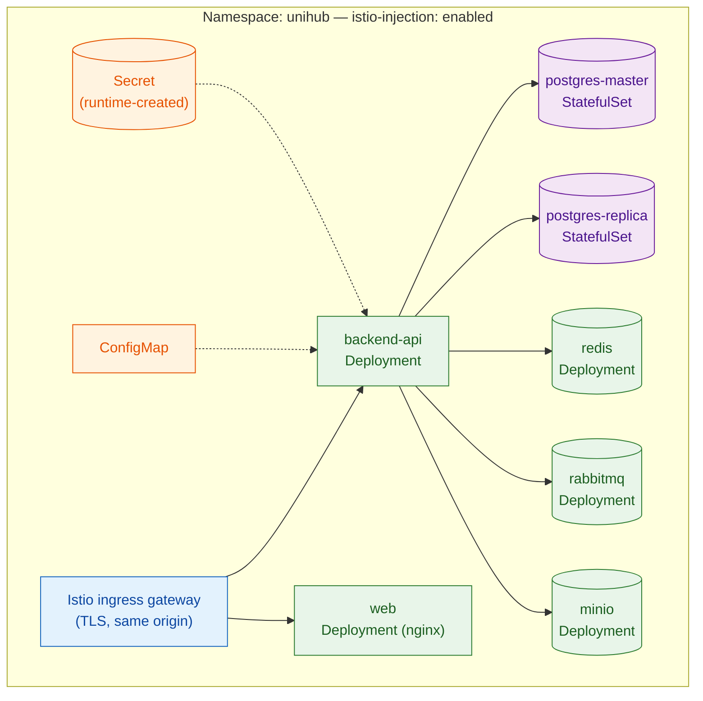

# Deployment & CI/CD — Platform

This file is the physical-level completion of `architecture.md` §1.2 (Core Components — Ingress Controller, Service Mesh, Backend API, PostgreSQL, Redis, Message Broker, Object Storage, Observability Stack) and §5.4 (Network & Data Protection Boundaries — the Zero-Trust mesh every pod runs inside), together with `proposal.md` §5.2/§14/§16 and `docs/requirement.md` §3.3. Those sections established *that* the system runs as N parallel, self-healing Backend API instances behind a single entry point, with PostgreSQL under stable identity/persistent storage, secrets injected at runtime, and CI enforcing lint/test/package before any image is deployable — but deliberately left the concrete Dockerfile, the concrete Kubernetes manifests, the concrete CI workflow, and the concrete migration/seed mechanism as physical detail for this document. Nothing here overrides `architecture.md` — where this file and that one appear to disagree, `architecture.md` is the authority and this file has a bug.

**Why this lives in `platform/`:** it packages and deploys every subsystem this corpus specifies — PostgreSQL (`database-schema.md`), Redis (`distributed-coordination.md`), RabbitMQ (`messaging.md`), MinIO/S3 (`../modules/workshop.md`), JWT/RBAC (`auth-and-identity.md`), and metrics/tracing (`observability.md`) — as one outer envelope: how the Backend API is built into an image, how that image and its dependencies are declared as Kubernetes manifests, how CI verifies a change before it can be packaged, and how a schema/seed migration is applied before any pod starts against it. It does not redesign any subsystem it deploys.

**Scope:** the multi-stage Dockerfile; the Kustomize-based Kubernetes manifest set (base + dev/loadtest overlays); the GitHub Actions CI pipeline (including its security-scan jobs — Gitleaks blocking, Semgrep and Dependency-Check non-blocking); the Flyway-as-a-Kubernetes-Job migration and seed-data mechanism; and the Dev/CI/Minikube-PoC environment matrix. **Out of scope:** the SQL content of any migration beyond the one seed-data file this document names (`database-schema.md` owns schema DDL); Istio's own traffic-policy internals beyond the sidecar-injection labeling and the one namespace-level `PeerAuthentication` this document adds, currently PERMISSIVE (§2, Mesh mTLS Mode ADR) — `architecture.md` §5.4 specifies the model; Prometheus/Grafana/OpenTelemetry configuration beyond the ports and ConfigMap values this document wires up as a deployment target (`observability.md` already specifies the metrics/tracing design); JWT secret *contents* or claims structure (`auth-and-identity.md`, already written — this file only specifies that such a secret exists as a Kubernetes Secret, not its value or shape); any production cloud deployment target (`proposal.md` §5.2 excludes this explicitly); and the Mobile App's (Expo) build/distribution pipeline (a separate, non-store-distribution concern from this Backend-API-focused CI/CD document).

All configuration in this document targets a single Kubernetes namespace, `unihub`, on a local Minikube cluster — consistent with `proposal.md` §5.2's framing of the PoC as local/self-hosted infrastructure, AWS S3 excepted.

---

## Table of Contents

- [Architecture Decision Records (ADRs)](#architecture-decision-records-adrs)
  - [ADR Mini: CI/CD Automation Boundary](#adr-mini-cicd-automation-boundary)
  - [ADR Mini: Kubernetes Manifest Management](#adr-mini-kubernetes-manifest-management)
  - [ADR Mini: Resource Profile Strategy](#adr-mini-resource-profile-strategy)
  - [ADR Mini: Migration & Seed Data Mechanism](#adr-mini-migration-seed-data-mechanism)
  - [ADR Mini: CI Job Structuring](#adr-mini-ci-job-structuring)
  - [ADR Mini: Coverage Verification Mechanism](#adr-mini-coverage-verification-mechanism)
  - [ADR Mini: Contract-Diff Mechanism](#adr-mini-contract-diff-mechanism)
  - [ADR Mini: Container Packaging Strategy](#adr-mini-container-packaging-strategy)
  - [ADR Mini: Mesh mTLS Mode](#adr-mini-mesh-mtls-mode)
  - [ADR Mini: Security Scan Jobs](#adr-mini-security-scan-jobs)
- [1. Container Packaging & Build Strategy](#1-container-packaging-build-strategy)
- [2. Kubernetes Topology — Kustomize Base](#2-kubernetes-topology-kustomize-base)
- [3. Resource Profile Overlays — Dev vs. Load-Test Scale](#3-resource-profile-overlays-dev-vs-load-test-scale)
- [4. Database Migration & Seed Data — Flyway as a Kubernetes Job](#4-database-migration-seed-data-flyway-as-a-kubernetes-job)
- [5. CI Pipeline — GitHub Actions](#5-ci-pipeline-github-actions)
- [6. Local Development vs. CI vs. Minikube PoC — Environment Matrix](#6-local-development-vs-ci-vs-minikube-poc-environment-matrix)
- [7. Reference Table](#7-reference-table)

---

## Architecture Decision Records (ADRs)

### ADR Mini: CI/CD Automation Boundary

**Context:** `docs/requirement.md` §3.3 lists GitHub Actions' CI steps ending at "package the application into a Docker image and push it to Docker Hub" — no deployment step is named anywhere in the corpus. `proposal.md` §14 describes the Minikube-run topology as the runtime target, not something CI is described as driving into. Minikube is inherently local to a developer's machine; a GitHub Actions hosted runner has no network path to reach it without introducing new infrastructure (a self-hosted runner, or a tunnel) that no document in the corpus calls for.

**Decision:** GitHub Actions' automation scope stops at building and pushing the Docker image to Docker Hub. Deployment to the local Minikube cluster is a separate, explicit local action — a Makefile target the developer runs by hand (`kubectl kustomize overlays/<profile> | kubectl apply -f -`) — never a job inside the CI workflow.

**Consequences:**
- The CI workflow's job graph terminates at `build-and-push`; no `deploy` job exists in `.github/workflows/`.
- The local `Makefile` is a first-class artifact of this design (versioned in the repo, not ad hoc), since it's now the only place deployment actually happens.

**Trade-offs accepted (user's own reasoning):** a self-hosted runner registered on the developer's machine (true end-to-end CD) and a tunneled hosted runner were both rejected — the first compounds `proposal.md` §16's already-flagged "learning curve for infrastructure-heavy tooling" risk with a new long-lived process to maintain, the second exposes a local cluster to the internet for no benefit a single-developer PoC needs.

### ADR Mini: Kubernetes Manifest Management

**Context:** `architecture.md` §1.2 and `proposal.md` §14 fix Kubernetes/Minikube as the orchestration target but name no manifest-management tool. The dev-lightweight vs. load-test-scale need (see next ADR) requires some form of environment parameterization across manifest sets, and raw per-environment YAML duplication risks drift between profiles.

**Decision:** Kustomize — a `base/` directory of canonical manifests plus `overlays/dev` and `overlays/loadtest` patch directories, applied via `kubectl apply -k` — is the manifest-management mechanism. No Helm chart, no other templating engine.

**Consequences:**
- Environment differences are expressed as patches against one shared base, not duplicated files — a change to the base (e.g., a new ConfigMap key) propagates to both profiles automatically.
- No new binary is required beyond what ships inside `kubectl` (Kustomize has been built in since 1.14).

**Trade-offs accepted (user's own reasoning):** Helm was rejected — its chart packaging, release/rollback, and Go-template DSL solve problems (multi-release distribution, versioned rollback history) this single-deployable, single-environment-target PoC doesn't have, and would add a second templating language on top of an already infrastructure-heavy stack.

### ADR Mini: Resource Profile Strategy

**Context:** `proposal.md` §16 explicitly flags "high local resource consumption — running a full Kubernetes cluster, database replicas, messaging, monitoring, and a Service Mesh sidecar on every pod together on developer hardware" as a risk, with the accepted mitigation being to "constrain resource usage per component during day-to-day development; run the full topology at scale only for dedicated load-test sessions." No document specifies the mechanism for that split.

**Decision:** Two static Kustomize overlays implement the mitigation directly: `overlays/dev` (1 Backend API replica, single Postgres instance with no replica, minimal `resources.requests/limits`) and `overlays/loadtest` (2+ Backend API replicas, Postgres Master-Replica, full-size `resources.requests/limits` sized toward the 12,000-CCU spike target in `docs/requirement.md` §1.4).

**Consequences:**
- Day-to-day development runs against `overlays/dev` by default — fast iteration, low resource pressure.
- A dedicated load-test session switches to `overlays/loadtest` by name, matching exactly the "only for dedicated load-test sessions" language in `proposal.md` §16.
- **Deviation, recorded 2026-11-05 (Phase 7 checklist D82, C59):** the `overlays/loadtest` sizes in §3 do not fit the development machine (16 GB, Apple Silicon) together with Istio and the observability stack. The machine's Docker Desktop is raised to ~12 GB (`minikube start --memory=10g --cpus=6`), and the §3 numbers are **replaced by the values measured at Phase 7 task 5.7**; still two overlays, no third. If the topology is still `OOMKilled` at that size, the owner decides — Istio and the observability stack are never dropped to make it fit. **Measured on a fresh `overlays/loadtest` deploy (Phase 7 task 10.2, 2026-11-07):** the node container 4.80 GiB of its 10 GiB when idle and 5.83 GiB after the resilience battery; each API pod 524–527 MiB idle and 590–612 MiB after it, of a 1 GiB limit; no `OOMKilled`. The binding constraint is the host, not the node: the 16 GiB laptop gives the Docker VM 12 GiB, which it keeps resident, and swap was 6.8–7.2 GiB of 8 with the load average at 7–15 even idle; the first rebuild (task 10.1, attempt 1) showed every probe timing out together when the host stalled. Peak memory under load is not measured (Phase 8). The 12,000-CCU target of Phase 8 is unlikely to be reachable on this machine; that is Phase 8's to settle.

**Trade-offs accepted (user's own reasoning):** a HorizontalPodAutoscaler-only approach was rejected as the sole mechanism — HPA can scale the Backend API Deployment, but does nothing about Postgres replica count or the per-pod Istio sidecar overhead that `proposal.md` §16 actually names as the cost driver; HPA may still be layered inside `overlays/loadtest` for the API tier specifically, but it does not replace the overlay split.

### ADR Mini: Migration & Seed Data Mechanism

**Context:** `architecture.md` §6.2 already fixes the migration ADR at the concept level: schema changes are explicit and versioned, migration runs once, before any application instance starts, from a single place — never from inside the applications themselves. That ADR's own diagram shows a dedicated Migration Job running before the rolling deployment begins. Given the CI/CD Automation Boundary ADR above, this Job is applied as part of the local deploy step, not by GitHub Actions.

**Decision:** Flyway is packaged into its own container image and run as a one-shot Kubernetes Job (`flyway-migrate`), applied first by the local `Makefile` target; the target blocks on `kubectl wait --for=condition=complete job/flyway-migrate` before applying the Backend API Deployment. Seed data — default roles/permissions from `database-schema.md` §2.2–§2.3 — travels as a Flyway versioned migration (`V2__seed_default_roles_permissions.sql`) using idempotent `INSERT ... ON CONFLICT DO NOTHING`, through the exact same single-execution pipeline as schema DDL, not a separate ad hoc script.

**Consequences:**
- The Job is a first-class, retryable Kubernetes object — its failure is visible via `kubectl get job/flyway-migrate` and blocks the subsequent Deployment apply deterministically.
- Reference data gets the same once-only, versioned guarantee as schema changes — no second mechanism to remember or forget against a fresh cluster.

**Trade-offs accepted (user's own reasoning):** running Flyway from the developer's own machine via `kubectl port-forward` was rejected — it bypasses the in-cluster mTLS path (`architecture.md` §5.4) the in-cluster Job would otherwise use, and depends on a manually-managed, easy-to-forget port-forward process. Running Flyway on Spring Boot startup was rejected outright as a direct violation of the existing `architecture.md` §6.2 ADR (N parallel pods would race to migrate).

### ADR Mini: CI Job Structuring

**Context:** `docs/requirement.md` §3.3 lists an ordered CI sequence (lint, unit tests, integration tests, package+push) but does not specify how that ordering is enforced. This document additionally requires that test execution be structurally separated from artifact publishing, not just sequentially ordered. `CLAUDE.md` and `packages/api-contract/README.md`'s own "Key decisions" table extend that base sequence with one more gate once backend code exists: the `springdoc`-generated OpenAPI spec is diff-checked against the hand-written contract in `packages/api-contract`, and — per the README's own words — "a mismatch is a build failure, not a silent drift." `docs/testing/strategy/test-strategy.md` §4 already documents this as its own stage 4 (Contract diff); this ADR is where that extension actually lands in the job graph, not a competing decision.

**Decision:** A single GitHub Actions workflow file with sequential jobs — `lint` → `unit-test` → `integration-test` (Testcontainers: Postgres — plus a streaming replica for the INV-03 classes —, Redis, RabbitMQ, MinIO) → `contract-diff` → `build-and-push` — connected via `needs:`. The `build-and-push` job additionally runs only on a `push` event to `main` (never on a pull request), and only if every upstream job in the graph succeeded. `contract-diff`'s own mechanism is a separate ADR below, since it involves tool choices `integration-test`'s job doesn't.

**Consequences:**
- A failed lint/unit/integration/contract-diff job structurally blocks `build-and-push` via the job dependency graph — not merely step ordering within one job, which could be bypassed by a misplaced `continue-on-error` or a step-reordering mistake.
- One workflow file remains the single source of truth for the whole pipeline, with no cross-workflow triggering to reason about.
- The three security-scan jobs (Security Scan Jobs ADR) live in the same file but outside the sequential chain: they `needs:` nothing. Semgrep and Dependency-Check are non-blocking, so nothing waits for them; Gitleaks is blocking, so `build-and-push` `needs:` it alongside `contract-diff`.
- The Web Application has its own `web` job (Phase 2 checklist 5): `npm ci`, types generated from `packages/api-contract`, typecheck, lint (oxlint plus the import-boundary rules) and Vitest. It `needs:` nothing and is blocking, outside the sequential chain like the scans: it uses no database, Docker or backend, so it neither waits for nor delays the backend jobs. Since Phase 7 (checklist D85, D103) a Web image is built, so `build-and-push` `needs:` `web` as well.
- `contract-diff` runs after `integration-test`, not in parallel with it — it's cheap relative to the Testcontainers job, and ordering it last among the test-gate jobs means a contract mismatch never wastes the time of a run that was already going to fail on lint/unit/integration anyway.

**Trade-offs accepted (user's own reasoning):** two separate workflow files cross-triggered via `workflow_run` were rejected — that level of pipeline decoupling is disproportionate for one developer maintaining one repository, and adds triggering complexity with no corresponding benefit here.

### ADR Mini: Coverage Verification Mechanism

**Context:** `docs/testing/strategy/test-strategy.md` §4 states ≥80% coverage on core business-logic services as a blocking gate on the `unit-test` stage, and `docs/requirement.md` §3.2 states the same figure. Neither document names a concrete coverage tool, and — until this ADR — the `unit-test` job below only ran `./gradlew test`, with no coverage measurement or enforcement step at all: the 80% figure was a documented promise with nothing in the actual pipeline checking it. `docs/testing/test-levels/unit-testing.md` §3 flagged this gap and proposed the fix this ADR formalizes.

**Decision:** `org.jacoco` (JaCoCo), via Gradle's `jacoco` plugin, with a `jacocoTestCoverageVerification` rule scoped to core business-logic packages only (`com.unihub.*.application.usecase`, `com.unihub.*.domain.*` — the package layout fixed by `docs/guidelines/backend-coding-standards.md` §2; exact rule in `docs/testing/test-levels/unit-testing.md` §3), excluding DTOs/config/mappers/the generated `packages/api-contract` client — the same exclusion list `test-strategy.md` §4 already defines in prose. `check.dependsOn jacocoTestCoverageVerification`, and the `unit-test` job runs it as a second step immediately after `./gradlew test`.

**Consequences:**
- A PR that drops core business-logic line coverage below 80% fails the `unit-test` job directly — the same job `test-strategy.md` §4 already names as the coverage gate, not a separate, easily-bypassed check.
- Coverage is measured only over Unit-test execution, consistent with `docs/testing/test-levels/unit-testing.md`'s scope — the `integration-test` job's Testcontainers-backed tests are not folded into this same coverage number, since `test-strategy.md` §4's 80% figure is stated specifically against Unit-level business-logic tests.

**Trade-offs accepted:** JaCoCo's package-level `includes`/`excludes` pattern is this document's own concrete scoping mechanism — `CLAUDE.md` and `test-strategy.md` describe "core business-logic services" only in prose; translating that into glob patterns depends on the package layout. That layout is now fixed by `docs/guidelines/backend-coding-standards.md` §2, and the patterns follow it (`com.unihub.*.application.usecase`, `com.unihub.*.domain.*`), replacing the earlier inferred `com.unihub.*.service.*`. The remaining assumption is only that the scaffold follows §2; `unit-testing.md` §3 says how to confirm the gate actually measures those packages.

### ADR Mini: Contract-Diff Mechanism

**Context:** `packages/api-contract/README.md`'s "Contract authority once implementation starts" decision commits to diffing a `springdoc`-generated spec against the hand-written one in CI, but names no concrete generation or diff tooling — that choice belongs here, at the CI-implementation level, not in the contract package itself. `docs/testing/test-levels/contract-testing.md` §4 flagged a gap in this ADR's first version: `packages/api-contract` already describes all six business modules, but the *generated* spec only ever contains whatever controllers exist in code at a given point in `docs/testing/strategy/test-plan.md`'s phased rollout — a full-spec-vs-full-spec diff would report every not-yet-implemented module's paths as "missing" and fail unconditionally until all six modules are built, contradicting that phased rollout entirely. This ADR's Decision below now includes the fix for that gap, not just the original mechanism. Running that mechanism against the first real controller (`GET /api/v1/workshops`, Phase 1 Mục 1) surfaced four further gaps, each closed in the Decision below: the filter worked per path, so the contract's `POST` on the same path — no controller yet — stayed in the comparison; every component of the hand-written spec stayed in too, referenced by an implemented operation or not (54 orphans); springdoc and the contract describe the same wire shape differently (inlined vs. named `$ref` parameters, headers and schemas, `allOf: [$ref]` vs. inline, an `int32` format on every `int`, OpenAPI 3.0 vs. 3.1); and API-level metadata (`info`, `servers`, `tags`) is part of no operation.

**Decision:** The whole mechanism lives in one script, `apps/backend/scripts/contract-diff.sh`, which the `contract-diff` job and a developer run unchanged (`docs/testing/test-levels/contract-testing.md` §2) — there is no second copy of the steps to keep in sync. It runs five steps:

1. **Generate.** `org.springdoc:springdoc-openapi-gradle-plugin`'s `generateOpenApiDocs` boots the application in a forked JVM and reads its `/v3/api-docs`. It needs no *running* Postgres/Redis/RabbitMQ/MinIO, so it can run as its own lightweight job rather than piggybacking on `integration-test`'s Testcontainers setup — but the application context is real: once any JDBC adapter exists, a `DataSource` bean must be constructible, so `SPRING_DATASOURCE_URL` is set to any JDBC URL (nothing connects to it while the spec is read). springdoc is pinned to `springdoc.api-docs.version: openapi_3_1` in `application.yml` — the dialect the contract is written in.
2. **Bundle** the hand-written multi-file spec into one JSON file with `npx @redocly/cli bundle`, the command `packages/api-contract/README.md` already documents for local use, so `jq` can filter it.
3. **Keep only implemented operations.** `jq` filters the bundled spec's `paths` to the (path, HTTP method) pairs the generated spec has. A module with no controller yet, and an operation not built yet on a path whose other operations are, contribute nothing; an operation that *is* implemented is compared in full.
4. **Normalise both sides.** `redocly bundle --dereferenced --remove-unused-components` resolves every `$ref` and drops what no operation uses, so each operation is compared as its fully resolved shape instead of by the names of the components it happens to reference. Then `jq` deletes `info`, `servers` and `tags` (API-level metadata, not part of any operation); `security` and `components.securitySchemes` (**temporary**, see Consequences); and `format: "int32"` (springdoc writes it for every Java `int`, the contract writes plain `type: integer`; `int64` is still compared).
5. **Diff.** `oasdiff diff` (`tufin/oasdiff`, run via its published Docker image so no local Go toolchain is required) with `--flatten-allof` (the contract writes `allOf: [$ref X]` where springdoc writes `X` inline), `--exclude-elements description,examples,summary,title`, and `--fail-on-diff`.

The job fails on any reported difference in what steps 3–5 leave. Shape — paths, methods, `operationId`, tags, parameters and their constraints, required fields, response codes, content types, headers, schema structure — is compared literally, not narrowed to breaking changes, matching the README's "a mismatch is a build failure" language for everything it describes. Prose — descriptions, summaries, titles, examples — is not compared, so it lives in `packages/api-contract` alone instead of being copied into Java annotations.

**Consequences:**
- The generated spec never connects to a real database or broker — `contract-diff` stays fast and has nothing in common with `integration-test`'s infrastructure needs beyond both running on the same JDK. It does need a `DataSource` URL to exist (Decision, step 1).
- Failing on any *shape* difference, not just breaking changes, means a purely additive change to the hand-written spec for an *already-implemented* operation (a new optional field, a new response code) also requires the backend annotations to be updated in the same change before CI passes — a stricter bar than a breaking-changes-only check, chosen because the README already establishes the hand-written spec as authoritative and *any* drift from it, additive or not, means the two have silently diverged on what the real contract is. A wording-only change (a clarified description, a new example) does not, by design.
- An operation implemented in code but genuinely absent from the hand-written spec (an undocumented endpoint) is **not** removed by the `jq` step in step 3 — it only removes hand-written-only operations, never generated-only ones — so `contract-diff` still fails on undocumented endpoints.
- A module, or a single operation, can go from "not yet implemented" (silently excluded from the diff) to "implemented" (fully diffed, any drift blocking) with no separate flag to flip — step 3 re-derives the implemented set from the generated spec on every run.
- **The job proves the *declared* shape, not that the behaviour exists.** A controller can declare a `429` with `Retry-After`, or an `X-Correlation-Id` header, with annotations alone; the diff passes whether or not a rate limiter or a correlation-ID filter exists. At the time of writing `GET /api/v1/workshops` declares exactly those two without implementing either; the controller method says so in a comment.
- **Authentication is proved, except one prose field.** Step 4 compares the global `security` requirement, the `bearerAuth` scheme (`type`/`scheme`/`bearerFormat`) and each operation's own `security`; only the scheme's long `description` is dropped from both sides, because that text lives only in the contract. (Until RBAC/JWT landed, Mục 2.2, step 4 removed `security` and `components.securitySchemes` wholesale; see `docs/testing/reports/test-matrix.md` §4.4.)
- Dereferencing (step 4) makes a contract refactor that only renames or splits components invisible to the job. That is intended — a component's name is not part of the wire shape — but it also means the job cannot check that the contract keeps a given schema reusable.

**Trade-offs accepted:** `oasdiff`, the `springdoc-openapi-gradle-plugin` task name, and the script's `jq`/`redocly` filters are this document's own tool picks and scripting choices — `CLAUDE.md` names `springdoc` generically but neither a specific plugin nor a diff tool, and names nothing about phased-rollout filtering at all. This ADR's first version carried a path-only `jq` filter flagged as inferred and "to be verified against the real generated-spec shape once the first backend controller exists"; that verification happened with `GET /api/v1/workshops` (Phase 1 Mục 1) and the path-only filter was not sufficient, which is why steps 3–5 above exist. A live-endpoint approach (hitting a running app's `/v3/api-docs` instead of the static `generateOpenApiDocs` task) was rejected because it would require standing up the full application (defeating the "lightweight job" goal above) just to read spec metadata that the annotations already contain statically. Copying every contract description and example into Java annotations, so the prose could be diffed too, was rejected: the same text in two places that must stay identical, for no wire-level benefit. `@redocly/cli` 2.x requires Node ≥ 22.12 (or ≥ 20.19 < 21), so the job pins `actions/setup-node` to `'22'` instead of relying on whatever Node the `ubuntu-latest` image happens to ship.

### ADR Mini: Container Packaging Strategy

**Context:** `CLAUDE.md` and `proposal.md` §10 fix Java 21 / Spring Boot 3.x as the backend stack and Docker Hub as the registry, but name no build mechanism. Spring Boot 3 ships two credible Dockerfile-free alternatives — Cloud Native Buildpacks via `bootBuildImage`, and Jib — alongside a hand-written multi-stage Dockerfile.

**Decision:** An explicit multi-stage Dockerfile: a builder stage (JDK + Gradle, with the dependency-resolution layer cached separately from the source-copy layer so unchanged dependencies never re-download) produces the jar; a minimal runtime stage (slim JRE base image, non-root `USER`, `-XX:MaxRAMPercentage` tuned for cgroup v2 container memory limits) runs it.

**Consequences:**
- Every layering, user-privilege, and JVM-tuning decision is visible and reviewable directly in the Dockerfile — nothing is delegated to a buildpack's implicit defaults.
- The dependency-layer/source-layer split gives the same build-cache benefit Buildpacks/Jib provide automatically, but stated explicitly as a design decision in this document.

**Trade-offs accepted (user's own reasoning):** Buildpacks and Jib were both rejected — this is a design-stage project meant to specify and demonstrate the container-build reasoning (layer caching, non-root user, cgroup-aware JVM sizing) explicitly; delegating that to a buildpack's implicit defaults would hide exactly the mechanics this document exists to make legible.

### ADR Mini: Mesh mTLS Mode

**Status:** **STRICT is in force** in `unihub` and in `unihub-observability` since Phase 7 task 7.5 (2026-11-06): `base/peer-authentication.yaml` and `observability/peer-authentication.yaml` are namespace-wide `PeerAuthentication` `default` in `STRICT`, with no `selector` and no `portLevelMtls`. The three preconditions below were shown on the cluster first (P2–P4, tasks 7.2–7.4), then the mode was switched and the evidence re-run under it (`k8s/scripts/check-mesh.sh`, `k8s/scripts/check-mtls.sh`, `docs/testing/reports/phase-7-cluster-checks.md`). **That run was made by Claude Code, not accepted by the owner (D102)**, and the signed evidence is the re-run of Mục 10 on a fresh deploy (done 2026-11-07 from `minikube delete` with the CI image of `f648fd0`: the negative control answered on all 19 ports, then all 19 refused, and `check-mesh.sh` was green); until the owner states acceptance INV-20 is not reported `Passing`. An earlier version of this ADR decided STRICT outright; that was withdrawn because it would have refused in-cluster clients this document did not yet deploy or handle, and removed the one workaround it had for the Flyway Job (opting out of injection).

**Context:** `architecture.md` §5.4 guarantees that every connection is mutually authenticated and that "there is no plaintext hop anywhere" — but this document, which turns that into manifests, only labeled the namespace for sidecar injection, and deferred the mesh's traffic policy to `architecture.md` §5.4, which states the guarantee without naming a setting. Sidecar injection alone leaves Istio's default mode, which negotiates mTLS between sidecars but still *accepts* plaintext connections — so the guarantee holds only as long as no client chooses to connect in plaintext, and nothing in the manifests prevents it. The gap was found while writing the mTLS test in `docs/testing/non-functional/security-testing.md` (S-19).

**Decision:** a namespace-wide `PeerAuthentication` named `default` in `STRICT` mode in each of the two namespaces, so a connection to any pod that does not present a valid mesh identity is refused rather than downgraded to plaintext. Until the preconditions were met the object was `PERMISSIVE` (sidecars negotiate mTLS, plaintext is still accepted), and so `architecture.md` §5.4's "no plaintext hop" was a target. The switch was one line per namespace plus deleting the two workload-scoped STRICT policies of task 6.1 (see (c)). The boundary that remains by design: the ingress gateway's public ports 80 and 443 take traffic from outside the mesh, and the management port 8081 (in no Service) is reachable only by a client that presents its own mesh certificate — Prometheus does, a sidecar client's plaintext does not (`check-mtls.sh`).

**Istio version: 1.31.x on Kubernetes 1.35.1 (Minikube 1.38.1's default) — corrected 2026-11-05, Phase 7 checklist D81, C56.** The earlier 1.24.x was a decision on paper; checked against Istio's own supported-releases page (read 2026-11-05) it reached end of life on 2025-06-24 and supports Kubernetes 1.28–1.31 only. That page lists 1.31 (released 2026-08-27, end of life expected ~February 2027) for Kubernetes 1.32–1.37 and 1.30 for 1.32–1.36; 1.29 is past end of life (2026-10-15). The patch version is pinned at Phase 7 task 5.1 (the newest 1.31 patch at least two weeks old) and recorded with the cluster evidence. Installation is by a pinned `istioctl`. **Stop condition:** if `istioctl x precheck` fails on that pair, or native sidecars (precondition (b)) do not work, the owner decides — the Kubernetes version is not changed silently.

**Preconditions — all three before switching to STRICT** (each **shown on the cluster on 2026-11-06**, tasks 7.2–7.4, before the switch, and again under STRICT):
- [x] **(a) Ingress path.** `architecture.md` §5.4's diagram has Ingress → mTLS → sidecar. **Decided 2026-11-05 (Phase 7 checklist D83, D93, on the owner's delegation, confirmed at sign-off):** the Ingress Controller role is filled by **Istio's ingress gateway** (an Envoy that is itself part of the mesh, configured with Istio's `Gateway` + `VirtualService`), not by ingress-nginx, which Kubernetes SIG Network retired in March 2026 (no further releases or security fixes). The gateway → `backend-api` hop is therefore mutually authenticated by construction, with no `PeerAuthentication` exception. What remains unmet until Phase 7 task 7.2 is the evidence: the hop reported as `mutual_tls` and S-19.
- [x] **(b) Flyway Job exits its sidecar.** The namespace is injected, so the Job's pod carries an `istio-proxy` container that, without help, keeps running after Flyway exits — the Job never reaches `complete` and `kubectl wait --for=condition=complete` (§4) times out. **This affects today's PERMISSIVE deploy too, not only STRICT**, and under STRICT the old workaround — `sidecar.istio.io/inject: "false"` on the Job — no longer works, because a non-meshed client is refused. The answer is Istio's **native sidecar** mode (the proxy runs as a Kubernetes sidecar container — an init container with `restartPolicy: Always` — which ends when the Job's main container exits); there is deliberately **no custom `quitquitquit` fallback**. **The same mode is what lets the Postgres replica's `pg_basebackup` init container reach the Master under injection** (§2): an ordinary init container runs before the proxy and has no network under STRICT (Phase 7 checklist D94). **Confirmed under PERMISSIVE on 2026-11-06** (tasks 5.1 and 5.7, `docs/testing/reports/phase-7-cluster-checks.md`): on Istio 1.31.3 with Kubernetes 1.35.1 the **default install** already runs `istio-proxy` as a native sidecar — a probe pod in an injected namespace shows it under `initContainers` with `restartPolicy: Always`, and `ENABLE_NATIVE_SIDECARS` is not set; the Flyway Job reached `Complete` with injection, and the replica pod's init containers run in the order `istio-init`, `istio-proxy`, `basebackup`. What stays **unmet** is the same under STRICT (Phase 7 task 7.3, and AC94.1 at Mục 10).
- [x] **(c) Observability stack.** Prometheus, Grafana and Tempo scrape and receive from `unihub` pods (Actuator on its own management port **8081** — corrected 2026-11-02, Phase 6 checklist D64, C39 — RabbitMQ's 15692, OTLP), and `architecture.md` §5.4 puts the observability stack in the mesh. **Decided 2026-11-05 (Phase 7 checklist D95):** the stack runs in its own namespace `unihub-observability`, **injected**; Prometheus scrapes pods over mTLS with the certificates its sidecar writes to a shared volume (Istio's documented pattern), not through its sidecar's outbound path; no `portLevelMtls` exception. The in-cluster stubs (WireMock for the payment gateway and the AI service), Mailpit and MinIO live in `unihub` and are injected like every other pod. **Stop condition:** if Prometheus cannot scrape with the sidecar's certificates on the pinned Istio, the owner decides — no exception is added silently. **Found by running it (Phase 7 task 6.1, 2026-11-06, Istio 1.31.3; `docs/testing/reports/phase-7-cluster-checks.md`):** the scrape works with the sidecar's certificates on 1.31, so the stop condition is not triggered, but **only where the target is STRICT**: under PERMISSIVE Istio hands a TLS connection that does not carry its own ALPN straight to the application (`server gave HTTP response to HTTPS client` for the API, `connection reset` for the broker). So the order "P4 (scrape over mTLS), then STRICT" cannot hold for the two scraped workloads. Decision, taken on the owner's delegation and open to the owner's confirmation: `base/peer-authentication-scraped.yaml` makes **`backend-api` and `rabbitmq` STRICT, selected by label, with no `portLevelMtls`** — a tightening of the namespace's PERMISSIVE `default`, not an exception to a STRICT one; task 7.5 makes `default` STRICT for the whole namespace and deletes that file. A static test pins that no `PeerAuthentication` carries `portLevelMtls` and that none besides `default` is anything but STRICT (AC95.2). Two more facts from the same run: Prometheus's Go client must not offer HTTP/2 (`enable_http2: false`), because the API's management port is in no Service, so its sidecar passes the decrypted stream as plain TCP and Tomcat closes an HTTP/2 connection; and Istio rewrites `prometheus.io/*` annotations to its plaintext merged endpoint, so the scrape selects pods by label and container-port name, not by those annotations.

**Consequences:**
- INV-20 (`docs/testing/strategy/test-strategy.md` §2) is enforced by STRICT and tested by S-19 (`k8s/scripts/check-mtls.sh`): from a pod in a namespace without a sidecar, 19 ports answer no plaintext, and a sidecar client is answered on all but the management port. The negative control (`check-mtls.sh --negative-control`: a PERMISSIVE policy selected by label for every workload, for the length of one run) showed **all 19 ports answering plaintext, the management port and the RabbitMQ ports included**, and the plain run right after it all 19 refused — so the probe tells refusing from answering port by port. It also reproduced the finding of (c): with the API PERMISSIVE, Prometheus's mTLS scrape fails (`min(up) = 0`). STRICT is in the manifests, so a fresh deploy has no PERMISSIVE moment of its own: Mục 10 repeated the control with that same script on 2026-11-07 (same result). Reported `Covered`/`Passing` only when the owner states acceptance (D102); the Mục 10 re-run is the signed one.
- **Effects of STRICT, checked on the cluster:** the Flyway Job reaches `Complete` and its `istio-proxy` exits with it; a replica rebuilt from an empty volume (`pg_basebackup` in an init container) streams; kubelet `httpGet` probes keep working (Istio rewrites them to the sidecar's port 15020; a rolling restart of the API under STRICT left every pod Ready); the gateway's spans still reach Tempo over gRPC; Prometheus still scrapes with its sidecar's certificates.
- Kubelet `httpGet` probes keep working under STRICT because Istio rewrites application probes to go through the sidecar by default — verified on 1.31.3 (the Effects bullet above; `check-mesh.sh` checks the rewrite on every pod). A `tcpSocket` probe would not: the sidecar answers the connection whether or not the broker behind it is up, which is why RabbitMQ's start-up and readiness probes are `httpGet` (Probes paragraph, §2).
- `PeerAuthentication` uses `apiVersion: security.istio.io/v1`, which Istio 1.22+ serves — covered by the chosen 1.31.x.
- **History (task 6.1 → 7.5):** from the first observability deploy until task 7.5 `backend-api` and `rabbitmq` were STRICT by label (`peer-authentication-scraped.yaml`), because the scrape over mTLS cannot work against a PERMISSIVE target (see (c)); 7.5 made the namespaces STRICT and deleted that file.
- **Order of the switch (Phase 7 checklist D96):** (a)–(c) met → `mode: STRICT` → every cluster check (smoke, Playwright, kill-pod, the Kubernetes halves of scenarios 1 and 2, P1, S-19) is **re-run under STRICT**; only those runs are sign-off evidence.

**Trade-offs accepted (as decided before the switch):** enforcing STRICT while (a)–(c) were unmet was rejected — with (a)–(c) unmet it would refuse the Ingress, the observability stack and the migration Job. The interim leaves the guarantee unenforced, and says so openly rather than presenting a manifest that looks strict. The default mode without any object was rejected only in the sense that an explicit `PERMISSIVE` object makes the intent visible and the later switch a single line. STRICT's eventual cost is on the same footing as `architecture.md` §5.4's stated trade-off that "the mesh is now a dependency of everything."

### ADR Mini: Security Scan Jobs

**Context:** the corpus had no static-analysis, dependency-vulnerability or secret-scanning tool: the only automated code check in the pipeline is `lint` (Checkstyle + Spotless), which checks style, not security, and INV-18 (`docs/testing/strategy/test-strategy.md` §2) named "secret-scanning" without choosing one.

**Decision:** three tools, each its own job in the existing workflow, in parallel with — not inside — the gate chain (they `needs:` nothing):
- **Gitleaks** (secret scanning, INV-18) is **blocking**: `build-and-push` `needs:` it, and it has no `continue-on-error`.
- **Semgrep** (SAST) and **OWASP Dependency-Check** (dependency vulnerabilities) are **non-blocking**: `continue-on-error: true`, nothing `needs:` them. They report on every push and pull request and gate neither a merge nor `build-and-push`.

Decided in a review of the testing documents.

**Why Gitleaks is blocking from the start:** INV-18 is Non-Negotiable, and a secret that reaches the repository is not undone by fixing it later (it stays in history, which is why the job scans full history). Secret findings have the fewest legitimate false positives and depend on no external database, and — since no source code exists yet — there is no baseline to triage, so blocking costs nothing today. Justified false positives go in Gitleaks' allowlist, committed and reviewed.

**Why Semgrep and Dependency-Check are non-blocking at first:**
- *No baseline.* The first runs on real code will surface an unknown volume of findings, some of them false positives. Blocking merges on untriaged noise stalls the critical path of a single-developer delivery (`proposal.md` §16's bandwidth risk).
- *External dependency (Dependency-Check).* It relies on a remote vulnerability database whose availability and rate limits are outside the project's control (an API key is normally required to avoid throttling); an outage there would block merges for reasons unrelated to the change.
- *Untuned rules (Semgrep).* The rule sets named in §5 are starting values.

**Conditions to promote Semgrep or Dependency-Check to blocking** (each independently; promotion means removing `continue-on-error` and adding the job to `build-and-push`'s `needs:`):
1. The baseline is triaged: every existing finding is either fixed or suppressed with a written justification in a committed suppression file (inline `nosemgrep`, Dependency-Check's suppression file).
2. The tool image is pinned to a version or digest rather than `latest`, so a tool upgrade cannot fail a merge. **Met for the image (2026-10-26):** Semgrep `1.181.1`, Dependency-Check `13.0.0`, Gitleaks `v8.30.1`, each the version `latest` resolved to at that moment (same manifest digest). The rules and vulnerability data they fetch at run time are not pinned.
3. A blocking severity threshold has been chosen (for example, High and Critical only). **Not chosen yet.**
4. The job has run stably for a period the user defines. **Not defined yet.**
5. For Dependency-Check: the API-key secret is in place and its data is cached, so runtime is bounded.

**Consequences:** INV-18's detection is enforced from the first push. Semgrep and Dependency-Check findings are visible but gate nothing until promoted. Reports are workflow artifacts, never committed (`docs/testing/strategy/test-strategy.md` §6). Gating a *pull-request merge* on Gitleaks additionally needs the manual branch-protection setup in §5.

**Trade-offs accepted:** all three jobs blocking from day one was rejected for Semgrep and Dependency-Check for the reasons above; running any of them inside the `lint` → … → `build-and-push` chain was rejected because a scan finding is then indistinguishable from a test failure and lengthens every gate run. Gitleaks first ran on `latest`, the same posture the `oasdiff` step takes, accepting that an upgrade could start failing merges; all three scanner images were then pinned on 2026-10-26 (Semgrep 1.181.1, Dependency-Check 13.0.0, Gitleaks v8.30.1 — each what `latest` pointed to, so nothing changed) rather than waiting for that first failure. `oasdiff` still takes `latest`.

---

## 1. Container Packaging & Build Strategy

**Rationale:** `CLAUDE.md` fixes Java 21 / Spring Boot 3.x and Docker Hub as the registry (per the Container Packaging Strategy ADR above). The two things a container-packaging design must get right for this project specifically are: (a) rebuilding the image on every source change must not re-download every dependency, since CI runs this on every push (`docs/requirement.md` §3.3), and (b) the running container must respect the memory limit Kubernetes assigns it, not the host's full physical memory, since the JVM historically over-reads `/proc/meminfo` unless told the process is inside a cgroup.

**Model:**

**Location and build context (corrected 2026-11-05, Phase 7 checklist C45):** the file is `apps/backend/Dockerfile`, built with `apps/backend` as its context (the Gradle project is a single project there, with Kotlin build scripts — `build.gradle.kts`/`settings.gradle.kts` — not the Groovy names an earlier version of this model used). The builder stage runs on the build machine's own architecture (`--platform=$BUILDPLATFORM`) so Gradle never runs under emulation; only the runtime stage is per target architecture, which is what makes the multi-architecture image of §5 cheap (Phase 7 checklist D84). **Verified at Phase 7 task 1.1 (2026-11-05):** `./gradlew dependencies` is *not* enough — it resolves the dependency graph but downloads no jar, and a `bootJar --offline` after it failed (`commons-lang3`, `swagger-annotations-jakarta`: "No cached version available for offline mode"). The dependency layer therefore runs a small Gradle init script, `apps/backend/gradle/resolve-main-dependencies.init.gradle`, that resolves the jars of `compileClasspath`, `runtimeClasspath` and `annotationProcessor`; with it the `bootJar --offline` succeeds, and `--offline` stays in the Dockerfile so an incomplete layer fails loudly instead of re-downloading. Gradle writes two jars to `build/libs` (the boot jar and `-plain`), so the runtime stage copies `unihub-*-SNAPSHOT.jar`, not `*.jar`. The user is numeric (`10001`) so a Pod with `runAsNonRoot` can verify it. A `.dockerignore` in `apps/backend` keeps `build/`, `.gradle/`, every `.env*` (but `env.example`), `src/test` and `src/integrationTest` out of the context.

```dockerfile
# apps/backend/Dockerfile — build context: apps/backend (the file in the repository is the authority; this is its shape)
# Base images pinned by the digest of the tag's multi-platform index (amd64 + arm64).

# ---- Builder stage (native architecture of the build machine) ----
FROM --platform=$BUILDPLATFORM eclipse-temurin@sha256:<21-jdk-jammy index> AS builder
WORKDIR /workspace

# Dependency layer, cached separately from source: re-run only when the build scripts or the wrapper change.
COPY gradlew ./
COPY gradle gradle
COPY build.gradle.kts settings.gradle.kts ./
RUN ./gradlew --no-daemon --init-script gradle/resolve-main-dependencies.init.gradle resolveMainDependencies

# Source layer: main sources only, so a test edit never invalidates it.
COPY src/main src/main
RUN ./gradlew bootJar --offline --no-daemon -x test

# ---- Runtime stage ----
FROM eclipse-temurin@sha256:<21-jre-jammy index> AS runtime
RUN groupadd --system --gid 10001 unihub \
 && useradd --system --uid 10001 --gid unihub --no-create-home --shell /usr/sbin/nologin unihub
WORKDIR /app
# Not build/libs/*.jar: that also matches the "-plain" jar Gradle writes beside the boot jar.
COPY --from=builder /workspace/build/libs/unihub-*-SNAPSHOT.jar app.jar
USER 10001:10001
ENV JAVA_TOOL_OPTIONS="-XX:+UseContainerSupport -XX:MaxRAMPercentage=75.0 -XX:InitialRAMPercentage=50.0"
EXPOSE 8080 8081
ENTRYPOINT ["java", "-jar", "/app/app.jar"]
```

| Decision | Value | Why |
|---|---|---|
| Builder base image | `eclipse-temurin:21-jdk-jammy`, pinned by the digest of its multi-platform index (checked 2026-11-05: linux/amd64 and linux/arm64/v8 both listed) | Matches `CLAUDE.md`'s Java 21 requirement exactly; Temurin is the OpenJDK distribution with the widest CI/Docker Hub support. |
| Runtime base image | `eclipse-temurin:21-jre-jammy` (not `-jdk`), pinned by digest the same way | The runtime stage never compiles anything — a JRE is the smaller, correct base; shipping a JDK (with `javac`, `jshell`, etc.) into a runtime image is unused attack surface. |
| Layer order | Dependency manifest copied and resolved *before* `src/` is copied | Docker's layer cache invalidates from the first changed layer downward — putting the rarely-changing dependency manifest first means a routine source edit never re-triggers a dependency re-download. |
| Non-root `USER` | Dedicated `unihub` system user, numeric uid/gid `10001` (a Pod with `runAsNonRoot` cannot verify a user given by name), no login shell, no home directory | Baseline container hardening; consistent with `architecture.md` §5.4's Zero-Trust posture applied one layer lower, at the process level inside the pod. |
| JVM container awareness | `-XX:+UseContainerSupport -XX:MaxRAMPercentage=75.0` | Modern JDKs (10+) enable container support by default, but pinning it here makes the intent explicit rather than relying on a default that could change; 75% leaves headroom for the JVM's own non-heap memory (metaspace, thread stacks, direct buffers) inside the same container limit (§2/§3). |
| Health check mechanism | Kubernetes liveness/readiness probes (§2), **not** a Docker `HEALTHCHECK` instruction | Kubernetes never consults `HEALTHCHECK` — it uses its own probe configuration on the Pod spec. Adding one here would be dead configuration; the actual probe design lives in `observability.md`. |
| Image tag convention | `<dockerhub-namespace>/unihub-backend:<git-sha>` and `<dockerhub-namespace>/unihub-web:<git-sha>`, plus a floating `:latest` on every `main` push; each a multi-architecture manifest (`linux/amd64`, `linux/arm64`) | The immutable `git-sha` tag is what Kubernetes manifests actually reference (§2) — a floating tag alone would make "which commit is running" unanswerable from the cluster; `:latest` remains only as a convenience pointer for manual local use. `arm64` because the Minikube PoC runs on Apple Silicon; the cluster pulls the digest CI built, so the image that runs is the image CI checked (Phase 7 checklist D84). The namespace is the owner's Docker Hub account, `thanhtien2208` (stated by the owner 2026-11-05; the `DOCKERHUB_USERNAME` and `DOCKERHUB_TOKEN` repository secrets exist, so login works only if their values are right — the first run of `build-and-push` proves it). During day-to-day work an image built locally with `minikube image build` may be tagged `dev-<git-sha>`, never `latest`. |

**The Web Application image (Phase 7 checklist D85).** `apps/web/Dockerfile`, built with the **repository root** as context (the build generates its API types from `packages/api-contract`; a root `.dockerignore` keeps everything else out): a Node 22 stage on `--platform=$BUILDPLATFORM` (so `npm ci` and the Vite build never run under emulation) runs `npm ci`, `npm run api:types` and `npm run build`, and an `nginxinc/nginx-unprivileged` stage (non-root, listens on 8080) serves `dist/` with an SPA fallback (`apps/web/nginx/default.conf`: `/healthz` for the Pod's probes, content-hashed files under `/assets/` cached for a year and answered with a real 404 when missing, every other path the app shell with `no-cache`). Both base images are pinned by digest (Node 22 on Debian bookworm-slim, glibc like the `web` CI job; nginx 1.28), and `VITE_PAYMENT_TEST_MODE` is a build argument that defaults to `false`. nginx sets the **Content-Security-Policy as an HTTP header** — the same policy as the build's `<meta>` tag plus `frame-ancestors 'none'`, which a `<meta>` tag cannot carry (`web-coding-standards.md` §11; closes the Phase 2 deferral). The Web is served from the **same origin** as the API (§2: the gateway routes `/api/**` to `backend-api` and everything else to `web`), so `VITE_API_BASE_URL` stays empty and no CORS configuration exists. The image for the Minikube PoC is built with `VITE_PAYMENT_TEST_MODE=true`, because the payment gateway in the cluster is a stub (§2); there is no production build of the Web with real payment collection, and none is in scope.

**Trade-offs:** the two-stage build means the builder stage's full JDK + Gradle toolchain is downloaded and run on every CI build — that cost is accepted because it's paid once per CI run, inside a job whose own stated job (§5) is exactly to verify the code before it can be packaged; it is never paid at runtime, since the final image contains only the JRE and the built jar.

**Guarantees:** the shipped image never contains build tooling (Gradle, source `.java` files, a full JDK) — only the runtime and the compiled jar; the container never runs as root; the JVM's heap sizing is bound to whatever `resources.limits.memory` the Deployment spec assigns it (§2/§3), never to the node's total physical memory.

---

## 2. Kubernetes Topology — Kustomize Base

**Rationale:** `architecture.md` §1.2 names the Core Components this topology must stand up: Ingress Controller, Backend API, PostgreSQL, Redis, Message Broker, Object Storage, and — per §5.4 — a sidecar proxy on every one of those pods. This section gives that list concrete manifest form as a Kustomize `base/`, deferring only the two things that differ per environment (replica counts, resource sizing — §3) to overlays.

**Model:**

```
k8s/
├── namespace.yaml
├── base/
│   ├── kustomization.yaml
│   ├── backend-api-deployment.yaml
│   ├── backend-api-service.yaml
│   ├── web-deployment.yaml            # Phase 7 checklist D85
│   ├── web-service.yaml
│   ├── gateway.yaml                   # Istio Gateway + VirtualService (D83), replaces ingress.yaml
│   ├── postgres-master-statefulset.yaml
│   ├── postgres-master-service.yaml
│   ├── postgres-replica-statefulset.yaml
│   ├── postgres-replica-service.yaml
│   ├── redis-deployment.yaml
│   ├── redis-service.yaml
│   ├── rabbitmq-deployment.yaml
│   ├── rabbitmq-service.yaml
│   ├── minio-deployment.yaml
│   ├── minio-service.yaml
│   ├── mailpit-deployment.yaml        # SMTP for the notification module (D86)
│   ├── mailpit-service.yaml
│   ├── stubs/                         # WireMock payment gateway + AI service, with mappings (D86)
│   ├── peer-authentication.yaml
│   ├── configmap.yaml
│   └── secret.example.yaml
├── overlays/
│   ├── dev/
│   └── loadtest/
├── observability/                     # Prometheus, Grafana, Tempo, gateway tracing (D95, D98, D99; task 6.1, 6.3)
│   ├── kustomization.yaml
│   ├── namespace.yaml                 # unihub-observability, injected
│   ├── peer-authentication.yaml       # STRICT (task 7.5)
│   ├── prometheus.yaml                # + ServiceAccount, Role/RoleBinding in unihub
│   ├── tempo.yaml
│   ├── grafana.yaml
│   ├── gateway-tracing.yaml           # Telemetry for the ingress gateway, 10%
│   └── secret.example.yaml            # grafana-admin template, outside resources:
├── istio/
│   └── install.yaml                   # IstioOperator: default profile + the `tempo` tracing provider
├── jobs/
│   └── flyway-migrate-job.yaml
└── scripts/                           # create-secrets.sh, create-observability-secret.sh, make-local-ca.sh, check-mesh.sh, check-mtls.sh, smoke.sh, kill-pod.sh
```

**Observability stack — manifests built 2026-11-06 (Phase 7 tasks 6.1, 6.3; the paragraph below is the Phase 6 statement of the gap, kept for the reasoning).** `architecture.md` §1.2 lists the Observability Stack as a Core Component and precondition (c) above assumes Prometheus, Grafana and Tempo run in the cluster, but the tree above has no manifest for them. Their **content** is written (Phase 6) at **`observability/` in the repository root** and used by docker-compose (`observability.md` §8): the Grafana datasources, three dashboards (`observability/grafana/dashboards/`), the 22 alert rules (`observability/grafana/provisioning/alerting/unihub-rules.yml`), Tempo's configuration, the broker's per-queue metrics setting and a compose-only Prometheus scrape configuration. `AuditAlertIT` mounts the same Grafana files into a real Grafana, so the content is proven to load; a Kubernetes cluster has not seen it. **Decided for Phase 7 (checklist D99):** `k8s/observability/` holds the Deployments/Services of Prometheus, Grafana and Tempo in the injected namespace `unihub-observability` (Mesh ADR (c)), a Kubernetes-specific Prometheus scrape configuration (`kubernetes_sd_configs` on pod annotations, mTLS with the sidecar's certificates), and a `configMapGenerator` reading `../../observability/` (allowed by `--load-restrictor LoadRestrictionsNone`, §7) — so one copy of the content serves both. Grafana's admin password comes from a Secret created by hand; no contact point is configured (an owner decision, `observability.md` §6). The backend's `MANAGEMENT_OTLP_TRACING_ENDPOINT` points at Tempo.

**As built (task 6.1, 2026-11-06):** `k8s/observability/` (built with `make render-observability`, applied by `make deploy-observability`, which `make deploy-dev` and `make deploy-loadtest` run before the application). Prometheus `v3.15.0`, Grafana `13.2.4`, Tempo `2.10.8` — docker-compose's images, checked by a static test. The scrape is `observability/prometheus/prometheus.k8s.yml`: pod discovery in `unihub` by the `app` label and the container-port **name** (`management` on the API, `http-prometheus` on the broker), jobs named `unihub-backend` and `rabbitmq` as the alert rules pin; not by annotation, because Istio rewrites `prometheus.io/*` (Mesh ADR (c)). Prometheus's pod asks its sidecar to write the workload certificate to a shared `emptyDir` (`proxy.istio.io/config` `OUTPUT_CERTS`, `sidecar.istio.io/userVolumeMount` — both work with the native sidecar) and `traffic.sidecar.istio.io/excludeOutboundPorts: "8081,15692"` keeps those two ports out of its own sidecar; its Role reads pods of `unihub` only. The ConfigMaps keep Kustomize's content hash (a changed file rolls the pod); Grafana has no anonymous access, its admin password is the Secret `grafana-admin` made by `k8s/scripts/create-observability-secret.sh` (`make secrets`). Prometheus, Tempo and Grafana keep their data in an `emptyDir`: it is lost when the pod is replaced (a development convenience, like compose's volumes, which at least survive a restart).

**Gateway tracing (task 6.3, D98):** `k8s/istio/install.yaml` is what `cluster-up.sh` hands to `istioctl install -f`: the `default` profile plus the `opentelemetry` extension provider `tempo` (gRPC 4317 — Tempo's configuration gained a gRPC receiver beside the 4318 the application uses). `k8s/observability/gateway-tracing.yaml` is a `Telemetry` in `istio-system` that selects the gateway workload alone and samples 10%. Measured on the cluster: of 100 requests through the gateway **all 100** reached the application with a `traceparent`, 8 of them flagged sampled — Envoy mints the trace ID for every request, not only the sampled ones, so the correlation ID is the Ingress's trace ID for all of them; a sampled request's `X-Correlation-Id` is a trace in Tempo holding the gateway's router and route spans, with the application's server span as the router span's child.

**Since Phase 7 task 5.2 (2026-11-05) the files under `k8s/` are the authority for the manifests; the blocks in this section show only what explains a decision.** `base/kustomization.yaml` ties the files above into one resource set: every manifest is listed explicitly (Kustomize does not glob), **except** `secret.example.yaml`, which is deliberately left out. A Secret in `resources:` would be applied with the literal placeholder `<injected at runtime>` as its values; leaving it out guarantees `kubectl apply -k` (any overlay) never creates one, and the real Secret only ever comes from `k8s/scripts/create-secrets.sh`. It also carries the generators:

- `backend-api-config` — the application's configuration, as literals under the names the application binds (below).
- `flyway-migrations` — every file of the migration directory (§4), with `disableNameSuffixHash` because the Job is applied by `kubectl` and names the ConfigMap literally. Each new migration file is added to this `files:` list as part of adding the migration; `KubernetesManifestsTest` fails until it is (C47).
- `postgres-master-initdb` (the one `pg_hba.conf` line a standby needs), `rabbitmq-prometheus-conf` (read from `observability/rabbitmq/prometheus.conf`: one copy for compose and the cluster) and the two stubs' mappings.

Build with `kubectl kustomize --load-restrictor LoadRestrictionsNone`: the generators read files outside `k8s/`, which Kustomize refuses by default (C49). **Images:** ours are `thanhtien2208/unihub-backend:@IMAGE_TAG@` and `thanhtien2208/unihub-web:@IMAGE_TAG@` — a placeholder the Makefile replaces with the commit SHA (`make deploy-dev TAG=<sha>`, §4), so a base applied without that step fails (an invalid image name) instead of quietly running `latest` (D84). Third-party images are pinned to a tag or digest and are the ones of `docker-compose.yml` (C51); a static test rejects `latest` and an untagged image.

`namespace.yaml` carries the mesh-injection label required by `architecture.md` §5.4 — every pod created inside this namespace picks up an Envoy sidecar automatically, with no per-Deployment annotation needed:

```yaml
apiVersion: v1
kind: Namespace
metadata:
  name: unihub
  labels:
    istio-injection: enabled
```

`base/peer-authentication.yaml` declares the mesh's mTLS mode for the whole namespace (Mesh mTLS Mode ADR above). It has no `selector`, so it applies to every workload in `unihub` — the Backend API, PostgreSQL, Redis, RabbitMQ and MinIO alike. **It is `STRICT` (Phase 7 task 7.5), after the ADR's three preconditions were shown; `observability/peer-authentication.yaml` is its twin for `unihub-observability`:**

```yaml
apiVersion: security.istio.io/v1
kind: PeerAuthentication
metadata:
  name: default
  namespace: unihub
spec:
  mtls:
    mode: STRICT
```

Injection on its own does not decide this: with no object at all Istio's default is also permissive. The object makes the intent explicit. Under STRICT a connection without a mesh identity is refused; `portLevelMtls` is never used (a static test refuses it), so there is no exempted hop.

`base/backend-api-deployment.yaml` — the base carries the sizing of `overlays/dev`; `overlays/loadtest` patches replicas and resources (§3). What the file decides:

- **Ports and Service.** 8080 (`http`) and 8081 (`management`). The Service `backend-api-service` publishes only 8080 (`KubernetesManifestsTest` checks it): no route, inside or outside the mesh, reaches `/actuator` through it; Prometheus will scrape the pod directly (Phase 7 Mục 6).
- **Probes.** A `startupProbe` on the liveness path (every 5 s, `failureThreshold: 30`, up to 150 s) holds readiness and liveness back, so no `initialDelaySeconds` has to be guessed: a start takes 11–20 s and readiness reads `OUT_OF_SERVICE` for a few seconds before `UP` (task 1.2). Readiness (every 5 s) and liveness (every 10 s) have `failureThreshold: 3`, written down, not defaulted (D89). All three use the `management` port.
  - **Measured on a loaded host (Phase 7 task 10.1, 2026-11-07):** on a fresh deploy the start took 80 s, not 11–20 s, and the probes' timeouts were the fragile part: the start-up probe's default `timeoutSeconds: 1` was too short for the health endpoint while the CPU was contended, so it is now 3 s, like the other two.
- **RabbitMQ (same finding).** (1) *Memory:* the broker reads the memory it may use from the VM, not from the container's limit (`total memory: 12529770496` in the boot log, a watermark of 5.01 GB for a 768 Mi limit), so its own alarm never fired and the kernel killed it (`OOMKilled`, exit 137). `k8s/base/rabbitmq-memory.conf` sets `total_memory_available_override_value = 768MiB` (keep it equal to the container's limit); the watermark is now 0.322 GB. (2) *Probes:* `rabbitmq-diagnostics -q ping` starts a second Erlang VM and took 3.0, 5.3 and 9.0 s under the 500m CPU limit against a 10 s timeout, so it failed in bursts and the kubelet restarted a healthy broker. Start-up (every 5 s, 36 tries) and readiness ask the plugin's own HTTP endpoint (`/metrics` on 15692) with a 3 s timeout, and liveness keeps `ping` with a 30 s timeout. A `tcpSocket` probe was rejected: with a sidecar, the proxy answers the connection whether or not the broker is up, while the mesh passes an `httpGet` probe through to the application. The broker's boot dropped from 53 s to 35 s.
- **Shutdown.** `preStop: sleep 5` lets the Endpoints controller and the gateway stop sending traffic to a terminating pod; `server.shutdown: graceful` and `spring.lifecycle.timeout-per-shutdown-phase: 20s` (in `application.yml`) then let Tomcat finish the requests in flight; `terminationGracePeriodSeconds: 30`. 5 + 20 fits in 30, and the static test checks that inequality against the real values of both files.
- **Resources.** requests 200m / 512Mi, limits 500m / 1Gi. **Informed by one measurement, confirmed at task 5.7:** on 2026-11-05 (the image of `1d689d8`, this Deployment's environment, Docker, **under a 768 Mi limit**, no sidecar) the process held 583 MiB right after start-up and 621 MiB after one paid registration — 81% of that limit, with the heap at most 75% of it (`JAVA_TOOL_OPTIONS`), so 768 Mi left little room. The heap is a percentage of the limit, so under 1 Gi the JVM takes more than it did: the resident size at 1 Gi, with a sidecar and under load, has not been measured.
- **Security context.** Runs as `10001`, `runAsNonRoot`, all capabilities dropped, no privilege escalation, `RuntimeDefault` seccomp. A read-only root filesystem is not set (not tried).
- **Configuration.** `envFrom` the ConfigMap `backend-api-config` and the Secret `backend-api-secrets`.

Probe paths and the Liveness/Readiness split (process-alive vs. PostgreSQL-Master connectivity — `observability.md`'s Readiness Composition ADR; Redis and RabbitMQ are deliberately not Readiness conditions) are `observability.md`'s design, reused here only as the concrete `httpGet` wiring the Deployment spec needs.

The `backend-api-config` literals in `base/kustomization.yaml` and `base/secret.example.yaml` are **shape-only** — key names, never real values, per `CLAUDE.md`'s non-negotiable invariant that secrets are never committed. The names are the ones the application actually reads (`apps/backend/env.example` and `application.yml`; corrected 2026-11-05, Phase 7 checklist C46, D87 — an earlier draft used `DB_HOST`, `REDIS_HOST`, `S3_ENDPOINT`, which nothing binds):

- **No `kubernetes` profile.** `SPRING_PROFILES_ACTIVE=dev` turns on only the account seeder (`user.md` §10), which the cluster's E2E accounts need (D86); `ProfileGatedBeansTest` keeps `DevStudentSeedRunner` the only bean that profile switches on.
- **Datasources.** `SPRING_DATASOURCE_URL` is `postgres-master`; `UNIHUB_DATASOURCE_REPLICA_URL` is `postgres-replica` in the base and is merged to `postgres-master` by `overlays/dev` (0 replicas, D87). Username and password are Secret keys for both.
- **Backing services** by their Service names: `UNIHUB_REDIS_ADDRESS=redis://redis:6379` (password in the Secret), `SPRING_RABBITMQ_HOST=rabbitmq`, `UNIHUB_OBJECT_STORAGE_ENDPOINT=http://minio:9000` with `…_CREATE_BUCKET=true` (replaces a bucket-creation Job, D86), `UNIHUB_NOTIFICATION_SMTP_HOST=mailpit`, `UNIHUB_PAYMENT_STRIPE_APIBASE=http://payment-gateway-stub:8080`, `UNIHUB_AI_SUMMARIZATION_BASE_URL=http://ai-summarization-stub:8080`, `UNIHUB_WEB_BASE_URL=https://unihub.local` (the links in an email point at the gateway's origin).
- **Spelling.** Spring maps an environment variable's `_` to `.` and drops a `-` of the property name: `secret-key` is `UNIHUB_PAYMENT_STRIPE_SECRETKEY`, `api-base` is `…_APIBASE`; `UNIHUB_PAYMENT_STRIPE_SECRETKEY` and `…_APIBASE` use that documented form. **Most of the other names do not:** `UNIHUB_DEV_SEED_*_PASSWORD` (including the three staff ones), `UNIHUB_OBJECT_STORAGE_*`, `UNIHUB_AI_SUMMARIZATION_BASE_URL`, `UNIHUB_TICKET_SIGNING_KEY` and `UNIHUB_WEB_BASE_URL` all map to dashed properties and bind only through Boot's legacy mapping (a `-` of the property read as `_`), which is also how `env.example` has always named them. Measured with Boot 3.3.5 (`EnvironmentVariableBindingTest`, which hands the real manifest names to Spring's own binder): both spellings bind. The first draft of this document said the underscore form does not; that was wrong, and the test pins the fact — it guards most of the ConfigMap and the Secret, so a Boot upgrade that dropped the legacy mapping fails there, not in a pod that starts without its seed password or ticket key.
- **Not set on purpose.** `UNIHUB_PAYMENT_STRIPE_WEBHOOK_SECRET`: with none, every payment webhook is refused; the charge resolves from the synchronous confirm and the reconciliation sweep, so the stub needs no signed webhook (D86). `MANAGEMENT_OTLP_TRACING_ENDPOINT`: set until Tempo exists (task 6.1) it makes the exporter log an `ERROR` every 10 s (seen in the Docker rehearsal of 2026-11-05).
- **The Secret.** `secret.example.yaml` lists the keys; the real Secret is made by `k8s/scripts/create-secrets.sh` (`make secrets`), which reads each value from the environment of whoever runs it and makes up a random one for a credential that is not set (the ticket key from `apps/backend/scripts/generate-ticket-key.sh`; the Stripe key is `stub-` plus random characters, so no literal that looks like a Stripe key is ever in the repository). No value is printed or written to a file in the repository, and the values reach `kubectl` through a private temporary file, not its command line. It refuses to replace an existing Secret: the postgres image reads `POSTGRES_PASSWORD` only when it first creates its data directory, so a new password would lock the application out of the existing volume, and a new ticket key makes every issued ticket stop verifying (`--replace` exists, with that warning at the top of the script). The seeded accounts' passwords are Secret keys too (`UNIHUB_DEV_SEED_*_PASSWORD`, one per role, `user.md` §10).
- **Static checks** (`KubernetesManifestsTest`): every variable the application needs at start-up is in the ConfigMap or the template (AC87.1); no name is in both, and the ConfigMap holds no name that looks like a credential; the template holds only placeholders; the script writes exactly the template's keys; every `secretKeyRef` key and ConfigMap a workload refers to exists.

`base/postgres-master-statefulset.yaml` gives PostgreSQL the stable identity and persistent storage `docs/requirement.md` §3.3 requires; `database-schema.md` owns everything about the schema this instance holds, not this document. It reads `POSTGRES_USER`, `POSTGRES_PASSWORD` and `POSTGRES_DB` from the Secret (the postgres image reads those, C57); `PGDATA` is a subdirectory of the volume (a freshly provisioned volume can hold `lost+found`, which `initdb` refuses); a ConfigMap mounted in `/docker-entrypoint-initdb.d` appends `host replication all all scram-sha-256` to `pg_hba.conf` (the image's default has no remote `replication` entry; the script runs once, when the data directory is created, so a pod recreated on the same volume keeps its data); readiness and liveness are `pg_isready` — readiness keeps the Service, and with it the Flyway Job and the API, from reaching a Master that does not accept connections yet. Requests 250m / 512Mi, limits 500m / 1Gi, a 2 Gi volume. The postgres image starts as root and drops to `postgres` itself, so this pod has no `runAsNonRoot`. It carries the label `unihub.io/pre-migration`: it is applied before the Flyway Job (§4).

`postgres-master`'s `spec.serviceName` above requires a governing Service of that exact name to exist — this is what gives the StatefulSet's pod(s) the stable network identity `docs/requirement.md` §3.3 requires, and it's the same name the Flyway Job (§4) and the ConfigMap's `SPRING_DATASOURCE_URL` (above) resolve against. It's headless (`clusterIP: None`) because a StatefulSet's governing Service exists to provide per-pod DNS records, not a single load-balanced ClusterIP:

```yaml
# Governing Service of the StatefulSet: headless, it gives the pod the stable DNS name postgres-master that the
# ConfigMap's datasource URL and the Flyway Job resolve. Port name `tcp-` keeps Istio from sniffing the protocol.
apiVersion: v1
kind: Service
metadata:
  name: postgres-master
  namespace: unihub
  labels: { app: postgres-master, unihub.io/pre-migration: "true" }
spec:
  clusterIP: None
  selector: { app: postgres-master }
  ports:
    - { name: tcp-postgres, port: 5432, targetPort: tcp-postgres }
```

`base/postgres-replica-statefulset.yaml` mirrors the Master's StatefulSet (same resources, same volume claim shape) with streaming replication against `postgres-master`. **Mechanism (Phase 7 checklist C60, D86):** the same one the integration tests use (`ReplicaIntegrationTestSupport`): an init container on `postgres:16-alpine` waits for the Master, then clones it with `pg_basebackup --write-recovery-conf` (which writes `standby.signal` and `primary_conninfo`) into the empty data volume — and does nothing when the volume already holds a cluster, so a restart does not clone again — and the image's own entrypoint then starts a hot standby. The Master has the `replication` entry in `pg_hba.conf` (above). Under mesh injection that init container needs the proxy running before it, i.e. native sidecars (Mesh ADR (b)). **Run under Docker on 2026-11-05 with the committed scripts:** the Master's `pg_stat_replication` shows the standby `streaming`; a row written on the Master is read on the replica; a write on the replica is refused (`cannot execute INSERT in a read-only transaction`); the init container run a second time prints that it will not clone again. In a cluster it is task 5.7. The StatefulSet is present in the base for completeness of the topology, but scaled to zero replicas in `overlays/dev` and to 1 in `overlays/loadtest` (§3), since a lone developer iterating locally has no read-traffic volume to split. `base/postgres-replica-service.yaml` mirrors the Master's headless Service, with `name: postgres-replica` and `selector: { app: postgres-replica }` — the Backend API's read-routing datasource (`architecture.md` §4.1) resolves reads against this name, writes against `postgres-master` above.

`base/gateway.yaml` is the single external entry point (`architecture.md` §1.2). **Corrected 2026-11-05 (Phase 7 checklist D83, C50):** the earlier `Ingress` for ingress-nginx (with the deprecated `kubernetes.io/ingress.class` annotation) is replaced by **Istio's ingress gateway** — ingress-nginx was retired by Kubernetes SIG Network in March 2026 — configured with Istio's own `Gateway` and `VirtualService` (no Gateway API CRDs to install). `requirement.md` §3.3 names "an Ingress (e.g., Nginx Ingress)"; the gateway fills that role. It terminates TLS for `unihub.local` with a certificate from a local CA (`k8s/scripts/make-local-ca.sh`, `openssl`; the Secret is created by hand and never committed — D97), redirects HTTP to HTTPS, and routes `/api/**` to the API and everything else to the Web on the same origin:

```yaml
apiVersion: networking.istio.io/v1
kind: Gateway
metadata:
  name: unihub-gateway
  namespace: unihub
spec:
  selector: { istio: ingressgateway }
  servers:
    - port: { number: 443, name: https, protocol: HTTPS }
      hosts: ["unihub.local"]
      tls: { mode: SIMPLE, credentialName: unihub-tls, minProtocolVersion: TLSV1_2 }
    - port: { number: 80, name: http, protocol: HTTP }
      hosts: ["unihub.local"]
      tls: { httpsRedirect: true }
---
apiVersion: networking.istio.io/v1
kind: VirtualService
metadata:
  name: unihub
  namespace: unihub
spec:
  hosts: ["unihub.local"]
  gateways: ["unihub-gateway"]
  http:
    - match: [{ uri: { prefix: /api/ } }]
      route: [{ destination: { host: backend-api-service, port: { number: 8080 } } }]
    - route: [{ destination: { host: web, port: { number: 8080 } } }]
```

The gateway also starts the W3C trace (`traceparent`), sampled at 10% through Istio's Telemetry API so the application's `ParentBased` sampler follows the same decision, and exports its spans to Tempo — so the correlation ID, which is the trace ID (`observability.md` §1), is now minted at the Ingress as `requirement.md` §3.1 asks (D98). The client address the rate limiter uses is the gateway's `X-Envoy-External-Address`, read only behind the pod's own sidecar; `numTrustedProxies` stays 0 (`distributed-coordination.md` §3, D91). The TLS Secret `unihub-tls` is created in the namespace of the gateway **workload** (`istio-system` with the default install), which is where Istio reads `credentialName` from — not in `unihub`. The exact field names above are checked against Istio 1.31 at Phase 7 task 5.6. Reaching it from the host: `minikube tunnel` and an `/etc/hosts` entry for `unihub.local`.

Redis, RabbitMQ, and MinIO each get a base `Deployment` + `Service` pair (Redis as a `Deployment`: it holds nothing durable — `distributed-coordination.md` §1, corrected C52), each using the same image and version as `apps/backend/docker-compose.yml` (§6's "same images" guarantee, C51), each following `distributed-coordination.md` §1's single-instance-PoC topology, `messaging.md`'s broker configuration, and `../modules/workshop.md`'s MinIO-as-S3-substitute decision respectively — this document only wires them into the same namespace and mesh, it does not redesign any of the three. Their Deployments carry the same `app: <name>` pod-template label the Backend API's Deployment does (§2, above); each Service below selects on that same label, which is what makes the ConfigMap's `UNIHUB_REDIS_ADDRESS`/`SPRING_RABBITMQ_HOST`/`UNIHUB_OBJECT_STORAGE_ENDPOINT` values (above) resolvable at all:

Each Service selects on its Deployment's `app: <name>` label and names its ports with Istio's protocol prefix (`tcp-redis`, `tcp-amqp`, `http-management`, `http-prometheus`, `http-s3`, `tcp-smtp`, `tcp-postgres`), so that the sidecar does not have to sniff a protocol; the `rabbitmq` Service has the 15692 port that Prometheus scrapes (C51). Details the files carry, each checked by running the image on 2026-11-05:

- **Redis** starts `redis-server --save "" --appendonly no`, and with `--requirepass` when `UNIHUB_REDIS_PASSWORD` is not empty; the probe is `redis-cli ping` with `REDISCLI_AUTH` from the same Secret key (a probe without it gets `WRONGPASS`).
- **RabbitMQ** keeps its data in an `emptyDir` (the application declares its queues at start-up; nothing here must outlive the pod) and mounts `observability/rabbitmq/prometheus.conf` for the per-queue series.
- **MinIO** is the digest `docker-compose.yml` pins, a Chainguard build with no shell, so its probes are `httpGet` on `/minio/health/live` and `/ready`; `emptyDir`.
- **Mailpit** (`v1.20.7`): `/livez` and `/readyz` answer 200.
- **The two stubs** are WireMock `3.13.2`, the version of the integration tests, started with the arguments of their Deployments (`JAVA_OPTS=-Xmx128m`, about 110–170 MiB each). The payment gateway stub's mappings (`k8s/base/stubs/payment-gateway/mappings.json`) answer the six calls `StripePaymentGateway` makes — create, confirm, retrieve, cancel, list refunds, create refund — with response templating on: the PaymentIntent id is `pi_` plus the UUID in the `Idempotency-Key` header the adapter sends (and the refund's, `re_` plus the UUID of its key), so a retried create answers the same object, as Stripe does for a replayed key. Confirm and retrieve both answer `succeeded`. **`StripeStubMappingsIT`** runs the real adapter against exactly that file, in the image and with the arguments of the committed Deployment, so a new call in the adapter that the stub no longer answers fails in CI, not in a pod. The AI stub answers `POST /v1/summarize` with a fixed summary.

<div align=center>



</div>

**Trade-offs:** the base declares every component the topology needs, including the Postgres Replica, even though `overlays/dev` scales it to zero — this means the base is never itself a directly-deployable set of manifests (it needs an overlay to be sane for any real use), a small departure from Kustomize's more common "base is deployable on its own" convention, accepted because the alternative (two divergent base-like manifest sets) is exactly the drift risk the Kubernetes Manifest Management ADR exists to avoid.

**Guarantees:** every pod in this namespace inherits the mesh's mTLS automatically via the namespace-level `istio-injection` label (`architecture.md` §5.4) — no per-Deployment sidecar configuration is needed or present — and `base/peer-authentication.yaml` declares the mode. It is `PERMISSIVE` today, so the mesh *offers* mTLS but does not yet *refuse* plaintext; that enforcement is the STRICT target, gated by the Mesh mTLS Mode ADR's preconditions. No Secret with a real value is ever committed; `secret.example.yaml`'s `stringData` placeholders are never valid credentials.

---

## 3. Resource Profile Overlays — Dev vs. Load-Test Scale

**Rationale:** implements the Resource Profile Strategy ADR directly — `proposal.md` §16's named risk (the full topology's cumulative resource cost on dev hardware) is addressed by never running the full-size topology except when a load test is the explicit goal.

**Model:**

```
k8s/overlays/dev/
└── kustomization.yaml           # no resource patch: the base's sizing is dev's

k8s/overlays/loadtest/
├── kustomization.yaml
└── resource-patch.yaml
```

`overlays/dev/kustomization.yaml` (the base's own sizing is dev's, so there is no patch file; the replica datasource still needs a URL with 0 replicas — D87):

```yaml
# overlays/dev: one API instance, no Postgres replica (reads go to the Master, as in docker-compose), the
# base's sizing. deployment-and-cicd.md §3.
apiVersion: kustomize.config.k8s.io/v1beta1
kind: Kustomization
resources:
  - ../../base
replicas:
  - name: backend-api
    count: 1
  - name: postgres-replica
    count: 0
configMapGenerator:
  - name: backend-api-config
    behavior: merge
    literals:
      # 0 replicas, so the replica datasource still needs a URL (D87): the Master.
      - UNIHUB_DATASOURCE_REPLICA_URL=jdbc:postgresql://postgres-master:5432/unihub
```

`overlays/loadtest/kustomization.yaml`:

```yaml
# overlays/loadtest: three API instances and a Postgres replica, the topology INV-16 and S-15 need (at least two
# API pods). The base's replica URL already points at postgres-replica, so no ConfigMap change here.
# The sizing in resource-patch.yaml is PROVISIONAL: the numbers of the design document do not fit the development
# machine beside Istio and the observability stack (Resource Profile ADR, D82); task 5.7 measures and replaces them.
apiVersion: kustomize.config.k8s.io/v1beta1
kind: Kustomization
resources:
  - ../../base
patches:
  - path: resource-patch.yaml
replicas:
  - name: backend-api
    count: 3
  - name: postgres-replica
    count: 1
```

`overlays/loadtest/resource-patch.yaml` — one file, three strategic-merge documents: the `backend-api` Deployment and both Postgres StatefulSets. **Provisional** (Resource Profile ADR deviation, D82): not measured on a cluster; the API's limit is the base's 1 Gi because one API process held 621 MiB under a 768 Mi limit (Docker), and the Postgres numbers are below the 1000m / 2Gi this document had, which with Istio and Prometheus/Grafana/Tempo do not fit 10 GB of Minikube. Task 5.7 measures and replaces them.

```yaml
# PROVISIONAL (D82, task 5.7): not measured on a cluster. The API's 1 Gi limit is what the base already has (an API
# process measured 621 MiB under Docker, so a smaller limit is not safe); the Postgres numbers are smaller than the
# design document's 1000m/2Gi, which together with Istio and Prometheus/Grafana/Tempo do not fit 10 GB of Minikube.
apiVersion: apps/v1
kind: Deployment
metadata:
  name: backend-api
  namespace: unihub
spec:
  template:
    spec:
      containers:
        - name: backend-api
          resources:
            requests: { cpu: 300m, memory: 512Mi }
            limits: { cpu: 1000m, memory: 1Gi }
---
apiVersion: apps/v1
kind: StatefulSet
metadata:
  name: postgres-master
  namespace: unihub
spec:
  template:
    spec:
      containers:
        - name: postgres
          resources:
            requests: { cpu: 500m, memory: 768Mi }
            limits: { cpu: 1500m, memory: 1536Mi }
---
apiVersion: apps/v1
kind: StatefulSet
metadata:
  name: postgres-replica
  namespace: unihub
spec:
  template:
    spec:
      containers:
        - name: postgres
          resources:
            requests: { cpu: 500m, memory: 768Mi }
            limits: { cpu: 1500m, memory: 1536Mi }
```

| Component | `overlays/dev` | `overlays/loadtest` | Why |
|---|---|---|---|
| `backend-api` replicas | 1 | 3 | Dev needs one instance to iterate against; the 12,000-CCU spike target (`docs/requirement.md` §1.4) needs multiple parallel instances behind the Ingress to be meaningfully exercised at all. |
| `backend-api` CPU/memory request → limit | 200m / 512Mi → 500m / 1Gi (the base) | 300m / 512Mi → 1000m / 1Gi (provisional) | Dev's single instance only needs to serve one developer's manual traffic; load-test instances need CPU headroom under the K6/JMeter-driven surge `docs/requirement.md` §3.2 requires. The 1 Gi limit follows one measurement (621 MiB resident under a 768 Mi limit, Docker, after one paid registration); it is confirmed or changed at 5.7. |
| `postgres-master`/`postgres-replica` CPU/memory request → limit | Unpatched — base (250m / 512Mi → 500m / 1Gi, §2) | 500m / 768Mi → 1500m / 1536Mi (provisional) | A load test's whole point is to exercise the read/write split under real query volume (`architecture.md` §4.1); the design's 1000m / 2Gi does not fit the machine beside Istio and the observability stack (D82). |
| `postgres-replica` count | 0 | 1 | Dev has no read-traffic volume to split across a Master and a Replica; a load test is specifically what `architecture.md` §4.1's read/write split exists to be validated against. |
| Istio sidecar resources | Mesh default (unpatched) | Mesh default (unpatched) | The sidecar's own resource footprint is the same per-pod regardless of profile — the *number of pods* carrying one is what the profile split actually controls (fewer pods in dev = fewer sidecars, not smaller sidecars). |

Both values above are starting/tuning numbers, not derived from a load test that hasn't been run yet — expected to be revised once `docs/requirement.md` §3.2's K6/JMeter scenario produces real numbers. **The `overlays/loadtest` numbers do not fit the development machine** together with Istio and the observability stack (Resource Profile ADR, deviation of 2026-11-05, Phase 7 checklist D82): they are replaced by the values measured at Phase 7 task 5.7, which are recorded in `docs/testing/reports/phase-7-cluster-checks.md`. In `overlays/dev` the replica datasource points at `postgres-master` (0 replicas; §2 ConfigMap).

**Trade-offs:** maintaining two overlays means any new resource ever added to the base (say, a future component) needs a conscious decision about whether it needs a per-profile patch too — a small ongoing maintenance cost, accepted in exchange for the base staying a single source of truth for every component's *shape*, with only *sizing* diverging per environment.

**Guarantees:** switching profiles is a one-line command change (`overlays/dev` vs `overlays/loadtest` in the `Makefile` target, §4), never a manual edit of shared manifests — there is no way to "accidentally" run the full-scale topology since it never activates without explicitly naming `loadtest`.

---

## 4. Database Migration & Seed Data — Flyway as a Kubernetes Job

**Rationale:** `architecture.md` §6.2 already fixes the ADR — migration runs once, from a single place, before any application instance starts. This section gives that ADR's own diagram (a Migration Job → DB → success → Rollout) concrete Kubernetes form, and extends the same single-execution guarantee to reference-data seeding, per the Migration & Seed Data Mechanism ADR above.

**Model:**

Migration SQL files live under `src/main/resources/db/migration/` in the application source tree (once it exists), following Flyway's own naming convention. `database-schema.md` §10's DDL becomes `V1__initial_schema.sql`; this document adds the seed file on top:

```sql
-- V2__seed_default_roles_permissions.sql
INSERT INTO roles (id, name) VALUES
    (gen_random_uuid(), 'Student'),
    (gen_random_uuid(), 'Organizer'),
    (gen_random_uuid(), 'Admin'),
    (gen_random_uuid(), 'Check-in Staff')
ON CONFLICT (name) DO NOTHING;

INSERT INTO permissions (id, code) VALUES
    (gen_random_uuid(), 'WORKSHOP_CREATE'),
    (gen_random_uuid(), 'WORKSHOP_EDIT'),
    (gen_random_uuid(), 'CHECKIN_SCAN'),
    (gen_random_uuid(), 'REPORT_VIEW')
ON CONFLICT (code) DO NOTHING;

-- Role-to-permission bundling: looked up by name/code, not by the UUIDs just
-- generated above, since a re-run of this file against an already-seeded
-- database never re-inserts into roles/permissions (ON CONFLICT DO NOTHING
-- above) — the ids generated on THIS run may not be the ids already stored.
INSERT INTO role_permissions (role_id, permission_id)
SELECT r.id, p.id
FROM roles r, permissions p
WHERE (r.name, p.code) IN (
    ('Organizer', 'WORKSHOP_CREATE'),
    ('Organizer', 'WORKSHOP_EDIT'),
    ('Admin', 'WORKSHOP_CREATE'),
    ('Admin', 'WORKSHOP_EDIT'),
    ('Admin', 'REPORT_VIEW'),
    ('Check-in Staff', 'CHECKIN_SCAN')
)
ON CONFLICT (role_id, permission_id) DO NOTHING;
```

Phase 2 adds `REGISTRATION_CREATE`, bundled into `Student`, as a separate data migration `V4__seed_registration_permission.sql` of the same shape (`database-schema.md` §10.1) — an applied migration such as `V2` is never edited. Dev/test student accounts are never seeded by a migration (`../modules/user.md` §10).

`roles.name` and `permissions.code` both carry a `UNIQUE NOT NULL` constraint (`database-schema.md` §2.2/§2.3) — `ON CONFLICT DO NOTHING` is exactly what makes this file safe to run against a database that already has these rows, satisfying the idempotency this pipeline requires without a second mechanism. `role_permissions`' composite primary key (`role_id`, `permission_id` — `database-schema.md` §2.5) gives the same `ON CONFLICT` target for the bundling step, so all three inserts share the identical once-only guarantee, in the same file.

The migration SQL is bundled into a ConfigMap at deploy time (via the `configMapGenerator` in `base/kustomization.yaml`, §2 — not committed as a static manifest; its content is generated from the source tree's migration files), then mounted into the Flyway Job. The name is fixed (`disableNameSuffixHash`) because this Job is applied by `kubectl` directly, not through Kustomize, so Kustomize could not rewrite a hashed name inside it:

```yaml
# The one place the schema is migrated in the cluster, before any API pod starts (INV-15, architecture.md §6.2).
# Applied by `make migrate` with kubectl, not through Kustomize, so it names its ConfigMap literally
# (flyway-migrations, generated with disableNameSuffixHash). A Job's spec is immutable: the Makefile deletes the
# old one first. The pod is sidecar-injected like every pod in `unihub`; with native sidecars (Mesh ADR (b), D94) the
# proxy stops when Flyway exits and the Job completes. The image is the version of the Gradle plugin (C48).
# The credentials are declared as env (not envFrom) so the $(VAR) expansion in args has an unambiguous source.
apiVersion: batch/v1
kind: Job
metadata:
  name: flyway-migrate
  namespace: unihub
  labels: { app: flyway-migrate, app.kubernetes.io/part-of: unihub }
spec:
  backoffLimit: 0
  ttlSecondsAfterFinished: 3600
  template:
    metadata:
      labels: { app: flyway-migrate, app.kubernetes.io/part-of: unihub }
    spec:
      restartPolicy: Never
      containers:
        - name: flyway
          image: flyway/flyway:13.8.0-alpine
          args:
            - "-url=jdbc:postgresql://postgres-master.unihub.svc.cluster.local:5432/$(POSTGRES_DB)"
            - "-user=$(POSTGRES_USER)"
            - "-password=$(POSTGRES_PASSWORD)"
            - "-locations=filesystem:/flyway/sql"
            # The proxy may not be ready for the first connection; a few retries cost nothing.
            - "-connectRetries=10"
            - "migrate"
          env:
            - name: POSTGRES_USER
              valueFrom: { secretKeyRef: { name: backend-api-secrets, key: POSTGRES_USER } }
            - name: POSTGRES_PASSWORD
              valueFrom: { secretKeyRef: { name: backend-api-secrets, key: POSTGRES_PASSWORD } }
            - name: POSTGRES_DB
              valueFrom: { secretKeyRef: { name: backend-api-secrets, key: POSTGRES_DB } }
          volumeMounts:
            - { name: migrations, mountPath: /flyway/sql, readOnly: true }
          resources:
            requests: { cpu: 100m, memory: 256Mi }
            limits: { cpu: 500m, memory: 512Mi }
      volumes:
        - name: migrations
          configMap: { name: flyway-migrations }
```

**Phase 7 additions (checklist D86–D87):** the `Makefile` carries `secrets` (`k8s/scripts/create-secrets.sh`), `render`, `check-images`, `pre-migration`, `migrate`, `deploy-dev`, `deploy-loadtest` and `rollout`; `cluster-up` (Minikube with the version and resources of the Resource Profile ADR, then the pinned Istio) arrives with task 5.1 and `smoke` with Phase 7 Mục 9. The Job's pod is sidecar-injected like every pod in `unihub`; it completes only with native sidecars (Mesh ADR (b)). It reads `POSTGRES_USER`, `POSTGRES_PASSWORD` and `POSTGRES_DB` from the Secret (the first draft's `DB_USER`/`DB_PASSWORD` were not in it) and retries its connection (`-connectRetries=10`). The same arguments were run against Postgres under Docker on 2026-11-05: `Successfully applied 10 migrations … now at version v8`; the Job in a cluster is task 5.7.

**Assumption:** the database name `unihub` in the JDBC URL above (and implicitly, wherever the Backend API's own datasource config points at `postgres-master`/`postgres-replica`) is introduced in this document for the first time — no other file in the design corpus fixes a database name. Treat it as a starting/tuning value, on the same footing as §3's resource numbers, not as a value already decided elsewhere.

The `Makefile` at the repository root enforces the ordering the ADR requires — the Job applied and awaited *before* the Deployment. `k8s/jobs/flyway-migrate-job.yaml` and the `Makefile` are the authority; what they decide:

- `make deploy-dev TAG=<sha>` (and `deploy-loadtest`) = `check-images` → `migrate` → apply the overlay → `rollout`. `TAG` is the commit whose CI run pushed the images; `check-images` stops at once when either image does not exist for it (a commit that has not been pushed has no image) and prints both digests (AC84.2). `latest` is never deployed.
- `render` prints an overlay with the tag filled in and needs no cluster (`make render PROFILE=loadtest`). The manifests carry `@IMAGE_TAG@` where the tag goes; the CI `lint` job renders both overlays and fails if a placeholder survives.
- `SHELL := /bin/bash -o pipefail`: a failed `kubectl kustomize` must not be hidden by the `sed` or `kubectl apply` after it (checked: an overlay that does not build makes `make render` exit 2).
- `kubectl kustomize --load-restrictor LoadRestrictionsNone` is the Kustomize v5.8.1 built into kubectl 1.36 (C49).
- `rollout` waits for every Deployment and StatefulSet by name (the Postgres replica only in `loadtest`); `KubernetesManifestsTest` fails when that list differs from the base.

**Ordering, and why not simply apply the overlay first.** The first version of this target ran Flyway before anything had been deployed, so on a fresh cluster the Job had neither a Postgres to connect to nor the ConfigMap it mounts. Applying the *whole* overlay first would fix both but start `backend-api` pods before the schema exists — the exact thing `architecture.md` §6.2 forbids. `pre-migration` therefore applies only the objects labelled `unihub.io/pre-migration=true` (the Postgres Master's StatefulSet and Service, and the generated `flyway-migrations` and `postgres-master-initdb` ConfigMaps), rendered from the same overlay the deploy applies afterwards, and requires `backend-api-secrets` to exist first. It then waits for Postgres to accept connections with a bounded `pg_isready` loop (the Master has a readiness probe now, but a loop that names its failure — "did not accept connections within 120s" — is what stops a deploy early) and only then lets `migrate` run the Job. `migrate` waits for `Complete` and, when it does not come, prints the Job's log and stops: nothing else is applied.

**Assumption:** the `-l unihub.io/pre-migration=true` filtering, the generator options and the retry loop are inferred from `kubectl`/Kustomize behavior, not exercised against a cluster. The Job's sidecar-exit problem is precondition (b) of the Mesh mTLS Mode ADR and is not addressed by this target.

The `kubectl delete --ignore-not-found` step exists because a Kubernetes `Job`'s spec is immutable — re-applying an already-completed Job with the same name fails without first deleting the old one, which is expected on every redeploy that includes a new migration version.

<div align=center>


</div>

**What the rollout rehearsal found about the broker (Phase 7 task 8.4, 2026-11-06, `k8s/scripts/rollout-rehearsal.sh`):** the schema half of INV-15 holds on the cluster — the Job of HEAD ran under injection and STRICT while the previous release's three pods served (0 failed probe requests, V8, sign-in 200). The **messaging topology has no expand/contract**: the broker keeps a queue as the first release that declared it made it, so a release that changes a queue's arguments (`unihub.audit.queue` gained `x-dead-letter-exchange`, `x-max-length`, `x-overflow` and `x-dead-letter-routing-key` in `ab9cd91`, the same commit as V8) cannot start next to pods that still hold the old declaration: `PRECONDITION_FAILED`, a crash-looping new pod, a rollout that never completes while the old pods go on serving (706 probe requests, 0 failed), and deleting the queue does not help because the old consumers declare it again. Stopping the previous release first works and is an outage (85 s, 236 `503` in the rehearsal). Until the owner decides how a change of queue arguments is handled (an operational one-time step; RabbitMQ policies instead of declared arguments; a new queue name then retiring the old), such a change must not be shipped as a rolling update. The Phase 7 cluster was first deployed at HEAD, so no real release has crossed this yet.

**Trade-offs:** because a `Job` is immutable, every redeploy that carries a new migration version requires deleting and recreating the Job object itself, not just re-running it — a small extra step versus a hypothetical mutable-Job design, accepted because Kubernetes Jobs are immutable by design and there's no simpler mechanism that stays inside the cluster.

**Guarantees:** the Backend API Deployment is never applied unless `flyway-migrate` has already exited successfully — `kubectl wait --for=condition=complete` blocks the `Makefile` target on exactly that condition, matching `architecture.md` §6.2's requirement that no application instance starts against a schema it doesn't expect. Seed data reuses the identical guarantee — it is not a separate, easier-to-forget step.

---

## 5. CI Pipeline — GitHub Actions

**Rationale:** implements the CI Job Structuring ADR and `docs/requirement.md` §3.3's ordered CI sequence, with `integration-test` using Testcontainers against real Postgres/Redis/RabbitMQ/MinIO — never in-memory fakes (`CLAUDE.md`) — extended with the `unit-test` job's coverage-verification step (Coverage Verification Mechanism ADR above) and the `contract-diff` job (Contract-Diff Mechanism ADR above, including its operation-level phased-rollout filter and spec normalisation) on top of that base sequence, per `packages/api-contract/README.md`'s own commitment and `docs/testing/strategy/test-strategy.md` §4's stages 2 and 4.

**Model:**

```yaml
# .github/workflows/ci.yml
name: CI

on:
  push:
    branches: [main]
  pull_request:
    branches: [main]

jobs:
  lint:
    runs-on: ubuntu-latest
    steps:
      - uses: actions/checkout@v4
      - uses: actions/setup-java@v4
        with: { java-version: '21', distribution: 'temurin' }
      - run: ./gradlew checkstyleMain checkstyleTest spotlessCheck --no-daemon

  unit-test:
    needs: lint
    runs-on: ubuntu-latest
    steps:
      - uses: actions/checkout@v4
      - uses: actions/setup-java@v4
        with: { java-version: '21', distribution: 'temurin' }
      - run: ./gradlew test --no-daemon
      # Fails the job if core business-logic package coverage drops below
      # 80% (Coverage Verification Mechanism ADR above) — the actual
      # enforcement of the figure docs/requirement.md §3.2 only states in
      # prose otherwise.
      - run: ./gradlew jacocoTestCoverageVerification --no-daemon

  integration-test:
    needs: unit-test
    runs-on: ubuntu-latest
    steps:
      # Full history: MigrationCompatibilityIT builds the previous release (the commit before the newest
      # migration) from it, and scripts/build-previous-release.sh refuses a shallow clone (Phase 7 task 4.2).
      - uses: actions/checkout@v4
        with: { fetch-depth: 0 }
      - uses: actions/setup-java@v4
        with: { java-version: '21', distribution: 'temurin' }
      # Testcontainers starts Postgres (plus a streaming replica for the INV-03
      # test classes only), Redis, RabbitMQ, and MinIO itself
      # against the Docker daemon already present on ubuntu-latest — no
      # `services:` stanza is needed, unlike a fixed-sidecar-container setup.
      - run: ./gradlew integrationTest --no-daemon
      # Test reports, uploaded even when the job fails: a failure is diagnosable without a rerun
      # (Phase 6 sign-off §5 row 10; Phase 7 checklist D103).
      - uses: actions/upload-artifact@v4
        if: always()
        with:
          name: integration-test-reports
          path: |
            apps/backend/build/reports/tests
            apps/backend/build/test-results
            apps/backend/build/previous-release/logs

  # The Web Application (apps/web): outside the chain, `needs:` nothing, blocking. No database or Docker.
  # schema.gen.ts is gitignored, so the types are generated before typecheck, lint and test.
  web:
    runs-on: ubuntu-latest
    defaults:
      run:
        working-directory: apps/web
    steps:
      - uses: actions/checkout@v4
      - uses: actions/setup-node@v4
        with:
          node-version: '22'
          cache: npm
          cache-dependency-path: apps/web/package-lock.json
      - run: npm ci
      - run: npm run api:types
      - run: npm run typecheck
      - run: npm run lint
      - run: npm test

  # The Check-in Client (apps/mobile, Phase 5 checklist D57): same shape as `web`, outside the chain,
  # blocking. Jest + jest-expo + React Native Testing Library; no EAS build and no emulator in CI.
  mobile:
    runs-on: ubuntu-latest
    defaults:
      run:
        working-directory: apps/mobile
    steps:
      - uses: actions/checkout@v4
      - uses: actions/setup-node@v4
        with:
          node-version: '22'
          cache: npm
          cache-dependency-path: apps/mobile/package-lock.json
      - run: npm ci
      - run: npm run api:types
      - run: npm run typecheck
      - run: npm run lint
      - run: npm test

  contract-diff:
    needs: integration-test
    runs-on: ubuntu-latest
    steps:
      - uses: actions/checkout@v4
      - uses: actions/setup-java@v4
        with: { java-version: '21', distribution: 'temurin' }
      # @redocly/cli 2.x needs Node >= 22.12 (or >= 20.19 < 21) — pinned here, not left to the
      # ubuntu-latest image's preinstalled version.
      - uses: actions/setup-node@v4
        with: { node-version: '22' }
      # The whole mechanism is this one script (Contract-Diff Mechanism ADR above): it boots a minimal
      # Spring context to read the controller annotations — no Postgres/Redis/RabbitMQ/MinIO needed,
      # only a DataSource URL value — bundles the hand-written contract, keeps the operations already
      # implemented, normalises both specs, and runs `oasdiff diff --fail-on-diff`. `jq` and Docker are
      # preinstalled on ubuntu-latest. A developer runs the same file locally
      # (docs/testing/test-levels/contract-testing.md §2).
      - run: bash apps/backend/scripts/contract-diff.sh

  build-and-push:
    # `web` too, because the Web image is built here (Phase 7 checklist D85, D103).
    needs: [contract-diff, secret-scan-gitleaks, web]
    # A `push` event can only come from `main` (the workflow's `on.push.branches`), so that is the whole
    # condition; pull requests never reach this job or the Docker Hub secrets.
    if: github.event_name == 'push'
    runs-on: ubuntu-latest
    env:
      DOCKERHUB_NAMESPACE: thanhtien2208   # the owner's Docker Hub account; not a secret
    steps:
      - uses: actions/checkout@v4
      - uses: docker/setup-qemu-action@v3      # only the backend runtime stage's RUN steps run per architecture (§1)
      - uses: docker/setup-buildx-action@v3
      - uses: docker/login-action@v3
        with:
          username: ${{ secrets.DOCKERHUB_USERNAME }}
          password: ${{ secrets.DOCKERHUB_TOKEN }}
      - id: backend
        uses: docker/build-push-action@v6
        with:
          context: apps/backend
          platforms: linux/amd64,linux/arm64
          push: true
          provenance: false   # no "unknown/unknown" attestation entry in the index (AC84.1)
          sbom: false
          cache-from: type=gha,scope=backend
          cache-to: type=gha,mode=max,scope=backend
          tags: |
            ${{ env.DOCKERHUB_NAMESPACE }}/unihub-backend:${{ github.sha }}
            ${{ env.DOCKERHUB_NAMESPACE }}/unihub-backend:latest
      - id: web
        uses: docker/build-push-action@v6
        with:
          context: .
          file: apps/web/Dockerfile
          platforms: linux/amd64,linux/arm64
          push: true
          provenance: false
          sbom: false
          build-args: |
            VITE_PAYMENT_TEST_MODE=true
          cache-from: type=gha,scope=web
          cache-to: type=gha,mode=max,scope=web
          tags: |
            ${{ env.DOCKERHUB_NAMESPACE }}/unihub-web:${{ github.sha }}
            ${{ env.DOCKERHUB_NAMESPACE }}/unihub-web:latest
      # The two digests go in the run summary: they are the evidence for M-66 and what the cluster must run.
      - run: echo "backend ${{ steps.backend.outputs.digest }}, web ${{ steps.web.outputs.digest }}" >> "$GITHUB_STEP_SUMMARY"

  # ---- Security scans (Security Scan Jobs ADR) ----
  # Semgrep and Dependency-Check: no `needs:` and `continue-on-error: true` — they report on
  # every push/PR but neither block a merge nor gate build-and-push. Rule sets are starting values.
  # Gitleaks (last job): also `needs:` nothing, but NOT continue-on-error — build-and-push needs it
  # (INV-18). The three scanner images are pinned (Semgrep 1.181.1, Dependency-Check 13.0.0, Gitleaks v8.30.1);
  # oasdiff above still uses `latest`.
  sast-semgrep:
    runs-on: ubuntu-latest
    continue-on-error: true
    steps:
      - uses: actions/checkout@v4
      - run: |
          docker run --rm -v "$PWD:/src" semgrep/semgrep:1.181.1 \
            semgrep scan --metrics=off --config p/java --config p/typescript \
            --config p/owasp-top-ten /src

  dependency-check:
    runs-on: ubuntu-latest
    continue-on-error: true
    steps:
      - uses: actions/checkout@v4
      # Gradle has no lockfile; the boot jar is what lets the scan see the backend's runtime dependencies.
      - uses: actions/setup-java@v4
        with: { java-version: '21', distribution: temurin, cache: gradle }
      - run: ./gradlew bootJar --no-daemon
        working-directory: apps/backend
      - run: |
          docker run --rm -v "$PWD:/src" -v "$PWD/dc-report:/report" owasp/dependency-check:13.0.0 \
            --scan /src --format HTML --format JSON --out /report --nvdApiKey "$NVD_API_KEY"
        env:
          NVD_API_KEY: ${{ secrets.NVD_API_KEY }}
      - uses: actions/upload-artifact@v4
        if: always()
        with: { name: dependency-check-report, path: dc-report }

  secret-scan-gitleaks:
    runs-on: ubuntu-latest
    steps:
      - uses: actions/checkout@v4
        with: { fetch-depth: 0 }   # full history: a secret committed and later deleted is still leaked
      - run: |
          docker run --rm -v "$PWD:/repo" ghcr.io/gitleaks/gitleaks:v8.30.1 \
            detect --source /repo --redact --exit-code 1
```

| Job | Runs on | Gated by | Purpose |
|---|---|---|---|
| `lint` | Every push + PR | — | Checkstyle + formatting, per `docs/requirement.md` §3.3 step 1. |
| `unit-test` | Every push + PR | `lint` success | Fast, no-infrastructure tests, plus JaCoCo coverage verification (≥80% on core business-logic packages — Coverage Verification Mechanism ADR above). |
| `integration-test` | Every push + PR | `unit-test` success | Testcontainers-backed Postgres (plus a streaming replica for INV-03)/Redis/RabbitMQ/MinIO — real infrastructure, per `CLAUDE.md`. |
| `contract-diff` | Every push + PR | `integration-test` success | Diffs the `springdoc`-generated spec against `packages/api-contract`'s hand-written one, filtered to already-implemented operations (path + method) and compared as fully resolved shape (prose excluded); fails on any shape difference in an implemented operation or on any undocumented endpoint, per that package's README (Contract-Diff Mechanism ADR above). |
| `build-and-push` | **Only** `push` to `main` | `contract-diff`, `secret-scan-gitleaks` and `web` success | The only job that can publish an artifact — structurally unreachable from a PR or from any failed upstream job. Builds and pushes the backend and Web images, multi-architecture (§1). |
| `sast-semgrep` | Every push + PR | — (parallel, non-blocking) | SAST. Findings reported, never gating (Security Scan Jobs ADR). |
| `dependency-check` | Every push + PR | — (parallel, non-blocking) | Dependency vulnerabilities (OWASP Dependency-Check): the npm lockfile plus the backend's runtime dependencies, read from the boot jar the job builds first (Gradle has no lockfile); HTML/JSON report uploaded as a workflow artifact. |
| `secret-scan-gitleaks` | Every push + PR | — (parallel; **blocking** — `build-and-push` `needs:` it) | Secret scanning over full history — INV-18's enforcement (Security Scan Jobs ADR). |

`DOCKERHUB_USERNAME`, `DOCKERHUB_TOKEN` and `NVD_API_KEY` (the vulnerability-database key `dependency-check` uses) are GitHub Actions repository secrets, injected by the Actions runtime — never committed to the workflow file itself, consistent with `CLAUDE.md`'s secrets invariant extended to CI configuration.

**Trade-offs:** every push to a PR branch pays the full `lint` → `unit-test` → `integration-test` → `contract-diff` cost even though its `build-and-push` job will never run (the `if:` condition excludes anything but a `main` push) — accepted because catching a failure on a PR, before merge, is the entire point of running CI on PRs at all; skipping the expensive `integration-test` job (or the cheaper `contract-diff` job right after it) for PRs would defeat that.

**Guarantees:** `build-and-push` cannot execute unless every job ahead of it in the `needs:` graph succeeded, and never executes at all on a pull request — there is no path by which an untested change reaches Docker Hub. Core business-logic coverage below 80% and any contract drift on an already-implemented endpoint each independently block that path — neither is a promise left unenforced in this pipeline. Gitleaks is an additional gate on `build-and-push` (INV-18). Semgrep and Dependency-Check are the deliberate exception: they report but do not block, until each meets the promotion conditions in the Security Scan Jobs ADR.

**Branch protection — not applied, deliberately (corrected 2026-11-05, Phase 7 checklist C53).** This is a solo project that pushes straight to `main` with branch protection off (`docs/testing/reports/test-matrix.md` §4.4); the gate is the `needs:` graph above, and a failure is reported on the commit that caused it. The paragraph below is kept as the setup to use if the project ever takes pull requests: on the `main` branch, GitHub branch protection would require these five status checks to pass before a pull request can merge: **`lint`**, **`unit-test`**, **`integration-test`**, **`contract-diff`** and **`secret-scan-gitleaks`**. This is configured once, in the repository's GitHub settings, when the repository is initialized at implementation; it is not something this blueprint or the workflow file can automate or express. Until it is done no job gates a merge (the workflow still gates `build-and-push` through `needs:`, above). All of the gate chain is required directly, not just its last link: a job skipped because an upstream `needs:` failed is typically counted as satisfied by branch protection, so requiring only `contract-diff` would not stop a pull request whose lint or tests fail.

---

## 6. Local Development vs. CI vs. Minikube PoC — Environment Matrix

**Rationale:** `proposal.md` §5.2 frames this project as a local/self-hosted PoC (AWS S3 excepted), not a staged dev→cloud-staging→production pipeline — three environments cover the whole delivery path, not more.

**Model:**

| | **Local Development** | **CI Runner (GitHub Actions)** | **Minikube PoC** |
|---|---|---|---|
| Postgres / Redis / RabbitMQ / MinIO | Docker Compose (developer's own convenience, outside this document's Kustomize scope) or a local Minikube profile | Testcontainers — ephemeral, started/stopped per test run (§5); Postgres additionally as a Master + streaming replica for the INV-03 test classes | In-cluster Deployments/StatefulSets from `base/` (§2) |
| Backend API | Run directly via `./gradlew bootRun`, pointed at Docker Compose services | Not run as a long-lived process — only exercised via `unit-test`/`integration-test`/`contract-diff`'s `generateOpenApiDocs` (a minimal Spring context, not the full application) | Runs as the `backend-api` Deployment (§2/§3) |
| Migrations | Flyway Gradle plugin (`./gradlew flywayMigrate`) against the local Compose Postgres | Flyway runs as part of the Testcontainers-backed integration test lifecycle (each test's own ephemeral Postgres) | `flyway-migrate` Kubernetes Job (§4), gating the Deployment rollout |
| Config/secrets source | Local `.env` file (git-ignored, never committed) | GitHub Actions repository secrets (`DOCKERHUB_USERNAME`/`DOCKERHUB_TOKEN`) | Kubernetes ConfigMap (`backend-api-config`) + Secret created via `kubectl create secret` (§2) — never a committed file |
| Manifest/overlay used | None — Kustomize is not part of the local-dev inner loop | None — CI never applies Kubernetes manifests | `overlays/dev` for daily use, `overlays/loadtest` for a dedicated load-test session (§3) |
| Mesh (Istio) | Not present — mTLS is a cluster-only concern | Not present | Present via namespace-level `istio-injection` label (§2) |
| E2E verification (Playwright) | Not run — no deployed stack to point it at in this environment | Not run — `.github/workflows/ci.yml` (§5) has no `e2e` job; `docs/testing/test-levels/e2e-testing.md` §3 keeps this off the per-push path deliberately | The only environment the full Playwright suite runs against — manually, immediately after `make deploy-dev`/`make deploy-loadtest` succeeds, as part of the phase-7-onward smoke-test deliverable (`docs/testing/strategy/test-plan.md` §1) |
| Security scans (Semgrep / Dependency-Check / Gitleaks) | Not part of the inner loop (the same container commands can be run by hand) | Run on every push/PR — Gitleaks blocking, Semgrep and Dependency-Check non-blocking (§5) | Not applicable |
| External providers | Mailpit; Stripe sandbox or WireMock; AI stub | WireMock (`mocking-guidelines.md` §1) | In-cluster Mailpit and WireMock stubs for the payment gateway and the AI service (§2, Phase 7 checklist D86) |
| Triggered by | Developer, manually | `push`/`pull_request` to `main` (§5) | Developer running `make deploy-dev` / `make deploy-loadtest` (§4), manually, per the CI/CD Automation Boundary ADR |

**Guarantees:** no environment silently diverges in *mechanism* — every environment that runs a migration uses Flyway; every environment that needs Postgres/Redis/RabbitMQ/MinIO uses the same images the others do (Testcontainers and the Kustomize base both pull the same `postgres:16-alpine`, etc.); only *scale* and *automation trigger* differ, per the table above. E2E verification is the one row that isn't a *mechanism* difference so much as a *presence* difference — Minikube PoC is the only environment with a full deployed stack (frontend + backend + all four infra containers together) for a real browser to exercise at all.

---

## 7. Reference Table

Every manifest file, overlay, workflow job, and script target in one place, mirroring the closing-table convention of the other `platform/*.md` and `../modules/*.md` files.

| Artifact | Path / Name | Purpose |
|---|---|---|
| Dockerfile (backend) | `apps/backend/Dockerfile`, context `apps/backend` | Multi-stage build: `eclipse-temurin:21-jdk-jammy` builder on `$BUILDPLATFORM` → `eclipse-temurin:21-jre-jammy` runtime (§1) |
| Dockerfile (Web) | `apps/web/Dockerfile`, context repository root | Node 22 build → `nginx-unprivileged`, CSP as an HTTP header, same origin as the API (§1) |
| Image tag convention | `<namespace>/unihub-backend:<git-sha>`, `<namespace>/unihub-web:<git-sha>` (+ floating `:latest`), `linux/amd64` + `linux/arm64` | Immutable, traceable deploy target referenced by manifests (§1/§2) |
| Namespace manifest | `k8s/namespace.yaml` | Declares `unihub` namespace with `istio-injection: enabled` (§2) |
| Kustomize base | `k8s/base/` | Canonical manifests for every Core Component (§2) |
| Mesh mTLS mode | `k8s/base/peer-authentication.yaml` | Namespace-wide `PeerAuthentication`, `STRICT` since Phase 7 task 7.5 (§2, Mesh mTLS Mode ADR); `k8s/observability/peer-authentication.yaml` for the observability namespace |
| Istio version | 1.31.x on Kubernetes 1.35.1 (patch pinned at Phase 7 task 5.1; Mesh mTLS Mode ADR, D81) | Single version target for the mesh manifests and precondition (b) |
| Ingress | `k8s/base/gateway.yaml` — Istio ingress gateway (`Gateway` + `VirtualService`), TLS from a local CA | Single external entry point; replaces ingress-nginx (§2, D83) |
| Observability manifests | `k8s/observability/` (namespace `unihub-observability`, injected) | Prometheus, Grafana, Tempo built from `observability/` (§2, D95, D99) |
| Cluster scripts | `k8s/scripts/` (`cluster-up.sh`, `create-secrets.sh`, `create-observability-secret.sh`, `make-local-ca.sh`, `smoke.sh`, `e2e.sh`, `kill-pod.sh`, `check-rate-limit.sh`, `check-mesh.sh`, `check-mtls.sh`, `dependency-outage.sh`, `rollout-rehearsal.sh`, `journey.sh`, `lib.sh`) | Cluster, secrets, TLS and the manual Phase 7 checks, each run and recorded in `docs/testing/reports/phase-7-cluster-checks.md` (§2, §4) |
| Dev overlay | `k8s/overlays/dev/` | 1 API replica, 0 Postgres replicas, minimal resources (§3) |
| Load-test overlay | `k8s/overlays/loadtest/` | 3 API replicas, 1 Postgres replica, full-size resources (§3) |
| Migration Job manifest | `k8s/jobs/flyway-migrate-job.yaml` (`flyway/flyway:13.8.0-alpine`) | One-shot Flyway container, gates Deployment rollout (§4) |
| Seed migration file | `src/main/resources/db/migration/V2__seed_default_roles_permissions.sql` | Idempotent default roles/permissions (§4) |
| Deploy automation | `Makefile` (`cluster-up`, `secrets`, `check-images`, `migrate`, `deploy-dev`, `deploy-loadtest`, `deploy-observability`, `rollout`, `render`, `smoke`, `e2e` targets) | The only place deployment to Minikube happens (§4, CI/CD Automation Boundary ADR) |
| E2E verification | Playwright in `tests/e2e/` (`make e2e`, `k8s/scripts/e2e.sh`), run manually against Minikube PoC after `make deploy-dev`/`make deploy-loadtest`; 13 tests on three engines through `https://unihub.local` | Phase 7-onward smoke-test evidence gate — deliberately **not** a `.github/workflows/ci.yml` job (`docs/testing/strategy/test-strategy.md` §4, `docs/testing/test-levels/e2e-testing.md` §3) |
| CI workflow | `.github/workflows/ci.yml` | `lint` → `unit-test` → `integration-test` → `contract-diff` → `build-and-push` (which also `needs:` `web`) job graph (§5), plus three parallel security-scan jobs outside that chain (`build-and-push` also `needs:` the Gitleaks one; Semgrep and Dependency-Check are non-blocking) — no `e2e` job, by the decision above |
| Coverage verification | JaCoCo, `jacocoTestCoverageVerification` (≥80% line, `com.unihub.*.application.usecase`/`com.unihub.*.domain.*`) | Second step of `unit-test`, enforces `docs/requirement.md` §3.2's coverage figure (§5, Coverage Verification Mechanism ADR) |
| Contract-diff script | `apps/backend/scripts/contract-diff.sh` (run by the `contract-diff` job and locally) | Generate → bundle → keep implemented operations → dereference/prune/normalise both sides → `oasdiff diff --flatten-allof --exclude-elements description,examples,summary,title --fail-on-diff` (§5, Contract-Diff Mechanism ADR) |
| CI secrets | `DOCKERHUB_USERNAME`, `DOCKERHUB_TOKEN`, `NVD_API_KEY` (GitHub Actions repository secrets) | Docker Hub authentication for `build-and-push`; vulnerability-database access for `dependency-check`; never committed (§5) |
| Branch protection | Not applied, deliberately (solo project, `test-matrix.md` §4.4) | The setup to use if pull requests are ever taken is in §5 |
| Security scan jobs | `sast-semgrep`, `dependency-check`, `secret-scan-gitleaks` in `.github/workflows/ci.yml` | Gitleaks blocking (INV-18); Semgrep and Dependency-Check non-blocking, outside the gate chain (§5, Security Scan Jobs ADR) |
| Runtime Secret template | `k8s/base/secret.example.yaml` | Shape-only reference; real Secret created via `kubectl create secret generic` (§2) |
