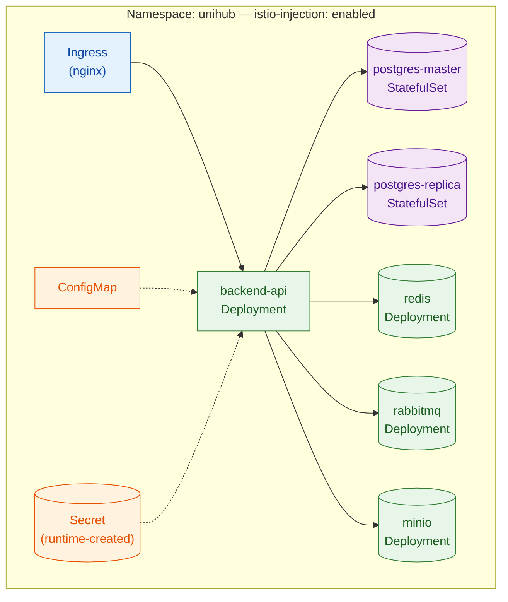
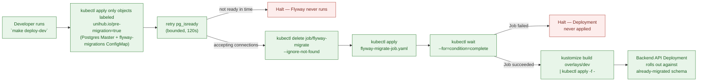

# Deployment & CI/CD — Platform

This file is the physical-level completion of `architecture.md` §1.2 (Core Components — Ingress Controller, Service Mesh, Backend API, PostgreSQL, Redis, Message Broker, Object Storage, Observability Stack) and §5.4 (Network & Data Protection Boundaries — the Zero-Trust mesh every pod runs inside), together with `proposal.md` §5.2/§14/§16 and `docs/requirement.md` §3.3. Those sections established *that* the system runs as N parallel, self-healing Backend API instances behind a single entry point, with PostgreSQL under stable identity/persistent storage, secrets injected at runtime, and CI enforcing lint/test/package before any image is deployable — but deliberately left the concrete Dockerfile, the concrete Kubernetes manifests, the concrete CI workflow, and the concrete migration/seed mechanism as physical detail for this document. Nothing here overrides `architecture.md` — where this file and that one appear to disagree, `architecture.md` is the authority and this file has a bug.

**Why this lives in `platform/`:** it packages and deploys every subsystem this corpus specifies — PostgreSQL (`database-schema.md`), Redis (`distributed-coordination.md`), RabbitMQ (`messaging.md`), MinIO/S3 (`../modules/workshop.md`), JWT/RBAC (`auth-and-identity.md`), and metrics/tracing (`observability.md`) — as one outer envelope: how the Backend API is built into an image, how that image and its dependencies are declared as Kubernetes manifests, how CI verifies a change before it can be packaged, and how a schema/seed migration is applied before any pod starts against it. It does not redesign any subsystem it deploys.

**Scope:** the multi-stage Dockerfile; the Kustomize-based Kubernetes manifest set (base + dev/loadtest overlays); the GitHub Actions CI pipeline (including its security-scan jobs — Gitleaks blocking, Semgrep and Dependency-Check non-blocking); the Flyway-as-a-Kubernetes-Job migration and seed-data mechanism; and the Dev/CI/Minikube-PoC environment matrix. **Out of scope:** the SQL content of any migration beyond the one seed-data file this document names (`database-schema.md` owns schema DDL); Istio's own traffic-policy internals beyond the sidecar-injection labeling and the one namespace-level `PeerAuthentication` this document adds, currently PERMISSIVE (§2, Mesh mTLS Mode ADR) — `architecture.md` §5.4 specifies the model; Prometheus/Grafana/OpenTelemetry configuration beyond the ports and ConfigMap values this document wires up as a deployment target (`observability.md` already specifies the metrics/tracing design); JWT secret *contents* or claims structure (`auth-and-identity.md`, already written — this file only specifies that such a secret exists as a Kubernetes Secret, not its value or shape); any production cloud deployment target (`proposal.md` §5.2 excludes this explicitly); and the Mobile App's (Expo) build/distribution pipeline (a separate, non-store-distribution concern from this Backend-API-focused CI/CD document).

All configuration in this document targets a single Kubernetes namespace, `unihub`, on a local Minikube cluster — consistent with `proposal.md` §5.2's framing of the PoC as local/self-hosted infrastructure, AWS S3 excepted.

---

## Table of Contents

- [Architecture Decision Records (ADRs)](#architecture-decision-records-adrs)
  - [ADR Mini: CI/CD Automation Boundary](#adr-mini-cicd-automation-boundary)
  - [ADR Mini: Kubernetes Manifest Management](#adr-mini-kubernetes-manifest-management)
  - [ADR Mini: Resource Profile Strategy](#adr-mini-resource-profile-strategy)
  - [ADR Mini: Migration & Seed Data Mechanism](#adr-mini-migration-seed-data-mechanism)
  - [ADR Mini: CI Job Structuring](#adr-mini-ci-job-structuring)
  - [ADR Mini: Coverage Verification Mechanism](#adr-mini-coverage-verification-mechanism)
  - [ADR Mini: Contract-Diff Mechanism](#adr-mini-contract-diff-mechanism)
  - [ADR Mini: Container Packaging Strategy](#adr-mini-container-packaging-strategy)
  - [ADR Mini: Mesh mTLS Mode](#adr-mini-mesh-mtls-mode)
  - [ADR Mini: Security Scan Jobs](#adr-mini-security-scan-jobs)
- [1. Container Packaging & Build Strategy](#1-container-packaging-build-strategy)
- [2. Kubernetes Topology — Kustomize Base](#2-kubernetes-topology-kustomize-base)
- [3. Resource Profile Overlays — Dev vs. Load-Test Scale](#3-resource-profile-overlays-dev-vs-load-test-scale)
- [4. Database Migration & Seed Data — Flyway as a Kubernetes Job](#4-database-migration-seed-data-flyway-as-a-kubernetes-job)
- [5. CI Pipeline — GitHub Actions](#5-ci-pipeline-github-actions)
- [6. Local Development vs. CI vs. Minikube PoC — Environment Matrix](#6-local-development-vs-ci-vs-minikube-poc-environment-matrix)
- [7. Reference Table](#7-reference-table)

---

## Architecture Decision Records (ADRs)

### ADR Mini: CI/CD Automation Boundary

**Context:** `docs/requirement.md` §3.3 lists GitHub Actions' CI steps ending at "package the application into a Docker image and push it to Docker Hub" — no deployment step is named anywhere in the corpus. `proposal.md` §14 describes the Minikube-run topology as the runtime target, not something CI is described as driving into. Minikube is inherently local to a developer's machine; a GitHub Actions hosted runner has no network path to reach it without introducing new infrastructure (a self-hosted runner, or a tunnel) that no document in the corpus calls for.

**Decision:** GitHub Actions' automation scope stops at building and pushing the Docker image to Docker Hub. Deployment to the local Minikube cluster is a separate, explicit local action — a Makefile target the developer runs by hand (`kustomize build overlays/<profile> | kubectl apply -f -`) — never a job inside the CI workflow.

**Consequences:**
- The CI workflow's job graph terminates at `build-and-push`; no `deploy` job exists in `.github/workflows/`.
- The local `Makefile` is a first-class artifact of this design (versioned in the repo, not ad hoc), since it's now the only place deployment actually happens.

**Trade-offs accepted (user's own reasoning):** a self-hosted runner registered on the developer's machine (true end-to-end CD) and a tunneled hosted runner were both rejected — the first compounds `proposal.md` §16's already-flagged "learning curve for infrastructure-heavy tooling" risk with a new long-lived process to maintain, the second exposes a local cluster to the internet for no benefit a single-developer PoC needs.

### ADR Mini: Kubernetes Manifest Management

**Context:** `architecture.md` §1.2 and `proposal.md` §14 fix Kubernetes/Minikube as the orchestration target but name no manifest-management tool. The dev-lightweight vs. load-test-scale need (see next ADR) requires some form of environment parameterization across manifest sets, and raw per-environment YAML duplication risks drift between profiles.

**Decision:** Kustomize — a `base/` directory of canonical manifests plus `overlays/dev` and `overlays/loadtest` patch directories, applied via `kubectl apply -k` — is the manifest-management mechanism. No Helm chart, no other templating engine.

**Consequences:**
- Environment differences are expressed as patches against one shared base, not duplicated files — a change to the base (e.g., a new ConfigMap key) propagates to both profiles automatically.
- No new binary is required beyond what ships inside `kubectl` (Kustomize has been built in since 1.14).

**Trade-offs accepted (user's own reasoning):** Helm was rejected — its chart packaging, release/rollback, and Go-template DSL solve problems (multi-release distribution, versioned rollback history) this single-deployable, single-environment-target PoC doesn't have, and would add a second templating language on top of an already infrastructure-heavy stack.

### ADR Mini: Resource Profile Strategy

**Context:** `proposal.md` §16 explicitly flags "high local resource consumption — running a full Kubernetes cluster, database replicas, messaging, monitoring, and a Service Mesh sidecar on every pod together on developer hardware" as a risk, with the accepted mitigation being to "constrain resource usage per component during day-to-day development; run the full topology at scale only for dedicated load-test sessions." No document specifies the mechanism for that split.

**Decision:** Two static Kustomize overlays implement the mitigation directly: `overlays/dev` (1 Backend API replica, single Postgres instance with no replica, minimal `resources.requests/limits`) and `overlays/loadtest` (2+ Backend API replicas, Postgres Master-Replica, full-size `resources.requests/limits` sized toward the 12,000-CCU spike target in `docs/requirement.md` §1.4).

**Consequences:**
- Day-to-day development runs against `overlays/dev` by default — fast iteration, low resource pressure.
- A dedicated load-test session switches to `overlays/loadtest` by name, matching exactly the "only for dedicated load-test sessions" language in `proposal.md` §16.

**Trade-offs accepted (user's own reasoning):** a HorizontalPodAutoscaler-only approach was rejected as the sole mechanism — HPA can scale the Backend API Deployment, but does nothing about Postgres replica count or the per-pod Istio sidecar overhead that `proposal.md` §16 actually names as the cost driver; HPA may still be layered inside `overlays/loadtest` for the API tier specifically, but it does not replace the overlay split.

### ADR Mini: Migration & Seed Data Mechanism

**Context:** `architecture.md` §6.2 already fixes the migration ADR at the concept level: schema changes are explicit and versioned, migration runs once, before any application instance starts, from a single place — never from inside the applications themselves. That ADR's own diagram shows a dedicated Migration Job running before the rolling deployment begins. Given the CI/CD Automation Boundary ADR above, this Job is applied as part of the local deploy step, not by GitHub Actions.

**Decision:** Flyway is packaged into its own container image and run as a one-shot Kubernetes Job (`flyway-migrate`), applied first by the local `Makefile` target; the target blocks on `kubectl wait --for=condition=complete job/flyway-migrate` before applying the Backend API Deployment. Seed data — default roles/permissions from `database-schema.md` §2.2–§2.3 — travels as a Flyway versioned migration (`V2__seed_default_roles_permissions.sql`) using idempotent `INSERT ... ON CONFLICT DO NOTHING`, through the exact same single-execution pipeline as schema DDL, not a separate ad hoc script.

**Consequences:**
- The Job is a first-class, retryable Kubernetes object — its failure is visible via `kubectl get job/flyway-migrate` and blocks the subsequent Deployment apply deterministically.
- Reference data gets the same once-only, versioned guarantee as schema changes — no second mechanism to remember or forget against a fresh cluster.

**Trade-offs accepted (user's own reasoning):** running Flyway from the developer's own machine via `kubectl port-forward` was rejected — it bypasses the in-cluster mTLS path (`architecture.md` §5.4) the in-cluster Job would otherwise use, and depends on a manually-managed, easy-to-forget port-forward process. Running Flyway on Spring Boot startup was rejected outright as a direct violation of the existing `architecture.md` §6.2 ADR (N parallel pods would race to migrate).

### ADR Mini: CI Job Structuring

**Context:** `docs/requirement.md` §3.3 lists an ordered CI sequence (lint, unit tests, integration tests, package+push) but does not specify how that ordering is enforced. This document additionally requires that test execution be structurally separated from artifact publishing, not just sequentially ordered. `CLAUDE.md` and `packages/api-contract/README.md`'s own "Key decisions" table extend that base sequence with one more gate once backend code exists: the `springdoc`-generated OpenAPI spec is diff-checked against the hand-written contract in `packages/api-contract`, and — per the README's own words — "a mismatch is a build failure, not a silent drift." `docs/testing/strategy/test-strategy.md` §4 already documents this as its own stage 4 (Contract diff); this ADR is where that extension actually lands in the job graph, not a competing decision.

**Decision:** A single GitHub Actions workflow file with sequential jobs — `lint` → `unit-test` → `integration-test` (Testcontainers: Postgres — plus a streaming replica for the INV-03 classes —, Redis, RabbitMQ, MinIO) → `contract-diff` → `build-and-push` — connected via `needs:`. The `build-and-push` job additionally runs only on a `push` event to `main` (never on a pull request), and only if every upstream job in the graph succeeded. `contract-diff`'s own mechanism is a separate ADR below, since it involves tool choices `integration-test`'s job doesn't.

**Consequences:**
- A failed lint/unit/integration/contract-diff job structurally blocks `build-and-push` via the job dependency graph — not merely step ordering within one job, which could be bypassed by a misplaced `continue-on-error` or a step-reordering mistake.
- One workflow file remains the single source of truth for the whole pipeline, with no cross-workflow triggering to reason about.
- The three security-scan jobs (Security Scan Jobs ADR) live in the same file but outside the sequential chain: they `needs:` nothing. Semgrep and Dependency-Check are non-blocking, so nothing waits for them; Gitleaks is blocking, so `build-and-push` `needs:` it alongside `contract-diff`.
- The Web Application has its own `web` job (Phase 2 checklist 5): `npm ci`, types generated from `packages/api-contract`, typecheck, lint (oxlint plus the import-boundary rules) and Vitest. It `needs:` nothing and is blocking, outside the sequential chain like the scans: it uses no database, Docker or backend, so it neither waits for nor delays the backend jobs. It is not in `build-and-push`'s `needs:` while no web image is built.
- `contract-diff` runs after `integration-test`, not in parallel with it — it's cheap relative to the Testcontainers job, and ordering it last among the test-gate jobs means a contract mismatch never wastes the time of a run that was already going to fail on lint/unit/integration anyway.

**Trade-offs accepted (user's own reasoning):** two separate workflow files cross-triggered via `workflow_run` were rejected — that level of pipeline decoupling is disproportionate for one developer maintaining one repository, and adds triggering complexity with no corresponding benefit here.

### ADR Mini: Coverage Verification Mechanism

**Context:** `docs/testing/strategy/test-strategy.md` §4 states ≥80% coverage on core business-logic services as a blocking gate on the `unit-test` stage, and `docs/requirement.md` §3.2 states the same figure. Neither document names a concrete coverage tool, and — until this ADR — the `unit-test` job below only ran `./gradlew test`, with no coverage measurement or enforcement step at all: the 80% figure was a documented promise with nothing in the actual pipeline checking it. `docs/testing/test-levels/unit-testing.md` §3 flagged this gap and proposed the fix this ADR formalizes.

**Decision:** `org.jacoco` (JaCoCo), via Gradle's `jacoco` plugin, with a `jacocoTestCoverageVerification` rule scoped to core business-logic packages only (`com.unihub.*.application.usecase`, `com.unihub.*.domain.*` — the package layout fixed by `docs/guidelines/backend-coding-standards.md` §2; exact rule in `docs/testing/test-levels/unit-testing.md` §3), excluding DTOs/config/mappers/the generated `packages/api-contract` client — the same exclusion list `test-strategy.md` §4 already defines in prose. `check.dependsOn jacocoTestCoverageVerification`, and the `unit-test` job runs it as a second step immediately after `./gradlew test`.

**Consequences:**
- A PR that drops core business-logic line coverage below 80% fails the `unit-test` job directly — the same job `test-strategy.md` §4 already names as the coverage gate, not a separate, easily-bypassed check.
- Coverage is measured only over Unit-test execution, consistent with `docs/testing/test-levels/unit-testing.md`'s scope — the `integration-test` job's Testcontainers-backed tests are not folded into this same coverage number, since `test-strategy.md` §4's 80% figure is stated specifically against Unit-level business-logic tests.

**Trade-offs accepted:** JaCoCo's package-level `includes`/`excludes` pattern is this document's own concrete scoping mechanism — `CLAUDE.md` and `test-strategy.md` describe "core business-logic services" only in prose; translating that into glob patterns depends on the package layout. That layout is now fixed by `docs/guidelines/backend-coding-standards.md` §2, and the patterns follow it (`com.unihub.*.application.usecase`, `com.unihub.*.domain.*`), replacing the earlier inferred `com.unihub.*.service.*`. The remaining assumption is only that the scaffold follows §2; `unit-testing.md` §3 says how to confirm the gate actually measures those packages.

### ADR Mini: Contract-Diff Mechanism

**Context:** `packages/api-contract/README.md`'s "Contract authority once implementation starts" decision commits to diffing a `springdoc`-generated spec against the hand-written one in CI, but names no concrete generation or diff tooling — that choice belongs here, at the CI-implementation level, not in the contract package itself. `docs/testing/test-levels/contract-testing.md` §4 flagged a gap in this ADR's first version: `packages/api-contract` already describes all six business modules, but the *generated* spec only ever contains whatever controllers exist in code at a given point in `docs/testing/strategy/test-plan.md`'s phased rollout — a full-spec-vs-full-spec diff would report every not-yet-implemented module's paths as "missing" and fail unconditionally until all six modules are built, contradicting that phased rollout entirely. This ADR's Decision below now includes the fix for that gap, not just the original mechanism. Running that mechanism against the first real controller (`GET /api/v1/workshops`, Phase 1 Mục 1) surfaced four further gaps, each closed in the Decision below: the filter worked per path, so the contract's `POST` on the same path — no controller yet — stayed in the comparison; every component of the hand-written spec stayed in too, referenced by an implemented operation or not (54 orphans); springdoc and the contract describe the same wire shape differently (inlined vs. named `$ref` parameters, headers and schemas, `allOf: [$ref]` vs. inline, an `int32` format on every `int`, OpenAPI 3.0 vs. 3.1); and API-level metadata (`info`, `servers`, `tags`) is part of no operation.

**Decision:** The whole mechanism lives in one script, `apps/backend/scripts/contract-diff.sh`, which the `contract-diff` job and a developer run unchanged (`docs/testing/test-levels/contract-testing.md` §2) — there is no second copy of the steps to keep in sync. It runs five steps:

1. **Generate.** `org.springdoc:springdoc-openapi-gradle-plugin`'s `generateOpenApiDocs` boots the application in a forked JVM and reads its `/v3/api-docs`. It needs no *running* Postgres/Redis/RabbitMQ/MinIO, so it can run as its own lightweight job rather than piggybacking on `integration-test`'s Testcontainers setup — but the application context is real: once any JDBC adapter exists, a `DataSource` bean must be constructible, so `SPRING_DATASOURCE_URL` is set to any JDBC URL (nothing connects to it while the spec is read). springdoc is pinned to `springdoc.api-docs.version: openapi_3_1` in `application.yml` — the dialect the contract is written in.
2. **Bundle** the hand-written multi-file spec into one JSON file with `npx @redocly/cli bundle`, the command `packages/api-contract/README.md` already documents for local use, so `jq` can filter it.
3. **Keep only implemented operations.** `jq` filters the bundled spec's `paths` to the (path, HTTP method) pairs the generated spec has. A module with no controller yet, and an operation not built yet on a path whose other operations are, contribute nothing; an operation that *is* implemented is compared in full.
4. **Normalise both sides.** `redocly bundle --dereferenced --remove-unused-components` resolves every `$ref` and drops what no operation uses, so each operation is compared as its fully resolved shape instead of by the names of the components it happens to reference. Then `jq` deletes `info`, `servers` and `tags` (API-level metadata, not part of any operation); `security` and `components.securitySchemes` (**temporary**, see Consequences); and `format: "int32"` (springdoc writes it for every Java `int`, the contract writes plain `type: integer`; `int64` is still compared).
5. **Diff.** `oasdiff diff` (`tufin/oasdiff`, run via its published Docker image so no local Go toolchain is required) with `--flatten-allof` (the contract writes `allOf: [$ref X]` where springdoc writes `X` inline), `--exclude-elements description,examples,summary,title`, and `--fail-on-diff`.

The job fails on any reported difference in what steps 3–5 leave. Shape — paths, methods, `operationId`, tags, parameters and their constraints, required fields, response codes, content types, headers, schema structure — is compared literally, not narrowed to breaking changes, matching the README's "a mismatch is a build failure" language for everything it describes. Prose — descriptions, summaries, titles, examples — is not compared, so it lives in `packages/api-contract` alone instead of being copied into Java annotations.

**Consequences:**
- The generated spec never connects to a real database or broker — `contract-diff` stays fast and has nothing in common with `integration-test`'s infrastructure needs beyond both running on the same JDK. It does need a `DataSource` URL to exist (Decision, step 1).
- Failing on any *shape* difference, not just breaking changes, means a purely additive change to the hand-written spec for an *already-implemented* operation (a new optional field, a new response code) also requires the backend annotations to be updated in the same change before CI passes — a stricter bar than a breaking-changes-only check, chosen because the README already establishes the hand-written spec as authoritative and *any* drift from it, additive or not, means the two have silently diverged on what the real contract is. A wording-only change (a clarified description, a new example) does not, by design.
- An operation implemented in code but genuinely absent from the hand-written spec (an undocumented endpoint) is **not** removed by the `jq` step in step 3 — it only removes hand-written-only operations, never generated-only ones — so `contract-diff` still fails on undocumented endpoints.
- A module, or a single operation, can go from "not yet implemented" (silently excluded from the diff) to "implemented" (fully diffed, any drift blocking) with no separate flag to flip — step 3 re-derives the implemented set from the generated spec on every run.
- **The job proves the *declared* shape, not that the behaviour exists.** A controller can declare a `429` with `Retry-After`, or an `X-Correlation-Id` header, with annotations alone; the diff passes whether or not a rate limiter or a correlation-ID filter exists. At the time of writing `GET /api/v1/workshops` declares exactly those two without implementing either; the controller method says so in a comment.
- **Authentication is proved, except one prose field.** Step 4 compares the global `security` requirement, the `bearerAuth` scheme (`type`/`scheme`/`bearerFormat`) and each operation's own `security`; only the scheme's long `description` is dropped from both sides, because that text lives only in the contract. (Until RBAC/JWT landed, Mục 2.2, step 4 removed `security` and `components.securitySchemes` wholesale; see `docs/testing/reports/test-matrix.md` §4.4.)
- Dereferencing (step 4) makes a contract refactor that only renames or splits components invisible to the job. That is intended — a component's name is not part of the wire shape — but it also means the job cannot check that the contract keeps a given schema reusable.

**Trade-offs accepted:** `oasdiff`, the `springdoc-openapi-gradle-plugin` task name, and the script's `jq`/`redocly` filters are this document's own tool picks and scripting choices — `CLAUDE.md` names `springdoc` generically but neither a specific plugin nor a diff tool, and names nothing about phased-rollout filtering at all. This ADR's first version carried a path-only `jq` filter flagged as inferred and "to be verified against the real generated-spec shape once the first backend controller exists"; that verification happened with `GET /api/v1/workshops` (Phase 1 Mục 1) and the path-only filter was not sufficient, which is why steps 3–5 above exist. A live-endpoint approach (hitting a running app's `/v3/api-docs` instead of the static `generateOpenApiDocs` task) was rejected because it would require standing up the full application (defeating the "lightweight job" goal above) just to read spec metadata that the annotations already contain statically. Copying every contract description and example into Java annotations, so the prose could be diffed too, was rejected: the same text in two places that must stay identical, for no wire-level benefit. `@redocly/cli` 2.x requires Node ≥ 22.12 (or ≥ 20.19 < 21), so the job pins `actions/setup-node` to `'22'` instead of relying on whatever Node the `ubuntu-latest` image happens to ship.

### ADR Mini: Container Packaging Strategy

**Context:** `CLAUDE.md` and `proposal.md` §10 fix Java 21 / Spring Boot 3.x as the backend stack and Docker Hub as the registry, but name no build mechanism. Spring Boot 3 ships two credible Dockerfile-free alternatives — Cloud Native Buildpacks via `bootBuildImage`, and Jib — alongside a hand-written multi-stage Dockerfile.

**Decision:** An explicit multi-stage Dockerfile: a builder stage (JDK + Gradle, with the dependency-resolution layer cached separately from the source-copy layer so unchanged dependencies never re-download) produces the jar; a minimal runtime stage (slim JRE base image, non-root `USER`, `-XX:MaxRAMPercentage` tuned for cgroup v2 container memory limits) runs it.

**Consequences:**
- Every layering, user-privilege, and JVM-tuning decision is visible and reviewable directly in the Dockerfile — nothing is delegated to a buildpack's implicit defaults.
- The dependency-layer/source-layer split gives the same build-cache benefit Buildpacks/Jib provide automatically, but stated explicitly as a design decision in this document.

**Trade-offs accepted (user's own reasoning):** Buildpacks and Jib were both rejected — this is a design-stage project meant to specify and demonstrate the container-build reasoning (layer caching, non-root user, cgroup-aware JVM sizing) explicitly; delegating that to a buildpack's implicit defaults would hide exactly the mechanics this document exists to make legible.

### ADR Mini: Mesh mTLS Mode

**Status:** the direction is **STRICT**, but it is **not in force**. `base/peer-authentication.yaml` ships `PERMISSIVE` until the three preconditions below are met; they are Phase 7 exit criteria (`docs/testing/strategy/test-plan.md` §1). An earlier version of this ADR decided STRICT outright; that was withdrawn because it would have refused in-cluster clients this document does not yet deploy or handle, and removed the one workaround it had for the Flyway Job (opting out of injection).

**Context:** `architecture.md` §5.4 guarantees that every connection is mutually authenticated and that "there is no plaintext hop anywhere" — but this document, which turns that into manifests, only labeled the namespace for sidecar injection, and deferred the mesh's traffic policy to `architecture.md` §5.4, which states the guarantee without naming a setting. Sidecar injection alone leaves Istio's default mode, which negotiates mTLS between sidecars but still *accepts* plaintext connections — so the guarantee holds only as long as no client chooses to connect in plaintext, and nothing in the manifests prevents it. The gap was found while writing the mTLS test in `docs/testing/non-functional/security-testing.md` (S-19).

**Decision:** the target is a namespace-wide `PeerAuthentication` named `default` in `STRICT` mode, so a connection to any pod in `unihub` that does not present a valid mesh identity is refused rather than downgraded to plaintext. **Until the preconditions are met the object is `PERMISSIVE`**: sidecars still negotiate mTLS, plaintext is still accepted, and `architecture.md` §5.4's "no plaintext hop" is a target, not an enforced guarantee. Switching is a one-line change (`mode: STRICT`), made only when all three boxes are ticked.

**Istio version: 1.24.x.** A decision on paper, made so the manifests, the `apiVersion` below and precondition (b) all target one version. It rests on two assertions from the decision-maker that this blueprint has not verified: that 1.24.x is the stable line to standardize on, and that it supports native sidecar termination for Jobs. Both — and compatibility with the Kubernetes/Minikube version actually installed — are checked at implementation; if they turn out wrong, the blueprint is corrected then.

**Preconditions — all three before switching to STRICT** (each is currently **not met**):
- [ ] **(a) Ingress path.** `architecture.md` §5.4's diagram has Ingress → mTLS → sidecar, but this document does not deploy the Ingress controller (Minikube's ingress add-on runs it in its own namespace). Either the `ingress-nginx` namespace is sidecar-injected, or the Ingress → `backend-api` path is covered by its own, narrowly scoped `PeerAuthentication` exception — which weakens "no exempted hop" for that one hop and must be recorded as such. Without one of the two, STRICT refuses every external request.
- [ ] **(b) Flyway Job exits its sidecar.** The namespace is injected, so the Job's pod carries an `istio-proxy` container that, without help, keeps running after Flyway exits — the Job never reaches `complete` and `kubectl wait --for=condition=complete` (§4) times out. **This affects today's PERMISSIVE deploy too, not only STRICT**, and under STRICT the old workaround — `sidecar.istio.io/inject: "false"` on the Job — no longer works, because a non-meshed client is refused. The blueprint's answer is Istio's **native sidecar termination** (built on Kubernetes sidecar containers, which end the proxy when the Job's main container exits), expected to be available on Istio 1.24.x; there is deliberately **no custom `quitquitquit` fallback** in the blueprint. What stays **unmet** is confirming, at implementation, that it works on that Istio version together with the Kubernetes version Minikube provides, and whether it has to be switched on.
- [ ] **(c) Observability stack.** Prometheus, Grafana and Tempo scrape and receive from `unihub` pods (Actuator on 8080, RabbitMQ's 15692, OTLP), and `architecture.md` §5.4 puts the observability stack in the mesh — but this document does not deploy it (out of scope above). Either it is injected, or the scrape/export ports get a scoped exception. Any other in-cluster client of a `unihub` pod, such as the load-test WireMock stub, falls under the same rule.

**Consequences:**
- While the mesh is PERMISSIVE, INV-20 (`docs/testing/strategy/test-strategy.md` §2) is pending, the mTLS test S-19 cannot pass, and it must not be reported as Covered in the OWASP map (`docs/testing/non-functional/security-testing.md`).
- Kubelet `httpGet` probes are expected to keep working under STRICT because Istio rewrites application probes to go through the sidecar by default — verify against the installed version.
- `PeerAuthentication` uses `apiVersion: security.istio.io/v1`, which Istio 1.22+ serves — covered by the chosen 1.24.x.

**Trade-offs accepted:** enforcing STRICT now was rejected — with (a)–(c) unmet it would refuse the Ingress, the observability stack and the migration Job. The interim leaves the guarantee unenforced, and says so openly rather than presenting a manifest that looks strict. The default mode without any object was rejected only in the sense that an explicit `PERMISSIVE` object makes the intent visible and the later switch a single line. STRICT's eventual cost is on the same footing as `architecture.md` §5.4's stated trade-off that "the mesh is now a dependency of everything."

### ADR Mini: Security Scan Jobs

**Context:** the corpus had no static-analysis, dependency-vulnerability or secret-scanning tool: the only automated code check in the pipeline is `lint` (Checkstyle + Spotless), which checks style, not security, and INV-18 (`docs/testing/strategy/test-strategy.md` §2) named "secret-scanning" without choosing one.

**Decision:** three tools, each its own job in the existing workflow, in parallel with — not inside — the gate chain (they `needs:` nothing):
- **Gitleaks** (secret scanning, INV-18) is **blocking**: `build-and-push` `needs:` it, and it has no `continue-on-error`.
- **Semgrep** (SAST) and **OWASP Dependency-Check** (dependency vulnerabilities) are **non-blocking**: `continue-on-error: true`, nothing `needs:` them. They report on every push and pull request and gate neither a merge nor `build-and-push`.

Decided in a review of the testing documents.

**Why Gitleaks is blocking from the start:** INV-18 is Non-Negotiable, and a secret that reaches the repository is not undone by fixing it later (it stays in history, which is why the job scans full history). Secret findings have the fewest legitimate false positives and depend on no external database, and — since no source code exists yet — there is no baseline to triage, so blocking costs nothing today. Justified false positives go in Gitleaks' allowlist, committed and reviewed.

**Why Semgrep and Dependency-Check are non-blocking at first:**
- *No baseline.* The first runs on real code will surface an unknown volume of findings, some of them false positives. Blocking merges on untriaged noise stalls the critical path of a single-developer delivery (`proposal.md` §16's bandwidth risk).
- *External dependency (Dependency-Check).* It relies on a remote vulnerability database whose availability and rate limits are outside the project's control (an API key is normally required to avoid throttling); an outage there would block merges for reasons unrelated to the change.
- *Untuned rules (Semgrep).* The rule sets named in §5 are starting values.

**Conditions to promote Semgrep or Dependency-Check to blocking** (each independently; promotion means removing `continue-on-error` and adding the job to `build-and-push`'s `needs:`):
1. The baseline is triaged: every existing finding is either fixed or suppressed with a written justification in a committed suppression file (inline `nosemgrep`, Dependency-Check's suppression file).
2. The tool image is pinned to a version or digest rather than `latest`, so a tool upgrade cannot fail a merge. **Met for the image (2026-10-26):** Semgrep `1.181.1`, Dependency-Check `13.0.0`, Gitleaks `v8.30.1`, each the version `latest` resolved to at that moment (same manifest digest). The rules and vulnerability data they fetch at run time are not pinned.
3. A blocking severity threshold has been chosen (for example, High and Critical only). **Not chosen yet.**
4. The job has run stably for a period the user defines. **Not defined yet.**
5. For Dependency-Check: the API-key secret is in place and its data is cached, so runtime is bounded.

**Consequences:** INV-18's detection is enforced from the first push. Semgrep and Dependency-Check findings are visible but gate nothing until promoted. Reports are workflow artifacts, never committed (`docs/testing/strategy/test-strategy.md` §6). Gating a *pull-request merge* on Gitleaks additionally needs the manual branch-protection setup in §5.

**Trade-offs accepted:** all three jobs blocking from day one was rejected for Semgrep and Dependency-Check for the reasons above; running any of them inside the `lint` → … → `build-and-push` chain was rejected because a scan finding is then indistinguishable from a test failure and lengthens every gate run. Gitleaks first ran on `latest`, the same posture the `oasdiff` step takes, accepting that an upgrade could start failing merges; all three scanner images were then pinned on 2026-10-26 (Semgrep 1.181.1, Dependency-Check 13.0.0, Gitleaks v8.30.1 — each what `latest` pointed to, so nothing changed) rather than waiting for that first failure. `oasdiff` still takes `latest`.

---

## 1. Container Packaging & Build Strategy

**Rationale:** `CLAUDE.md` fixes Java 21 / Spring Boot 3.x and Docker Hub as the registry (per the Container Packaging Strategy ADR above). The two things a container-packaging design must get right for this project specifically are: (a) rebuilding the image on every source change must not re-download every dependency, since CI runs this on every push (`docs/requirement.md` §3.3), and (b) the running container must respect the memory limit Kubernetes assigns it, not the host's full physical memory, since the JVM historically over-reads `/proc/meminfo` unless told the process is inside a cgroup.

**Model:**

```dockerfile
# ---- Builder stage ----
FROM eclipse-temurin:21-jdk-jammy AS builder
WORKDIR /workspace

# Dependency layer, cached separately from source: Docker only re-runs this
# RUN when build.gradle/settings.gradle/gradle-wrapper.properties change,
# never on a plain source edit.
COPY gradlew ./
COPY gradle gradle
COPY build.gradle settings.gradle ./
RUN ./gradlew dependencies --no-daemon

# Source layer: invalidates only this and the steps below it on a source edit.
COPY src src
RUN ./gradlew bootJar --no-daemon -x test

# ---- Runtime stage ----
FROM eclipse-temurin:21-jre-jammy AS runtime

# Non-root: the container never runs as root, even though nothing in this
# image currently requires elevated privileges — defense-in-depth against
# a future dependency that might.
RUN groupadd --system unihub && useradd --system --gid unihub unihub
WORKDIR /app
COPY --from=builder /workspace/build/libs/*.jar app.jar
USER unihub

# cgroup v2-aware JVM sizing: MaxRAMPercentage bounds heap to a share of the
# *container's* memory limit (via Deployment resources.limits.memory, §2/§3),
# not the node's physical RAM — required so a pod's own limit is what the JVM
# actually respects. InitialRAMPercentage avoids a cold-start heap that's too
# small to absorb the registration-opening spike (docs/requirement.md §1.4)
# before the JVM's own heuristics catch up.
ENV JAVA_TOOL_OPTIONS="-XX:+UseContainerSupport -XX:MaxRAMPercentage=75.0 -XX:InitialRAMPercentage=50.0"

EXPOSE 8080
ENTRYPOINT ["java", "-jar", "/app/app.jar"]
```

| Decision | Value | Why |
|---|---|---|
| Builder base image | `eclipse-temurin:21-jdk-jammy` | Matches `CLAUDE.md`'s Java 21 requirement exactly; Temurin is the OpenJDK distribution with the widest CI/Docker Hub support. |
| Runtime base image | `eclipse-temurin:21-jre-jammy` (not `-jdk`) | The runtime stage never compiles anything — a JRE is the smaller, correct base; shipping a JDK (with `javac`, `jshell`, etc.) into a runtime image is unused attack surface. |
| Layer order | Dependency manifest copied and resolved *before* `src/` is copied | Docker's layer cache invalidates from the first changed layer downward — putting the rarely-changing dependency manifest first means a routine source edit never re-triggers a dependency re-download. |
| Non-root `USER` | Dedicated `unihub` system user, no shell, no home directory needed | Baseline container hardening; consistent with `architecture.md` §5.4's Zero-Trust posture applied one layer lower, at the process level inside the pod. |
| JVM container awareness | `-XX:+UseContainerSupport -XX:MaxRAMPercentage=75.0` | Modern JDKs (10+) enable container support by default, but pinning it here makes the intent explicit rather than relying on a default that could change; 75% leaves headroom for the JVM's own non-heap memory (metaspace, thread stacks, direct buffers) inside the same container limit (§2/§3). |
| Health check mechanism | Kubernetes liveness/readiness probes (§2), **not** a Docker `HEALTHCHECK` instruction | Kubernetes never consults `HEALTHCHECK` — it uses its own probe configuration on the Pod spec. Adding one here would be dead configuration; the actual probe design lives in `observability.md`. |
| Image tag convention | `<dockerhub-namespace>/unihub-backend:<git-sha>`, plus a floating `:latest` on every `main` push | The immutable `git-sha` tag is what Kubernetes manifests actually reference (§2) — a floating tag alone would make "which commit is running" unanswerable from the cluster; `:latest` remains only as a convenience pointer for manual local use. |

**Trade-offs:** the two-stage build means the builder stage's full JDK + Gradle toolchain is downloaded and run on every CI build — that cost is accepted because it's paid once per CI run, inside a job whose own stated job (§5) is exactly to verify the code before it can be packaged; it is never paid at runtime, since the final image contains only the JRE and the built jar.

**Guarantees:** the shipped image never contains build tooling (Gradle, source `.java` files, a full JDK) — only the runtime and the compiled jar; the container never runs as root; the JVM's heap sizing is bound to whatever `resources.limits.memory` the Deployment spec assigns it (§2/§3), never to the node's total physical memory.

---

## 2. Kubernetes Topology — Kustomize Base

**Rationale:** `architecture.md` §1.2 names the Core Components this topology must stand up: Ingress Controller, Backend API, PostgreSQL, Redis, Message Broker, Object Storage, and — per §5.4 — a sidecar proxy on every one of those pods. This section gives that list concrete manifest form as a Kustomize `base/`, deferring only the two things that differ per environment (replica counts, resource sizing — §3) to overlays.

**Model:**

```
k8s/
├── namespace.yaml
├── base/
│   ├── kustomization.yaml
│   ├── backend-api-deployment.yaml
│   ├── backend-api-service.yaml
│   ├── ingress.yaml
│   ├── postgres-master-statefulset.yaml
│   ├── postgres-master-service.yaml
│   ├── postgres-replica-statefulset.yaml
│   ├── postgres-replica-service.yaml
│   ├── redis-deployment.yaml
│   ├── redis-service.yaml
│   ├── rabbitmq-deployment.yaml
│   ├── rabbitmq-service.yaml
│   ├── minio-deployment.yaml
│   ├── minio-service.yaml
│   ├── peer-authentication.yaml
│   ├── configmap.yaml
│   └── secret.example.yaml
├── overlays/
│   ├── dev/
│   └── loadtest/
└── jobs/
    └── flyway-migrate-job.yaml
```

`base/kustomization.yaml` is what actually ties the files above into one applied resource set — every manifest is listed explicitly, **except** `secret.example.yaml`, which is deliberately left out — and it also carries the `configMapGenerator` for the Flyway migrations (§4). Kustomize does not glob, so each new migration file is added to that `files:` list as part of adding the migration:

```yaml
# k8s/base/kustomization.yaml
apiVersion: kustomize.config.k8s.io/v1beta1
kind: Kustomization
resources:
  - backend-api-deployment.yaml
  - backend-api-service.yaml
  - ingress.yaml
  - postgres-master-statefulset.yaml
  - postgres-master-service.yaml
  - postgres-replica-statefulset.yaml
  - postgres-replica-service.yaml
  - redis-deployment.yaml
  - redis-service.yaml
  - rabbitmq-deployment.yaml
  - rabbitmq-service.yaml
  - minio-deployment.yaml
  - minio-service.yaml
  - peer-authentication.yaml
  - configmap.yaml
configMapGenerator:                    # the migration SQL the Flyway Job mounts (§4)
  - name: flyway-migrations
    files:
      - ../../src/main/resources/db/migration/V1__initial_schema.sql
      - ../../src/main/resources/db/migration/V2__seed_default_roles_permissions.sql
    options:
      disableNameSuffixHash: true      # the Job is applied outside Kustomize and names this ConfigMap literally
      labels:
        unihub.io/pre-migration: "true"  # so `make pre-migration` can apply it ahead of the rest (§4)
# secret.example.yaml is intentionally absent from this list — it is a
# committed template only (placeholder stringData, shown below). Leaving it
# out of `resources:` is what guarantees `kubectl apply -k` (any overlay)
# never creates a Secret whose values are the literal string
# "<injected at runtime>" — the real Secret only ever comes from the
# imperative `kubectl create secret generic backend-api-secrets ...`
# command shown below, never from a file kustomize/kubectl reads.
```

`namespace.yaml` carries the mesh-injection label required by `architecture.md` §5.4 — every pod created inside this namespace picks up an Envoy sidecar automatically, with no per-Deployment annotation needed:

```yaml
apiVersion: v1
kind: Namespace
metadata:
  name: unihub
  labels:
    istio-injection: enabled
```

`base/peer-authentication.yaml` declares the mesh's mTLS mode for the whole namespace (Mesh mTLS Mode ADR above). It has no `selector`, so it applies to every workload in `unihub` — the Backend API, PostgreSQL, Redis, RabbitMQ and MinIO alike. **It is `PERMISSIVE` for now; STRICT is the target, gated by the ADR's three preconditions:**

```yaml
apiVersion: security.istio.io/v1
kind: PeerAuthentication
metadata:
  name: default
  namespace: unihub
spec:
  mtls:
    mode: PERMISSIVE   # interim; becomes STRICT once ADR preconditions (a)-(c) are met
```

Injection on its own does not decide this: with no object at all Istio's default is also permissive. The object is kept so the intent is explicit and the later switch is one line. Under `PERMISSIVE` plaintext connections are still accepted, so `architecture.md` §5.4's "no plaintext hop" is not yet enforced.

`base/backend-api-deployment.yaml` — the base carries a conservative default; §3's overlays patch `replicas` and `resources` per profile:

```yaml
apiVersion: apps/v1
kind: Deployment
metadata:
  name: backend-api
  namespace: unihub
spec:
  replicas: 1  # base default only — always overridden by an overlay (§3)
  selector:
    matchLabels: { app: backend-api }
  template:
    metadata:
      labels: { app: backend-api }
    spec:
      containers:
        - name: backend-api
          image: unihub/unihub-backend:latest  # tag pinned per-deploy via `kustomize edit set image` (§7)
          ports:
            - containerPort: 8080
          envFrom:
            - configMapRef: { name: backend-api-config }
            - secretRef: { name: backend-api-secrets }
          resources:
            requests: { cpu: "250m", memory: "512Mi" }  # base default only — patched per overlay (§3)
            limits:   { cpu: "500m", memory: "768Mi" }
          readinessProbe:
            httpGet: { path: /actuator/health/readiness, port: 8080 }
            initialDelaySeconds: 15
            periodSeconds: 10
          livenessProbe:
            httpGet: { path: /actuator/health/liveness, port: 8080 }
            initialDelaySeconds: 30
            periodSeconds: 15
```

Probe paths and the Liveness/Readiness split (process-alive vs. PostgreSQL-Master connectivity — `observability.md`'s Readiness Composition ADR; Redis and RabbitMQ are deliberately not Readiness conditions) are `observability.md`'s design, reused here only as the concrete `httpGet` wiring the Deployment spec needs.

`base/configmap.yaml` and `base/secret.example.yaml` are **shape-only** — key names, never real values, per `CLAUDE.md`'s non-negotiable invariant that secrets are never committed:

```yaml
apiVersion: v1
kind: ConfigMap
metadata:
  name: backend-api-config
  namespace: unihub
data:
  SPRING_PROFILES_ACTIVE: "kubernetes"
  DB_HOST: "postgres-master"
  DB_PORT: "5432"
  REDIS_HOST: "redis"
  RABBITMQ_HOST: "rabbitmq"
  S3_ENDPOINT: "http://minio:9000"
  # UNIHUB_NOTIFICATION_SMTP_HOST is required (blank stops startup, notification.md §2) and has
  # no placeholder here on purpose: a non-blank dummy value would pass that check and silently
  # turn every email into UNAVAILABLE. Each overlay sets the real SMTP host.
  UNIHUB_NOTIFICATION_SMTP_PORT: "587"
---
# secret.example.yaml — committed as a template, never as `secret.yaml` with real values;
# `.gitignore` excludes any locally-generated `secret.yaml`. Real values are created via
# `kubectl create secret generic backend-api-secrets --from-literal=DB_PASSWORD=... \
#   --from-literal=JWT_SIGNING_KEY=... -n unihub` and are never written to a file that
# could be committed.
apiVersion: v1
kind: Secret
metadata:
  name: backend-api-secrets
  namespace: unihub
type: Opaque
stringData:
  DB_USER: "<injected at runtime>"
  DB_PASSWORD: "<injected at runtime>"
  JWT_SIGNING_KEY: "<injected at runtime>"
  PAYMENT_GATEWAY_API_KEY: "<injected at runtime>"
  UNIHUB_NOTIFICATION_SMTP_USERNAME: "<injected at runtime>"   # Phase 4 checklist D36
  UNIHUB_NOTIFICATION_SMTP_PASSWORD: "<injected at runtime>"
```

`base/postgres-master-statefulset.yaml` gives PostgreSQL the stable identity and persistent storage `docs/requirement.md` §3.3 requires; `database-schema.md` owns everything about the schema this instance holds, not this document:

```yaml
apiVersion: apps/v1
kind: StatefulSet
metadata:
  name: postgres-master
  namespace: unihub
  labels: { unihub.io/pre-migration: "true" }   # applied before the Flyway Job runs (§4)
spec:
  serviceName: postgres-master
  replicas: 1
  selector:
    matchLabels: { app: postgres-master }
  template:
    metadata:
      labels: { app: postgres-master }
    spec:
      containers:
        - name: postgres
          image: postgres:16-alpine
          ports: [{ containerPort: 5432 }]
          envFrom:
            - secretRef: { name: backend-api-secrets }
          volumeMounts:
            - name: data
              mountPath: /var/lib/postgresql/data
          resources:
            requests: { cpu: "250m", memory: "512Mi" }  # base default only — patched per overlay (§3)
            limits:   { cpu: "500m", memory: "1Gi" }
  volumeClaimTemplates:
    - metadata: { name: data }
      spec:
        accessModes: ["ReadWriteOnce"]
        resources: { requests: { storage: "2Gi" } }  # base default only — patched per overlay (§3)
```

`postgres-master`'s `spec.serviceName` above requires a governing Service of that exact name to exist — this is what gives the StatefulSet's pod(s) the stable network identity `docs/requirement.md` §3.3 requires, and it's the same name the Flyway Job (§4) and the ConfigMap's `DB_HOST` (above) resolve against. It's headless (`clusterIP: None`) because a StatefulSet's governing Service exists to provide per-pod DNS records, not a single load-balanced ClusterIP:

```yaml
# base/postgres-master-service.yaml
apiVersion: v1
kind: Service
metadata:
  name: postgres-master
  namespace: unihub
  labels: { unihub.io/pre-migration: "true" }   # applied before the Flyway Job runs (§4)
spec:
  clusterIP: None
  selector:
    app: postgres-master
  ports:
    - port: 5432
      targetPort: 5432
```

`base/postgres-replica-statefulset.yaml` mirrors the Master's StatefulSet (same `resources` block, same volume claim shape) with streaming replication configured against `postgres-master` — present in the base for completeness of the topology, but scaled to zero replicas in `overlays/dev` and to 1+ in `overlays/loadtest` (§3), since a lone developer iterating locally has no read-traffic volume to split. `base/postgres-replica-service.yaml` mirrors the Master's headless Service identically, with `name: postgres-replica` and `selector: { app: postgres-replica }` — the Backend API's read-routing datasource (`architecture.md` §4.1) resolves reads against this name, writes against `postgres-master` above.

`base/ingress.yaml` is the single external entry point (`architecture.md` §1.2), TLS-terminating and routing to `backend-api-service`:

```yaml
apiVersion: networking.k8s.io/v1
kind: Ingress
metadata:
  name: unihub-ingress
  namespace: unihub
  annotations:
    kubernetes.io/ingress.class: nginx
spec:
  tls:
    - hosts: ["unihub.local"]
      secretName: unihub-tls
  rules:
    - host: unihub.local
      http:
        paths:
          - path: /
            pathType: Prefix
            backend:
              service:
                name: backend-api-service
                port: { number: 8080 }
```

Redis, RabbitMQ, and MinIO each get a base `Deployment` + `Service` pair, each following `distributed-coordination.md` §1's single-instance-PoC topology, `messaging.md`'s broker configuration, and `../modules/workshop.md`'s MinIO-as-S3-substitute decision respectively — this document only wires them into the same namespace and mesh, it does not redesign any of the three. Their Deployments carry the same `app: <name>` pod-template label the Backend API's Deployment does (§2, above); each Service below selects on that same label, which is what makes the ConfigMap's `REDIS_HOST`/`RABBITMQ_HOST`/`S3_ENDPOINT` values (above) resolvable at all:

```yaml
# base/redis-service.yaml
apiVersion: v1
kind: Service
metadata:
  name: redis
  namespace: unihub
spec:
  selector: { app: redis }
  ports:
    - port: 6379
      targetPort: 6379
---
# base/rabbitmq-service.yaml
apiVersion: v1
kind: Service
metadata:
  name: rabbitmq
  namespace: unihub
spec:
  selector: { app: rabbitmq }
  ports:
    - port: 5672
      targetPort: 5672
    - port: 15672
      targetPort: 15672
---
# base/minio-service.yaml
apiVersion: v1
kind: Service
metadata:
  name: minio
  namespace: unihub
spec:
  selector: { app: minio }
  ports:
    - port: 9000
      targetPort: 9000
```

<div align=center>



</div>

**Trade-offs:** the base declares every component the topology needs, including the Postgres Replica, even though `overlays/dev` scales it to zero — this means the base is never itself a directly-deployable set of manifests (it needs an overlay to be sane for any real use), a small departure from Kustomize's more common "base is deployable on its own" convention, accepted because the alternative (two divergent base-like manifest sets) is exactly the drift risk the Kubernetes Manifest Management ADR exists to avoid.

**Guarantees:** every pod in this namespace inherits the mesh's mTLS automatically via the namespace-level `istio-injection` label (`architecture.md` §5.4) — no per-Deployment sidecar configuration is needed or present — and `base/peer-authentication.yaml` declares the mode. It is `PERMISSIVE` today, so the mesh *offers* mTLS but does not yet *refuse* plaintext; that enforcement is the STRICT target, gated by the Mesh mTLS Mode ADR's preconditions. No Secret with a real value is ever committed; `secret.example.yaml`'s `stringData` placeholders are never valid credentials.

---

## 3. Resource Profile Overlays — Dev vs. Load-Test Scale

**Rationale:** implements the Resource Profile Strategy ADR directly — `proposal.md` §16's named risk (the full topology's cumulative resource cost on dev hardware) is addressed by never running the full-size topology except when a load test is the explicit goal.

**Model:**

```
k8s/overlays/dev/
├── kustomization.yaml
└── resource-patch.yaml

k8s/overlays/loadtest/
├── kustomization.yaml
└── resource-patch.yaml
```

`overlays/dev/kustomization.yaml`:

```yaml
apiVersion: kustomize.config.k8s.io/v1beta1
kind: Kustomization
resources:
  - ../../base
patches:
  - path: resource-patch.yaml
replicas:
  - name: backend-api
    count: 1
  - name: postgres-replica
    count: 0   # same replicas: mechanism overlays/loadtest uses to scale it up — no separate patch file needed
```

`overlays/dev/resource-patch.yaml`:

```yaml
apiVersion: apps/v1
kind: Deployment
metadata:
  name: backend-api
spec:
  template:
    spec:
      containers:
        - name: backend-api
          resources:
            requests: { cpu: "200m", memory: "384Mi" }
            limits:   { cpu: "400m", memory: "512Mi" }
```

`overlays/loadtest/kustomization.yaml`:

```yaml
apiVersion: kustomize.config.k8s.io/v1beta1
kind: Kustomization
resources:
  - ../../base
patches:
  - path: resource-patch.yaml
replicas:
  - name: backend-api
    count: 3
  - name: postgres-replica
    count: 1
```

`overlays/loadtest/resource-patch.yaml` — one file, three strategic-merge documents: the `backend-api` Deployment, and both Postgres StatefulSets, since the Resource Profile Strategy ADR's "full-size `resources.requests/limits`" claim covers the whole Master-Replica topology, not the API tier alone:

```yaml
apiVersion: apps/v1
kind: Deployment
metadata:
  name: backend-api
spec:
  template:
    spec:
      containers:
        - name: backend-api
          resources:
            requests: { cpu: "500m", memory: "768Mi" }
            limits:   { cpu: "1000m", memory: "1Gi" }
---
apiVersion: apps/v1
kind: StatefulSet
metadata:
  name: postgres-master
spec:
  template:
    spec:
      containers:
        - name: postgres
          resources:
            requests: { cpu: "1000m", memory: "2Gi" }
            limits:   { cpu: "2000m", memory: "4Gi" }
---
apiVersion: apps/v1
kind: StatefulSet
metadata:
  name: postgres-replica
spec:
  template:
    spec:
      containers:
        - name: postgres
          resources:
            requests: { cpu: "1000m", memory: "2Gi" }
            limits:   { cpu: "2000m", memory: "4Gi" }
```

| Component | `overlays/dev` | `overlays/loadtest` | Why |
|---|---|---|---|
| `backend-api` replicas | 1 | 3 | Dev needs one instance to iterate against; the 12,000-CCU spike target (`docs/requirement.md` §1.4) needs multiple parallel instances behind the Ingress to be meaningfully exercised at all. |
| `backend-api` CPU/memory request | 200m / 384Mi | 500m / 768Mi | Dev's single instance only needs to serve one developer's manual traffic; load-test instances need headroom under the K6/JMeter-driven surge `docs/requirement.md` §3.2 requires. |
| `postgres-master`/`postgres-replica` CPU/memory request | Unpatched — base default (250m / 512Mi, §2) | 1000m / 2Gi | A load test's whole point is to exercise the read/write split under real query volume (`architecture.md` §4.1) — running it against a resource-starved Postgres would bottleneck on the database, not on what's actually being measured. Dev's single-developer query volume never approaches the base default. |
| `postgres-replica` count | 0 | 1 | Dev has no read-traffic volume to split across a Master and a Replica; a load test is specifically what `architecture.md` §4.1's read/write split exists to be validated against. |
| Istio sidecar resources | Mesh default (unpatched) | Mesh default (unpatched) | The sidecar's own resource footprint is the same per-pod regardless of profile — the *number of pods* carrying one is what the profile split actually controls (fewer pods in dev = fewer sidecars, not smaller sidecars). |

Both values above are starting/tuning numbers, not derived from a load test that hasn't been run yet — expected to be revised once `docs/requirement.md` §3.2's K6/JMeter scenario produces real numbers.

**Trade-offs:** maintaining two overlays means any new resource ever added to the base (say, a future component) needs a conscious decision about whether it needs a per-profile patch too — a small ongoing maintenance cost, accepted in exchange for the base staying a single source of truth for every component's *shape*, with only *sizing* diverging per environment.

**Guarantees:** switching profiles is a one-line command change (`overlays/dev` vs `overlays/loadtest` in the `Makefile` target, §4), never a manual edit of shared manifests — there is no way to "accidentally" run the full-scale topology since it never activates without explicitly naming `loadtest`.

---

## 4. Database Migration & Seed Data — Flyway as a Kubernetes Job

**Rationale:** `architecture.md` §6.2 already fixes the ADR — migration runs once, from a single place, before any application instance starts. This section gives that ADR's own diagram (a Migration Job → DB → success → Rollout) concrete Kubernetes form, and extends the same single-execution guarantee to reference-data seeding, per the Migration & Seed Data Mechanism ADR above.

**Model:**

Migration SQL files live under `src/main/resources/db/migration/` in the application source tree (once it exists), following Flyway's own naming convention. `database-schema.md` §10's DDL becomes `V1__initial_schema.sql`; this document adds the seed file on top:

```sql
-- V2__seed_default_roles_permissions.sql
INSERT INTO roles (id, name) VALUES
    (gen_random_uuid(), 'Student'),
    (gen_random_uuid(), 'Organizer'),
    (gen_random_uuid(), 'Admin'),
    (gen_random_uuid(), 'Check-in Staff')
ON CONFLICT (name) DO NOTHING;

INSERT INTO permissions (id, code) VALUES
    (gen_random_uuid(), 'WORKSHOP_CREATE'),
    (gen_random_uuid(), 'WORKSHOP_EDIT'),
    (gen_random_uuid(), 'CHECKIN_SCAN'),
    (gen_random_uuid(), 'REPORT_VIEW')
ON CONFLICT (code) DO NOTHING;

-- Role-to-permission bundling: looked up by name/code, not by the UUIDs just
-- generated above, since a re-run of this file against an already-seeded
-- database never re-inserts into roles/permissions (ON CONFLICT DO NOTHING
-- above) — the ids generated on THIS run may not be the ids already stored.
INSERT INTO role_permissions (role_id, permission_id)
SELECT r.id, p.id
FROM roles r, permissions p
WHERE (r.name, p.code) IN (
    ('Organizer', 'WORKSHOP_CREATE'),
    ('Organizer', 'WORKSHOP_EDIT'),
    ('Admin', 'WORKSHOP_CREATE'),
    ('Admin', 'WORKSHOP_EDIT'),
    ('Admin', 'REPORT_VIEW'),
    ('Check-in Staff', 'CHECKIN_SCAN')
)
ON CONFLICT (role_id, permission_id) DO NOTHING;
```

Phase 2 adds `REGISTRATION_CREATE`, bundled into `Student`, as a separate data migration `V4__seed_registration_permission.sql` of the same shape (`database-schema.md` §10.1) — an applied migration such as `V2` is never edited. Dev/test student accounts are never seeded by a migration (`../modules/user.md` §10).

`roles.name` and `permissions.code` both carry a `UNIQUE NOT NULL` constraint (`database-schema.md` §2.2/§2.3) — `ON CONFLICT DO NOTHING` is exactly what makes this file safe to run against a database that already has these rows, satisfying the idempotency this pipeline requires without a second mechanism. `role_permissions`' composite primary key (`role_id`, `permission_id` — `database-schema.md` §2.5) gives the same `ON CONFLICT` target for the bundling step, so all three inserts share the identical once-only guarantee, in the same file.

The migration SQL is bundled into a ConfigMap at deploy time (via the `configMapGenerator` in `base/kustomization.yaml`, §2 — not committed as a static manifest; its content is generated from the source tree's migration files), then mounted into the Flyway Job. The name is fixed (`disableNameSuffixHash`) because this Job is applied by `kubectl` directly, not through Kustomize, so Kustomize could not rewrite a hashed name inside it:

```yaml
# k8s/jobs/flyway-migrate-job.yaml
apiVersion: batch/v1
kind: Job
metadata:
  name: flyway-migrate
  namespace: unihub
spec:
  backoffLimit: 0
  template:
    spec:
      restartPolicy: Never
      containers:
        - name: flyway
          image: flyway/flyway:10-alpine
          args:
            - "-url=jdbc:postgresql://postgres-master.unihub.svc.cluster.local:5432/unihub"
            - "-user=$(DB_USER)"
            - "-password=$(DB_PASSWORD)"
            - "-locations=filesystem:/flyway/sql"
            - "migrate"
          env:
            # Declared explicitly (not envFrom) so Kubernetes' $(VAR) expansion
            # in `args` above has an unambiguous env: source to resolve against —
            # envFrom-sourced variables participating in that same expansion is
            # a less-verified path, not worth relying on for the one thing that
            # must not silently fail.
            - name: DB_USER
              valueFrom: { secretKeyRef: { name: backend-api-secrets, key: DB_USER } }
            - name: DB_PASSWORD
              valueFrom: { secretKeyRef: { name: backend-api-secrets, key: DB_PASSWORD } }
          volumeMounts:
            - name: migrations
              mountPath: /flyway/sql
      volumes:
        - name: migrations
          configMap:
            name: flyway-migrations
```

**Assumption:** the database name `unihub` in the JDBC URL above (and implicitly, wherever the Backend API's own datasource config points at `postgres-master`/`postgres-replica`) is introduced in this document for the first time — no other file in the design corpus fixes a database name. Treat it as a starting/tuning value, on the same footing as §3's resource numbers, not as a value already decided elsewhere.

The `Makefile` (introduced fully in §5) enforces the ordering the ADR requires — Job applied and awaited *before* the Deployment:

```makefile
.PHONY: deploy-dev deploy-loadtest migrate pre-migration

PROFILE ?= dev

# Kustomize refuses files outside the kustomization root by default; the migration SQL lives in
# src/main/resources/db/migration/ (§2's generator), so the build relaxes that restriction.
KBUILD = kustomize build --load-restrictor LoadRestrictionsNone

deploy-dev: PROFILE = dev
deploy-dev: migrate
	$(KBUILD) k8s/overlays/dev | kubectl apply -f -

deploy-loadtest: PROFILE = loadtest
deploy-loadtest: migrate
	$(KBUILD) k8s/overlays/loadtest | kubectl apply -f -

# Flyway needs two things the full overlay apply would only create AFTER migrate: a Postgres Master
# that accepts connections, and the generated flyway-migrations ConfigMap the Job mounts. Applying the
# whole overlay first would start backend-api against an unmigrated schema (architecture.md §6.2), so
# pre-migration applies ONLY the objects labeled unihub.io/pre-migration=true — the Postgres Master's
# StatefulSet and Service, and that ConfigMap — rendered from the same overlay the deploy target applies
# afterwards (that later full apply then changes nothing). Needs the backend-api-secrets Secret to exist (§2).
migrate: pre-migration
	kubectl delete job/flyway-migrate -n unihub --ignore-not-found
	kubectl apply -f k8s/jobs/flyway-migrate-job.yaml
	kubectl wait --for=condition=complete --timeout=120s job/flyway-migrate -n unihub

pre-migration:
	kubectl apply -f k8s/namespace.yaml
	$(KBUILD) k8s/overlays/$(PROFILE) | kubectl apply -f - -l unihub.io/pre-migration=true
	@for i in $$(seq 1 60); do \
	  kubectl exec -n unihub postgres-master-0 -c postgres -- pg_isready -q && exit 0; \
	  sleep 2; \
	done; echo "postgres-master did not accept connections within 120s" >&2; exit 1
```

**Ordering, and why not simply apply the overlay first.** The first version of this target ran Flyway before anything had been deployed, so on a fresh cluster the Job had neither a Postgres to connect to nor the ConfigMap it mounts. Applying the *whole* overlay first would fix both but start `backend-api` pods before the schema exists — the exact thing `architecture.md` §6.2 forbids. `pre-migration` therefore applies only the labeled subset (Postgres Master + the generated ConfigMap), waits for Postgres to accept connections with a bounded `pg_isready` retry loop (`pg_isready` is present in `postgres:16-alpine`; the Master's StatefulSet defines no readiness probe, so a `Running` pod is not yet a pod that accepts connections), and only then lets `migrate` run the Job.

**Assumption:** the `-l unihub.io/pre-migration=true` filtering, the generator options and the retry loop are inferred from `kubectl`/Kustomize behavior, not exercised against a cluster. The Job's sidecar-exit problem is precondition (b) of the Mesh mTLS Mode ADR and is not addressed by this target.

The `kubectl delete --ignore-not-found` step exists because a Kubernetes `Job`'s spec is immutable — re-applying an already-completed Job with the same name fails without first deleting the old one, which is expected on every redeploy that includes a new migration version.

<div align=center>



</div>

**Trade-offs:** because a `Job` is immutable, every redeploy that carries a new migration version requires deleting and recreating the Job object itself, not just re-running it — a small extra step versus a hypothetical mutable-Job design, accepted because Kubernetes Jobs are immutable by design and there's no simpler mechanism that stays inside the cluster.

**Guarantees:** the Backend API Deployment is never applied unless `flyway-migrate` has already exited successfully — `kubectl wait --for=condition=complete` blocks the `Makefile` target on exactly that condition, matching `architecture.md` §6.2's requirement that no application instance starts against a schema it doesn't expect. Seed data reuses the identical guarantee — it is not a separate, easier-to-forget step.

---

## 5. CI Pipeline — GitHub Actions

**Rationale:** implements the CI Job Structuring ADR and `docs/requirement.md` §3.3's ordered CI sequence, with `integration-test` using Testcontainers against real Postgres/Redis/RabbitMQ/MinIO — never in-memory fakes (`CLAUDE.md`) — extended with the `unit-test` job's coverage-verification step (Coverage Verification Mechanism ADR above) and the `contract-diff` job (Contract-Diff Mechanism ADR above, including its operation-level phased-rollout filter and spec normalisation) on top of that base sequence, per `packages/api-contract/README.md`'s own commitment and `docs/testing/strategy/test-strategy.md` §4's stages 2 and 4.

**Model:**

```yaml
# .github/workflows/ci.yml
name: CI

on:
  push:
    branches: [main]
  pull_request:
    branches: [main]

jobs:
  lint:
    runs-on: ubuntu-latest
    steps:
      - uses: actions/checkout@v4
      - uses: actions/setup-java@v4
        with: { java-version: '21', distribution: 'temurin' }
      - run: ./gradlew checkstyleMain checkstyleTest spotlessCheck --no-daemon

  unit-test:
    needs: lint
    runs-on: ubuntu-latest
    steps:
      - uses: actions/checkout@v4
      - uses: actions/setup-java@v4
        with: { java-version: '21', distribution: 'temurin' }
      - run: ./gradlew test --no-daemon
      # Fails the job if core business-logic package coverage drops below
      # 80% (Coverage Verification Mechanism ADR above) — the actual
      # enforcement of the figure docs/requirement.md §3.2 only states in
      # prose otherwise.
      - run: ./gradlew jacocoTestCoverageVerification --no-daemon

  integration-test:
    needs: unit-test
    runs-on: ubuntu-latest
    steps:
      - uses: actions/checkout@v4
      - uses: actions/setup-java@v4
        with: { java-version: '21', distribution: 'temurin' }
      # Testcontainers starts Postgres (plus a streaming replica for the INV-03
      # test classes only), Redis, RabbitMQ, and MinIO itself
      # against the Docker daemon already present on ubuntu-latest — no
      # `services:` stanza is needed, unlike a fixed-sidecar-container setup.
      - run: ./gradlew integrationTest --no-daemon

  # The Web Application (apps/web): outside the chain, `needs:` nothing, blocking. No database or Docker.
  # schema.gen.ts is gitignored, so the types are generated before typecheck, lint and test.
  web:
    runs-on: ubuntu-latest
    defaults:
      run:
        working-directory: apps/web
    steps:
      - uses: actions/checkout@v4
      - uses: actions/setup-node@v4
        with:
          node-version: '22'
          cache: npm
          cache-dependency-path: apps/web/package-lock.json
      - run: npm ci
      - run: npm run api:types
      - run: npm run typecheck
      - run: npm run lint
      - run: npm test

  contract-diff:
    needs: integration-test
    runs-on: ubuntu-latest
    steps:
      - uses: actions/checkout@v4
      - uses: actions/setup-java@v4
        with: { java-version: '21', distribution: 'temurin' }
      # @redocly/cli 2.x needs Node >= 22.12 (or >= 20.19 < 21) — pinned here, not left to the
      # ubuntu-latest image's preinstalled version.
      - uses: actions/setup-node@v4
        with: { node-version: '22' }
      # The whole mechanism is this one script (Contract-Diff Mechanism ADR above): it boots a minimal
      # Spring context to read the controller annotations — no Postgres/Redis/RabbitMQ/MinIO needed,
      # only a DataSource URL value — bundles the hand-written contract, keeps the operations already
      # implemented, normalises both specs, and runs `oasdiff diff --fail-on-diff`. `jq` and Docker are
      # preinstalled on ubuntu-latest. A developer runs the same file locally
      # (docs/testing/test-levels/contract-testing.md §2).
      - run: bash apps/backend/scripts/contract-diff.sh

  build-and-push:
    needs: [contract-diff, secret-scan-gitleaks]
    # No separate branch check needed: the workflow's own `on.push.branches`
    # trigger (above) already restricts every `push` event this job can see
    # to `main` — `github.event_name == 'push'` is the whole condition.
    if: github.event_name == 'push'
    runs-on: ubuntu-latest
    steps:
      - uses: actions/checkout@v4
      - uses: docker/setup-buildx-action@v3
      - uses: docker/login-action@v3
        with:
          username: ${{ secrets.DOCKERHUB_USERNAME }}
          password: ${{ secrets.DOCKERHUB_TOKEN }}
      - uses: docker/build-push-action@v5
        with:
          context: .
          push: true
          tags: |
            unihub/unihub-backend:${{ github.sha }}
            unihub/unihub-backend:latest

  # ---- Security scans (Security Scan Jobs ADR) ----
  # Semgrep and Dependency-Check: no `needs:` and `continue-on-error: true` — they report on
  # every push/PR but neither block a merge nor gate build-and-push. Rule sets are starting values.
  # Gitleaks (last job): also `needs:` nothing, but NOT continue-on-error — build-and-push needs it
  # (INV-18). The three scanner images are pinned (Semgrep 1.181.1, Dependency-Check 13.0.0, Gitleaks v8.30.1);
  # oasdiff above still uses `latest`.
  sast-semgrep:
    runs-on: ubuntu-latest
    continue-on-error: true
    steps:
      - uses: actions/checkout@v4
      - run: |
          docker run --rm -v "$PWD:/src" semgrep/semgrep:1.181.1 \
            semgrep scan --metrics=off --config p/java --config p/typescript \
            --config p/owasp-top-ten /src

  dependency-check:
    runs-on: ubuntu-latest
    continue-on-error: true
    steps:
      - uses: actions/checkout@v4
      - run: |
          docker run --rm -v "$PWD:/src" -v "$PWD/dc-report:/report" owasp/dependency-check:13.0.0 \
            --scan /src --format HTML --format JSON --out /report --nvdApiKey "$NVD_API_KEY"
        env:
          NVD_API_KEY: ${{ secrets.NVD_API_KEY }}
      - uses: actions/upload-artifact@v4
        if: always()
        with: { name: dependency-check-report, path: dc-report }

  secret-scan-gitleaks:
    runs-on: ubuntu-latest
    steps:
      - uses: actions/checkout@v4
        with: { fetch-depth: 0 }   # full history: a secret committed and later deleted is still leaked
      - run: |
          docker run --rm -v "$PWD:/repo" ghcr.io/gitleaks/gitleaks:v8.30.1 \
            detect --source /repo --redact --exit-code 1
```

| Job | Runs on | Gated by | Purpose |
|---|---|---|---|
| `lint` | Every push + PR | — | Checkstyle + formatting, per `docs/requirement.md` §3.3 step 1. |
| `unit-test` | Every push + PR | `lint` success | Fast, no-infrastructure tests, plus JaCoCo coverage verification (≥80% on core business-logic packages — Coverage Verification Mechanism ADR above). |
| `integration-test` | Every push + PR | `unit-test` success | Testcontainers-backed Postgres (plus a streaming replica for INV-03)/Redis/RabbitMQ/MinIO — real infrastructure, per `CLAUDE.md`. |
| `contract-diff` | Every push + PR | `integration-test` success | Diffs the `springdoc`-generated spec against `packages/api-contract`'s hand-written one, filtered to already-implemented operations (path + method) and compared as fully resolved shape (prose excluded); fails on any shape difference in an implemented operation or on any undocumented endpoint, per that package's README (Contract-Diff Mechanism ADR above). |
| `build-and-push` | **Only** `push` to `main` | `contract-diff` and `secret-scan-gitleaks` success | The only job that can publish an artifact — structurally unreachable from a PR or from any failed upstream job. |
| `sast-semgrep` | Every push + PR | — (parallel, non-blocking) | SAST. Findings reported, never gating (Security Scan Jobs ADR). |
| `dependency-check` | Every push + PR | — (parallel, non-blocking) | Dependency vulnerabilities (OWASP Dependency-Check); HTML/JSON report uploaded as a workflow artifact. |
| `secret-scan-gitleaks` | Every push + PR | — (parallel; **blocking** — `build-and-push` `needs:` it) | Secret scanning over full history — INV-18's enforcement (Security Scan Jobs ADR). |

`DOCKERHUB_USERNAME`, `DOCKERHUB_TOKEN` and `NVD_API_KEY` (the vulnerability-database key `dependency-check` uses) are GitHub Actions repository secrets, injected by the Actions runtime — never committed to the workflow file itself, consistent with `CLAUDE.md`'s secrets invariant extended to CI configuration.

**Trade-offs:** every push to a PR branch pays the full `lint` → `unit-test` → `integration-test` → `contract-diff` cost even though its `build-and-push` job will never run (the `if:` condition excludes anything but a `main` push) — accepted because catching a failure on a PR, before merge, is the entire point of running CI on PRs at all; skipping the expensive `integration-test` job (or the cheaper `contract-diff` job right after it) for PRs would defeat that.

**Guarantees:** `build-and-push` cannot execute unless every job ahead of it in the `needs:` graph succeeded, and never executes at all on a pull request — there is no path by which an untested change reaches Docker Hub. Core business-logic coverage below 80% and any contract drift on an already-implemented endpoint each independently block that path — neither is a promise left unenforced in this pipeline. Gitleaks is an additional gate on `build-and-push` (INV-18). Semgrep and Dependency-Check are the deliberate exception: they report but do not block, until each meets the promotion conditions in the Security Scan Jobs ADR.

**Branch protection (manual, one-time setup — not a CI job).** On the `main` branch, GitHub branch protection requires these five status checks to pass before a pull request can merge: **`lint`**, **`unit-test`**, **`integration-test`**, **`contract-diff`** and **`secret-scan-gitleaks`**. This is configured once, in the repository's GitHub settings, when the repository is initialized at implementation; it is not something this blueprint or the workflow file can automate or express. Until it is done no job gates a merge (the workflow still gates `build-and-push` through `needs:`, above). All of the gate chain is required directly, not just its last link: a job skipped because an upstream `needs:` failed is typically counted as satisfied by branch protection, so requiring only `contract-diff` would not stop a pull request whose lint or tests fail.

---

## 6. Local Development vs. CI vs. Minikube PoC — Environment Matrix

**Rationale:** `proposal.md` §5.2 frames this project as a local/self-hosted PoC (AWS S3 excepted), not a staged dev→cloud-staging→production pipeline — three environments cover the whole delivery path, not more.

**Model:**

| | **Local Development** | **CI Runner (GitHub Actions)** | **Minikube PoC** |
|---|---|---|---|
| Postgres / Redis / RabbitMQ / MinIO | Docker Compose (developer's own convenience, outside this document's Kustomize scope) or a local Minikube profile | Testcontainers — ephemeral, started/stopped per test run (§5); Postgres additionally as a Master + streaming replica for the INV-03 test classes | In-cluster Deployments/StatefulSets from `base/` (§2) |
| Backend API | Run directly via `./gradlew bootRun`, pointed at Docker Compose services | Not run as a long-lived process — only exercised via `unit-test`/`integration-test`/`contract-diff`'s `generateOpenApiDocs` (a minimal Spring context, not the full application) | Runs as the `backend-api` Deployment (§2/§3) |
| Migrations | Flyway Gradle plugin (`./gradlew flywayMigrate`) against the local Compose Postgres | Flyway runs as part of the Testcontainers-backed integration test lifecycle (each test's own ephemeral Postgres) | `flyway-migrate` Kubernetes Job (§4), gating the Deployment rollout |
| Config/secrets source | Local `.env` file (git-ignored, never committed) | GitHub Actions repository secrets (`DOCKERHUB_USERNAME`/`DOCKERHUB_TOKEN`) | Kubernetes ConfigMap (`backend-api-config`) + Secret created via `kubectl create secret` (§2) — never a committed file |
| Manifest/overlay used | None — Kustomize is not part of the local-dev inner loop | None — CI never applies Kubernetes manifests | `overlays/dev` for daily use, `overlays/loadtest` for a dedicated load-test session (§3) |
| Mesh (Istio) | Not present — mTLS is a cluster-only concern | Not present | Present via namespace-level `istio-injection` label (§2) |
| E2E verification (Playwright) | Not run — no deployed stack to point it at in this environment | Not run — `.github/workflows/ci.yml` (§5) has no `e2e` job; `docs/testing/test-levels/e2e-testing.md` §3 keeps this off the per-push path deliberately | The only environment the full Playwright suite runs against — manually, immediately after `make deploy-dev`/`make deploy-loadtest` succeeds, as part of the phase-7-onward smoke-test deliverable (`docs/testing/strategy/test-plan.md` §1) |
| Security scans (Semgrep / Dependency-Check / Gitleaks) | Not part of the inner loop (the same container commands can be run by hand) | Run on every push/PR — Gitleaks blocking, Semgrep and Dependency-Check non-blocking (§5) | Not applicable |
| Triggered by | Developer, manually | `push`/`pull_request` to `main` (§5) | Developer running `make deploy-dev` / `make deploy-loadtest` (§4), manually, per the CI/CD Automation Boundary ADR |

**Guarantees:** no environment silently diverges in *mechanism* — every environment that runs a migration uses Flyway; every environment that needs Postgres/Redis/RabbitMQ/MinIO uses the same images the others do (Testcontainers and the Kustomize base both pull the same `postgres:16-alpine`, etc.); only *scale* and *automation trigger* differ, per the table above. E2E verification is the one row that isn't a *mechanism* difference so much as a *presence* difference — Minikube PoC is the only environment with a full deployed stack (frontend + backend + all four infra containers together) for a real browser to exercise at all.

---

## 7. Reference Table

Every manifest file, overlay, workflow job, and script target in one place, mirroring the closing-table convention of the other `platform/*.md` and `../modules/*.md` files.

| Artifact | Path / Name | Purpose |
|---|---|---|
| Dockerfile | `Dockerfile` (repo root) | Multi-stage build: `eclipse-temurin:21-jdk-jammy` builder → `eclipse-temurin:21-jre-jammy` runtime (§1) |
| Image tag convention | `unihub/unihub-backend:<git-sha>` (+ floating `:latest`) | Immutable, traceable deploy target referenced by manifests (§1/§2) |
| Namespace manifest | `k8s/namespace.yaml` | Declares `unihub` namespace with `istio-injection: enabled` (§2) |
| Kustomize base | `k8s/base/` | Canonical manifests for every Core Component (§2) |
| Mesh mTLS mode | `k8s/base/peer-authentication.yaml` | Namespace-wide `PeerAuthentication`, currently `PERMISSIVE`; STRICT is the target, gated by three preconditions (§2, Mesh mTLS Mode ADR; Phase 7 exit criteria in `test-plan.md`) |
| Istio version | 1.24.x — a decision on paper, not yet verified against a real install or the Kubernetes/Minikube version (Mesh mTLS Mode ADR) | Single version target for the mesh manifests and precondition (b) |
| Dev overlay | `k8s/overlays/dev/` | 1 API replica, 0 Postgres replicas, minimal resources (§3) |
| Load-test overlay | `k8s/overlays/loadtest/` | 3 API replicas, 1 Postgres replica, full-size resources (§3) |
| Migration Job manifest | `k8s/jobs/flyway-migrate-job.yaml` | One-shot Flyway container, gates Deployment rollout (§4) |
| Seed migration file | `src/main/resources/db/migration/V2__seed_default_roles_permissions.sql` | Idempotent default roles/permissions (§4) |
| Deploy automation | `Makefile` (`migrate`, `deploy-dev`, `deploy-loadtest` targets) | The only place deployment to Minikube happens (§4, CI/CD Automation Boundary ADR) |
| E2E verification | Playwright, run manually against Minikube PoC after `make deploy-dev`/`make deploy-loadtest` | Phase 7-onward smoke-test evidence gate — deliberately **not** a `.github/workflows/ci.yml` job (`docs/testing/strategy/test-strategy.md` §4, `docs/testing/test-levels/e2e-testing.md` §3) |
| CI workflow | `.github/workflows/ci.yml` | `lint` → `unit-test` → `integration-test` → `contract-diff` → `build-and-push` job graph (§5), plus three parallel security-scan jobs outside that chain (`build-and-push` also `needs:` the Gitleaks one; Semgrep and Dependency-Check are non-blocking) — no `e2e` job, by the decision above |
| Coverage verification | JaCoCo, `jacocoTestCoverageVerification` (≥80% line, `com.unihub.*.application.usecase`/`com.unihub.*.domain.*`) | Second step of `unit-test`, enforces `docs/requirement.md` §3.2's coverage figure (§5, Coverage Verification Mechanism ADR) |
| Contract-diff script | `apps/backend/scripts/contract-diff.sh` (run by the `contract-diff` job and locally) | Generate → bundle → keep implemented operations → dereference/prune/normalise both sides → `oasdiff diff --flatten-allof --exclude-elements description,examples,summary,title --fail-on-diff` (§5, Contract-Diff Mechanism ADR) |
| CI secrets | `DOCKERHUB_USERNAME`, `DOCKERHUB_TOKEN`, `NVD_API_KEY` (GitHub Actions repository secrets) | Docker Hub authentication for `build-and-push`; vulnerability-database access for `dependency-check`; never committed (§5) |
| Branch protection | GitHub repository settings on `main` — manual, one-time, at repository initialization | Required status checks `lint`, `unit-test`, `integration-test`, `contract-diff`, `secret-scan-gitleaks`; not a workflow job (§5) |
| Security scan jobs | `sast-semgrep`, `dependency-check`, `secret-scan-gitleaks` in `.github/workflows/ci.yml` | Gitleaks blocking (INV-18); Semgrep and Dependency-Check non-blocking, outside the gate chain (§5, Security Scan Jobs ADR) |
| Runtime Secret template | `k8s/base/secret.example.yaml` | Shape-only reference; real Secret created via `kubectl create secret generic` (§2) |
