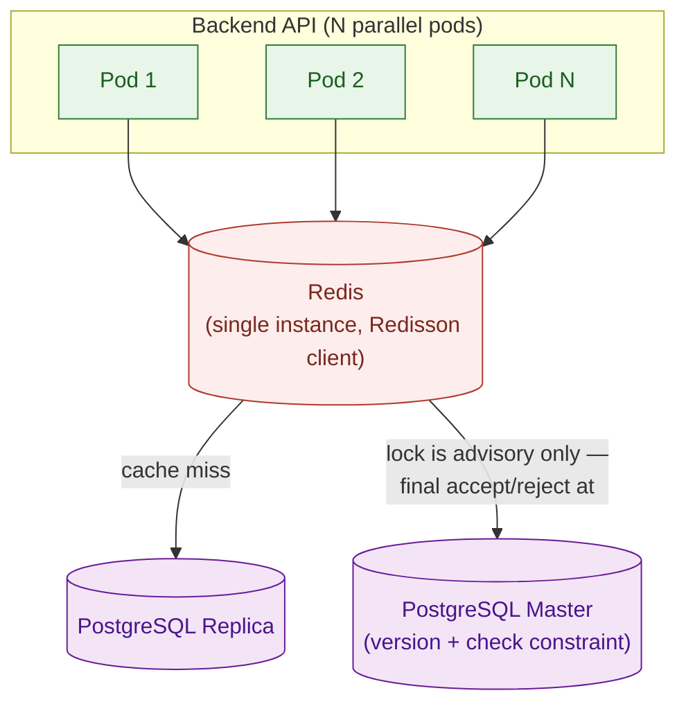

# Distributed Coordination (Redis) — Platform

This file is the physical-level completion of `architecture.md` §4.2 (Redis Coordination & Caching Topology) and §4.6 (Distributed Scheduled Job Coordination), for the parts of that shared Redis deployment that are genuinely cross-cutting — used by more than one business module. Nothing here overrides `architecture.md` — where this file and that one appear to disagree, `architecture.md` is the authority and this file has a bug.

**Why this lives in `platform/`, not in one module:** Redis backs three jobs in this system — cache-aside reads, distributed locking, and rate limiting — and two of those three are genuinely owned by a single module (the workshop-catalog cache belongs to `../modules/workshop.md`; the seat-reservation lock belongs to `../modules/registration.md`, since it's the centerpiece of that module's anti-overbooking story). This file covers only the mechanism a *module* doc shouldn't have to re-explain every time it uses it: the shared Redis deployment itself, the scheduled-job coordination lock (reused by five different jobs across three modules and the shared platform), and rate limiting (applied at multiple endpoints, owned by no single module). A module doc that uses one of these links back here for the mechanism and states only what's specific to its own use.

**Scope:** the shared Redis deployment's topology (§1); the scheduled-job coordination lock, reused by the nightly student sync, the payment reconciliation sweep, the two technical-pattern-entity cleanup sweeps, and the outbox relay (§2); rate limiting (§3); a consolidated failure-mode table across every Redis-backed subsystem in this system, including the two that live in module docs (§4); and the full key/tuning-parameter reference (§5).

**Out of scope, and where it actually lives:** the workshop-catalog cache-aside design (`../modules/workshop.md`); the seat-reservation distributed lock (`../modules/registration.md`); the Postgres-side optimistic-concurrency check itself (`database-schema.md` §3.1/§4.1 — this file's locks are advisory only and never the final word); JWT claim shape/expiry (`auth-and-identity.md`); each scheduled job's own internal correctness (`../modules/user.md` for the nightly sync, `../modules/payment.md` for reconciliation — this file only owns the lock that decides *which instance* runs a job, not what the job does once running).

All configuration in this document targets Redis via the Redisson client (per `CLAUDE.md`'s tech stack).

---

## Table of Contents

- [1. Redis Topology & Deployment](#1-redis-topology-deployment)
- [2. Distributed Lock: Scheduled Job Coordination](#2-distributed-lock-scheduled-job-coordination)
- [3. Rate Limiting](#3-rate-limiting)
- [4. Failure Modes & Fail-Safe Behavior (All Redis-Backed Subsystems)](#4-failure-modes-fail-safe-behavior-all-redis-backed-subsystems)
- [5. Key Format & Tuning-Parameter Reference Table](#5-key-format-tuning-parameter-reference-table)

---

## 1. Redis Topology & Deployment

**Rationale:** `architecture.md` §4.2 already established why cache, lock, and rate-limit share one deployment instead of three — all three are cheap, short-lived, and fail safely, so splitting them across separate stateful components would be complexity without a corresponding benefit. This section only adds the physical shape of that one deployment.

**Model:**

| Decision | Value | Why |
|---|---|---|
| Topology | Single Redis instance (Kubernetes `StatefulSet`, one pod) | `CLAUDE.md` frames this deployment as a local Minikube proof-of-concept, not a cloud production rollout — Sentinel/Cluster HA is a deliberate future revisit, not something this design builds toward now. |
| Client | Redisson, single-server mode (`SingleServerConfig`) | Mandated client per `CLAUDE.md`'s tech stack; single-server mode matches the single-instance topology above — Sentinel/Cluster client modes aren't applicable yet. |
| Connection pool | Redisson defaults (`connectionPoolSize` 64, `connectionMinimumIdleSize` 24) | No load-test evidence yet justifies overriding the client's own defaults; revisit once K6/JMeter load testing (`docs/requirement.md` §3.2) produces a number. |
| Persistence (RDB/AOF) | Disabled | Nothing stored in this Redis is authoritative data (`database-schema.md` §6.3's cross-referenced retention table: coordination locks and rate limits are seconds-lived; cache is disposable). A restart losing all keys is a non-event — caches refill on next read, locks simply don't exist until next acquired, rate limiters reset to full budget. |

<div align=center>



</div>

**Guarantees:** losing the Redis pod entirely degrades the system (slower reads, rejected registration writes, skipped job cycles — see §4) but never corrupts data; every value Redis holds is either a disposable copy or a coordination signal with a bounded lifetime.

---

## 2. Distributed Lock: Scheduled Job Coordination

**Rationale:** `architecture.md` §4.6 requires exactly one pod to execute a given scheduled job per cycle, never zero (barring a Redis outage) and never more than one. This is the same lock primitive `../modules/registration.md` uses for seat reservation, reused here for a structurally different purpose — job exclusivity, not write-path mutual exclusion — so the parameters differ even though the mechanism doesn't.

**Model:** one lock key per job, each with its own lease sized to comfortably exceed that job's expected runtime — a single shared lock/lease across all five jobs would either be too short for the slowest (nightly sync) or needlessly long for the fastest (the cleanup sweeps), and either way would leave a job type name resolving to logic totally unrelated to another's.

| Job | Key | Lease (TTL) | Why this lease |
|---|---|---|---|
| Nightly student sync (`../modules/user.md`) | `unihub:lock:job:nightly-student-sync` | 30 minutes | Runs once daily, processing a full legacy-system export — data volume varies, and this job is never in a tight loop with others waiting, so a generous lease costs nothing. Revisit if real runtime approaches this value. |
| Payment reconciliation sweep (`../modules/payment.md`) | `unihub:lock:job:payment-reconciliation` | 5 minutes | Scans `PENDING` payments older than 15 minutes and calls the gateway's status API per row — bounded by realistic pending-transaction volume, not by anything close to 30 minutes. |
| Idempotency-key cleanup sweep (`database-schema.md` §8.1) | `unihub:lock:job:idempotency-cleanup` | 1 minute | A single bounded `DELETE ... WHERE created_at < ...` — fast by construction. |
| Event-publication cleanup sweep (`database-schema.md` §8.2) | `unihub:lock:job:event-publication-cleanup` | 1 minute | Same shape as the idempotency sweep — a bounded delete of already-published rows. |
| Outbox relay (`messaging.md` §5) | `unihub:lock:job:outbox-relay` | 30 seconds | Runs every second, not nightly or every few minutes. One cycle publishes at most 200 rows with per-message confirms, a small fraction of 30s. A short lease also means a crashed relay pod is replaced within 30s, which bounds how long events can stall. |

```java
RLock lock = redisson.getLock("unihub:lock:job:" + jobName);
boolean acquired;
try {
    acquired = lock.tryLock(0, leaseSeconds, TimeUnit.SECONDS); // non-blocking: acquire now or skip
} catch (RedisConnectionException e) {
    return; // Redis unreachable — skip this cycle, next tick retries (§4.6)
}
if (!acquired) {
    return; // another instance already claimed this cycle — skip, don't queue a retry
}
try {
    // run the job
} finally {
    lock.unlock();
}
```

`tryLock` wait-time is **0** here, unlike the seat lock's 2 seconds (`../modules/registration.md`) — a scheduled tick isn't a user waiting on a response; there's no reason to block. Either this instance claims the cycle immediately, or it skips and trusts the next tick, exactly as `architecture.md` §4.6 describes.

**Trade-off — the same fixed-lease-expiry risk as the seat lock, without the same second layer:** if a job's actual runtime exceeds its lease (most plausible for nightly student sync, line above: "data volume varies"), the lease expires while the job is still running, and a second pod can then acquire the same lock and start a **concurrent second run** of that job — briefly violating the "exactly one instance per cycle" guarantee this section exists to provide. Unlike the seat lock, there's no PostgreSQL optimistic-concurrency check standing behind this one as a second layer, so this risk is only survivable if the job's own write path is idempotent under a concurrent duplicate run:
- **Outbox relay** is safe by the messaging contract rather than by its predicate: a concurrent second run may publish some rows twice, which is exactly the at-least-once delivery every consumer is already built to tolerate (`messaging.md` §4–§5).
- **Payment reconciliation, idempotency cleanup, event-publication cleanup** are naturally safe: each operates on rows by a `WHERE` predicate (`status = 'PENDING'`, `created_at < ...`) that a second concurrent pass simply finds nothing new to act on — a duplicate run degrades to a no-op, not corruption.
- **Nightly student sync** is the one job where this isn't automatically true — a concurrent second run against the same legacy CSV import could race on the same upsert rows. This job's lease (30 minutes) is a guess at normal runtime, not a guarantee; treat sustained runtime approaching the lease as an operational alert to shorten the job or lengthen the lease, and require the sync's own upsert logic (`../modules/user.md`) to be safe under a concurrent duplicate run regardless — this file cannot make that job idempotent on its own, it can only flag that the lock alone won't catch an overrun.

**Guarantees:** exactly one instance runs a given job per cycle under normal conditions; a skipped cycle (lost the race, or Redis unreachable) is always recovered by the next scheduled tick, never queued or retried mid-cycle (§4.6).

---

## 3. Rate Limiting

**Rationale:** `docs/requirement.md` §2.5 requires limiting requests per user/device within a time window, applied consistently across all parallel pods — an in-process limiter would leave a gap as wide as the one a local lock would leave for seat reservation. Redisson's `RRateLimiter` is a token-bucket primitive native to the already-mandated client. This applies across endpoints owned by different modules (registration attempts, login), which is why it's a platform concern rather than any one module's.

**Model:**

| Scope | Key | Rate | Why |
|---|---|---|---|
| Per-user registration attempts | `unihub:ratelimit:registration:{userId}` | 5 requests / 10s | Generous enough for legitimate retry-on-failure UX (a student whose first attempt got a transient 503 from `../modules/registration.md`'s seat lock should be able to retry within seconds), tight enough to block a scripted hammering loop aimed at one workshop's seats. |
| Per-IP general API traffic | `unihub:ratelimit:global-ip:{ipAddress}` | 100 requests / 60s | Coarser, catches unauthenticated abuse (catalog scraping, credential-stuffing against login) that a per-user limiter can't see because it has no authenticated user yet. |

```java
// Each key is per-identity (per userId/IP), so the rate can't be pre-configured once at
// startup — it must be set the first time this pod sees a given key. trySetRate() only
// succeeds that first time (returns false harmlessly afterward), but calling it inline on
// every request still costs a second Redis round-trip per request for a value that, once
// set, never changes for that key. A pod-local cache of "keys already configured this
// pod's lifetime" skips the redundant call on every request after the first:
RRateLimiter limiter = redisson.getRateLimiter("unihub:ratelimit:registration:" + userId);
if (!configuredKeysCache.contains(limiter.getName())) { // e.g. a local Caffeine cache
    limiter.trySetRate(RateType.OVERALL, 5, 10, RateIntervalUnit.SECONDS);
    configuredKeysCache.add(limiter.getName());
}

// Hot path after the first request per key — one Redis round-trip, not two:
if (!limiter.tryAcquire()) {
    return HttpStatus.TOO_MANY_REQUESTS; // 429, with a computed Retry-After
}
```

**Trade-off — this is abuse prevention, not a correctness mechanism:** rate limiting exists to protect system capacity, not to enforce anti-overbooking — that guarantee is entirely `../modules/registration.md`'s and `database-schema.md`'s. A rate-limited request is simply asked to slow down; it carries no bearing on whether a seat was, or wasn't, correctly reserved.

**Guarantees:** a client's request budget is identical regardless of which pod handles the request (§4.2) — never a per-instance-only limit that a distributed client could route around.

---

## 4. Failure Modes & Fail-Safe Behavior (All Redis-Backed Subsystems)

One consolidated view across every Redis-backed subsystem in this system — each fails differently on purpose, not by a single blanket policy. The first two rows live in module docs; they're included here so an operator has one table to check instead of four.

| Subsystem | Redis unreachable → | Rationale |
|---|---|---|
| Workshop-catalog cache-aside (`../modules/workshop.md`) | Fall through to the PostgreSQL Replica directly, uncached | The cache is never authoritative (§4.2) — a miss only costs a Replica read, never a correctness problem. |
| Seat-reservation lock (`../modules/registration.md`) | **Reject** the registration write (`503`, `Retry-After`) | §4.2: coordination unavailable means the write must never proceed uncoordinated. Rejecting protects the anti-overbooking invariant when the advisory layer can't do its job — Postgres's check alone, absent the lock's throughput-shaping role, isn't treated as sufficient under the exact high-contention conditions (`docs/requirement.md` §1.4) this lock exists for. |
| Scheduled-job lock (§2) | **Skip** this cycle; the next tick retries | §4.6: uncoordinated execution (two instances running the same job at once) is worse than a delayed one. |
| Rate limiter (§3) | **Fail open** — allow the request through unthrottled | Not covered explicitly by §4.2. Proposed here because the one correctness-critical defense in this system (the seat lock) is already fail-closed during the same outage — failing the rate limiter open too doesn't reopen the overbooking risk, it only means abuse-prevention is temporarily degraded for the duration of the outage, which is an acceptable secondary-layer trade-off rather than a second correctness gap stacked on top of the first. |

---

## 5. Key Format & Tuning-Parameter Reference Table

Every Redis key pattern and numeric value across this system, in one place, traced back to what it backs — including the two subsystems that are fully specified in their owning module doc. This is the single index; the module docs remain the authoritative source for their own rows.

| Key Pattern | TTL / Lease / Rate | Backs |
|---|---|---|
| `unihub:cache:workshop:detail:{workshopId}` | 300s TTL | Caching slow-changing workshop data (`docs/requirement.md` §2.4) — full design in `../modules/workshop.md` |
| `unihub:cache:workshop:seats:{workshopId}` | 3s TTL | Near-real-time seat availability display (§1.3.1) — full design in `../modules/workshop.md` |
| `unihub:cache:workshop:list:{filterHash}` | 30s TTL | Catalog search/browse caching (§2.4) — full design in `../modules/workshop.md` |
| `unihub:lock:seat:{workshopId}` | 5s lease, 2s wait | Anti-overbooking coordination layer (`architecture.md` §6.1/§4.2, `proposal.md` §11.1) — full design in `../modules/registration.md`; advisory only, `database-schema.md` §3.1/§4.1's `version`/check-constraint pair is the final authority |
| `unihub:lock:job:nightly-student-sync` | 30min lease, 0s wait | Exactly-one-instance nightly sync (§2 above) |
| `unihub:lock:job:payment-reconciliation` | 5min lease, 0s wait | Exactly-one-instance reconciliation sweep (§2 above) |
| `unihub:lock:job:idempotency-cleanup` | 1min lease, 0s wait | Exactly-one-instance idempotency sweep (§2 above) |
| `unihub:lock:job:event-publication-cleanup` | 1min lease, 0s wait | Exactly-one-instance outbox cleanup sweep (§2 above) |
| `unihub:lock:job:outbox-relay` | 30s lease, 0s wait | Exactly-one-instance outbox relay per 1s cycle (§2 above, `messaging.md` §5) |
| `unihub:ratelimit:registration:{userId}` | 5 req / 10s | Abuse prevention on registration attempts (§3 above) |
| `unihub:ratelimit:global-ip:{ipAddress}` | 100 req / 60s | Abuse prevention for unauthenticated traffic (§3 above) |
