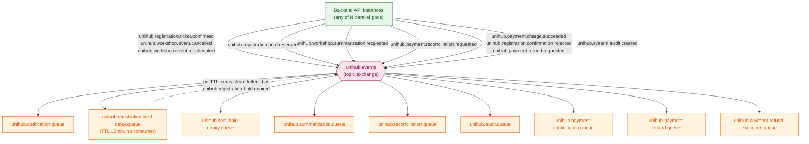
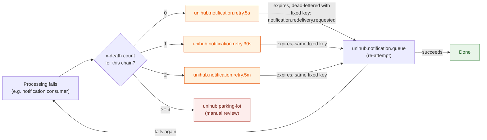

# Messaging (RabbitMQ) — Platform

This file is the physical-level completion of `architecture.md` §4.3 (RabbitMQ Asynchronous Messaging Topology) and §5.5 (Audit Logging's reuse of the same broker), for the parts of that shared broker that are genuinely cross-cutting. Nothing here overrides `architecture.md` — where this file and that one appear to disagree, `architecture.md` is the authority and this file has a bug.

**Why this lives in `platform/`, not in one module:** one topic exchange and one retry/dead-lettering policy serve all five message kinds in this system, spanning four different modules plus the audit pipeline. The broker topology (§1), the exchange/routing-key naming convention and full queue index (§2), and the retry/dead-lettering mechanism (§4) are genuinely shared infrastructure — a module doc that redefined its own retry policy would either duplicate this reasoning four times or drift from it. Each business-specific message flow — what triggers it, what its consumer does, what it re-checks before acting — is narrated in full in its owning module doc; this file is the shared mechanism and the index, not the business logic.

**Scope:** broker topology and deployment (§1); the one shared exchange, the full routing-key/queue index across all five message kinds, and the queue-declaration table (§2); async audit-event publishing, which belongs to no single business module (§3); the retry/dead-lettering/idempotent-consumption mechanism, applied identically across all five queues (§4); the outbox relay that moves `event_publications` rows onto the broker (§5); the full reference table (§6).

**Out of scope, and where it actually lives:** seat-hold expiry (`../modules/registration.md`); lifecycle-event notification dispatch (`../modules/notification.md`); the AI-summarization job (`../modules/workshop.md`); the payment reconciliation task (`../modules/payment.md`); the transactional outbox pattern itself (`database-schema.md` §8.2 `event_publications` — this file owns what happens *after* a row leaves that table, not the same-transaction guarantee that gets it there); JWT/auth (`auth-and-identity.md`).

All configuration in this document targets RabbitMQ via Spring AMQP (per `CLAUDE.md`'s tech stack — the same deployable consumes its own queues; there is no separate worker service, per `architecture.md` §1.1/§4.3).

---

## Table of Contents

- [1. Broker Topology & Deployment](#1-broker-topology-deployment)
- [2. Exchange & Queue Design](#2-exchange-queue-design)
- [3. Async Audit Event Publishing](#3-async-audit-event-publishing)
- [4. Retry, Dead-Lettering & Idempotent Consumption](#4-retry-dead-lettering-idempotent-consumption)
- [5. Outbox Relay](#5-outbox-relay)
- [6. Reference Table](#6-reference-table)

---

## 1. Broker Topology & Deployment

**Rationale:** `architecture.md` §4.3 already established why one broker carries all of this instead of several — every one of these five jobs is fundamentally the same problem (decouple *when work happens* from *when it was triggered*), so splitting them across multiple brokers would be complexity without a corresponding benefit.

**Model:**

| Decision | Value | Why |
|---|---|---|
| Topology | Single RabbitMQ instance (Kubernetes `StatefulSet`, one pod), management plugin enabled | Consistent with `CLAUDE.md`'s framing of this deployment as a local Minikube proof-of-concept — the same reasoning `distributed-coordination.md` §1 already applied to Redis. Quorum queues / clustered HA are a deliberate future revisit, not something this design builds toward now. |
| Client | Spring AMQP (`spring-boot-starter-amqp`) | Idiomatic for the mandated Spring Boot stack; `@RabbitListener` consumers run inside the same deployable that serves HTTP (§1.1, §4.3). |
| Publisher confirms | Enabled (`publisher-confirm-type: correlated`) | The outbox relay (`database-schema.md` §8.2) needs positive confirmation that RabbitMQ actually accepted a message before marking the corresponding `event_publications` row `PUBLISHED` and eligible for cleanup — without confirms, the relay would have no way to know a publish actually landed. |
| Durability | All exchanges, queues, and messages declared durable/persistent | Per §4.3's own guarantee: "a broker restart doesn't silently drop a scheduled seat-hold release or a queued reconciliation task." |

---

## 2. Exchange & Queue Design

**Rationale:** one topic exchange, decided with the user, keeps a single binding surface — adding a new event type later is a new routing key, not a new exchange to declare and wire into every producer.

**Model:**

- **Exchange:** `unihub.events` (type `topic`, durable).
- **Routing key convention:** `unihub.<domain>.<entity>.<action>` — `domain` is the owning module's concern (`registration`, `workshop`, `payment`, `system`), `entity` is the noun the event is about, `action` is a past-tense fact ("this already happened"), except where noted otherwise below.

| Routing Key | Domain | Entity | Action | Bound Queue | Full design |
|---|---|---|---|---|---|
| `unihub.registration.ticket.confirmed` | registration | ticket | confirmed | `unihub.notification.queue` | `../modules/notification.md` |
| `unihub.workshop.event.cancelled` | workshop | event | cancelled | `unihub.notification.queue` | `../modules/notification.md` |
| `unihub.workshop.event.rescheduled` | workshop | event | rescheduled | `unihub.notification.queue` | `../modules/notification.md` |
| `unihub.payment.charge.succeeded` | payment | charge | succeeded | `unihub.payment-confirmation.queue` | `../modules/registration.md` §5, `../modules/payment.md` §9 |
| `unihub.registration.confirmation.rejected` | registration | confirmation | rejected | `unihub.payment-refund.queue` | `../modules/registration.md` §5, `../modules/payment.md` §9 |
| `unihub.payment.refund.requested` *(Phase 3, built)* | payment | refund | requested — a Deferred Job (`../../guidelines/backend-coding-standards.md` §8.4) Payment sends to itself, written in the same transaction as every move to `REFUND_REQUIRED` (Phase 3 checklist D26) | `unihub.payment-refund-execution.queue` | `../modules/payment.md` §9 |
| `unihub.notification.redelivery.requested` | notification | redelivery | requested | `unihub.notification.queue` — a fourth, dedicated binding used only by that queue's own retry chain (§4); it exists because `unihub.notification.queue` is the one queue bound to three different "real" keys, and its retry chain needs one fixed key to dead-letter back to, not three. | `../modules/notification.md`, §4 below |
| `unihub.registration.hold.reserved` | registration | hold | reserved | `unihub.registration.hold-delay.queue` (delay-only) | `../modules/registration.md` |
| `unihub.registration.hold.expired` | registration | hold | expired | `unihub.seat-hold-expiry.queue` | `../modules/registration.md` |
| `unihub.workshop.summarization.requested` | workshop | summarization | requested | `unihub.summarization.queue` | `../modules/workshop.md` |
| `unihub.payment.reconciliation.requested` | payment | reconciliation | requested | `unihub.reconciliation.queue` | `../modules/payment.md` |
| `unihub.system.audit.created` | system | audit | created | `unihub.audit.queue` | §3 below |

Every queue below is durable; message bodies are JSON (Jackson-serialized), matching the serialization convention already established for cached values in `distributed-coordination.md`.

| Queue | Bound Routing Key(s) | Special Arguments | Consumer |
|---|---|---|---|
| `unihub.notification.queue` | `ticket.confirmed`, `event.cancelled`, `event.rescheduled`, `notification.redelivery.requested` | — | Notification module (`../modules/notification.md`) |
| `unihub.payment-confirmation.queue` | `charge.succeeded` | — | Registration module — confirms a paid registration, or emits `confirmation.rejected` (`../modules/registration.md` §5) |
| `unihub.payment-refund.queue` | `confirmation.rejected` | — | Payment module — `SUCCEEDED → REFUND_REQUIRED` + outbox `refund.requested`; never calls the gateway (`../modules/payment.md` §9) |
| `unihub.payment-refund-execution.queue` *(Phase 3, built)* | `refund.requested` | — | Payment module — the only caller of the gateway refund, `REFUND_REQUIRED → REFUNDED` (`../modules/payment.md` §9) |
| `unihub.registration.hold-delay.queue` | `hold.reserved` | `x-message-ttl: 900000`, `x-dead-letter-exchange: unihub.events`, `x-dead-letter-routing-key: unihub.registration.hold.expired` | **None** — messages only ever leave by expiring (`../modules/registration.md`) |
| `unihub.seat-hold-expiry.queue` | `hold.expired` | — | Registration module (`../modules/registration.md`) |
| `unihub.summarization.queue` | `summarization.requested` | — | Workshop module (`../modules/workshop.md`) |
| `unihub.reconciliation.queue` | `reconciliation.requested` | — | Payment module (`../modules/payment.md`) |
| `unihub.audit.queue` | `audit.created` | — | Audit/observability consumer (§3) |

Each of the eight consumed queues (including `unihub.payment-refund-execution.queue`, built in Phase 3) has its own dedicated 3-stage retry chain (§4) — not a single chain shared across all of them. §4 explains why a shared chain doesn't actually work once a manual, application-level republish step is involved.

**Message properties set by the relay (Phase 4 checklist D34):** every message carries `message-id` = `event_publications.id` and the AMQP `type` property = the row's routing key, plus the `correlationId` header (§5). `type` exists because one queue, `unihub.notification.queue`, receives three payload types and the received routing key is replaced after a retry hop (§4); both properties live on the `Message` object, so they survive every retry hop and the parking-lot. A consumer of a single-type queue may ignore `type`. Messages published before `type` existed have none; the notification consumer's fallback for them is in `../modules/notification.md` §3.

**Transition (Phase 4 checklist D44):** from Phase 2 until the Notification consumer existed, the relay published `ticket.confirmed`, `event.cancelled` and `event.rescheduled` to `unihub.notification.queue` with nothing consuming them, so any long-lived broker (the local docker-compose one) holds a backlog of stale messages, some pointing at data that no longer exists. Before the first run of the consumer against such a broker, count, then purge `unihub.notification.queue` and its three retry queues once (`docker exec unihub-rabbitmq rabbitmqctl list_queues name messages`, then `rabbitmqctl purge_queue` for `unihub.notification.queue`, `unihub.notification.retry.5s`, `.retry.30s`, `.retry.5m`); the run (date, counts) is recorded in the Phase 4 checklist. The consumer's `type` fallback (D34) and its `NonRetryableMessageException` for missing data (D35) remain as the fence, so an unpurged broker parks stale messages instead of blocking the queue. CI brokers are fresh per run and need nothing.



The two payment hand-off keys (`charge.succeeded`, `confirmation.rejected`, Phase 2 checklist D2/C10) are lifecycle events — kind ② of `architecture.md` §4.3, alongside "registration confirmed" — consumed by a business module rather than by Notification. They add queues, not a new message kind. `refund.requested` (Phase 3 checklist D26) is a Deferred Job like `hold.reserved` — Payment addressing itself — not a lifecycle event.

**Guarantees:** every producer and consumer agrees on exactly one exchange and one naming convention — no message kind is ever routed by an undocumented, ad-hoc key.

---

## 3. Async Audit Event Publishing

**Rationale:** `architecture.md` §5.5 requires every sensitive operation (registration, payment, check-in, workshop lifecycle change, role/permission change) to emit an audit event — asynchronously, and **deliberately without** the transactional-outbox guarantee the other four message kinds get, because audit is "an investigative concern, not a correctness-critical one." This belongs here, not in any one module doc, because every module that performs a sensitive operation is a producer — it has no single owning module.

**Model:** any module performing an audited operation publishes `unihub.system.audit.created` directly (fire-and-forget, not via the `event_publications` outbox table) → `unihub.audit.queue`. The consumer appends a row to `audit_events` (`database-schema.md` §8.3).

**This is the one message kind in this document that is genuinely allowed to be lost:** if the publish call itself fails (e.g. the broker is briefly unreachable), the audit event never enters the queue at all — and per `architecture.md` §5.5, that's accepted, not a bug: "an audit-publish failure must never block or fail the business operation it would have recorded... but the audit-publish failure itself must surface as an operational alert." The publish call's own failure is what gets alerted on, not silently retried into the same durability the other four kinds enjoy.

**Idempotency:** deliberately *not* pursued as rigorously as elsewhere. A redelivered audit event simply produces a second `audit_events` row for the same real event — since that table has no uniqueness constraint tying a row to a single source event (`database-schema.md` §8.3), a duplicate is cosmetic noise for an investigator, not a correctness bug the way a duplicate registration or payment would be.

**Guarantees:** an audit pipeline outage never blocks or fails the business operation it would have recorded (`architecture.md` §5.5) — the direct consequence of this message kind's publish being outside the outbox's atomicity.


**Phase 2 note (checklist D6, C32):** nothing is published to `unihub.system.audit.created` before Phase 6. The Phase 2 `AuditTrail` adapter writes structured log lines instead; the publishing adapter and the consumer of `unihub.audit.queue` that writes `audit_events` are built **together** in Phase 6 (M-54). Publishing earlier would fill a queue that has no consumer, and a RabbitMQ memory alarm blocks every publisher — the outbox relay included — while queue arguments cannot be changed once declared.

---

## 4. Retry, Dead-Lettering & Idempotent Consumption

**Rationale:** `architecture.md` §4.3 states RabbitMQ here is at-least-once, never exactly-once — every consumer in every module doc already re-checks current Postgres state before acting for exactly this reason. This section adds what happens when a consumer's processing itself *fails* (a downstream call throws, a transient error occurs) — distinct from redelivery, which is about a message arriving more than once. This is genuinely shared: the same 3-stage chain shape applies identically to all eight consumed queues, so it's specified once here rather than eight times.

**Model — exponential backoff via a dedicated retry chain per business queue, not one chain shared across all of them:**

A shared chain was the original design here, but it doesn't actually work: a message only reaches a retry-stage queue via an **application-level republish**, not RabbitMQ's own automatic dead-lettering. Publishing through the default exchange to reach a queue by name requires the routing key to equal that queue's name — so whatever routing key the message truly arrived with is already gone by the time the retry queue's own TTL expiry triggers the *next* dead-letter hop. RabbitMQ's "preserve the original routing key when `x-dead-letter-routing-key` is unset" behavior is real, but it only preserves the routing key of the delivery that *directly* preceded the current dead-letter event — which, after a manual republish, is the retry queue's own name, not the true original. Relying on it here would silently discard every message that fails even once, since `unihub.events` has no binding for a routing key like `unihub.retry.5s`.

The fix is to give each of the eight business queues its own 3-stage chain, each explicitly (not by omission) setting `x-dead-letter-routing-key` to a key that's bound back to that same business queue — so it doesn't matter what routing key got the message into the retry queue in the first place; the dead-letter hop is hard-wired to land back in the right place regardless.

| Business Queue | Retry Chain (queue → TTL) | `x-dead-letter-routing-key` (explicit) |
|---|---|---|
| `unihub.notification.queue` | `unihub.notification.retry.5s` (5s) → `unihub.notification.retry.30s` (30s) → `unihub.notification.retry.5m` (5min) | `unihub.notification.redelivery.requested` — a dedicated key (§2) added because this queue is bound to three different "real" keys; the retry chain needs exactly one fixed target, and the message *body* still carries which of the three facts actually occurred. |
| `unihub.seat-hold-expiry.queue` | `unihub.seat-hold-expiry.retry.5s` → `.retry.30s` → `.retry.5m` | `unihub.registration.hold.expired` — reused as-is, since this queue only has the one binding. |
| `unihub.summarization.queue` | `unihub.summarization.retry.5s` → `.retry.30s` → `.retry.5m` | `unihub.workshop.summarization.requested` — reused as-is. |
| `unihub.reconciliation.queue` | `unihub.reconciliation.retry.5s` → `.retry.30s` → `.retry.5m` | `unihub.payment.reconciliation.requested` — reused as-is. |
| `unihub.audit.queue` | `unihub.audit.retry.5s` → `.retry.30s` → `.retry.5m` | `unihub.system.audit.created` — reused as-is. |
| `unihub.payment-confirmation.queue` | `unihub.payment-confirmation.retry.5s` → `.retry.30s` → `.retry.5m` | `unihub.payment.charge.succeeded` — reused as-is. |
| `unihub.payment-refund.queue` | `unihub.payment-refund.retry.5s` → `.retry.30s` → `.retry.5m` | `unihub.registration.confirmation.rejected` — reused as-is. |
| `unihub.payment-refund-execution.queue` *(Phase 3, built)* | `unihub.payment-refund-execution.retry.5s` → `.retry.30s` → `.retry.5m` | `unihub.payment.refund.requested` — reused as-is. |

Every retry-stage queue also sets `x-dead-letter-exchange: unihub.events`. This is 24 retry queues total (declared by `Topology` since Phase 3) instead of 3 — more declarations, but each one is a small, static piece of metadata, and none of them depend on a routing-key-preservation trick that doesn't actually hold across a manual republish. A single shared `unihub.parking-lot` (below) is still fine, because nothing dead-letters *out* of it automatically — it's the terminal stage, manually drained by a human, so there's no further routing-key hop to get wrong.

| Terminal | `unihub.parking-lot` | — (no TTL, no auto-processing) | n/a — durable, manually inspected |

**Retry-count tracking:** RabbitMQ automatically attaches an `x-death` header to every dead-lettered message — an array with one entry per distinct (queue, reason) combination the message has passed through, each carrying its own `count`. Consumers derive the current attempt number by scanning that array for the entry matching the message's *own* retry-chain queue and reading its `count` — not by treating `x-death` as a single scalar. No custom `x-retry-count` header needs to be invented or maintained by application code.

**Flow — on a processing failure (using `unihub.notification.queue` as the example; identical shape for the other seven):**
```
1. Consumer catches the processing exception, nacks without requeue.
2. Error handler scans the x-death array for the entry matching this message's own
   retry-chain queue (e.g. unihub.notification.retry.*) and reads its count:
     count == 0  → publish to unihub.notification.retry.5s   (default exchange,
                                                                routing key = queue name)
     count == 1  → publish to unihub.notification.retry.30s
     count == 2  → publish to unihub.notification.retry.5m
     count >= 3  → Max Retries (3) exhausted — publish directly to unihub.parking-lot,
                   tagging the original routing key + last exception message as headers
```
The routing key used to reach the retry queue in step 2 no longer matters for correctness — each retry queue's `x-dead-letter-routing-key` is hard-wired (table above), so the dead-letter hop back to the business queue is correct regardless.



Each of the other seven business queues has an identical-shaped chain and diagram, differing only in queue names and the fixed dead-letter-routing-key (table above) — not repeated here.

**Critical distinction — this is a different mechanism from `idempotency_keys`:** `database-schema.md` §8.1's `idempotency_keys` table guards **client-facing HTTP request** duplication — a student's double-click or a resent network request, deduplicated by a client-generated key checked in the same Postgres transaction as the business effect. The re-check-current-state-before-acting pattern used by every consumer in every module doc guards **broker redelivery** — a completely different failure mode, with a completely different mechanism. Neither one substitutes for the other, and this document must never be read as saying the `idempotency_keys` table also covers message redelivery, or vice versa.

**Exception — failures that must not park (Phase 3 checklist D19, D25; the seat-hold row is built, the refund row is built too, see `RefundPayment`):** two failures are transient by nature *and* would leave money or a seat stuck if parked, so for them alone the error handler keeps republishing to the chain's last stage (`.retry.5m`) without limit instead of moving to `unihub.parking-lot`. The handler decides by (queue, exception type), so no queue is added and no queue argument changes. Both halves of the pair are explicit: the exception implements the marker `com.unihub.shared.domain.RetryUntilAvailable` *and* the queue is flagged `waitsForDependency` in `Topology`. The same exception on any other queue follows the three-attempt rule (the reconciliation consumer also meets a gateway that was not reached, and is parked as usual). A message of such a queue still walks 5s → 30s → 5m first, then stays at 5m.

| Queue | Exception kept in the chain | Why | Signal |
|---|---|---|---|
| `unihub.seat-hold-expiry.queue` | The seat lock could not be taken (`SeatLockUnavailableException`: contention, or Redis unreachable or hung) | Parking it would leave the seat `RESERVED` until a human acts, breaking INV-07; releasing without the lock would breach INV-08 (`../modules/registration.md` §3). The seat is released at most one stage (5 min) after Redis recovers | `unihub_seat_hold_expiry_lock_unavailable_total` |
| `unihub.payment-refund-execution.queue` | The gateway was never reached (circuit `OPEN`, connection refused or timed out before sending) | The refund is owed and nothing was attempted; parking it would hold the student's money until a human acts (`../modules/payment.md` §9) | `unihub_payment_refund_required_oldest_age_seconds` |

Every other failure on these two queues, and every failure on the other six, follows the 3-attempt rule above. The alerts on both signals are Phase 6 (`observability.md` §6).

`unihub.notification.queue` follows the 3-attempt rule too, deliberately (Phase 4 checklist D32): a notification provider that is unavailable leaves the affected rows `PENDING` and the consumer throws, so the message walks 5s → 30s → 5m and then parks. Notification holds neither money nor a seat, so it is not a must-not-park exception; a replay of the parked message sends only the rows still `PENDING` (`../modules/notification.md` §3, §5).

**Guarantees:** a transient consumer failure is retried up to 3 times with increasing delay before requiring human attention; the Parking Lot Queue is where the Organizing Committee's operational visibility (`architecture.md`'s Observability Stack) picks up a genuinely stuck message — never a silent drop.

---

## 5. Outbox Relay

**Rationale:** four of the five message kinds (§2; all except audit, §3) are written to `event_publications` (`database-schema.md` §8.2) in the same transaction as the business change, per `architecture.md` §4.3/§6.1. Something must then move each `PENDING` row onto the broker. With N parallel pods, that something must not publish the same row from several pods at once as a matter of course. It also must not hold a database transaction open while it talks to the broker — a rule `docs/guidelines/backend-coding-standards.md` §8.3/§19.1 applies to all code, because a transaction held across broker latency pins a pooled connection for that whole time.

**Decision (ADR mini):** a **single-instance polling relay per cycle**, coordinated by the same scheduled-job lock as every other recurring job (`architecture.md` §4.6, `distributed-coordination.md` §2).

| Option | Verdict | Why |
|---|---|---|
| **Single instance per cycle, job lock, no row locks** | **Chosen** | Reuses an existing primitive; normally exactly one publisher; no connection held during publishing |
| Multi-instance claim-with-lease (`UPDATE … SET claimed_until … WHERE id IN (SELECT … FOR UPDATE SKIP LOCKED)` in a short transaction, publish outside it) | Rejected for now | Scales horizontally and doesn't depend on Redis, but adds columns and lease logic to solve a throughput problem this system doesn't have. It is the documented upgrade path if the relay ever becomes a bottleneck. |
| `SELECT … FOR UPDATE SKIP LOCKED` held across the publish | Rejected | Holds a transaction and a pooled connection across broker round-trips |
| Publish in `afterCommit`, with polling only as a fallback | Rejected | Lower latency, but two publish paths for the same row: more duplicates and harder to reason about and test |
| Spring Modulith Event Publication Registry / Debezium CDC | Rejected | Modulith brings its own table shape, conflicting with `event_publications`. Debezium is a new infrastructure component, which `architecture.md`/`proposal.md` never named. |

**Model — one cycle:**

```
every 1s (fixedDelay), on every pod:
  tryLock("unihub:lock:job:outbox-relay", wait 0s, lease 30s)   -- lost / Redis down → skip this cycle
  SELECT id, routing_key, payload, correlation_id
    FROM event_publications
   WHERE status = 'PENDING'
   ORDER BY created_at
   LIMIT 200                                                      -- Master, no row locks, no open transaction
  for each row:
    MDC.put("correlationId", row.correlation_id)                  -- observability.md §1: the global
    publish to unihub.events with routing_key,                    --   RabbitTemplate post-processor copies it
            message-id = row.id, type = routing_key,              --   into the correlationId header
            persistent, mandatory = true                          -- type: §2 (Phase 4 checklist D34)
    wait for the publisher confirm (timeout 5s)
    ack and not returned  → UPDATE event_publications                        -- autocommit, one row
                               SET status = 'PUBLISHED', published_at = now()
                             WHERE id = :id AND status = 'PENDING'
    nack / returned (unroutable)  → leave PENDING, log WARN, continue with the next row
    no confirm within 5s, or connection refused
                                  → leave PENDING, log WARN, END THE CYCLE    -- Phase 4 checklist D42
    finally MDC.remove("correlationId")
  unlock
```

| Parameter | Value | Why |
|---|---|---|
| Poll interval | 1s, `fixedDelay` | Bounds added latency to about a second. The heaviest consumer of that latency is seat-hold expiry, whose consumer re-reads `hold_expires_at` anyway, so a late release is a delay, never a wrong outcome (`../modules/registration.md` §3). |
| Batch size | 200 rows | Large enough to drain a registration-spike backlog in a few cycles, small enough that one cycle finishes well inside the lease |
| Lock lease | 30s, wait 0s | A 200-row batch with per-message confirms completes in a small fraction of this; wait 0s matches every other job (`distributed-coordination.md` §2) |
| Confirm timeout | 5s per message | A broker that can't confirm within 5s is unhealthy; leaving the row `PENDING` retries it next cycle |
| Channel RPC timeout | 5s (`spring.rabbitmq.channel-rpc-timeout`; the client's default is 10 minutes) | The next publish after a confirm timeout needs a new channel, and opening one against a broker that does not answer waits for this timeout. A broker that can't answer in 5s is unhealthy for the same reason as above, and the wait must stay far inside the 30s lease. It applies to every channel RPC of the application (listeners, declarations), which take milliseconds on a healthy broker |
| `mandatory` | `true` | Without it, a message with no matching binding is acknowledged by the broker and silently discarded. With it, the broker returns the message, and the relay treats a return as a failure and keeps the row `PENDING`. |

**Failure behavior:**

| Situation | Outcome | Why it is acceptable |
|---|---|---|
| Redis unavailable | No pod claims the cycle; rows stay `PENDING` and publish once Redis returns | Delay, not loss. During a Redis outage registration writes are already rejected (`architecture.md` §4.2), so few new rows arrive. |
| Broker reachable but not answering (hung, paused) | The first wait that runs out ends the cycle: the confirm timeout, or on a later cycle the channel RPC timeout when the new channel cannot be opened; rows stay `PENDING` and the next cycle (1s later) tries again | Treating a timeout as a per-row failure would wait 5s for **every** row: a 200-row cycle would take ≈ 17 min against a 30s lease, so the lease would expire mid-batch and a second pod would start a parallel relay on every broker hang (Phase 4 checklist D42). A nack or a returned (unroutable) message is still a failure of that row. Both waits count: with only the confirm timeout bounded, every cycle after the first blocked in `channel.open` for the client's default 10 minutes (found by `OutboxRelayBrokerOutageIT`, Phase 4 checklist 7.4) `RetryChainRecoverer`, which uses the same sender, requeues the original on any republish failure, so the change loses nothing there |
| Pod dies after the broker confirmed but before the `UPDATE` | The row is published again next cycle | At-least-once is the contract (`architecture.md` §4.3); every consumer is idempotent under redelivery (§4). Most consumers deduplicate on the state of their own aggregate (`backend-coding-standards.md` §8.5); only the Notification consumer keys on `message-id` (`../modules/notification.md` §3) |
| Lease expires mid-batch, a second pod starts | Some rows may be published twice | Same as above |
| One row keeps failing (unroutable key, oversized payload) | It stays `PENDING`; the relay skips past it every cycle, so it never blocks rows behind it | `unihub_outbox_oldest_pending_age_seconds` (`observability.md`) grows and alerts; an operator fixes the cause |
| Relay throughput insufficient | Backlog and the same metric grow | Upgrade path: the claim-with-lease option above. The change stays inside `shared.infrastructure` and touches no module. |

**Ordering:** rows are published in `created_at` order on a best-effort basis. A failing row is skipped rather than blocking, so no strict ordering is promised — consistent with `architecture.md` §4.3's "no global ordering" and with every consumer re-checking current state before acting.

**Guarantees:** every committed `event_publications` row is eventually published, at least once, as long as Redis and RabbitMQ are eventually available; no database transaction or pooled connection is held while waiting on the broker; a permanently failing row surfaces as an alert instead of blocking the rows behind it.

---

## 6. Reference Table

Every exchange, queue, routing key, and retry/TTL value in this document, in one place — the same purpose the closing tables in `database-schema.md` §11 and `distributed-coordination.md` §5 serve for their respective files.

| Name | Type / Value | Backs |
|---|---|---|
| `unihub.events` | Topic exchange | Single binding surface for all five message kinds (`architecture.md` §4.3, §5.5) |
| `unihub.registration.ticket.confirmed` | Routing key | Registration confirmation notification (`docs/requirement.md` §1.3.2) — `../modules/notification.md` |
| `unihub.workshop.event.cancelled` / `.rescheduled` | Routing key | Workshop lifecycle notification (`docs/requirement.md` §1.3.3) — `../modules/notification.md` |
| `unihub.registration.hold.reserved` / `.expired` | Routing key | Seat-hold expiry (`docs/requirement.md` §1.3.1, §2.10) — `../modules/registration.md` |
| `unihub.workshop.summarization.requested` | Routing key | AI brochure summarization (`docs/requirement.md` §1.3.4) — `../modules/workshop.md` |
| `unihub.payment.reconciliation.requested` | Routing key | Stuck-payment reconciliation (`docs/requirement.md` §2.10) — `../modules/payment.md` |
| `unihub.payment.charge.succeeded` | Routing key → `unihub.payment-confirmation.queue` | Paid registration confirmed after payment (`docs/requirement.md` §1.3.1) — `../modules/registration.md` §5 |
| `unihub.registration.confirmation.rejected` | Routing key → `unihub.payment-refund.queue` | Refund compensation for a payment whose registration is no longer `RESERVED` (derived requirement, `../modules/payment.md` §9) |
| `unihub.payment.refund.requested` *(Phase 3, built)* | Routing key → `unihub.payment-refund-execution.queue` | Deferred Job written with every move to `REFUND_REQUIRED`; its consumer is the only caller of the gateway refund (`../modules/payment.md` §9, Phase 3 checklist D26) |
| `unihub.system.audit.created` | Routing key | Async audit trail (`architecture.md` §5.5) — §3 above |
| `unihub.notification.redelivery.requested` | Routing key | Fixed dead-letter target for `unihub.notification.queue`'s own retry chain (§4) — needed because that queue has three "real" bindings, not one |
| `unihub.registration.hold-delay.queue` | TTL 900000ms (15 min), no consumer; the TTL is taken from the same setting as `hold_expires_at` (`unihub.registration.seat-hold`, Phase 3 checklist C2). The retry stages' 5s / 30s / 5min come from `unihub.messaging.retry-delays`; both settings exist so that a test broker can run the lifecycle in seconds, and neither is changed in an environment whose broker already holds the queues (queue arguments are immutable: a changed value means new queues) | Seat-hold 15-minute window, exact value (`docs/requirement.md` §1.3.1) — `../modules/registration.md` |
| `unihub.notification.retry.5s` / `.30s` / `.5m` | TTL 5s / 30s / 5min, `x-dead-letter-routing-key` explicitly `unihub.notification.redelivery.requested` | Exponential-backoff retry, dedicated to `unihub.notification.queue` (§4) |
| `unihub.seat-hold-expiry.retry.5s` / `.30s` / `.5m` | Same TTLs, dead-letter-routing-key `unihub.registration.hold.expired` | Dedicated retry chain for `unihub.seat-hold-expiry.queue` (§4) |
| `unihub.summarization.retry.5s` / `.30s` / `.5m` | Same TTLs, dead-letter-routing-key `unihub.workshop.summarization.requested` | Dedicated retry chain for `unihub.summarization.queue` (§4) |
| `unihub.reconciliation.retry.5s` / `.30s` / `.5m` | Same TTLs, dead-letter-routing-key `unihub.payment.reconciliation.requested` | Dedicated retry chain for `unihub.reconciliation.queue` (§4) |
| `unihub.audit.retry.5s` / `.30s` / `.5m` | Same TTLs, dead-letter-routing-key `unihub.system.audit.created` | Dedicated retry chain for `unihub.audit.queue` (§4) |
| `unihub.payment-confirmation.retry.5s` / `.30s` / `.5m` | Same TTLs, dead-letter-routing-key `unihub.payment.charge.succeeded` | Dedicated retry chain for `unihub.payment-confirmation.queue` (§4) |
| `unihub.payment-refund.retry.5s` / `.30s` / `.5m` | Same TTLs, dead-letter-routing-key `unihub.registration.confirmation.rejected` | Dedicated retry chain for `unihub.payment-refund.queue` (§4) |
| `unihub.payment-refund-execution.retry.5s` / `.30s` / `.5m` *(Phase 3, built)* | Same TTLs, dead-letter-routing-key `unihub.payment.refund.requested` | Dedicated retry chain for `unihub.payment-refund-execution.queue` (§4) |
| `unihub.parking-lot` | Durable, no TTL, manual processing | Max Retries = 3 exhausted — operator-visible failure surface, shared across all eight chains since it's terminal (no further dead-letter hop to get wrong) |
| Outbox relay | Single instance per cycle via `unihub:lock:job:outbox-relay` (lease 30s, wait 0s); poll every 1s (`fixedDelay`); batch 200; confirm timeout 5s; `mandatory = true`; no transaction held across a publish | Moves `event_publications` rows onto the broker (§5, `database-schema.md` §8.2, `architecture.md` §4.3/§6.1) |
