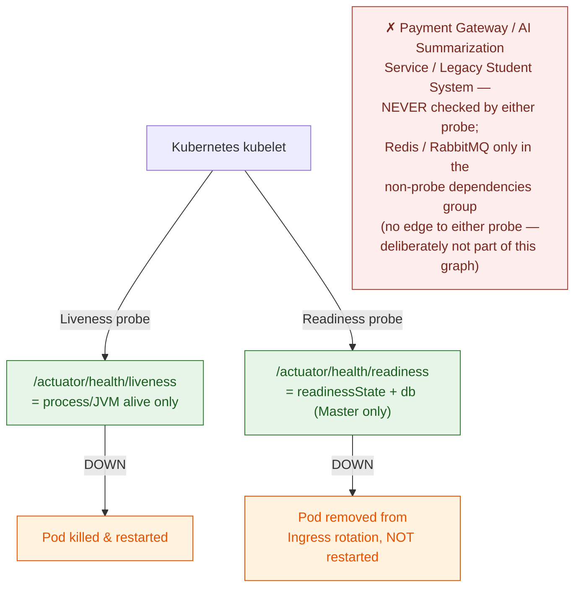

# Observability — Platform

This file is the physical-level completion of `architecture.md` §1.2/§2.2/§3 (the Observability Stack — Prometheus, Grafana, OpenTelemetry, cross-cutting every Backend API instance) and `docs/requirement.md` §3.1 (Observability Requirements) and §3.3 (Kubernetes health-probe requirements). Those sources establish *that* every request must carry a traceable Correlation ID, *that* distributed tracing and Prometheus metrics must exist, and *that* Kubernetes must self-heal via Liveness/Readiness probes — but stop short of header names, instrumentation mechanism, trace storage, concrete metric names, probe composition, and alert thresholds. Nothing in this file overrides `architecture.md`/`docs/requirement.md` — where they disagree, those documents are the authority and this file has a bug.

**Why this lives in `platform/`:** every module's every request and every consumer is observed by the same mechanism — this file cross-cuts all six business modules by nature, the same reason `auth-and-identity.md` and `messaging.md` do.

**Scope:** Correlation ID identity and its propagation across HTTP, RabbitMQ, and logs (§1); distributed tracing instrumentation, trace backend, and sampling (§2); the Prometheus metrics catalog, both Golden Signals and system-specific business metrics (§3–§4); Kubernetes Liveness/Readiness probe composition (§5); and a concrete alerting-threshold table (§6).

**Out of scope:** Audit Logging (`architecture.md` §5.5, already specified — a different question, "who did this," for a different audience, aimed at incident investigators rather than operators); the `paymentGateway` CircuitBreaker's own trip-threshold parameters (`../modules/payment.md`, already written — this file only exposes/monitors that state, it doesn't redefine it); the RabbitMQ exchange/queue/routing-key topology (`messaging.md`, already written — this file only adds monitoring on top of it); log aggregation/storage infrastructure (no ELK/Loki or equivalent is named anywhere in the project corpus — introducing one would be a new infrastructure decision this document does not make; logs remain structured JSON to container stdout, and whatever collects them at the cluster level is outside this document's scope); the GitHub Actions CI pipeline (`docs/requirement.md` §3.3, a separate physical-design concern — see `deployment-and-cicd.md`); JWT/auth mechanics (`auth-and-identity.md`, already written).

---

## Table of Contents

- [Architecture Decision Records (ADRs)](#architecture-decision-records-adrs)
  - [ADR Mini: Tracing Instrumentation Mechanism](#adr-mini-tracing-instrumentation-mechanism)
  - [ADR Mini: Correlation ID Identity](#adr-mini-correlation-id-identity)
  - [ADR Mini: Trace Backend](#adr-mini-trace-backend)
  - [ADR Mini: Alerting Rule Engine](#adr-mini-alerting-rule-engine)
  - [ADR Mini: Readiness Composition](#adr-mini-readiness-composition)
- [1. Correlation ID & Distributed Trace Propagation](#1-correlation-id-distributed-trace-propagation)
- [2. Distributed Tracing Wiring](#2-distributed-tracing-wiring)
- [3. Metrics Catalog — Golden Signals](#3-metrics-catalog-golden-signals)
- [4. Metrics Catalog — Custom Business/Domain Metrics](#4-metrics-catalog-custom-businessdomain-metrics)
- [5. Health Probes — Liveness & Readiness](#5-health-probes-liveness-readiness)
- [6. Alerting Rules Catalog](#6-alerting-rules-catalog)
- [7. Reference Table](#7-reference-table)
- [8. Phase 6 Decisions (2026-11-02)](#8-phase-6-decisions-2026-11-02)

---

## Architecture Decision Records (ADRs)

The first four decisions below were reached through the `spec-driven-development` gated workflow (the fifth, Readiness Composition, was decided later, in a review of `docs/testing/non-functional/resilience-testing.md`, and is marked as such): 2–4 alternatives were explored with a trade-off matrix, the human made the call at the Phase 3 Decision Gate, and the reasoning was captured here verbatim rather than left to live only in `SPEC.md` (a working document for the next task, not a durable record). Every section from §1 onward specifies these four decisions in physical detail; this section is the permanent record of *why* they were chosen over their rejected alternatives.

### ADR Mini: Tracing Instrumentation Mechanism

**Context:** `docs/requirement.md` §3.1 requires distributed tracing across database queries, third-party API calls (Stripe/Momo), and RabbitMQ messages, integrated into the Spring Boot instances. `CLAUDE.md` fixes OpenTelemetry as the tracing technology but not the instrumentation mechanism. Two credible paths exist: an OpenTelemetry Java Agent (auto-instrumentation, no code changes, matching the SRS's literal wording "OpenTelemetry Agent") versus Micrometer Tracing with the OTel Bridge (Spring Boot 3's native observability path, sharing the same `ObservationRegistry` that also drives Actuator/Micrometer metrics).

**Decision:** Micrometer Tracing (`micrometer-tracing-bridge-otel`), built on Spring Boot 3's native Observation API — instrumenting `RestTemplate`/`WebClient`, `RabbitTemplate`/`@RabbitListener`, and JDBC access through the same `ObservationRegistry` used for Prometheus metrics — is the tracing instrumentation mechanism, not a separate OpenTelemetry Java Agent.

**Consequences:**
- Metrics and traces share one instrumentation point (`ObservationRegistry`) instead of two independently configured pipelines that could drift apart.
- No second artifact (a `-javaagent` jar) needs to be versioned and mounted into the container image or Kubernetes Deployment spec.
- `trace_id`/`span_id` reach the MDC automatically via Micrometer's `Slf4jMDCEventListener` — no custom MDC-population code required.

**Trade-offs accepted (user's own reasoning):** the OpenTelemetry Java Agent (zero code, and the literal reading of SRS §3.1's "OpenTelemetry Agent" wording) was rejected in favor of the idiomatic Spring Boot 3 path — avoiding JVM agent classloading/cold-start overhead precisely at the 12,000-concurrent-user registration peak (`docs/requirement.md` §1.4), and avoiding a second artifact to version and mount separately from the application jar.

### ADR Mini: Correlation ID Identity

**Context:** `docs/requirement.md` §3.1 requires a Correlation ID, tagged at the Ingress, propagated through every Spring Boot layer, through RabbitMQ, and into log output. With Micrometer Tracing already established as the instrumentation mechanism, every request already carries an OpenTelemetry Trace ID. Minting a second, independent correlation identifier alongside it would require every current and future RabbitMQ producer/consumer (five message kinds per `messaging.md` §2) to remember to propagate two separate IDs instead of one.

**Decision:** The OpenTelemetry Trace ID *is* the Correlation ID — one physical value, surfaced as the `X-Correlation-Id` HTTP header, the MDC `correlationId` key, and a mirrored RabbitMQ message header, with no second identifier minted anywhere in the system.

**Consequences:**
- A single value greps and searches identically across application logs, Grafana Tempo traces, and RabbitMQ message headers — an operator pastes one string into one search box.
- Any RabbitMQ consumer that participates in trace-context propagation (native to Micrometer's Spring AMQP Observation support) automatically carries the Correlation ID too, since they are the same field — nothing extra to remember when a sixth message kind is added later.

**Trade-offs accepted (user's own reasoning):** a fully independent, backend-format-agnostic UUID-based Correlation ID was rejected — it would require dual-propagation code at every RabbitMQ producer/consumer boundary, a documented source of "forgot the second field" bugs, to buy independence from the tracing backend's ID format that this project has no concrete need for.

### ADR Mini: Trace Backend

**Context:** `CLAUDE.md` and `architecture.md` §1.2/§2.2 name OpenTelemetry as the tracing technology and Grafana as the existing dashboard tool, but neither names a system of record for storing and querying traces once they're exported — a gap this document must close before "distributed tracing" is actually usable by an operator.

**Decision:** Grafana Tempo is the trace storage/query backend, wired in as a Grafana datasource; the Backend API exports traces via OTLP directly to Tempo.

**Consequences:**
- Operators query traces from the same Grafana instance already used for metric dashboards — no second UI to learn or context-switch into.
- Grafana Exemplars link a latency spike on a Prometheus panel directly to its originating trace in Tempo, which is precisely §3.1's stated goal of "fast identification of bottlenecks or failures."

**Trade-offs accepted (user's own reasoning):** Jaeger was rejected because it introduces its own standalone UI/query surface — a heavier-weight, more full-featured trace-analysis tool, but unnecessary operator-facing friction for a single-Grafana-pane PoC. Zipkin was rejected as a legacy, non-OTLP-native protocol that would need an extra exporter-translation step for no corresponding benefit here.

### ADR Mini: Alerting Rule Engine

**Context:** `docs/requirement.md` §3.1 requires a Grafana dashboard suite for the Organizing Committee/ops team to monitor system health, but names no alert-routing engine. `CLAUDE.md`'s Boundaries instruct against adding infrastructure components beyond what `architecture.md`/`proposal.md` specify, and no document in the corpus mentions Alertmanager, PagerDuty, Slack, or any on-call routing system.

**Decision:** Grafana's built-in Unified Alerting evaluates alert rules directly against Prometheus and Tempo data and dispatches notifications via Grafana Contact Points — no separate Alertmanager, or any other new pod, is introduced.

**Consequences:**
- Alerting reuses infrastructure already mandated (Grafana) rather than adding a new one to the cluster.
- Rule definitions and the dashboards they alert on live in one tool, keeping one mental model for the Organizing Committee/ops team audience §3.1 names.

**Trade-offs accepted (user's own reasoning):** Prometheus Alerting Rules paired with a dedicated Alertmanager — the conventional CNCF-native pairing, with dedupe/grouping/silencing features Grafana's own engine lacks — was rejected as disproportionate infrastructure for a PoC-scale, single-Grafana-instance deployment that `proposal.md` §5.2 already excludes from "real production cloud deployment."

### ADR Mini: Readiness Composition

**Context:** the first version of §5 put `readinessState` plus Spring Boot's auto-configured `db`, `redis` and `rabbit` `HealthIndicator`s in the Readiness group, on the stated basis that a pod unable to reach a dependency "correctly stops receiving traffic." Reviewing the fault-injection scenarios in `docs/testing/non-functional/resilience-testing.md` showed this contradicts the rest of the corpus. `architecture.md` §4.2 makes a Redis outage a *deliberate, partial* degradation — the cache falls through to the Replica, registration writes are rejected, scheduled jobs skip — not an outage of the service; `architecture.md` §4.3/§6.1 put RabbitMQ publication behind the transactional outbox precisely so a broker outage does not fail the request path. But Redis and RabbitMQ are each a single shared instance (`distributed-coordination.md` §1, `messaging.md` §1): when either is down it is down for every pod at once, so a Readiness check on it removes *all* pods from Ingress rotation simultaneously and turns the designed partial degradation into a total outage — the same cascade §5's own exclusion of third-party dependencies exists to prevent, one layer in. No text in this document argued for including them beyond their being auto-configured.

**Decision:** Readiness is `readinessState` plus `db` only, where `db` checks the **PostgreSQL Master** datasource. The `redis` and `rabbit` `HealthIndicator`s stay, but move out of the probe group into a separate, non-probe `dependencies` health group that reports them as `DEGRADED` (HTTP 200) when unreachable — visible on the health endpoint, never consulted by Kubernetes. Liveness is unchanged.

**Consequences:**
- A Redis or RabbitMQ outage no longer removes pods from rotation, so the behaviors in `distributed-coordination.md` §4 and `architecture.md` §4.2 are reachable *through the Ingress*, not only inside the application.
- PostgreSQL (Master) remains Readiness-critical: with no system of record there is nothing a pod can correctly serve.
- The Replica is not a Readiness condition. What happens when it is unreachable is not yet specified (`architecture.md` §4.1).

**Trade-offs accepted:**
- A single pod whose *own* connectivity to Redis or RabbitMQ is broken (a node-local network fault, not the shared instance) stays in rotation and answers registration writes with `503` + `Retry-After` while healthy pods would succeed; a client retry may reach a different pod. Accepted: for a shared-instance outage — the dominant case — ejecting on the check is strictly worse, and a per-pod partial failure is rarer.
- A Redis or RabbitMQ outage no longer produces a Kubernetes-visible symptom (NotReady pods), and no rule in §6 fires on it directly. **A compensating alert — on the `dependencies` group or an equivalent signal — is therefore required, and is an unmet precondition of Phase 7 sign-off (`docs/testing/strategy/test-plan.md` §1, P1). Defined 2026-11-02 (Phase 6 checklist D77): `unihub_dependency_up` (§4) and its rule (§6); the Kubernetes-side evidence stays with Phase 7.**

---

## 1. Correlation ID & Distributed Trace Propagation

**Rationale:** `docs/requirement.md` §3.1 requires a Correlation ID tagged at the Ingress and propagated through every processing layer, through RabbitMQ, and into log output, so "the entire processing flow of any given request can be traced even as it passes through multiple different components." Per the Correlation ID Identity ADR above, this section specifies one physical mechanism, not two parallel ones.

**Model — HTTP:**

| Element | Value | Why |
|---|---|---|
| Response/propagation header | `X-Correlation-Id` | Human-readable, greppable header name — distinct from the binary/hex `traceparent` header the mesh (`architecture.md` §5.4) already propagates for W3C trace-context, which exists for machine-to-machine linkage, not for an operator to paste into a log search box. |
| MDC key | `correlationId` | Populated by a `Filter` (`CorrelationIdFilter`) registered *after* Spring Boot Actuator's own tracing filter, so `Tracer.currentSpan()` is already resolved — whether this request continues an existing trace (propagated in via `traceparent` from an upstream mesh hop, `architecture.md` §5.4) or starts a new one, by the time this filter runs, a trace ID is guaranteed to exist. |
| Value | The current span's OpenTelemetry Trace ID (32-character hex) | Per the Correlation ID Identity ADR — no separate UUID is generated. |
| On response | The same value is echoed back as the `X-Correlation-Id` response header | Lets a client (or a support engineer working from a bug report) hand the operator one string to search for. |

**Model — RabbitMQ (every consumed queue, `messaging.md` §2 — eight from Phase 6, audit included):**

- **Trace-context propagation** (the `traceparent` header itself) is automatic — Micrometer Tracing's Spring AMQP Observation support (native to Spring Boot 3.x + Spring AMQP 3.x once `micrometer-tracing-bridge-otel` is on the classpath, per the Tracing Instrumentation Mechanism ADR) instruments both `RabbitTemplate.send()` and `@RabbitListener` containers, so a message published from a request that is part of trace `T` continues trace `T` when consumed, with zero application code.
  - **Correction (2026-11-02, Phase 6 checklist C38):** "zero application code" is not quite true on Spring Boot 3.3. Observation on `RabbitTemplate` and on listener containers is **off by default** (`spring.rabbitmq.template.observation-enabled`, `spring.rabbitmq.listener.simple.observation-enabled`; verify the names against the pinned version), and beans built by hand — `notificationListenerContainerFactory`, the template behind `ConfirmedSender`, the audit connection factory of §8 — must enable it themselves.
  - **As built (Phase 6 checklist 5.1, 2026-11-04, checked against Boot 3.3.5 and spring-rabbit 3.1.7):** `spring.rabbitmq.listener.simple.observation-enabled: true` is copied by Boot's container-factory configurer, so it reaches the hand-built `notificationListenerContainerFactory` as well (that factory calls the configurer). `spring.rabbitmq.template.observation-enabled` is **not** copied onto the template by Boot 3.3.5, so `RabbitMessagingConfig`'s `RabbitTemplateCustomizer` calls `setObservationEnabled(true)` itself (the template behind `ConfirmedSender` is that one). The audit publisher's template is not a bean and so would not find the `ObservationRegistry`; `AmqpAuditPublisher` is given the `ApplicationContext` and hands it to its template. A message that arrives without a `correlationId` header is now handled under the consumer's own trace id, not with none.
- **The plain `correlationId` header is mirrored explicitly on top of that**, for the same reason the HTTP side uses a plain header instead of asking an operator to decode `traceparent` by hand:
  - **Producer side:** a `MessagePostProcessor` that copies `MDC.get("correlationId")` into a `correlationId` message header is registered **once**, globally, via `rabbitTemplate.setBeforePublishPostProcessors(...)` on the single shared `RabbitTemplate` bean — not passed manually at each publish point (`messaging.md` §2). This is deliberate: manually attaching the post-processor at every call site would reintroduce the exact "forgot to propagate at the Nth call site" bug class the Correlation ID Identity ADR rejected a dual-ID scheme to avoid — a future sixth message kind gets the header automatically, with no new wiring to remember.
  - **Consumer side:** a shared `@RabbitListener` advice (a `MethodInterceptor`/AOP aspect applied uniformly, not duplicated per listener method) reads the `correlationId` header at message entry, calls `MDC.put("correlationId", ...)` before invoking the listener's business logic, and `MDC.remove("correlationId")` in a `finally` block — the `finally` is required because `@RabbitListener` containers run on a pooled thread; without an explicit clear, a stale `correlationId` from one message could leak into the log lines of the *next*, unrelated message processed on the same reused thread.
- **Across the transactional outbox:** the outbox-backed message kinds (every routing key except audit, `OutboxRoutingCoverageTest`) are not published inside the originating request. The outbox relay publishes them later, from its own scheduled cycle (`messaging.md` §5). The request's correlation id is therefore captured into `event_publications.correlation_id` when the row is written (`database-schema.md` §8.2). Before publishing each row, the relay puts that stored value back into the MDC, so the same global post-processor above writes it into the `correlationId` header, and clears it in `finally`. **Consequence:** the correlation id — and so the log trail — stays continuous from request to consumer. The *trace* does not: the relay's publish belongs to the relay's trace, not the request's, so Grafana Tempo shows the request and the consumer as two traces linked by the same `correlationId`. The audit message kind (`messaging.md` §3) is not published inside the request either: from Phase 6 it is handed to a bounded executor (§8, D68). The adapter snapshots the `correlationId` and the observation context when `record()` is called and restores both on the executor thread, so an audit message carries the request's `correlationId` (corrected 2026-11-02, Phase 6 checklist C44). **As built (2026-11-04, task 5.5): it continues the request's trace, but not through the observation context.** With `jdbc.includes: query` the observation current at `record()` is a no-op left open by the JDBC layer between statements (with `connection` included it is a real one; found by printing both), so the snapshot alone gives the executor thread nothing to continue. `RabbitAuditTrail` therefore also captures the Micrometer `TraceContext` at `record()` and makes it current on the executor thread (`CurrentTraceContext.maybeScope`) while it publishes; the audit `PRODUCER` span is in the request's trace (`TracingIT`) and the audit consumer continues it.

```mermaid
flowchart LR
    Ingress["Ingress /\nMesh sidecar\n(architecture.md §5.4)"] -->|"traceparent (if continuing\nan existing trace)"| Filter["CorrelationIdFilter\n(runs after tracing filter)"]
    Filter -->|"MDC.put(correlationId,\ncurrent traceId)"| Business["Business logic\n(logs carry correlationId)"]
    Business -->|"X-Correlation-Id echoed"| Response["HTTP Response"]
    Business -->|"MessagePostProcessor:\nmirror correlationId header"| Publish["RabbitTemplate publish\n(any queue, messaging.md §2)"]
    Publish -->|"traceparent (automatic,\nMicrometer AMQP Observation)\n+ correlationId (mirrored header)"| Consume["@RabbitListener\n+ shared advice"]
    Consume -->|"MDC.put(correlationId,\nheader value); finally: MDC.remove"| ConsumerLogic["Consumer business logic\n(logs carry same correlationId)"]

    classDef edgeStyle fill:#E8F5E9,stroke:#2E7D32,color:#1B5E20
    classDef appStyle fill:#FFF3E0,stroke:#E65100,color:#E65100
    classDef brokerStyle fill:#FCE4EC,stroke:#AD1457,color:#880E4F

    class Ingress,Response edgeStyle
    class Filter,Business,Consume,ConsumerLogic appStyle
    class Publish brokerStyle
```



**As built (Phase 6 checklist 3.1–3.6, 2026-11-03):** `shared.web.CorrelationIdFilter` (registered by `CorrelationIdConfig` at `HIGHEST_PRECEDENCE + 2`, one step after Boot's observation filter and far before the Spring Security chain) reads the current span's trace id through `CorrelationIds`, puts it in the MDC and on the response, and removes it in `finally`; it does nothing where tracing is off. A request header of the same name is never read. `CorrelationIdProblemAdvice` (a `ResponseBodyAdvice`) adds `correlationId` to every `ProblemDetail` written through MVC, so a producer added later cannot forget it; the two bodies written by the security filters take it from `ProblemResponses`. `error.yaml` lists `correlationId` as `required`. Every scheduled job cycle runs through `JobCycle`, an observation of its own named `unihub.job.cycle{job}` that puts its trace id in the MDC for the cycle and restores what was there; the relay puts a row's stored id back for the publish of that row, or keeps the cycle's id for a row stored without one. A message received without the header is handled under the consumer's own trace id when its container has one (listener observation is task 5.1). The console pattern is `[cid=… trace=… span=…]` (`logging.pattern.correlation`). Because `@SpringBootTest` turns tracing off, an IT that asserts on the id carries `@AutoConfigureObservability`. With sampling 0.0 the trace id still exists: `CorrelationPropagationUnsampledIT` proves it (D66).

**Trade-off — thread-pool MDC leakage is a real risk, closed by discipline, not by a framework guarantee:** Spring's `@RabbitListener` containers reuse a fixed thread pool; any consumer path that returns *without* going through the shared advice's `finally` block (e.g. a hand-rolled listener that bypasses the shared base) risks leaking one message's `correlationId` into the next message's logs on that same thread. This document specifies the shared-advice pattern specifically so this is enforced once, centrally, rather than repeated (and potentially forgotten) in every listener implementation (seven before Phase 6, eight with the audit consumer).

**Guarantees:** every log line, trace span, and RabbitMQ message tied to one end-to-end workflow — an HTTP request and everything it triggers asynchronously — carries the identical `correlationId` value, with no second identifier to keep in sync.

---

## 2. Distributed Tracing Wiring

**Rationale:** `docs/requirement.md` §3.1 requires automatic trace collection for database queries, third-party API calls, and RabbitMQ messages. Per the Tracing Instrumentation Mechanism and Trace Backend ADRs above, this section turns those into a concrete dependency list, export target, and sampling policy.

**Model — dependencies:**

| Dependency | Purpose |
|---|---|
| `micrometer-tracing-bridge-otel` | Bridges the Micrometer `Observation` API (also used for metrics, `management.metrics.*`) to the OpenTelemetry SDK, so every instrumented operation produces both a span and a metric from one instrumentation point. |
| `io.opentelemetry:opentelemetry-exporter-otlp` | Ships completed spans via OTLP to Grafana Tempo (Trace Backend ADR). |
| A JDBC-Observation add-on (the community-standard `datasource-micrometer` integration, wrapping the Hikari `DataSource`) | **Required, not optional.** Spring Boot 3's native Observation auto-configuration instruments HTTP clients (`RestTemplate`/`WebClient`) and Spring AMQP (`RabbitTemplate`/`@RabbitListener`) out of the box, but **not** raw JDBC/JPA statement execution. Without this add-on, `docs/requirement.md` §3.1's explicit requirement to trace "database queries" would silently go unmet even though every other instrumentation point works. |
| `micrometer-registry-prometheus` | Already required for `/actuator/prometheus` (§3–§4 below). This is a `MeterRegistry`, not itself part of the `ObservationRegistry` contract — the actual sharing is that every `Observation` recorded through the one `ObservationRegistry` is published, via a registered `ObservationHandler`, both as a span (to the OTel/Tempo pipeline above) and as a metric into this `MeterRegistry` — one instrumentation call, two outputs. |

**Model — export configuration:**

```properties
management.otlp.tracing.endpoint=http://tempo:4318/v1/traces
management.tracing.sampling.probability=0.10
```

**Model — trace retention:** Tempo's local block storage retains trace data for **2 days**, configured via its compactor (`compaction.block_retention: 48h`). Every other durable store in this project's technical-design corpus states an explicit retention decision (Redis TTLs in `distributed-coordination.md` §5, `audit_events`/`legacy_sync_runs` kept indefinitely per `database-schema.md` §6.3 and `../modules/user.md`) — Tempo is no exception. 2 days is sized for the PoC's own operating rhythm: long enough to investigate an incident discovered a day or two after it happened, short enough to bound local-disk growth on the Minikube node without needing a remote object-storage backend (S3/GCS) for Tempo — a second use of object storage this project's single-managed-cloud-dependency framing (`proposal.md` §5.2) does not call for. Metrics (§3–§4) and Grafana dashboards remain the durable long-term signal; traces are a short-lived diagnostic aid, not a permanent record — that split of responsibility is deliberate, not a gap.

**Model — sampling:** a head-based `ParentBased(TraceIdRatioBased(0.10))` sampler — the Micrometer Tracing/OTel SDK default composition. "Parent-based" means once a trace is sampled (whether the decision was made here or upstream at a mesh hop, `architecture.md` §5.4), every span within that same trace is sampled too — a trace is never fragmented partway through by an inconsistent per-span decision. 10% is a starting value sized for the 12,000-concurrent-user registration peak (`docs/requirement.md` §1.4): high enough to be statistically representative of latency/bottleneck patterns during a spike, low enough to bound Tempo's storage and OTLP network overhead at that volume.

**Model — sensitive-data guardrail:** span/trace instrumentation is opt-in about *what* it captures, not just *whether* it runs, and this system's traffic includes JWT bearer tokens, payment amounts, and student PII — none of which belong in a trace exported to Tempo. Concretely:

| Guardrail | Value | Why |
|---|---|---|
| HTTP request/response detail capture | Left at its Spring Boot 3 default — **disabled** (`server.reactive.session`/`management.observations.http.server.requests.*` header-and-body capture options are never turned on) | The default Observation-based HTTP instrumentation records method, URI template, status, and duration — never headers or body content — unless a future change explicitly opts in. The `Authorization` header (carrying the JWT, `auth-and-identity.md` §3) and any request body (registration/payment payloads) must never become span attributes. |
| JDBC statement capture | SQL text only, via the JDBC-Observation add-on (§2 dependency table) — **bind parameter values are never captured** | A parameterized SQL statement's shape is useful for spotting a slow query; the literal values bound into it can be a student's email, a payment amount, or other PII — capturing text only, never values, keeps that data out of Tempo entirely. |
| Payment Gateway call spans | Span attributes limited to outcome (success/failure/timeout) and duration — no request/response body attributes | The Payment Module's call to Stripe (`../modules/payment.md`) carries amount and gateway transaction detail; none of it needs to appear on the span for the tracing goal (bottleneck/failure diagnosis) to be met. |

**This guardrail is a default posture, not a one-time check.** Any future change that turns on header, body, or parameter-value capture "for easier debugging" is a re-open of this guardrail, not a harmless config tweak — it must be re-evaluated against what's riding in that data before being enabled.

**Trade-off — uniform sampling does not guarantee a full trace exists for every individual error:** achieving "always capture a trace when something goes wrong" would require *tail*-based sampling — deciding whether to keep a trace only after it completes and its outcome is known — which in the OpenTelemetry ecosystem is implemented by a `tail_sampling` processor running inside an OpenTelemetry Collector sitting between the application and Tempo. This document does not introduce a Collector; doing so would be a new infrastructure component beyond what any ADR above decided, for a refinement the SRS does not explicitly require. This gap is accepted, not silently absorbed: error **visibility** does not actually depend on trace sampling at all — the Golden-Signals error-count metric (§3) is recorded for *every* request regardless of whether its trace was sampled, and Grafana Alerting (§6) fires on that metric. An operator is alerted to a 5xx spike whether or not the specific failing request happened to be one of the sampled 10%; the sampled traces exist for representative performance investigation, not as a promise of exhaustive per-error forensics. A tail-sampling Collector is a reasonable future revisit if real incidents show this gap actually mattering, not something to pre-build now.

**Correction (2026-11-02, Phase 6 checklist C40, D73):** none of this system's third-party clients is a `RestTemplate`/`RestClient`/`WebClient` — Stripe goes through `JdkStripeHttpClient` and the AI service through `HttpSummarizationClient` (both `java.net.http`), S3 through the AWS SDK's Apache client — so Boot instruments none of them. Each gets a hand-written `Observation` (outcome and duration only, the guardrail above): Stripe, the AI service and S3. SMTP is deliberately not traced: `requirement.md` §3.1 names Stripe/Momo, and mail delivery already has `unihub.notification.delivery`.

**As built (Phase 6 checklist 5.1–5.5, 2026-11-04):**

- **JDBC.** `datasource-micrometer-spring-boot` 1.0.6 wraps `masterDataSource` and `replicaDataSource`, the two pools; the routing `dataSource` in front of them is excluded (`jdbc.excluded-data-source-bean-names`), or each statement would be a span twice. `jdbc.includes: query` (the library's default also traces every connection checkout and every result-set fetch) and `jdbc.datasource-proxy.include-parameter-values: false` are set in `application.yml`, stated and not left to a default. A statement is a `CLIENT` span named `query` with the SQL text (`jdbc.query[0]`) and `peer.service` (`unihub-master` or `unihub-replica`). Work with no observation around it (a gauge refreshing in the background) is a trace of one statement, sampled like any other.
- **Third parties.** `OutboundCall` (`shared.infrastructure.out.observation`) wraps each exchange in an `Observation` with two low-cardinality values, `operation` and `outcome` (`success`, `failure`, `timeout`; for the store also `not_found`), and nothing else: `unihub.stripe.request` (`operation` = the HTTP method; a 5xx answer is a `failure`), `unihub.ai.summarize`, `unihub.s3.request` (`operation` = `head`, `get`, `delete`; the presigned URL is computed locally, is not a request and never reaches a span). Each is also a timer (`unihub_stripe_request_seconds` …). The exception is deliberately not given to the observation. The Stripe call runs on a virtual thread so that the time limiter can stop waiting for it; `ResilientPaymentGateway` carries the caller's context onto that thread (`ContextSnapshot`), or the gateway span would be a trace of its own.
- **Exception text.** An exception recorded on a span (the JDBC listener records every failed statement) is an `exception` event with its class, message and stack trace, and a database refusal's message carries the row (`Key (email)=(…)`). `ScrubbedSpanExporter` wraps every `SpanExporter` bean (`TracingConfig`) and removes `exception.message` and `exception.stacktrace` from events and the description from the status; the class (`exception.type`) stays. The text is in the log line of the same trace id.
- **Shape of the traces.** A request is one trace (the `SERVER` span, its security and JDBC spans, the gateway span, the audit publish); the relay publishes from the trace of its own cycle, so the consumer of that message is in the relay's trace, not the request's; the two are joined by the `correlationId` (`event_publications.correlation_id`, the `correlationId` header). `TracingIT` asserts all of it, and that no span, name, attribute, event or status carries a bearer token, a gateway key, a card token, a bind value, a signed URL or an exception message.

**Guarantees:** every HTTP request, JDBC statement, third-party call (Stripe sandbox, AI Summarization Service, S3), and RabbitMQ publish/consume that occurs within a sampled trace produces a span exported to Grafana Tempo — visible from the same Grafana instance used for metric dashboards, linkable from a latency panel via Exemplars.

---

## 3. Metrics Catalog — Golden Signals

**Rationale:** `docs/requirement.md` §3.1 requires Actuator-exposed operational metrics — JVM memory, CPU, active database connections, request latency, RabbitMQ queue depth — scraped by Prometheus. This section maps that requirement onto the four Golden Signals (Latency, Traffic, Errors, Saturation), naming the real Micrometer/Actuator metric each one is backed by.

**Model:**

| Signal | Metric (Micrometer name → Prometheus name) | Type | Notes |
|---|---|---|---|
| **Latency** | `http.server.requests` → `http_server_requests_seconds` | Timer (histogram) | Requires `management.metrics.distribution.percentiles-histogram.http.server.requests=true` so Prometheus can compute a cross-pod `histogram_quantile(0.95, ...)` — a client-side-computed percentile (Micrometer's `.percentiles()` option) cannot be aggregated across the ≥2 parallel Backend API pods (`docs/requirement.md` §3.3) the way a histogram bucket can. |
| **Traffic** | Same metric, count | `sum(rate(http_server_requests_seconds_count[1m]))` | Requests/sec across all pods, tagged by `uri`/`method`. |
| **Errors** | Same metric, filtered | `sum(rate(http_server_requests_seconds_count{status=~"5.."}[5m])) / sum(rate(http_server_requests_seconds_count[5m]))` | 5xx ratio — the numerator/denominator pair the alerting rule in §6 evaluates. |
| **Saturation — DB pool** | `hikaricp.connections.active` / `hikaricp.connections.max` / `hikaricp.connections.pending` → `hikaricp_connections_*` | Gauge | Requests queued waiting for a pool connection (`pending > 0` sustained) is an early warning of DB-side saturation before it shows up as latency. |
| **Saturation — JVM heap** | `jvm.memory.used` / `jvm.memory.max` → `jvm_memory_used_bytes` / `jvm_memory_max_bytes` | Gauge | Tagged by `area="heap"` / `id`. |
| **Saturation — CPU** | `system.cpu.usage`, `process.cpu.usage` → `system_cpu_usage`, `process_cpu_usage` | Gauge | Host-level vs. JVM-process-level CPU, both exposed by Actuator natively. |

**Guarantees:** every metric in this table is exposed via `/actuator/prometheus` without any custom instrumentation code — all four are either Spring Boot Actuator defaults or a one-line configuration property, matching `docs/requirement.md` §3.1's own named list (JVM memory, CPU, active DB connections, request latency) exactly.

---

## 4. Metrics Catalog — Custom Business/Domain Metrics

**Rationale:** `docs/requirement.md` §3.1's named list is generic infrastructure health; it does not by itself surface this system's own correctness-critical state — an open payment circuit, a backing-up queue, a stuck outbox relay. This section names the metrics an implementer must add, and precisely what each one is (and is not) sourced from.

**Model:**

| Metric | Type | Source | Backs |
|---|---|---|---|
| `unihub_registration_active_holds` | Gauge | `SELECT COUNT(*) FROM registrations WHERE status = 'RESERVED'` (`database-schema.md` §4.1, served by the existing partial index `idx_registrations_reserved_hold`), bound to a Micrometer `Gauge` — **refreshed in the background, not queried on a scrape** (see below) | Visibility into seat-hold pressure during a registration spike. **Explicitly not** sourced from the Redis `unihub:lock:seat:{workshopId}` key (`../modules/registration.md`) — that lock is a ~5-second mutual-exclusion primitive around a single write, not the 15-minute hold itself; conflating the two would report a number close to zero at almost every scrape regardless of actual hold pressure. |
| `resilience4j.circuitbreaker.state` → `resilience4j_circuitbreaker_state{name="paymentGateway", state=...}` | Gauge (native, via `resilience4j-micrometer`) | The shared `paymentGateway` CircuitBreaker registry entry (`../modules/payment.md`) | Direct visibility into `CLOSED`/`OPEN`/`HALF_OPEN` state — no custom code, since Resilience4j's own Micrometer binder emits this automatically once the dependency is on the classpath. |
| `rabbitmq_queue_messages_ready{queue=...}` / `rabbitmq_queue_messages_unacked{queue=...}` | Gauge (native, broker-side) | RabbitMQ's own `rabbitmq_prometheus` plugin, enabled on the broker (`rabbitmq-plugins enable rabbitmq_prometheus`) and scraped by Prometheus as its **own** target (the broker's port 15692, not through the Backend API) | Per-queue depth/lag for every queue named in `messaging.md` §2, **including `unihub.parking-lot`**. Chosen over standing up a separate `rabbitmq_exporter` container — the plugin is native to the broker already deployed, so this adds a scrape target, not a new component. |
| `unihub_legacy_sync_last_run_quarantine_ratio` | Gauge, range 0.0–1.0 | Set once per nightly cycle by the sync job itself — `rows_quarantined / rows_processed` from that run's `legacy_sync_runs` row (`../modules/user.md`) — at the moment the run completes | A precomputed ratio avoids both a fragile PromQL query against a table that only changes once a day and a divide-by-zero when `rows_processed = 0`. |
| `unihub_outbox_oldest_pending_age_seconds` | Gauge | `SELECT EXTRACT(EPOCH FROM (now() - MIN(created_at))) FROM event_publications WHERE status = 'PENDING'` (`database-schema.md` §8.2, served by `idx_event_publications_pending`) — **refreshed in the background** (see below) | **Age, not count, is the correct signal.** A handful of `PENDING` rows mid-flight between commit and the relay's next publish cycle is normal and expected; a *growing* age means the outbox relay itself has stalled — directly protecting the transactional-outbox Non-Negotiable Invariant (`CLAUDE.md`) by making a silent relay failure visible instead of invisible. |
| `unihub_postgres_replica_lag_seconds` | Gauge | `CASE WHEN pg_is_in_recovery() THEN CASE WHEN pg_last_xact_replay_timestamp() IS NULL THEN NULL WHEN pg_last_wal_receive_lsn() = pg_last_wal_replay_lsn() THEN 0 ELSE EXTRACT(EPOCH FROM (now() - pg_last_xact_replay_timestamp())) END END`, run against the Replica connection (`architecture.md` §4.1) — **refreshed in the background** (see below). **Changed 2026-11-06 (Phase 7 task 6.2, D99):** the `receive = replay` arm is new | Flags read-path staleness (a stale seat-count or catalog read served from a lagging Replica) before a symptom is reported rather than after. Chosen as a scheduled application-level query over standing up `postgres_exporter` — same no-new-external-component posture as the RabbitMQ plugin choice above. |
| `unihub_seat_claim_version_conflicts_total` | Counter | Incremented by the seat-claim use case each time an attempt loses the `workshops.version` race (`../modules/registration.md` §2) | Phase 8 revisit of the shared `workshops.version` decision (`database-schema.md` §3.1, Phase 2 checklist D3) |
| `unihub_seat_claim_retries_exhausted_total` | Counter | Incremented when all 3 attempts lost the race and the request got `503` | Same; revisit if > 0.1% of seat claims at the 12,000-user peak |
| `unihub_workshop_edit_conflicts_total` | Counter | Incremented when an organizer edit is refused by the version check | Same; revisit if > 5% of edits during the peak |
| `unihub_audit_publish_failures_total` | Counter | Incremented by the `AuditTrail` adapter for every audit event it failed to record — the logging adapter in Phase 2, the publishing adapter `RabbitAuditTrail` from Phase 6 (`../../guidelines/backend-coding-standards.md` §12) | INV-14's "the audit-publish failure itself must surface" (`architecture.md` §5.5) — the metric exists from Phase 2 (checklist D6, C32); its alert rule and the INV-14 test remain Phase 6 (M-55) |
| `unihub_payment_reconciliation_stuck_total` | Counter | Incremented by the reconciliation consumer when a payment's PaymentIntent is still `processing` 24 h after `initiated_at` and automatic resolution stops (`../modules/payment.md` §6) | Nothing stays `PENDING` silently — an operator sees it; alert rule `unihub-reconciliation-stuck` in `observability/grafana/provisioning/alerting/unihub-rules.yml` (§6, Phase 6) |
| `unihub_seat_hold_expiry_lock_unavailable_total` | Counter | Incremented by the seat-hold expiry consumer each time it cannot take the seat lock (contention, or Redis unreachable or hung) and keeps the message in its retry chain instead of parking it (`../modules/registration.md` §3, `messaging.md` §4) | A sustained rise means seats are waiting on Redis to be released (INV-07 × INV-08, Phase 3 checklist D19); alert rule `unihub-seat-hold-lock-unavailable` in `observability/grafana/provisioning/alerting/unihub-rules.yml` (§6, Phase 6) |
| `unihub_payment_refund_required_oldest_age_seconds` | Gauge | `SELECT EXTRACT(EPOCH FROM (now() - MIN(updated_at))) FROM payments WHERE status = 'REFUND_REQUIRED'` — **refreshed in the background** (see below). `updated_at` is set on every save (`@UpdateTimestamp`) and nothing saves a row while it sits in `REFUND_REQUIRED`, so it is the time the row entered that status | A refund owed to a student that is not progressing — breaker open for long, or a refund parked after `failed`/`canceled` (`../modules/payment.md` §9, Phase 3 checklist D25); alert rule `unihub-refund-required-age-warning` and `-critical` in `observability/grafana/provisioning/alerting/unihub-rules.yml` (§6, Phase 6) |
| `unihub_payment_refund_parked_total` | Counter | Incremented on **any** park from `unihub.payment-refund-execution.queue` — the gateway reported the refund `failed`/`canceled`, or it was still `pending`/`requires_action` after the chain's 3 attempts (`../modules/payment.md` §9) | Each one needs an operator; alert rule `unihub-refund-parked` in `observability/grafana/provisioning/alerting/unihub-rules.yml` (§6, Phase 6) |
| `unihub_legacy_sync_last_run_quarantine_ratio`, `unihub_registration_active_holds`, `unihub_outbox_oldest_pending_age_seconds`, `unihub_postgres_replica_lag_seconds` | — | **Built 2026-11-03** (Phase 6 Mục 4, D76): `ActiveHoldsGauge` (Registration), `DatabaseGauges` (shared kernel), `MicrometerSyncMetrics` (User; set by `RunNightlySync` when a run completes) | Every series exists from startup. Replica lag reports **NaN**, never 0, when the instance is not in recovery or `pg_last_xact_replay_timestamp()` is `NULL` (a single-instance local stack), so it can never present a false zero; the quarantine ratio is NaN until the first completed run |
| `unihub_audit_publish_failures_total{reason}` | Counter | From Phase 6, `reason` ∈ `dropped` (executor queue full, or left in it at shutdown after the drain), `nack` (broker refused — including `unihub.audit.queue` full, `messaging.md` §3), `timeout` (no confirm within 5 s), `error` (any exception). **Every `reason` series is registered at 0 at startup**: Prometheus `increase()`/`rate()` ignore a series born above 0, so a lazily created series could hide the first outage from its alert | Phase 6 checklist D68; closes `backend-coding-standards.md` §12's "dropped lines are not counted" (C41) |
| `unihub_dependency_up{dependency="redis"\|"rabbitmq"}` | Gauge (1/0) | Built 2026-11-03 (`DependencyUpGauges`, `shared.infrastructure.health`; interval `unihub.observability.dependency-probe-interval`, default 5 s; its own thread and its own `BoundedProbe`s, never the `@Scheduled` pool the outbox relay shares; NaN until the first answer). Last result of a **background** probe on a schedule, each dependency behind a hard timeout (1 s); the gauge only reads that result. **Never** a health check run inside the scrape: a paused dependency would stall `/actuator/prometheus` and mark the whole target `up = 0`, hiding every metric exactly during the outage | `test-plan.md` §1 P1 — the compensating alert for the Readiness Composition ADR (Phase 6 checklist D77) |
| `unihub.notification.delivery`, `unihub.notification.pending.oldest.age.seconds` (Prometheus: `unihub_notification_pending_oldest_age_seconds`) | Counter (tagged by channel and result), Gauge | Built in Phase 4 (`../modules/notification.md`); catalogued here 2026-11-02 (C41) | Provider failures and a stalled send lease |
| `unihub.checkin.scan.clock.ahead`, `unihub.checkin.scan.resubmission.conflicts` | Counter | Built in Phase 5 (`../modules/checkin.md` §8); catalogued here 2026-11-02 (C41) | Device clocks running ahead; a device resubmitting a scan with different content |
| `unihub_rate_limit_bypassed_total{reason}` | Counter | **Built (Phase 7 task 3.3, 2026-11-05)** in `RedissonRateLimiter`. Incremented each time the rate limiter lets a request through because Redis did not answer (`reason` ∈ `error` — refused or any other failure —, `timeout` — a paused Redis); requests waved through during the pod's 5 s pause after a failure (it leaves Redis alone, like the catalog cache) are counted too, with the reason of the failure that started the pause. Both series are registered at 0 in every context, whether or not `unihub.rate-limit.enabled` (as D68 does for the audit counter) | The limiter fails open (`distributed-coordination.md` §4); this is what keeps that degradation from being silent |

**Model — background refresh for the DB-backed Gauges (Phase 6 D76, D77; built 2026-11-03):** `unihub_registration_active_holds`, `unihub_outbox_oldest_pending_age_seconds`, `unihub_postgres_replica_lag_seconds`, `unihub_payment_refund_required_oldest_age_seconds` and `unihub_notification_pending_oldest_age_seconds` run a live SQL query rather than reading state already in memory. None of them runs **on the scrape thread**. The `BackgroundGauges` bean (`shared.infrastructure.out.metrics`) re-reads each source every **10 seconds** on one small executor shared by all of them (two threads: the number of threads is the number of pool connections metrics can ever pin, and a read hung on a frozen Master holds one of them, never the pool); the gauge only returns the last value. `unihub.observability.background-refresh=false` registers the series at NaN and never reads (integration tests, which keep an idle context per configuration alive for the whole run). A scrape therefore costs PostgreSQL nothing, however many pods and however often it is scraped (at most one query per 10 s per gauge per pod), and, more importantly, a Master that hangs makes the value stale instead of holding `/actuator/prometheus`: Prometheus would mark the whole target `up = 0` and every metric would vanish exactly during the outage (the same argument as `unihub_dependency_up`, §4). The value is **NaN** until the first read succeeds, after a read that threw, and once the last good read is older than 60 s (a read that hangs never reports back, so age is the only way to see it). NaN is "unknown": no alert rule matches it, and it is never presented as a calm 0. No Caffeine dependency; a single-entry cache was the earlier design and was dropped because it still queried synchronously when it expired.

Two of the gauges report differently when there is nothing to report: the outbox age and the refund age are **0** when no row waits (the question "how old is the oldest" has the honest answer "nothing is waiting"); replica lag is **NaN** when the asked instance is not in recovery or has replayed no transaction (`pg_is_in_recovery()` false, or `pg_last_xact_replay_timestamp()` NULL), because "0 seconds behind" would be a claim about a Replica that does not exist, and **0** when a Replica has replayed everything it received (the receive and replay positions are equal). The lag is asked of the Replica pool itself, not of the routing datasource (which would send a statement outside a transaction to the Master); with no Replica configured the Master pool is asked and the series reads NaN. `unihub_legacy_sync_last_run_quarantine_ratio` is not read from the database: the sync sets it when a run completes, and it is NaN from startup until the first run after a restart (the job is off by default and runs on one pod once a night). Closed 2026-11-06 (Phase 7 task 6.2, D99, because `overlays/loadtest` runs a real Replica): `now() - pg_last_xact_replay_timestamp()` keeps growing on a healthy Replica while the primary is idle, so a quiet night read as lag; the guard is now in the formula (`JdbcReplicaLagIT`, against a real streaming Replica: an idle primary reads 0, a Replica held back reads the time since its last replay, a Master reads nothing). **Known limit of the guard:** the receive position is what the Replica was *sent*; a Replica whose connection to the primary is down has replayed all it received and reads 0 although the primary moved on. A broken replication link is not something this gauge sees.

**Guarantees:** every correctness-critical piece of state this system depends on that isn't already visible through a generic infrastructure metric — seat-hold pressure, circuit-breaker state, queue backlog including the terminal parking lot, sync data quality, outbox-relay health, and replication currency — has exactly one, precisely-sourced metric backing it.

---

## 5. Health Probes — Liveness & Readiness

**Rationale:** `docs/requirement.md` §3.3 requires Kubernetes Liveness and Readiness Probes for self-healing across at least 2 parallel Spring Boot Pods. `architecture.md` §1.4 and `CLAUDE.md`'s Non-Negotiable Invariants require that a Payment Gateway (or other external dependency) outage never cascades beyond the functionality that actually depends on it — this section makes clear that Readiness composition is where that guarantee would be violated if built carelessly — for third-party dependencies, and equally for shared in-cluster dependencies whose outage is designed to degrade the service rather than stop it (Readiness Composition ADR above).

**Model:**

```properties
management.endpoint.health.probes.enabled=true
management.health.livenessState.enabled=true
management.health.readinessState.enabled=true
management.endpoint.health.group.readiness.include=readinessState,db
management.endpoint.health.group.dependencies.include=redis,rabbit
```

| Probe | Composition | Kubernetes effect on failure |
|---|---|---|
| **Liveness** (`/actuator/health/liveness`) | Process/JVM/Spring-context health only — the `livenessState` indicator, with **no** downstream dependency checks | Pod is killed and restarted. |
| **Readiness** (`/actuator/health/readiness`) | `readinessState` plus Spring Boot's built-in `db` `HealthIndicator`, scoped to the PostgreSQL **Master** datasource only (Readiness Composition ADR) | Pod is removed from the Ingress load-balancing rotation — traffic stops routing to it — **without** being restarted. |
| **Dependencies** (`/actuator/health/dependencies`) — *not a probe* | The `redis` and `rabbit` `HealthIndicator`s, reported as `DEGRADED` when unreachable | None — Kubernetes never consults it. Informational only. |

**Explicitly excluded from Readiness:** Payment Gateway, AI Summarization Service, and the Legacy Student Management System — no `HealthIndicator` is written for any of them, and none is ever added to the `readiness` group above — and, per the Readiness Composition ADR, Redis and RabbitMQ: their indicators exist but sit in the non-probe `dependencies` group.

**Model — management port (decided 2026-11-02, Phase 6 checklist D64):** Actuator runs on its own port, **8081** (`management.server.port`; `0` in tests, read with `@LocalManagementPort`), exposing only `health` and `prometheus`, with its own security chain that permits both without a token. The Ingress never routes to it; the API port serves no `/actuator/**`; `/v3/api-docs` stays on the API port, so `contract-diff` is unaffected.

**Model — what backs `redis` and `db` here:** this project uses plain `org.redisson:redisson`, not `spring-boot-starter-data-redis`, so Boot contributes **no** `redis` indicator. A hand-written indicator pings Redisson with a hard **1 s** timeout (without it a paused Redis hangs the health call). Boot's `db` indicator covers every `DataSource` bean, the Replica target included; it is scoped explicitly to the **Master**.

**Model — the `dependencies` group (as built, Phase 6 task 1.2):** Boot's own `db`, `rabbit` and `mail` indicators are switched off (`management.health.*.enabled=false`) and three are written in `shared.infrastructure.health`, each run through a `BoundedProbe`: one worker thread, a hard time limit, and an immediate failure answer while a previous, hung check is still running (so a paused dependency never piles up threads). `db` asks the Master only and answers `DOWN` after 2 s; `redis` (a Redisson ping) and `rabbit` (a `basicQos` round trip on a channel of the application's connection factory) answer `DEGRADED` after 1 s — they report `DEGRADED` themselves, so no wrapper around Boot's indicators exists. The broker check is a round trip on purpose (corrected 2026-11-03, Phase 6 task 4.2): Boot's `RabbitHealthIndicator` reads the server properties kept from the handshake, which a cached connection answers without asking the broker, so a broker that is **paused** (sockets open, nothing answered) read as `UP`; `DependencyProbeIT` caught it. The group's `status.order` puts `DEGRADED` between `OUT_OF_SERVICE` and `UP`, and `status.http-mapping` returns `200` for it. A failed indicator reports the exception class or the reason of the time limit, never the driver's message (which may carry an address). Boot's `mail` indicator would open an SMTP connection on every probe and is off. `ManagementPortIT` proves the groups' composition and that a paused Redis is `DEGRADED` with `200` in under 2 s.

**Note — the management port and Expo:** `8081` is also the default port of Expo's Metro bundler, which `apps/mobile` uses for `expo start`. Running both on one machine needs one of them moved: set `MANAGEMENT_SERVER_PORT` for the backend (and the matching target in `observability/prometheus/prometheus.compose.yml`), or pass `--port` to `expo start`.



**Why the exclusion matters, concretely:** if Readiness included Payment Gateway health, a sandbox Payment Gateway outage — already isolated by the shared `paymentGateway` CircuitBreaker (`../modules/payment.md`) so that only paid-checkout and reconciliation are affected — would additionally mark **every** Backend API pod `NotReady`, removing all of them from the Ingress rotation simultaneously. An isolated, payment-only degradation would turn into a total site outage: browsing, free-ticket registration, and check-in would all stop being served, purely because of how the probe was wired, not because any of those paths actually depend on the Payment Gateway. This is exactly the cascade `architecture.md` §1.4 exists to prevent, applied to the Kubernetes layer instead of the application layer.

**Trade-off — Liveness deliberately cannot detect "the app is up but its data layer is unreachable":** a pod that is technically alive but cannot reach the PostgreSQL Master will fail Readiness (correctly stops receiving traffic) but keep passing Liveness (correctly stays running, not restarted). This is intentional, not an oversight: restarting a pod does nothing to fix an external PostgreSQL outage, and including dependency checks in Liveness would risk a **restart storm** — every pod simultaneously failing Liveness and restarting at once during a shared-dependency blip, compounding the outage instead of isolating it. Redis and RabbitMQ are deliberately *not* in this trade-off at all: their outage is a designed degradation (Readiness Composition ADR), so pods stay in rotation and the `dependencies` group reports `DEGRADED`.

**Guarantees:** a pod that cannot reach the PostgreSQL Master is taken out of traffic rotation without being needlessly restarted; a Redis or RabbitMQ outage never removes a pod from rotation, and its designed fail-closed/fail-open behaviors (`distributed-coordination.md` §4) are what callers experience; a pod that is fundamentally broken (deadlocked, out of memory) is restarted regardless of the state of any external dependency; no external third-party dependency's availability ever determines whether a Backend API pod can serve *any* traffic.

---

## 6. Alerting Rules Catalog

**Rationale:** per the Alerting Rule Engine ADR above, Grafana Unified Alerting evaluates the rules below directly against Prometheus (and, where noted, is itself the mechanism — no Alertmanager exists in this topology to route or deduplicate them). Every threshold below is a confirmed starting value, not load-tested against real traffic — consistent with the "starting value, revisit once real numbers are known" posture already used in `../modules/user.md` and `distributed-coordination.md` §1.

**Model:**

| Metric | Condition | Duration | Severity | Backs |
|---|---|---|---|---|
| `http_server_requests_seconds` (p95) | > 500ms | 5m | Warning | Early lead indicator ahead of the Critical threshold below. |
| `http_server_requests_seconds` (p95) | > 2s | 5m | **Critical** | `docs/requirement.md` §1.4's 12,000-concurrent-user peak — a sustained 2s p95 means checkout UX is degrading under load. |
| 5xx error ratio (§3) | > 1% | 5m | Warning | Early signal of a developing failure before it becomes widespread. |
| 5xx error ratio (§3) | > 5% | 5m | **Critical** | A meaningfully broad share of requests are failing. |
| `resilience4j_circuitbreaker_state{name="paymentGateway", state="open"}` | == 1, sustained | 1m | **Critical** | The shared breaker (`../modules/payment.md`) has been open long enough that this is not a transient blip — an operator should know payment is currently degraded. The `state` tag value is **lower case** (`state="open"`): `AbstractCircuitBreakerMetrics` lower-cases the enum name (`closed`, `open`, `half_open`, `disabled`, `metrics_only`, `forced_open`), and the series carries 1 for the current state and 0 for the others; checked against a real scrape (Phase 6 checklist 6.1, 6.4). |
| `rabbitmq_queue_messages_ready{queue="unihub.parking-lot"}` | > 0 | `for: 0s` (fires on the first evaluation, no sustained-duration wait) | **Critical** | Any message here already exhausted all 3 retries (`messaging.md` §4) — it is not "developing," it is already a terminal, human-actionable failure the moment it appears. |
| `rabbitmq_queue_messages_ready` (any business queue) | > 1,000 | 5m | Warning | Consumer lag developing behind producers. |
| `rabbitmq_queue_messages_ready` (any business queue) | > 5,000 | 5m | **Critical** | Consumer lag has become severe. |
| `unihub_legacy_sync_last_run_quarantine_ratio` | > 0.05 (5%) | `for: 0s` (the Gauge only changes once per nightly cycle, §4 — no sustained-duration wait applies to a value that static) | Warning | `../modules/user.md` — an unusually large fraction of one night's export needed quarantining, worth a human look at the source data. |
| `unihub_postgres_replica_lag_seconds` | > 10s | 5m | Warning | Read-path staleness risk (`architecture.md` §4.1). |
| `jvm_memory_used_bytes / jvm_memory_max_bytes` (heap) | > 0.85 | 5m | Warning | Approaching heap exhaustion before it manifests as GC pauses or an `OutOfMemoryError`. |
| `unihub_audit_publish_failures_total` (any `reason`) | `increase(…[5m]) > 0` | `for: 0s` | Warning | INV-14 — "the audit-publish failure itself must surface as an operational alert" (`architecture.md` §5.5). Phase 6 checklist D72: proven by `AuditAlertIT` against a real Prometheus and Grafana |
| `unihub_payment_reconciliation_stuck_total` | `increase(…[5m]) > 0` | `for: 0s` | **Critical** | A payment no automatic path will resolve (`../modules/payment.md` §6) |
| `unihub_payment_refund_parked_total` | `increase(…[5m]) > 0` | `for: 0s` | **Critical** | A refund owed to a student that needs an operator (`../modules/payment.md` §9) |
| `unihub_payment_refund_required_oldest_age_seconds` | > 3,600 / > 86,400 | 5m | Warning / **Critical** | A refund not progressing |
| `unihub_seat_hold_expiry_lock_unavailable_total` | `rate(…[5m]) > 0` | 5m | Warning | Seats waiting on Redis to be released (INV-07 × INV-08) |
| `unihub_outbox_oldest_pending_age_seconds` | > 60 / > 300 | 5m | Warning / **Critical** | Relay stalled; the relay runs every 1 s (`unihub.jobs.outbox-relay.interval`), so 60 s is dozens of cycles |
| `unihub_notification_pending_oldest_age_seconds` | > 300 | 5m | Warning | Notifications not leaving (`../modules/notification.md`) |
| `unihub_dependency_up` | == 0 | 1m | **Critical** | P1 (`test-plan.md` §1): a Redis or RabbitMQ outage, invisible to Readiness by design |
| `up{job="rabbitmq"}` | == 0 | 1m | **Critical** | The broker's own scrape target is gone. Since Phase 7 (task 6.4) the expression is `up{job="rabbitmq"} or on() vector(0)`, like the application's rule below: under pod discovery a broker scaled to 0 leaves no series, and an absent series is *no data*, which every rule reads as OK |
| `up` of the application's own scrape target (or the target absent) | == 0 | 1m | **Critical** | **Provisioned 2026-11-06** (`unihub-app-target-down`, Phase 7 checklist D99, task 6.2). The application is gone: without this rule every `unihub_*` rule goes to *no data* and stays silent (Phase 6 sign-off §5 row 7b). The expression is `up{job="unihub-backend"} or on() vector(0)`: a target that has disappeared (a deleted pod under service discovery leaves no series, so `up == 0` alone would never see it) reads as 0. The `on()` matters: a plain `or vector(0)` appends a 0 to a non-empty result and the rule would always fire |
| `changes(process_start_time_seconds[10m])` | > 0 | `for: 0s` | Warning | **Provisioned 2026-11-06** (`unihub-app-restarted`, D99; scoped to `job="unihub-backend"`). A container of the application restarted in place — a Liveness kill or a JVM crash (Phase 6 sign-off §5 row 2). **Limit:** a pod that is deleted comes back with a new name and address, a new series under Kubernetes service discovery, so `changes()` does not see it; that case shows only as a short dip in the number of targets |
| `unihub_rate_limit_bypassed_total` (any `reason`) | `increase(…[5m]) > 0` | `for: 0s` | Warning | **Provisioned** (`unihub-rate-limit-bypassed`, Phase 7 task 3.3; `sum(increase(…[5m]))`). The rate limiter is failing open (`distributed-coordination.md` §4) |

The rows after the JVM heap row were added 2026-11-02 (Phase 6 checklist D77) as **starting values**, the same posture as the rest of this table. Exact Prometheus names of Micrometer meters (suffixes such as `_total`, `_seconds`) are checked against a real scrape by the static test of Phase 6 Mục 6.4, not assumed.

**As built (Phase 6 checklist 6.1, 6.4, 6.6, 2026-11-04):** the rules are `observability/grafana/provisioning/alerting/unihub-rules.yml`, 25 rules in two groups (22 of Phase 6, the rate-limit rule of Phase 7 task 3.3 and the two application rules of task 6.2), in the shape Grafana 13.2.4 itself exports (taken from a rule created against the pinned container). Facts found by running them, not assumed:

- **Group intervals are multiples of 10 s** (Grafana's scheduler tick): 15 s is refused and stops Grafana's provisioning. `unihub-immediate` (every rule with `for: 0s`) evaluates every 20 s, `unihub-sustained` every minute.
- **Every rule reduces with `dropNN`**, so a NaN (replica lag on a primary, `unihub_dependency_up` before the first probe, the quarantine ratio before the first run, a 5xx ratio at zero traffic) becomes *no data*, and `noDataState` is `OK` for all of them: an unknown value is not an alert. `execErrState` is `Error` (a Prometheus that cannot be queried is itself visible). A missing application target silences every `unihub_*` rule; since Phase 7 task 6.2 `unihub-app-target-down` watches that target (the gap Phase 6 left to the owner).
- **"Any business queue" means the queues that have a consumer:** `unihub\..*\.queue` except `unihub.registration.hold-delay.queue`, which holds a message for 15 minutes by design and would otherwise page whenever many seats are held. The rules are not aggregated, so each queue is its own alert instance.
- **Heap:** `max(jvm_memory_used_bytes{area="heap"} / (jvm_memory_max_bytes{area="heap"} > 0))`; G1's eden and survivor pools report a maximum of `-1`, which would skew a plain ratio.
- **Replica lag is provisioned as catalogued** (`unihub_postgres_replica_lag_seconds > 10` for 5 m). **Since Phase 7 (checklist D99, task 6.2), because `overlays/loadtest` runs a real replica:** the gauge reads 0 when the replica has replayed everything it received (`pg_last_wal_receive_lsn() = pg_last_wal_replay_lsn()`), so an idle primary no longer makes a healthy replica look 10 s behind (§4).
- **No contact point is provisioned.** No document names a receiver; Grafana's default policy keeps the alerts visible in its UI. Naming the receiver is an owner decision — unchanged by Phase 7 (checklist D99): P1 "in force" means the rule is loaded and evaluated on the deployed cluster and reaches `Firing` there, visible in Grafana.
- `rabbitmq_queue_messages_unacked`, not `_unacknowledged`, is the broker's name for unacknowledged messages (checked against a real broker with `observability/rabbitmq/prometheus.conf`).

`ObservabilityProvisioningIT` (M-57) checks every metric name and every label value an expression pins against a real scrape of the application and of RabbitMQ, pins the thresholds above, and checks that every `job` a rule pins (`unihub-backend`, `rabbitmq`) is a job of both Prometheus configurations (`prometheus.compose.yml`, `prometheus.k8s.yml`), so renaming one cannot silence a rule; `AuditAlertIT` (M-55) loads all of it into a real Grafana against a real Prometheus and takes the audit rule to `Firing`.

**Guarantees:** every threshold above evaluates against a metric named concretely in §3/§4 — none references a metric this document doesn't itself define — and every rule is defined and notified entirely within Grafana's built-in alerting engine, with no Alertmanager or other new pod introduced into the cluster.

---

## 7. Reference Table

Every header name, MDC key, dependency, metric name, and threshold decided in this document, in one place — the same purpose the closing tables in `database-schema.md` §11, `distributed-coordination.md` §5, `messaging.md` §6, `auth-and-identity.md` §6, and each `../modules/*.md` file serve for their own documents.

| Item | Value | Backs |
|---|---|---|
| Correlation ID identity | The OpenTelemetry Trace ID — no second, independent ID | Single-value searchability across logs/traces/messages (Correlation ID Identity ADR) |
| HTTP header | `X-Correlation-Id` | Human-readable propagation/echo header, distinct from binary `traceparent` |
| MDC key | `correlationId` | Structured-log field on every log line |
| RabbitMQ propagation | `traceparent` — automatic (Micrometer AMQP Observation); `correlationId` — mirrored via one `MessagePostProcessor` registered globally on the shared `RabbitTemplate` (`setBeforePublishPostProcessors`, producer) / shared listener advice with `finally`-block MDC clear (consumer) | Trace continuity + human-readable header across every queue, with no per-call-site wiring (`messaging.md` §2) |
| Tracing instrumentation | Micrometer Tracing (`micrometer-tracing-bridge-otel`), not an OTel Java Agent | Tracing Instrumentation Mechanism ADR |
| JDBC tracing add-on | `net.ttddyy.observation:datasource-micrometer-spring-boot:1.0.6` (Phase 6 D74) | Only mechanism that actually satisfies `docs/requirement.md` §3.1's "trace database queries" under the Micrometer Tracing path |
| JDBC span scope | The two pools only (`masterDataSource`, `replicaDataSource`); the routing `dataSource` excluded; `jdbc.includes: query`; `include-parameter-values: false` | One span per statement, text only (Phase 6 D74, §2 as built) |
| Third-party call spans | `unihub.stripe.request`, `unihub.ai.summarize`, `unihub.s3.request`; tags `operation` and `outcome` only (`OutboundCall`) | Phase 6 D73; the guardrail of §2 |
| Exception text in spans | Removed at export by `ScrubbedSpanExporter` (`exception.message`, `exception.stacktrace`, status description); `exception.type` kept | A refused statement's message carries the row's values (§2 as built) |
| Trace backend | Grafana Tempo, OTLP export from Backend API | Trace Backend ADR |
| Trace retention | Tempo local block storage, **2 days** (`compaction.block_retention: 48h`) | Bounded local-disk growth on the PoC's Minikube node; no second object-storage integration needed |
| Trace sampling | Head-based `ParentBased(TraceIdRatioBased(0.10))` | 10% baseline; error visibility guaranteed instead via always-on metrics (§2 Trade-off) |
| Trace data guardrail | HTTP header/body capture off by default; JDBC captures SQL text only, never bind-parameter values; Payment Gateway spans carry outcome/duration only | Keeps JWT bearer tokens, payment amounts, and student PII out of spans exported to Tempo (§2) |
| DB-backed Gauge refresh | `unihub_registration_active_holds`, `unihub_outbox_oldest_pending_age_seconds`, `unihub_postgres_replica_lag_seconds` (and the refund and notification age gauges) re-read **every 10 s on a thread of their own**; NaN before the first read, after a failed read and after 60 s without a good one (`BackgroundGauge`, Phase 6 D76/D77) | A scrape never waits on PostgreSQL and costs it nothing (§4) |
| Golden Signals — Latency | `http_server_requests_seconds` histogram | `docs/requirement.md` §3.1 |
| Golden Signals — Traffic | `http_server_requests_seconds_count` rate | `docs/requirement.md` §3.1 |
| Golden Signals — Errors | `http_server_requests_seconds_count{status=~"5.."}` ratio | `docs/requirement.md` §3.1 |
| Golden Signals — Saturation | `hikaricp_connections_*`, `jvm_memory_*_bytes`, `system_cpu_usage`/`process_cpu_usage` | `docs/requirement.md` §3.1 |
| Active ticket holds | `unihub_registration_active_holds` (Gauge, `registrations.status='RESERVED'`) | Seat-hold pressure visibility — not the Redis seat-lock |
| Circuit breaker state | `resilience4j_circuitbreaker_state{name="paymentGateway"}` | `../modules/payment.md` |
| RabbitMQ queue depth/lag | `rabbitmq_queue_messages_ready` / `_unacked`, via native `rabbitmq_prometheus` plugin | `messaging.md` §2, incl. `unihub.parking-lot` |
| Legacy sync quarantine | `unihub_legacy_sync_last_run_quarantine_ratio` (Gauge, 0.0–1.0) | `../modules/user.md` |
| Outbox relay health | `unihub_outbox_oldest_pending_age_seconds` (Gauge) | Transactional-outbox Non-Negotiable Invariant (`CLAUDE.md`) |
| Replica lag | `unihub_postgres_replica_lag_seconds` (Gauge) | `architecture.md` §4.1 |
| Liveness probe | `/actuator/health/liveness` — process only, no dependency checks | Avoids restart storms on a shared-dependency blip |
| Readiness probe | `/actuator/health/readiness` — `readinessState` + `db` (PostgreSQL Master only) | Self-healing without cascading an external or shared-dependency outage (Readiness Composition ADR) |
| Dependency health group | `/actuator/health/dependencies` — `redis` + `rabbit`, reported `DEGRADED`, never a probe | Visibility of a designed degradation without ejecting pods |
| Readiness exclusions | Payment Gateway, AI Summarization Service, Legacy Student Management System (no indicator at all); Redis, RabbitMQ, the Replica (not in Readiness) | Fault-isolation invariant (`architecture.md` §1.4, `CLAUDE.md`); designed degradation (`architecture.md` §4.2, §4.3) |
| Alert: p95 latency | Warning > 500ms / **Critical > 2s**, 5m | `docs/requirement.md` §1.4 |
| Alert: 5xx error rate | Warning > 1% / **Critical > 5%**, 5m | — |
| Alert: `paymentGateway` breaker OPEN | **Critical**, sustained 1m | `../modules/payment.md` |
| Alert: `unihub.parking-lot` depth | **Critical**, > 0, immediate | `messaging.md` §4 |
| Alert: business queue lag | Warning > 1,000 / **Critical > 5,000**, 5m | `messaging.md` §2 |
| Alert: legacy sync quarantine ratio | Warning > 5%, per run | `../modules/user.md` |
| Alert: replica lag | Warning > 10s, 5m | `architecture.md` §4.1 |
| Alert: JVM heap | Warning > 85%, 5m | — |
| Alert: audit publish failures | Warning, `increase(…[5m]) > 0`, `for: 0s` | INV-14, §6 |
| Alert: payment reconciliation stuck / refund parked | **Critical**, `increase(…[5m]) > 0`, `for: 0s` | `../modules/payment.md` §6, §9 |
| Alert: refund waiting | Warning > 3,600 s / **Critical > 86,400 s**, 5m | `../modules/payment.md` §9 |
| Alert: seat-hold expiry lock unavailable | Warning, `rate(…[5m]) > 0`, 5m | INV-07 × INV-08 |
| Alert: outbox relay behind | Warning > 60 s / **Critical > 300 s**, 5m | `messaging.md` §5 |
| Alert: notifications not leaving | Warning > 300 s, 5m | `../modules/notification.md` |
| Alert: Redis or RabbitMQ down (P1) / broker scrape target down | **Critical**, `unihub_dependency_up < 1` / `up{job="rabbitmq"} < 1`, 1m | `test-plan.md` §1 P1 |
| Alert rule file | `observability/grafana/provisioning/alerting/unihub-rules.yml`: 23 rules in two groups (`unihub-immediate` every 20 s, `unihub-sustained` every minute — a multiple of 10 s), `dropNN` so an unknown value is *no data* (`noDataState: OK`), `execErrState: Error`, no contact point | §6 as built, Phase 6 D72, D77 |
| Dashboards | `observability/grafana/dashboards/`: `api-jvm.json`, `business.json`, `messaging-audit.json`; the latency heatmap links `trace_id` exemplars to Tempo | §8, Phase 6 D78 |
| Alerting engine | Grafana Unified Alerting — **no Alertmanager** | Alerting Rule Engine ADR |
| Management port | **8081**, `health` + `prometheus` only, never routed by the Ingress | §5, Phase 6 D64 |
| Audit publish | Bounded executor (1 thread, 10,000 entries), own connection factory, confirm and connection/RPC timeouts 5 s, drain 5 s at shutdown, context snapshot | §8, Phase 6 D68 |
| P1 signal | `unihub_dependency_up{dependency}` from a background probe, 1 s timeout; alert `== 0` for 1m, Critical | §4, §6, Phase 6 D77 |
| Local stack | `observability/` at the repo root, mounted by `docker-compose.yml` | §8, Phase 6 D63 |

---

## 8. Phase 6 Decisions (2026-11-02)

**Rationale:** Phase 6 checklist Mục 0 (`checklists/phase-6-observability.md`, D63–D80) settled what §1–§7 left open. Each decision is folded into the section it changes; this section holds the parts that have no earlier home.

**Model — local stack (D63):** Prometheus, Grafana and Tempo run in `apps/backend/docker-compose.yml` beside the other dependencies, with the broker's `rabbitmq_prometheus` plugin (already enabled in the `rabbitmq:3.13.7-management` image, so no `enabled_plugins` file is mounted; a `conf.d` file turns on per-queue series and the port `15692` is published). Their **content** — Grafana datasources, dashboards and alert rules, Tempo's configuration, and a compose-only Prometheus scrape configuration (`prometheus.compose.yml`: the application on the host, `rabbitmq:15692`) — lives in **`observability/` at the repository root**, not under `k8s/`: none of it depends on Kubernetes, and Phase 6 runs no cluster. Phase 7 adds the manifests (`deployment-and-cicd.md` §2) and builds ConfigMaps from the same files, so one copy serves both. No Grafana password exists in the repository: compose cannot require one from the environment without refusing the whole file for everyone who does not run Grafana, and Grafana 13 supports only the `Viewer` role for anonymous access. So the local Grafana lets anonymous visitors in as Viewers (enough to see the provisioned dashboards and alert rules), keeps the admin account Grafana ships with (`admin`/`admin`; Grafana prompts for a new password at the first login, and the prompt can be skipped), and is bound to `127.0.0.1` like every other compose port; the integration test that needs the Grafana API (`AuditAlertIT`, D72) starts its own Prometheus and Grafana containers on one network, bind-mounts these same files read-only exactly as compose does, and gives Grafana a password generated for the run. Images (chosen on their release dates, each more than two weeks old): Prometheus `v3.15.0`, Grafana `13.2.4`, Tempo `2.10.8` — Tempo's 3.x line moves ingestion onto a Kafka-compatible broker, which a one-process developer stack has no use for.

**Model — audit publishing (D68):** `RabbitAuditTrail` never touches the broker on the request thread. After commit (or at once without a transaction) it hands the entry, with a snapshot of the `correlationId`, the observation context and the trace context, to a single-thread executor with a 10,000-entry queue; a full queue drops and counts. The executor publishes through its **own** connection factory (a stalled audit path cannot block the outbox relay), with publisher confirms and 5 s confirm, connection and RPC timeouts; at shutdown it drains for up to 5 s and counts what remains. A JVM crash loses queued entries uncounted — a named limit, recorded at the Phase 6 sign-off.

**Model — correlation (D65, D66, D67):** a client-supplied `X-Correlation-Id` is **ignored**, not rejected; the value is always the trace ID (a client wanting to join a trace sends `traceparent`). The trace ID exists even for an unsampled request — proven by a test with sampling 0.0, and if it does not, the work stops for a decision rather than falling back to a UUID. Every scheduled job cycle runs in its own `Observation`, so rows it writes to the outbox carry a `correlation_id`. A consumer receiving a message without the header uses its own span's trace ID. The console log pattern carries `%X{correlationId}`, `traceId` and `spanId`. The Ingress tagging of `requirement.md` §3.1 is Phase 7; Phase 6 proves the chain from the application's edge inward (C42).

**Model — dashboards (D78):** three provisioned dashboards: *API & JVM* (golden signals, Hikari, heap, CPU), *Business* (holds, seat-claim conflicts, the `paymentGateway` breaker, reconciliation, refunds, check-in, notifications) and *Messaging & audit* (every queue including `unihub.parking-lot`, outbox age, audit failures, dependency up). A per-push test checks that every metric named in a dashboard or alert rule, and every label value an expression pins, appears in a real scrape of the application or of a real RabbitMQ running with `observability/rabbitmq/prometheus.conf` (`ObservabilityProvisioningIT`; no hand-written list of the broker's metrics). **As built (6.2, 6.3):** `observability/grafana/dashboards/api-jvm.json`, `business.json`, `messaging-audit.json` (uids `unihub-api-jvm`, `unihub-business`, `unihub-messaging-audit`; provisioned read-only). The latency panel of *API & JVM* is a heatmap of `http_server_requests_seconds_bucket` with exemplars on; the Prometheus datasource links the exemplar label `trace_id` to the Tempo datasource, and Prometheus stores exemplars only with `--enable-feature=exemplar-storage` (set in compose). The application exports an exemplar only for a sampled request and only in the OpenMetrics format. `ObservabilityProvisioningIT` checks that output and that the datasource names the same label; the recorded compose run (checklist 6.5, 2026-11-04) showed Prometheus 3.15 negotiating that format with the application and storing the exemplar (`/api/v1/query_exemplars` returns a `trace_id`); clicking an exemplar through to Tempo in the UI was not exercised. A dashboard built on `unihub_notification_delivery_total` is empty until the first notification: a counter with labels is born with its first event.

**Model — exporter (D80):** OTLP over HTTP/protobuf with the default OkHttp sender. Boot 3.3.5 manages OpenTelemetry 1.37.0, which has no JDK sender (`opentelemetry-exporter-sender-jdk` does not exist at that version). No gRPC.

**Guarantees:** every Phase 6 decision that changes a mechanism specified above is recorded in that section; this section adds only what had no earlier home.

### Phase 7 Decisions (2026-11-05)

Phase 7 checklist Mục 0 (`checklists/phase-7-kubernetes.md`, D81–D104, decided on the owner's delegation) changes three things here. **Built 2026-11-06:** the stack in the cluster and the gateway's trace (tasks 6.1, 6.3; `deployment-and-cicd.md` §2 "As built"), and the two application rules and the replica-lag formula (task 6.2, §4, §6); the P1 drill (task 6.4) is recorded in `docs/testing/reports/phase-7-cluster-checks.md`.

- **The stack in the cluster (D95, D99).** `k8s/observability/` deploys Prometheus, Grafana and Tempo in the sidecar-injected namespace `unihub-observability`, from the same `observability/` content docker-compose uses (`configMapGenerator`). Prometheus finds the application's pods by `kubernetes_sd_configs` on the management port 8081 and scrapes them over mTLS with its sidecar's certificates (`deployment-and-cicd.md`, Mesh ADR (c)); the compose-only `prometheus.compose.yml` stays for docker-compose.
- **P1 in force (D99).** On the deployed cluster, scaling Redis (then RabbitMQ) to zero takes `unihub-dependency-down` to `Firing` and back to `Normal` after recovery — the evidence of `test-plan.md` P1, with a screenshot of the alert at `Firing`.
- **The correlation ID is minted at the Ingress (D98).** The Istio ingress gateway starts the W3C trace and sends `traceparent`; the application continues it, so the correlation ID — still the trace ID (D65) — is the gateway's trace ID, as `requirement.md` §3.1 asks ("tagged at the Ingress"). The gateway samples 10% through Istio's Telemetry API, the same ratio as the application, whose `ParentBased` sampler then follows the gateway's decision; the gateway's spans go to Tempo. Without a gateway in front (docker-compose, integration tests) the application still mints the trace ID itself, as built in Phase 6.
