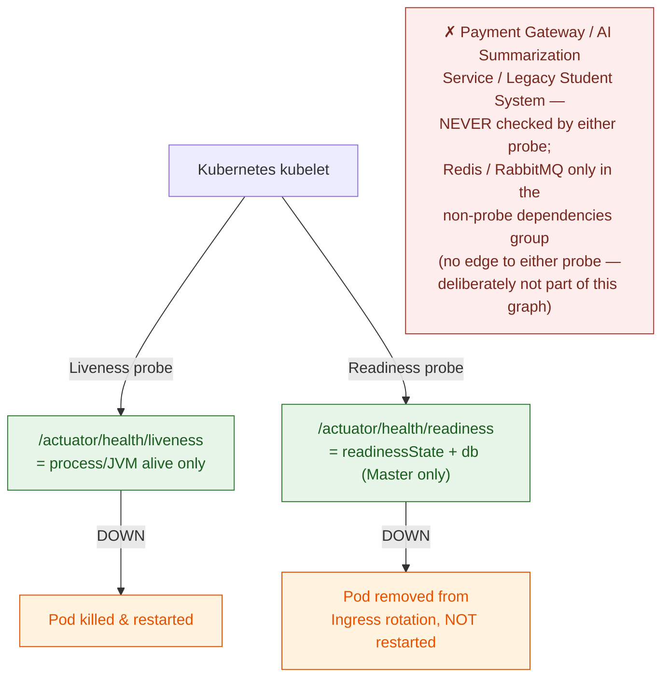

# Observability — Platform

This file is the physical-level completion of `architecture.md` §1.2/§2.2/§3 (the Observability Stack — Prometheus, Grafana, OpenTelemetry, cross-cutting every Backend API instance) and `docs/requirement.md` §3.1 (Observability Requirements) and §3.3 (Kubernetes health-probe requirements). Those sources establish *that* every request must carry a traceable Correlation ID, *that* distributed tracing and Prometheus metrics must exist, and *that* Kubernetes must self-heal via Liveness/Readiness probes — but stop short of header names, instrumentation mechanism, trace storage, concrete metric names, probe composition, and alert thresholds. Nothing in this file overrides `architecture.md`/`docs/requirement.md` — where they disagree, those documents are the authority and this file has a bug.

**Why this lives in `platform/`:** every module's every request and every consumer is observed by the same mechanism — this file cross-cuts all six business modules by nature, the same reason `auth-and-identity.md` and `messaging.md` do.

**Scope:** Correlation ID identity and its propagation across HTTP, RabbitMQ, and logs (§1); distributed tracing instrumentation, trace backend, and sampling (§2); the Prometheus metrics catalog, both Golden Signals and system-specific business metrics (§3–§4); Kubernetes Liveness/Readiness probe composition (§5); and a concrete alerting-threshold table (§6).

**Out of scope:** Audit Logging (`architecture.md` §5.5, already specified — a different question, "who did this," for a different audience, aimed at incident investigators rather than operators); the `paymentGateway` CircuitBreaker's own trip-threshold parameters (`../modules/payment.md`, already written — this file only exposes/monitors that state, it doesn't redefine it); the RabbitMQ exchange/queue/routing-key topology (`messaging.md`, already written — this file only adds monitoring on top of it); log aggregation/storage infrastructure (no ELK/Loki or equivalent is named anywhere in the project corpus — introducing one would be a new infrastructure decision this document does not make; logs remain structured JSON to container stdout, and whatever collects them at the cluster level is outside this document's scope); the GitHub Actions CI pipeline (`docs/requirement.md` §3.3, a separate physical-design concern — see `deployment-and-cicd.md`); JWT/auth mechanics (`auth-and-identity.md`, already written).

---

## Table of Contents

- [Architecture Decision Records (ADRs)](#architecture-decision-records-adrs)
  - [ADR Mini: Tracing Instrumentation Mechanism](#adr-mini-tracing-instrumentation-mechanism)
  - [ADR Mini: Correlation ID Identity](#adr-mini-correlation-id-identity)
  - [ADR Mini: Trace Backend](#adr-mini-trace-backend)
  - [ADR Mini: Alerting Rule Engine](#adr-mini-alerting-rule-engine)
  - [ADR Mini: Readiness Composition](#adr-mini-readiness-composition)
- [1. Correlation ID & Distributed Trace Propagation](#1-correlation-id-distributed-trace-propagation)
- [2. Distributed Tracing Wiring](#2-distributed-tracing-wiring)
- [3. Metrics Catalog — Golden Signals](#3-metrics-catalog-golden-signals)
- [4. Metrics Catalog — Custom Business/Domain Metrics](#4-metrics-catalog-custom-businessdomain-metrics)
- [5. Health Probes — Liveness & Readiness](#5-health-probes-liveness-readiness)
- [6. Alerting Rules Catalog](#6-alerting-rules-catalog)
- [7. Reference Table](#7-reference-table)

---

## Architecture Decision Records (ADRs)

The first four decisions below were reached through the `spec-driven-development` gated workflow (the fifth, Readiness Composition, was decided later, in a review of `docs/testing/non-functional/resilience-testing.md`, and is marked as such): 2–4 alternatives were explored with a trade-off matrix, the human made the call at the Phase 3 Decision Gate, and the reasoning was captured here verbatim rather than left to live only in `SPEC.md` (a working document for the next task, not a durable record). Every section from §1 onward specifies these four decisions in physical detail; this section is the permanent record of *why* they were chosen over their rejected alternatives.

### ADR Mini: Tracing Instrumentation Mechanism

**Context:** `docs/requirement.md` §3.1 requires distributed tracing across database queries, third-party API calls (Stripe/Momo), and RabbitMQ messages, integrated into the Spring Boot instances. `CLAUDE.md` fixes OpenTelemetry as the tracing technology but not the instrumentation mechanism. Two credible paths exist: an OpenTelemetry Java Agent (auto-instrumentation, no code changes, matching the SRS's literal wording "OpenTelemetry Agent") versus Micrometer Tracing with the OTel Bridge (Spring Boot 3's native observability path, sharing the same `ObservationRegistry` that also drives Actuator/Micrometer metrics).

**Decision:** Micrometer Tracing (`micrometer-tracing-bridge-otel`), built on Spring Boot 3's native Observation API — instrumenting `RestTemplate`/`WebClient`, `RabbitTemplate`/`@RabbitListener`, and JDBC access through the same `ObservationRegistry` used for Prometheus metrics — is the tracing instrumentation mechanism, not a separate OpenTelemetry Java Agent.

**Consequences:**
- Metrics and traces share one instrumentation point (`ObservationRegistry`) instead of two independently configured pipelines that could drift apart.
- No second artifact (a `-javaagent` jar) needs to be versioned and mounted into the container image or Kubernetes Deployment spec.
- `trace_id`/`span_id` reach the MDC automatically via Micrometer's `Slf4jMDCEventListener` — no custom MDC-population code required.

**Trade-offs accepted (user's own reasoning):** the OpenTelemetry Java Agent (zero code, and the literal reading of SRS §3.1's "OpenTelemetry Agent" wording) was rejected in favor of the idiomatic Spring Boot 3 path — avoiding JVM agent classloading/cold-start overhead precisely at the 12,000-concurrent-user registration peak (`docs/requirement.md` §1.4), and avoiding a second artifact to version and mount separately from the application jar.

### ADR Mini: Correlation ID Identity

**Context:** `docs/requirement.md` §3.1 requires a Correlation ID, tagged at the Ingress, propagated through every Spring Boot layer, through RabbitMQ, and into log output. With Micrometer Tracing already established as the instrumentation mechanism, every request already carries an OpenTelemetry Trace ID. Minting a second, independent correlation identifier alongside it would require every current and future RabbitMQ producer/consumer (five message kinds per `messaging.md` §2) to remember to propagate two separate IDs instead of one.

**Decision:** The OpenTelemetry Trace ID *is* the Correlation ID — one physical value, surfaced as the `X-Correlation-Id` HTTP header, the MDC `correlationId` key, and a mirrored RabbitMQ message header, with no second identifier minted anywhere in the system.

**Consequences:**
- A single value greps and searches identically across application logs, Grafana Tempo traces, and RabbitMQ message headers — an operator pastes one string into one search box.
- Any RabbitMQ consumer that participates in trace-context propagation (native to Micrometer's Spring AMQP Observation support) automatically carries the Correlation ID too, since they are the same field — nothing extra to remember when a sixth message kind is added later.

**Trade-offs accepted (user's own reasoning):** a fully independent, backend-format-agnostic UUID-based Correlation ID was rejected — it would require dual-propagation code at every RabbitMQ producer/consumer boundary, a documented source of "forgot the second field" bugs, to buy independence from the tracing backend's ID format that this project has no concrete need for.

### ADR Mini: Trace Backend

**Context:** `CLAUDE.md` and `architecture.md` §1.2/§2.2 name OpenTelemetry as the tracing technology and Grafana as the existing dashboard tool, but neither names a system of record for storing and querying traces once they're exported — a gap this document must close before "distributed tracing" is actually usable by an operator.

**Decision:** Grafana Tempo is the trace storage/query backend, wired in as a Grafana datasource; the Backend API exports traces via OTLP directly to Tempo.

**Consequences:**
- Operators query traces from the same Grafana instance already used for metric dashboards — no second UI to learn or context-switch into.
- Grafana Exemplars link a latency spike on a Prometheus panel directly to its originating trace in Tempo, which is precisely §3.1's stated goal of "fast identification of bottlenecks or failures."

**Trade-offs accepted (user's own reasoning):** Jaeger was rejected because it introduces its own standalone UI/query surface — a heavier-weight, more full-featured trace-analysis tool, but unnecessary operator-facing friction for a single-Grafana-pane PoC. Zipkin was rejected as a legacy, non-OTLP-native protocol that would need an extra exporter-translation step for no corresponding benefit here.

### ADR Mini: Alerting Rule Engine

**Context:** `docs/requirement.md` §3.1 requires a Grafana dashboard suite for the Organizing Committee/ops team to monitor system health, but names no alert-routing engine. `CLAUDE.md`'s Boundaries instruct against adding infrastructure components beyond what `architecture.md`/`proposal.md` specify, and no document in the corpus mentions Alertmanager, PagerDuty, Slack, or any on-call routing system.

**Decision:** Grafana's built-in Unified Alerting evaluates alert rules directly against Prometheus and Tempo data and dispatches notifications via Grafana Contact Points — no separate Alertmanager, or any other new pod, is introduced.

**Consequences:**
- Alerting reuses infrastructure already mandated (Grafana) rather than adding a new one to the cluster.
- Rule definitions and the dashboards they alert on live in one tool, keeping one mental model for the Organizing Committee/ops team audience §3.1 names.

**Trade-offs accepted (user's own reasoning):** Prometheus Alerting Rules paired with a dedicated Alertmanager — the conventional CNCF-native pairing, with dedupe/grouping/silencing features Grafana's own engine lacks — was rejected as disproportionate infrastructure for a PoC-scale, single-Grafana-instance deployment that `proposal.md` §5.2 already excludes from "real production cloud deployment."

### ADR Mini: Readiness Composition

**Context:** the first version of §5 put `readinessState` plus Spring Boot's auto-configured `db`, `redis` and `rabbit` `HealthIndicator`s in the Readiness group, on the stated basis that a pod unable to reach a dependency "correctly stops receiving traffic." Reviewing the fault-injection scenarios in `docs/testing/non-functional/resilience-testing.md` showed this contradicts the rest of the corpus. `architecture.md` §4.2 makes a Redis outage a *deliberate, partial* degradation — the cache falls through to the Replica, registration writes are rejected, scheduled jobs skip — not an outage of the service; `architecture.md` §4.3/§6.1 put RabbitMQ publication behind the transactional outbox precisely so a broker outage does not fail the request path. But Redis and RabbitMQ are each a single shared instance (`distributed-coordination.md` §1, `messaging.md` §1): when either is down it is down for every pod at once, so a Readiness check on it removes *all* pods from Ingress rotation simultaneously and turns the designed partial degradation into a total outage — the same cascade §5's own exclusion of third-party dependencies exists to prevent, one layer in. No text in this document argued for including them beyond their being auto-configured.

**Decision:** Readiness is `readinessState` plus `db` only, where `db` checks the **PostgreSQL Master** datasource. The `redis` and `rabbit` `HealthIndicator`s stay, but move out of the probe group into a separate, non-probe `dependencies` health group that reports them as `DEGRADED` (HTTP 200) when unreachable — visible on the health endpoint, never consulted by Kubernetes. Liveness is unchanged.

**Consequences:**
- A Redis or RabbitMQ outage no longer removes pods from rotation, so the behaviors in `distributed-coordination.md` §4 and `architecture.md` §4.2 are reachable *through the Ingress*, not only inside the application.
- PostgreSQL (Master) remains Readiness-critical: with no system of record there is nothing a pod can correctly serve.
- The Replica is not a Readiness condition. What happens when it is unreachable is not yet specified (`architecture.md` §4.1).

**Trade-offs accepted:**
- A single pod whose *own* connectivity to Redis or RabbitMQ is broken (a node-local network fault, not the shared instance) stays in rotation and answers registration writes with `503` + `Retry-After` while healthy pods would succeed; a client retry may reach a different pod. Accepted: for a shared-instance outage — the dominant case — ejecting on the check is strictly worse, and a per-pod partial failure is rarer.
- A Redis or RabbitMQ outage no longer produces a Kubernetes-visible symptom (NotReady pods), and no rule in §6 fires on it directly. **A compensating alert — on the `dependencies` group or an equivalent signal — is therefore required, and is an unmet precondition of Phase 7 sign-off (`docs/testing/strategy/test-plan.md` §1, P1). The rule and the metric behind it are not yet defined; naming them is this document's job (§4, §6).**

---

## 1. Correlation ID & Distributed Trace Propagation

**Rationale:** `docs/requirement.md` §3.1 requires a Correlation ID tagged at the Ingress and propagated through every processing layer, through RabbitMQ, and into log output, so "the entire processing flow of any given request can be traced even as it passes through multiple different components." Per the Correlation ID Identity ADR above, this section specifies one physical mechanism, not two parallel ones.

**Model — HTTP:**

| Element | Value | Why |
|---|---|---|
| Response/propagation header | `X-Correlation-Id` | Human-readable, greppable header name — distinct from the binary/hex `traceparent` header the mesh (`architecture.md` §5.4) already propagates for W3C trace-context, which exists for machine-to-machine linkage, not for an operator to paste into a log search box. |
| MDC key | `correlationId` | Populated by a `Filter` (`CorrelationIdFilter`) registered *after* Spring Boot Actuator's own tracing filter, so `Tracer.currentSpan()` is already resolved — whether this request continues an existing trace (propagated in via `traceparent` from an upstream mesh hop, `architecture.md` §5.4) or starts a new one, by the time this filter runs, a trace ID is guaranteed to exist. |
| Value | The current span's OpenTelemetry Trace ID (32-character hex) | Per the Correlation ID Identity ADR — no separate UUID is generated. |
| On response | The same value is echoed back as the `X-Correlation-Id` response header | Lets a client (or a support engineer working from a bug report) hand the operator one string to search for. |

**Model — RabbitMQ (all five queues, `messaging.md` §2):**

- **Trace-context propagation** (the `traceparent` header itself) is automatic — Micrometer Tracing's Spring AMQP Observation support (native to Spring Boot 3.x + Spring AMQP 3.x once `micrometer-tracing-bridge-otel` is on the classpath, per the Tracing Instrumentation Mechanism ADR) instruments both `RabbitTemplate.send()` and `@RabbitListener` containers, so a message published from a request that is part of trace `T` continues trace `T` when consumed, with zero application code.
- **The plain `correlationId` header is mirrored explicitly on top of that**, for the same reason the HTTP side uses a plain header instead of asking an operator to decode `traceparent` by hand:
  - **Producer side:** a `MessagePostProcessor` that copies `MDC.get("correlationId")` into a `correlationId` message header is registered **once**, globally, via `rabbitTemplate.setBeforePublishPostProcessors(...)` on the single shared `RabbitTemplate` bean — not passed manually at each of the five publish points (`messaging.md` §2). This is deliberate: manually attaching the post-processor at every call site would reintroduce the exact "forgot to propagate at the Nth call site" bug class the Correlation ID Identity ADR rejected a dual-ID scheme to avoid — a future sixth message kind gets the header automatically, with no new wiring to remember.
  - **Consumer side:** a shared `@RabbitListener` advice (a `MethodInterceptor`/AOP aspect applied uniformly, not duplicated per listener method) reads the `correlationId` header at message entry, calls `MDC.put("correlationId", ...)` before invoking the listener's business logic, and `MDC.remove("correlationId")` in a `finally` block — the `finally` is required because `@RabbitListener` containers run on a pooled thread; without an explicit clear, a stale `correlationId` from one message could leak into the log lines of the *next*, unrelated message processed on the same reused thread.
- **Across the transactional outbox:** the four outbox-backed message kinds are not published inside the originating request. The outbox relay publishes them later, from its own scheduled cycle (`messaging.md` §5). The request's correlation id is therefore captured into `event_publications.correlation_id` when the row is written (`database-schema.md` §8.2). Before publishing each row, the relay puts that stored value back into the MDC, so the same global post-processor above writes it into the `correlationId` header, and clears it in `finally`. **Consequence:** the correlation id — and so the log trail — stays continuous from request to consumer. The *trace* does not: the relay's publish belongs to the relay's trace, not the request's, so Grafana Tempo shows the request and the consumer as two traces linked by the same `correlationId`. Only the audit message kind (`messaging.md` §3) is published inside the request and keeps a single continuous trace.

```mermaid
flowchart LR
    Ingress["Ingress /\nMesh sidecar\n(architecture.md §5.4)"] -->|"traceparent (if continuing\nan existing trace)"| Filter["CorrelationIdFilter\n(runs after tracing filter)"]
    Filter -->|"MDC.put(correlationId,\ncurrent traceId)"| Business["Business logic\n(logs carry correlationId)"]
    Business -->|"X-Correlation-Id echoed"| Response["HTTP Response"]
    Business -->|"MessagePostProcessor:\nmirror correlationId header"| Publish["RabbitTemplate publish\n(any of 5 queues, messaging.md §2)"]
    Publish -->|"traceparent (automatic,\nMicrometer AMQP Observation)\n+ correlationId (mirrored header)"| Consume["@RabbitListener\n+ shared advice"]
    Consume -->|"MDC.put(correlationId,\nheader value); finally: MDC.remove"| ConsumerLogic["Consumer business logic\n(logs carry same correlationId)"]

    classDef edgeStyle fill:#E8F5E9,stroke:#2E7D32,color:#1B5E20
    classDef appStyle fill:#FFF3E0,stroke:#E65100,color:#E65100
    classDef brokerStyle fill:#FCE4EC,stroke:#AD1457,color:#880E4F

    class Ingress,Response edgeStyle
    class Filter,Business,Consume,ConsumerLogic appStyle
    class Publish brokerStyle
```



**Trade-off — thread-pool MDC leakage is a real risk, closed by discipline, not by a framework guarantee:** Spring's `@RabbitListener` containers reuse a fixed thread pool; any consumer path that returns *without* going through the shared advice's `finally` block (e.g. a hand-rolled listener that bypasses the shared base) risks leaking one message's `correlationId` into the next message's logs on that same thread. This document specifies the shared-advice pattern specifically so this is enforced once, centrally, rather than repeated (and potentially forgotten) in five separate listener implementations.

**Guarantees:** every log line, trace span, and RabbitMQ message tied to one end-to-end workflow — an HTTP request and everything it triggers asynchronously — carries the identical `correlationId` value, with no second identifier to keep in sync.

---

## 2. Distributed Tracing Wiring

**Rationale:** `docs/requirement.md` §3.1 requires automatic trace collection for database queries, third-party API calls, and RabbitMQ messages. Per the Tracing Instrumentation Mechanism and Trace Backend ADRs above, this section turns those into a concrete dependency list, export target, and sampling policy.

**Model — dependencies:**

| Dependency | Purpose |
|---|---|
| `micrometer-tracing-bridge-otel` | Bridges the Micrometer `Observation` API (also used for metrics, `management.metrics.*`) to the OpenTelemetry SDK, so every instrumented operation produces both a span and a metric from one instrumentation point. |
| `io.opentelemetry:opentelemetry-exporter-otlp` | Ships completed spans via OTLP to Grafana Tempo (Trace Backend ADR). |
| A JDBC-Observation add-on (the community-standard `datasource-micrometer` integration, wrapping the Hikari `DataSource`) | **Required, not optional.** Spring Boot 3's native Observation auto-configuration instruments HTTP clients (`RestTemplate`/`WebClient`) and Spring AMQP (`RabbitTemplate`/`@RabbitListener`) out of the box, but **not** raw JDBC/JPA statement execution. Without this add-on, `docs/requirement.md` §3.1's explicit requirement to trace "database queries" would silently go unmet even though every other instrumentation point works. |
| `micrometer-registry-prometheus` | Already required for `/actuator/prometheus` (§3–§4 below). This is a `MeterRegistry`, not itself part of the `ObservationRegistry` contract — the actual sharing is that every `Observation` recorded through the one `ObservationRegistry` is published, via a registered `ObservationHandler`, both as a span (to the OTel/Tempo pipeline above) and as a metric into this `MeterRegistry` — one instrumentation call, two outputs. |

**Model — export configuration:**

```properties
management.otlp.tracing.endpoint=http://tempo:4318/v1/traces
management.tracing.sampling.probability=0.10
```

**Model — trace retention:** Tempo's local block storage retains trace data for **2 days**, configured via its compactor (`compaction.block_retention: 48h`). Every other durable store in this project's technical-design corpus states an explicit retention decision (Redis TTLs in `distributed-coordination.md` §5, `audit_events`/`legacy_sync_runs` kept indefinitely per `database-schema.md` §6.3 and `../modules/user.md`) — Tempo is no exception. 2 days is sized for the PoC's own operating rhythm: long enough to investigate an incident discovered a day or two after it happened, short enough to bound local-disk growth on the Minikube node without needing a remote object-storage backend (S3/GCS) for Tempo — a second use of object storage this project's single-managed-cloud-dependency framing (`proposal.md` §5.2) does not call for. Metrics (§3–§4) and Grafana dashboards remain the durable long-term signal; traces are a short-lived diagnostic aid, not a permanent record — that split of responsibility is deliberate, not a gap.

**Model — sampling:** a head-based `ParentBased(TraceIdRatioBased(0.10))` sampler — the Micrometer Tracing/OTel SDK default composition. "Parent-based" means once a trace is sampled (whether the decision was made here or upstream at a mesh hop, `architecture.md` §5.4), every span within that same trace is sampled too — a trace is never fragmented partway through by an inconsistent per-span decision. 10% is a starting value sized for the 12,000-concurrent-user registration peak (`docs/requirement.md` §1.4): high enough to be statistically representative of latency/bottleneck patterns during a spike, low enough to bound Tempo's storage and OTLP network overhead at that volume.

**Model — sensitive-data guardrail:** span/trace instrumentation is opt-in about *what* it captures, not just *whether* it runs, and this system's traffic includes JWT bearer tokens, payment amounts, and student PII — none of which belong in a trace exported to Tempo. Concretely:

| Guardrail | Value | Why |
|---|---|---|
| HTTP request/response detail capture | Left at its Spring Boot 3 default — **disabled** (`server.reactive.session`/`management.observations.http.server.requests.*` header-and-body capture options are never turned on) | The default Observation-based HTTP instrumentation records method, URI template, status, and duration — never headers or body content — unless a future change explicitly opts in. The `Authorization` header (carrying the JWT, `auth-and-identity.md` §3) and any request body (registration/payment payloads) must never become span attributes. |
| JDBC statement capture | SQL text only, via the JDBC-Observation add-on (§2 dependency table) — **bind parameter values are never captured** | A parameterized SQL statement's shape is useful for spotting a slow query; the literal values bound into it can be a student's email, a payment amount, or other PII — capturing text only, never values, keeps that data out of Tempo entirely. |
| Payment Gateway call spans | Span attributes limited to outcome (success/failure/timeout) and duration — no request/response body attributes | The Payment Module's call to Stripe (`../modules/payment.md`) carries amount and gateway transaction detail; none of it needs to appear on the span for the tracing goal (bottleneck/failure diagnosis) to be met. |

**This guardrail is a default posture, not a one-time check.** Any future change that turns on header, body, or parameter-value capture "for easier debugging" is a re-open of this guardrail, not a harmless config tweak — it must be re-evaluated against what's riding in that data before being enabled.

**Trade-off — uniform sampling does not guarantee a full trace exists for every individual error:** achieving "always capture a trace when something goes wrong" would require *tail*-based sampling — deciding whether to keep a trace only after it completes and its outcome is known — which in the OpenTelemetry ecosystem is implemented by a `tail_sampling` processor running inside an OpenTelemetry Collector sitting between the application and Tempo. This document does not introduce a Collector; doing so would be a new infrastructure component beyond what any ADR above decided, for a refinement the SRS does not explicitly require. This gap is accepted, not silently absorbed: error **visibility** does not actually depend on trace sampling at all — the Golden-Signals error-count metric (§3) is recorded for *every* request regardless of whether its trace was sampled, and Grafana Alerting (§6) fires on that metric. An operator is alerted to a 5xx spike whether or not the specific failing request happened to be one of the sampled 10%; the sampled traces exist for representative performance investigation, not as a promise of exhaustive per-error forensics. A tail-sampling Collector is a reasonable future revisit if real incidents show this gap actually mattering, not something to pre-build now.

**Guarantees:** every HTTP request, JDBC statement, third-party call (Stripe sandbox, AI Summarization Service), and RabbitMQ publish/consume that occurs within a sampled trace produces a span exported to Grafana Tempo — visible from the same Grafana instance used for metric dashboards, linkable from a latency panel via Exemplars.

---

## 3. Metrics Catalog — Golden Signals

**Rationale:** `docs/requirement.md` §3.1 requires Actuator-exposed operational metrics — JVM memory, CPU, active database connections, request latency, RabbitMQ queue depth — scraped by Prometheus. This section maps that requirement onto the four Golden Signals (Latency, Traffic, Errors, Saturation), naming the real Micrometer/Actuator metric each one is backed by.

**Model:**

| Signal | Metric (Micrometer name → Prometheus name) | Type | Notes |
|---|---|---|---|
| **Latency** | `http.server.requests` → `http_server_requests_seconds` | Timer (histogram) | Requires `management.metrics.distribution.percentiles-histogram.http.server.requests=true` so Prometheus can compute a cross-pod `histogram_quantile(0.95, ...)` — a client-side-computed percentile (Micrometer's `.percentiles()` option) cannot be aggregated across the ≥2 parallel Backend API pods (`docs/requirement.md` §3.3) the way a histogram bucket can. |
| **Traffic** | Same metric, count | `sum(rate(http_server_requests_seconds_count[1m]))` | Requests/sec across all pods, tagged by `uri`/`method`. |
| **Errors** | Same metric, filtered | `sum(rate(http_server_requests_seconds_count{status=~"5.."}[5m])) / sum(rate(http_server_requests_seconds_count[5m]))` | 5xx ratio — the numerator/denominator pair the alerting rule in §6 evaluates. |
| **Saturation — DB pool** | `hikaricp.connections.active` / `hikaricp.connections.max` / `hikaricp.connections.pending` → `hikaricp_connections_*` | Gauge | Requests queued waiting for a pool connection (`pending > 0` sustained) is an early warning of DB-side saturation before it shows up as latency. |
| **Saturation — JVM heap** | `jvm.memory.used` / `jvm.memory.max` → `jvm_memory_used_bytes` / `jvm_memory_max_bytes` | Gauge | Tagged by `area="heap"` / `id`. |
| **Saturation — CPU** | `system.cpu.usage`, `process.cpu.usage` → `system_cpu_usage`, `process_cpu_usage` | Gauge | Host-level vs. JVM-process-level CPU, both exposed by Actuator natively. |

**Guarantees:** every metric in this table is exposed via `/actuator/prometheus` without any custom instrumentation code — all four are either Spring Boot Actuator defaults or a one-line configuration property, matching `docs/requirement.md` §3.1's own named list (JVM memory, CPU, active DB connections, request latency) exactly.

---

## 4. Metrics Catalog — Custom Business/Domain Metrics

**Rationale:** `docs/requirement.md` §3.1's named list is generic infrastructure health; it does not by itself surface this system's own correctness-critical state — an open payment circuit, a backing-up queue, a stuck outbox relay. This section names the metrics an implementer must add, and precisely what each one is (and is not) sourced from.

**Model:**

| Metric | Type | Source | Backs |
|---|---|---|---|
| `unihub_registration_active_holds` | Gauge | `SELECT COUNT(*) FROM registrations WHERE status = 'RESERVED'` (`database-schema.md` §4.1, served by the existing partial index `idx_registrations_reserved_hold`), bound to a Micrometer `Gauge` — **debounced, not queried live on every scrape** (see below) | Visibility into seat-hold pressure during a registration spike. **Explicitly not** sourced from the Redis `unihub:lock:seat:{workshopId}` key (`../modules/registration.md`) — that lock is a ~5-second mutual-exclusion primitive around a single write, not the 15-minute hold itself; conflating the two would report a number close to zero at almost every scrape regardless of actual hold pressure. |
| `resilience4j.circuitbreaker.state` → `resilience4j_circuitbreaker_state{name="paymentGateway", state=...}` | Gauge (native, via `resilience4j-micrometer`) | The shared `paymentGateway` CircuitBreaker registry entry (`../modules/payment.md`) | Direct visibility into `CLOSED`/`OPEN`/`HALF_OPEN` state — no custom code, since Resilience4j's own Micrometer binder emits this automatically once the dependency is on the classpath. |
| `rabbitmq_queue_messages_ready{queue=...}` / `rabbitmq_queue_messages_unacknowledged{queue=...}` | Gauge (native, broker-side) | RabbitMQ's own `rabbitmq_prometheus` plugin, enabled on the broker (`rabbitmq-plugins enable rabbitmq_prometheus`) and scraped by Prometheus as its **own** target (the broker's port 15692, not through the Backend API) | Per-queue depth/lag for every queue named in `messaging.md` §2, **including `unihub.parking-lot`**. Chosen over standing up a separate `rabbitmq_exporter` container — the plugin is native to the broker already deployed, so this adds a scrape target, not a new component. |
| `unihub_legacy_sync_last_run_quarantine_ratio` | Gauge, range 0.0–1.0 | Set once per nightly cycle by the sync job itself — `rows_quarantined / rows_processed` from that run's `legacy_sync_runs` row (`../modules/user.md`) — at the moment the run completes | A precomputed ratio avoids both a fragile PromQL query against a table that only changes once a day and a divide-by-zero when `rows_processed = 0`. |
| `unihub_outbox_oldest_pending_age_seconds` | Gauge | `SELECT EXTRACT(EPOCH FROM (now() - MIN(created_at))) FROM event_publications WHERE status = 'PENDING'` (`database-schema.md` §8.2, served by `idx_event_publications_pending`) — **debounced** (see below) | **Age, not count, is the correct signal.** A handful of `PENDING` rows mid-flight between commit and the relay's next publish cycle is normal and expected; a *growing* age means the outbox relay itself has stalled — directly protecting the transactional-outbox Non-Negotiable Invariant (`CLAUDE.md`) by making a silent relay failure visible instead of invisible. |
| `unihub_postgres_replica_lag_seconds` | Gauge | `SELECT EXTRACT(EPOCH FROM (now() - pg_last_xact_replay_timestamp()))`, run against the Replica connection (`architecture.md` §4.1) — **debounced** (see below) | Flags read-path staleness (a stale seat-count or catalog read served from a lagging Replica) before a symptom is reported rather than after. Chosen as a scheduled application-level query over standing up `postgres_exporter` — same no-new-external-component posture as the RabbitMQ plugin choice above. |
| `unihub_seat_claim_version_conflicts_total` | Counter | Incremented by the seat-claim use case each time an attempt loses the `workshops.version` race (`../modules/registration.md` §2) | Phase 8 revisit of the shared `workshops.version` decision (`database-schema.md` §3.1, Phase 2 checklist D3) |
| `unihub_seat_claim_retries_exhausted_total` | Counter | Incremented when all 3 attempts lost the race and the request got `503` | Same; revisit if > 0.1% of seat claims at the 12,000-user peak |
| `unihub_workshop_edit_conflicts_total` | Counter | Incremented when an organizer edit is refused by the version check | Same; revisit if > 5% of edits during the peak |
| `unihub_audit_publish_failures_total` | Counter | Incremented by the `AuditTrail` adapter for every audit event it failed to record — the logging adapter in Phase 2, the publishing adapter from Phase 6 (`../../guidelines/backend-coding-standards.md` §12) | INV-14's "the audit-publish failure itself must surface" (`architecture.md` §5.5) — the metric exists from Phase 2 (checklist D6, C32); its alert rule and the INV-14 test remain Phase 6 (M-55) |

**Model — debounce for the three DB-backed Gauges:** `unihub_registration_active_holds`, `unihub_outbox_oldest_pending_age_seconds`, and `unihub_postgres_replica_lag_seconds` are the three metrics in this catalog that run a live SQL query rather than reading already-in-memory state (Resilience4j's own binder, or the RabbitMQ broker's own plugin). A Prometheus scrape naturally hits every pod independently and on a short interval (commonly 15s) — without a cache, that's 3 extra live queries per pod per scrape cycle landing on PostgreSQL, redundant across pods since all three read cluster-wide state, not anything pod-local. Each of the three is wrapped by a small in-memory cache (e.g. a single-entry Caffeine cache, one per metric, `expireAfterWrite` **10 seconds**) so a burst of near-simultaneous scrapes across pods collapses to at most one real query per 10-second window per metric, cluster-wide query volume included. 10 seconds is short enough that none of these three signals — seat-hold pressure, outbox-relay staleness, replica lag — is materially less useful for the alerting thresholds in §6 (all of which evaluate over a 5-minute window or longer) than a live-every-scrape read would be, and it directly protects PostgreSQL from exactly the kind of avoidable extra load this document should not itself be introducing during the 12,000-concurrent-user peak (`docs/requirement.md` §1.4) it exists to help operators watch over.

**Guarantees:** every correctness-critical piece of state this system depends on that isn't already visible through a generic infrastructure metric — seat-hold pressure, circuit-breaker state, queue backlog including the terminal parking lot, sync data quality, outbox-relay health, and replication currency — has exactly one, precisely-sourced metric backing it.

---

## 5. Health Probes — Liveness & Readiness

**Rationale:** `docs/requirement.md` §3.3 requires Kubernetes Liveness and Readiness Probes for self-healing across at least 2 parallel Spring Boot Pods. `architecture.md` §1.4 and `CLAUDE.md`'s Non-Negotiable Invariants require that a Payment Gateway (or other external dependency) outage never cascades beyond the functionality that actually depends on it — this section makes clear that Readiness composition is where that guarantee would be violated if built carelessly — for third-party dependencies, and equally for shared in-cluster dependencies whose outage is designed to degrade the service rather than stop it (Readiness Composition ADR above).

**Model:**

```properties
management.endpoint.health.probes.enabled=true
management.health.livenessState.enabled=true
management.health.readinessState.enabled=true
management.endpoint.health.group.readiness.include=readinessState,db
management.endpoint.health.group.dependencies.include=redis,rabbit
```

| Probe | Composition | Kubernetes effect on failure |
|---|---|---|
| **Liveness** (`/actuator/health/liveness`) | Process/JVM/Spring-context health only — the `livenessState` indicator, with **no** downstream dependency checks | Pod is killed and restarted. |
| **Readiness** (`/actuator/health/readiness`) | `readinessState` plus Spring Boot's built-in `db` `HealthIndicator`, scoped to the PostgreSQL **Master** datasource only (Readiness Composition ADR) | Pod is removed from the Ingress load-balancing rotation — traffic stops routing to it — **without** being restarted. |
| **Dependencies** (`/actuator/health/dependencies`) — *not a probe* | The `redis` and `rabbit` `HealthIndicator`s, reported as `DEGRADED` when unreachable | None — Kubernetes never consults it. Informational only. |

**Explicitly excluded from Readiness:** Payment Gateway, AI Summarization Service, and the Legacy Student Management System — no `HealthIndicator` is written for any of them, and none is ever added to the `readiness` group above — and, per the Readiness Composition ADR, Redis and RabbitMQ: their indicators exist but sit in the non-probe `dependencies` group.

**Model — the `dependencies` group:** Spring Boot's own `redis`/`rabbit` indicators report a raw `DOWN`. A thin `HealthContributor` wrapper maps that to a custom `DEGRADED` status, and the group's `status.http-mapping` returns `200` for it, so an unreachable Redis or RabbitMQ is visible on the health endpoint without ever failing a probe. This is an implementation note, not a new component; verify the exact property names against the pinned Spring Boot version.



**Why the exclusion matters, concretely:** if Readiness included Payment Gateway health, a sandbox Payment Gateway outage — already isolated by the shared `paymentGateway` CircuitBreaker (`../modules/payment.md`) so that only paid-checkout and reconciliation are affected — would additionally mark **every** Backend API pod `NotReady`, removing all of them from the Ingress rotation simultaneously. An isolated, payment-only degradation would turn into a total site outage: browsing, free-ticket registration, and check-in would all stop being served, purely because of how the probe was wired, not because any of those paths actually depend on the Payment Gateway. This is exactly the cascade `architecture.md` §1.4 exists to prevent, applied to the Kubernetes layer instead of the application layer.

**Trade-off — Liveness deliberately cannot detect "the app is up but its data layer is unreachable":** a pod that is technically alive but cannot reach the PostgreSQL Master will fail Readiness (correctly stops receiving traffic) but keep passing Liveness (correctly stays running, not restarted). This is intentional, not an oversight: restarting a pod does nothing to fix an external PostgreSQL outage, and including dependency checks in Liveness would risk a **restart storm** — every pod simultaneously failing Liveness and restarting at once during a shared-dependency blip, compounding the outage instead of isolating it. Redis and RabbitMQ are deliberately *not* in this trade-off at all: their outage is a designed degradation (Readiness Composition ADR), so pods stay in rotation and the `dependencies` group reports `DEGRADED`.

**Guarantees:** a pod that cannot reach the PostgreSQL Master is taken out of traffic rotation without being needlessly restarted; a Redis or RabbitMQ outage never removes a pod from rotation, and its designed fail-closed/fail-open behaviors (`distributed-coordination.md` §4) are what callers experience; a pod that is fundamentally broken (deadlocked, out of memory) is restarted regardless of the state of any external dependency; no external third-party dependency's availability ever determines whether a Backend API pod can serve *any* traffic.

---

## 6. Alerting Rules Catalog

**Rationale:** per the Alerting Rule Engine ADR above, Grafana Unified Alerting evaluates the rules below directly against Prometheus (and, where noted, is itself the mechanism — no Alertmanager exists in this topology to route or deduplicate them). Every threshold below is a confirmed starting value, not load-tested against real traffic — consistent with the "starting value, revisit once real numbers are known" posture already used in `../modules/user.md` and `distributed-coordination.md` §1.

**Model:**

| Metric | Condition | Duration | Severity | Backs |
|---|---|---|---|---|
| `http_server_requests_seconds` (p95) | > 500ms | 5m | Warning | Early lead indicator ahead of the Critical threshold below. |
| `http_server_requests_seconds` (p95) | > 2s | 5m | **Critical** | `docs/requirement.md` §1.4's 12,000-concurrent-user peak — a sustained 2s p95 means checkout UX is degrading under load. |
| 5xx error ratio (§3) | > 1% | 5m | Warning | Early signal of a developing failure before it becomes widespread. |
| 5xx error ratio (§3) | > 5% | 5m | **Critical** | A meaningfully broad share of requests are failing. |
| `resilience4j_circuitbreaker_state{name="paymentGateway", state="OPEN"}` | == 1, sustained | 1m | **Critical** | The shared breaker (`../modules/payment.md`) has been open long enough that this is not a transient blip — an operator should know payment is currently degraded. Tag value is uppercase (`OPEN`, not `open`) — verify against the pinned `resilience4j-micrometer` version, since it mirrors `CircuitBreaker.State`'s enum name verbatim. |
| `rabbitmq_queue_messages_ready{queue="unihub.parking-lot"}` | > 0 | `for: 0s` (fires on the first evaluation, no sustained-duration wait) | **Critical** | Any message here already exhausted all 3 retries (`messaging.md` §4) — it is not "developing," it is already a terminal, human-actionable failure the moment it appears. |
| `rabbitmq_queue_messages_ready` (any business queue) | > 1,000 | 5m | Warning | Consumer lag developing behind producers. |
| `rabbitmq_queue_messages_ready` (any business queue) | > 5,000 | 5m | **Critical** | Consumer lag has become severe. |
| `unihub_legacy_sync_last_run_quarantine_ratio` | > 0.05 (5%) | `for: 0s` (the Gauge only changes once per nightly cycle, §4 — no sustained-duration wait applies to a value that static) | Warning | `../modules/user.md` — an unusually large fraction of one night's export needed quarantining, worth a human look at the source data. |
| `unihub_postgres_replica_lag_seconds` | > 10s | 5m | Warning | Read-path staleness risk (`architecture.md` §4.1). |
| `jvm_memory_used_bytes / jvm_memory_max_bytes` (heap) | > 0.85 | 5m | Warning | Approaching heap exhaustion before it manifests as GC pauses or an `OutOfMemoryError`. |

**Guarantees:** every threshold above evaluates against a metric named concretely in §3/§4 — none references a metric this document doesn't itself define — and every rule is defined and notified entirely within Grafana's built-in alerting engine, with no Alertmanager or other new pod introduced into the cluster.

---

## 7. Reference Table

Every header name, MDC key, dependency, metric name, and threshold decided in this document, in one place — the same purpose the closing tables in `database-schema.md` §11, `distributed-coordination.md` §5, `messaging.md` §6, `auth-and-identity.md` §6, and each `../modules/*.md` file serve for their own documents.

| Item | Value | Backs |
|---|---|---|
| Correlation ID identity | The OpenTelemetry Trace ID — no second, independent ID | Single-value searchability across logs/traces/messages (Correlation ID Identity ADR) |
| HTTP header | `X-Correlation-Id` | Human-readable propagation/echo header, distinct from binary `traceparent` |
| MDC key | `correlationId` | Structured-log field on every log line |
| RabbitMQ propagation | `traceparent` — automatic (Micrometer AMQP Observation); `correlationId` — mirrored via one `MessagePostProcessor` registered globally on the shared `RabbitTemplate` (`setBeforePublishPostProcessors`, producer) / shared listener advice with `finally`-block MDC clear (consumer) | Trace continuity + human-readable header across all five queues, with no per-call-site wiring (`messaging.md` §2) |
| Tracing instrumentation | Micrometer Tracing (`micrometer-tracing-bridge-otel`), not an OTel Java Agent | Tracing Instrumentation Mechanism ADR |
| JDBC tracing add-on | `datasource-micrometer` (community-standard) | Only mechanism that actually satisfies `docs/requirement.md` §3.1's "trace database queries" under the Micrometer Tracing path |
| Trace backend | Grafana Tempo, OTLP export from Backend API | Trace Backend ADR |
| Trace retention | Tempo local block storage, **2 days** (`compaction.block_retention: 48h`) | Bounded local-disk growth on the PoC's Minikube node; no second object-storage integration needed |
| Trace sampling | Head-based `ParentBased(TraceIdRatioBased(0.10))` | 10% baseline; error visibility guaranteed instead via always-on metrics (§2 Trade-off) |
| Trace data guardrail | HTTP header/body capture off by default; JDBC captures SQL text only, never bind-parameter values; Payment Gateway spans carry outcome/duration only | Keeps JWT bearer tokens, payment amounts, and student PII out of spans exported to Tempo (§2) |
| DB-backed Gauge debounce | `unihub_registration_active_holds`, `unihub_outbox_oldest_pending_age_seconds`, `unihub_postgres_replica_lag_seconds` each cached **10s** (`expireAfterWrite`) | Caps live-query volume against PostgreSQL across all pods/scrapes (§4) |
| Golden Signals — Latency | `http_server_requests_seconds` histogram | `docs/requirement.md` §3.1 |
| Golden Signals — Traffic | `http_server_requests_seconds_count` rate | `docs/requirement.md` §3.1 |
| Golden Signals — Errors | `http_server_requests_seconds_count{status=~"5.."}` ratio | `docs/requirement.md` §3.1 |
| Golden Signals — Saturation | `hikaricp_connections_*`, `jvm_memory_*_bytes`, `system_cpu_usage`/`process_cpu_usage` | `docs/requirement.md` §3.1 |
| Active ticket holds | `unihub_registration_active_holds` (Gauge, `registrations.status='RESERVED'`) | Seat-hold pressure visibility — not the Redis seat-lock |
| Circuit breaker state | `resilience4j_circuitbreaker_state{name="paymentGateway"}` | `../modules/payment.md` |
| RabbitMQ queue depth/lag | `rabbitmq_queue_messages_ready` / `_unacknowledged`, via native `rabbitmq_prometheus` plugin | `messaging.md` §2, incl. `unihub.parking-lot` |
| Legacy sync quarantine | `unihub_legacy_sync_last_run_quarantine_ratio` (Gauge, 0.0–1.0) | `../modules/user.md` |
| Outbox relay health | `unihub_outbox_oldest_pending_age_seconds` (Gauge) | Transactional-outbox Non-Negotiable Invariant (`CLAUDE.md`) |
| Replica lag | `unihub_postgres_replica_lag_seconds` (Gauge) | `architecture.md` §4.1 |
| Liveness probe | `/actuator/health/liveness` — process only, no dependency checks | Avoids restart storms on a shared-dependency blip |
| Readiness probe | `/actuator/health/readiness` — `readinessState` + `db` (PostgreSQL Master only) | Self-healing without cascading an external or shared-dependency outage (Readiness Composition ADR) |
| Dependency health group | `/actuator/health/dependencies` — `redis` + `rabbit`, reported `DEGRADED`, never a probe | Visibility of a designed degradation without ejecting pods |
| Readiness exclusions | Payment Gateway, AI Summarization Service, Legacy Student Management System (no indicator at all); Redis, RabbitMQ, the Replica (not in Readiness) | Fault-isolation invariant (`architecture.md` §1.4, `CLAUDE.md`); designed degradation (`architecture.md` §4.2, §4.3) |
| Alert: p95 latency | Warning > 500ms / **Critical > 2s**, 5m | `docs/requirement.md` §1.4 |
| Alert: 5xx error rate | Warning > 1% / **Critical > 5%**, 5m | — |
| Alert: `paymentGateway` breaker OPEN | **Critical**, sustained 1m | `../modules/payment.md` |
| Alert: `unihub.parking-lot` depth | **Critical**, > 0, immediate | `messaging.md` §4 |
| Alert: business queue lag | Warning > 1,000 / **Critical > 5,000**, 5m | `messaging.md` §2 |
| Alert: legacy sync quarantine ratio | Warning > 5%, per run | `../modules/user.md` |
| Alert: replica lag | Warning > 10s, 5m | `architecture.md` §4.1 |
| Alert: JVM heap | Warning > 85%, 5m | — |
| Alerting engine | Grafana Unified Alerting — **no Alertmanager** | Alerting Rule Engine ADR |
